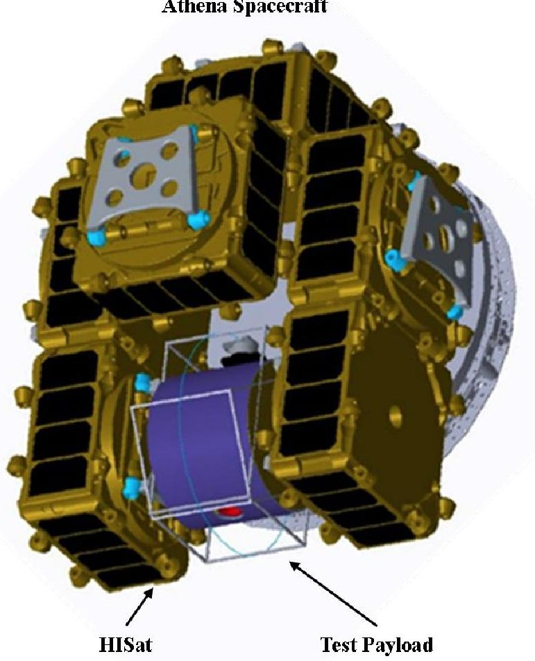
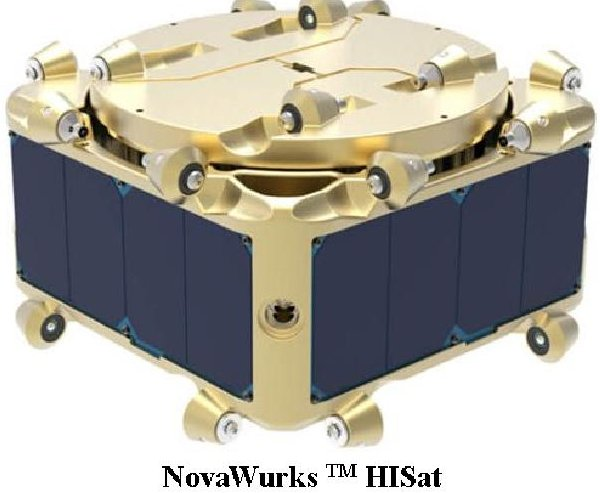
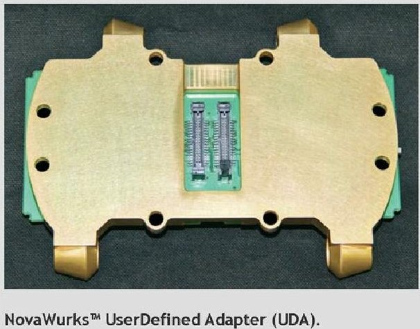
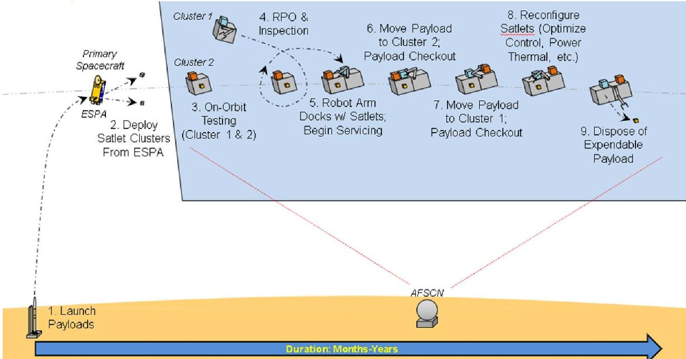
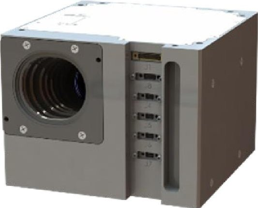

<!-- PDF_PAGE: 1 -->

# Using Small Satellites to Construct an In-Space Test Platform for Risk Reduction

Elozor Plotke, $ ^{1} $ and Peter C. Lai $ ^{2} $

LinQuest Corporation, El Segundo, California, 90245, USA

Roberta M. Ewart $ ^{3} $

US Space Force, El Segundo, California, 90245, USA

To overcome the technical readiness levels (TRL) 4-7 "Valley of Death" and accelerate new technology development, the US Space Force (USSF) started an in-Space Developmental Test (iSDT) initiative with its instantiation of a persistent iSDT platform called the Advanced Space-Based Testbed (XST). For risk-reduction, a scaled-down Mini-XST is proposed for proof-of-concept. Its key space systems include the spacecraft bus, test payloads, tender servicer to deliver test payload to the Mini-XST spacecraft, and robotic servicer to attach test payloads to the Mini-XST platform. In this paper, the proposed Mini-XST taking advantage of recent proliferated small satellite technologies as well as standard interface to support its successful operation will be discussed and illustrated.

## I. Introduction

The US Space Force (USSF) started an in-Space Developmental Test (iSDT) initiative a few years ago to accelerate new technology development by a factor of 10, overcome the technical readiness levels (TRL) 4-7 "Valley of Death", and reduce acquisition cost [1]. iSDT is expected to enable space research and development of key innovative and game-changing space technologies, and as a result, to forward the U.S. space priorities and technology vision. This iSDT initiative is crucial in supporting U.S. National interest in forwarding rapid development of space technologies. As indicated in the memo published by the Office of the Under Secretary of Defense for Research and Engineering (OUSD(R&E)) [2], in an era of competition and threats to our U.S. National space assets it is essential to accelerate the development of advanced materials, trusted artificial intelligence (AI) and autonomy, microelectronics, processors and data storage technologies, energy generation and battery storage, integrated sensing and cyber. The developments of iSDT are also consistent with the "In-Space Servicing, Assembly, and Manufacturing National Strategy" [3] and the "United States Space Priorities Framework" [4], both recently published by the White House, as well as the "Space Test Enterprise Vision" [5], which addresses the need to develop not only the organic expertise, but also the government-owned test infrastructure in order to deliver credible warfighting capabilities on operationally relevant timelines.

The realization form of an iSDT persistent platform is called the Advanced Space-Based Testbed (XST). XST is unmanned, capable of robotically enabled in-space assembly (iSA) to accommodate as many test payloads as possible, flexible, modular, expandable, reconfigurable, persisting over a long lifetime via in-space servicing (iSS), and capable of maintaining positive attitude control, electrical power control, and thermal control margins. XST is also capable of morphing in shape and size via iSA and autonomous self-servicing by using iSS techniques. Such a platform is envisioned to test and demonstrate functional and performance requirements, and to act as a testbed for technology experimentation, demonstration, prototyping, space qualification for rapid transition to Programs of Record (PoR), and space operations in a weightless and harsh environment. Eventually XSTs will be a technical, convenient, and cost-effective alternative to the International Space Station (ISS) for in-space experiments, demonstrations, and

<!-- PDF_PAGE: 2 -->

prototypes. The requirements and corresponding verification and validation (V&V) methods can be found in reference [26].

Mini-XST is a scaled-down version of XST with only essential components needed for flight demonstration without full-blown redundant or similar systems in XST. The purpose of a Mini-XST is to perform risk reduction activities in preparation for building out a larger, more capable persistent platform used for in-space developmental test of mission, cross-mission, pervasive and game-changing technologies. Its key space systems include the spacecraft bus, test payloads, tender servicer to deliver test payload to the Mini-XST spacecraft, and robotic servicer to attach test payloads to the Mini-XST. With the proliferated SmallSat technology in recent years, SmallSats becomes ideal for constructing a Mini-XST spacecraft. For example, the Hyper-Integrated Satlet (HISat) modules developed by NovaWurks [6] can be launched in batches then assembled in space to form a larger, conformable test platform [7].

To accommodate test payloads efficiently on an in-space test platform, a previous study found that size is the limiting factor [1]. Currently, the limit for test payload volume is no greater than $ 1 0^{6} \mathrm{~ c m}^{3} $ . Similarly, Airbus Bartolomeo commercial platform on the ISS limits the size to no greater than 3U, weight to less than 450 kg, and power to less than 800 W [8]. These test payload size, weight, and power constraints can be accommodated by a small satellite (SmallSat) based XST.

This Mini-XST will be built upon the ISAM technologies currently being developed by Government, industry, and academia. For example, Air Force Research Laboratories (AFRL) is conducting an Autonomy Demonstrations and Orbital eXperiments (ADOX) program starting in 2022 to support the emerging "space superhighway" in cislunar regions with persistent logistical-platforms needed for refueling, refurbishing, and other iSS capabilities, as well iSA and in-space manufacturing (iSM) techniques used for construction and re-configuration [23]. The ADOX program will develop, test, and verify space domain awareness (SDA), autonomy for satellite inspection, and logistics capabilities beyond GEO out to the moon. Another example is Slingshot developed by The Aerospace Corporation to design, prototype, and test on-orbit modular and autonomous technology experiments for next generation satellite systems [20]. The Slingshot platform, launched in July 2022, uses modular interfaces to enable a production-like business model. This business model provides recurring opportunities to experiment in space and to mature technologies through on-orbit testing in the areas of autonomy, onboard processing, robotics, and communication systems. Continuous development enables rapid innovation of these technologies for a variety of space applications.

Likewise, USSF industry partners have taken an active interest and are investing in development of modular, upgradeable, conformable space vehicles to provide logistical infrastructure and in-space developmental test persistent platforms. The Arkisys Port Module is the building block for platforms that can be scaled over time, autonomously aggregating payloads, components, power, propulsion, and structures from any company, any organization, and any country around the world [7]. Nanoracks is repurposing the launch vehicle upper stage into an orbital platform ideal for in-space test [17]. Nanoracks and Lockheed Martin are also co-developing a suite of StarLabs, free-flying in-space laboratories and persistent platforms that will serve as operational hubs for commercial and government customers alike. A key advantage to the StarLab system uses an inflatable module, allowing for extensive internal volume for in-space testing and crew operations while reducing launch mass and volume [18].

There are similar persistent platforms initiatives proposed in academia. For example, University of Arizona's CATALYST platform is meant to be used as a sandbox to advance new spacecraft instruments, spacecraft to spacecraft coordination/servicing/docking, and next-generation robotics in low-gravity environments [19].

Since the Mini-XST operational concept is to launch the SmallSat bus modules and test payloads either together or separately then assembled in space, space robotics to perform the iSA is deemed as a key technology to make iSA happen. Due to microgravity in space, the space robotics is quite different from the ones used for terrestrial applications [32]. Defense Advanced Research Projects Agency (DARPA) and NASA have participated in development of dexterous robotic arms with multi-function end-effector/tool capabilities and are currently implementing in their respective Robotic Servicing of Geosynchronous Satellite (RSGS) [11] and On-orbit Servicing, Assembly, and Manufacturing 1 (OSAM-1) [12] programs respectively. More recently, SmallSat technologies are also critical to hosting robotic servicers used to assemble test payloads to the Mini-XST. Some examples are the KRAKEN robotic arm [13] on GAUNTLET [14] developed by Tethers Unlimited Inc. (TUI).

The Mini-XST employs a set of standard mechanical, electrical, data, and thermal interfaces to assemble SmallSats into a reconfigurable and morphable space platform, to attach test articles and units to the test platform, and to dock with visiting space vehicles. Therefore, the standard interface and corresponding requirement to support iSA are crucial for the success of Mini-XST operation.

Demonstration, prototypes, and operational system architectures are captured within the emerging and rapidly developing digital engineering ecosystem utilizing Model Based System Engineering (MBSE) tools, simulations, and analyses. An MBSE model was previously developed by the authors for [1] for both the XST and the Mini-XST to

<!-- PDF_PAGE: 3 -->

include diagrams for the system and activities. The model was developed in accordance with the USSF digital engineering ecosystem initiative [36] used for the conceptual design, trade analysis, and rapid prototyping activities.

The proposed Mini-XST and the utilized technologies above will be described in this paper.

## II. Mini-XST Description and Operational Concept

While the conceptual design has not been performed yet, the proposed Mini-XST as a learning step to be launched and deployed sooner is envisioned to consist of multiple SmallSats, which are launched in batches then assembled in space to form a larger, conformable test platform called a "cluster". A good example of such test platform assembled with SmallSats is shown in Fig. 1. In this case, the Athena spacecraft is made up of many rectangular HISats [15]. The HISat can fly on its own with essential housekeeping functionality. Multiple HISats ganged together via tailorable User-Defined Adapter (UDA) [16] becomes increasingly more capable as additional HISats are integrated together. Besides the essential housekeeping functionality, each HISat may carry different additional add-on capability, e.g., solar array, battery, radiator, propulsion unit, in-space computing processor and storage, robotic arm, antenna, etc. Added together a spacecraft made up of multiple HISats can have the similar capability of a conventional spacecraft. Test payloads can be similarly integrated via UDA to this test platform. Note that the construction of a Mini-XST is not limited to HISats and UDAs but can constructed from other SmallSats with equal or superior capabilities.

Athena Spacecraft

Fig. 1 Athena spacecraft built from multiple HISat via UDA [6], [14], [16].

A hypothetical Operational Viewpoint-1 (OV-1) for a baseline Mini-XST demonstration is shown in Fig. 2. A SmallSat free-flyer test payload is launched based on its own delivery schedule, separates from the launch vehicle, performs rendezvous proximity operations (RPO) with the Mini-XST and is then captured by the robotic arm on the Mini-XST. The following baseline operations and capabilities are planned to be demonstrated on a Mini-XST including:

- Cooperatively, autonomously, and safely fly space vehicles to perform inspection, RPO, capture, and docking,

- Perform iSA using on-board robotic arms to attach and detach modular payloads,

- Optimize space vehicle power, thermal, and attitude control authority by reconfiguring space vehicle,

- Demonstrate integrated vehicle health management,

<!-- PDF_PAGE: 4 -->

- Check out, validate, and verify interface standards for iSA, iSS, RPO, docking (electrical power, data; fiducials and RPO; refueling), and

- Demonstrate disposal of expendable payloads.

Fig. 2 Mini-XST demonstration - OV-1 operational concept (CONOPS).

The baselined demonstration assumes that the SmallSat Clusters will be attached to an Evolvable Expendable Launch Vehicle (EELV) Secondary Payload Adapter (ESPA) or similar carrier and launched into low earth orbit (LEO). The OV-1 in Fig. 2 shows a step-by-step sequence as described below to demonstrate the Mini-XST requirements as specified in [26]:

1. Pre-Launch Integration, and Launch: Two SmallSat Clusters are individually integrated and prepared for launch on the ground. Ground testing is conducted to ensure that the SmallSats are operational and ready for flight. Cluster 1 is pre-configured with a modular payload (blue colored) and robotic arm attached. Cluster 2 is pre-configured with two modular payloads (orange and yellow colored) attached. Cluster 1 and Cluster 2 are integrated on to the same ESPA host. The launch vehicle delivers the two Clusters to LEO.

2. Deploy Clusters from ESPA: After arriving at the final LEO orbit, the two Clusters are deployed from the ESPA.

3. On-Orbit Testing: In-space test ensures that the SmallSats comprising the two Clusters are fully functional including the attitude control, flight software (FSW), thermal control, telemetry/tracking/command (TT&C), propulsion, electrical power, data communications, and robotic arm.

4. RPO and Inspection: Cluster 1 uses RPO to approach Cluster 2. Cluster 1 does a $ 4 \pi $ steradian inspection of Cluster 2.

5. Robot Arm Grapples Cluster, and Docking: Use ground-based software to determine that grappling and combining Cluster 1 with Cluster 2 will maintain positive attitude control margin. Then, Cluster 1 uses RPO to approach Cluster 2. Cluster 1 uses its robotic arm to grapple Cluster 2 such that it can conduct the subsequent satellite servicing operation of combining Cluster 1 and Cluster 2 together. Cluster 1's robotic arm docks Clusters 1 and Cluster 2 together to include power, data, TT&C, and mechanical connections. Once the two Clusters are combined into one, conduct testing of the Cluster 1 and Cluster 2 attitude control and FSW ensuring positive attitude control margin. Demonstrate thermal control, TT&C, propulsion, electrical power, data communication and robotic arm via functional testing. With Cluster 1 integrated together with Cluster 2, this will become the Mini-XST.

<!-- PDF_PAGE: 5 -->

6. Move Modular Payload (Blue) from Cluster 1 to Cluster 2, and Modular Payload Checkout: Use groundbased software to determine that after moving the modular payload from Cluster 1 to Cluster 2, the MiniXST will maintain positive attitude control margin. Then, Cluster 1's robotic arm removes the modular payload (blue) from Cluster 1 and moves it to a pre-determined location on Cluster 2. Subsequently, this modular payload (blue) functional testing is conducted.

7. Move Modular Payload (Orange) from Cluster 2 to Cluster 1, and Modular Payload Checkout: Use ground-based software to determine that after moving the modular payload (orange) from Cluster 2 to Cluster 1, that the Mini-XST will maintain positive attitude control margin. Then, Cluster 1's robotic arm removes the modular payload (orange) from Cluster 1 and moves it to a pre-determined location on Cluster 2. Subsequently, modular payload (orange) functional testing is conducted.

8. Reconfigure SmallSats and Optimize Attitude Control, Power, Thermal, etc.: Use ground-based software to determine the optimal configuration of the Mini-XST to maximize attitude control authority and margin. Then, use the robotic arm to reconfigure the Mini-XST for maximum attitude control authority and margin, followed by functional testing on attitude control, FSW, thermal control, TT&C, propulsion, electrical power, data communication and robotic arm. Conduct additional testing if any are planned.

9. Dispose of Expendable Modular Payload (Yellow): Use ground-based software to determine that after the robotic arm removes the expendable modular payload (yellow) and releases it for disposal, that the Mini-XST will maintain positive attitude control margin. Then, use the robotic arm to safely remove the expendable modular payload (yellow) and release it such that it moves away from the Mini-XST. Determine that the Mini-XST maintains positive attitude control margin.

## III. Mini-XST Demonstration Stretch Goals

The baseline demonstration described in Section II is required to verify iSS functions including robotic operations, payload integration and de-integration. In addition, the baseline demonstration will validate the Mini-XST's payload accommodation for power, data, and mechanical interfaces. Also, the ground-based software used to predict spacecraft attitude control and optimal configuration will be validated.

If there are additional project resources available, then the plan for this Mini-XST demonstration will also include stretch goals. A key stretch goal is to exercise using a tender servicer to perform iSA and iSS techniques and procedures per requirements specified in [26]. This demonstrates that a new test payload can be transported by a tender servicer to the Mini-XST test platform. The tender servicer also adds, moves, and removes upgradeable, modular bus and payload units. A couple of examples of tender servicers are Astroscale's ELSA [9] used to safely and responsibly capture and retire other satellites, and TUI's LEO Knight [10], a MicroSat-class spacecraft that integrates TUI's KRAKEN robotic arm with servicing tools and refueling components. When a test payload completes its in-space test, a tender servicer can provide disposal services to either an in-space graveyard or back to Earth.

Some additional stretch goals for Mini-XST flight demonstration should satisfy requirements as specified in [26] which include:

- Augment the Mini-XST with additional space-power generation and storage capacity,

- Conduct long-duration stress testing and radiation exposure,

- Conduct an in-space structure assembly demonstration using a tender servicer to expand the size and shape of the Mini-XST, and to add additional modular payloads,

- Demonstrate spacecraft docking onto the Mini-XST (without using a robotic arm),

- Demonstrate refueling operations with propellant transfer and storage in order to extend Mini-XST life,

- Conduct an iSM demonstration by building structures and parts, then integrating them on to the MiniXST using iSA techniques and procedures,

- Demonstrate docking a free flyer robotic arm with its own house-keeping functions to the Mini-XST,

- Conduct radio frequency (RF) and optical transceiver calibration and test,

- Conduct a test and demonstration of a variety of data, power, mechanical, and thermal interfaces to determine the best interface(s) to use for iSA-capable modular technologies,

- Practice rendezvous, proximity operations, and docking (RPOD) and determine the ways and means of optimizing and speeding up RPOD both with man-in-the-loop and autonomously, and

- Demonstrate residual operations to directly support Warfighter mission areas.

<!-- PDF_PAGE: 6 -->

## IV. Proposed Mini-XST Construction

With the aforementioned mission concept of operations (CONOPS) shown in Fig. 2, the construction of the proposed Mini-XST demonstration flight is elaborated as below.

The main structure of the testbed, i.e., bus, will be a collection of low cost SmallSats. In the upcoming conceptual design exercise, the standard size of the SmallSats, ranging from 4U like HISat in Fig. 1 to ESPA class satellite size (approximately 61 x 71 x 97 cm and 200 kg [27]), will be determined. Unlike the traditional satellite carrying all the house-keeping functions, each SmallSat in this Mini-XST will only possess certain function(s) depending on the standard size eventually chosen. For example, some SmallSat may carry only guidance, navigation, and control (GNC) unit, e.g., Blue Canyon Technology's (BCT) integrated attitude control system (ACS) [29] as shown in Fig. 3, while other SmallSat carries propulsion unit or power unit. Also, one subsystem can be distributed in different SmallSats. For example, solar array and battery can be in different SmallSats being launched separately then being assembled in space following individual deployments. Such concept has been mature via the exercise of Athena spacecraft [15] and Arkisys Port [7].

Fig. 3 XACT-50 integrated GNC system [29].

In the era of mass-producing satellites [28], more and more SmallSat manufacturers are joining the commercial market to compete with the well-known Starlink, OneWeb, etc. Once the conceptual design is complete, then the bus procurement should be straightforward and low cost.

Due to the unique function of each payload, its size won't be standardized like bus. However, payloads will be constrained by size, weight, and power (SWaP) as previously defined by the authors [1], essentially limited by SmallSat form factor. Therefore, selected payloads from the collection database in [1] will be chosen to ride with this Mini-XST flight demonstration.

Once the baseline demonstration is complete, the Mini-XST can be expanded with additional SmallSats, and additional modular payloads can be added. To increase the flexibility for allowing SmallSats and modular payloads to be launched separately and then integrated in-space with the Mini-XST, the tender servicer is considered as a critical step. With this tender service available, payload no longer requires additional housekeeping functionality, as such the SWaP of SmallSat and modular payload assembled to Mini-XST will be significantly reduced. Since there are commercial companies such as Astroscale [9], TUI [10], Starfish [30] and other new comers developing this capability, USSF can simply buy the service rather than develop its own. However, Mini-XST delivery procedures must be developed in order to procure the right servicer.

Similar to tender servicer, robotic arms for performing in-space assembly are being developed by both Government agencies including USSF and commercial companies. However, due to the use of SmallSat, the required robotic arm is the scaled down version rather than the gigantic Canadarm used on Space Shuttle. Even the Maxar built robotic FREND arm used on NASA's OSAM-1 might be too large for SmallSat applications [34]. Ideally, the robotic arms used for Mini-XST must be shorter than 1 meter per segment with a total of 6 or 7 degrees of freedom (DOF). Again, for Mini-XST the key requirements for robotic arms used need to be developed for procurement purpose.

Finally, despite the industry have been debating on standard interfaces for iSA for years but not moving any closer in the near future, Mini-XST has to choose "a" standard in order to perform in-space integration of SmallSat modular bus units and payloads. While Mini-XST interfaces have not been designed, it has to satisfy the mechanical, electrical, thermal requirements as defined in [1] and [26] as a minimum. Athena spacecraft [15] and Arkisys Port [7] have selected the standard interfaces that meets their own specific mechanical, electrical, and thermal requirements. An interface for a refueling capability option is separately considered due to its uniqueness. In particular, the refueling interface for repeated uses has to be developed as the existing interface, e.g. OSAM-1, is only capable of one-time use

<!-- PDF_PAGE: 7 -->

or at most two times, if the redundant interface is counted [35]. Subsequently, an interface control document (ICD) has to be developed, once a standard interface is selected. Potentially, the interface standard developed via this flight demonstration will become an USSF standard for industry to follow.

The construction of this proposed flight demonstration will be jointly developed together with another demo proposed by the authors for cislunar space domain awareness (SDA) [31]. Many technologies can be shared among the two demos to save cost. The tentative schedule for this proposed flight demonstration is as in in terms of Authority to Proceed (ATP).

Table 1. Mini-XST Tentative Schedule

<table border="1"><tr><td>Event</td><td>Milestone Year</td></tr><tr><td>Milestone A(MSA)-System Assessment&amp;Spacecraft Development</td><td>ATP+3 yrs</td></tr><tr><td>Initial Operational Capability(IOC)-Launch&amp;Transfer Orbit</td><td>ATP+3.5 yrs</td></tr><tr><td>Full Operational Capability(FOC)-In-Space Test</td><td>ATP+4 yrs</td></tr><tr><td>End-of-Life(EOL)</td><td>ATP+7 yrs</td></tr></table>

## V. Value Proposition

Value assessment of a project provides decision makers with information to prioritize candidate funding of concepts and innovations that delivers solutions to an enterprise. In the case of the USSF, it is important to deliver solutions that outpace the threat within 4 to 5 years. This process is employed for experiments, demonstrations, and prototypes that have a high probability of filling gaps and needs in the USSF Architecture, or enhancing capabilities already deployed. Key factors to consider while assessing a concept includes operational capability for a Program of Record (PoR), timeliness to transition a concept into operational and sustainable capability, integration feasibility, Technology Readiness Level (TRL) realism, and a life-cycle cost estimate with available funding provided to fully integrate into a PoR.

An assessment was done on the Mini-XST and its value to the USSF. A 5 out of 5 score is equivalent to a score that meets 100% of the USSF Architecture criteria. The Mini-XST value assessment is listed in Table 2, with a value assessment of 44%. This assessment is a snapshot in time and can be improved with:

- Analysis on the threat environment and the associated advanced concepts of operations (CONOPS) and platform requirements,

- A better understanding on how an XST in-space developmental test persistent platform will benefit the enterprise across the USSF and integration into the larger enterprise,

- A detailed roadmap and schedule, and

- Garnering support from leadership for funding this Mini-XST risk reduction effort and acquisition planning for a full-up XST persistent platform.

Table 2. Mini-XST Value Assessment

<table border="1"><tr><td>Operational Capability-Scoring Elements</td><td>Max Score</td><td>Score</td><td>Scoring Criteria</td></tr><tr><td>a. Does the candidate concept fill one or more USSF Architecture critical enabling technology gap(s) and need(s)?</td><td>2</td><td>1</td><td>Technology Enabler=1</td></tr><tr><td>b. End-user priority needs identified through integrated priority list, guidance document,and/or strategic objective requirement. Identified tech-pushed enhanced capabilities for performance and/or resiliency,pervasive and game-changing technologies.</td><td>1</td><td>.5</td><td>Science&amp;Technology(S&amp;T)or similar Community(s)Identified=.5</td></tr></table>

<!-- PDF_PAGE: 8 -->

<table border="1"><tr><td>c. Are candidate concept requirements defined and supported by performance metrics linked to concepts of operations(CONOPS) with success criteria included to evaluate quantitative results of how resilient the concept operates in a contested space environment?</td><td>1</td><td>0</td><td>No=0</td></tr><tr><td>d. Does the candidate concept deliver enhanced performance and/or key enabling infrastructure capability improvements that benefit two or more mission areas(communications, pointing, navigation and timing, environmental monitoring, situational domain awareness, missile warning and missile tracking, etc.)?</td><td>1</td><td>1</td><td>Yes=1</td></tr><tr><td>Sub-Total Score out of a Maximum of45%</td><td>5</td><td>2.5</td><td>22.5%</td></tr><tr><td>Timeliness to Transition Concept into an Operational and Sustainable Capability-Scoring Elements</td><td>Max Score</td><td>Score</td><td>Scoring Criteria</td></tr><tr><td>a. Does the candidate concept provide a clear schedule/roadmap that demonstrates the capability delivery life cycle, as applicable to included, but not limited to: acquisition strategy(time to acquire), technology maturation, development, production, integration and testing, fielding, and operations and sustainment(O&amp;S)?</td><td>2</td><td>1</td><td>Roadmap provides limited or no identified O&amp;S=1</td></tr><tr><td>b. Does the candidate concept schedule provide delivery within4 to5 years to outpace any identified threat?</td><td>1</td><td>.5</td><td>Capability is integrated, operational and sustainablein:＞4 yrs&amp;≤10 yrs=.5</td></tr><tr><td>c. Does the candidate concept identify the receiving organization(s) identified deliver capability and include transition plan to the PoR or other transition partner?</td><td>1</td><td>0</td><td>No=0</td></tr><tr><td>d. Feasibility of program delivery as depicted in roadmap</td><td>1</td><td>1</td><td>High Feasibility=1</td></tr><tr><td>Sub-Total Score out of a Maximum of25%</td><td>5</td><td>2.5</td><td>12.5%</td></tr><tr><td>Integration Feasibility-Scoring Elements</td><td>Max Score</td><td>Score</td><td>Scoring Criteria</td></tr><tr><td>a. Does the candidate ensure Information Exchange Requirements(IERs) are captured and integrated to support Warfighter operations or system operational information exchanges?</td><td>2</td><td>0</td><td>No IERs defined=0</td></tr><tr><td>b. Are interfaces captured and clearly defined?</td><td>1</td><td>1</td><td>Yes=1</td></tr><tr><td>c. Are the candidate concept interoperable with legacy mission operational capabilities?</td><td>1</td><td>0</td><td>No=0</td></tr><tr><td>d. End-to-end Warfighter CONOPS is considered(integration and transition into O&amp;S); confident capability can be integrated.</td><td>1</td><td>0</td><td>Integration Plan Provided:No=0</td></tr><tr><td>Sub-Total Score out of a Maximum of20%</td><td>5</td><td>1</td><td>4%</td></tr><tr><td>Technology Readiness Level(TRL)-Scoring Elements</td><td>Max Score</td><td>Score</td><td>Scoring Criteria</td></tr><tr><td>a. Operating environment for eventual systems is known?</td><td>1</td><td>1</td><td>Yes=1</td></tr><tr><td>b. Inventory of external interfaces completed(end-to-end interface and data exchanges requirements are identified)?</td><td>1</td><td>1</td><td>Yes=1</td></tr><tr><td>c. Engineering feasibility is demonstrated(is the design solution producible)?</td><td>1</td><td>1</td><td>Yes=1</td></tr><tr><td>d. Is modeling, simulation and analysis used to predict system performance in an operational environment?</td><td>1</td><td>0</td><td>No=0</td></tr><tr><td>e. Laboratory system is high-fidelity functional prototype of operational system(can survive space environment post-demo to continue residual operations)?</td><td>1</td><td>1</td><td>Yes=1</td></tr><tr><td>Sub-Total Score out of a Maximum of5%</td><td>5</td><td>4</td><td>4%</td></tr></table>

<!-- PDF_PAGE: 9 -->

<table border="1"><tr><td>Cost and Funding Identified-Scoring Elements</td><td>Max Score</td><td>Score</td><td>Scoring Criteria</td></tr><tr><td>a. Lifecycle cost with funding status identified,as applicable: Technology Development/Maturation. Engineering Manufacturing and Development(EMD),and Production to include requiredO&amp;S to achieve thePoR requirements for the Full Lifecycle.Funding request has been submitted or approved.</td><td>5</td><td>1</td><td>No funding identified,but requests have been submitted=1</td></tr><tr><td>Sub-Total Score out of a Maximum of5%</td><td>5</td><td>1</td><td>1%</td></tr><tr><td>Total Score out of Maximum of100%</td><td>5</td><td>2.2</td><td>44%</td></tr></table>

## VI. Conclusion

The Mini-XST flight demonstration is a low cost and low risk learning step to achieve the full goals of XST to qualify space technologies, and to conduct in-space research and development at a far more rapid pace as well as to lower cost, potentially by a factor of 10, than currently available. This proposed demonstration will serve to inform decision makers of the value of an un-manned, robotically enabled rapid developmental test platform to accelerate fielding of Warfighter capabilities at a lower cost. It is deemed to be lower cost since much of the non-recurring cost for developing the required technologies have already been borne by NASA, DARPA, DIU, and industry partners.

The baseline demonstration and the stretch goals discussed in this paper will enable the key technologies exemplified below:

1) Space power system (including energy storage, energy generation, at the unit, assembly, subsystem level) testing and qualification,

2) Long duration vacuum testing and materials development,

3) Processor electronics stress (vacuum and thermal) testing and radiation exposure,

4) Integrated Vehicle Health Management studies (for unmanned reusable launch vehicles),

5) Propellant transfer studies (for space servicing), structural acceleration and stress studies,

6) Radio Frequency (RF) and optical transceivers design and calibration,

7) Spacecraft servicing depot and docking stations for long-term experimentation and user mission payloads.

Once this Mini-XST is authorized to proceed, we would like to continue to refine our understanding of what is needed and how to less expensively provide development test opportunities for our government and industry partners. We are also watching for appropriate enterprise and interface standards. We intend to release a Request for Information (RFI) to the greater community to utilize the existing mature technologies, and expedite the construction of this flight demonstration.

## Acknowledgments

This work was made possible with the support of the USSF SSC Chief Scientist Office which leads efforts to identify Warfighter technical needs and gaps, develop Government laboratory, industry, and academia-based solutions, and transition game-changing and innovative pervasive technologies to programs-of-record and commercialization opportunities.

## References

[1] Plotke, E., Lai, P. C., Behner, N., Hill, L., Ray Jr., R. M., Ewart, R. M., "In-Space Development Test Persistent Platform for US Space Force", 2022 AIAA SciTech Forum, AIAA-2022-2464, 29 December 2021, URL: https://doi.org/10.2514/6.2022- 2464.

[2] Shyu, H., "USD(R&E) Technology Vision for an Era of Competition", Office of the Under Secretary of Defense for Research and Engineering (OUSD(R&E)) dated February 1, 2022, URL: https://www.cto.mil/wp content/uploads/2022/02/usdre_strategic_vision_critical_tech_areas.pdf.

[3] "In-Space Servicing, Assembly, and Manufacturing National Strategy", In-Space Servicing, Assembly, and Manufacturing Interagency working Group of the National Science & Technology Council, Executive Office of the President of the United States, April 2022, URL: https://www.whitehouse.gov/wp-content/uploads/2022/04/04-2022-ISAM-National-Strategy-Final.pdf.

[4] "United States Space Priorities Framework", The White House, Washington D.C., December 2021. URL: https://www.whitehouse.gov/wp-content/uploads/2021/12/United-States-Space-Priorities-Framework- _-December-1- 2021.pdf.

[5] Thompson, D. D., "Space Test Enterprise Vision", United States Space Force, March 2022, URL: https://www.spaceforce.mil/Portals/1/Space-Test-Vision.pdf?ver=9loT5hkynJY7HKQE5YgHXA%3d%3d.

<!-- PDF_PAGE: 10 -->

[6] “About HISat”, NovaWurks, URL: https://www.novawurks.com/services/about-hisat/.

[7] Barnhart, D., Lopez, D., Rughani, R., Khuzadi, M., Schervan, T., Kreisel, J., Allam, J., Lorden, M., Crandall, B., Arshavsky, M., "Enabling a Multi-National Commercial Destination in Space: The Port", 2022 SciTech Forum, AIAA 2022-2465, Session: Special Session: In-Space Test Platform I, 29 December 2021, URL: https://doi.org/10.2514/6.2022-2465.

[8] Corley, B., Steimle, P. C., "New Bartolomeo Payload Platform on the International Space Station", 2022 AIAA SciTech Forum, AIAA-2022-0860, 3-7 January 2022.

[9] Astroscale, End-of-Life Services, Active Debris Removal, Life Extension, URL: https://astroscale.com/elsa-m/

[10] Tethers Unlimited Inc., LEO Knight, URL: https://www.tethers.com/in-space-services/.

[11] Robotic Servicing of Geosynchronous Satellites (RSGS), Defense Advanced Research Projects Agency (DARPA), URL: https://www.darpa.mil/program/robotic-servicing-of-geosynchronous-satellites.

[12] OSAM-1 Mission, NASA's Exploration & In-Space Services, URL: https://nexis.gsfc.nasa.gov/osam-1.html.

[13] Tethers Unlimited Inc., KRAKEN robotic arm, URL: https://www.tethers.com/robotic-arm/.

[14] Hoyt, R., Jimmerson, G., Britton, N., D'Amelio, J., Rice, S., "The GAUNTLET Robotics Payload: Affordable Solutions for Space System Modularity", 2022 SciTech Forum, AIAA 2022-2467, Session: Special Session: In-Space Test Platform I, 29 December 2021, https://arc.aiaa.org/doi/10.2514/6.2022-2467.

[15] Priestley, K., "Athena Overview", NASA Langley Research Center, October 2019, URL: https://ceres.larc.nasa.gov/documents/STM/2019-10/5-WED_1205pm Priestley.pdf.

[16] Mirczak, W., and Crandall, B., "My Payload Won't Fit into A CubeSat... Now What? A NovaWurksTM Inc. Perspective", SatMagazine by Satnews, February 2017, URL: http://www.satmagazine.com/story.php?number=1724933603.

[17] Bishop, N., Harris, R., Marsh, D., "Repurposing Spent Upper Stages into Platforms for In-Space Testing", 2022 SciTech Forum, AIAA 2022-2466, Session: Special Session: In-Space Test Platform I, 29 December 2021, URL: https://doi.org/10.2514/6.2022-2466.

[18] Smith, M., Marsh, D., Cichan, T., Biggs, B., Bishop, N., "Free-Flying StarLabs as Platforms for In-Space Developmental Test", 2022 SciTech Forum, AIAA 2022-2515, Session: Special Session: In-Space Test Platform II, 29 December 2021, https://arc.aiaa.org/doi/10.2514/6.2022-2515.

[19] Raj, A., Diaz-Flores, A., Thangavelautham, J., "Catalyst: An Orbit Platform for Accelerating the Advancement of the Cislunar Economy", 2022 SciTech Forum, AIAA 2022-2516, Session: Earth and Non-Earth Space Missions I, 29 December 2021, https://arc.aiaa.org/doi/10.2514/6.2022-2516.

[20] Weiher, H., Mabry, D., Utter, A., "Slingshot: In-Space Modularity Test Platform", 2022 SciTech Forum, AIAA 2022-2517, Session: Modeling and Simulation of Air and Space Vehicle Dynamics, System, and Environments I, 29 December 2021, https://arc.aiaa.org/doi/10.2514/6.2022-2517.

[21] French, K., Quiros, G., Abromitis, K., DiMarzio, D., Kugler, J., "Enabling Persistent Platforms Through OSAM Technologies", 2022 SciTech Forum, AIAA 2022-2518, Session: Special Session: In-Space Test Platform II, 29 December 2021, https://arc.aiaa.org/doi/10.2514/6.2022-2518.

[22] Buehler, D., Felt, E., Finley, C., Garretson, P., Williams, A., "Posturing Space Forces for Operations Beyond GEO", Space Force Journal, 21 January 2021, URL: https://spaceforcejournal.org/posturing-space-forces-for-operations-beyond-geo/

[23] Heck, L., Foose, P., "WARTECH 2.0 Summit expand transformational potential", Air Force Research Laboratory Public Affairs, 7 December 2021, URL: https://www.afrl.af.mil/News/Article/2864595/wartech-20-summit-expands transformational-potential/.

[24] "Autonomy Demonstrations and Orbital eXperiments (ADOX), Air Force Research Laboratories, URL: https://www.afrl.af.mil/News/Photos/igphoto/2002905161/.

[25] Holzinger, M. J., Chow, C. C., Garretson, P., "A Primer on Cislunar Space", Air Force Research Laboratories, AFRL 2021 1271, 3 May 2021, URL: https://www.afrl.af.mil/Portals/90/Documents/RV/A%20Primer%20on%20Cislunar%20Space_Dist%20A_PA2021- 1271.pdf?ver=vs6e0sE4PuJ51QC-15DEfg%3D%3D.

[26] Plotke, E., Lai, P. C., Olmedo, C., Ewart, R., "In-Space Developmental Test Persistent Platform System Specification", USSF Space Systems Command, 31 December 2022, URL: .

[27] Carrie L. O'Quinn, Barbara M. Braun, Allison B. Taylor, Danielle Piskorz, Chris Loghry, and Jeffrey Kwong, "Setting the Standard: Recommendations on "Launch Unit" Standard SmallSat Sizes between CubeSats and ESPA-Class," SSC18-IX-07, 32nd Annual AIAA/USU Conference on Small Satellites, Logan, UT, August 2018.

[28] Adrienne Harebottle, "Satellite Manufacturing in the Era of Mass Production," https://interactive.satellitetoday.com/via/september-2021/satellite-manufacturing-in-the-era-of-mass-production/, AUGUST 19, 2021.

[29] P. C. Lai, D. C. Sternberg, R. J. Haw, E. D. Gustafson, P. C. Adell, and J. D. Baker, "Lunar Flashlight CubeSat GNC System Development," Acta Astronautica, August 2020. URL: https://www.sciencedirect.com/science/article/abs/pii/S0094576520300333?via%3Dihub.

[30] Aria Alamalhodaei, "Starfish Space raises $7M for in-orbit servicing space tug," September 29, 2021, https://techcrunch com.cdn.ampproject.org/c/s/techcrunch.com/2021/09/29/starfish-space-raises-7m-for-in-orbit-servicing-space-tug/amp/

[31] R. Ewart, E. Plotke, and P. Lai, "Pole-Sitter Based Space Domain Awareness for Cislunar Regions," Advanced Maui Optical and Space Surveillance Technologies (AMOS) Conference, September 27-30, 2022.

[32] G. Henshaw, "ISAM Ground Test Infrastructure," 2022 NASA ISAM Workshop, Greenbelt, October 17-18, 2022.

<!-- PDF_PAGE: 11 -->

[33] Doggett, W. R., Dorsey, J. T., White, B. W., Song, K., Raffanello, L. M., Cline, J. E., Teter, J. E., Arney, D. C., Cooper, J. R., Mahlin, M. K., Neilan, J. H., Neuhaus, J. R., Cosgrove, P. A., Snyder, R. M., Brown, T., Naasz, B. J., and Wong, I. M. "Near-term Persistent Platform Orbital Testbed: Three Candidate Architecture Options," ASCEND, AIAA 2020-4130, 16- 18 November 2020.

[34] "Robotic Servicing Arm", NASA's Exploration & In-Space Services, URL: https://nexis.gsfc.nasa.gov/robotic_servicing_arm.html.

[35] "Robotically Refueling a Satellite in Space: Easy or Hard?", PTT, Propellant Transfer Technologies, NASA's Exploration & In-Space Services, URL: https://nexis.gsfc.nasa.gov/propellant_transfer_technologies.html.

[36] Morris, J., Pallone, S., Denaro, B., Horejsi, J., Train, J., "US Space Force Digital Engineering Ecosystem," panel, 2020 Space Industry Days, http://afcea-la.org/sid2020/Digital_Engineering_Ecosystem_Space_Industry_Day.pdf, October 2020.