<!-- PDF_PAGE: 1 -->

RESEARCH

Open Access

# Vector—towards quantum key distribution with small satellites

Alexander V. Miller $ ^{1,2^{*}} $ , Liubov V. Pismeniuk $ ^{1} $ , Alexey V. Duplinsky $ ^{1,3} $ , Vitaly E. Merzlinkin $ ^{1,4} $ , Aleksandr A. Plukchi $ ^{5,6} $ , Kseniia A. Tikhonova $ ^{1} $ , Ivan S. Nesterov $ ^{1} $ , Dmitry O. Sevryukov $ ^{1,4} $ , Sergey D. Levashov $ ^{1} $ , Vladimir V. Fetisov $ ^{5} $ , Sergei V. Krasnopejev $ ^{7} $ and Ruslan M. Bakhshaliev $ ^{1} $

$ ^{*} $ Correspondence: avm@mcqt.ru $ ^{1} $ QSpace Technologies, Moscow, 121205, Russia

$ ^{2} $Moscow Centre for Quantum Technologies, Moscow, 127204, Russia

Full list of author information is available at the end of the article

## Abstract

A satellite-constellation based global quantum network could allow secure quantum communication between remote users worldwide. Such a constellation could be formed of micro- or even nanosatellites, which have the advantage of being more cost-effective than larger expensive spacecrafts. At the same time, the features of quantum communication impose a number of technical requirements that are more difficult to meet when using small satellites. Full-fledged quantum communication has been demonstrated with neither a micro- nor a nanosatellite so far. The authors took up this challenge and have developed a 6U CubeSat weighting 9.5 kg. The satellite is to be launched in 2023 and has already successfully passed all the pre-flight tests. The mission is not yet intended for fully quantum communication. Nevertheless, the authors are testing such key functional elements as polarization reference-frame synchronization and acquisition, pointing and tracking system on it. Besides that, the payload accommodates a full-duplex telecommunication system operating at a bit rate of 50 Mbit/s: an up- and a downlink at wavelengths of 808 and 850 nm. After the satellite is launched, the main goal to be achieved is to demonstrate stable connection between it and an optical ground station and carry out multiple communication sessions. In quantum communication, generating secret keys from raw measurement data implies two-way exchange of significant amount of information and therefore availability of a classical communication channel with a high bandwidth is one of the crucial things. In the following mission, which envisages an overall quantum key distribution system, we plan to use the free-space optical link for such an exchange of data, whereas the RF link will only be used for telemetry and telecommand.

Keywords: Quantum cryptography; Free-space optical communication; Quantum key distribution; Satellite quantum communication; Satellite laser communication

## 1 Introduction

The idea of quantum cryptography is not based on computational complexity of mathematical algorithms, but on the laws of physics. The idea was first announced in 1984 by Bennett and Brassard, who proposed the first quantum cryptography protocol, BB84 [1]. An experimental implementation of quantum key distribution (QKD) was first demon-

<!-- PDF_PAGE: 2 -->

strated in 1989 [2]. In that experiment, qubits were encoded in photon's polarization and the photons were transmitted through 32.5 cm on an optical table. Since then, the technology has been widely developed. In particular, distance between shared parties has increased significantly. Thus, free-space QKD over 144 km was experimentally demonstrated using decoy-state BB84 protocol [3]. Recently, using twin-field QKD protocol, quantum key exchange through optical fiber over 833.8 [4] and 1002 km [5] was implemented. Although such distances are outstanding in terrestrial QKD, secret key rate is of about $ 1 0^{-1 1} $ bits per pulse [4,5], which is barely attractive from the point of view of practical applications. The only reasonable way to build a truly global, intercontinental, quantum network to date is using of artificial satellites as trusted nodes between remote ground stations. In 2016, the first such satellite, Micius, was launched into its orbit, which was followed by experiments on satellite-to-ground QKD [6-8], entanglement distribution [9], entanglement-based QKD [10] and quantum teleportation [11].

Micius became a significant milestone and started an era of quantum communications in space. However, the weight of the satellite is of 635 kg [12] and the cost of the project is extremely high. Obviously, the move towards reducing the size of satellites can make the technology of QKD in space more cost-effective. As far as the authors know, no one has succeeded in distributing a quantum key either with a micro- (10-100 kg) or with a nanosatellite (1-10 kg) to date. Nevertheless, work in that direction is being actively carried out. Thus, in 2022, China's second quantum satellite, Jinan 1, which is a microsatellite, was launched into its orbit [13]. It is expected to generate quantum keys at speeds 2 magnitude higher than Micius and be capable of operating at any time of the day. However, no scientific results have been reported so far. Another satellite, which weights 48 kg, was developed by National Institute of Information and Communications Technology in Japan and launched in 2014 [14]. In 2016, transmission of two non-orthogonal polarization states at a repetition rate of 10 MHz, with 0.14 photons/pulse received on the ground on average, was demonstrated. It corresponds to a signal level at the output of satellite's telescope that is, at least, 7 orders of magnitude higher than the level to ensure secure communication. However, the work is undoubtedly valuable since the authors demonstrated an operating acquisition, pointing and tracking (APT) system, clock data recovery and polarization reference-frame synchronization. Another microsatellite, QEYSSat, funded by the Canadian Space Agency, is to be launched in 2024-2025 [15]. The mission is aimed at demonstrating ground-to-space quantum key distribution with multiple ground stations. Separately it is worth noting the experiment at Tiangong-2 space laboratory carried out by the team of University of Science and Technology of China: using a 57.9-kg payload on board, space-to-ground QKD was successfully demonstrated [16].

Using of nanosatellites as trusted nodes in a global quantum network can be even more cost-effective in view of relatively low cost of such spacecrafts. Several research teams around the world are moving towards distributing quantum keys with a nanosatellite and the intrigue remains who will be able to make that happen first. Researchers at Centre for Quantum Technologies in Singapore have successfully demonstrated in-orbit operation of polarization entangled photon-pair sources [17,18]. In 2022, the Center for Quantum Technologies and its spin-off, SpeQtral, announced their next mission, SpeQtral-1 [19,20]. The satellite is expected to be launched in 2024 and perform quantum-secure communication over intercontinental distances. There are also several other projects that

<!-- PDF_PAGE: 3 -->

aim to either test separate modules [21] or demonstrate the feasibility of fully quantum communication with a nanosatellite [22-24].

Our team at QSpace also joined that "Nano Space Race" and has developed a payload built into a 6U CubeSat platform. The launch of the satellite is planned for 2023. It is expected that its service life in orbit will be 2 years. To date, the spacecraft has already successfully passed all the pre-flight tests. The mission is not yet intended for fully quantum key distribution with a satellite. Nevertheless, we are testing such crucial functional elements as on-board APT system and polarization reference-frame synchronization on it. Besides that, we have developed a full-duplex telecommunication system operating at a bit rate of 50 Mbit/s: an up- and a downlink at wavelengths of 808 and 850 nm correspondingly. In quantum communication, generating secret keys from raw measurement data implies two-way exchange of significant amount of information and thus availability of a classical communication channel with a high bandwidth is one of the crucial things. In our next mission, we plan to utilize the optical communication link for such an exchange of data during obtaining quantum keys, whereas the RF link will only be used for telemetry and telecommand.

Despite the fact that laser communications in space have been actively developed in the last decade [25-38], there have not been too many successful demonstrations of optical communication with a nanosatellite so far. The first such communication link was established with a 1.5U CubeSat developed under a NASA-funded program and reported in 2019 [31]. It was a 200 Mbps downlink operating at a wavelength of 1064 nm and capable of stable data transmission to a 40 cm aperture ground receiver. The pointing accuracy required for optical communication is achieved through pointing the body of the satellite by means of two onboard star trackers used for attitude referencing. Another successful implementation of an optical downlink was demonstrated with a 6U CubeSat, whose development was funded within the scope of another NASA's program, was reported in 2023 [36]. Although the connection has a bandwidth of 200 Gbps, the actual data rate varies from zero to 150 Gbps due to imperfection of the ground telescope and back-end optics, and due to the use of commercial off-the-shelf fiber transceivers, which are not resistant to too much Doppler shift. The ground station is also equipped with a 1.8 kbps optical uplink transmitter primarily used for signaling, mainly for permanent submission of information to the spacecraft whether retransmission of data is required or not. Also, there was one more NASA-funded mission, whose goal was to establish a 10 Mbps optical downlink from a 3U CubeSat [38]. Stable mutual pointing of the ground-based telescope and the spacecraft with an accuracy sufficient for optical communication was achieved, but no actual data transmission has been demonstrated.

The structure of this paper is as follows: in section "Mission Architecture", we provide a detailed description of the spacecraft and our optical ground station (OGS) at Zvenigorod observatory; in section "Link Budget Calculation" we present the model used for calculation of link loss and the results of calculations obtained for the uplink and the downlink; finally, in section "Pre-flight Tests", we present the results of preliminary testing the satellite, with an emphasis on the telecommunication system. Finally, in section "Discussion and Conclusion", we summarize what has already been done so far and give some perspective for the future.

<!-- PDF_PAGE: 4 -->

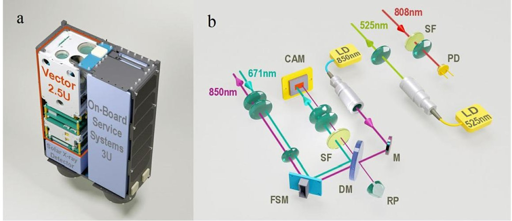

Figure 1 The 3D model of the assembled satellite (a) and the optical design of payload Vector (b): LD—laser diodes, M—mirror, DM—dichroic mirror, RP—180° reflective prism, SF—spectral filters, CAM—camera, FSM—fast steering mirror, PD—photodetector

## 2 Mission architecture

The mission architecture envisages a ground segment and a single satellite space segment, i.e. a 6U CubeSat, which accommodates two independent payloads: Vector (2.5U) and a solar X-ray detector (0.5U). The remaining volume, 3U, is occupied by spacecraft's service systems. The ground segment is split into two parts. First, a radio frequency ground station will be used to receive telemetry data and control the satellite by establishing a RF link with it. Second, an OGS placed at Zvenigorod observatory （ $ 5 5^{\circ} 4 1^{\prime} 5 6^{\prime \prime} $ N, $ 3 6^{\circ} 4 5^{\prime} 3 2^{\prime \prime} $ E, 180 m above msl) will be utilized for receiving and transmitting optical signal from / to Vector. The spacecraft is to be launched from Vostochny Cosmodrome in 2023. The satellite's orbit is Sun-synchronous with an eccentricity close to zero and an altitude of about 560 km.

## 2.1 QubeSat platform

The satellite platform is a 6U CubeSat platform with overall dimensions $ 3 4 0. 5 \times2 2 6. 3 \times $ 100.0 mm and a weight of 9.5 kg. Approximately 3U of volume is reserved for the platform systems: on-board computer, attitude determination and control system (ADCS), and communications. The ADCS incorporates two 2-axis digital sun sensors. Precise 3-axes pointing is carried out by means of 3 miniature reaction wheels. The platform is expected to provide at least sub- $ 1. 5^{\circ} $ coarse pointing. The pointing accuracy is expected to be improved to sub- $ 0. 2 5^{\circ} $ once the ADCS receives a feedback signal from Vector: the payload is equipped with a wide field of view (WFOV) camera, which captures the signal from a ground-based 671 nm beacon laser. Telecommand and telemetry is performed via 4.8 kbit/s VHF up- and 9.6 kbit/s UHF downlink. The platform also accommodates an S-band transmitter, which allows a data rate of up to 2 Mbit/s and can be used for transmission of a large amount of telemetry data. The satellite bus includes solar panels to recharge on-board batteries. The 3D model and a photo of the assembled spacecraft are presented in Fig. 1a and 2a.

## 2.2 Payload

The optical design of payload Vector is shown in Fig. 1b. Transmitting and receiving telecom signal is implemented through two spatially separated optical subsystems. Modulated

<!-- PDF_PAGE: 5 -->

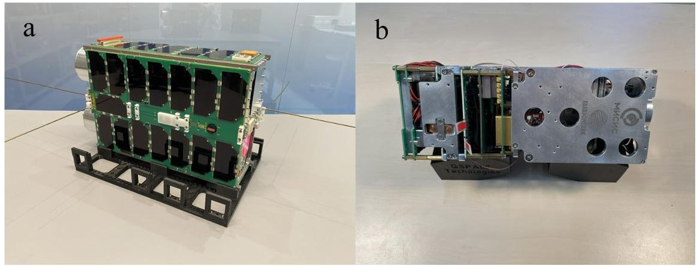

Figure 2 Flight model: a—the assembled satellite, b—payload Vector

telecom signal from laser diode LD 850 nm passes through dichroic mirror DM, reflects from fast steering mirror FSM, expands as it passes a lens system, and is output through an output aperture. The signal from the ground-based beacon laser is captured by the same output aperture. It reflects from FSM, DM and is focused on the matrix of camera CAM. Deviation of the spot at the matrix serves as a feedback signal: FSM is rotated by such an angle to compensate coarse-pointing error. Using the feedback closed-loop, the transmitter is expected to achieve a tracking accuracy much smaller than the downlink beam divergence. The payload also accommodates laser diode LD 525 nm operating in CW mode. Its radiation serves as a beacon for the OGS during closed-loop coarse tracking the satellite. Uplink telecom signal is captured by another input aperture, passes through a lens and a narrowband spectral filter, and is focused on the light-sensitive area of photodetector PD. The photodetector is based on a Silicon Photomultiplier, which is a common-bias and common-output matrix of Geiger-mode avalanche photodiodes connected in parallel and fabricated on a monolithic silicon crystal. Avalanche signal is amplified and compared with an adjustable offset level of a comparator. The detector outputs the result of comparison as LVDS logic signal supplied further to an FPGA, which treats the signal and decodes the data sent from the OGS in real time. Details on the photodetector settings can be found in Appendix A.

## 2.3 Optical ground station

The OGS has already shown performance during multiple quantum communication sessions with Micius. It is placed at Zvenigorod observatory $ ( 5 5^{\circ} 4 1^{\prime} 5 6^{\prime \prime} \mathrm{N}, 3 6^{\circ} 4 5^{\prime} 3 2^{\prime \prime} \mathrm{E}, 1 8 0 \mathrm{m} $ above msl) and based on a 60 cm aperture telescope equipped with a motorized tracking mount. The exterior and optical design of the OGS are presented in Fig. 3. The primary purpose of the telescope system is collection of the telecom signal so that the signal of sufficient power is focused on the photodetector. It is capable of determining the trajectory of a satellite and tracking it regardless of whether a downlink beacon signal is captured or not. Knowledge of the satellite's trajectory is obtained by means of SGP4 model, which converts a two-line element set of a satellite to its celestial coordinates fed to the telescope mount. Maximum pointing error at open-loop coarse tracking can be estimated as maximum error of SGP4 model, which is of $ \sim1 $ km [39], divided by minimum distance to the satellite, which is obviously its altitude, equal to 560 km for the satellite under consideration. Thus, in theory, it should be less than or of the same order of magnitude as 1.8 mrad.

<!-- PDF_PAGE: 6 -->

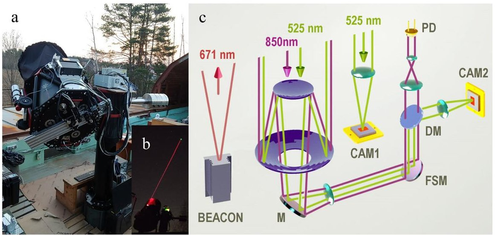

Figure 3 The photos (a, b) and the optical design (c) of the OGS: CAM1—WFOV camera, CAM2—NFOV camera

In practice, the typical RMS-error obtained by the authors does not exceed 400 $ \mu $ rad when tracking low-orbit satellites. A further reduction in pointing error is achieved through the use of an APT system, which consists of coarse and fine tracking system, and an uplink beacon. The uplink beacon helps the satellite to orientate itself at the OGS and establish a good quality line-of-sight. The OGS is equipped with a WFOV camera whose sensor is in the focal plane of a guide telescope mounted parallel to the optical axis of the main one. On-the-fly processing of image stream from the WFOV camera is permanently carried out and, once the camera reliably receives the downlink beacon signal, a required offset starts to be calculated. The offset is then supplied to the mount control software, which allows to minimize pointing error yet remaining due to imperfect knowledge of the satellite's orbit and compensate any systematic tracking errors inherent in the telescope mount. A typical pointing error at closed-loop coarse tracking is of about 50 $ \mu $ rad RMS. The OGS is also equipped with a narrow field of view (NFOV) camera and a fast steering mirror (FSM) with a maximum bandwidth of 580 Hz. Unlike the WFOV one, the NFOV camera and the FSM are mounted inside the optical receiver. The FSM is introduced into the combined beam path of the telecom and downlink beacon signal to guide the telecom signal into the photodetector's field of view. After locating the satellite in the NFOV camera, the remaining pointing error is minimized by beam steering. A typical RMS-error during closed-loop fine tracking does not exceed 7 $ \mu $ rad. More details on the OGS can be found in a previous publication [40].

## 2.4 Polarization reference-frame synchronization

When distributing a quantum key, Alice and Bob must have a shared reference frame. In satellite quantum communication, continuous alignment of polarization states is required due to movement of the spacecraft in orbit and because of its rotation. For carrying out such alignment in automatic mode, we have developed a polarization reference-frame synchronization system. Its optical design is presented in Fig. 4. The operating principle is based on the use of a linearly polarized reference signal transmitted together with the quantum one. The reference signal is not necessarily the downlink beacon, it can be any other polarized radiation. The only compulsory requirement is that its wavelength must

<!-- PDF_PAGE: 7 -->

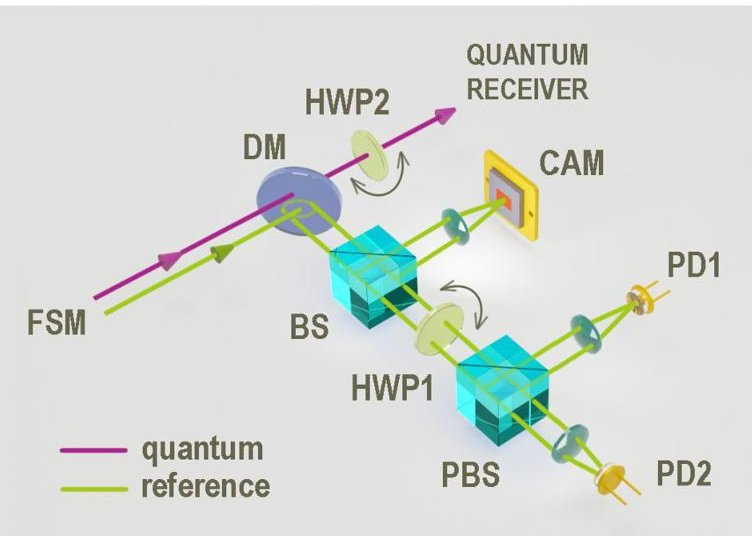

Figure 4 The optical design of the polarization reference-frame synchronization system: BS—beam splitter, HWP1 and HWP2—half wave plates, PBS—polarization beam splitter, CAM—NFOV camera, PD1 and PD2—photodetectors

differ sufficiently so that the reference and quantum signals can be separated by a dichroic mirror. After the reference signal is reflected from dichroic mirror DM, it can be split into several parts for use in different purposes. Here, we imply that the reference signal is the downlink beacon and some of it is used to ensure the operation of fine tracking system. Therefore, after being reflected from beam splitter BS, one part of the reference signal is focused on the matrix of the narrow field of view camera. The transmitted beam passes through half wave plate HWP1 followed by polarization beam splitter PBS and two photodetectors, PD1 and PD2. The amplitude of detector outputs is being continuously digitized while half wave plate HWP1 is rotated to scan the range of interest. The control program treats the obtained data on-the-fly and determines the angle of HWP1 that corresponds to minimum amplitude at one of the detectors. Half wave plate HWP2 is rotated by this angle biased by a preliminary found offset. It should guarantee that polarization reference frame is being kept synchronized during a whole communication session. For testing the performance of the reference-frame synchronization in real experiment, we made the downlink telecom signal linearly polarized. It is redundant from the point of view of the telecommunication system, which can operate with unpolarized signal, and is only required for verifying the above approach. We also plan to modify the above design by substitution of the polarization beam splitter and photodetectors with a commercial off-the-shelf polarimeter and perform tests of the modified system too.

During the experiments on QKD with Micius, the authors applied an alternative approach. A time dependence of the angle between horizontal polarization state and horizontal plane of the OGS was calculated based on a predicted trajectory of the satellite some time before a quantum communication session. This dependence was fed to the input of the software that controls the rotation angle of half wave plate HWP2 during experiment. Using this method, the authors did not observe any significant increase in quantum bit error rate in any of the several communication sessions carried out with Micius i.e. maximum misalignment between the reference frames was kept at acceptable levels. However, although this approach gives acceptable results, it is semi-automatic and quite labor intensive. Moreover, it cannot be applied unless the operation of ADCS is entirely predictable. Unfortunately, the features of how our spacecraft's attitude control system works have not

<!-- PDF_PAGE: 8 -->

been investigated well enough. For example, although sub-1.5 $ ^{\circ} $ coarse pointing is guaranteed by the satellite platform, spin around the axis connecting the spacecraft and the OGS cannot be completely excluded. The study of how the ADCS really works is one of the objectives of this mission.

## 2.5 Telecommunication system

The telecommunication system is a full-duplex system, which uses a simple connectionless communication model with a minimum of protocol mechanisms. At the physical layer, data is encoded in Manchester code: there is a transition at the middle of each bit period and the direction of the transition determines the data. In the system developed by the authors, the transition from low to high represents logic 0 and the transition from high to low represents logic 1. The bit rate is 50 Mbit/s. In both directions, data is being sent in 335 octets long packets, the interpacket gap is 12 octets. The packet consists of an 8-octet preamble, which is used for synchronization, 4-octet serial number, a 321-octet frame, which carries a payload of data, and 2-octet CRC-16 checksum. The envelope of the preamble retrieved by receiver can also be used for time synchronization in quantum key distribution.

## 3 Link budget calculations for the uplink and the downlink

## 3.1 Model used to calculate link loss

Diffraction loss is calculated under the assumption that light beams are Gaussian. If the distance between the transmitter and the receiver is sufficiently large and pointing error is sufficiently low, it can be shown that diffraction loss is equal to

$$
2 0 l g \left(\frac {\sqrt {2} \lambda \cdot d}{\pi w _ {0} \cdot D}\right),
$$

where $ \lambda $ is wavelength, d is the distance to the satellite, $ w_{0} $ is beam waist radius, and D is aperture diameter of the receiver.

If the pointing error cannot be neglected, the loss due to finite pointing accuracy must also be taken into consideration:

$$
\frac {2 0}{l n 1 0} \cdot \left(\frac {\pi w _ {0} \cdot \theta_ {\mathrm {e r r , R M S}}}{\lambda}\right) ^ {2},
$$

where $ \theta_{\mathrm{err},\mathrm{RMS}} $ is RMS pointing error.

Besides geometric loss, there is also atmospheric attenuation due to such processes as scattering and absorption. If neglecting the curvature of the Earth's surface, power loss in atmosphere can be written as

$$
\frac {\kappa}{\sin \theta_ {\mathrm {E L}}},
$$

where $ \theta_{\mathrm{E L}} $ is satellite elevation and coefficient $ \kappa $ characterizes cumulative loss in dB due to scattering and absorption per one air mass.

The distance to the satellite and elevation change along the satellite's trajectory. It can be shown that

$$
d ^ {2} = R _ {E} ^ {2} + \left(R _ {E} + h\right) ^ {2} - 2 R _ {E} \cdot \left(R _ {E} + h\right) \cdot \cos \alpha ,
$$

Content courtesy of Springer Nature, terms of use apply. Rights reserved.

<!-- PDF_PAGE: 9 -->

$$
\cos \theta_ {E L} = \frac {R _ {E} + h}{d} \cdot \sin \alpha ,
$$

where $ R_{E} $ is Earth radius, h is the altitude of the satellite, and $ \alpha $ is angle between the direction to the OGS and the direction to the satellite from the center of Earth.

The model of non-rotating Earth is used to obtain the dependence of $ \alpha $ on time. As the orbital eccentricity is close to zero for the satellite under consideration, we consider that it is moving in a circular orbit. We also assume that $ \alpha $ is zero at time zero. Taking into account these assumptions, one can derive the following expression for $ \alpha $:

$$
\alpha = R _ {E} \cdot \sqrt {\frac {g}{\left(R _ {E} + h\right) ^ {3}}} \cdot t,
$$

where g is gravitational acceleration, and t is time.

The derivation of the equations presented in this section is given in Appendix B.

## 3.2 Results of calculations

Time dependencies of distance d and elevation $ \theta_{\mathrm{E L}} $ calculated using Eqs. (4)-(6) for a satellite with an altitude of 560 km are shown in Fig. 5a and 5b. The selected time interval is from $ -164 $ to $ +164 $ s, which corresponds to the time while the satellite elevation is more than $ 20^{\circ} $ . Diffraction loss are calculated using Eq. (1). According to calculations in Zemax, the waist radius $ w_{0} $ is of 4.0 mm for the downlink. This corresponds to a divergence of the beam in the far field equal to 68 $ \mu $ rad. This value is somewhat larger than the far-field divergence measured experimentally, 41 $ \mu $ rad. We use the value found theoretically, 68 $ \mu $ rad, into all our calculations since it gives us an upper bound for link loss. The diffraction loss for the downlink is of 39.0 dB at zenith and 46.4 dB at an elevation of $ 20^{\circ} $ . For the uplink, we expect the beam divergence to be the same as it is for the downlink. The corresponding diffraction loss is 26.0 dB more, 65.0 dB and 72.4 dB.

Attenuation in atmosphere depends on weather conditions: at a wavelength of 850 nm, $ \frac{1}{4}\cdot\kappa $ lies in the range from 0.23 for clear weather to 0.41 for foggy weather [41]. The loss varies from 0.9 dB at the best weather conditions at zenith to 4.8 dB at the worst weather conditions at an elevation of $ 20^{\circ} $ : see Table 1 for details.

In addition to losses varying along the satellite's trajectory, there are also constant losses in the optical systems of the satellite and the OGS. They are 7.8 dB for the downlink, which includes loss due to the central obstruction of the ground-based telescope, and 0.3 dB for the uplink. Besides that, there is loss of 4.8 dB in the uplink due to a finite pointing accuracy of the ground-based telescope, which is 50 $ \mu $ rad RMS. In the downlink, the anticipated loss due to pointing error is negligible, $ \sim $ 0.3%, since the downlink signal is guided by a fine tracking system. As a result, the total loss for the downlink varies from 47.7 to 59.0 dB depending on the satellite elevation and weather conditions. The time dependence of total loss in the downlink calculated for the worst weather conditions is presented in Fig. 5c. For the uplink, total loss varies from 71.0 to 82.3 dB. As one can see, the total loss for the uplink is higher by 23.3 dB than that for the downlink at the same conditions. Since the time dependence for the uplink looks pretty much similar, we do not present it in a figure.

## 4 Pre-flight tests

Vector has successfully passed all tests as a separate module and has been integrated into the spacecraft. The assembled spacecraft has also been rigorously tested. The pre-flight

<!-- PDF_PAGE: 10 -->

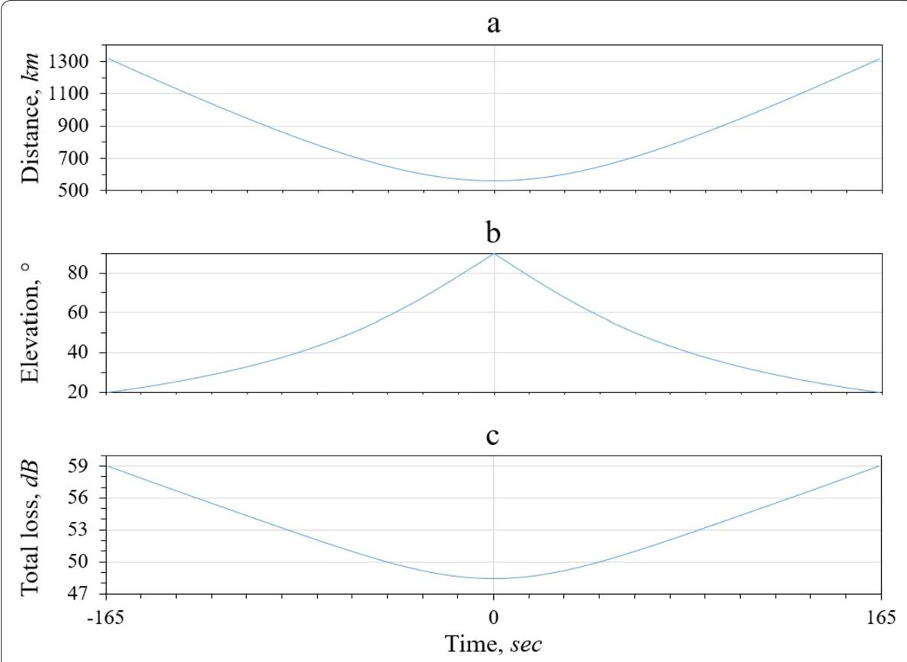

Figure 5 Calculated time dependencies: a—distance to satellite, b—elevation, c—total loss in satellite downlink under the worst weather conditions; the satellite is in a circular orbit with an altitude of 560 km

Table 1 Main parameters of the downlink and the uplink; the satellite is in a circular orbit at an altitude of 560 km

<table border="1"><tr><td></td><td></td><td>Downlink</td><td>Uplink</td></tr><tr><td>Wavelength,nm</td><td></td><td>850</td><td>808</td></tr><tr><td>Far-field divergence,μrad</td><td></td><td></td><td>68</td></tr><tr><td>Aperture diameter of receiver,mm</td><td></td><td>600</td><td>30</td></tr><tr><td rowspan="2">Diffraction loss,dB</td><td>Zenith</td><td>39.0</td><td>65.0</td></tr><tr><td>Elevation20°</td><td>46.4</td><td>72.4</td></tr><tr><td rowspan="2">Scattering and absorption losses,dB</td><td>Zenith</td><td></td><td>0.9-1.61</td></tr><tr><td>Elevation20°</td><td></td><td>2.7-4.81</td></tr><tr><td>Loss due to pointing error,dB</td><td></td><td>0.0</td><td>4.8</td></tr><tr><td>Constant loss in the transmitter,dB</td><td></td><td>0.7</td><td>-</td></tr><tr><td>Constant loss in the receiver,dB</td><td></td><td>7.12</td><td>0.3</td></tr><tr><td rowspan="2">Total loss,dB</td><td>Zenith</td><td>47.7-48.41</td><td>71.0-71.71</td></tr><tr><td>Elevation20°</td><td>56.9-59.01</td><td>80.2-82.31</td></tr></table>

$ ^{1} $ Depends on weather conditions.

$ ^{2} $ Includes loss due to the central obstruction.

tests included check for marginal power consumption, thermal vacuum testing, check for correct data exchange between the satellite bus and the payload, and vibration testing. It has been shown that the spacecraft should survive the launch and operational environment, with no functional elements to be damaged.

The vibration testing had multiple goals. The first one was to make sure that there are no resonant frequencies in the range where it can be crucial i.e. in the range of vibration frequencies of the rocket during space launch. The second objective is to ensure that there is no harm to the payload / satellite after extensive exposure to sine vibration of a given strength at some frequencies. For this purpose, comparison of vibrational spectra before

<!-- PDF_PAGE: 11 -->

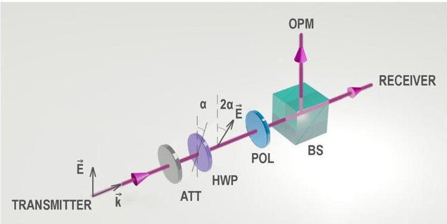

Figure 6 The optical scheme of variable attenuation for testing the telecommunication system: ATT-fixed optical attenuator, HWP—half wave plate, POL—polarizer, BS—beam splitter 50/50, OPM—optical power meter

and after the exposure is carried out first. Then the payload / satellite is checked whether the alignment of optical beams is maintained. Finally, performance of the electronics and functionality of the whole system is checked. Also, the payload / satellite undergoes random vibration testing.

Special attention was paid to stable operation of the telecommunication system. During the tests, the optical signal was attenuated to the level as it would be during a satellite pass through zenith under worst-case conditions. The optical scheme for testing with variable attenuation is presented in Fig. 6. First, the signal is attenuated with a fixed optical attenuator so that maximum output power corresponds to the optical power at zenith. Then, signal passes a half wave plate followed by a polarizer, whose axes are oriented relative to the vector of electric field so that the output power is proportional to $ \cos^{2}2\alpha $ , where $ \alpha $ is the angle of the half wave plate. The change of angle is implemented by means of a motorized rotation mount managed from a PC. After the polarizer, the signal is split into two parts: the first one ends up in the receiver, whereas the second one hits the sensor of an optical power meter, which allows to control the real value of optical power during testing.

For the downlink, the laser output power is of 120 mW. As can be seen in Table 1, the total loss varies from 48.4 dB at zenith to 59.0 dB at an elevation of $ 2 0^{\circ} $ under the worst weather conditions. It corresponds to received signal power of $ 1. 7 \ \mu\mathrm{W} $ and 150 nW. Checks on the telecommunication system was therefore performed around this range. The obtained dependence of bit error rate (BER) on signal power is presented in Fig. 7. As one can see, bit error probability does not exceed $ 1 0^{-3} $ in the range of interest. Such an error rate is sufficient for error correction with reasonable redundancy and reliable data transmission can thus be carried out at least at elevation greater than $ 2 0^{\circ} $ . According to our calculations, such a single communication session lasts about 328 s if the satellite passes through zenith.

For the uplink, it is supposed to use a ground-based transmitter with such a power as to provide signal-to-noise ratio not worse than that obtained for the downlink. The total loss of the uplink is greater than that of the downlink by 23.3 dB and the output transmitter power is supposed to be at least 26 W. It is technically quite a difficult task to modulate optical signal of such a high power since standard off-the-shelf modulators have either too low acceptable level of input power or too low modulation bandwidth. However, the authors plan to find a satisfactory solution to this challenge by the launch of the satellite.

<!-- PDF_PAGE: 12 -->

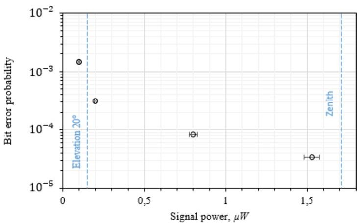

Figure 7 The dependence of bit error probability on received signal power. A single point presents data averaged over $ 1 0^{5} $ packets or $ 2. 5 6 8 \times1 0^{8} $ bits. Vertical dashed lines indicate signal power at zenith and at an elevation of $ 2 0^{\circ} $ under the worst weather conditions

## 5 Discussion and conclusion

A satellite-constellation based global quantum network could allow secure quantum communication between remote users worldwide and contribute to the creation of quantum internet in the future. Such a constellation could be formed of micro- or even nanosatellites, which have the advantage of being more cost-effective than larger expensive spacecrafts. However, the features of quantum communication impose a number of specific technical requirements set for both the OGS and the spacecraft. In particular, precise control of the downlink laser beam and very accurate attitude control of the satellite must be guaranteed during a whole communication session. For small satellites, it is more difficult to meet these requirements than for large ones. To the authors' knowledge, full-fledged quantum communication has been demonstrated with neither a micro- nor a nanosatellite so far. Micius, weighing 635 kg [11], has been the only satellite that was able to demonstrate QKD with ground-based stations [5-7]. The team of the University of Science and Technology of China has thus provided proof-of-principle evidence that quantum key distribution between a LEO satellite and a ground station is feasible, which became undoubtedly a key milestone towards quantum communications in space. However, the cost of the project is extremely high and such satellites as Micius can barely be considered suitable for use in a commercial quantum network. Our team has taken aim at the creation of a global quantum network based on a constellation of nanosatellites. As a first step towards this long-term goal, we developed a 6U CubeSat to be launched into its orbit in 2023. Although the spacecraft is not yet intended for full-fledged quantum communication, we are testing such crucial functional elements as satellite's APT system and polarization reference-frame synchronization on it. Besides that, the satellite is equipped with a full-duplex telecommunication system operating at a bit rate of 50 Mbit/s. This is at least one order of magnitude higher than the data rate provided by the available RF links. The optical link can therefore be utilized as a classical communication channel in our next mission, which envisages an overall QKD system. It should be noted that the technology of optical satellite communication is of interest not only in the context of quantum communications. Inter-satellite optical communication can complement data transmission over a radio link in a classical satellite-based telecommunication network. Also, it can have a practical application in technologies that imply satellite-to-ground transmission of large amounts of data, such as remote Earth sensing and extra-terrestrial astronomical observations.

Content courtesy of Springer Nature, terms of use apply. Rights reserved.

<!-- PDF_PAGE: 13 -->

The authors have conducted an analysis of link losses in the up- and the downlink and have shown that signal power does not fall below 150 nW at elevation above $ 2 0^{\circ} $ . At such a signal level, bit error probability is of about $ 1 0^{-3} $ , according to the results of preliminary tests of the telecommunication system. Such an error rate is sufficient for reliable error correction with reasonable redundancy of transmitted data. Using the model of non-rotating Earth, a single communication session has been shown to last for 5 min 28 s when the spacecraft goes through zenith. The main goal to be achieved after the satellite is launched is to demonstrate stable connection between it and an OGS and carry out multiple communication sessions. The authors plan to utilize the OGS that has already shown performance during experiments on QKD with Micius.

In the spacecraft under consideration, only 2.5U of volume was allocated for the payload including both optical components and electronics. It is technically quite a difficult task to fit all the components into such a small volume. Therefore, the authors decided to limit satellite's input aperture to 30 mm. Such a small aperture diameter resulted in higher requirements imposed on the ground-based transmitter: it must be capable of modulating optical signal with a power of several watts. We expect to have more space available for the payload in the following mission and then we can use an output aperture of about 95 mm. First, it will let us to reduce the output power of the ground-based transmitter by one order of magnitude. Second, such an aperture diameter will allow to achieve a much smaller divergence of the downlink beam. The latter circumstance is especially important in the context of quantum communication as link loss has a direct impact on secure key rate. Moreover, if the downlink beam divergence is too large, signal-to-noise ratio can fall below the critical level at which secure communication becomes impossible. Since generating secret keys from raw measurement data implies two-way exchange of significant amount of information, availability of a classical communication channel with a high bandwidth is another important thing from the point of view of quantum communication. We plan to use the free-space optical link for such an exchange of data during obtaining quantum keys, whereas the RF link will only be used for telemetry and telecommand. The concept of the following mission is still under development and its design will depend, among other things, on the results of in-orbit operation of our first satellite.

## Appendix A: Photodetector Bias Voltage and Comparator Level Selection

One of the crucial things in the telecommunication system from the point of view of hardware is setting the correct parameters of the photodetectors. Spacecraft's equipment with the highest power consumption is turned on shortly before a communication session, which increases thermal load significantly. Besides that, a spacecraft is impacted by solar radiation and the illuminance changes dramatically when it enters Earth's umbra region. Both factors can cause temperature and consequently breakdown voltage to drift significantly in an unpredictable direction. Correction of the photodetector operating point is therefore required. Bias voltage correction is performed in automatic mode: temperature measurement is carried out every 500 ms and bias voltage is immediately corrected when necessary. Selection of comparator level is not so obvious. If it is too low, error rate increases due to noise triggering of the photodetectors. At a too high comparator level, there is a risk of not receiving the signal, which also leads to an increased error rate. An additional complexity is that received signal power varies by a factor of about 10 during

<!-- PDF_PAGE: 14 -->

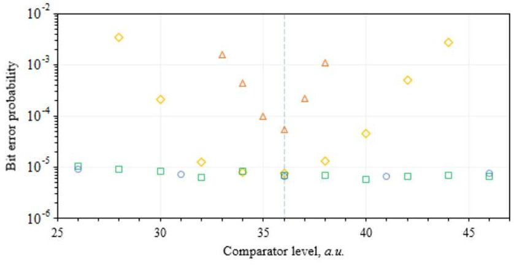

Figure A1 The dependencies of bit error probability on comparator level obtained at different levels of optical power. The bit rate is 100 Mbit/s. Data encoding is implemented by means of an electro-optical modulator. A single point presents data averaged over $ 1 0^{4} $ packets or $ 2. 5 6 8 \times1 0^{7} $ bits. Vertical dashed line indicates the comparator level that provides the lowest BER

a communication session. Influence of comparator level on BER was therefore studied at different levels of signal power. A summary of the obtained results is presented in Fig. A1. The upper bound of acceptable comparator level is moving towards higher values with increasing signal power as expected. It was also found that the lower bound is moving towards lower values. The last effect is apparently due to the dependence of avalanche intensity on the amount of radiation that hits the detector. The more intense an avalanche, the greater bias voltage drops. For the given electrical circuit, voltage recovery time is of $ \sim 1 0 0 $ ns, which is much greater than the period of information pulses, and therefore bias voltage never has time to fully recover. As a result, at a fixed comparator level, the higher signal power, the lower BER. As one can notice, regardless of signal power, the comparator level that provides the lowest error rate is pretty much the same. This level is indicated by vertical dashed line.

## Appendix B: Model Used to Calculate Link Loss

For calculation of diffraction loss, we assume that light beams are Gaussian. It means that their intensity distribution has Gaussian profile:

$$
I (r, z) = \frac {2 P _ {0}}{\pi w ^ {2} (z)} \cdot e ^ {- 2 \frac {r ^ {2}}{w ^ {2} (z)}},
$$

where r is the radial distance from the center axis of the beam, z is the axial distance from the beam's waist, w(z) is the radius at which the field amplitude falls to $ 1 / e $ of its axial value, and $ P_{0} $ is the total power of the beam. The parameter w is given by the following equation:

$$
w (z) = w _ {0} \cdot \sqrt {1 + \left(\frac {z}{z _ {R}}\right) ^ {2}},
$$

where $ w_{0}=w(0) $ is the waist radius, and $ z_{R}=\frac{\pi w_{0}^{2}}{\lambda} $ is Rayleigh length. By taking the derivative of w with respect to z and tending z to $ +\infty $ , one can make sure that the derivative tends to $ \frac{\lambda}{\pi w_{0}} $ , which is the far-field divergence of a Gaussian beam.

<!-- PDF_PAGE: 15 -->

In general, if there is an arbitrary surface $ \Sigma $ , power captured by this surface can be calculated as surface integral of vector field $ I\cdot \frac{\overrightarrow{k}}{k} $ :

$$
P = \iint_ {\Sigma} I \cdot \frac {\overrightarrow {\boldsymbol {k}}}{k} \cdot \overrightarrow {d S}.
$$

If the tracking accuracy $ \theta_{\mathrm{err}} $ is sufficiently low, i.e. $ z\cdot\theta_{\mathrm{err}}\ll w, r $ inside the region of integration is much less than w. Also, the wave vector $ \overrightarrow{k} $ is pretty much parallel to vector $ \overrightarrow{dS}. $ Then (B.3) can be written as

$$
P = I (r = 0, z) \cdot S,
$$

where $ S=\iint_{\Sigma} d S $ is the total surface area. As a telescope with an aperture of D has an area of $ \frac{\pi D^{2}}{4} $ (B.4) becomes

$$
P = \frac {P _ {0} \cdot D ^ {2}}{2 w ^ {2} (z)}.
$$

At distances typical for satellite communication, $ z\gg z_{R} $ and (B.5) can be written as

$$
P = P _ {0} \cdot \frac {\pi^ {2} w _ {0} ^ {2} \cdot D ^ {2}}{2 \lambda^ {2} \cdot z ^ {2}}.
$$

Also, at such distances, discrepancy between z and the distance d between a satellite and an OGS is insignificant. Therefore, z in (B.6) may be substituted with d. If taking into account that loss in dB are defined as $ 1 0 l g \frac { P _ { 0 } } { P } $ , one can get:

$$
D i f f r a c t i o n \, l o s s = 2 0 l g \left(\frac {\sqrt {2} \lambda \cdot d}{\pi w _ {0} \cdot D}\right).
$$

If the pointing error is significant, angular deviation of the beam must also be considered. In this case, if we still assume that the region of integration is much less than w, and if $ \theta_{\mathrm{err}}\ll1 $ (B.3) can be written as:

$$
P = I \left(z \cdot \theta_ {\mathrm {e r r}}, z\right) \cdot S.
$$

If we substitute z with d and take into account that $ z\gg z_{R} $ , as it was done above, after performing several simple mathematical transformations, we will get the following expression for $ 1 0 l g \frac { P _ { 0 } } { P } $ i.e. power loss in dB:

$$
2 0 l g \left(\frac {\sqrt {2} \lambda \cdot d}{\pi w _ {0} \cdot D}\right) + \frac {2 0}{l n 1 0} \cdot \left(\frac {\pi w _ {0}}{\lambda}\right) ^ {2} \cdot \theta_ {\mathrm {e r r}} ^ {2}.
$$

As one can notice, the first term in (B.9) is diffraction loss derived above by assuming that the pointing error is zero, whereas the second one characterizes extra loss caused by a finite pointing accuracy. As a rule, pointing error is a random rapidly changing value and therefore it makes sense to consider the loss averaged over a sufficiently large time interval.

<!-- PDF_PAGE: 16 -->

Thus, if taking into consideration all of the above, the expression for total geometric loss can be written as:

$$
D i f f r a c t i o n \, l o s s + \frac {2 0}{l n 1 0} \cdot \left(\frac {\pi w _ {0}}{\lambda}\right) ^ {2} \cdot \overline {{\theta_ {\mathrm {e r r}} ^ {2}}}.
$$

Equation (B.10) represents loss in vacuum. In reality, signal goes through atmosphere and such processes as scattering and absorption have also to be considered. Let the radiation of intensity I pass through volume $ S\cdot\delta z $ with a concentration of scattering centers of $ n_{S} $ as shown in Fig. B1a. If $ \delta z $ is small enough, the change of intensity $ \delta I $ after passing through the volume can be written as $ -C_{S}\cdot I\cdot n_{S}\cdot\delta z $ , where $ _{CS} $ is a coefficient that characterizes scattering efficiency. Passing to the differential limit, we obtain a differential equation $ \frac{dI}{I}=-C_{S}\cdot n_{S}\cdot dz $ , whose solution can be written as

$$
\int_ {I _ {0}} ^ {I} \frac {d \eta}{\eta} = - C _ {S} \cdot \int_ {z _ {0}} ^ {z} n _ {S} (\xi) d \xi .
$$

If we integrate along the center axis of the beam from its focus, point S in Fig. B1b, $ z_{0}=0 $ and $ I_{0} $ is the intensity of the beam in the center of waist, i.e. at point $ r=0 $ $ z=0 $ . The upper limit of integration $ z $ is equal to $ \frac{h}{\sin\theta_{\mathrm{EL}}} $ at the location of the OGS, point G in Fig. 3b, where $ h $ is the altitude of the satellite and $ \theta_{\mathrm{EL}} $ is its elevation. If we substitute integration variable $ \xi $ with $ \mu=-\sin\theta_{\mathrm{EL}}\cdot\xi+h $ , the right part of Eq. (B.11) becomes $ -\frac{C_{S}}{\sin\theta_{\mathrm{EL}}}\cdot\int_{0}^{h} n_{S}(\mu) d\mu $ . As atmospheric density is negligibly low at typical altitudes of satellites, $ \int_{0}^{h} n_{S}(\mu) d\mu $ is equivalent to $ \int_{0}^{+\infty} n_{S}(\mu) d\mu $ with high accuracy. The value $ C_{S}\cdot\int_{0}^{+\infty} n_{S}(\mu) d\mu $ does not depend on the satellite's position and is only determined by properties of the atmosphere and the radiation wavelength. If we designate $ C_{S}\cdot\int_{0}^{+\infty} n_{S}(\mu) d\mu $ as $ \kappa_{S} $ , Eq. (B.11) becomes $ \ln\frac{I}{I_{0}}=-\frac{\kappa_{S}}{\sin\theta_{\mathrm{EL}}} $ Similar considerations apply to the process of absorption and a similar coefficient $ \kappa_{A} $ can be introduced. In view of the above, total loss can be written as

$$
2 0 l g \left(\frac {\sqrt {2} \lambda \cdot d}{\pi w _ {0} \cdot D}\right) + \frac {2 0}{l n 1 0} \cdot \left(\frac {\pi w _ {0}}{\lambda}\right) ^ {2} \cdot \overline {{\theta_ {\mathrm {e r r}} ^ {2}}} + \frac {1 0}{l n 1 0} \cdot \frac {\kappa}{\sin \theta_ {\mathrm {E L}}},
$$

where $ \kappa=\kappa_{S}+\kappa_{A} $ . Coefficient $ \frac{10}{ln10}\kappa $ characterizes cumulative loss in dB due to scattering and absorption per one air mass.

For calculation of distance to a satellite d and elevation $ \theta_{\mathrm{E L}} $ , we use the model of nonrotating Earth. This model is a reasonable approximation as, even if an OGS is placed at the equator, where the speed reaches its maximum, it is yet one order of magnitude less than the speed of a satellite. Also, we assume the orbital eccentricity is 0, i.e. the satellite is moving in a circular orbit. It also has a basis: the orbital eccentricity of our satellite is close to 0. Considering two assumptions above, distance to the satellite d can be found from the law of cosines applied to triangle CGS—see Fig. B1c:

$$
d ^ {2} = R _ {E} ^ {2} + \left(R _ {E} + h\right) ^ {2} - 2 R _ {E} \cdot \left(R _ {E} + h\right) \cdot \cos \alpha ,
$$

where $ R_{E} $ is Earth radius, and $ \alpha $ is angle between the direction to the satellite and the direction to the OGS. By equating the centripetal force and gravity, one can derive a well-

<!-- PDF_PAGE: 17 -->

a

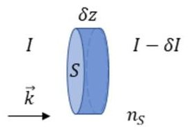

b

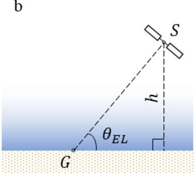

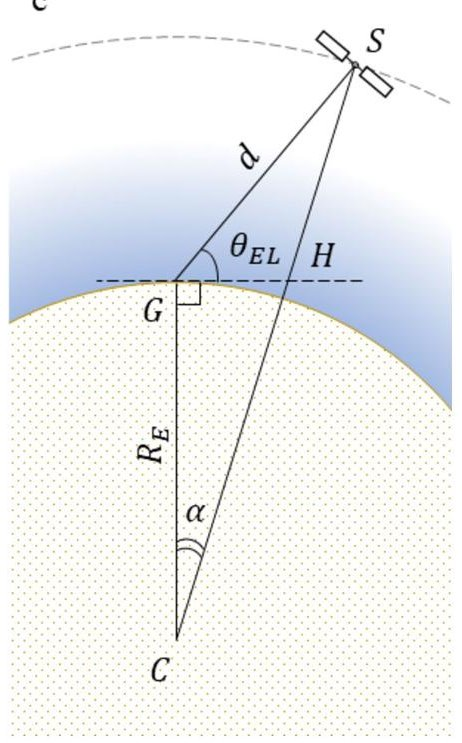

Figure B1 Scattering and absorption in atmosphere. The geometry of relative position of a satellite and an OGS: C—the center of Earth, G—the position of the OGS, S—the position of the satellite

known expression for the speed of a satellite $ \nu_{\mathrm{SAT}} $:

$$
R _ {E} \cdot \sqrt {\frac {g}{R _ {E} + h}},
$$

where g is gravitational acceleration. Since $ ( R_{E}+h)\cdot d\alpha=\nu_{\mathrm{SAT}}\cdot d t $ $ \alpha $ can be written as $ \alpha_{0}+\frac{\nu_{\mathrm{SAT}}}{R_{E}+h}\cdot\left(t-t_{0}\right) $ , where $ \alpha_{0}=\alpha\left(t=t_{0}\right) $ . If $ \alpha_{0}=0 $ and the satellite passes through the zenith at time zero, i.e. $ t_{0}=0 $ $ \alpha $ is equal to

$$
R _ {E} \cdot \sqrt {\frac {g}{\left(R _ {E} + h\right) ^ {3}}} \cdot t.
$$

Elevation can be found from the law of cosines for triangle SGH:

$$
S H ^ {2} = d ^ {2} + G H ^ {2} - 2 d \cdot G H \cdot \cos \theta_ {\mathrm {E L}}.
$$

GH can be calculated as $ R_{E}\cdot \tan \alpha $ . SH can be found as the difference between CS, which is equal to $ R_{E}+h $ , and CH, which in turn is equal to $ \frac{R_{E}}{\cos \alpha} $ . From the equations above, skipping intermediate math, the following equation for elevation is obtained:

$$
\cos \theta_ {\mathrm {E L}} = \frac {R _ {E} + h}{d} \cdot \sin \alpha .
$$

It should be noted that the authors neglect a number of phenomena in the above model. In particular, the curvature of the Earth's surface is not considered when calculating loss in atmosphere. When considering the motion of the satellite, the authors use the model of non-rotating Earth, which is obviously only a certain approximation of reality. We also neglect beam wander due to atmospheric turbulence, which can lead to an increase in the

<!-- PDF_PAGE: 18 -->

beam divergence and, consequently, extra loss, especially for the uplink. Nevertheless, the creation of an overall model that would consider all conceivable phenomena was not the purpose of this work and can be a topic of a separate study.

## Acknowledgements

The authors are grateful to Vladimir Maiboroda, Vyacheslav Tekaev, Nikolai Borisov, Valentin Tolstykh, Dmitry Plokhov and Lyudmila Mikhaylova for their advice and technical assistance. The authors also thank Vadim Makarov for fruitful discussions.

## Funding

This research was supported by the Ministry of Education and Science of the Russian Federation in the framework of the Program of Strategic Academic Leadership "Priority 2030" (Strategic Project "Quantum Internet").

## Declarations

## Competing interests

The authors declare no competing interests.

## Author contributions

R.B., S.K., K.T., L.P. and A.M. developed the concept of the satellite. S.K. led the development of the satellite platform. A.M. and R.B. performed the link budget calculations. K.T., I.N. and D.S. were responsible for the development of payload's electronics. K.T. and S.L. developed the software for the payload. L.P. did design work and prepared figures 1, 2, and 4. A.M. prepared the other figures and wrote the manuscript. R. B. was in charge of the optical design of the payload. R.B., V.M. and A.D. assembled the optical part of the payload and adjusted the optical axes. L.P., S.K., R.B., I.N., K.T., S.L., A.D. and A.M. carried out the pre-flight tests. A.P., K.T., I.N. and V.F. made the photodetectors on the basis of components produced by Dephan. All authors reviewed the manuscript.

## Author details

$ ^{1} $QSpace Technologies, Moscow, 121205, Russia. $ ^{2} $Moscow Centre for Quantum Technologies, Moscow, 127204, Russia. $ ^{3} $HSE University, Moscow, 101000, Russia. $ ^{4} $National University of Science and Technology "MISIS", Moscow, 115419, Russia. $ ^{5} $Dephan LLC, Moscow, 121205, Russia. $ ^{6} $Moscow Institute of Physics and Technology, Moscow, 117303, Russia. $ ^{7} $NILAKT DOSAAF, Kaluga, 248018, Russia.

Received: 17 June 2023 Accepted: 21 November 2023 Published online: 28 November 2023

## References

1. Bennett CH, Brassard G. Quantum cryptography: public key distribution and coin tossing. In: Proceedings of international conference of computers, systems & signal processing. 9-12 December. Bangalore, India. 1984. p. 175.

2. Bennett CH, Bessette F, Brassard G, Salvail L, Smolin J. Experimental quantum cryptography. J Cryptol. 1992;5:3-28.

3. Schmitt-Manderbach T, Weier H, Fürst M, Ursin R, Tiefenbacher F, Scheidl T, Perdigues J, Sodnik Z, Kurtsiefer C, Rarity JG, Zeilinger A, Weinfurter H. Experimental demonstration of free-space decoy-state quantum key distribution over 144 km. Phys Rev Lett. 2007;98:010504

4. Wang S, Yin Z-Q, He D-Y, Chen W, Wang R-Q, Ye P, Zhou Y, Fan-Yuan G-J, Wang F-X, Chen W, Zhu Y-G, Morozov PV, Divochiy AV, Zhou Z, Guo G-C, Han Z-F. Twin-field quantum key distribution over 830-km fibre. Nat Photonics. 2022;16:154-61.

5. Liu Y, Zhang W-J, Jiang C, Chen J-P, Zhang C, Pan W-X, Ma D, Dong H, Xiong J-M, Zhang C-J, Li H, Wang R-C, Wu J, Chen T-Y, You L, Wang X-B, Zhang Q, Pan J-W. Phys Rev Lett. 2023;130:210801

6. Liao S-K, Cai W-Q, Liu W-Y, Zhang L, Li Y, Ren J-G, Yin J, Shen Q, Cao Y, Li Z-P, Li F-Z, Chen X-W, Sun L-H, Jia J-J, Wu J-C Jiang X-J, Wang J-F, Huang Y-M, Wang Q, Zhou Y-L, Deng L, Xi T, Ma L, Hu T, Zhang Q, Chen Y-A, Liu N-L, Wang X-B, Zhu Z-C, Lu C-Y, Shu R, Peng C-Z, Wang J-Y, Pan J-W. Satellite-to-ground quantum key distribution. Nature. 2017;549:43-7.

7. Liao S-K, Cai W-Q, Handersteiner J, Liu B, Yin J, Zhang L, Rauch D, Fink M, Ren J-G, Liu W-Y, Li Y, Shen Q, Cao Y, Li F-Z, Wang J-F, Huang Y-M, Deng L, Xi T, Ma L, Hu T, Li L, Liu N-L, Koidl F, Wang P, Chen Y-A, Wang X-B, Steindorfer M, Kirchner G, Lu C-Y, Shu R, Ursin R, Scheidl T, Peng C-Z, Wang J-Y, Zeilinger A, Pan J-W. Satellite-relayed intercontinental quantum network. Phys Rev Lett. 2018;120:030501

8. Chen Y-A, Zhang Q, Chen T-Y, Cai W-Q, Liao S-K, Zhang J, Chen K, Yin J, Ren J-G, Chen Z, Han S-L, Yu Q, Liang K, Zhou F, Yuan X, Zhao M-S, Wang T-Y, Jiang X, Zhang L, Liu W-Y, Li Y, Shen Q, Cao Y, Lu C-Y, Shu R, Wang J-Y, Li L, Liu N-L, Xu F, Wang X-B, Peng C-Z, Pan J-W. An integrated space-to-ground quantum communication network over 4600 kilometers. Nature. 2021;589:214-9.

9. Yin J, Cao Y, Li Y-H, Liao S-K, Zhang L, Ren J-G, Cai W-Q, Liu W-Y, Li B, Dai H, Li G-B, Lu Q-M, Gong Y-H, Xu Y, Li S-L, Li F-Z, Yin Y-Y, Jiang Z-Q, Li M, Jia J-J, Ren G, He D, Zhou Y-L, Zhang X-X, Wang N, Chang X, Zhu Z-C, Liu N-L, Chen Y-A, Lu C-Y, Shu R, Peng C-Z, Wang J-Y, Pan J-W. Satellite-based entanglement distribution over 1200 kilometers. Science. 2017;356:1140-4.

10. Yin J, Li Y-H, Liao S-K, Yang M, Cao Y, Zhang L, Ren J-G, Cai W-Q, Liu W-Y, Li S-L, Shu R, Huang Y-M, Deng L, Li L, Zhang Q, Liu N-L, Chen Y-A, Lu C-Y, Wang X-B, Xu F, Wang J-Y, Peng C-Z, Ekert AK, Pan J-W. Entanglement-based secure quantum cryptography over 1120 kilometers. Nature. 2020;582:501-5.

11. Ren J-G, Xu P, Yong H-L, Zhang L, Liao S-K, Yin J, Liu W-Y, Cai W-Q, Yang M, Li L, Yang K-X, Han X, Yao Y-Q, Li J, Wu H-Y, Wan S, Liu L, Liu D-Q, Kuang Y-W, He Z-P, Shang P, Guo C, Zheng R-H, Tian K, Zhu Z-C, Liu N-L, Lu C-Y, Shu R, Chen Y-A, Peng C-Z, Wang J-Y, Pan J-W. Ground-to-satellite quantum teleportation. Nature. 2017;549:70-3.

12. Lu C-Y, Cao Y, Peng C-Z, Pan J-W. Micius quantum experiments in space. Rev Mod Phys. 2022;94:035001

<!-- PDF_PAGE: 19 -->

13. SatNews. Available online: https://news.satnews.com/2022/07/31/china-launches-new-satellite-in-important-step-towards-global-quantum-communications-network (accessed on 29 April 2023)

14. Takenaka H, Carrasco-Casado A, Fujiwara M, Kitamura M, Sasaki M, Toyoshima M. Satellite-to-ground quantum-limited communication using a 50-kg-class microsatellite. Nat Photonics. 2017;11:502-8.

15. Canadian Space Agency. Available online: https://www.asc-csa.gc.ca/eng/satellites/qeyssat.asp (accessed on 29 April 2023)

16. Liao S-K, Lin J, Ren J-G, Liu W-Y, Qiang J, Yin J, Li Y, Shen Q, Zhang L, Liang X-F, Yong H-L, Li F-Z, Yin Y-Y, Cao Y, Cai W-Q, Zhang W-Z, Jia J-J, Wu J-C, Chen X-W, Zhang S-C, Jiang X-J, Wang J-F, Huang Y-M, Wang Q, Ma L, Li L, Pan G-S, Zhang Q, Chen Y-A, Lu C-Y, Liu N-L, Ma X, Shu R, Peng C-Z, Wang J-Y, Pan J-W. Space-to-ground quantum key distribution using a small-sized payload on Tiangong-2 space lab. Chin Phys Lett. 2017;34:090302

17. Tang Z, Chandrasekara R, Tan YC, Cheng C, Sha L, Hiang GC, Oi DKL, Ling A. Generation and analysis of correlated pairs of photons aboard a nanosatellite. Phys Rev Appl. 2016;5:054022.

18. Villar A, Lohrmann A, Bai X, Vergoossen T, Bedington R, Perumangatt C, Lim HY, Islam T, Reezwana A, Tang Z, Chandrasekara R, Sachidananda S, Durak K, Wildfeuer CF, Griffin D, Oi DKL, Ling A. Entanglement demonstration on board a nano-satellite. Optica. 2020;7:734-7.

19. SpeQtral. Available online: https://speqtral.space/speqtral-announces-speqtral-1-quantum-satellite-mission-for-ultrasecure-communications (accessed on 29 April 2023)

20. Sivasankaran S, Liu C, Mihm M, Ling A. A CubeSat platform for space based quantum key distribution. In: Proceedings of international conference on space optical systems and applications. 28-31 March. Kyoto, Japan. 2022.

21. Knips L, Auer M, Baliuka A, Bayraktar O, Freiwang P, Grunefeld M, Haber R, Lemke N, Marquardt C, Moll F, Pudelko J, Rodiger B, Schilling K, Schmidt C, Weinfurter HQUBE. Towards quantum key distribution with small satellites. In: Proceedings of quantum 2.0 conference and exhibition. Everett, USA. 2022. p. 13-6.

22. Hutterer M, Auer M, Baliuka A, Bayraktar O, Freiwang P, Gall M, Günther K, Haber R, Janusch J, Knips L, Kobel P, Krauss M, Lemke N, Marquardt C, Moll F, Papadopoulos C, Pudelko J, Rödiger B, Roubal C, Scharnagel J, Schilling K, Schmidt C, Weinfurter H.. QUBE-II: Quantum key distribution with a CubeSat. In: Proceedings of 73rd international astronautical. Paris, France: Congress; 2022. p. 18-22.

23. Kerstel E, Bourdarot G, LeCoarer E, Barthelemy M, Gardelein A, Gilot Y, Rodrigo J, Sequies T, Borne V, Burlet J-Y, Christidis A, Segura J, Boulanger B, Boutou V, Bouzat M, Chabanol M, Fesquet L, Fourati H, Moulin M, Niot J-M, Bastos RP, Robu B, Rolland E, Toru S, Tanzilli S, Fink M, Joshi SK & Ursin R Nanobob: a cubesat mission concept for quantum communication experiments in an uplink configuration. In: Proceedings of international conference on space optics. 9-12 October. Chania, Greece. 2018.

24. Mazzarella L, Lowe C, Lowndes D, Joshi SK, Greenland S, McNeil D, Mercury C, Macdonald M, Rarity J, Oi DKLQUAR. Quantum research cubesat — a constellation for quantum communication. Cryptography. 2020;4:7.

25. Boroson DM, Robinson BS, Murphy DV, Burianek DA, Kharti F, Kovalik JM, Sodnik Z, Cornwell DM. Overview and results of the lunar laser communication demonstration. In: Proceedings of free-space laser communication and atmospheric propagation XXVI. Proc. SPIE. vol. 8971. 2014.

26. Schmidt C, Brechtelsbauer M, Rein F, Funch C. OSIRIS payload for DLR's BiROS satellite. In: Proceedings of international conference on space optical systems and applications. Kobe, Japan. 2014. p. 7-9.

27. Sindiy O, Abrahamson M, Biswas A, Wright MW, Padams JH, Konyha A. Lessons learned from optical payload for lasercomm science (OPALS) mission operations. In: Proceedings of AIAA SPACE 2015 conference and exposition. Pasadena, USA, 31 August-3 September 2015

28. Carrasco-Casado A, Takenaka H, Kolev D, Munemasa Y, Kunimori H, Suzuki K, Fuse T, Kubo-Oka T, Akioka M, Koyama Y, Toyoshima M. LEO-to-ground optical communications using SOTA (Small Optical TrAnsponder)—payload verification results and experiments on space quantum communications. Acta Astronaut. 2017;139:377-84.

29. Edwards BL, Israel DJ, Vithlani SK. Latest changes to NASA's laser communications relay demonstration project. In: Proceedings of free-space laser communication and atmospheric propagation XXX. Proc. SPIE. vol. 10524. 2018.

30. Funch C, Moll F, Giggenbach D, Schmidt C, Keim J, Gaisser S. OSIRISv1 on flying laptop: measurement results and outlook. In: Proceedings of international conference on space optical systems and applications. 2019. p. 14-6.

31. Rose TS, Rowen DW, LaLumondiere SD, Werner NI, Linares R, Faler AC, Wicker JM, Coffman CM, Maul GA, Chien DH, Utter AC, Welle RP, Janson SW. Optical communications downlink from a low-earth orbiting 1.5U. CubeSat Opt Express. 2019;27:24382-92.

32. Rodiger B, Menninger C, Fuchs C, Grillmayer L, Arnold S, Rochow C, Wertz P, Schmidt C. High data-rate optical communication payload for CubeSats. In: Proceedings of free-space laser communication and atmospheric propagation IX. Proc. SPIE. vol. 11506. 2020.

33. Heine F, Martin-Pimentel P, Hopcke N, Hasler D, Rochow C, Zech H. Status of Tesat lasercomms activities. In: Proceedings of free-space laser communication and atmospheric propagation XXXIII. Proc. SPIE. vol. 11678. 2021.

34. Iwamoto K, Komatsu H, Ohta S, Kubo Y, Nakao T, Yamazoe H, Kamata T, Munemasa Y, Kunimori H, Toyoshima M, Koda D, Sawada H, Ikeda T. Experimental results on in-orbit technology demonstration of SOLISS. In: Proceedings of free-space laser communication and atmospheric propagation XXXIII. Proc. SPIE. vol. 11678. 2021.

35. Yamakawa S, Satoh Y, Itahashi T, Takano Y, Hoshi S, Miyamoto Y, Sugiho M, Yoshizawa T, Koizumi Y, Yukizane M, Suzuki S, Kohata HLUCA. The second-generation GEO satellite-based space data-relay system using optical link. In: Proceedings of international conference on space optical systems and applications. 2022. p. 28-31.

36. Schieler CM, Riesing KM, Bilyeu BC, Chang JS, Garg AS, Gilbert NJ, Horvath AJ, Reeve RS, Robinson BS, Wang JP, Piazzolla S, Roberts WT, Kovalik JM, Keer B. On-orbit demonstration of 200-Gbps laser communication downlink from the TBIRD CubeSat. In: Proceedings of free-space laser communications and atmospheric propagation XXXV. Proc. SPIE. vol. 12413. 2023.

37. Israel DJ, Edwards BL, Butler RL, Moores JD, Piazzolla S, Toit N, Braatz L. Early results from NASA's laser communications relay demonstration (LCRD) experiment program. In: Proceedings of free-space laser communication and atmospheric propagation XXXV. Proc. SPIE. vol. 12413. 2023.

38. Kammerer W, Grenfell P, Harburg J, Belsten N, Tomio H, Serra P, Cahoy K, Brothers T, Person M, Clark M, Coogan D, Conklin J, Mayer D, Stupl J, Hanson JCLICK-A. Optical communication experiments from a CubeSat downlink terminal. In: Proceedings of 37th annual small satellite conference. 7-10 August. Logan, USA. 2023.

<!-- PDF_PAGE: 20 -->

39. Vallado D, Crawford P, Hujsak R, Kelso TS. Revisiting Spacetrack Report #3. In: Proceedings of astrodynamics specialist conference. 21-24 August. Keystone, USA. 2006.

40. Khmelev A, Duplinsky A, Mayboroda V, Bakhshaliev R, Balanov M, Kurochkin V, Kurochkin Y. Recording of a single-photon signal from low-flying satellites for satellite quantum key distribution. Tech Phys Lett. 2021;41:

41. Khmelev AV, Ivchenko EI, Miller AV, Duplinsky AV, Kurochkin VL, Kurochkin YV. Semi-Empirical Satellite-to-ground quantum key distribution model for realistic receivers. Entropy. 2023;25:670.

## Publisher's Note

Springer Nature remains neutral with regard to jurisdictional claims in published maps and institutional affiliations.

## Submit your manuscript to a SpringerOpen journal and benefit from:

Convenient online submission

Rigorous peer review

Open access: articles freely available online

High visibility within the field

Retaining the copyright to your article

Submit your next manuscript at ► springeropen.com

<!-- PDF_PAGE: 21 -->

## Terms and Conditions

Springer Nature journal content, brought to you courtesy of Springer Nature Customer Service Center GmbH ("Springer Nature").

Springer Nature supports a reasonable amount of sharing of research papers by authors, subscribers and authorised users ("Users") for small-scale personal, non-commercial use provided that all copyright, trade and service marks and other proprietary notices are maintained. By accessing, sharing, receiving or otherwise using the Springer Nature journal content you agree to these terms of use ("Terms"). For these purposes, Springer Nature considers academic use (by researchers and students) to be non-commercial.

These Terms are supplementary and will apply in addition to any applicable website terms and conditions, a relevant site licence or a personal subscription. These Terms will prevail over any conflict or ambiguity with regards to the relevant terms, a site licence or a personal subscription (to the extent of the conflict or ambiguity only). For Creative Commons-licensed articles, the terms of the Creative Commons license used will apply.

We collect and use personal data to provide access to the Springer Nature journal content. We may also use these personal data internally within ResearchGate and Springer Nature and as agreed share it, in an anonymised way, for purposes of tracking, analysis and reporting. We will not otherwise disclose your personal data outside the ResearchGate or the Springer Nature group of companies unless we have your permission as detailed in the Privacy Policy.

While Users may use the Springer Nature journal content for small scale, personal non-commercial use, it is important to note that Users may not:

1. use such content for the purpose of providing other users with access on a regular or large scale basis or as a means to circumvent access control;

2. use such content where to do so would be considered a criminal or statutory offence in any jurisdiction, or gives rise to civil liability, or is otherwise unlawful;

3. falsely or misleadingly imply or suggest endorsement, approval , sponsorship, or association unless explicitly agreed to by Springer Nature in writing;

4. use bots or other automated methods to access the content or redirect messages

5. override any security feature or exclusionary protocol; or

6. share the content in order to create substitute for Springer Nature products or services or a systematic database of Springer Nature journal content.

In line with the restriction against commercial use, Springer Nature does not permit the creation of a product or service that creates revenue, royalties, rent or income from our content or its inclusion as part of a paid for service or for other commercial gain. Springer Nature journal content cannot be used for inter-library loans and librarians may not upload Springer Nature journal content on a large scale into their, or any other, institutional repository.

These terms of use are reviewed regularly and may be amended at any time. Springer Nature is not obligated to publish any information or content on this website and may remove it or features or functionality at our sole discretion, at any time with or without notice. Springer Nature may revoke this licence to you at any time and remove access to any copies of the Springer Nature journal content which have been saved.

To the fullest extent permitted by law, Springer Nature makes no warranties, representations or guarantees to Users, either express or implied with respect to the Springer nature journal content and all parties disclaim and waive any implied warranties or warranties imposed by law, including merchantability or fitness for any particular purpose.

Please note that these rights do not automatically extend to content, data or other material published by Springer Nature that may be licensed from third parties.

If you would like to use or distribute our Springer Nature journal content to a wider audience or on a regular basis or in any other manner not expressly permitted by these Terms, please contact Springer Nature at