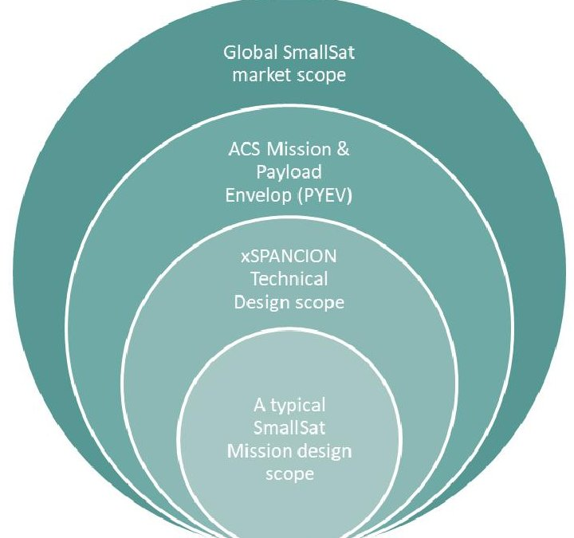
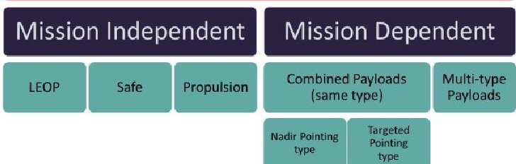
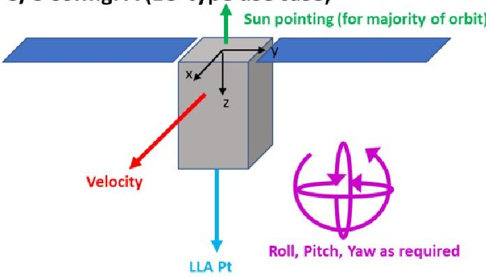
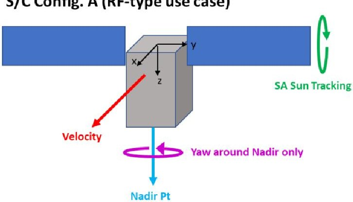
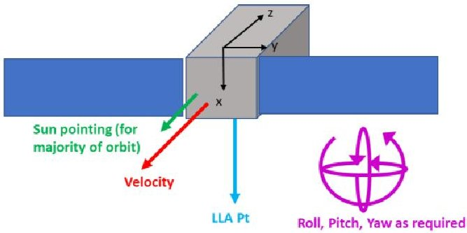
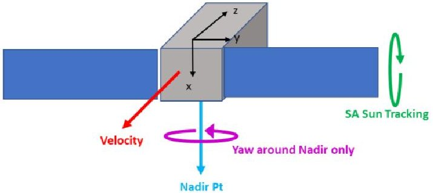
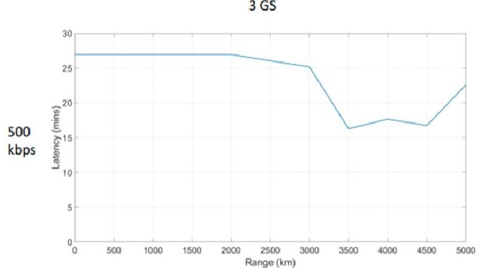
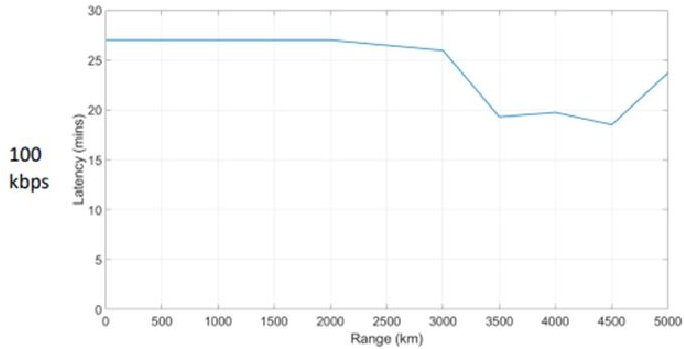
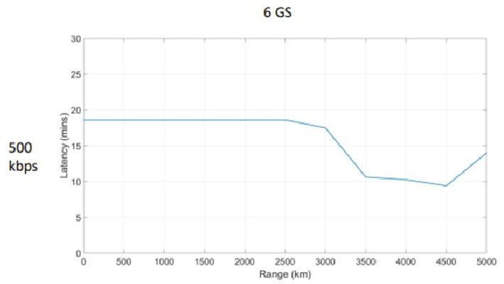
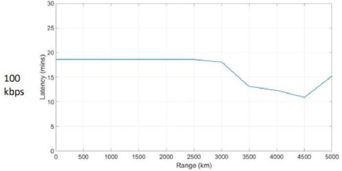

<!-- PDF_PAGE: 1 -->

$ 74^{\mathrm{th}} $ International Astronautical Congress (IAC), Baku, Azerbaijan, 2-6 October 2023. Copyright 2023 by Clyde Space Ltd.. Published by the IAF, with permission and released to the IAF to publish in all forms.

IAC-23-B4.6A.10.x78817

# xSPANCION: Modular satellite platform design for scalable and adaptive production

Lian Ming Goh $ ^{a *} $ , Dr Pamela Smith $ ^{a} $ , Dr Andrew Carrel $ ^{a} $

$ ^{a} $ AAC Clyde Space, Skypark 5, 45 Finnieston Street, Glasgow, G3 8JU, enquiries@aac-clydespace.com $ ^{*} $ Corresponding Author

## Abstract

Small satellites are playing an ever-increasing role in creating new opportunities for agencies and the commercial sector to apply value-added services that benefit and improve life on Earth. From disaster management and climate change monitoring to improving agricultural yields and establishing robust global communications network, the market demands for satellite data, both in quantity and quality, is rapidly growing.

xSPANCION is a part of the European Space Agency (ESA) ARTES Partnership Projects Pioneer programme, between industry, academia, and space agencies to address the need for a sustainable framework of delivering space data and services, quickly and at low cost. To meet the changing commercial market demands while also being scalable for efficient high-volume production of satellites, it is important to design satellites with modularity and flexibility in mind. The adoption of a Model-Based Systems Engineering (MBSE) approach enables an engineering team to capture and manage complex system interactions, dependencies, and requirements across the entire system development lifecycle. Consistent design and analytical satellite models that are traceable to engineering rationales can be re-used and re-baselined for future satellite missions, driving efficiency in the design cycle. To ensure efficient and cost-effective production of CubeSats, high-volume manufacturing and production methodologies such as Design for Manufacture (DfM) and Design for Test (DfT) are also adopted. This approach considers the use of automated assembly and testing systems, as well as adaptable ground support equipment (GSE) to streamline and standardise production and test processes.

This paper provides an overview of the innovative satellite system designed within the xSPANCION programme, specifically focussing on the modular and scalable aspects of the platform design and the engineering processes involved in maturing the design concept for rapid constellation production and test. A range of expected satellite constellation missions and services is first presented together with the envisioned changes in the satellite platform design to enable these mission concepts. The requirements derivation, systems analysis, and trade-study of the satellite system performance is conducted. Through an iterative process, the system architecture gradually solidifies to highlight the standardised aspects of design and those elements of the design that are mission specific. Finally, a discussion on the balance between standardisation and change is presented in the context of the verification and validation strategy of the satellite system.

Keywords: smallsat, cubesat, constellation, modular design, scalable architecture, adaptive production

## Nomenclature

1U-A standard unit of $ 1 0 \times1 0 \times1 0 $ cm for CubeSat definition.

delta-V - The change in initial and final velocity

Acronyms/Abbreviations

ACS-AAC Clyde Space

AOCS-Attitude and Orbit Control System

ASA-Articulated Solar Arrays

CAM-Collision Avoidance Manoeuvre

CONOPS-Concept of Operations

COTS-Commercially-Off-The-Shelf

DDVP-Design, Development & Verification Plan

DfM-Design for Manufacture

DfT-Design for Test

EMC-Electromagnetic Compatibility

EO-Earth Observation

EOL-End-Of-Life

ESA-European Space Agency

FDIR - Fault Detection, Isolation, and Recovery

GB - GigaByte

Gbps - Gigabits per second

GEVS - General Environmental Verification Standard

GNSS - Global Navigation Satellite System

GNSS-RO - GNSS Radio Occultation

GS - Ground Station

GSE - Ground Support Equipment

GSN - Ground Station Network

HDRM - Hold-Down Release Mechanism

HW - Hardware

ICD - Interface Control Document

IOD - In-Orbit Demonstration

IoT - Internet-of-Things

ISL - Inter-Satellite Link

kbps - kilobits per second

LEOP - Launch and Early Operations

LLA - Latitude, Longitude, and Altitude

M2M - Machine-to-Machine

<!-- PDF_PAGE: 2 -->

Mbps - Megabits per second

MBSE - Model-based Systems Engineering

MBVI - Model-based Vertical Integration

MSS - Mobile-satellite services

N/A - Not applicable

NASA - National Aeronautics and Space Administration

OAP - Orbit Average Power

P/L - Payload

PYEV - Payload Envelope

RF - Radiofrequency

RVCM - Requirements Verification Control Matrix

S/C - Spacecraft

SADA - Solar Array Drive Assembly

SADM - Solar Array Drive Mechanism

SW - Software

TB - TeraByte

V&V - Verification and Validation

VHF - Very High Frequency

WS - Workstream

## 1. Introduction

Small satellites (in short, smallsat) have been playing an increasing important role in today's space industry. Initially created with the intention for educational activities, cube satellites (termed, CubeSats) and smallsats are now pivotal for organisations and nations to establish their space-based capabilities and better improve their socioeconomic situations. According to Morgan Stanley's market research [1], it is projected that the New Space Economy could exceed $1 trillion by 2040. Euroconsult has also recently published its 9th edition of its' Small Satellite market intelligence report [2] stating that the smallsat industry within the New Space economy will grow to approximately $110.5 billion in market value over the next decade (i.e. to the year 2032). The driver for this continued growth is the replenishment cycles of constellations around the world as well as the increasing complexity of single satellite missions for government uses. According to the statistics, 90% of all smallsats launched were for constellations over 2023 to 2032 [2].

The drive for constellations is achieving global coverage and low latency. In combination with using smallsat within the constellation, a strong advantage of being relatively low cost and rapid time-to-market can be achieved. These characteristics enables smallsat to provide near-real time information and technology services from space to ground. As summarised in [2], 4 out of 7 major smallsat applications are providing data collected from space about Earth as a service. From disaster management and climate change monitoring to improving agricultural yields and establishing robust global communications network both on ground and at

sea, the market demands for satellite data, both in quantity and quality, is rapidly growing.

## 1.1 A generic platform for Constellation missions

As constellations of satellites are deployed into space on a regular cadence, a market opportunity is created for satellite manufacturers to offer a satellite platform that can go through rapid production, testing, and commissioning. The earlier the satellite can start gathering data, the earlier the return on investment can be realised. This eventually leads to the need to have standard processes in engineering, as well as a generic platform that can serve a variety of needs with minimal to no change required.

Having a generic satellite platform brings several advantages, both in the short-term mission delivery and the long-term scale-up of an organisation. From a technical perspective, having a generic platform design allows re-use of common features thus reducing overheads in bespoke analysis, test, and qualification campaigns for flight. The common design aspects shall only need to be qualified once, and so long as the interfaces and system behaviour of the common design stays consistent, an overall satellites qualification and testing campaign can be significantly simplified with only the scope of work that is outside of the generic platform design. The minimum quality is also ensured if the generic design is re-used providing confidence in the whole satellite system and retiring technical risks even before a mission starts.

In the context of a mission delivery to customers, quicker turnaround times can be achieved. In the longer term, a generic platform provides significant cost savings and solidifies stakeholder and customer trust in delivery.

In the context of a generic satellite platform that is designed for operating as a constellation, it is important the generic architecture considers the following aspects:

- Provides higher power generation, regulation, distribution, and storage capabilities,

- Provides higher data transfer rates, data processing, and on-board memory storage capabilities,

- Provides higher agility, finer pointing control, and in-orbit manoeuvring capabilities,

- Adopts Design for Manufacture (DfM) methodology for ease of manufacturing and rework,

- Adopts Design for Test (DfT) methodology for ease of testing and automation,

- Modular design for ease of 'plug-and-play' a range of peripherals to a generic core platform,

- Scalable design for servicing much larger or smaller performance needs relative to a generic platform product,

<!-- PDF_PAGE: 3 -->

- Reconfigurable design features to be flexible and robust in supporting mission-specific engineering work,

- Implements autonomous behaviours in both on-board spacecraft operations and on-ground mission operations,

- Efficient thermal management and control system, and

- Low levels of self-generating noise - electrical, radiofrequency (RF), and/or magnetics,

The above list is non-exhaustive and only highlights the key technical aspects. In addition to this, the appropriate engineering processes and workflows must be practiced ensuring consistency and traceability throughout the design, build, test, and operations. Change management, configuration management, and risks management must be considered and integrated into the project management and planning of the satellite engineering lifecycle.

## 1.2 xSPANCION programme

xSPANCION (eXtended Satellite Production ANd Constellation OperatioNs) is a technology development programme consisting of six technical workstreams (WS) listed as follows:

1. WS1000 Model-Based Vertical Integration

2. WS2000 Constellation-enabling Spacecraft Technology

3. WS3000 High-Volume Production Readiness

4. WS4000 Constellation Operation Readiness

5. WS5000 Application-focussed Customer Interface Development

6. WS6000 Demonstration

The first five of the workstreams run in parallel to one another and the development nature for each WS is sufficiently distinct to address a certain aspect within the business domain. Nevertheless they are interdependent as one domain feeds to another to ensure a successful constellation mission outcome. WS1000 focuses on process and quality improvements using a model-based engineering (MBE) approach; WS2000 contains specific technology developments for designing a constellation-ready satellite; WS3000 considers the production and testing processes and workflows to enable high-volume production including digital tracking and test automation; WS4000 involves the Mission Operations Centre (MOC) and the Ground Segment architecture to be constellation operations ready for commanding and controlling multiconstellation missions; and WS5000 aims to bring a streamlined and automated access for users to request data and services through a user-friendly API. The sixth workstream, WS6000, is effectively an in-orbit

demonstration (IOD) mission providing an opportunity to prove all the technologies developed under the previous five workstreams.

In a previously published paper presented by AAC Clyde Space at the ESA 4S Symposium [3], a comprehensive overview of the xSPANCION programme has been presented along with the impact each workstreams brings. Therefore this paper will only summarise the key aspects to provide context for the spacecraft design to be discussed in the remainder of this paper.

The uniqueness of xSPANCION comes from the fact that it does not specify a specific space mission need (at least for the first five WS of xSPANCION). Therefore, the scope of a typical space mission objective is not applicable. Rather, the technology developed must cater for a wide range of possible missions and applications including its associated operational and user needs. Across the entire business chain, the stakeholders involved within the xSPANCION programme range from senior managers, engineers, and technicians to business developers, suppliers, and product or service end-users.

For the purposes of this paper, the focus will primarily be on WS2000, where the engineering design and analyses activities of the spacecraft occur. Where relevant, the technologies of other WS will be mentioned to highlight dependencies, design and/or analysis drivers, and operational needs.

## 1.3 Innovative smallsat technologies in xSPANCION

xSPANCION WS2000 contains three (3) distinct constellation-enabling technologies which are:

1. Inter-satellite Links (ISL) - to overcome the challenges in data delivery by optimising the data transfer and delivery through the constellation, thus reducing latency and/or maximising data volume. There are many other benefits of having ISL onboard and one of the biggest advantages is to have ISL act as a backup to the usual telemetry and telecommand (TMTC) channels of a satellite [5].

2. Articulated Solar Array (ASA) - to maximise power generation capability in any orbits, allowing for more capable operations of the payloads and subsystems,

3. Propulsion combined with novel and autonomous manoeuvring techniques - to extend operational mission lifetime, thus maximising the service delivery lifetime while meeting responsive operational needs.

With the above listed technologies, the intention of WS2000 is to design, develop, and verify a constellation-ready spacecraft platform that contains

<!-- PDF_PAGE: 4 -->

generic hardware and software components for use in multiple satellite constellation missions. In terms of the spacecraft platform sizes, the design range is from 3U up to 16U with spacecraft mass between 3 kg and 32 kg respectively.

## 2. Methodology

In the context of WS2000 - Constellation-enabling Spacecraft Technology, the challenge is to design a spacecraft platform that can accommodate a range of constellation mission needs and accommodate a range of payload needs. On one side, designing for all possible missions would drive the spacecraft to be overengineered, costly, and impractical to manufacture, test, and operate. On the other hand, designing the spacecraft to have very limited capabilities would risk the product being unable to service a commercially valuable mission should the need arise. Hence, a delicate balance must be maintained between the spacecraft performance and the mission scoped.

To ensure this balance was maintained, an extensive scoping exercise was performed to identify potential satellite missions that are both commercially valuable and achievable for AAC Clyde Space. Mission drivers and justifications were summarised and multiple internal workshops were held to gather feedback from various internal stakeholders (i.e. with business development, engineering, and manufacturing). For every mission scoped, the likely payloads were also included as it is important that the spacecraft can accommodate the technical needs of the payload (mass, power, data, and so on). Multiple payloads and missions subsequently formed an enveloping profile-a Payload Envelope (PYEV) Specification, where the maximum and minimum range of the technical envelope may not necessarily come from the same payload or the same mission.

Using the PYEV Specification defined as a guide, a set of comprehensive spacecraft requirement (both SW and HW) were derived. The systems-level spacecraft requirements were decomposed by considering the engineering complexity, time-to-market, initial cost overheads, and any foreseeable risks (both technically and commercially such as changing market demands). System analyses were performed to assess the feasibility of having a single spacecraft design to accommodate all requirements, or if there is a need to split the spacecraft design into more than one. Engineers were given multiple opportunities to feedback the technical challenges to the relevant stakeholders where certain features and performance requirements are too constraining for the system design. At the end of the systems technical assessment, a realistic technical scope was defined against the initial PYEV specification. A

technical development roadmap was also created to capture the design, development, and verification plan (DDVP) of the technical scope but also to chart out the future work of bridging the differences between the two technical scopes. Figure 1 shows a simple illustration of where the PYEV and realistic technical scope sits in the broader picture. For the xSPANCION satellite design, the balanced technical design scope is addressed.

As the xSPANCION technical design scope is composed of various mission and payload demands, several mission scenarios or use cases were defined for detailed verification purposes. The realistic mission use cases or reference scenarios would specify the Concept of Operations (CONOPS) as per any typical SmallSat mission. The CONOPS associated to each reference scenario acts as a reference to detailed engineering design and analyses down to subsystem and componentlevel. To a large extent, it would also drive the equipment and component selection for a 'standard' xSPANCION spacecraft platform. Nowadays commercially-off-the-shelf (COTS) products are preferred over bespoke, in-house developed products. Therefore, understanding the needs and a clear selection criterion for choosing the appropriate products are a crucial part of the satellite design process. Multiple engineering workshops and iterations were held, both within and across engineering disciplines, to shape the reference scenarios to be realistic and challenging.

Fig.1. Illustration of technical mission and payload scope.

The reference scenarios are categorised into mission independent and mission dependent scenarios. For every satellite mission (whether it is a single satellite or a constellation), a spacecraft will experience and go through each of the mission independent scenarios at some point within its mission lifetime. There are

<!-- PDF_PAGE: 5 -->

numerous other common operational scenarios, however, from an edge case or worst-case design and analyses perspective, grouping these scenarios together would avoid duplication of engineering work and most importantly, provide a clear path to standardise engineering solutions across missions. Figure 2 summarises the main reference scenarios for the xSPANCION programme.

xSPANCION Reference Scenarios

Fig. 2. Breakdown of the xSPANCION main reference scenarios to guide detailed engineering.

The Launch and Early Operations (LEOP) scenario is critical for sizing a satellite's standard power, thermal, and AOCS subsystem. Compared to traditional large satellites having dedicated launches, typical CubeSats are deployed into orbit via a deployer pod or an in-orbit carrier vehicle. This manner of 'piggyback' orbit deployment does not provide the luxury of choosing exactly how the environment of the CubeSat will be once deployed. In certain cases, a deployed satellite tumbling uncontrollably at a random angular rate could cause the satellite to be in a dangerous situation from a power and thermal perspective in the worst case causing a loss of satellite and/or the mission. According to a reliability paper published [4], approximately 20 40 % of all small satellites launched have failed in the first month of their mission post-deployment. The cause of failure could either be due to environmental effects (such as radiation, thermal cycling, and so on) or operational effects (such as unsuccessful deployment or LEOP, and so on). This further justifies the need to have a dedicated analytical scenario defined to address this mission-critical phase. Furthermore, having a standardised approach to LEOP ensures a consistent design, production, and operational strategy, which in turn serves as a foundation for scaling up of the business and technology capabilities.

Similar to the LEOP scenario, the Safe scenario focuses on having the spacecraft designed to survive under an uncontrolled attitude throughout all possible CONOPS in a satellite's mission lifetime, including a successful End-Of-Life (EOL) operation. The engineering intention is for a satellite to survive in an 'uncontrolled safe mode' meaning that once a satellite falls into Safe mode with only mission-critical components powered on, the satellite should not need to

be in a position to have its' AOCS system activated thus conserving power.

The Propulsion scenario describes a case where the satellite uses the propulsion subsystem to perform orbital manoeuvres in space. The system demand of a propulsive manoeuvre operation varies depending on the nature of the operations such as altitude maintenance collision avoidance, phasing, and so on. One of the most challenging aspects for performing an accurate design and analysis is the Collision Avoidance Manoeuvre (CAM) operations. Some factors to size the delta-V needs correctly includes but not limited to the traffic of the orbit, a satellite's acceptable collision detection sphere, confidence of the AOCS to perform the manoeuvre, and more. All these factors including a standard operational manoeuvre strategy would influence the sizing of the propulsion system and thus the satellite system design.

It is worth noting that although there has been extensive design and analyses work on standardising the spacecraft design using the reference scenarios, it is important to recognise that there will still be unavoidable design changes and analysis reruns when an actual space mission comes. As the generic satellite design gets more detailed, the number of analytical use cases increases along with seemingly endless trade-off assessment between conflicting requirements.

Instead of spending a significant time iterating the generic satellite design, a reasonable level of fidelity in design and analysis was established. Upon reaching a satisfactory level and accepting that certain technical concerns and risks can be addressed at a mission-specific phase, the generic design and analysis outcomes could be formalised and justified. While going through the engineering exercise of designing the generic satellite design, a key point to bear in mind is understanding the limitations and constraints of the design under different operational environments rather than optimising the performance of the design.

This knowledge and understanding of the design limitations would help greatly for when a satellite mission design starts building from the generic design instead of starting from scratch. The technical risks carried forward from the generic design are already well understood and the focus on mission-specific engineering work would be to highlight all the deltas and deviations from the standard baseline.

The outcomes of all design and analyses work from each engineering domain leads to a list of compliance statuses against the reference scenarios and spacecraft requirements defined. The compliance statuses are then summarised in an overall Requirements Verification Control Matrix (RVCM) with clear reference back to each engineering design or analysis activity. Where there is a non-compliance, a justification and a resolution are provided in the RVCM.

<!-- PDF_PAGE: 6 -->

Reiterating on the philosophy of analysing the worst cases of enveloping mission needs, it is not necessary to ensure that the complete generic spacecraft design will be fully compliant with the requirements set. This is because a realistic mission use case may not see the full worst-case envelope during its mission lifetime. Therefore, a summary of the generic performances and capabilities are formalised into a Spacecraft Platform Interface Control Document (ICD).

The 'missionisation' work from the generic spacecraft platform to a mission-specific spacecraft platform starts with the requirements compliance matrix and the Spacecraft Platform ICD. By comparing the information to the mission-specific requirements and user needs, only the changes from the generic design (both HW and SW) are identified to suit a mission-specific design. The subsequent engineering work involved for verification and validation purposes would also focus on the deltas and changes, acknowledging that the standard baseline product has been sufficiently verified in previous phases.

## 3. Systems Engineering and Design Envelopes

Following the methodology presented in section 2, the PYEV specification is formulated based on likely constellation missions scoped out according to the following mission types as defined in [2]:

1. Satcom - Satellite systems funded by civil or defense government agencies for broadband and mobile-satellite services (MSS) communications services including internet, broadcasting, and so on

2. Earth Observation - Satellites for electro-optical and radar observation of the Earth, as well as for meteorology, both for operational and Earthscience research purposes. It also includes GNSS radio occultation (GNSS-RO).

3. Information - Smallsats providing narrowband communications services such as Internet-of- Things (IoT), Machine-to-Machine (M2M), and data collection from ground, aerial, and atmospheric sensors.

4. Technology - Technology development satellites built to test new technologies or platform/payload components; some technology satellites may serve other applications on a non- operational basis.

5. Science and Exploration - Smallsats for astrophysics and astronomy, planetary science (including Earth science and lunar missions), heliophysics, and solar-terrestrial interactions.

For simplicity, Table 1 summarises the Payload Envelope (PYEV) specifications across the mission

types and performance demands of the spacecraft. All relevant payload (P/L) technical needs and spacecraft performance needs are also tabulated. It can be observed that for M2M RF mission types under consideration, the power demands, and to a certain extent, the thermal demands are a worst-case envelope. Whereas for general EO-type missions, the pointing and the associated jitter and smear requirements are relatively tighter. From a data delivery perspective, low latency and responsive operations are a must for RF-type missions. However, the data volume and data transmission throughput are more demanding for the EO-type of the missions assessed. The associated data memory storage requirement for EO-type missions are also higher.

Table 1. Summary of Payload Envelope (PYEV) Technical specifications based on general mission types

<table border="1"><tr><td>Performance needs</td><td>EO-type Missions</td><td>RF-type Missions</td></tr><tr><td>Data Latency</td><td>&lt;24hrs</td><td>&lt;10mins</td></tr><tr><td>Data Volume</td><td>4TB/day</td><td>10GB/day</td></tr><tr><td>Data Throughput</td><td>1.0Gbps</td><td>4.0Mbps</td></tr><tr><td>Geocoding</td><td>&gt;100m</td><td>N/A</td></tr><tr><td>Payload Mass</td><td>12kg</td><td>8kg</td></tr><tr><td>Payload Volume</td><td>12U</td><td>9U</td></tr><tr><td>Payload Power</td><td>10W(peak)</td><td>45W(peak)</td></tr><tr><td>Payload Memory</td><td>&gt;128GB</td><td>&gt;16GB</td></tr><tr><td>Payload Pointing</td><td>&lt;0.1°</td><td>&lt;2.0°</td></tr></table>

It is worth noting that there are special circumstances and unique characteristics of a mission type that were not summarised into Table 1. An example would be electromagnetic compatibility (EMC) requirements, which drives the RF platform design down to component-level oscillator frequency selection. Another example would be magnetic cleanliness requirements, which drives the material selection of the platform as well as the AOCS actuator and magnetometer sizing and performances. It is important that the majority, if not all, of these requirements are identified and acknowledged as part of the PYEV technical envelope and mission scoping exercise, and that these specific cases should be evaluated on a case-by-case basis for design implementation. If deemed necessary and these requirements are found to be common for the majority of mission types, the generic platform design should account for it, otherwise the

<!-- PDF_PAGE: 7 -->

engineering consideration and assessment would be performed at a mission-specific build.

Taking the mission operations, orbital needs, and likely spacecraft configurations into account, ageneric systems engineering assessment has resulted in the following spacecraft configuration options as shown in Figure 3 and Figure 4.

S/C Config. A (EO-type use case)

S/C Config. A (RF-type use case)

Fig. 3. Spacecraft configuration option A.

Spacecraft configuration A in Figure 3 illustrates the long axis of the spacecraft body aligning towards nadir. From a mechanical layout and equipment accommodation perspective, an EO-type mission may have long optical payload imagers and therefore configuration A would work for these. However, for RF-type payloads which use patch or deployable antennas of different RF frequencies to be mounted externally to the surface of the satellite, spacecraft configuration B, in Figure 4, may have an advantage due to its larger surface area facing to one direction (i.e. to Nadir).

S/C Config. B (EO-type use case)

S/C Config. B (RF-type use case)

Fig. 4. Spacecraft configuration option B.

The RF-type use case in both Figure 3 and Figure 4 utilises one of the three innovative constellationenabling technologies, which is the Articulated Solar Arrays (ASA) for maximising power generation in any orbit. Another argument here is that the EO-type configuration will not be constantly pointing to nadir as the mission is to observe and image targets on Earth. Imaging operations would require LLA (Latitude, Longitude, and Altitude) pointing; as and when the satellite is not performing imaging operations, it defaults to Sun-pointing. In this scenario, the justification is sufficiently provided that there is not a need for ASA in EO-type missions.

Propulsion is baselined in all spacecraft configurations primarily due to regulatory guidelines. Consideration of ISL is less straightforward and requires a few systems analysis and trade-offs, which will be described in the following section.

## 4. System Analysis and Trade-offs

## 4.1 ISL system technology assessment

As the ISL system is a novel technology for the CubeSat industry, there were numerous challenges and trade-off assessments made to ensure the design is appropriate in terms of the cost, schedule, and intended performance.

One of the analyses performed was on the usefulness of the ISL system, on top of what was already presented in [5]. The factors include but are not limited to the following:

<!-- PDF_PAGE: 8 -->

- Constellation size (i.e. number of satellites with ISL)

- Constellation configuration (i.e. how the satellites are distributed in the constellation affects the ISL contact duration for adjacent satellites)

- Ground Station Network (GSN) distribution

- ISL space-to-space link distances

- ISL data transfer rates

- ISL field-of-view (an RF-type ISL system was assumed).

An ISL link budget was performed together with realistic mission analysis and data transfer algorithms. The trade-off was to investigate if a higher ISL data transfer rate would reduce the number of ground stations needed for the mission.

The ISL scan angle and the field-of-view (FoV) is the same in this analysis as the assumption was made that this factor would not contribute to a significant change in the initial assessment. However, it is acknowledged that this is a factor that must be considered for detail analyses as the FoV varies based on the frequency band selection and allocated from ITU, the physical limitations of a CubeSat's surface area, the external allowable thickness of a deployer pod, and the ability to have electronic beamforming and beamsteering capabilities or relying on the full spacecraft attitude changing. Having the ISL attitude changing during ISL contact times may impose an additional operational constraint on the satellite for power generation, target imaging, thermal optimisation, and many more factors.

Fig. 5. Latency plots against ISL link distances for 3 ground stations.

The results show that the increase in ISL data rates is not as significant as compared to the increase in ISL maximum allowable link distances on latency improvements. There seems to be a threshold value for the ISL link distance that once the threshold value is met or exceeded, data latency improves by approximately 20-30 %. This can be explained by having limited useful contacts between satellites (i.e. contacts that would actually offer much in the way of latency benefits). This is reflected in Figure 5 where the data latency reduces significantly after 3000 km.

It can also be observed in Figure 6 that when the number of ground stations (GS) are doubled under the above scenario, the data latency further improves by another 20%. An initial conclusion can be drawn that the implementation of an ISL system could bring a 20 40 % improvement in the data latency and data delivery, provided that the constellation and GSN is sized and appropriately distributed.

Fig. 6. Latency plots against ISL link distances for 6 ground stations.

At a systems-level, the ISL is designed as a standalone subsystem to be mounted onto the generic xSPANCION spacecraft platform. It will undergo its own subsystem-level qualification and testing campaign up to NASA GEVS standards as well as providing standalone HW and SW interfaces for any on-board processors to command and control it.

By segmenting the generic system architecture in this manner, the ISL subsystem effectively becomes an optional COTS product for every spacecraft mission going forwards. Instead of reinventing the wheel of an

<!-- PDF_PAGE: 9 -->

ISL design, the focus of majority of the engineering efforts for a mission would be a fit/no-fit assessment of the ISL subsystem to meet the mission requirements.

## 4.2 ASA performance trade-off assessment

The articulated solar array (ASA) consists of several components, most of which are industry standard for the CubeSat market such as deployable solar arrays or body-mounted solar arrays, hinges, and Hold-Down Release Mechanisms (HDRM). What makes the ASA technology challenging at a spacecraft systems-level is accommodating the Solar Array Drive Mechanism (SADM) or the Solar Array Drive Assembly (SADA) within the overall generic spacecraft architecture design. SADA is typically used in traditional large satellites (500 kg and above), however, for xSPANCION's use case the design challenge is to fit a SADA within a compact volume constrained by a CubeSat form factor (approximately 200 x 200 x 400 mm) along with all other electronics, structural and thermal elements, AOCS sensors and actuators, Communication radios, harnesses, and many more. The mass, power, thermal, and pointing budgets are very tight within a CubeSat and there is typically a strict static and dynamic structural envelope on the external of the satellite assembly due to the need to insert and deploy the satellite from a deployer pod rather than directly from a launcher separation interface. Thus, a limited protrusion thickness of the satellite introduces an additional layer of complexity in the spacecraft's mechanical layout assessment.

From a generic platform design perspective, the mechanical placement of the SADA is crucial to accommodate for a variety of deployable solar arrays configuration (e.g. deploying from the long-edge of the satellite or from the short-edge of the satellite as shown in Figure 3 and Figure 4). Similar to the development of the ISL subsystem, the SADA component (both HW and SW) was designed to be a fit/no-fit equipment on the generic platform. This is because some missions may not require such high-power demands (e.g. imaging missions) therefore it would simplify the mission-specific spacecraft development if a typical fixed deployable solar array system is used. As and when the need for SADA arise, a few design topics should be considered more thoroughly within the mission-specific engineering work package such as microvibration effects, EMC, and Fault Detection, Isolation, and Recovery (FDIR) design. The output of each assessment will subsequently inform and drive how rigorous the simulation, testing, and qualification of the spacecraft should be.

To provide further insights into the usefulness and value of mounting a SADA at a generic platform-level, a trade-off comparison is performed on the net Orbit

Average Power (OAP) of using and not using a SADA. The trade-off assessment was performed based on an example operational profile of a Nadir Pointing type reference scenario as outlined in the xSPANCION Reference Scenarios from Figure 2 in section 2 above and with the spacecraft configuration A (RF-type use case) from Figure 3.

From the summary performance results in Table 2, it can be observed that a spacecraft design with SADA consumes more power but at the same time is able to provide more power generation to support a wider range of operational activities. An example is given in the table where the 'Available Payload Power (OAP)' can be up to 44.73 W. Whereas a spacecraft design without SADA can provide up to 25.24 W at EOL worst case analytical conditions. This is 40-50 % improvement in power generation capability. Both comparison cases have the same solar array configuration, same orbits, and same generic platform spacecraft power consumption. The difference is in the case with SADA, the spacecraft is allowed to perform yawing attitude manoeuvres where necessary to maximise power generation. With a single-axis articulation and the ability to yaw the spacecraft, the generic design can minimise the beta angle, which is the angle between the sun vector and the orbital plane. In other words, a single generic spacecraft platform design with SADA is flexible enough to fit all orbits, at least from a power generation perspective.

Table 2. Summary of spacecraft OAP generation performance in an example use case.

<table border="1"><tr><td>OAP Performance at EOL</td><td>With SADA</td><td>Without SADA</td></tr><tr><td>OAP Consumption</td><td>63.33W</td><td>43.82W</td></tr><tr><td>OAP Generation</td><td>63.98W</td><td>45.21W</td></tr><tr><td>Net OAP</td><td>0.65W</td><td>1.39W</td></tr><tr><td>Net DoD per orbit</td><td>+0.41%</td><td>+0.86%</td></tr><tr><td>Available Payload Power(OAP)</td><td>Up to44.73W</td><td>Up to25.24W</td></tr><tr><td>Articulation</td><td>One-axis</td><td>N/A</td></tr><tr><td>Range of available orbits for S/C operations</td><td>Flexible for all orbits(Beta angle0°-90°)</td><td>Bespoke design for each orbit or beta angle</td></tr></table>

From the results in Table 2, there would be cases where the spacecraft platform design without a SADA mounted will be useful. For example, if the payload

<!-- PDF_PAGE: 10 -->

selected for a mission is less than the threshold quoted in the table, to reduce complexity during analyses and test as well as minimising cost, the SADA could be excluded from the generic spacecraft design if the overall system meets the mission requirements.

## 5. Standardisation versus Missionisation

As shown with the examples presented in preceding sections, the generic xSPANCION platform has the flexibility to mount and unmount the various constellation-enabling technologies depending on the mission needs. The range of performance and design limitations are identified through system analyses, trade-offs, and iterations with subsystem engineers where relevant to draw conclusions on a baseline with assumptions.

As mentioned in section 2, it is also not the intention of this engineering work to produce a finalised design, but to perform sufficient engineering work on understanding where the technical risks and behaviours of the satellite are.

Where those risks and behaviours would concern a particular mission, it shall be dealt with in the mission-specific work package. Results and outcomes should be fed back to the generic platform design for improvements and lessons learned.

Strict processes are followed for configuration management, change management, and quality / product assurance. This is to ensure that any updates in one area is always reflected, and the traceability is captured. Periodic technical workshops are proposed to review and update the standard requirements, standard design, and the associated standard test activities.

## 6. System Verification & Validation

The V&V campaign of the generic platform design shall be performed once, ideally, and the results are referenced for every mission-specific build going forwards that re-uses the exact same common elements of the generic design without modifications.

Where a change or a modification is necessary, an impact assessment should be carried out to identify and scope out the criticality of the change on the wider system. For example, invalidating the qualification test results of the generic system is a major change that requires a delta-qualification or a full qualification campaign.

Where there are new improvements on the standardised product designs, every new improvements could be developed, tested, and qualified in isolation as a standalone unit prior to integration testing, so long as the standard interfaces and expected standard system behaviour stays consistent.

There may also be incremental improvements from mission to mission, however it is important to justify the value of those since it may be due to a specific need for that mission only and not applicable for the rest of the fleet of satellite builds.

## 7. Conclusion

A comprehensive methodology of approaching a generic satellite platform design has been presented, along with examples of engineering assessments and the considerations made during trade-offs. One example being the ISL system as an innovative generic technology to service constellation mission needs in a robust manner. Where a constellation mission demands it, the generic spacecraft platform design can include the ISL system, further improving the data latency by 20 40 %. Another example is the trade-off performance assessment of the ASA system, where SADA is treated similarly as an optional equipment in the generic spacecraft platform design. Where a mission demands higher power needs and complex operations (i.e. a high power payload or electric propulsion), having a SADA included in the spacecraft design can maximise the power generation capability of the spacecraft, whilst also be flexible in the range of orbits to operate in.

The xSPANCION programme has developed a generic satellite platform design capable of serving various smallsat missions, including constellation and swarms. The generic satellite technology contains modular subsystems, standardised avionics, and several default configurations. Together with default optional equipment mounted to the generic satellite platform, the performance and capabilities of the whole system is characterised, and all relevant open points, technical risks, further investigations, and concerns have been logged and documented.

As the xSPANCION programme moves into a mission-specific build, the documented information will be carried forward and detailed where relevant depending on the nature of the mission. A mission-specific spacecraft build will be deployed into orbit for a technology demonstration mission and ultimately validate the functionality, behaviour, and performance limitations of the generic satellite platform technologies - both at a systems-level and subsystemlevel.

## Acknowledgements

The xSPANCION project is structured as a Public Private Partnership, in which AAC Clyde Space (prime). and its partners, Bright Ascension Ltd., the University of Strathclyde, D-Orbit UK, Alden Legal UK and the Satellite Applications Catapult are working in

<!-- PDF_PAGE: 11 -->

partnership with the UK Space Agency and the European Space Agency to develop a Space Data as a Service offering. xSPANCION is co-funded by the UK Space Agency, through ESA's Pioneer Partnership Projects. We are grateful to all programme partners for their contributions.

## References

[1] M. Stanley, Space: Investing in the Final Frontier 24 July 2020 https://www.morganstanley.com/ideas/investing-in space

[2] Euroconsult, Prospects for the Small Satellite Market, 9th edition, July 2023

[3] P. Smith, A. Carrel, xSPANCION: Extended Satellite Production and Constellation Operations, The 4S Symposium 2022, Vilamoura, Portugal, 16 20 May.

[4] J. Bouwmeester, A. Menicucci, E.K.A. Gill Improving CubeSat reliability: Subsystem redundancy or improved testing?, Reliability Engineering and System Safety 220 (2022) 108288

[5] C.J. Lowe, M. Macdonald, Space mission resilience with inter-satellite networking, Reliability Engineering and System Safety 193 (2020) 106608