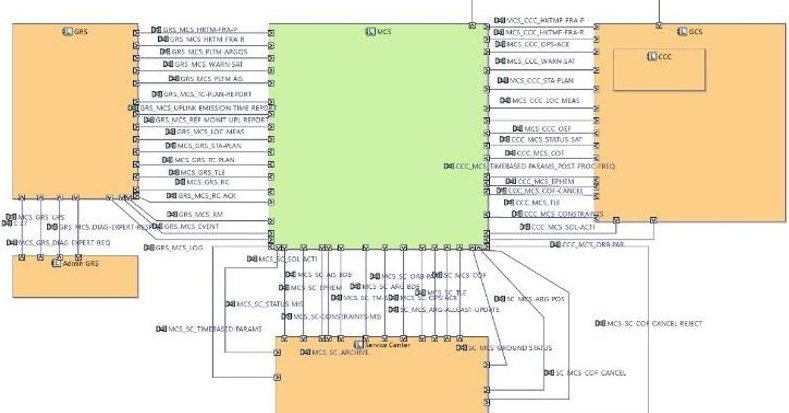
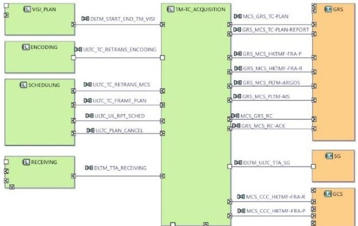
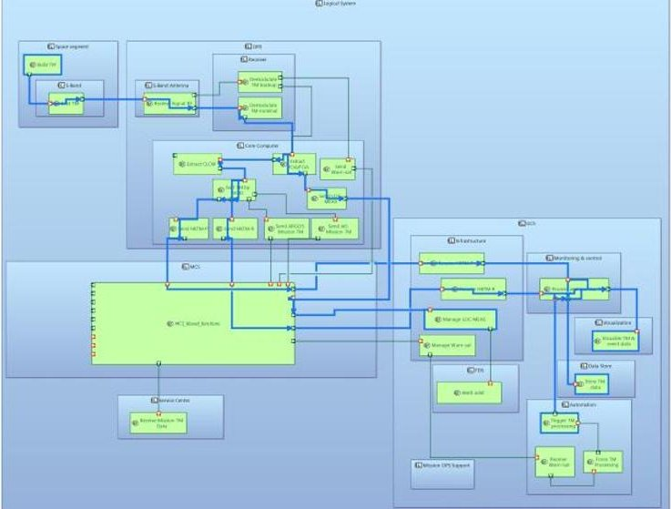
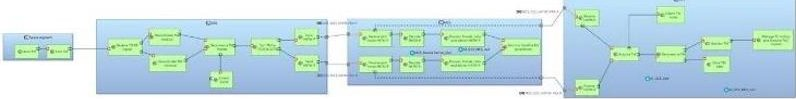
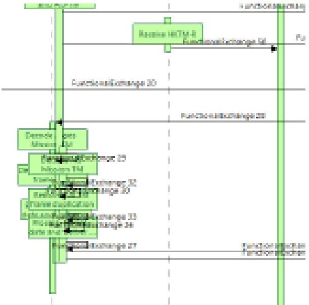
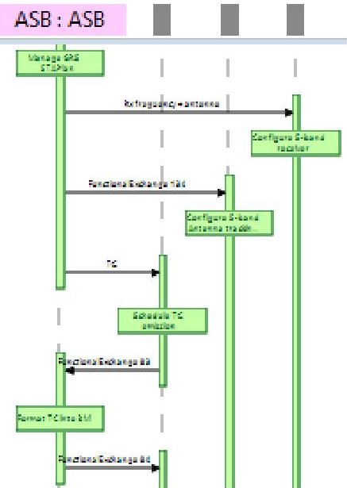
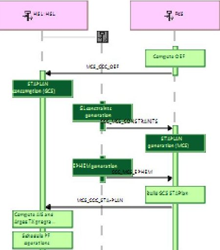

<!-- PDF_PAGE: 1 -->

# Optimization of Kinéis (nano-satellites constellation) system tests using MBSE approach

Jonathan LASALLE

ARTAL Technologies, 1 rue Ariane, 31520 Ramonville-Saint-Agne, jonathan.lasalle@artal.fr

Isabelle HERNANDEZ

Kinéis, 11 rue Hermès, 31520 Ramonville-Saint-Agne, ihernandez@kineis.com

Nathalie CORCORAL and Julien REY

CNES, 18 avenue Edouard Belin, 31400 Toulouse {nathalie.corcoral, julien.rey}@cnes.fr

## 1 Introduction

Founded in 2018, Kinéis is a satellite operator and a global connectivity provider. It inherited CNES and CLS expertise from forty years of working with the Argos system and developed reliable technology that provides easy access to useful satellite data.

Kinéis's objective is to strengthen the historical and reputed Argos IoT service, ensure its continuity, enhance its performance, and continue to make it a strategic technology for science.

The current challenge consists in adding 25 advanced nanosatellites in the existing system in order to improve IoT capabilities and address new markets.

The Space segment is completed by a specific Ground Segment designed for Constellation Operations and unusual Operations Concepts.

Taking advantage of Capella evaluation on SVOM project, CNES proposed to Kinéis to experiment MBSE approach for its System Validation process. This activity, launched on 2021 with Artal support, is still in progress. Nevertheless, the first feedbacks are available, regarding different axis: starting MBSE approach when system architecture is almost finalized, using Capella models on different representation layers, improving communication internally and with partners, return-on-investment for validation process.

## 2 MBSE-oriented objectives

Rich in Artal MBSE experience, the CNES goal was to propose the MBSE approach in order to assist the design and the validation of the Kinéis system. Unfortunately, the MBSE approach was not introduced in the first phases of the project but during system and subsystem architecture definition. Consequently, a focus was made on the finalization of the architecture, the interfaces and on the definition of system validation process.

The main gains that were expected concerned the two following pillars:

1) Communication: to improve the communication between stakeholders by using a rigorous and yet reader-friendly language, and thereby reducing ambiguities.

2) Test Scenarios automatic generation: to take advantage of the formal description of the system to generate system scenarios using functional chain description

Secondary objectives were also identified: to assist specification securing (regarding consistency, completeness...) and to generate assets (documents, code, database schema, etc.). About this last point, we currently plan to export the test scenarios captured using Capella (and associated extensions) into the project management tool used by Kinéis: Jira. This link should improve the qualification traceability.

## 3 Capella models

The MBSE activities of this project were realized using the Capella tool [2], an open-source graphical modeller based on the Arcadia Method [1] (Arcadia is a model-based engineering method that defines high-level concepts). Capella is mainly based on four representation layers, dedicated to the system needs capture

<!-- PDF_PAGE: 2 -->

(Operational Analysis (OA) and System Analysis (SA) layers) and to its associated solution specification (Logical Architecture (LA) and Physical Architecture (PA) layers). The different representation layers are linked together in order to apply traceability and coverage mechanisms.

Following the principles defined during the previous CNES Proof of Concepts, this project naturally began with the capture of the system architecture itself using Capella.

Equipped with a complete Capella training, Kinéis experts were able to start to capture the system specification progressively. The need analysis and the definition of the solution were already performed using other methodologies. It is for this reason that the modeling started from the Logical Architecture layer.

The first contribution of Capella models was to finalize the system and the subsystems interfaces. The injection of functional description was really helpful in order to complete the existing specification and to fully specify functional interface between sub-systems, which is a crucial step for system test design.

During this step we faced a first challenge regarding Capella model reconciliation, as described here after. Indeed, one of the subsystems was already described by another stakeholder, also using Capella.

In the following representation of the overall system, the green part (representing one of the Ground System Components) was described in detail in another pre-existing Capella model.

It should be noted that this sub-model does not include functional behavior description (unlike the Kinéis System model), and only contains logical

interface description, as described in the following figure.

Therefore, the reconciliation and the creation of traceability links between these two models were not trivial. As it is not well tooled-up in the context of Capella, we decided to implement a dedicated process. This process was based on automated file generation allowing an assisted comparison of component interfaces. We were then able to complete the global model manually, based on "easy to read" reports of models comparison.

The time saved thanks to this extension does not prevent this task from remaining laborious. Retrospectively, it would have been preferable to initialize the global model prior to the sub-model. Then, the initialization of the sub-model (using the system-subsystem Capella extension for example) would have allowed to obtain a proper traceability between the two models.

## 4 Communication optimization

All along the modelling phases, we faced the difficulty to share the model with engineers that were not trained to Capella. Indeed, for example, Capella LAB (Logical Architecture Blank) diagrams can potentially contains several kind of graphical items with specific associated semantics.

<!-- PDF_PAGE: 3 -->

In order to facilitate the understanding of the captured functional behaviors, the modelling team created, manually, dedicated LAB representations, focused on selected functional chains. The goal was to create "flat" representations and to remove some hierarchical structures in order to facilitate the reading of the produced representations. These communication medium were quite laborious to create and to maintain all modifications of a functional chain required to manually update the derived LAB views. Nevertheless, those representations allowed the teams, in charge of the different system components, to jointly identify the interfaces, the test perimeters, and the development priorities according to system test schedule. This is a real added value in comparison with document centric approach.

In order to improve communication through the Capella models, it was decided to implement a Capella extension dedicated to the automatic generation and update of the LAB diagrams. Those ones provide simplified visualizations of allocated functional chains.

This Capella extension works as follows:

1. The user create a new Logical Architecture Blank (LAB) diagram

2. The user imports, using the native "Add Component" tool, the components to display. The idea is there to avoid to import too many components in order to obtain simplified diagrams (without displaying all components hierarchies that can interfere with diagram understanding).

3. Using a dedicated new button (provided by the Capella extension), the user can import the content of one (or several) functional chain.

The obtained LAB is a native LAB. The tool only helps user to generate it then avoiding laborious manual steps.

If the functional chain is semantically updated from elsewhere (from an LFCD (Logical Functional Chain Description) diagram for example), the user can easily update this representation using a dedicated "synchronization" button that will add and remove

functions and links that were added and removed during the update.

Using this extension, such kind of representation can be generated and updated with a low number of user actions. This shortcut has been largely used by the modelling team, making drastically easier the communication between engineers (without any Capella knowledge).

This new feature is integrated inside a proprietary Capella extension, developed and owned by Artal presented in the next section.

## 5 Sequence diagram improvement

Based on the process initiated in collaboration between the CNES and Artal [3], the system test specification can be performed by a dedicated Capella extension developed and maintained by Artal. It consists in using functional chains as reference for the definition of test sequences represented using Sequence diagrams. A dedicated tool allows the user to generate automatically diagrams from a given functional chain. Then, the test scenarios can be customized and annotated in order to inject "chronological" constraints.

The use of this existing tool in the Kinéis model highlighted the limitation of Capella in term of sequence diagram use. Indeed, functional chains specified in the context of the Kinéis are more complex than other experimented space systems. The "constellation" aspect of the system makes it more complex than "classical" space systems, making scenarios less readable. For example, Capella will propose by default such kind of representation for the functional chain previously depicted.

(This image is blurred because it contains confidential data)

<!-- PDF_PAGE: 4 -->

This "unreadable" graphical result is due, in this case, to a high number of functions displayed in a single timeline, all being interconnected (one timeline representing one component).

Then, through a collaboration between Capella experts and system test engineers, new ergonomics concepts were designed and implemented inside Capella.

First of all, we injected a representation mechanism that allowed to split "superposed" function on parallel branches as depicted on the following representation (to avoid functions to be superimposed).

(This image is blurred because it contains confidential data)

Another injected improvement consist in allowing users to use sub-functional chains instead of unitary functions in such kind of diagram (in order to reduce the number of items to display and make the diagrams more readable). In the following diagram, the light-green boxes represent unitary functions whereas dark-green boxes represent functional chains (themselves representing sub-functions).

(This image is blurred because it contains confidential data)

All these improvements made all complex functional chains we met during the Kinéis system modelling representable using "new" sequence diagrams.

However, beyond the "visualization" issue, the edition capability was also an obstacle when using this mechanism operationally: these kinds of diagrams are quite laborious to edit given that a lot of graphical constraints exist. Indeed, when the user graphically moves one item of a sequence diagram, all linked items are moved automatically in order to maintain the consistency of the representation. Given this principles, Capella sequence diagrams are unusable when sequence diagram are too complex (too many links between too many functions). Then, we decided to update the native pattern in order to remove graphical constraints. In our new version, the moving of a graphical items did not have any other graphical impact. The user had to move manually other linked items in order to maintain the semantic consistency.

## 6 Conclusion

This work highlights that the MBSE approach was strongly useful:

1. To define the Kinéis system functional chains, making drastically easier the communication between the engineers from different disciplines (without any Capella knowledge).

2. To ease the system tests perimeter definition using functional chains. Indeed, they describe the system with an operational point of view that facilitates the definition of the qualification test (tests performed without temporal aspects).

3. To assist the System Tests Operational scenario definitions using the functional chain description in Capella and the automatic insertion in Sequence diagram with temporal aspects.

Additionally, this functionality eases communication between engineers and improves the System Test procedures writing.

<!-- PDF_PAGE: 5 -->

Nevertheless, it should be underlined that:

1. MBSE method and Capella need training. For engineers who are not familiar with them, time consuming is very high.

We recommend that all the engineers follow a first level MBSE & Capella training. Additionally, the support of MBSE & Capella expert, in charge of capturing, editing, and maintaining the models is required.

2. Capella tool has limitations, add-ons development, specified with the final users, are needed. It requires effort to maintain the solution developed.

To conclude, we consider that MBSE and Capella are useful for Kinéis System test definition and preparation. We plan, in the next step, to interface Capella and Jira tool in order to improve the overall qualification process.

## References

[1] VOIRIN, Jean-Luc. Model-based System and Architecture Engineering with the Arcadia Method. Elsevier, 2017.

[2] ROQUES, Pascal. Systems Architecture Modelling with the Arcadia Method: A Practical Guide to Capella. Elsevier, 2017.

[3] LASALLE, Jonathan & al. A Successful MBSE landing on a CNES operational use case. MBSE 2020 by ESA.