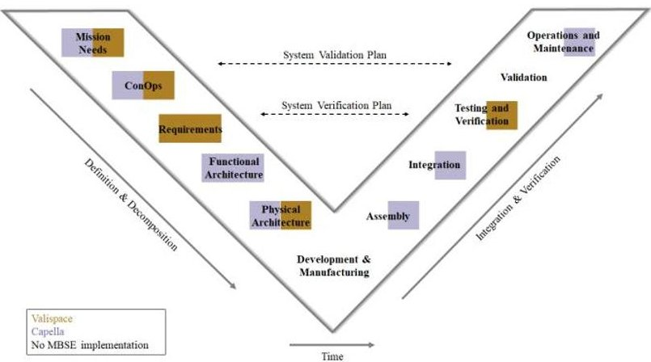
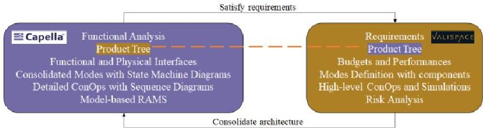
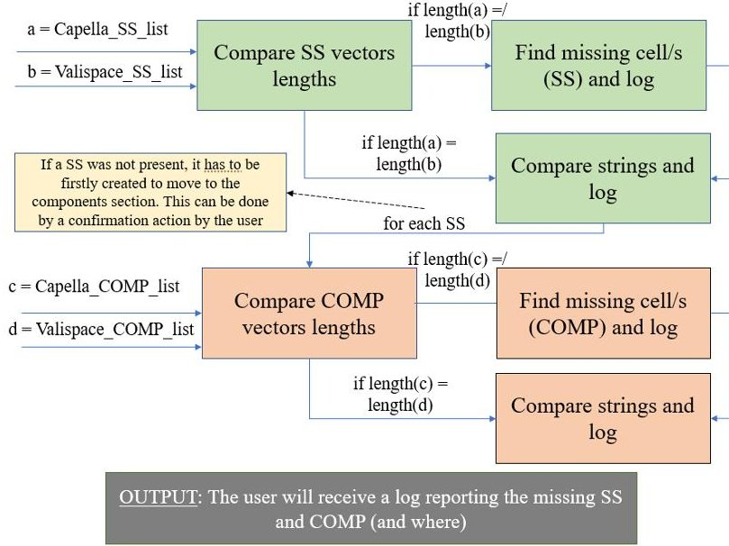
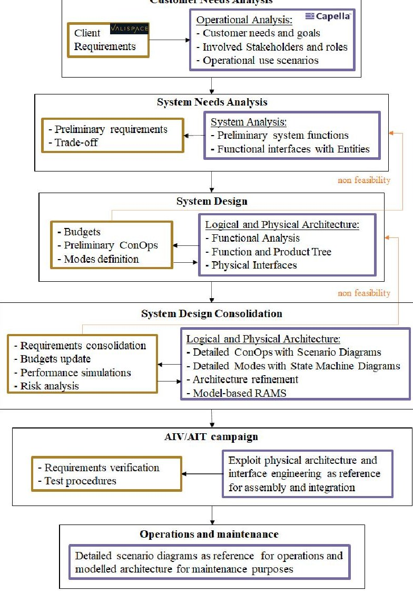
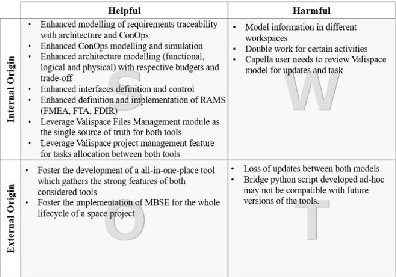

<!-- PDF_PAGE: 1 -->

Small satellites mission design enhancement through MBSE and DDSE toolchain Paolo Minacapilli $ ^{(*)} $ , Flor Criado Zurita $ ^{(*)} $ , Saul Campo Pérez $ ^{(*)} $ , Alberto Rodríguez Pérez-Silva $ ^{(*)} $ , David Escudero Lasheras $ ^{(*)} $

(*) Elecnor Deimos

OBJECTIVES: O2, T2

ABSTRACT - Several MBSE approaches have been adopted in the past, often merging different tools to extract the best from each. However, this way there is the risk of losing the single source of truth nature of modelling, as using multiple workspaces implies that the information is repeated. This paper proposes an agile methodology currently being developed in Deimos covering the whole lifecycle of a space mission by exploiting two different tools, a Model Based Systems Engineering (MBSE) one and a Data Driven Systems Engineering (DDSE) one, guaranteeing information continuity between them, serving as reference for the whole engineering team and sharing on going technical (and non) progresses with customers. The approach is currently successfully being adopted for several small satellite missions (Earth observation, deep space and other scientific missions).

## 1. INTRODUCTION

The adoption of Model-based Systems Engineering (MBSE) approaches in the space industry, and in particular in small satellites design, has demonstrated to be beneficial as a single source of truth, granting access to engineering data not only for the specific discipline of the design engineer, but for all the disciplines involved in the project [1]. It is especially important that the values of the design parameters are updated and unique to the scope of all the members of a project, even if they are in different teams. At the same time, a rigorous system and mission architecture shall be aligned with the quantitative sizing, leading to an enhanced overall system definition.

Nowadays, small satellites design needs a more agile methodology with respect to the traditional approaches adopted by large integrators for bigger class of satellites, due to reduced mission cost and development time. To this aim, MBSE represents the vanguard for destressing the engineering process by simplifying the way information is exchanged. Indeed, the main goal of MBSE is to provide both the engineering team and customers with a single workspace where all system aspects are accessible at different levels of understanding. Due to the variety of tasks addressed to Systems Engineering (SE), the adoption of a single modelling tool often does not allow to cover all of

them throughout the project lifecycle according to Deimos expertise and to previous missions [2]. This is particularly true for space applications, which entail very complex systems definition, design, implementation, testing, and operation by a set of multidisciplinary stakeholders.

The main goal of this paper is to develop an approach that facilitates small satellites missions design, without requiring significant team training investment and that entails most of the system data and SE activities allowing to rapidly cope with design changes through traceability, improving the quality of the design. The overall model will also serve as reference for development and testing activities, as well as for operations. For this scope, Deimos MBSE team has selected two tools that complement each other: Capella [3], an MBSE tool based on the ARCADIA method and language, and Valispace [4], a DDSE where all quantitative analysis are modeled. Table 1 reports the respective weaknesses and points of strength. Valispace is a more userfriendly environment and requires a not so steep training curve, as it does not comprehend the articulated syntax and semantics which commonly characterize MBSE languages, such as ARCADIA implemented in the Capella tool. The former indeed is not properly an MBSE tool, but more a place where to concentrate and share engineering data (i.e., data-driven). ARCADIA, instead, is purely an MBSE method and language, implemented in the Capella tool, therefore requires a sufficient level of training by users.

Table 1. Valispace and Capella capabilities.

<table border="1"><tr><td></td><td>Capella</td><td>Valispace</td></tr><tr><td>Requirements management</td><td>Strong (flow-down, traceability with any model element, difficult to export)</td><td>Very Strong (digitization, flow-down, traceability, gaps analysis, user-friendly, easy to export)</td></tr><tr><td>Concept of Operations</td><td>Very Strong (sequence diagrams)</td><td>Weak (limited to high level, no branching)</td></tr><tr><td>Modes and States</td><td>Strong (UML-inspired state machines, transitions modelled with detail and can be related to other model elements)</td><td>Weak (components and their values can be allocated to modes and simulated)</td></tr></table>

<!-- PDF_PAGE: 2 -->

<table border="1"><tr><td>Functional Analysis</td><td>Very Strong (detailed functionalities and functional interfaces modelling at different levels, function trees)</td><td>Weak (definition and trace but poor model)</td></tr><tr><td>Architecture management</td><td>Very Strong (detailed logical and physical architecture, allocation of functions to components, functional chains, trees)</td><td>Weak (only physical without modelling interfaces, trade-offs)</td></tr><tr><td>Budgets and simulation</td><td>Very weak (class diagrams can be used to model static data structures and relate them to model elements)</td><td>Strong (components can be modelled with their non-static sizing values, end-to-end traceability and data consistency)</td></tr><tr><td>Interfaces management</td><td>Very Strong (detailed functional and physical interfaces)</td><td>Weak (limited to definition)</td></tr><tr><td>RAMS management</td><td>Very Strong (with add-on)</td><td>Weak (limited to high level)</td></tr><tr><td>Teamwork</td><td>Strong (with add-on)</td><td>Very strong (real-time, internal reviews, comments, notifications)</td></tr><tr><td>Project management</td><td>Very weak</td><td>Strong (tasks, timeline, configuration control)</td></tr><tr><td>AIV/AIT management</td><td>Strong (architecture model can be re-used for AIV/AIT plan)</td><td>Strong (test procedures, requirements and verifications in the same tool)</td></tr><tr><td>Change tracking and history</td><td>Weak</td><td>Very Strong (full repercussion on the design)</td></tr></table>

The V-Model in Figure 1 reports the contribution of the two tools to the approach along the lifecycle, according to their capabilities identified in the previous trade-off.

The definition and decomposition branch foresees the adoption of the two tools for the same activities. This may appear in contrast with the single source of truth nature of MBSE. However, as discussed in the following section, an approach to effectively adopt them without losing piece of information moving from one to the other is being developed and tested by Deimos systems engineering team for several small satellites missions. It is noted that for the right branch, the activities are not fully managed in the toolchain environment, despite the latter provides a significant support for them.

Figure 1. V-Model.

## 2. MBSE TOOLCHAIN DEFINITION

The selected tools shall be bridged and their precise roles defined (i.e., clarify where a given activity is performed). The diagram in Figure 2 reports two main blocks, representing Capella and Valispace, and how they contribute to the toolchain.

Figure 2. Capella and Valispace contributions to the MBSE toolchain.

Capella is the main reference for the architecture definition, following the ARCADIA method [5]. Valispace provides a strong support to the toolchain by providing a user-friendly digital environment where to work with engineering data and requirements. The latter are also indirectly traced in Capella by exporting the architecture diagrams into Valispace, therefore ensuring that requirements are satisfied by the architectural solution and lifecycle diagrams. At the same time, the analyses conducted in Valispace are used to consolidate design decision and serving as input for Capella. Apart from these input-output relations, the main bridge which guarantees coherence of the toolchain is represented by the Product Tree. Components, indeed, are modelled in both tools and represent the focal point of the design as they are linked to all the activities (e.g., functional analysis, budgets, Modes, ConOps, RAMS, etc.). The results from both tools are used during reviews with customers. A script which automatically checks that the same components are present in both sides is under development in Deimos. The simple idea is to compare the vectors reporting the subsystems and components from Capella and Valispace,

<!-- PDF_PAGE: 3 -->

exploiting respectively the Python4Capella add-on and the Valispace Python API to manage the information in Python. The script will return a log indicating if a subsystem/component is missing and in which model. Figure 3 summarizes the concept of the Python script. In future development, the possibility of directly creating the subsystem/component in either tool environment is not excluded (keeping also the log alert).

Figure 3. Basic functioning of Python script to ensure consistency between Capella and Valispace

It is noted that some activities appear to be overlapped, i.e. Modes and ConOps. This should not cause concerns as their modelling is at two different levels among the tools. Indeed, while Valispace is used to preliminarily define them and for simulations (e.g., which components is used during a particular Mode, duration of the Mode withing the ConOps), Capella instead exploits the detailed system architecture as well as its syntax and semantics to formally model Modes through State Machine Diagram (functions allocation, transitions, etc.) and ConOps through sequence diagrams (functions and modes allocation, branching between lifelines, etc.). In this sense, Capella is also exploited to put the basis for the flight software design.

The MBSE toolchain is now detailed by allocating the exact activities to the tools and showing how their adoption evolves throughout the project lifecycle. Figure 4 reports a cascade diagram which resembles the blocks of the V-Model.

Figure 4. MBSE toolchain throughout the project lifecycle.

Each block is commented in the following:

1) Customer Needs Analysis: The mission/client needs are firstly imported in Valispace in terms of client requirements; followed by the Operational Analysis in Capella assessing the needs and defining stakeholders and operational use scenarios of the product to be developed. It is recalled that diagrams developed in Capella also serve to satisfy the requirements stored in Valispace, as previously discussed (Figure 2).

2) System Needs Analysis: According to the ARCADIA method, this step aims at preliminary assessing the system to understand how it can satisfy the former customer needs. A basic functional analysis is therefore modelled in Capella, representing an input to preliminary requirements definition and mission architecture trade-off analysis conducted in Valispace.

<!-- PDF_PAGE: 4 -->

3) System Design: In Capella, functional needs are consolidated in the Logical Architecture and allocated to logical components which put the basis for the Physical Architecture. As already discussed, here Valispace supports design decisions through budgets, high-level ConOps and Modes.

4) System Design Consolidation: ConOps are further detailed in Capella workspace by means of sequence diagrams and Modes in State Machine Diagrams. At this stage and following latest trends [6] [7], Reliability, Availability, Maintainability & Safety (RAMS) analyses for small satellites (within new space market) can also be modelled in Capella, including the definition of FDIR concept. RAMS analysis is enhanced by re-using the architecture model in Capella. These outputs are iteratively implemented in the Valispace model, leading to the consolidation of system, operational and interface requirements and the flow-down definition of subsystem/unit requirements, including verification methods and traceability between them. The Physical Architecture (components) model in Valispace allows to allocate multiple features to obtain system budgets, trends and performance simulations, which can lead to modifications of the architecture in Capella.

5) AIV/AIT campaign: Once the design is consolidated and the components manufactured, interfaces defined in Capella model can be exploited as reference for the assembly and integration activities. Likewise, Valispace can be useful to later produce test procedures, as well as to populate the verification matrix, including internal/external close-out references.

6) Operations and maintenance: The FDIR concept modelled in Capella for later implementation in the flight software can support the test campaign and in-flight operations. The latter are also complemented by the detailed sequence diagrams developed during the previous design steps.

definition, interfaces control (both design and integration), and even project management (including tasks allocation and direct review of the model by the client) and configuration control between both tools.

## 3. CONCLUSION

From the proposed synergia we can extract the following Strengths, Weaknesses, Opportunities and Threats (SWOT) presented in Figure 5. By leveraging the strengths of both tools, most of the systems engineering activities are enhanced, from requirements management, modelling and verification, ConOps modelling and simulation, architecture modelling and related budgets; to RAMS analyses and FDIR

Due to the use of different workspaces, the approach also presents some weaknesses related with certain duplication of information and work, as well as the need to establish a common database which needs to be checked prior start working on the other workspace. These drawbacks lead to potential threats such as loss of updates between the models or incompatibility of the proposed linking script with future versions of the tools.

To offset these issues, this approach also leads to new opportunities which foster the implementation of MBSE during the whole lifecycle of small satellites missions (from concept to operation), as well as motivate the development of a MBSE tool which leverages the capabilities of both proposed workspaces, being therefore the ultimate single source of truth for the system model.

Figure 5. SWOT analysis.

## 4. REFERENCES

[1] P. Minacapilli, M. Lavagna, "Small sats lifecycle management through MBSE aided decision making tailored tool", 72nd International Astronautical Congress (IAC 2021), 2021.

[2] J. Whitehouse, "MBSE at ESA: State of MBSE in ESA Missions and Activities", MBSE 2021 Conference https://indico.esa.int/event/386/timetable/#5-mbse-at-esa state-of-mbse-in

<!-- PDF_PAGE: 5 -->

[3] Eclipse Capella MBSE tool, https://www.eclipse.org/capella/

[4] Valispace engineering tool, https://www.valispace.com/

[5] P. Roques, "MBSE with the ARCADIA Method and the Capella Tool", 8th European Congress on Embedded Real Time Software and Systems (ERTS 2016), 2016.

[6] The Small Satellite Reliability Initiative- A Public Private Collaboration, https://www.nasa.gov/smallsat institute/reliability-initiative

[7] L. Bitetti, R.D. Ferluc, D. Mailland, G. Gregoris, F. Capogna, "Model Based approach for RAMS analyses in the Space domain with Capella open-source tool", International Symposium on Model-Based Safety and Assessment (pp. 18-31), Springer, Cham., 2019.