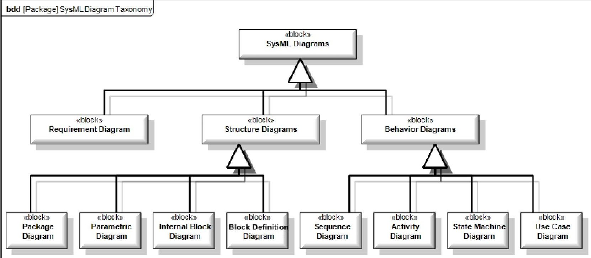
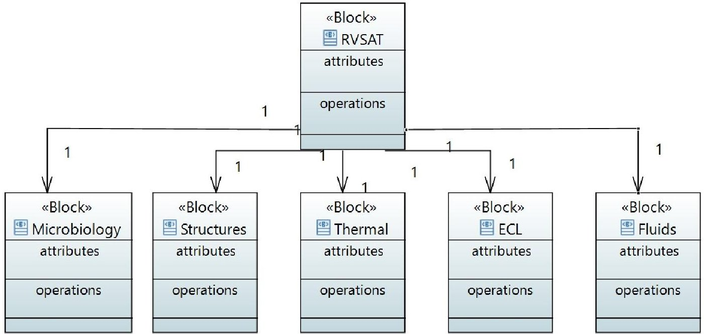
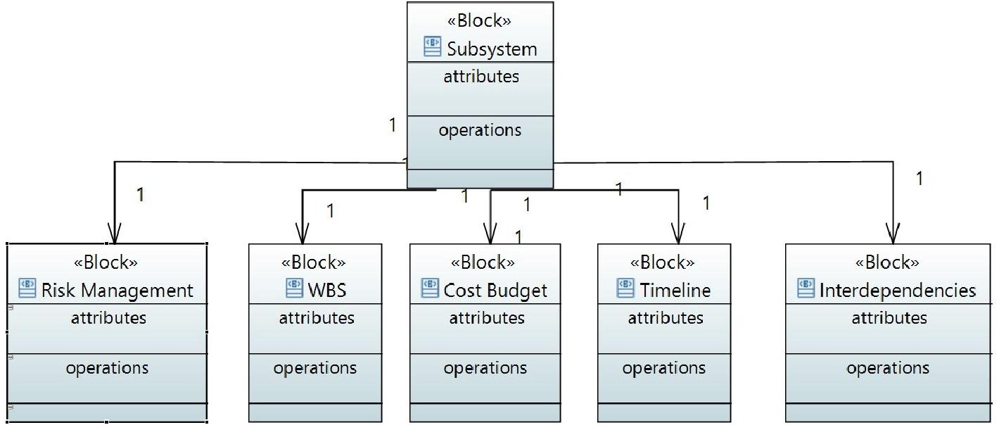
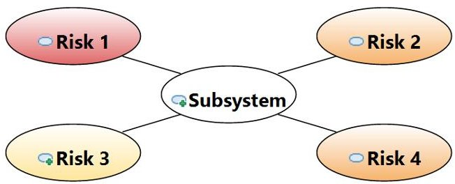
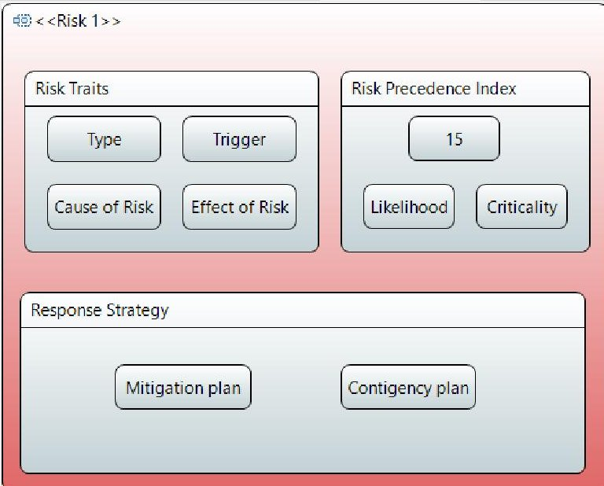
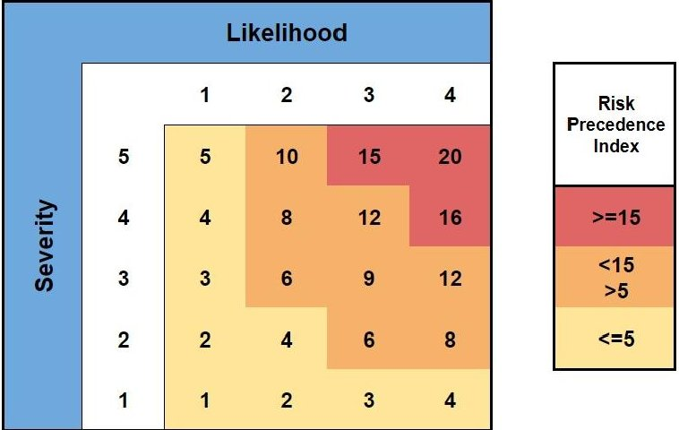

<!-- PDF_PAGE: 1 -->

# A Model-Based Approach to Risk Management for RVSAT-1: a Student Nano-satellite Project - Using

SysML

Shashank Nagabhushan Department of Aerospace Engineering R. V. College of Engineering Bengaluru, India shashankn.ae18@rvce.edu.in

Akash Kumar Singh Department of Aerospace Engineering R. V. College of Engineering Bengaluru, India akashkumarsingh.im18@rvce.edu.in

Suresh Gowda S Department of Aerospace Engineering R. V. College of Engineering Bengaluru, India sureshgowdas.ae18@rvce.edu.in

Abstract—In the recent past, the advancement of miniaturization and the revolutionary design philosophy have made nanosatellites the go-to platform for several commercial and scientific missions to low Earth orbit. The leverage for accommodating failures has thus reduced expeditiously, and analysis of mission-critical risks have assumed paramount importance to ensure the optimum performance of the system in its operating environment. However, from the Systems Engineering Methodology point of view, considerable nano-satellite projects continue to follow the conventional approach of Document-Based Systems Engineering. This approach involves the development of a Risk Response Matrix (RRM) to identify and categorize a risk based on its severity and likelihood. However, interpreting the risks associated with a nano-satellite through elaborate and esoteric documentation is maladroit and has quite a few pitfalls, the predominant ones being: the ineffective capturing of risks from a system point of view and a superficial understanding of how these risks affect other subsystems and subcomponents, apart from involving a substantial amount of book-keeping. To obviate these shortcomings, this paper expedites a novel idea of implementing a Model-Based Approach to assess and manage the risks faced by RVSAT-1, a student nano-satellite project, using SysML. The crux of the idea proposed is to represent the risks involved at the system and subsystem level as a model in SysML which depicts factors like risk severity and likelihood in a unique colour scheme based on a 'risk cube display'. Certain aspects such as consequences, risk ownership, mitigation and contingency plans too can be represented lucidly. Though developed for RVSAT-1, a student nano-satellite, this approach can be utilized for other complex systems as well. The proposed model for risk management enables ease of access and optimization, allowing the systems engineers to focus on value added tasks and ensure that a balanced approach is adopted towards managing risks. Through these proposed risk models, unprecedented levels of systems understanding can be achieved through integrated analytics, coalesced with a model-centric technical baseline. They can be used to intuitively assess and manage risks with great rigor and precision, contrary to the conventional document-based approach.

## TABLE OF CONTENTS

1. INTRODUCTION ... 1

2. MBSE AND SYSML ... 2

3. EXISTING TOOLS AND PRACTICES ... 3

4. PROPOSED METHODOLOGY ... 3

5. SUMMARY ... 6

ACKNOWLEDGMENTS ... 7

REFERENCES ... 7

BIOGRAPHY ... 7

## 1. INTRODUCTION

978-1-6654-3760-8/22/$31.00 ©2022 IEEE

The expeditious advancement of miniaturization has greatly increased the utilization of CubeSats by commercial and government agencies alike to perform critical missions in low Earth orbit on a relatively low budget. Due to their cost-effectiveness and relatively lucid architecture, CubeSats have also become a very popular platform amongst university students at the undergraduate level, providing them with an opportunity to perform and showcase advanced research in space technology. They also bring forth eager students from diverse domains to work together to solve complex problems using cutting edge technologies. Team Antariksh is one such amalgamation of like-minded students from various technical backgrounds aiming to explore and contribute to the field of space technology. The hundred-member strong space-technology team is currently involved in designing and developing RVSAT-1, a microbiological payload for ISRO's PSLV Stage-4 (PS4) orbital platform, and an experimental sounding rocket, ReSOLV-1[1].

When developing a complex system such as a nano-satellite, there is always an inherent risk of failure. These risks become even more pronounced in student-led teams due to the dearth of knowledge about mitigating them in accordance with existing industry standards. Moreover, student teams encounter several unprecedented problems ranging from lack of access to research facilities and inefficient logistics to uncertainties in funding and academic schedules. As the environment and constraints they work under are contrasting to those found in the industry, the straightforward application of these standards seem inefficient.

Irrespective of the size or scope of a project, effective risk assessment and management are very crucial for the success of the project. Enough resources have to be allocated to the categorization, prioritization and evaluation of various internal and external threats to the project to ensure its success within the defined schedule and budget.

Thus, a systematic and tailored approach towards risk management is indispensable to any system. The Systems Engineering Method (SEM) is one such technique which can be tailored according to the system under consideration. The traditional method of Systems Engineering accentuates that the aim of risk management is to minimize potential risks to an acceptable level before they transpire, throughout the life-cycle of the system. It is a continuous, progressive process that is utilised to foresee and avoid risks that might adversely impact the project.[2] The vital elements of the risk management process are Risk Identification, Risk Analysis, formulation of a Risk Mitigation Plan, Risk Mitigation Plan

<!-- PDF_PAGE: 2 -->

## Implementation and Risk Tracking.[3]

The traditional Systems Engineering Method follows the conventional document-based approach to effectively manage risks. While the document-based approach seems comprehensive and competent, it becomes extremely difficult for student teams to prepare, monitor, update and maintain such manuscripts as the system design continually evolves. This becomes extremely cumbersome in some cases where the system complexity is very high. Hence, a method with greater adaptability, compatibility and simplicity is desired.

Model Based Systems Engineering (MBSE) is one such tool which elegantly satisfies all the aforementioned qualities. The application of MBSE leads to the formation of a model of the system which can easily be scrutinized, monitored and updated simultaneously as the system design matures. Shifting to a model-based approach enables engineering teams to effortlessly interpret design change consequences, communicate design objectives and examine a system design with greater rigor. It also enables the systems engineer to capture all aspects of a system and identify key drivers efficiently.

This paper focuses on the application of the model-based approach to the process of risk management in RVSAT-1 in order to obviate the shortcomings of the conventional document-based approach, and cater to the needs of student teams. The proposed model is constructed in a layered configuration in SysML, a general-purpose modelling language. The layers are organised in a top-down fashion allowing one to navigate from the top most system level to lower level elements. The different layers include system level architecture, subsystem level tools, risk identification layer and risk assessment layer. This construct enables the stakeholders to achieve unprecedented levels of systems understanding and carry out effective risk management. While the approach is developed for a student nano-satellite project, it can be extended further to other complex systems with elementary modifications.

The paper is structured as follows. First, the paper briefly provides an overview about MBSE and SysML. The advantages of the model-based approach over the orthodox documentbased approach to systems engineering is also discussed in this section. Then, a brief overview of the existing tools and techniques used for risk management is presented. Next, the proposed method of risk management using the model-based approach is elucidated and substantiated with relevant images captured from the template of the SysML model for RVSAT1 created in the Eclipse Papyrus IDE. Details pertaining to the Risk Management Model adopted, Risk Precedence Index (RPI) and the colour-coded Risk Cube Display are also discussed in this section. The final section summarizes the entire discussion of this paper.

## 2. MBSE AND SYSML

This chapter provides an overview of Model-Based Systems Engineering (MBSE) and the Systems Modelling Language (SysML), a representative tool of MBSE.

## Model-Based Systems Engineering

Model-Based Systems Engineering is an all-encompassing term that portrays a modernised approach to systems engineering, in order to create a model as a central database comprising all information pertaining to the system of interest. In this approach, the conventional systems engineering practices

are adopted and interfaced with a visual modeling language, which also serves as a common platform for communication amongst industries, stakeholders and engineers from various domains. The International Council on Systems Engineering (INCOSE) gives the following definition for Model-Based Systems Engineering [4] :

"Model-Based Systems Engineering is the formalized application of modeling to support system requirements, design analysis, verification, and validation activities beginning in the conceptual design phase and continuing throughout development and later life cycle phases."

A number of complex projects have traditionally administered the document-based approach to systems engineering that consisted of textual details and design literature in hardcopy or electronic file format. Even though very comprehensive and rigorous, this method has some predominant limitations. As design, analysis, system requirements, and test information are scattered across several documents, it is very laborious to assess their uniformity and completeness. In addition, it becomes strenuous to execute the required traceability and to maintain or reuse system requirements and design details for reiterating the existing system design. To obviate these burdensome exercises, MBSE enables the generation of a system model that bolsters the ability to capture, analyze, share, and manage the data associated with the complete specification of a product, reaping benefits like improved product quality and communications among stakeholders, an increased ability to manage system complexity, better knowledge capture and reuse of information.

## SysML

The Systems Modeling Language (SysML), an extension of a subset of the Unified Modeling Language (UML), is a graphical modeling language developed by the Object Management Group (OMG) which is predominantly used for modeling a wide range of complex systems. SysML is devised with an intent to support a wide array of systems engineering methods, and not be limited to any single method [4]. It is well-suited for specifying requirements, structure, behavior, allocations, and constraints on system properties to support various engineering analyses. The following definition of SysML is given by Friedenthal et al. [5] :

"SysML is a general-purpose graphical modeling language that supports the analysis, specification, design, verification, and validation of complex systems. These systems may include hardware, software, data, personnel, procedures, facilities, and other elements of man-made and natural systems."

SysML dispenses a way to gather information pertaining to various parts of a system efficiently. It has a provision to select a specific method and tailor the modeling process according to the method chosen. The fundamental unit of any SysML structure is the 'block'. A block can be utilized to depict various system elements including hardware, software, facilities, personnel or any other system constituent. Blocks can consist of information specific to the element, its properties, or can even be associated with other model elements such as activities, functions, use cases, requirements and so on. Each model element can be connected to another element through a relation. These elements and relations can then be represented using a set of specific diagrams. The SysML diagram taxonomy is represented in Fig. 1[6].

<!-- PDF_PAGE: 3 -->

Figure 1. SysML diagram taxonomy

## 3. EXISTING TOOLS AND PRACTICES

As discussed previously, the importance of risk management has been increasing exponentially. Newer and more refined approaches, techniques and tools are being devised and implemented to improve the process of risk management. These include techniques like Risk Models, SWOT analysis, FMEA analysis etc. and tools like Project Manager, Risk Radar, Predict! to name a few [7] [8].

While there are many tools and techniques, quite a few pitfalls are encountered while acquiring and implementing some of these risk management practices. For example, many risk models are either too abstract or too specific and are generally at risk of failure in cases of unexpected crises[9]. Likewise, techniques like FMEA, SWOT analysis are generally document-centric and rigid which means implementing them and/or making changes are problematic[10].

There are various commercial tools available for risk management, but have their own limitations, especially from the point of view of student teams. These tools generally focus on one particular approach which inherently forces the user to implement risk management in a superficial manner [8]. Many of these tools are also inaccessible to student teams as they are proprietary and very expensive.

Thus, there is an indispensable need for an open-source and customizable approach to risk management in order to make it easily accessible. Model-based engineering and SysML provides a way to devise and implement such an approach.

Since the introduction of SysML in 2006, various organisations including student teams, have taken great strides towards developing their own frameworks to assist the shift towards a model-centric systems engineering process from the conventional document based approach.

Reference [11] presents one such innovative approach towards model-based risk management. This method involves the construction of different views by integrating a contextbased approach with model-based systems engineering concepts that can be undertaken while performing risk assessment and management throughout the system development process. A few high-level risk management views such as Risk Identification View, Concern Identification View, Evaluation View and Treatment View are suggested. The work also explores the viewpoints associated with business practises by developing the Concern, Context Identification and Systems Identification views. While this technique provides an extensive and holistic view of risk management, it also incorporates multiple steps to the process of risk management that seem to be tedious and redundant for student teams such as ours. Hence, the development of a simple yet robust model for the process is required.

## RVSAT-1

RVSAT-1 currently relies on a document-based approach for risk management. The existing practice of Risk Management for RVSAT-1 involves the development of a tailored risk response matrix (RRM), as depicted in table 1. The RRM consists of elements such as risk description, severity, likelihood, response strategy, trigger and contingency plan[12]. The tailored RRM acts as a qualitative risk management plan. The process of risk management is initiated with the identification and classification of risks into various domains such as technical, schedule, funding, staffing, logistics and infrastructure. The scales as presented in tables 2 and 3, are used to assess the likelihood and severity for any risk. Table 4 presents the possible response strategies that could be adopted based on the type of the risk and/or its trigger.

## 4. PROPOSED METHODOLOGY

The crux of the idea is to represent the risks involved at the system and subsystem level as a model in SysML. This

<!-- PDF_PAGE: 4 -->

Table 1. Risk Response Matrix for RVSAT-1

<table border="1"><tr><td>Risk Event</td><td>Risk Description</td><td>Likelihood</td><td>Severity</td><td>Response Strategy</td><td>Trigger</td><td>Contingency Plan</td></tr><tr><td>A</td><td></td><td></td><td></td><td></td><td></td><td></td></tr><tr><td>B</td><td></td><td></td><td></td><td></td><td></td><td></td></tr><tr><td>C</td><td></td><td></td><td></td><td></td><td></td><td></td></tr><tr><td>D</td><td></td><td></td><td></td><td></td><td></td><td></td></tr></table>

Table 2. Likelihood Scale

<table border="1"><tr><td>Likelihood</td><td>Description</td></tr><tr><td>5</td><td>Will almost definitely take place</td></tr><tr><td>4</td><td>Has a very high chance of taking place</td></tr><tr><td>3</td><td>Has a moderate chance of taking place</td></tr><tr><td>2</td><td>Has a low chance of taking place</td></tr><tr><td>1</td><td>Has a very rare chance of taking place</td></tr></table>

Table 3. Severity Scale

<table border="1"><tr><td>Severity Factor</td><td>Severity</td><td>Description</td></tr><tr><td>4</td><td>Catastrophic</td><td>Complete mission failure, or loss of the system. Inability to achieve the minimum acceptable requirements</td></tr><tr><td>3</td><td>Critical</td><td>Major mission degradation, major cost</td></tr><tr><td>2</td><td>Moderate</td><td>Minor mission degradation, small cost</td></tr><tr><td>1</td><td>Negligible</td><td>Less than minor mission degradation, or minor system damage</td></tr></table>

RVSAT-1

<Package Import> UML Primitive Types

<Package Import> Libraries

root

«Block» RVSAT

System Context

«Block» Electronics Control & Logic(ECL)

ECL Attributes

«Block» Risk Management

Risks

Risk1

Risk 1 Attributes

<<Risk 1>>

Risk2

Risk3

Risk4

«Block» WBS

«Block» Cost Budget

«Block» Timeline

«Block» Interdependencies

«Block» Structures

«Block» Fluids

«Block» Thermal

«Block» Microbiology

Figure 2. Model Tree

Table 4. Response Strategy

<table border="1"><tr><td>Response Strategy</td><td>Description</td></tr><tr><td>Avoid</td><td>Focus on eliminating the cause and thus, eliminating the threat.</td></tr><tr><td>Mitigate</td><td>Certain risks cannot be eliminated. However, their impact can be reduced by a suitable contingency plan</td></tr><tr><td>Transfer</td><td>Transfer the risk to some other 3rd party. Insurance purchases, warranties, guarantees, etc. are examples of risk transfers</td></tr><tr><td>Accept</td><td>Accept that the risk cannot be mitigated, avoided or transferred</td></tr></table>

method leverages various features of SysML such as Block Definition Diagram, Use Case diagram, Activity Diagram etc., to create a Model-Based Systems Engineering framework for RVSAT-1. This involves the development of the entire project as a model-based enterprise in a layer-wise fashion as depicted in Fig. 2. Each layer represents a unique aspect of the system and the associated systems engineering tools or processes.

A Block definition diagram (BDD) is utilised to represent the system level architecture. The system level architecture consists of the interfaces between all the subsystems, and are represented as blocks within the BDD. A BDD, for each subsystem, is then used to represent the various systems engineering tools being utilized in the development of RVSAT-1. The Work Breakdown Structure (WBS), Cost and Budget, Timeline, Risk Management and Inter-dependencies

<!-- PDF_PAGE: 5 -->

Figure 3. System Context Diagram

Figure 4. Subsystem Attributes Layer

are represented here. The subsystem BDDs are hyperlinked with the respective blocks within the system level architecture BDD. This enables the subsystem level BDDs to be accessed from the system level architecture BDD. This structure allows for seamless traceability and ease of access when performing validation and verification activities.

## Risks Management Model

The proposed method aims at translating the typical elements of the aforementioned RRM into a model. The Risk Management block in the subsystem BDD is hyperlinked to the Risk Management layers to maintain the navigation and traceability.The risk management element consists of two layers:

Risks Identification Layer: This layer, as shown in Fig. 5, assists in achieving easier access to all the risks associated with the system under consideration. It also allows for representation/categorization of risks based on Risk precedence Index. It is implemented by utilizing the use case diagram within which the risks are represented as use cases.

Figure 5. Risk Identification Layer

<!-- PDF_PAGE: 6 -->

Figure 6. Risk Attributes Layer

Risk Attributes Layer: This layer of the structure is created through the activity diagram element of SysML as depicted in Fig. 6. It presents all the typical elements of a risk management plan such as type, likelihood, severity, effects, mitigation, and contingency plans. This layer is implemented as an activity diagram with the components as different activities.

## Risk Precedence Index [RPI]

Risk Precedence Index [RPI] is a factor developed to assess the overall impact of a given risk by aggregating the elements of a typical risk such as likelihood and severity. The individual factors for likelihood and severity are extracted using the existing standards [12].

Another unique aspect of the proposed framework is the implementation of the Risk Precedence Cube, as depicted in Fig. 7[13], to assign an intuitive colour scheme to all the risks associated with the project by classifying them into three broad categories: high, medium and low level risks. This representation helps in providing a quick overview of the risks associated with the system or any of the subsystems of the project.

Risk Precedence Index for this proposal is defined as the product of the severity index number and the likelihood index number. A risk with an RPI of 15 or higher is classified as high-level risk, a risk with RPI greater than 5 and lesser than 15 is classified as mid-level risk and risks with RPI lower than or equal to 5 are classified as low-level risks.

## 5. SUMMARY

Risk management plays a crucial role in defining the success criteria of any project, be it large or small, as it helps to effectively identify, classify, develop and implement a suitable mitigation plan for any potential risks that could be faced by the project. If risks to any project are haphazardly managed, the integrity of the system becomes questionable, and increases the probability of failure in its operational environment.

Figure 7. Risk Precedence Cube

This paper addresses the important domain of risk management pertaining to student CubeSat teams. There is a considerable amount of risk involved in student teams, and owing to the inexperience and dearth of knowledge regarding industry standards utilized for risk management amongst students, there is a large possibility of imminent failure. The constraints faced by student teams are contrasting to those experienced by commercial and governmental organizations, as student teams may lack access to research facilities and may have to deal with uncertainties in funding and academic schedules. Thus, the direct application of industry standards becomes maladroit.

The application of the Systems Engineering Method seems to offer a tailored solution to the existing problems faced by student teams. The traditional application of the Systems Engineering Method, though seemingly comprehensive and effective, is hugely document-centric, and involves the creation, updation and maintenance of several documents as the system design matures through its life cycle. The maintenance of these documents becomes very cumbersome to student teams, and crucial information regarding system requirements, design, analysis and testing are scattered across several documents, making it very laborious to assess their consistency and completeness.

A solution to this problem is the implementation of ModelBased Systems Engineering. This relatively new approach, which is yet to find widespread adoption across industries and organisations, involves the creation of various systems development aspects as a model which can be scrutinized for design change impacts, communicating design intent and analyzing a system design well ahead of its realization.

The utilization of the model-based approach as a means to perform risk management in RVSAT-1, a student nanosatellite being developed by Team Antariksh of R. V. College of Engineering is perorated in this manuscript. Student teams can leverage these showcased advantages of the model-based approach to effectively manage risks in their projects.

The model is implemented by using a layered approach which makes it a well organised way of managing risks. The layers comprise of system architecture, subsystem tools, risk identification and risk assessment at progressive depths, each offering specific functionalities. These layers are hyperlinked with each other enabling seamless traceability and ease of access, allowing the systems engineers to focus on value

<!-- PDF_PAGE: 7 -->

added tasks to ensure that a balanced approach is taken up towards managing risks. It also allows the interfacing of different features with the model which grants it the capability to expand beyond risk management. Being a modular approach, it also offers the leverage to modify or further develop this idea without many complications, contrary to the document-based approach.

This model-based framework can easily be utilized for systems with greater complexities as well, and is not limited to RVSAT-1 or student CubeSat projects. The future scope of the developed model-based approach extends beyond the realms of just risk management. It can be interfaced with external tools such as MATLAB Systems Composer and Simulink in order to increase the efficiency and quality of the system development and verification processes.

## ACKNOWLEDGMENTS

We sincerely express our gratitude to Team Antariksh and R.V. College of Engineering for providing us with constant support and encouragement throughout the course of this research work.

## REFERENCES

[1] Team Antariksh, "RVSAT-1, Team Antariksh" 2021. [Online]. Available: https://www.teamantariksh.in/rvsat/ [Accessed 2021].

[2] "Risk Management," Accessed in February 2021 [Online]. Available: https://www.sebokwiki.org/wiki/Risk_Management

[3] B. Skalamara, "Systems Engineering Revitalization Efforts", 9th Annual NDIA Systems Engineering Conference, 2006.

[4] INCOSE. Systems Engineering Vision 2020. INCOSE Technical Report, 2007.

[5] S. Friedenthal, A. Moore, and R. Steiner, A Practical Guide to SysML: The Systems Modeling Language. Morgan Kaufmann Publishers, Inc., 2009.

[6] J. Holt and S. Perry, SysML for Systems Engineering, 2nd Edition: A Model-Based Approach. Institution of Engineering and Technology, 2013. doi: 10.1049/pbpc010e

[7] R. J. Chapman, Simple Tools and Techniques for Enterprise Risk Management. John Wiley & Sons, Ltd., 2012. doi: 10.1002/9781118467206.

[8] I. Dikmen, M.T. Birgonul, and A. E. Arikan, "A critical review of risk management support tools." 20th Annual ARCOM Conference, Edinburgh, UK. Association of Researchers in Construction Management, Vol. 2, pp. 1145-54, 1-3 September 2004.

[9] Jon. Danielsson, "The emperor has no clothes: Limits to risk modelling," Journal of Banking and Finance, vol. 26, no. 7. Elsevier BV, pp. 1273-1296, Jul. 2002. doi: 10.1016/s0378-4266(02)00263-7

[10] M. M. Helms and J. Nixon, "Exploring SWOT analysis where are we now?," Journal of Strategy and Management, vol. 3, no. 3. Emerald, pp. 215-251, Aug. 10, 2010. doi: 10.1108/17554251011064837.

[11] M. J. Brownsword, J. D. Holt and S. A. Perry, "A model-based risk management approach - Marketing vs safety case study," 6th IET International Conference on System Safety, 2011, pp. 1-6, doi: 10.1049/cp.2011.0262.

[12] G. S. Pantoji, M. H. Bhat, P. N. Gwalani and A. M. Bhulokam, "Development of a Risk Management Plan for RVSAT-1, a Student-based CubeSat Program," 2021 IEEE Aerospace Conference (50100), 2021, pp. 1-7, doi: 10.1109/AERO50100.2021.9438156.

[13] A. Kossiakoff, W. N. Sweet, S. J. Seymour, and S. M. Biemer, Systems Engineering Principles and Practice. John Wiley & Sons, Inc., 2011. doi: 10.1002/9781118001028.

## BIOGRAPHY

Shashank Nagabhushan is currently pursuing his B.E. degree in Aerospace Engineering from R.V. College of Engineering, Bengaluru, India. He is a member of student space technology team, Team Antariksh and has been working as a member of the Thermal Subsystem for the project RVSAT-1. As the Mission Manager of the project, he was responsible for drafting and managing

the timeline and leading the planning, development and implementation of the assembly, integration and test of all subsystems of RVSAT-1.

Akash Kumar Singh is currently pursuing his B.E. degree in Aerospace Engineering from R.V. College of Engineering, Bengaluru, India. He is a member of student space technology team, Team Antariksh and has worked as a member of the Structures Subsystem for project RVSAT-1. He was also responsible for the design and development of the ReSOLV-1 Sounding Rocket as the Chief

Engineer for the project.

Suresh Gowda S is currently pursuing his B.E. degree in Aerospace Engineering from R.V. College of Engineering, Bengaluru, India. He is a member of student space technology team, Team Antariksh and has been working as a member of the Structures Subsystem for the project RVSAT-1 on ideation and design structural aspects of the project. He also led the project as the Chief Subsystem

Engineer of Structures Subsystem and was responsible for planning, implementation and technical progress within the Structures Subsystem.