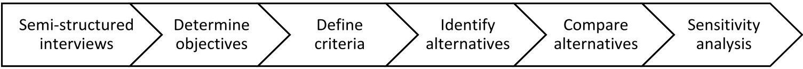
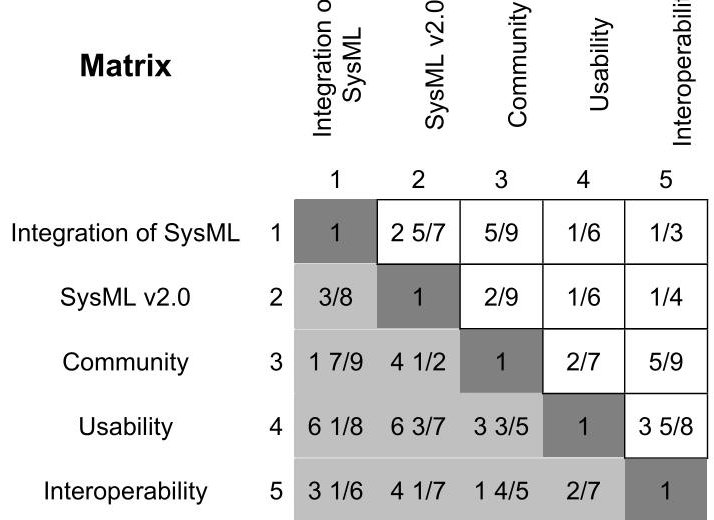
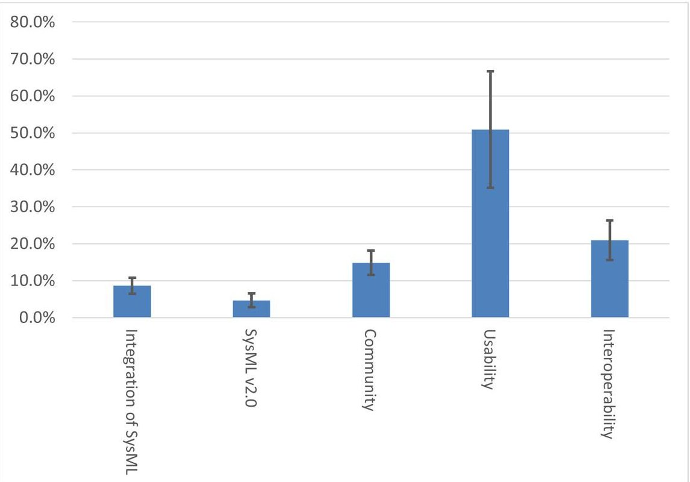
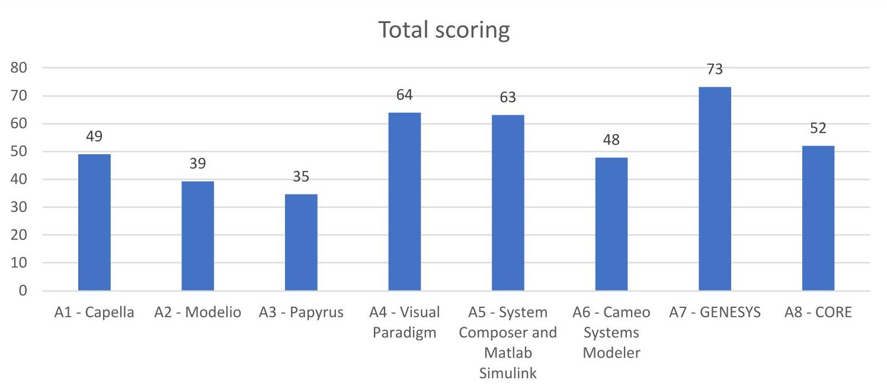
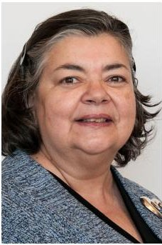

<!-- PDF_PAGE: 1 -->

Detroit, MI, USA June 25-30, 2022

# Academic application of trade-off studies to support a CubeSat project

Evelyn Honoré-Livermore

Norwegian University of Science and

Runar G. Rovik

Technology

7491 Trondheim

Norwegian University of Science and

Technology

evelyn.livermore@ntnu.no

7491 Trondheim

RunarGRovik@hotmail.com

Cecilia Haskins

Norwegian University of Science and Technology

7491 Trondheim

cecilia.haskins@ntnu.no

Copyright © 2022 by Authors. Permission granted to INCOSE to publish and use.

Abstract. Academic CubeSat projects offer students and researchers hands-on engineering experience and can deliver cutting-edge research data. The CubeSat projects are highly multidisciplinary and require teamwork skills as well as engineering expertise. A challenge for academic CubeSat projects is the high turnover of graduating students, which makes knowledge management complicated. Model-Based Systems Engineering (MBSE) offers functionality that can address many of the challenges academic CubeSat teams experience. This paper presents a trade-off study using the Analytical Hierarchy Process (AHP) to select an MBSE software for use by students. Literature on academic application of formal trade-off studies in student teams is limited. The case study described here shows how tangible and intangible factors are addressed using the AHP method, and a discussion of the process and results is provided.

## Introduction

A CubeSat is a small spacecraft consisting of cubes of 10 by 10 by 10 cm units (U), weighing up to 1.3 kg per unit. They come in different configurations, ranging from 1U to 24U, where the most popular sizes are 1U, 3U and 6U (Kulu 2021). The availability of Commercial-Off-The-Shelf (COTS) components, standardized spacecraft subsystems, and lower launch costs enable universities and small businesses to develop their own spacecraft at low cost and short time schedules (Sweeting 2018). The CubeSats are launched on 'rideshare launches', where there may be dozens of CubeSats launched from one rocket. The academic CubeSats are built with various objectives in mind, such as educating future engineers, performing In-Orbit Demonstration (IOD) of new payloads or services, or delivering research data. Most CubeSats are launched into Low Earth Orbit and will deorbit at the end of their lifetimes (usually up to 7 years), re-entering and burning up in the atmosphere. Some university CubeSat projects have propulsion systems, but these are not common.

The CubeSat projects are highly multidisciplinary projects and require many different competencies and engineering backgrounds. Most CubeSat projects rely heavily on mechanical and thermal design, electronics design, software and communication engineering, and aerospace engineering. In addition, project management and systems engineering are required to tie these all together to deliver a system in operation. Students joining academic CubeSat projects are challenged in the engineering domain

<!-- PDF_PAGE: 2 -->

and in the teamwork and interpersonal domains. Directions chosen to share information and generating knowledge in the team influence the design quality. In addition, the team members have different backgrounds and interests for the satellite project (the intervention system) and their role in the project team (realization system) (Martin 2004).

Academic CubeSat projects are challenged by a high turnover of students because of graduation, and many students join without prior knowledge of aerospace engineering or teamwork experience. Having good on-boarding and off-boarding processes, and an approach to knowledge management is important. Previous research suggests that there are challenges related to project management, balancing school work and satellite project work, ensuring momentum and project success. Moreover, research shows that the failure of many university CubeSat missions can be attributed to a lack of system-level testing and ad-hoc processes (Langer and Bouwmeester 2016, Faure 2017). The work in this paper is based one of the author's 2021 master thesis. More details can be found in the thesis online (Rovik 2021).

## Background

Trade-off studies, or trade studies, are a significant part of any system development process (Meier 2008). Engineers continuously make conscious and un-conscious decisions about design of a system as it converges towards an operational system. Design decisions can be formalized and documented through trade-off studies, which show the assumptions and rationale involved with the problem being addressed (Kossiakoff et al. 2011, Garber et al. 2015). This documentation is important to track the ways design decisions impact the system and organization, and for future reference as the people making the decisions leave the team and their tacit knowledge about the decision leaves with them.

Challenges with trade studies: Depending on how interrelated the alternatives involved in the trade-off study are, it can be challenging to structure the study and to understand how any one choice affects the overall system design. Often it remains unclear whether the trade-off study is effective or not in choosing a good alternative. Buede (2014) discusses challenges with trade studies: "The pitfalls of trade studies include missing important alternatives or objectives, and being overconfident about the future, especially the system's context, its usage, the various technologies to be employed in the system, or the architecture's capabilities" (Buede 2014, p. 8).

For a trade-off study to be effective for the team, the results must be communicated and available in the project's information system. If a trade-off study is informal, little documentation is produced and this makes it difficult to recollect and recapture the rationale producing the end result (Kindem and Haskins 2021). New decisions made on prior end results with poor results can lead to faults further along the development cycle if the rationale is not clear and the impacts unknown.

Most students have an intuitive understanding of a trade-off study, but not necessarily how to conduct one formally or how to analyze the results and address limitations of the end result. A lack of proper framework and not identifying objectives and selection criteria correctly can strongly influence the results (Kindem and Haskins 2021). A trade-off study framework should be tailored for the purpose and organization, and there are many different frameworks available. For university CubeSat teams, it is recommended that they are relatively simple to use while still following the guidelines for best practice.

<!-- PDF_PAGE: 3 -->

## Methods

Multi-Criteria Decision Making (MCDM). In this paper, the trade-off study in question is of a subjective nature. The comparison of alternatives was done using the Analytical Hierarchy Process (AHP). This quantifies and enables ranking of alternatives based on the criteria. The AHP is a multicriteria decision-making (MCDM) method that supports making decisions on subjective matters when there are conflicting interests (Al-Harbi 2001). AHP can incorporate both tangible and intangible factors in a decision-making process, which makes it suitable for this application. MCDM methods encourage the involved parties to build an understanding of their own value systems and the problem they are working on. AHP asks the stakeholders to do pairwise comparison of criteria and rank them in terms of importance, and then calculate the weighted average using linear algebra.

Case study. The case study for this paper concerns a university CubeSat team, composed of approximately 15-20 BSc and MSc students and 6-8 researchers (Post Doc. and PhDs). The students join the team for the duration of their Bachelor or Master thesis work, normally for up to 9 months. The development phase of the first CubeSat, HYPSO-1, lasted from the end of 2017 to the fall of 2021. The CubeSat was launched in January of 2022. The next CubeSat, HYPSO-2, started its development phase in the fall of 2021. This means that for each CubeSat, several cohorts of students contribute to the research and engineering work, and knowledge management has been an issue.

On average, 3 students have mechanical engineering background, 6 have electronics systems engineering background, and 4 have engineering cybernetics background. Most of the students do not have systems engineering coursework or aerospace engineering courses, as there are not many available at the university. The team has experienced challenges with knowledge management, traceability of requirements to design, traceability of design to verification and validation, dependability management, and ensuring that information is up-to-date and that design changes are traced to the impacted systems and that all designers are aware of the decisions and changes. In addition, this CubeSat team is planning to develop and launch multiple satellites, incorporating in-house developed Earth Observation (EO) sensors and communication payloads for research purposes. Many of the system elements will be re-used between the satellites, and they will have similar capabilities (for example, communication between ground and space; collect and process EO data). Therefore, reusability of system design and system elements is considered a benefit because it could lower cost and shorten the schedule for new projects.

MBSE. To support the Systems Engineering (SE) effort, Model-Based Systems Engineering (MBSE) tools are considered beneficial (Huldt 2019). Use of MBSE could address some of the challenges the team is experiencing. MBSE tools could be integrated with other engineering software, which means that results and information can be shared between e.g., mission simulation software and system budgets. Another benefit of introducing MBSE is to reduce the need for documents. Text written by individuals in documents is not easy to keep up-to-date, and having a reliable record can be challenging when an engineer is documenting the design at the end of a phase. It would be beneficial if some of the documentation was captured in the system used to design the system. In addition, it is difficult to provide a complete system overview in text. MBSE can support the design process with diagrams and models that have an associated ontology and semantics (Yang et al. 2020). The models can be accessed from different viewpoints that provide the required information for designers. Furthermore, most MBSE tools have built-in functionality for traceability between operational/requirements design, functional design, logical design, and physical design (Estefan 2007). Many have good functionality for interface documentation and management too.

CSRM. The International Council of Systems Engineers (INCOSE) Space Systems Working Group (SSWG) has developed a CubeSat System Reference Model (CSRM). This model is platform-independent and SysML-compliant and is submitted to the Object Management Group (OMG) as a

<!-- PDF_PAGE: 4 -->

CubeSat specification (Kaslow 2021). The CSRM provides an architecture and components for developing a CubeSat logical and physical architecture. Several CubeSat teams have used versions of the model in their work (Spangelo 2013, Alanazi and Straub 2019, Gregory 2020).

Digital Engineering. The university CubeSat team in this case study is introducing processes and systems to move towards Digital Engineering (DE) (Honoré-Livermore et al. 2021). DE proposes to enable an integrated approach to multidisciplinary product development and utilization through to disposal. A goal for DE is to have a "single source of truth" for a project, which MBSE tools can support for the system design (Bone et al. 2019). Applying MBSE and choosing a tool is a part of the process improvement activity, recognizing that DE is about more than just software tools and interoperability, it is also about changing the organizational processes and culture to adopt a digital workflow and mindset.

## Trade study method and results

The generic method used for the case study is shown in Figure 1, based on the trade-off study principles in Kossiakoff et al. (2011) and elaborated in the text that follows. Because of the potential of MBSE to address the challenges of the university CubeSat team, it was decided to conduct a trade-off study for evaluating different MBSE tools that could be used. The AHP method applied in this paper is based on Goepel (2013). The objective of the trade-off study (i.e., select an MBSE tool) guides the rest of the work. Objectives and criteria should be measurable to enable comparison between alternatives. When using AHP, the criteria are compared pairwise to each other and rated on the relative importance of each criterion on a scale of one to nine. The rating and scoring are subjective to each study and should not be used outside of the specific study as they are not a global or universal measure of the software. The criteria are weighted based on their importance to stakeholder needs and requirements.

Figure 1. Overview of method

Semi-structured interviews. Semi-structured interviews were conducted to build an understanding of working methods and stakeholder needs (i.e., the group leaders) (Yin 2017). Because of the COVID-19 lockdown, these interviews were performed using an online communication software with video and voice. In addition to providing the background for the objectives and criteria used in the trade-off study, the interviews provide a description of the work processes used in the project. The group leaders shared that most of the team members store their information in a mixture of textual documents or spreadsheets, in addition to design artifacts such as code and models. There is consensus that as the project progresses, the amount of information and information sources increases, which can make it complicated to find the most up-to-date and relevant information. In academic CubeSat projects, where students join the project only for a limited period and only during the school year, it is critical that the onboarding can be efficient so that incoming students can begin contributing to the projects quickly. Moreover, the information system also needs to consider offboarding of graduating students so that their knowledge is captured to maintain continuity. The group leaders also emphasized that most team members cooperate and connect at least a couple times per week, if not every day, which contributes positively to the information-sharing (Honoré-Livermore 2019). The group leaders were provided with the questions given in Table 1 prior to the actual conversation in order to prepare for the interviews. The interviews were used to define the objectives and criteria for the trade-off study given in Table 2 and Table 3, respectively.

<!-- PDF_PAGE: 5 -->

Determine objectives and define criteria. Based on the semi-structured interviews, the objectives were determined, and criteria derived from these. The group leaders were asked to fill out a spreadsheet where they could rate each criteria against each other and evaluate their relative importance. The stakeholders were also asked to rate their preference for each criteria in the pairwise comparison from 1-9, where 1 meant equal importance and 9 indicated much more important. This latter task is to improve consistency of grading and the spreadsheet would suggest changes to the stakeholder if there were discrepancies.

Table 1: Interview questions

<table border="1"><tr><td>Question ID</td><td>Question text</td></tr><tr><td>Q1</td><td>What are the goals and responsibilities of your team?</td></tr><tr><td>Q1-a</td><td>What is the goal- the main objective for your team?</td></tr><tr><td>Q1-b</td><td>What responsibilities does your team have to the project and the other teams?</td></tr><tr><td>Q2</td><td>Which software programs does your team use?</td></tr><tr><td>Q3</td><td>How do the team members store their data and their work?</td></tr><tr><td>Q4</td><td>How do the team members share their data with other teams and what other teams need access to data from your team?</td></tr></table>

Table 2: Trade-off objectives

<table border="1"><tr><td>Objective</td><td>Description</td></tr><tr><td>O1-Improving communications</td><td>There is a need to improve how the team communicates and shares information.MBSE can support this by removing some of the document-based information sharing and challenges with keeping all documents up-to-date,as well as providing more information graphically.</td></tr><tr><td>O2-Improving design decisions</td><td>Enable representation of design decisions in a clear,precise language that focuses on the requirements of the system.Offer improved requirements traceability and design impact traceability.</td></tr><tr><td>O3-Improving understanding</td><td>Present information in an easy-to-understand graphical view for improving team members&#x27; understanding of system design,requirements,and needs relevant to their work.Different viewpoints in MBSE tools offer simple and complex representations of engineering problems to allow team members to perform analysis of problems in the software directly.</td></tr><tr><td>O4-Improving long term achievements of the project</td><td>Reuse of models and model elements and sharing between projects can improve long-term efficiency of the team.It can also enable smoother onboarding for new team members,where they can see the history of the system design in a holistic manner.</td></tr></table>

<!-- PDF_PAGE: 6 -->

Table 3: Trade-off criteria

<table border="1"><tr><td>Criteria</td><td>Description</td></tr><tr><td>C1-Low cost</td><td>Keeping costs at a minimum is important for student projects which have limited funding.</td></tr><tr><td>C2/C3-Existing SysML/SysML 2.0</td><td>Integration with SysML is beneficial because it is an agreed-upon standard and could improve effectiveness of using MBSE.</td></tr><tr><td>C4-Community</td><td>Active user community can increase the learning process for new users.Online forums, customer support, on-boarding processes, etc.</td></tr><tr><td>C5-Usability</td><td>The university SmallSat Lab users should be able to pick up and learn how to use the software quickly, with good tutorials to simplify the learning process.An intuitive user interface;collaborative work possibilities;user access management,and other characteristics of usability should be considered.</td></tr><tr><td>C6-Interoperability</td><td>The software should allow for integration or import of discipline-specific models or other third-party software to simplify the design work.These tools include(from the interviews)Simulink,Python,GitHub,Siemens NX,ESATAN-TMS,Simulations STK,and CATIA.</td></tr></table>

Ranking criteria. The AHP method includes evaluating the importance of each criterion, which is potentially unique for each of the stakeholders in the project. A total of five stakeholders (group leaders, project manager, and the author of the master thesis) evaluated the criteria. This is done by pairwise ranking between each criterion, and how much on a scale of one to nine they are important. The tool used to support the ranking also supports consistency evaluation of ranking. For example, if A is ranked higher than B in one comparison, B higher than C, but C higher than A, then the tool will highlight this. The result of this pairwise comparison, shown in Figure 2, and weighing is shown in Figure 3. From this we see that the two SysML-criteria do not score highly, while usability is the most important criterion, followed by interoperability and support community.

Figure 2. Pairwise comparison matrix of criteria

<!-- PDF_PAGE: 7 -->

Figure 3. Criteria weighing from the five stakeholders with confidence brackets.

Define alternatives: MBSE tool selection. After a comprehensive review of available tools (consulting sites such as SysML Tools 2021) and based on descriptions on the supplier databases, the following alternatives were considered in this trade-off study:

A1. Capella (open-source) by PolarSys/Thales/Eclipse Foundation

A2. Modelio (open-source) by Modeliosoft

A3. Papyrus (open-source) by Eclipse Foundation

A4. Visual Paradigm by Visual Paradigm

A5. Matlab Simulink and System Composer by The MathWorks

A6. Cameo Systems Modeler by Dassault Systèmes

A7. CORE by Vitech Corporation

A8. GENESYS by Vitech Corporation

A9. Wolfram SystemModeler by Wolfram Research

A10. Enterprise Architect by Sparx System

A11. Innoslate by Innoslate

A12. Rational Rhapsody by IBM

A13. Scade by ANSYS

A14. MagicDraw by Dassault Systèmes

A15. Microsoft Visio by Microsoft

A16. Windchill Modeler by PTC

A11-A16 were removed due to insufficient information available to support the analysis as of January 2021 because of time constraints for the master thesis. The cost, criterion C1, is kept separate from the benefits in the AHP process. The cost criterion further contributed to a down-selection of alternatives from 10 to 8 alternatives because A9-A10 were not considered further because they do not offer research licenses/student licenses and would be too costly for the university budget, which was a constraint from the project.

<!-- PDF_PAGE: 8 -->

Scoring the alternatives. The next step considers how well each alternative meets the criteria of the trade-off study, i.e., its utility. The alternatives are evaluated and scored. These scores are then converted to 'utiles' which is a unitless measurement of utility. These results are presented in Table 4, where a higher score means that the alternative is better than others in terms of that criterion. These scores are given based on the documentation provided by the different companies. The usability score is related to the community-score, because if a company provides a good community this usually means there is more information on how to use the software. Interoperability gets a high score if an API is available or there is a plug-in API so that the users may integrate with the software themselves to support the transfer of data.

Table 4: Overview of alternative scores in terms of utility for each criterion.

<table border="1"><tr><td>Criterion/alternative</td><td>A1</td><td>A2</td><td>A3</td><td>A4</td><td>A5</td><td>A6</td><td>A7</td><td>A8</td></tr><tr><td>C2-Integration of SysML 2.0</td><td>20</td><td>60</td><td>30</td><td>20</td><td>100</td><td>30</td><td>100</td><td>100</td></tr><tr><td>C3-Plan for SysML 2.0</td><td>0</td><td>0</td><td>0</td><td>0</td><td>0</td><td>0</td><td>100</td><td>0</td></tr><tr><td>C4-Community</td><td>50</td><td>50</td><td>30</td><td>60</td><td>70</td><td>20</td><td>50</td><td>50</td></tr><tr><td>C5-Usability</td><td>70</td><td>40</td><td>50</td><td>80</td><td>70</td><td>50</td><td>70</td><td>25</td></tr><tr><td>C6-Interoperability</td><td>20</td><td>30</td><td>10</td><td>60</td><td>40</td><td>80</td><td>80</td><td>50</td></tr></table>

The scores are then used to find the total utility for each alternative, shown in Figure 4. This shows us which alternative meets both the subjective weighing of criteria by stakeholders and objective utility of the alternatives. The confidence brackets are not included here. Many of the alternatives end up with high scores, with GENESYS by Vitech Corporation receiving the highest total utility. GENESYS offers a complete package in terms of software capabilities and usability. The software supports SysML and the firm has plans to integrate SysML v2.0 as it released. It also scores well on usability as it offers many tutorials, guides and full documentation of the inner workings of the software. GENESYS was the alternative that offered the most complete package in guidance and tutorials ready for new users to learn the software. It also provides Open API to support interoperability, as well as implemented support for Simulink. A drawback is that it is not open-source, so the university must address this situation with regular updates to the license.

<!-- PDF_PAGE: 9 -->

Figure 4. Total scoring of each alternative

Sensitivity analysis. The AHP method checks that the ranking of criteria by the stakeholders are consistent. A sensitivity analysis of the results checks to see if the results are invariant "to small changes in the individual weighting and scores (Kossiakoff et al. 2011, p. 291)." One test is to see what happens to the results if each criterion is set to zero one-by-one, or to consider if there are criterions that have not been included. For example, the long-term availability of the software tool, or the transition cost between tools, are criteria that have not been evaluated, but that may influence the results. When setting each criterion to zero, the "Usability" criterion was the only one that influenced the results. If Usability is set to zero, Modelio comes out as the best open-source alternative. This is because Capella scored so high in Usability compared to Modelio in the scoring of the alternatives.

## Discussion and Conclusion

The trade-off study presents an evaluation of eight alternatives. A limitation of the study is identifying all the relevant alternatives and keeping updated with new developments. Additional software tools found during the investigation were removed from the study because of lack of documentation and response from the providers. At the time of writing this paper, some of these limitations have been addressed by reaching out to the providers again, but it has been challenging for the authors to contact some of the vendors.

The AHP method influences parts of the study. For example, the weighting of alternatives is impacted by the number of stakeholders, and the utility study is subjective to the experience and biases of the authors. This was addressed partially in sensitivity analysis by performing the utility study twice to see if there were any major discrepancies when comparing the alternatives. The objectives and criteria are developed based on the goals of the CubeSat projects. If these are interpreted incorrectly, the premise of the trade-off study is erroneous, and the result flawed. The objectives and criteria were discussed multiple times with the stakeholders to reduce the chance of including irrelevant factors. The objectives accurately reflect the needs for Digital Engineering, and as thus are relevant also for the university as a whole. There are some variations in the stakeholders' scoring of criteria, as shown in Table 5. For example, Eval. 2 and 3 highlight community higher than the other stakeholders, while Eval. 1 highlights integration of SysML.

<!-- PDF_PAGE: 10 -->

Table 5. Stakeholders' prioritization of each criterion

<table border="1"><tr><td colspan="2">Criterion</td><td>Eval.1</td><td>Eval.2</td><td>Eval.3</td><td>Eval.4</td><td>Eval.5</td></tr><tr><td>1</td><td>Integration of SysML</td><td>12.3%</td><td>7.9%</td><td>6.5%</td><td>5.6%</td><td>7.5%</td></tr><tr><td>2</td><td>SysML v2.0</td><td>3.9%</td><td>7.4%</td><td>4.0%</td><td>3.1%</td><td>3.6%</td></tr><tr><td>3</td><td>Community</td><td>6.3%</td><td>23.2%</td><td>44.1%</td><td>9.3%</td><td>7.5%</td></tr><tr><td>4</td><td>Usability</td><td>53.4%</td><td>53.6%</td><td>28.6%</td><td>53.9%</td><td>53.2%</td></tr><tr><td>5</td><td>Interoperability</td><td>24.1%</td><td>7.9%</td><td>16.8%</td><td>28.0%</td><td>28.3%</td></tr></table>

The results from the trade-off study recommends using GENESYS by Vitech Corporation. If an open-source alternative is needed, Capella by PolarSys/Thales/Eclipse Foundation is recommended. The academic CubeSat project has used both in the development of their first CubeSat, for different purposes. GENESYS has been used for requirements management and allocation, and dependability analysis. Capella has been used for operational concept exploration, modeling of operational scenarios, and evaluation of some on-board functionality. The CubeSat team wants to continue using one or both tools, but struggles with having enough SE resources and maintaining continuity.

The team leads were not surprised by the results, and some prefer the open-source alternative over the licensed alternative. However, finding resources to follow up the MBSE efforts remains a challenge. Since this study, there have been several efforts in the MBSE community for improving the usability of tools. For example, through the Capella textual editor (Capella-textual-editor, 2022), which would lower the bar for e.g., software engineers to contribute to the system model. The trade study should be revisited to include these new capabilities.

However, choosing a MBSE tool is not a sufficient step to adopt and implement MBSE as part of the workflow. Adoption requires a willingness from team members and support from the organization, and resources to implement and maintain the tool. There might also be cultural barriers because of unfamiliarity with using MBSE instead of document-based SE. A dedicated manager for the MBSE software and process could help the student team, and in this role would be in charge of training the systems engineers and maintaining a roadmap for the implementation of a MBSE workflow. This manager needs to be familiar and comfortable with the MBSE software to provide guidance for new team members and prevent default fallback to old working practices if it is challenging.

The academic project can also benefit from adopting the CSRM by INCOSE SSWG. This provides an architecture for starting the MBSE journey and structures the work for a new team. MBSE will generate engineering artifacts from the repository which can be used for improving the design development and communication between team members, and also with external stakeholders. The builtin traceability also assists project management with ensuring that all the design elements are considered and justified by the requirements. Traceability also supports verification activities, planning and scheduling, and helps reduce some of the challenges encountered by student CubeSat projects.

Future work could look at the effect of the project for students' SE skills, and how the introduction of MBSE has supported the development of the satellites. It would also be interesting to check in with project alumni to better understand how this project has contributed to their transferable skills and relevance in industry. From the study, the most important criterion ended up being "Usability". However, this is very subjective, and depends on the background of the persons using the software tools. This makes it challenging to measure, but a future study could look into how the students experience the usability of the tool, and which features of a tool contribute to this perception.

<!-- PDF_PAGE: 11 -->

## References

Al-Harbi, KMA-S (2001), 'Application of the AHP in project management', International Journal of Project Management, Vol. 1, pp. 19-27. DOI: 10.1016/S0263-7863(99)00038-1.

Alanazi, A and Straub J (2019), 'Engineering methodology for student-driven cubesats', Aerospace, Vol. 6, No. 5. DOI: 10.3390/aerospace6050054

Bone, MA et al. (2019), 'Transforming systems engineering through digital engineering', The Journal of Defense Modeling and Simulation, Vol. 16, No. 4, 2019, pp. 339-355, DOI: 10.1177/2F1548512917751873.

Buede, D (2014), 'On trade studies'. In: INCOSE International Symposium 14.1, pp. 2026-2034. DOI: 10.1002/j.2334-5837.2004.tb00631.x

Capella-textual-editor (2022), 'GitHub repository for Capella-textual-editor', Accessed online : 2022-02-28, available at : <https://github.com/eclipse/capella-textual-editor>

Estefan, JA (2007), 'INCOSE MBSE Focus Group : Survey of Model-Based Systems Engineering (MBSE) Methodologies', Object Management Group Homepage, Accessed online : 2021- 11-04, available at : <https://www.omg.org/syseng/MBSE Methodology Survey RevA.pdf>

Faure, P et al. (2016), 'Toward lean satellites reliability improvement using HORYU-IV project as case study', Acta Astronautica, Vol. 133, pp. 33-49, DOI: 10.1016/j.actaastro.2016.12.030

Garber, M et al. (2015), 'Multi-Stakeholder Trade Space Exploration Using Group Decision Making Methodologies', In: INCOSE International Symposium. Vol. 25, pp. 1118-1132. DOI: 10.1002/j.2334-5837.2015.00119.x

Goepel, K (2013), 'Implementing the Analytical Hierarchy Process as a Standard Method for Multi-Criteria Decision Making in Corporate Enterprises - A New AHP Excel with Multiple Inputs', DOI: 10.13033/isahp.y2013.047

Gregory, JM et al. (2020), 'Applying a Model-Based Approach to Develop a Standardized Template for CubeSat-class Satellites', In: 2020 IEEE Aerospace Conference, DOI: 10.1109/AERO47225.2020.9172748

Honoré-Livermore, E (2019), 'CubeSats in University: Using Systems Engineering Tools to Improve Reviews and Knowledge Management,' In: Conference on Systems Engineering Research, Procedia Computer Science, Vol 153, pp. 63-70, 2019 DOI: 10.1016/jprocs.2019.05.056

Honoré-Livermore, E, Birkeland, R, Bakken, S, Garrett, JL, Haskins, C (2021), 'Digital Engineering Management in an Academic CubeSat Project,' Special Issue on Systems Engineering Challenges in Journal of Aerospace Information Systems, DOI: 10.2514/1.I010981

Huldt, T and Stenius, I (2019), 'State-of-practice survey of model-based systems engineering', Systems Engineering, Vol. 22, No. 2, pp. 134-145, DOI: 10.1002/sys.21466.

Kaslow, D et al. (2021), 'Mission Engineering and the CubeSat System Reference Model', In: 2021 Aerospace Conference, IEEE Xplore, DOI: 10.1109/AERO50100.2021.9438168

Kindem, H and Haskins, C (2021), 'The value of trade-off studies for student projects', In: INCOSE International Symposium. Vol. 31, pp. 889-906, DOI: 10.1002/j.2334-5837.2021.00876.x

Kossiakoff, A et al. (2011), Systems Engineering Principles and Practice, Hoboken, NJ, US: John Wiley & Sons Inc.

Kulu, E (2021), 'Nanosats database', Accessed online: 2021-10-25, available at <https://www.nanosats.eu/>.

Langer, M and Bouwmeester, J (2016), 'Reliability of cubesats - statistical data, developers' beliefs and the way forward', In: AIAA/USU Conference on Small Satellites, SSC16- TS10ADVTECH2-4, available at <https://digitalcommons.usu.edu/smallsat/2016/TS10AdvTech2/4/>.

<!-- PDF_PAGE: 12 -->

Martin, JN (2004), '3.1.2 The Seven Samurai of Systems Engineering: Dealing with the complexity of 7 interrelated systems', In: INCOSE International Symposium, Vol. 14, No. 1, pp. 459- 470.

Meier, SR (2008), 'Best project management and systems engineering practices in the preacquisition phase for federal intelligence and defense agencies', Project Management Journal, Vol. 39, No. 1, pp.59-71.

Spangelo, SC et al. (2013), 'Model based systems engineering (MBSE) applied to Radio Aurora Explorer (RAX) CubeSat mission operational scenarios', In: 2013 IEEE Aerospace Conference, DOI: 10.1109/AERO.2013.6496894.

Specking, E et al. (2018), 'Early Design Space Exploration with Model-Based System Engineering and Set-Based Design', Systems, Vol. 6, No. 4:45. DOI: 10.3390/systems6040045.

SysML Tools (2021), 'Free & Commercial SysML Tools for MBSE', Accessed online: 2021-11-01, available at <https://sysmltools.com/select-sysml-modeling-tool/>

Sweeting, M (2018), 'Modern small satellites-changing the economics of space', Proceedings of the IEEE, Vol. 106, No. 3, pp. 343-361, DOI: 10.1109/JPROC.2018.2806218.

Rovik, Runar G (2021), 'Using Model Based Systems Engineering to Improve Design Decisions and Communications in Student CubeSat Projects', Master thesis in Mechanical Engineering, Norwegian University of Science and Technology

Yang, L et al. (2020), 'Ontology learning for systems engineering body of knowledge', IEEE Transactions on Industrial Informatics, Vol. 17, No. 2, pp.1039-1047.

Yin, Robert K. (2017), Case Study Research and Applications: Design and Methods, SAGE Publications Inc.

<!-- PDF_PAGE: 13 -->

## Biography

Evelyn Honoré-Livermore Evelyn is a Ph.D. Fellow at NTNU in the Department of Electronic Systems, researching the integration of systems engineering and project management methods for academic research projects. She is the project manager of the small satellite HYPSO. Evelyn received her MSc in Electronics Engineering from NTNU in 2012, and her MBA from Yonsei University, Seoul in 2017. She has project manager experience working with space systems in the Norwegian aerospace industry.

Runar G. Rovik. Runar is working as a Product Engineer in the oil and gas industry Interwell Norway AS. He graduated from NTNU with a MSc in Mechanical Engineering from 2021. He also has a bachelor's in mechanical engineering from 2018, also from NTNU. He was part of starting Propulse NTNU, a rocketry team that has competed in the Spaceport America Cup and in the European Rocketry Challenge. He is currently working on maintaining and improving a product line of High Expandable Bridge plugs, intervention tools used to create barriers in gas or oil well operations. His interests include systems engineering, programming, space exploration, renewables, and well intervention technology.

Cecilia Haskins. Cecilia is recently retired and continues in emeritus status with the Norwegian University of Science and Technology (NTNU) and the University of Southeastern Norway (USN). Her career included over 30 years as a practicing systems engineer and over 20 years educating the next generation of engineers on the importance of systems approaches. She joined INCOSE in 1993 where she held a variety of leadership and other volunteer positions, was recognized as an INCOSE Founder, and continues to be active as a mentor and author. Her educational background includes degrees in chemistry, business, and eventually a PhD in systems engineering from NTNU.