<!-- PDF_PAGE: 1 -->

Detroit, MI, USA June 25-30, 2022

# An MBSE Architectural Framework for Inter-Satellite Communication in a Multiorbit Disaggregated System

Awele Anyanhun, PhD

Georgia Tech Research Institute

Smyrna, Georgia

Ademola Peter Adejokun

Lockheed Martin Aeronautics

Matthew Hause

Fort Worth, Texas

System Strategy Inc.

Austin, Texas

Copyright © 2022 by Awele Anyanhun, Ademola Adejokun, Matthew Hause. Permission granted to INCOSE to publish and use.

Abstract. The Multi-Orbit Disaggregated System (MODS) concept is a disaggregation strategy geared towards improved resiliency and flexibility of space missions by dispersing payloads and/or functionality across multiple small satellites (SmallSats). Although SmallSats make good candidates for deployment as a MOD System, their success hinges on the ability to realize reliable Inter-Satellite Communication (ISC). To this end, we investigate the efficacy of developing a model-based systems engineering (MBSE) Architectural Framework for ISC to guide and constrain instantiations of ISC architecture solutions. An MBSE architectural framework is a systems engineering artifact that defines a set of views required to describe an architecture based on MBSE principles and practices. It provides a standardized structure and guidance to capture architectural decisions while maximizing opportunities for commonality, consistency, and interoperability within the Domain of Interest. To achieve well-defined architecture descriptions, a MODS architectural framework pattern, and a comprehensive architectural framework for the ISC (sub)system are created and presented. The Systems Modeling Language (SysML) (OMG, 2019) serves as the modeling language for the framework design.

## I. Introduction

Disaggregation of space system capability arose as an emerging concept with great benefits of improving resiliency as well as increase the flexibility of space missions as is widely reported in literature (Thompson, 2015, Command, 2013, Burch, 2011, Iam, 2013, Thompson, 2014, Hastings, 2019, Mazal, 2013, Thompson, 2015). Disaggregation disperses payloads and/or functionality across multiple satellites which span one or more orbital planes. Mission type, criticality, and payload type act as key determinants in whether a specific mission will implement a MultiOrbit Disaggregation system (MODS) solution. Irrespective of mission type however, Small Satellite Systems (SmallSats) make good candidates for deployment as a disaggregated system by offering flexible architectural options for space exploration missions. As a MODS solution, optimal utilization of these small, low cost SmallSats can be achieved by enabling high-speed InterSatellite Communication (ISC) for the relay of data, command, and control.

<!-- PDF_PAGE: 2 -->

To adequately define and specify an ISC (sub)system architecture for use in a MODS, a ModelBased Systems Engineering (MBSE) approach is required because of its holistic and rigorous approach to architecture development. MBSE provides a model-based approach to architecture development through the creation of system models. Specifically, it facilitates the development of system solutions in response to complex technological challenges encountered during the development of complex systems architectures. Central to the Systems Engineering (SE) and MBSE practice is the concept of Architectural Frameworks (AF) and architecture descriptions. Significant effort has so far been devoted to the research and development of both defense-based AFs and non-defense-based AFs as reported in a variety of literature (Reichwein 2011, Holt 2014, Dickerson 2016, Hilliard 2013, Shames 2010, Ministry of Defense 2016, ISO42010, 2011, UAF Specification, Hause 2015, Hause 2020, TOGAF 2009, Zachman 2008, NATO 2013, DODAF 2016). Examples of defense-based AFs include united states department of defense framework (DODAF), United Kingdom ministry of defense framework (MODAF), unified architecture framework (UAF) and the NATO framework (NAF). Non-defense-based AFs include Enterprise AFs such as Zachman AF and The Open Group AF (TOGAF). These AFs provide concepts, guidelines, best practices, and methods that are tailored to the needs of specific domains. They apply similar principles to organize and structure information using different levels of abstraction.

The motivation behind developing an AF for enabling the description of the MODS architecture is twofold. Firstly, an AF will enable consistent interpretation of the MODS architecture and architectural elements because of the use of an ontology and viewpoints. Secondly, an architectural framework will facilitate reusability by enabling the application of the more generalized MODS Architectural Framework (MODS-AF) to specific instances of its subsystem domains as demonstrated by the development of the ISC Architectural Framework (ISC-AF). The purpose of the defining the ontology and view is not to "reinvent the wheel", i.e., define, build, implement, and support a new AF. Instead, it is done to obtain a clear definition of the concepts, ideas, viewpoints, and concerns within the domain to be modeled. Having done so, we can then determine if other frameworks or modeling languages provide these required capabilities, or if they can do so by use of a Domain Specific Language (DSL) extension to the Framework. Alternatively, the framework could be extended as was the case for the security views in UAF, which were not originally defined in DoDAF or MODAF on which the UAF was based (Hause & Kihlstrom, 2020). Although specifying an AF is not an obvious requirement for developing architecture descriptions, they however are critical in facilitating the development of architectures and system models that are cohesive thereby delivering a more consistent and reusable architecture. In view of the significant benefits an AF provides towards the development of consistent system architectures, its development becomes necessary to facilitate the creation of system architecture models that will deliver value to the system development effort. A lack of such an enabler limits our ability to define comprehensive architectures. Therefore, as a means of addressing this challenge and research gap, this work seeks to expand on previously reported work by Anyanhun and Edmonson in (Anyanhun 2017) and is based on AF industry standards such as the ISO/IEC/IEEE 42010 (ISO/IEEE 42010, 2011) and specific aspects of the RASDS architecture. The additions reported in this work are necessary to address identified gaps in the previous ISC-AF.

We describe the MODS Architectural Framework (MODS-AF) presented in this research work as being composed of a set of Viewpoints and an Ontology. An ontology represents an explicit formal specification of all the key concepts and terms in a given domain and their relationships.

<!-- PDF_PAGE: 3 -->

The UAF and SysMLv2 are examples of an architectural framework and a modeling language built on an ontology. SysML v2 (Friedenthal, 2021) is built on the Kernel Modeling Language (KerML) and the UAF is built on the International Defense Enterprise Architecture Specification Foundation (IDEAS). A Viewpoint specifies the conventions required for the construction, interpretation, use and analysis of specific architecture views. The MODS-AF represents the overarching AF from which all other AFs developed for the description of individual (sub)system architectures are based. The ISC-AF also reported here is developed following this pattern. The AF presented in this work will be used to guide the development of an ISC system architecture model that can be queried, verified, and validated in a consistent way.

This paper makes several contributions to existing literature. First, this research work advances current research on architectural frameworks by utilizing MBSE principles and a formalized modeling language in the development of an architectural framework pattern for complex systems. Second, while there may exist several architecture descriptions for multiorbit disaggregated systems, to the best of the authors knowledge, the MODS-AF and ISC-AF presented in this paper are the first of its kind developed as a standard set of elements that enable and facilitate the descriptions of architectures for a MODS as well as its subsystems. Third, our AF is specified in a manner that allows it to be easily modified and adapted to suit a variety of systems due to the modular approach utilized. The AF can be leveraged by specializing off the various Perspectives and Ontologies. The rest of the paper is organized as follows: A brief description of the MODS concept is presented in Section II. In Section III, the AF, Requirements, System, Services, Security and Traceability Perspectives and Ontologies are discussed respectively while conclusions and future research work are presented in IV.

## II. Background and Overview of the MODS Concept

The MOD system concept proposed by Anyanhun et al. (Anyanhun 2018, Anyanhun 2020) comprises a network of three SmallSats. SmallSats represent a class of artificial satellites with an overall mass of 180kg and below. A viable MODS hinges on the availability of reliable InterSatellite Communication (ISC) capabilities. Therefore, current research efforts are focused on investigating the possibility of utilizing a hybrid visible light and RF technology for ISC within the MODS. A constraint imposed on the MODS communication system is that of a constant line-of-sight (LOS) configuration between both CubeSats.

Currently, two MODS designs are proposed with each comprising a network of three SmallSats two CubeSats (i.e. SmallSat with a mass range between 1-10Kg) and one MicroSat (i.e. SmallSat with a mass range between 10-100Kg). Both architectural designs differ mainly in the orbital placement of the CubeSats. Preliminary simulations of baseline scenarios capturing a day in the life of the MODS was performed to facilitate understanding of the ISC needs during the conceptual design formulation phase. Simulations performed using the Systems Tool Kit (STK) software (AGI, 2021) are portrayed in Figure 1. Design concept Alpha illustrates the placement of each CubeSat in the same equatorial Low Earth Orbit (LEO). This design concept readily satisfies the LOS constraint.

<!-- PDF_PAGE: 4 -->

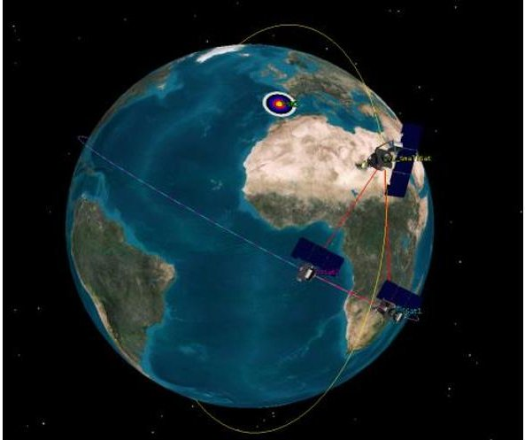

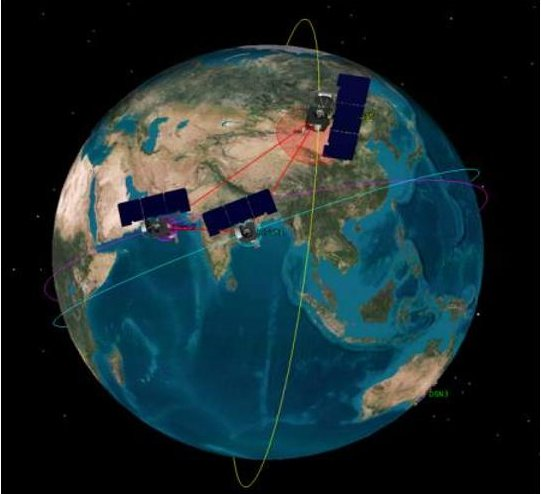

Figure 1. MODS Concept Alpha - (left) and Concept Beta - (right)

However, implementing such a design will necessitate that each CubeSat comprise a different set of mission payload(s). As shown in Design Concept Beta, each CubeSat is deployed in a different equatorial LEO. In both design concepts, the Sun Synchronous Orbit in which the MicroSat is deployed is maintained.

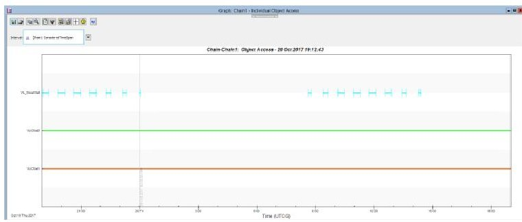

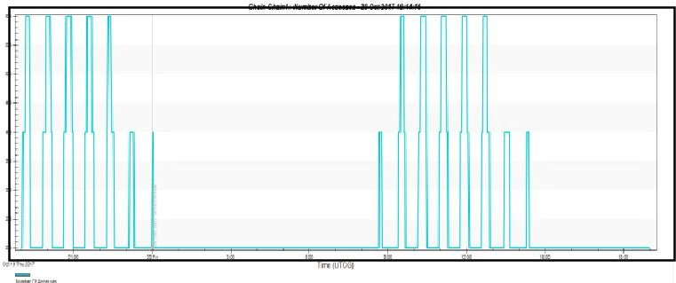

Figure 2. Plot depicts constant LOS Access between CubeSats (left); Plot depicts Duration of LOS Access between the MicroSat and both CubeSats (right).

Plots for access times and duration for Design Concept Beta are portrayed in Figure 2. The Baseline assessment of the plot shown indicates that Design Concept Beta satisfies the LOS configuration constraint. Additionally, the access times and duration during which data relay between the MicroSat and both CubeSats can occur is also highlighted. Considering that reliable ISC between the SmallSats is a critical factor on which the viability of the MODS depends, we begin by defining required MBSE artifacts needed to support the system modeling of the ISC (sub)system.

## A. The Multi-Orbit Disaggregated System

The block definition diagram (bdd) portrayed in Figure 3 illustrates the high-level architectural structure of the MODS. As depicted, the MODS is composed of three SmallSats as indicated by the multiplicity value of three (3) shown in the figure. Each SmallSat consists of one or two payloads and multiple subsystems. Payload types include but are not limited to scientific instruments, military payload, navigation technology and meteorological instruments. Similarly, onboard subsystems include the command and data handling system, propulsion system, attitude determination and control system, thermal system, electrical system, mechanical structure system and the communication system. The communication system capability is of vital interest since

<!-- PDF_PAGE: 5 -->

the MODS concept viability is dependent on ISC. Hence, its design is approached from two architectural viewpoints namely an ISC system capability viewpoint and a Satellite-To-Ground system capability viewpoint (this viewpoint is outside the scope of this work).

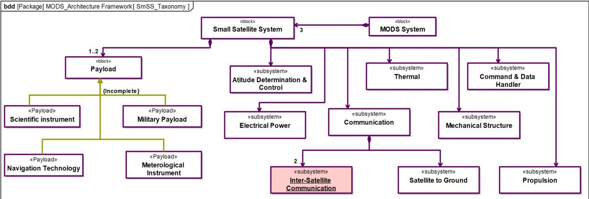

Figure 3. A Generic Small Satellite System Taxonomy

## B. MODS Architectural Framework

The viability of a system refers to its ability to maintain, recover, adapt, respond, and act independently without external help throughout its expected life span (Hitchins, 2008) It is therefore crucial that the MODS be viable in order to achieve stakeholder goals. To achieve viability, it is essential that an architectural framework first be developed based on best practices and methods and used in specifying MODS architectures. In addition, the purpose of the MODS MBSE Architectural Framework (MODS-AF) is to aid in the definition of a set of viewpoints that enable and facilitate the description of (sub)system architectures in a complete, consistent, homogeneous, and unambiguous way. Figure 4 portrays the relationship between the MODS-AF and subsystem AFs as a generalization relationship. This ensures a predefined minimum level of consistency across all AFs used in specifying (sub)systems architectures. The MODS-AF which we describe as a set of Viewpoints and an Ontology provides guidance on how to create such descriptions (Holt, 2014).

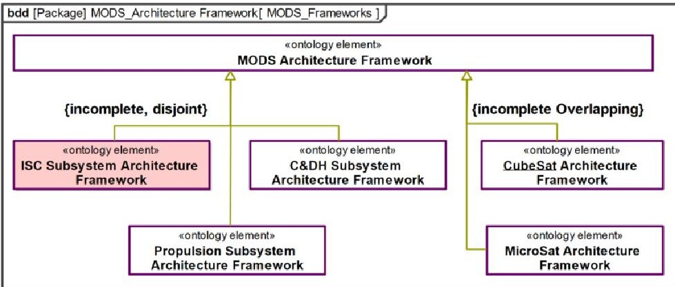

Figure 4. View Portrays Generalization-Specialization Relationships between the MODS-AF and Subsystem AFs

<!-- PDF_PAGE: 6 -->

Consequently, the MODS-AF consists of five Viewpoints: (1) The MODS-AF Context Viewpoint: This Viewpoint illustrated in Figure 5 highlights the MODS-AF stakeholders and their Concerns. Stakeholder Concerns form the basis for the existence of the MODS-AF and are the Concerns the MODS-AF is designed to address. (2) MODS-AF Ontology Viewpoint: This Viewpoint defines the terms and concepts specified in the MODS-AF Ontology. (3) MODS-AF Rules Definition Viewpoint: Defines the set of Rules that constrain the AF and Viewpoints. (4) MODS-AF Relationship Viewpoint: This Viewpoint depicts the relationships between the various Viewpoints grouped together to make up the MODS-AF Perspectives and Ontology. The AF view portrayed in Figure 6 as well as all Views portrayed in Section III conform to the MODS-AF Relationship Viewpoint. Only Views conforming to the MODS-AF Relationship Viewpoint are portrayed in this work. Finally, (5) MODS-AF Definition Viewpoint: Defines a particular Viewpoint or Ontology Element. These five Viewpoints and their corresponding Views are defined in a systematic manner to ensure they conform to the MODS-AF Ontology. Central to the development of the MODS architectural framework is the activity of defining the MODS Ontology; We define the MODS Ontology as an element of the Architectural Framework that defines all terms, concepts and their relationships that relate to any Architecture structured according to the MODS Architectural Framework.

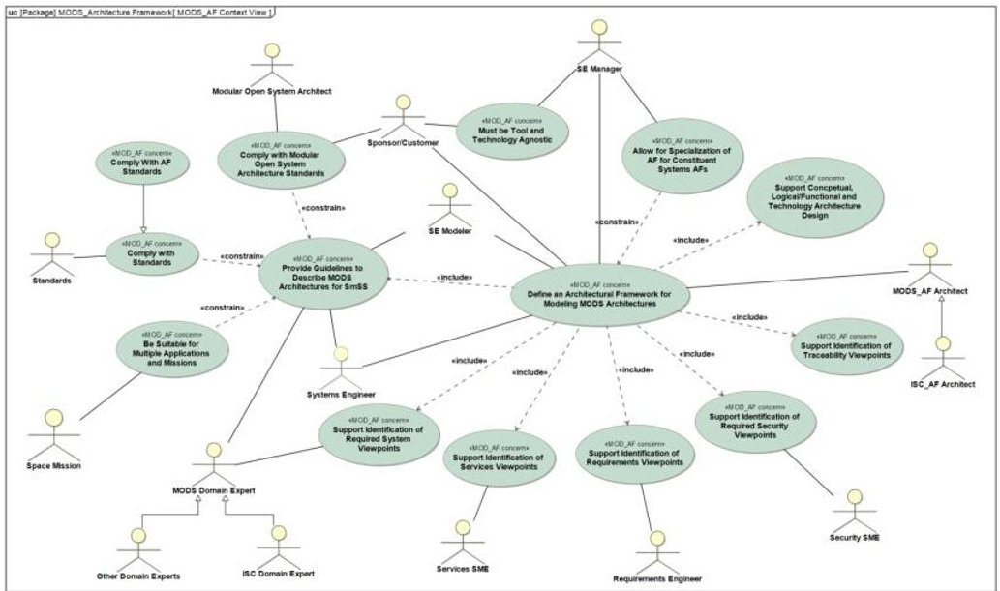

Figure 5. MODS-AF Context View Portraying the AF Stakeholder Concerns.

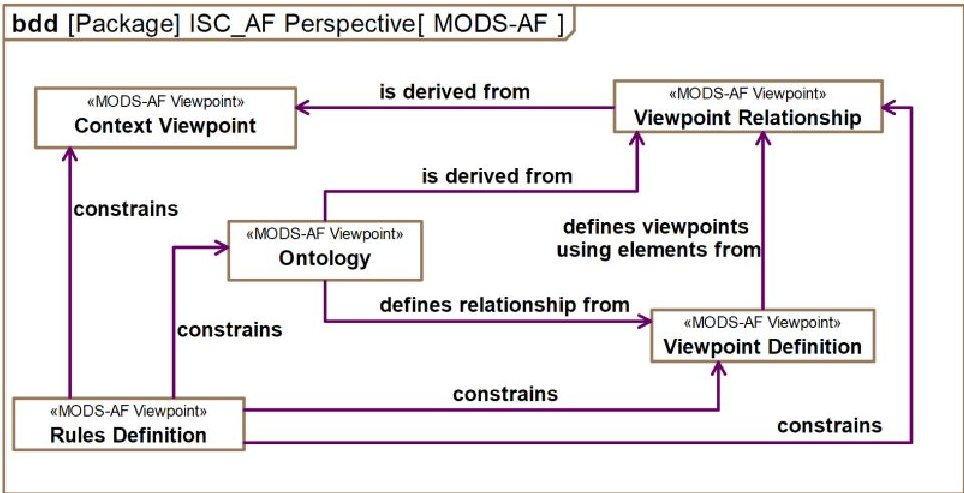

Figure 6. Viewpoint Relationship View portraying the MODS-AF Perspective.

<!-- PDF_PAGE: 7 -->

# C. MODS-AF Conceptual Ontology

Figure 7 depicts the MODS conceptual ontology relationship view which describes the relationships between concepts and terms specific to the MODS domain and represents a concrete model of the terms used in the problem domain. A combination of all concepts and terms relevant to the various MODS subsystems form the MODS Ontology. Specifying a conceptual ontology adds rigor to the meaning of the concepts and terms used in the MODS architecture descriptions as well as the views generated. Furthermore, underpinning the definitions of these concepts with logic enforces the consistency required by the AF.

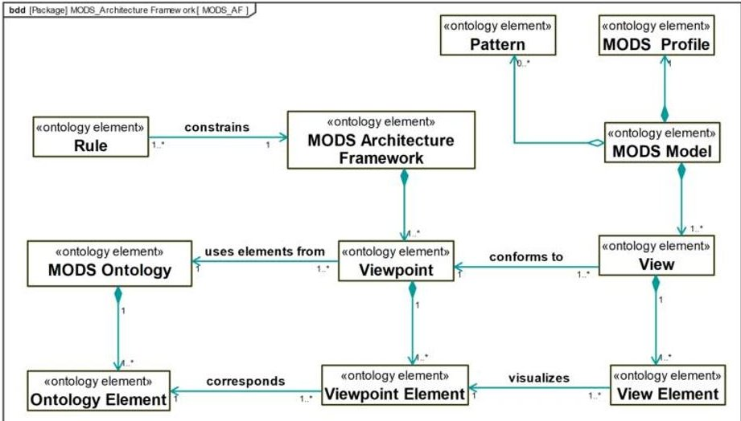

Figure 7. MODS-AF View portrays the MODS-AF Ontology Elements

Typically, a conceptual ontology provides the semantic grounding required by standardizing all relevant constructs in unambiguous terms (Holt, 2014, Bennett, 2019). It is expected that the ontology be generic enough to allow a range of logical ontologies reference it. Besides, it can be expected that an ontology will evolve over time, and so must be developed to be extensible (extensibility is made possible if the ontology is abstracted adequately (Bennett, 2019)). Therefore, to ensure extensibility, the Ontology is defined at a high level of abstraction and secondly, all relevant concepts are classified as belonging to one of six distinct categories namely AF, Requirement, System, Services, Information Security, and Traceability category respectively.

## III. ISC Architectural Framework

The ISC-AF is a specialization of the MODS-AF and represents the set of guidelines, patterns and rules required to delineate the inter-satellite communication system architecture. This work expands on the initial framework design reported by Anyanhun and Edmonson in (Anyanhun 2017) to include coverage of essential concepts needed to provide for a more accurate description of ISC architectures. Previously identified perspectives include the AF, Requirements and System Perspectives. Current additions are Information Security, Services and Traceability Perspectives. These additions were necessitated to fill identified gaps in the previous AF. Also introduced in this research work is the MODS-AF. It was necessary to define an overarching AF to ensure consistency in the development of architecture models for each of the subsystems that make up the disaggregated satellite system hence the need to define the MODS-AF and ensure the ISC-AF conforms to it. The ISC-AF provides the required structure needed to specify the ISC

<!-- PDF_PAGE: 8 -->

(sub)system architecture and it comprises an Ontology and a set of Viewpoints grouped into multiple Perspectives.

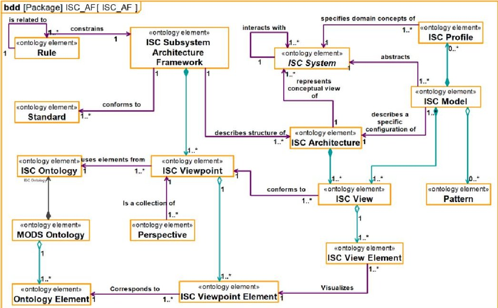

Figure 8. ISC-AF View portrays Ontology Elements

The ISC-AF Ontology View illustrated in Figure 8 highlights the relationships between the ISC-AF ontology elements. As shown, the ISC-AF is composed of one to many (1...*) viewpoints which architecture views conform to. The AF describes the structure of one to many ISC architectures, and also conforms to aspects of one to many Standards such as the ISO/IEC/IEEE 42010 (ISO/IEEE 42010, 2011), ISO/IEC/IEEE15288 (ISO/IEEE 15288, 2015) and the reference architecture for space data systems - RASDS (Shames, 2003). One to many Rules defined within the MODS-AF constrain aspects of the ISC-AF as well as Rules defined specifically for the ISC-AF. These rule sets are established to ensure consistency in the AF and the corresponding architectures. Furthermore, the ISC-AF specifies that a specific ISC architecture represents one to many conceptual views of the ISC system while one to many ISC system models abstract the ISC system as well as describe a specific configuration of the ISC architecture. In addition, the ISC-AF also specifies that the ISC model is composed of one to many views and can have patterns defined and used in modeling aspects of the system, as well as have an ISC Domain-Specific Language (DSL) profile defined for capturing domain specific concepts. The ISC-AF helps ensure that the resulting architectures developed using the AF will address stakeholder concerns in terms of the resulting views of the ISC system model created. Highlighted in the next section are the ISC-AF Requirement, System, Services, Security, and Traceability Ontology views and Perspectives.

## A. ISC-AF Stakeholder Concerns

The Context Viewpoint frames the context for the concerns addressed by the ISC-AF. Figure 9 portrays the view which conforms to the ISC-AF Context Viewpoint and describes in context the concerns of the ISC-AF stakeholders. The main concern the ISC-AF is developed to address is to Define an Architectural Framework for Modeling ISC Architectures. To fulfill this requirement, other concerns (shown by the include relationship) must be met, indicating that the main concern

<!-- PDF_PAGE: 9 -->

# is not considered complete without fulfilling all included concerns shown in the diagram. Some listed concerns include:

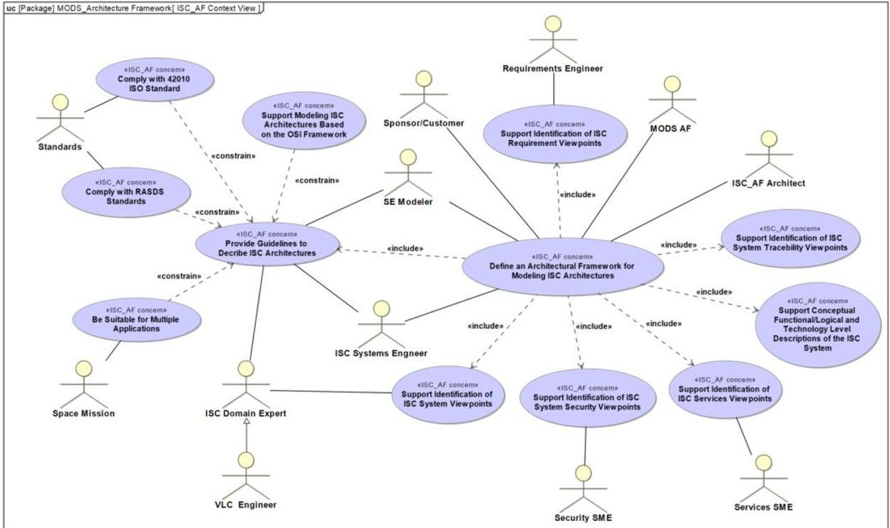

Figure 9. ISC-AF Context View portraying the AF's Stakeholder Concerns

- Provide guidelines and a generic platform to support and describe a robust ISC architecture.

- Support conceptual, functional and technology level descriptions of the ISC system.

- Support the identification of ISC System Viewpoints.

The architectural framework must also provide critical support in terms of standards, best practices and global requirements for modeling of an ISC system. This support is also specified in terms of Concerns which constrain the main Concern and are listed as:

- Be suitable for Multiple Applications - The framework must be generic enough to support different types of ISC architectures.

- Comply with the ISO 42010 Standard - The AF must comply with best practice standards for the development of coherent ISC architectures.

Following the identification of stakeholders' concerns, next steps involve the specification of relevant concepts necessary to address these concerns. These concepts are specified from an Ontology and Perspective context and are highlighted in the following sections.

## B. ISC-AF Requirement Concept Viewpoint

1) Requirements Ontology Definition. The ISC Requirements Ontology is developed by identifying, defining, and grouping together all concepts and terms related to the Requirement and Need Concept, as shown in the Requirement Ontology Definition View (RODV) portrayed in Figure 10. Pivotal to this knowledge area are concepts such as the ISC Need and ISC Requirement. As illustrated in the RODV, an ISC Requirement has a Requirement Description which is elicited from a Requirement Source. A Requirement Source represents a special type of Source Element. Also defined in the RODV is the term ISC Constraint. This term represents a global

<!-- PDF_PAGE: 10 -->

requirement indicating that any ISC system property identified as a constraint cannot be traversed. Three distinct relationship types (Composition, Association, Specialization) represent the various ways in which requirement concepts and terms (ontology elements) relate to each other in the RODV. For instance, the Composition relationship and multiplicity portrays that each ISC Requirement is composed of one-to-many Requirement Attribute. While the ISC Functional, ISC Service and Cybersecurity Requirements each represent a special type of Requirement. Similarly, the relationship between the ISC Need, ISC Goal and Objectives are contained within this View. The use of an Ontology to formally specify ISC Requirement concepts, terms, and relationships in this manner facilitate the development of ISC Requirement Viewpoints.

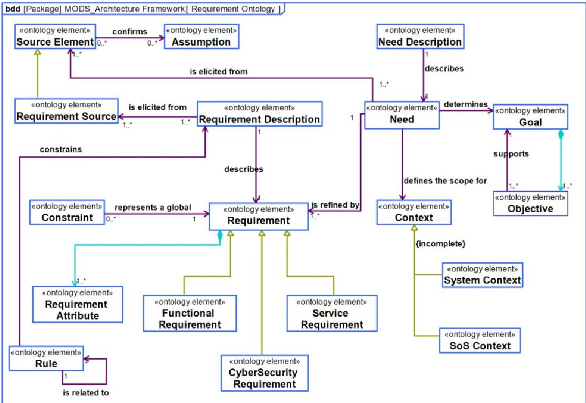

Figure 10. An ISC-AF Ontology View showing the Relationships between ISC Requirement Concepts

2) ISC-AF Requirements Perspective. Viewpoints classified within the Requirement Perspective contain knowledge required to develop views necessary for the capture and specification of requirements and related artifacts. Figure 11 depicts the Requirement Perspective viewpoints and the relationships that exist between these viewpoints. Views specified by these viewpoints must conform to their associated viewpoints. Furthermore, viewpoints belonging to the requirements perspective must cover all concepts related to requirements defined in the ISC-AF Requirements Ontology. A brief description is given for each predefined viewpoint as follows: Need Description Viewpoint: - This viewpoint identifies and comprises stakeholder concerns and requirements. Views which conform to this viewpoint represent a problem-oriented point of view. Requirement Description Viewpoint: - This viewpoint is used to define structured descriptions of requirements that have been derived from those captured in the needs description views. Each requirement description has associated attributes and is assessed individually. Source Element Viewpoint: - Views conforming to this viewpoint specify the source and origin of captured Needs and Requirements. Goal Definition Viewpoint: - Specifies relationships between the goals, objectives, mission, and scope descriptions. Validation Viewpoint: - Views realized from this viewpoint capture validation scenarios representing patterns for requirement satisfaction. Consequent-

<!-- PDF_PAGE: 11 -->

ly, viewpoints defined within this perspective facilitate the adequate description of relevant architecture views pertaining to the architecture requirements.

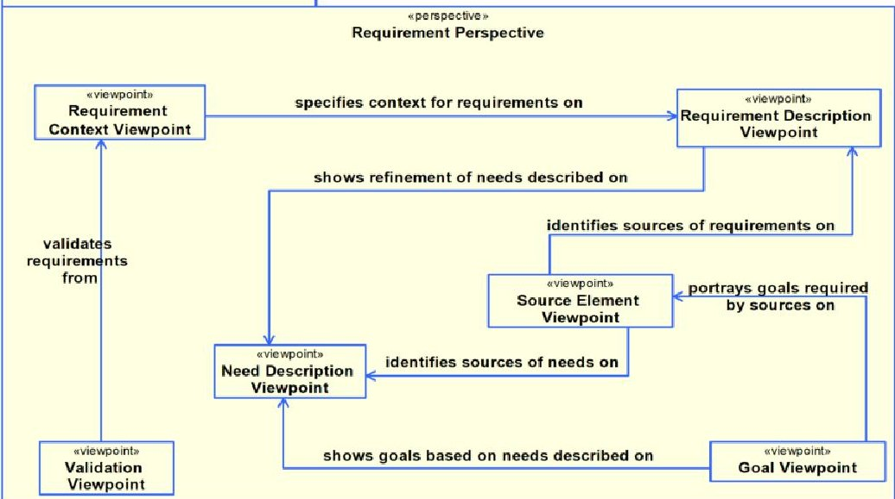

Figure 11. The ISC-AF Requirement Perspective: A viewpoint Relationship View Portraying the Relationships between ISC-AF Requirement Viewpoints

## C. ISC-AF System Concept Viewpoint

1) ISC-AF System Ontology Definition The concepts, terms and relationships identified and defined within the ISC System Ontology form the basis for the existence of the ISC-AF. The System Ontology Definition View (SODV) portrayed in Figure 12 identifies concepts that can appear on any given Viewpoint defined within the System Perspective. In fact, it is crucial that all concepts and terms that will be represented in any viewpoint be clearly documented in the SODV. This in turn ensures that each Viewpoint is defined using a consistent and related set of concepts (Holt, 2014). Some ISC system concepts within the SODV are defined as follows: System of Interest: - A special type of communication System that describes the current (sub)system being developed. Intermediate System: - A special type of Constituent System which corresponds to the communication-oriented (Physical, Datalink, Network) Layers of the OSI reference model (Zimmermann, 1980). OSI Layer: - A special type of System or Subsystem (depending on the level of abstraction) that implements Protocols used in the exchange of data. Use Case: - A description of a function of the ISC System considered within a certain context and validated by one or many Scenarios. External Environment: - A type of operational domain in which the System will be situated in and in which it will operate. It follows, then, that the SODV can be thought of as the knowledge representation of the system domain.

<!-- PDF_PAGE: 12 -->

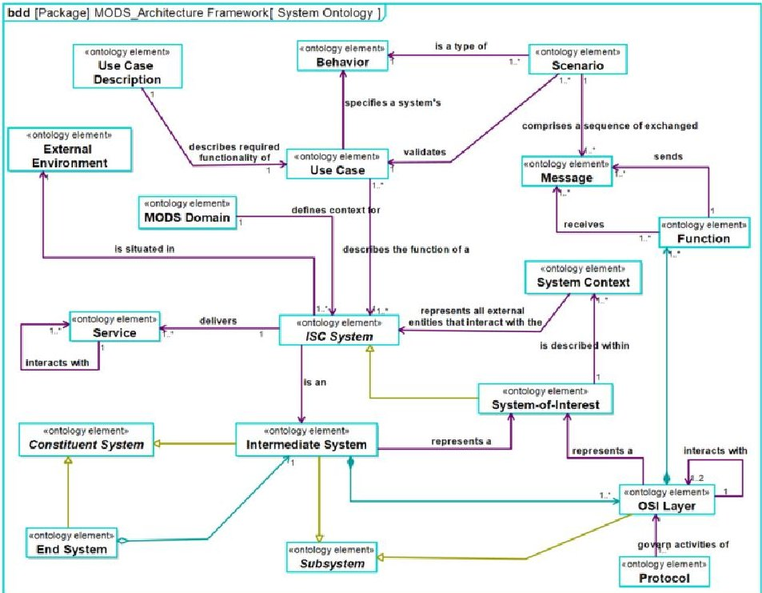

Figure 12. An ISC-AF Ontology View showing the Relationships between ISC System Concepts

2) ISC-AF System Perspective ISC System Concepts identified and defined within the SODV determine the relevant Viewpoints which are grouped together to form the System Perspective. The System Perspective supports capturing the structure and behavior of the ISC system. Within this perspective, viewpoints are defined which enable the creation of views necessary to completely specify the ISC system, its structure, configuration, interfaces as well as behavior. The ISC System Perspective shown in Figure 13 contains the following viewpoints: Protocol Definition Viewpoint: - This viewpoint is used to specify the rules and communication methods required for the exchange of data. Configuration Viewpoint: - This viewpoint is used to define how the ISC system and subsystems are configured based on their structure and the interfaces between System Elements. Analysis Viewpoint: - This viewpoint defines the parametric behavior of the ISC System and its System Elements which is expressed using mathematical and logical constraints.

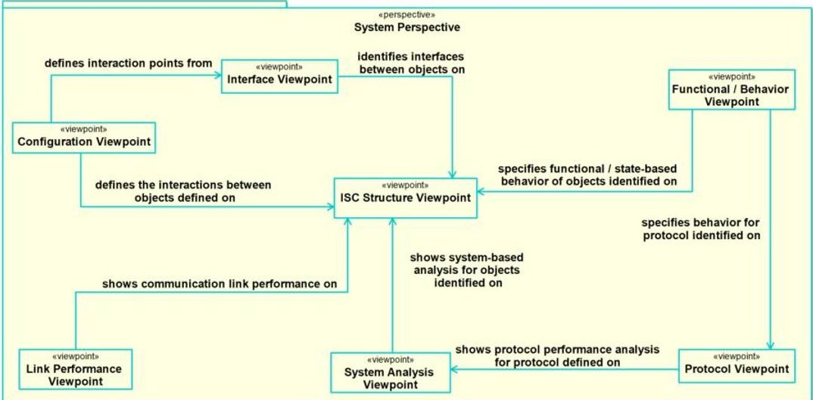

Figure 13. The ISC-AF System Perspective: A viewpoint relationship view portraying the relationships between ISC-AF system viewpoints

<!-- PDF_PAGE: 13 -->

System Structure Viewpoint: - This viewpoint is used to define the structure of the ISC system in terms of the System Elements it is composed of Performance Viewpoint: - This viewpoint defines parametric-based analysis of the LED-based visible light link. Interface Definition Viewpoint: - This viewpoint defines Interfaces between ISC System Elements. Functional/Behavior Viewpoint: - This viewpoint defines the State-based and Functional behavior of the ISC system and its System Elements.

## D. ISC-AF Service-Orientation Concept Viewpoint

1) ISC-AF Service-Oriented Ontology Definition Concepts and terms related to the utilization of service orientation for the ISC system are identified and defined within the Services Ontology Definition Viewpoint (SvODV). The SvODV shown in Figure 14 enables the capture of service-oriented concepts and the relationships between them thereby forming the Service Ontology for the ISC-AF. Service oriented architecture (SOA) is a reference architecture capable of delivering flexibility to the ISC system by enabling the reuse of existing functionality (services) as well as making the quality of relayed data easier to control (Dikmans, 2012). Therefore, key service-oriented concepts definitions must be clearly documented to ensure all Viewpoints required to create relevant views are identified. A brief observation of the SvODV highlights some of the following ontological elements (Concepts): ISC Service: - A discrete unit of encapsulated capability that is a black box to its consumers and consists of a well-defined Service Interface. Service Interface: - Defines how software components interact and exchange information with the owning Service and exposes the capability of the owning Service. Atomic Service: - A special type of Service that is indivisible and represents the most fine-grained service of its type. Composite Service: - A special type of Service whose structure emphasizes internal nested formations of child services. Service Provider: - An entity that provides a Service that can be consumed by a Service Consumer.

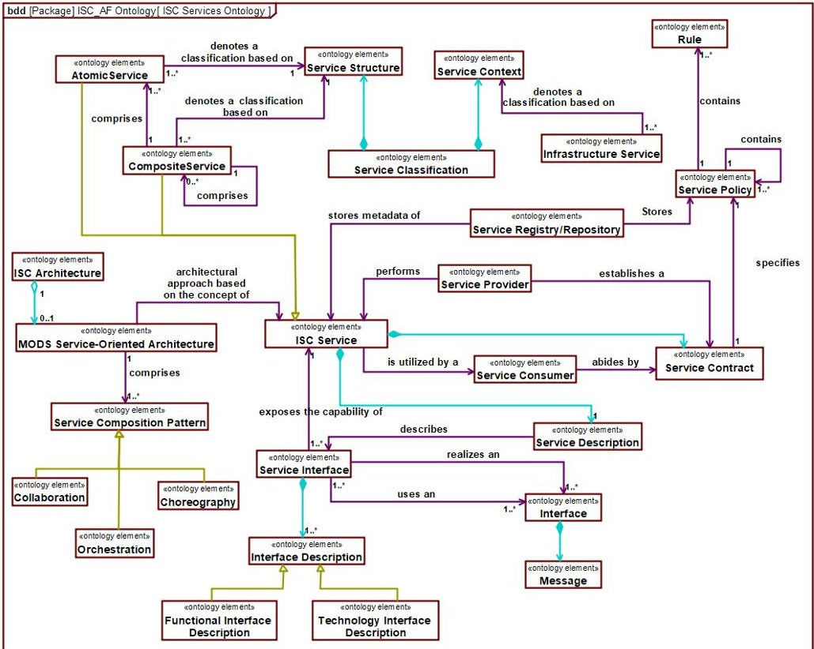

Figure 14. ISC-AF Ontology View showing Relationships between Service-Oriented Concepts

<!-- PDF_PAGE: 14 -->

Service Contract: - Defines the terms, conditions, and interaction rules Participants must agree to. Service Policy: - Defines configurable rules and conditions that affect services during their design-time and run-time lifecycle. They are used at run-time to enforce specific rules and standards. Service ontology elements defined in this view have relationships with the Requirement and System subsets.

2) ISC-AF Service Oriented Perspective. The idea of utilizing a SOA concept for the ISC system led to extending the AF ontology to include service-orientation concepts which would be utilized in the development of Service Oriented Viewpoints. The Service Oriented Perspective is concerned with the identification/discovery, analysis, and utilization of Services to deliver System agility. This is achieved by defining relevant viewpoints needed to create required service orientation views. Viewpoints captured within this Perspective are portrayed in Figure 15 and basically cover Concepts defined in the Service Orientation Ontology. Some captured viewpoints include: The Service Identification Viewpoint which is used to identify Services and the relationships between them while the Service Interface Description Viewpoint specifies the functional Service Interface for each identified Service which includes a description of the service capability. Service Choreography Viewpoint defines a pattern of composition where multiple Services embedded with control logic interact in a non-directed manner while views conforming to the SOA Evaluation Viewpoint are used for SOA metrics evaluation.

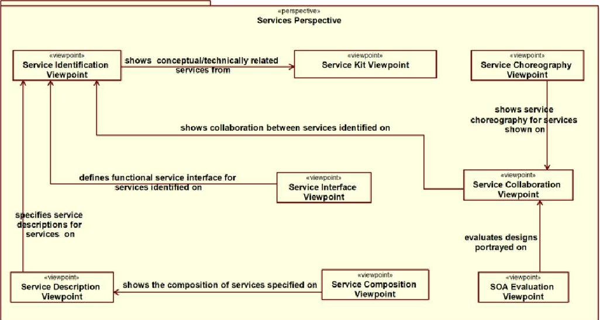

Figure 15. The ISC-AF Service-Oriented Perspective: A viewpoint relationship view portraying the relationships between ISC-AF Service-Oriented viewpoints.

## E. ISC-AF Information Security Concept Viewpoint

1) ISC-AF Information Security Ontology Definition. The Security Ontology Definition Viewpoint (SecODV) is created to define domain-relevant data and security concepts, and terms, and the relationships that exist between them. To this end, the ISC Domain Ontology is extended to cover security-related Concepts with regard to Mission Data. Domain Data is classified in the context of information security to enable the identification and definition of relevant Security concepts necessary to define baseline security controls for the protection of Data. The SecODV is portrayed in Figure 16. As shown, Domain Data is obtained from a Data Source, corresponds to a specific data type, and sets the priorities for the kind of data characteristics crucial for mission success. Data Availability, Data Integrity, and Data Confidentiality are crucial security-

<!-- PDF_PAGE: 15 -->

related Concepts required to achieve Information Security and trustworthiness (Adejokun, 2020, Schramm, 2011, Kleidermacher, 2001, Barrett, 2018). Data Availability ensures protection against the disruption of service. Data Integrity ensures reliability of Mission Data and processing accuracy while Data Confidentiality addresses protection of Restricted Data and Private Data. Furthermore, Data is classified based on assigned Data Sensitivity Levels for the various types of mission data. Two Sensitivity Levels defined in the ontology are Restricted Data and Private Data. Also specified in the ontology is the Quality-of-Service concept which has a direct impact on Data Integrity and determines Data Availability (Ivancic, 2015). Other Data Concepts defined within the Security Ontology View include the Service Sensitivity Level. Two Service Sensitivity Levels are required: Payload Data requires Bandwidth Sensitive Service to ensure large pieces of data can be relayed easily while Command and Control Data require Time Sensitive Service.

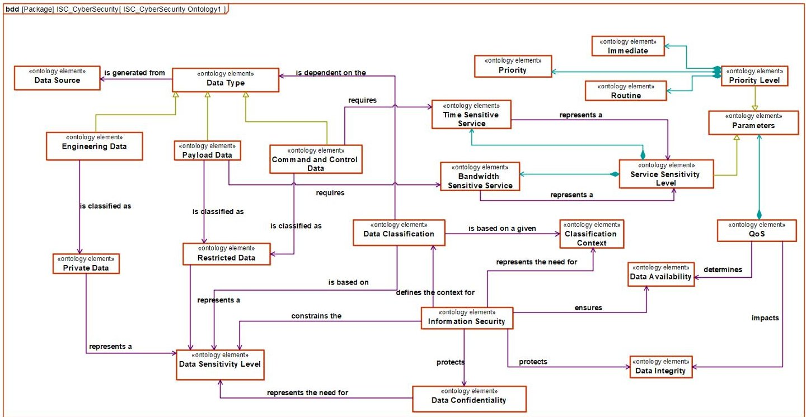

Figure 16. An ISC-AF Ontology View Portrays Relationships between Information Security Concepts

2) ISC-AF Information Security Perspective. The Information Security Perspective encapsulates the Information Security Viewpoints which capture the security capabilities of the System required to establish a root of trust. Views developed within this perspective take into consideration several factors needed to ensure correct formulation of information security requirements pertaining to the handling of mission critical data. As shown in Figure 17, Viewpoints within this perspective include the Data Source Viewpoint: views which conform to this viewpoint specify the specific source of any data element. The Data Type Viewpoint: is used to specify the type of Data i.e., data stream, service, data signal, raw data, etc. Other Viewpoints include the Sensitivity Level as well as the Information Security Viewpoint whose views capture relevant information about Data Integrity, Confidentiality and Availability.

<!-- PDF_PAGE: 16 -->

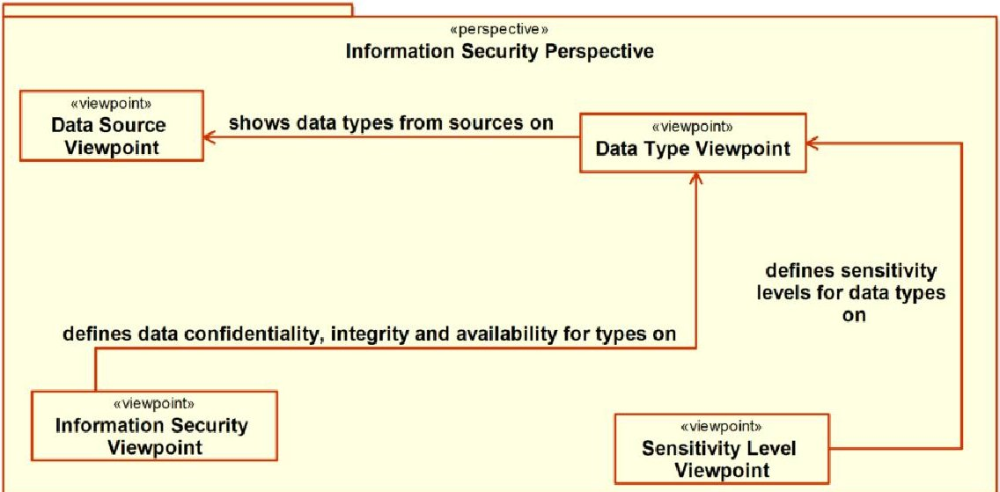

Figure 17. The ISC-AF Information Security Perspective: A viewpoint relationship view portraying the relationships between ISC-AF Information Security Viewpoints.

## F. ISC-AF Traceability Concept Viewpoint

1) ISC-AF Traceability Perspective. The Traceability Perspective is concerned mainly with supporting traceability throughout the AF and the resulting architecture model. Viewpoints defined within this Perspective help capture and visualize relationships between ISC viewpoints, views, and model elements. Specifically, the Traceability Perspective represents a crucial aspect of the AF as it provides a means to view how different aspects of the architecture are related thereby providing alternate and insightful views of the overall system architecture. Defined Traceability Viewpoints (Holt, 2016) are as follows: The Traceability Viewpoint is concerned with relating ISC model views and model elements together and is used to capture and visualize traceability between ISC elements specified in a model. The Impact Analysis Viewpoint supports traceability required to perform impact analysis for specific model elements. This view helps identify all model elements that will be directly impacted by changes to the specified (root) element. Also defined is the Traceability Identification Viewpoint and the Relationship Identification Viewpoint.

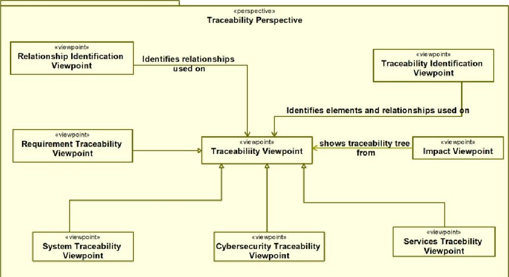

Figure 18. The ISC-AF Traceability Perspective

<!-- PDF_PAGE: 17 -->

The Traceability Identification Viewpoint is used to establish traceability by defining the types of elements that can be traced to and from, while the Relationship Identification Viewpoint establishes traceability across the model by defining the types of allowed traceability relationships that can be used between model elements in the ISC model. Traceability Views are realized using tables, relation maps, matrices, and diagrams where appropriate.

2) Required Traceability Views. Several traceability patterns are portrayed in the Traceability Identification Viewpoints shown in Figure 19. These patterns can be used by stakeholders to gain deeper understanding of system interactions as well as perform various forms of impact analysis, regression analysis and assessments. Some of these patterns can be created using Opaque Behavior Actions. These actions are model elements that can be used to construct traceability patterns thereby enabling easy reuse within the model. The traceability matrix shown in Figure 20 indicates the mapping of stakeholder concerns to the ISC-AF Viewpoints addressing those concerns.

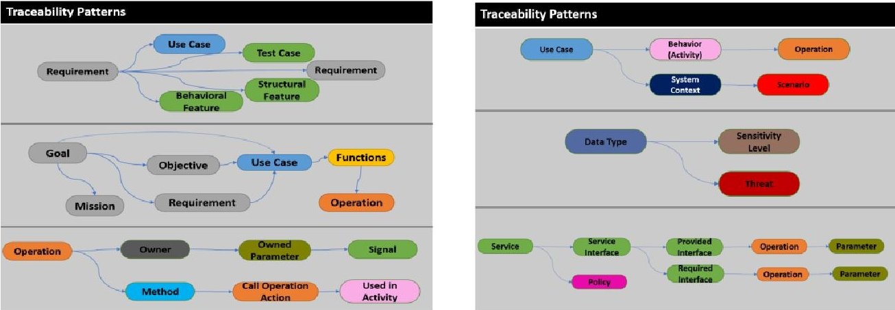

Figure 19. A view of some proposed Traceability Patterns

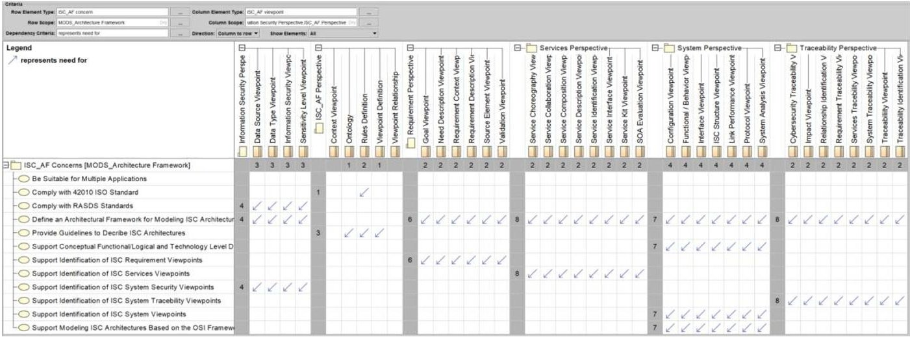

Figure 20. Traceability View Mapping Stakeholder Concerns to Viewpoints

Similarly, the AF traceability view shown in Table 1 is created by querying the ISC-AF model using the querying mechanism within the modeling tool to expose relationships between AF elements which are not obvious when viewing a specific diagram in the model. Such Traceability

<!-- PDF_PAGE: 18 -->

Views captured within the MBSE-based AF model enable easy identification of gaps while giving the AF architect and other stakeholders crucial views of the AF.

Table 1: An ISC-AF Traceability View Depicting Existing Traceability between ISC-AF Elements

<table class="table table-bordered"><thead><tr><th>#</th><th>Name</th><th>Viewpoint</th><th>Stakeholder Concern Addressed by Viewpoint</th><th>ISC-AF Stakeholder</th></tr></thead><tbody><tr><td rowspan="8">1</td><td rowspan="8">System Perspective</td><td>Configuration Viewpoint</td><td>○ Support Identification of ISC System Viewpoints</td><td>ISC Domain Expert</td></tr><tr><td>Protocol Viewpoint</td><td>○ Support Modeling ISC Architectures Based on the OSI Framework</td><td>MODS AF</td></tr><tr><td>Functional / Behavior Viewpoint</td><td>○ Support Conceptual Functional/Logical and Technology Level Descriptions</td><td>ISC Systems Engineer</td></tr><tr><td>Link Performance Viewpoint</td><td>○ Define an Architectural Framework for Modeling ISC Architectures</td><td>Sponsor/Customer</td></tr><tr><td>System Analysis Viewpoint</td><td></td><td>ISC_AF Architect</td></tr><tr><td>ISC Structure Viewpoint</td><td></td><td>SE Modeler</td></tr><tr><td>Interface Viewpoint</td><td></td><td></td></tr><tr><td rowspan="9">2</td><td rowspan="9">Traceability Perspective</td><td>Traceability Viewpoint</td><td>○ Support Identification of ISC System Traceability Viewpoints</td><td>MODS AF</td></tr><tr><td>Impact Viewpoint</td><td>○ Define an Architectural Framework for Modeling ISC Architectures</td><td>ISC Systems Engineer</td></tr><tr><td>Traceability Identification Viewpoint</td><td></td><td>Sponsor/Customer</td></tr><tr><td>Relationship Identification Viewpoint</td><td></td><td>ISC_AF Architect</td></tr><tr><td>Services Traceability Viewpoint</td><td></td><td>SE Modeler</td></tr><tr><td>System Traceability Viewpoint</td><td></td><td></td></tr><tr><td>Requirement Traceability Viewpoint</td><td></td><td></td></tr><tr><td>Cybersecurity Traceability Viewpoint</td><td></td><td></td></tr><tr><td rowspan="5">3</td><td rowspan="5">Information Security Perspective</td><td>Sensitivity Level Viewpoint</td><td>○ Support Identification of ISC System Security Viewpoints</td><td>Security SME</td></tr><tr><td>Cybersecurity Context Viewpoint</td><td>○ Define an Architectural Framework for Modeling ISC Architectures</td><td>MODS AF</td></tr><tr><td>Threats and Attacks Mitigation Viewpoint</td><td>○ Comply with RASDS Standards</td><td>ISC Systems Engineer</td></tr><tr><td>Data Source Viewpoint</td><td></td><td>Sponsor/Customer</td></tr><tr><td>Data Type Viewpoint</td><td></td><td></td></tr></tbody></table>

## IV Conclusion

An MBSE Architectural Framework is a key modeling artifact created at the onset of the system modeling activity to facilitate the creation of consistent system models. Presented in this research work is the concept of a MODS-AF and an ISC-AF developed for the description of a Multiorbit Disaggregated System (MODS) architecture. The proposed MODS high-level concept comprises three SmallSats that would utilize a hybrid visible light and RF Inter-Satellite Communication (ISC) system as a proof of concept. The developed MODS-AF described in Section II forms the basis for the descriptions of architectures within the MODS and represents the overarching AF pattern from which all other AFs will be defined as detailed in Section II.B. Given that the realization of the MODS design concept hinges on the availability of ISC capability within the disaggregated system, an extensive architectural framework for intersatellite communication (ISC-AF) was developed to provide the much-needed rigor and robustness required for the development of a consistent, coherent, and correct ISC architecture description as detailed in Section III. The ISC-AF is defined as a set of Viewpoints and an Ontology. Specifically, five ontology definition views were created to provide the semantic grounding required to standardize all relevant concepts and terms, as well as the relationships between them in an unambiguous way. In like manner, the ISC-AF Viewpoints were also grouped into five Perspectives namely Requirement, System, Security, Service-Orientation and Traceability Perspectives, with defined Viewpoints representing templates necessary for the capture and specification of architecture artifacts.

Subsequently, future work involves leveraging SysML for the development of architectural frameworks for other systems belonging to the MODS as well as development of a lightweight Domain Specific Language (DSL) Profile to address identified gaps. The DSL profile(s) will provide better semantics with which to represent and capture concepts relevant to the various (sub)system domains of the MODS. Following the definition of a DSL profile for the MOD System will be the development of an example system model using these concepts while also leveraging the CubeSat Reference Model (CRM) under development by the INCOSE Space Systems Working Group (SSWG) led by Kaslow et al (Kaslow et al, 2016, 2018, 2018).

<!-- PDF_PAGE: 19 -->

## References

"Object Management Group (OMG) SysML Language Specification." https://www.omg.org/spec/SysML/1.6/PDF, 2019. Accessed: 2021-01-30

Thompson, R.E., Colombi, J.M., Black, J and Ayres, BJ. (2015) "Disaggregated space system concept optimization: model-based conceptual design methods," Systems Engineering, vol. 18, no. 6, pp. 549-567.

Command, AFS. (2013) "Resiliency and disaggregated space architectures: White paper,".

Burch, R., 2011 "The case for disaggregation of us milsatcom," in 2011- MILCOM 2011 Military Communications Conference, pp. 2286-2291, IEEE.

Lam, J.F., La Tour, P., and Kim, J., (2013) "Architecting disaggregated space weather solutions using nanosatellites," in AIAA SPACE 2013 Conference and Exposition, p. 5322,

Thompson, R. Colombi, J. and Black, J. (2014) "Computer-aided architecting of disaggregated space systems," in 2014 IEEE Aerospace Conference, pp. 1-15, IEEE.

Hastings, D.E., Tour, PAL and Giri, D.K. (2019) "Architectural concept of disaggregation of space systems: Application to weather satellites," Journal of Spacecraft and Rockets, vol. 56, no. 5, pp. 1492-1507.

Mazal, L., and Gurfil, P., (2013) "Cluster flight algorithms for disaggregated satellites," Journal of Guidance, Control, and Dynamics, vol. 36, no. 1, pp. 124-135.

Thompson, R.E., Colombi, J.M., Black, J., and Ayres, B.J., (2015) "Model based conceptual design optimization methods: Disaggregated weather system follow-on," Journal of Spacecraft and Rockets, vol. 52, no. 4, pp. 1021-1037.

Reichwein, A., and Paredis, CJ. (2011) "Overview of architecture frameworks and modeling languages for model-based systems engineering," in ASME 2011 International Design Engineering Technical Conferences and Computers and Information in Engineering Conference, pp. 1341-1349, American Society of Mechanical Engineers.

Holt, J. and Perry, S. (2014) SysML for systems engineering, 2nd Edition: A model-based approach, vol. 10, chapter 11. IET.

Dickerson, C. and Mavris, DN (2016) "Architecture and principles of systems engineering. CRC Press.

Hilliard, R., (2013) "The role of architecture frameworks: Lessons learned from iso/isc/ieee 42010," in Proceedings of the IST-115 Symposium on Architecture Definition & Evaluation, Toulouse, France.

Shames, P., (2010) "Modeling space data systems architectures rasds and sysml,"

Ministry of Defense, (2016) "Mod architectural framework," [Online; accessed 19-December 2016].

ISO/IEC/IEEE42010, (2011) "Systems & software engineering-architectural description,". [Online; accessed 16-December-2020].

Object Management Group (OMG) (2019) Unified Architectural Framework Specification." https://www.omg.org/spec/UAF/1.1/DMM/PDF.

Hause, M., 2020, Integrating Security into Enterprise Architecture with UAF and PLE, Published in INCOSE Insight Magazine.

Hause, M, Bleakley, G., Morkevicius, A., 2016, Technology Update on the Unified Architecture Framework (UAF), presented at the 26th Annual INCOSE International Symposium (IS 2016), Edinburgh, Scotland, UK, July 18-21, 2016

TOGAF, (2009) "The open group architectural framework," [Online; accessed 19-December 2016].

<!-- PDF_PAGE: 20 -->

Zachman, JA (2008) "John zachman's concise definition of the zachman framework,"

North Atlantic Treaty Organization, (2013) "Nato architectural framework,". [Online; accessed 19-December-2016].

United States Department of Defense, (2010) "Department of defense architectural framework," 2010. [Online; accessed 19-December-2016].

Anyanhun, A. and Edmonson, W. (2017) "Inter-satellite communication mbse design framework for small satellites," in Proceedings of the 11th Annual IEEE Systems Conference.

Anyanhun, AI and Edmonson, WW (2018) "An mbse conceptual design phase model for intersatellite communication," in Systems Conference (SysCon), 2018 Annual IEEE International, IEEE.

Anyanhun, AI. Anzagira, A. and Edmonson, WW (2020) "Intersatellite communication: An mbse operational concept for a multiorbit disaggregated system," IEEE Journal on Miniaturization for Air and Space Systems, vol. 1, no. 1, pp. 56-65.

Analytical Graphics Inc. Systems Tool Kit." https://www.agi.com/ products/stk.

Hitchins, DK (2008) Systems engineering: a 21st century systems methodology. John Wiley & Sons.

Dassault Systemes Inc. MagicDraw Tool." https://www.3ds.com/ products-services/catia/ products/no-magic/

Bennett, M. (2019) "Concept modeling in the real world,".

ISO/IEC/IEEE15288, (2015) "Systems & software engineering- system life cycle processes,". [Online; accessed 16-December-2016]

Shames, P. and Yamada, T. (2003) "Reference architecture for space data systems," in International Telemetering Conference Proceedings, International Foundation for Telemetering.

Zimmermann, H. (1980) "OSI reference model-the iso model of architecture for open systems interconnection," IEEE Transactions on communications, vol. 28, no. 4, pp. 425-432, L. Dikmans, SOA made simple. Packt Publishing Ltd, 2012.

Adejokun, A. and Siok, MF (2020) "Effective systems security requirements in product line engineering," INSIGHT, vol. 23, no. 3, pp. 26-30.

Schramm, M. and Grzemba, A. (2011) "Trustworthy building blocks for a more secure embedded computing environment," in 2011 International Conference on Applied Electronics, pp. 1-4, IEEE.

Kleidermacher, D. and Griglock, M. (2001) "Cover story-safety-critical operating systems-the successful design of safety-critical systems is difficult and demands significant attention to detail. fortunately, an operating system," Embedded Systems Programming, vol. 14, no. 10, pp. 22-40.

Barrett, MP (2018) "Framework for improving critical infrastructure cybersecurity," National Institute of Standards and Technology, Gaithersburg, MD, USA, Tech. Rep.

Ivancic, WD. Vaden, KR. Jones, RE. and Roberts, AM (2015) "Operational concepts for a generic space exploration communication network architecture,".

Holt, J. Perry, S. and Brownsword, M. (2016) Foundations for Model-based Systems Engineering: From Patterns to Models, vol. 2. IET.

Kaslow, D. Ayres, B. Cahill, PT. Hart, L. Levi, AG and Croney, C. (2018) "Developing an mbse cubesat reference model-interim status# 4," in 2018 AIAA SPACE and Astronautics Forum and Exposition, p. 5328.

<!-- PDF_PAGE: 21 -->

Kaslow, D. and Madni, AM (2018) "Validation and verification of mbse compliant cubesat reference model," in Disciplinary Convergence in Systems Engineering Research, pp. 381-393, Springer.

Kaslow, D. Ayres, B. Cahill, PT Chonoles, MJ. Hart, L. Iwata, CK. Levi, AG and Yntema, R. (2016) "Cubesat model-based systems engineering (mbse) reference model-development and distribution-interim status," in AIAA SPACE 2016, p. 5551.

Friedenthal, S.A., 2021, SysML v2 Submission Team (SST), SysML v2 Update January30, 2021 https://www.omgwiki.org/MBSE/lib/exe/fetch.php?media=mbse:incose_mbse_iw_2021:iw2021_sysml_v2_2021-01-30-sfriedenthal-reva.pdf

## Biography

Awele I. Anyanhun holds a PhD in Electrical Engineering from North Carolina A&T State University, with specialization in systems engineering. Dr Anyanhun is currently a Senior Systems Engineer in the MBSE Research and Applications Branch at Georgia Tech Research Institute. Prior to joining GTRI, she worked as a Research Systems Architect in the Research and Advanced Engineering Group at Ford Motor Company in Dearborn, MI. She has also previously performed research work at the NASA Jet Propulsion Laboratory (JPL) in Pasadena California. Dr. Anyanhun is an INCOSE ASEP, certified UL-CFSP, and certified OMG Systems and Software Modeling Professional.

Ademola (Peter) Adejokun has over 20 years' experience in systems and software engineering; he currently works as a cyber systems security engineer at Lockheed Martin Aeronautics in Fort Worth, Texas. Ademola is a licensed professional engineer in Texas, an INCOSE ESEP, Six Sigma Black Belt, a certified PMP. Ademola is a senior member of the IEEE and ACM. He serves on the Object Management Group UML Testing Profile, UAF and System Assurance Task Force. He also serves on the National Council of Examiners for Engineering and Surveyors (NCCEES) Software and Electrical/Computer Engineering PE Licensure Exam Committees.

Matthew C. Hause is a Principal Engineer at SSI, a member of the UAF group and OMG SysML specification team. He was a member of the OMG Architecture Board for 10 years. He has been developing multi-national complex systems for over 40 years as a systems and software engineer. He started out working in the power systems industry then transitioned to command and control systems, process control, communications, SCADA, distributed control, Military systems, and many other areas of technical and real-time systems. His role at SSI includes Consulting, mentoring, standards development, presentations at conferences, and developing and presenting training courses.