<!-- PDF_PAGE: 1 -->

# Applying MBSE to Data Handling System Design of a Small Satellite Platform for Multiple Missions

Thomas Firchau German Aerospace Center (DLR) Institute of Space Systems 28359 Bremen, Germany thomas.firchau@dlr.de

Michael Jetzschmann German Aerospace Center (DLR) Institute of Space Systems 28359 Bremen, Germany michael.jetzschmann@dlr.de

Falk Nohka German Aerospace Center (DLR) Institute of Space Systems 28359 Bremen, Germany falk.nohka@dlr.de

Abstract-Model-based approaches to system design become more and more established in the space domain, as they promise to increase efficiency and reliability of the design process. This paper presents initial experience in adopting a model-based approach to the systems engineering of the data handling system for a small satellite platform. The goal was to increase engineering efficiency in order to allow the design of two variants of a system to address two different missions in parallel, but with the same team strength. The scope of the paper covers the definition of the MBSE methodology to use and its application to the preliminary design of the data handling system.

## TABLE OF CONTENTS

1. INTRODUCTION 1

2. METHODOLOGY 1

3. PRELIMINARY DHS DESIGN 5

4. CONCLUSIONS 9

REFERENCES 9

BIOGRAPHY 10

## 1. INTRODUCTION

The German Aerospace Center (DLR) Institute of Space Systems in Bremen has developed a small satellite platform for the range of mass from 100 to 500 kg. The platform typically targets the realization of small science missions accompanied by some technology experiments. The last mission to be realised within this program was Eu:CPORPIS [1]. In addition to the actual mission, the practical realization of space systems in particular also offers an important pillar of process research, which extends over the entire product life cycle at the DLR Institute of Space Systems.

Digitalisation in system design already plays a significant role in many areas of DLR space projects. However, the overall process is still strongly linked to the document-centric view of the European Cooperation for Space Standardization (ECSS) standards, which form the basis of the DLR engineering processes. By introducing Model-Based Systems Engineering (MBSE) approaches, the focus is transferred back to the engineering part of space system design. A document is no longer the central source of information, but just a view on the model. The digital information in the model facilitates deeper analyses in earlier design stages, thus reducing risk and costs in later project phases.

In the context of two current mission proposals, it is investigated how established MBSE approaches can be mapped to the ECSS-influenced DLR-project context. The Data

Handling System (DHS) serves as an example, which shall serve both mission proposals in two configurations.

This paper is organized in two major parts. In the first part the selected MBSE methodology is introduced and the mapping to our design process is discussed. In the second part it is shown how the methodology is applied to the preliminary design of the data handling system. Finally, a conclusion with lessons learnt and an outlook on future work is provided.

## 2. METHODOLOGY

In order to systematically apply MBSE, the initial methodology has to be defined. The starting points were the "Survey of Model-Based Systems Engineering (MBSE) Methodologies" [2], published by the International Council on Systems Engineering (INCOSE) in 2008 and the more recent supplements on the INCOSE Wiki [3].

In the survey methodology is defined as "a collection of related processes, methods, and tools". Processes define what has to be done, methods define how to do it, and tools enhance the efficiency of methods and processes. Additionally, the environment in which the methodology is used has to be considered, as it can enable or disable any part of a methodology. Figure 1 form the Systems Engineering Guidebook [4] visualizes these definitions.

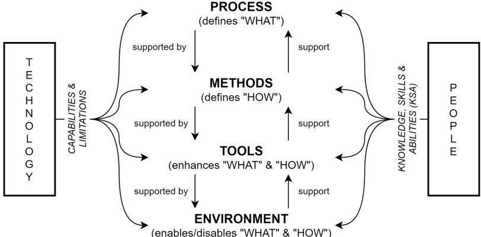

Figure 1. Elements of a methodology

It has be noted that processes and methods have a recursive relationship. At high levels of abstraction, methods themselfs can be seen as processes, that need to be further refined by lower level methods.

In addition to processes, methods, tools and the environment, the authors consider the languages used to describe systems to be an important part of the methodology. The language gives the user access to the information and has a strong influence

<!-- PDF_PAGE: 2 -->

on their understanding. It is therefore an essential factor for acceptance.

## Environment and Constraints

Within the research branch of DLR, projects have a lot of flexibility in choosing their methodology. While this enables developing and evaluating new methods, languages, and tools, it also limits the reuse of methodologies between projects.

Narrowing the scope to space projects within the research branch of DLR, the life cycle of space projects as proposed by the European Space Agency (ESA) is generally followed. This life cycle is defined in the ECSS standard on project planning and implementation [5] and is similar to what is used by the National Aeronautics and Space Administration (NASA).

The considered space projects are usually executed by small teams with a flat hierarchy and tight integration between domains. In order to preserve efficiency, the systems engineering methodology should be applicable throughout all domains, ideally even across different levels of detail. In the related project the system domain and the data handling domain are key drivers and collaborators on the adoption of MBSE. The ambition is to define a methodology, generic enough to handle both levels of detail.

Related to the role as research organisation, three further expectations have to be considered. DLR carries out research on all aspects of space projects. The results are published to share the findings with the community. Hence, the results should be reproducible as much as possible.

Besides research, DLR also has an education assignment. Students are regularly involved in research projects and research staff is teaching in lectures at universities. If students are already taught to work with current methods, languages, and tools they can contribute to research projects more easily and are also more valuable to employers once they graduate. Therefore, easy access to the elements of the methodology for students has to be considered, too.

Furthermore, it is required to ensure the practical success of the projects. A space project in the research branch has the goal to build a system that enables science to be conducted during its operational phase. The scientific return of this phase is a large part of the value proposition of the project.

To fulfil these expectations, the methodology should consist of elements that are mature and ready for productive use. If possible, they should be open access or open source, or provide some free version.

## Selected Methodology

Considering the environment and constraints, a combination of the Systems Modeling Toolbox (SYSMOD) [6], the Systems Modeling Language (SysML) [7], and MagicDraw has been selected as the initial methodology.

The Systems Modeling Toolbox was initially called the Systems Modeling Process, but has evolved over the years to include more than a description of processes and methods. Currently it also provides descriptions of roles, modelling guidance, a SysML profile, and a model library.

port processes. The Adoption Process and the Infrastructure Process can be followed to set up an operational environment for MBSE with SYSMOD.

SYSMOD describes two operational processes and two sup-

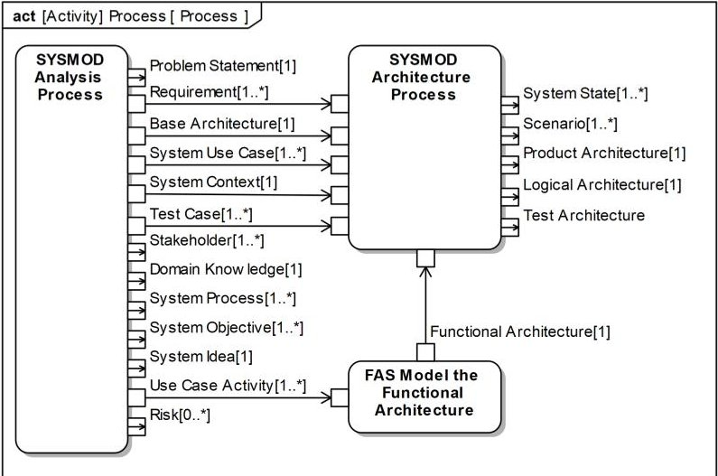

Figure 2. Overview of SYSMOD and FAS

In the operational state SYSMOD is separated into two major processes: The Analysis Process and the Architecture Process. The Analysis Process is used to identify, formulate and refine all requirements, constraints, and other information that is needed to define the design space for the solution. The solution is defined by the Architecture Process in form of a logical, product, and test architecture.

For complex systems SYSMOD can be augmented by the Functional Architecture for Systems (FAS) [8]. As shown in Figure 2 from [6], FAS adds a method to develop a functional architecture of the system. The possibility of explicitly adding this additional layer of abstraction perfectly meets our function-driven design process.

SYSMOD encourages the use of SysML. SysML "is a general purpose graphical modelling language for specifying analysing, designing, and verifying complex systems that may include hardware, software, information, personnel procedures, and facilities." [9] The language is maintained by the Object Management Group (OMG). It is the most widely used language for MBSE. SysML is very flexible and extensible, but can also be semantically ambiguous.

SysML v2—the next major revision of the language—will introduce more formal semantics and add a textual notation, as well as a standardized Application Programming Interface (API) for accessing model data. The API addresses the problem of model data exchange between tools.

MagicDraw is a commercial tool that can be used for model-driven software development or model-based systems engineering. It supports several languages directly or through plug-ins. Its implementation mostly complies with the SysML standard, which was a major driver for the tool decision. An appropriate alternative would the open source Papyrus [10] environment based on Eclipse, though it lacks some features and requires a longer training period according to the experience of the authors.

SysML, SYSMOD, and MagicDraw are all mature elements with extensive documentation and training available. This provides confidence, that they are usable in a productive

<!-- PDF_PAGE: 3 -->

environment and facilitate practical project success.

Nevertheless, there are some limitations concerning the expectations related to publications and education. Even though SysML is a well-established standardized language, there is up to now no viable model exchange between different modelling tools. The less a tool complies with the standard, the more this deficiency increases. This impedes model exchange and creates some tool dependency. Although MagicDraw is widely adopted in the systems engineering community, it still presents an entry barrier and limits the access to the models by everybody in the community.

However, there is still the opportunity to use an additional tool for education or switch entirely in the future, since SysML and SYSMOD are generally tool-independent. For now the focus is on mastering the methodology and applying it to DLR space projects. In this respect the generic method has to be mapped to the space project life cycle.

## Design Process Description

The design process illustrated in this section is based on the technical system life cycle process described in ISO 15288 [11], adopted to ECSS driven space system design and the distinctions of our organization, which leads to a process similar to Figure 4.0-1 of the NASA Systems Engineering Handbook [12, p. 44]. The process can be divided into the four main steps: Stakeholder Needs Identification, Requirements Definition, Architecture Definition, and Design Solution Definition. They are supported by System Analysis. The logical flow of these steps is shown in Figure 3.

Stakeholder Needs Identification is executed to identify the

stakeholders and elicit their expectations. In the next step the stakeholder expectations are refined into formal technical requirements. Validating the requirements ensures that the formal technical description meets the stakeholder expectations. Once a validated set of requirements exists, the architecture definition process delivers the first structure of the solution to be developed.

The architecture development is strongly driven by functions. It starts by decomposing the required functionality into subfunctions and arranging them in a functional architecture. For example, a general function "control spacecraft attitude" could be decomposed into—among others—"acquire attitude" and "change attitude". The functional architecture is independent of the physical implementation and consists only of functional elements and interfaces. The functional architecture is validated against the requirements and stakeholder expectations.

Beside the functional architecture a logical architecture is developed and functions are allocated to logical elements. Logical elements represent concepts of physical components. For example, an "on-board computer" is such a concept. An on-board computer in general allows us to process and store data and has input and output interfaces to exchange data with other systems. Functions like "acquire attitude" and "change attitude" can be allocated to the input and output interfaces of the on-board computer. The logical architecture together with the functional mapping is completed by another validation to ensure, that the stakeholder expectations are still met.

The logical architecture is not yet precise enough to procure or build the actual product. It is an intermediate step that provides the opportunity to gradually refine the solution and

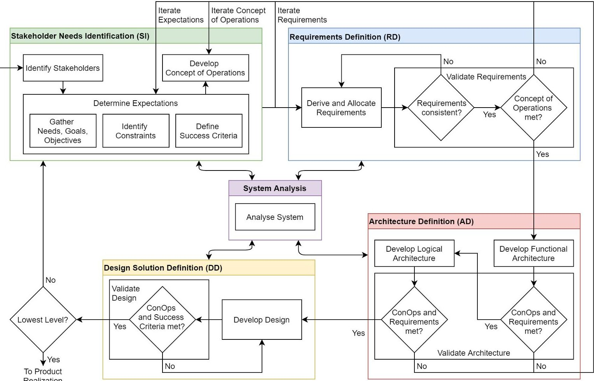

Figure 3. Overview of our design process

<!-- PDF_PAGE: 4 -->

clarify the needs and requirements. The design is finalised by the design solution definition process. Based on the logical architecture a specific design is developed and validated.

The overall design process is supported by the system analysis. Information from the other processes is used as input. The outcome of the analysis is used to make decisions in each of the other processes.

The design process is an iterative loop. It is repeated at each abstraction level of the system. Following a top-down design approach the following four abstraction levels are considered:

- At mission level the programmatic constraints, overall mission objectives, and required functions are defined. The high-level functions are assigned to elements like ground stations and spacecraft to create the mission architecture. This abstraction level combines the ECSS decomposition stages space system and segment.

- At system level each of the segment elements is further refined and its functions decomposed and grouped to specialised subsystems.

- At subsystem level each subsystem is refined and its functions decomposed and allocated to equipment.

- At equipment level end-products are designed and implemented.

- Since the focus is on the subsystem level, input from the system level will be received and output for the equipment level have to be created.

- Phase 0 - Mission analysis/needs identification

- The ECSS space project life cycle consists of seven phases [5], of which four are relevant for the design process:

- Phase A - Feasibility

- Phase B - Preliminary definition

- Phase C - Detailed definition

Each of the phases contains at least one complete iteration loop of the design process and is concluded by a review of the current design. Following the top down design approach, the level of abstraction is reduced phase by phase. However, experience has shown that the different levels of abstraction cannot be executed strictly one after the other. Rather than that, a preliminary consideration of the subsequent design level is necessary to conclude the current level. This leads to an overlap of the different design levels. Figure 4 shows the design process over the abstraction levels and phases 0 to C.

For the subsystem level an early draft set of the requirements is expected at the end of Phase A. The requirements directly flow down from system level, or are derived from the preliminary system level architecture definition. Moreover, there might be further constraints introduced from subsystemlevel stakeholders. Especially in a research organisation environment this is not unusual. Some requirements and constraints might be already further detailed, depending on their criticality. The activities above represent the initial and brief iteration of Stakeholder Needs Identification (SI0) and Requirements Definition (RD0) at subsystem level.

In the first half of Phase B the requirements at system level are finalised. At subsystem level the Stakeholder Needs Identification (SI1) is updated and the preliminary Requirements Definition (RD1) is completed to gain a set of preliminary subsystem requirements for the System Requirements Review (SRR).

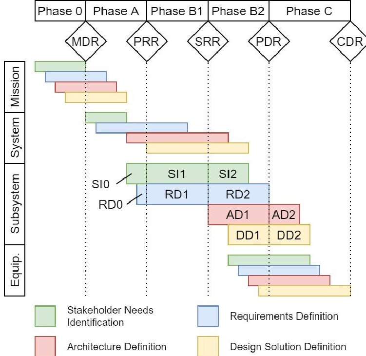

Figure 4. Mapping of design processes to abstraction levels and space project phases

In the second half of Phase B the system level design is completed. This enables the finalisation of the subsystem requirements (SI2 and RD2). At the same time the first major iterations of Architecture Definition (AD1) and Design Solution Definition (DD1) are executed. This results in a preliminary design, which is reviewed together with the final subsystem requirements in the Preliminary Design Review (PDR).

The subsystem design is finished at the beginning of Phase C (AD2 and DD2) and reviewed in the Critical Design Review (CDR). In this phase, at the latest, there is a transition from the dominating functional view to the physical view of the system, resulting in a concrete product tree.

Within each major iteration there can be many smaller iterations across all process steps as indicated by the loops in Figure 3. Especially in Phase B2 there may be a period of intense iteration across several levels as the design is finished at system level, subsystem design is in progress, and preliminary equipment design has started.

## Design Process Mapping

SYSMOD consists of two major processes. The analysis process is used to create a specification for the system. The architecture process is used to synthesise a design of the system. Each of the processes is further decomposed into different steps. The SYSMOD Analysis Process is broken down into:

- Analyse the problem

- Describe system idea and objectives

- Identify stakeholders

- Describe base architecture

- Model risks

- Model requirements

- Identify the system context

- Identify system use cases

- Identify system processes

- Model use case activities

<!-- PDF_PAGE: 5 -->

- Model the domain knowledge

- Specify test cases

The designation of the steps already indicates their purpose. However, some steps may not be obvious right away. The step Describe Base Architecture can be used to explicitly capture prior influences or constraints in the form of existing products or expectations. The base architecture defines toplevel architecture decisions and limits the design solution space.

Domain knowledge represents concepts that are specific to the domain and not covered by the used modelling language. For example, in SysML generic connections between two elements can be modelled. For the design of a data handling system it is relevant domain knowledge if a connection is a data connection or a power connection.

For the mapping the authors have decided to omit some of the steps for now. Although risks have an impact on the system design, their modelling is considered to be part of the technical management, which is out of scope. Modelling the domain knowledge is a support method that is specific to MBSE and has no direct equivalence in the classic design process. Specifying test cases is part of verification planning and is not a direct design activity, although it can have similar impact on the design as risk mitigation.

- Model the functional architecture

- FAS adds a method for creating the functional architecture to the SYSMOD architecture process which consists of the following steps:

- Model the logical architecture

- Model the product architecture

- Revise an architecture with scenarios

- Define system states

- Model the test architecture

According to the current status of the related project (mid of Phase B1) it is focussed on the architecture modelling steps for now. Revising architecture with scenarios and define states on subsystem level is one of the next steps, but not covered in this paper.

Table 1 shows how the sub-processes and methods of the design process were mapped to the methods of SYSMOD and FAS. The mapping is done for each of the space project phases relevant for the design of a data handling subsystem.

Similar to modelling test cases, modelling the test architecture is part of verification planning and no direct design activity.

## 3. PRELIMINARY DHS DESIGN

This section presents the application of SYSMOD and FAS to the preliminary design of the data handling system for two missions. Some SysML diagrams are used to exemplify intermediate steps of the process. However, for the sake of clarity the pictures contain only a few elements to illustrate the method rather than to show a complete design.

## Study Case Missions

The two missions that are currently considered and need to be served by the data handling system are a cryogenic technology demonstration and an earth observation technology demonstration. Both missions have successfully completed the feasibility study in Phase A. The effort to apply MBSE to the design of the data handling system was started with the preliminary design in Phase B and was executed in parallel to established engineering processes.

For both missions a similar spacecraft design is to be used. The spacecraft is divided into two logical parts: the payloads and the platform. The platform consists of all subsystems that are necessary to operate and maintain the payloads in orbit. This includes the Attitude and Orbit Control System (AOCS), the Communication System (COMS), the Electrical Power System (EPS), the Thermal Control System (TCS), and the DHS. The payloads consist of one primary payload and a selection of several smaller, secondary payloads.

The goal of the cryogenic technology demonstration mission (TD) is to demonstrate handling of cryogenic fluids in a microgravity environment. In order to fulfil this goal, it has to be shown that the fluids can be stored and transferred under different acceleration conditions. The primary payload therefore consists of a storage tank for cryogenic fluids, pumps and piping, as well as a experiment tank with cameras to observe the fluids.

The goal of the earth observation technology demonstration mission (EO) is to support the global carbon dioxide stocktake by observing small spot emission sources like coal-fired power plants using hyperspectral passive spectrometry. It is regarded an in-orbit verification with respect to the measurement principle and the very compact optics design. The primary payload consists of an optical assembly, an image sensor, and support electronics.

## Stakeholder Needs identification

Although SYSMOD supports developing systems from scratch, this is not necessary for the data handling system. As discussed in the description of the design process, prior to the design of the subsystem, development work has already been

Table 1. Mapping between SYSMOD and our design process

<table border="1"><tr><td></td><td>SYSMOD Method</td><td>Phase A</td><td>Phase B1</td><td>Phase B2</td><td>Phase C</td></tr><tr><td rowspan="9">SYSMOD Analysis Process</td><td>Analyse Problem</td><td rowspan="2">SI0- gather Needs, Goals, Objectives</td><td></td><td></td><td></td></tr><tr><td>Describe System Idea and Objectives</td><td></td><td></td><td></td></tr><tr><td>Identify Stakeholders</td><td>SI0- identify Stakeholders</td><td>SI1- identify Stakeholders</td><td></td><td></td></tr><tr><td>Describe Base Architecture</td><td rowspan="2">SI0- identify Constraints</td><td rowspan="2">SI1- identify Constraints</td><td></td><td></td></tr><tr><td>Identify System Context</td><td>SI2- identify Constraints</td><td></td></tr><tr><td>Model Requirements</td><td>RD0- Derive and Allocate Requirements</td><td>RD1- Derive and Allocate Requirements</td><td>RD2- Derive and Allocate Requirements</td><td></td></tr><tr><td>Identify System Use Cases</td><td rowspan="2">SI0- develop Concept of Operations</td><td rowspan="2">SI1- develop Concept of Operations</td><td rowspan="2">SI2- develop Concept of Operations</td><td></td></tr><tr><td>Identify System Processes</td><td></td></tr><tr><td>Model Use Case Activities</td><td></td><td></td><td></td><td></td></tr><tr><td>FAS</td><td>Model Functional Architecture</td><td></td><td></td><td>AD0- develop Functional Architecture</td><td>AD1- develop Functional Architecture</td></tr><tr><td rowspan="2">SYSMOD Architecture Process</td><td>Model Logical Architecture</td><td></td><td></td><td>AD0- develop Logical Architecture</td><td>AD1- develop Logical Architecture</td></tr><tr><td>Model Product Architecture</td><td></td><td></td><td>DD0- develop Design</td><td>DD1- develop Design</td></tr></table>

<!-- PDF_PAGE: 6 -->

carried out at system level. The solution identified at system level becomes the problem statement for the subsystem level.

The step Identify System Context is used to identify adjacent external systems and users. Here, most of them are already defined by the design at system level. Figure 5 shows a part of the data handling system context.

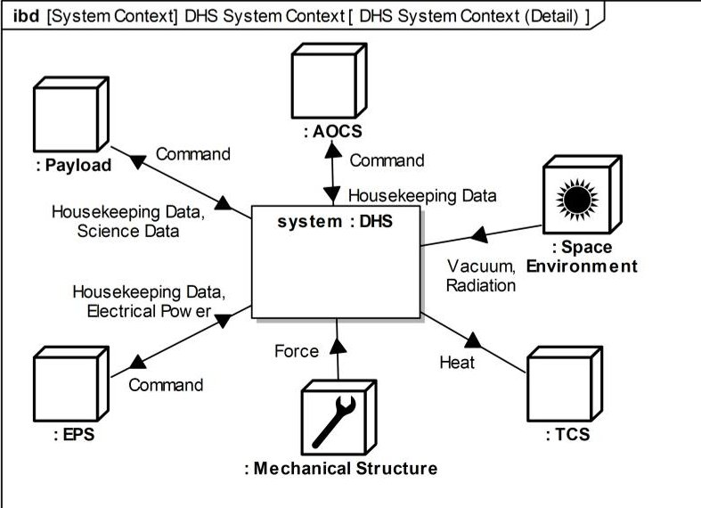

Figure 5. Excerpt from the data handling system context

The system context provides a high-level overview of the interactions between the system of interest and both the external systems and the direct users. Physical environments are also considered in the system context. For example, this can include the ground transport environment, the launch environment, or the space environment.

There might be additional systems that are not considered at the design level above. For example, this can include Electronic Ground Support Equipment (EGSE) or the flight software developers who need direct access to the system to debug their applications.

Based on the system context, the step Identify System Use Cases is used to describe how the external systems and direct users utilize the data handling system. For each of the users and systems a use case diagram illustrates their primary interactions. Several users or systems can be involved in the use cases. Figure 6 shows the primary payload use cases of the data handling system.

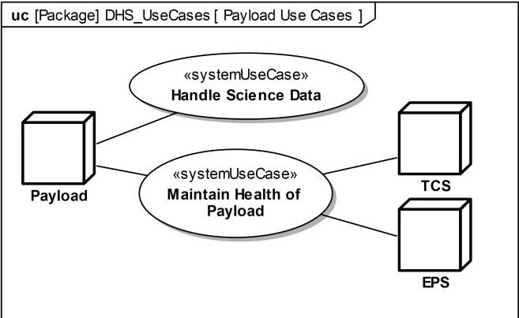

Figure 6. Use cases of the data handling system

The use cases are decomposed into essential use case steps, which are represented as activities in activity diagrams. The logical sequence of steps is determined by the object flow between the steps. The SysML term object flow also includes the flow of information. Figure 7 shows the essential use case steps of the use case Handle Science Data.

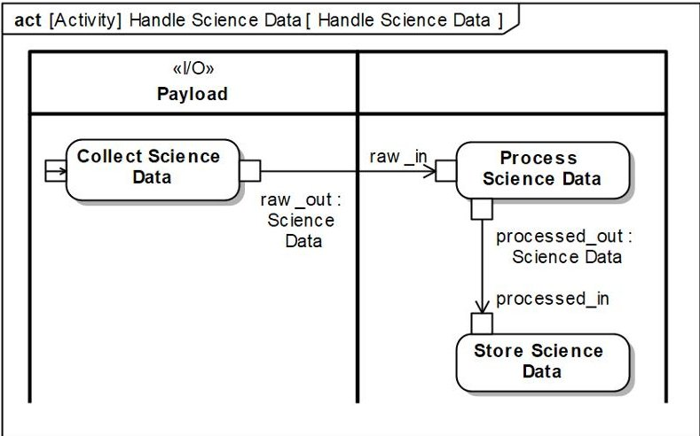

Figure 7. Essential use cases steps of Handle Science Data

The use case is decomposed into essential use case steps (collect data, process data, store data). Steps which represent direct exchanges with an external system are assigned to a special activity partition.

## Requirements Definition

Classic requirements are statements that provide an atomic piece of specification for the system. They can address functional and non-functional aspects of the design. When using a model-based approach, elements of the model can become part of specification. For example, use cases could be interpreted as functional requirements, ports as interface requirements, and constraints as performance requirements.

Nevertheless, SysML also provides the capability to model requirements in the form of statements and associate them with model elements. For the preliminary design of the data handling system this was not required. Additionally, requirements are usually already managed digitally in specialised tools. Synchronising them with the model was currently not a priority and will be addressed in future work.

## Architecture Definition

The architecture definition starts with the synthesis of the functional architecture by using the FAS method. This also marks the transition from viewing the system from the perspective of what external systems and users need to what the data handling system provides. The functional architecture consists only of the functions the system needs to provide and is independent of a physical solution.

The FAS method uses the use cases activities as input. The activities are assigned to functional groups. FAS knows two specialised functional groups: Input/Output (I/O) groups and the system group. Activities that correspond to use cases are assigned to the system group. Activities that correspond to essential use case steps and are used to exchange information with users or external systems are automatically grouped into functional I/O groups for each of the respective user or system. For example, the Collect Science Data activity is automatically mapped to a functional group called I/O

<!-- PDF_PAGE: 7 -->

Payload. A part of the mapping for the data handling system is shown in Figure 8.

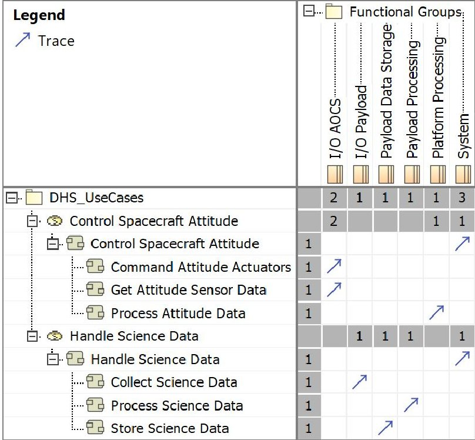

Figure 8. Mapping from use case activities to functional groups

The remaining activities need to be grouped manually. It is up to the systems engineer to find the right level of abstraction for the grouping.

To decouple the life cycle of use cases from the one of the functional architecture, for each functional group a functional element of the same name is created. The functional elements are the building blocks of the functional architecture. If two functional groups contain activities that exchange information, a functional interface is created between the respective functional blocks. Figure 9 shows the resulting functional architecture as an internal block diagram.

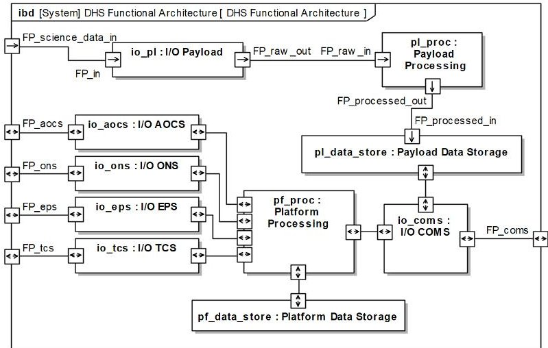

Figure 9. Partial functional architecture of the data handling system

The functional architecture is now used as input for the SYSMOD architecture process. This process produces the logical and the product architecture. Both architectures are physical

architectures and represent things like soft- and hardware. However, the logical architecture represents the concept of the thing (e.g.fault-tolerant processor), while the product architecture represents the specific instance of the thing (e.g. fault-tolerant LEON 3 processor by vendor X). The product architecture represents the specific design solution for the system.

The logical architecture is a transitional step and is created by an iterative process of defining logical elements and allocating functions to them. Figure 10 shows the definition of a subset of the logical architecture of the data handling system.

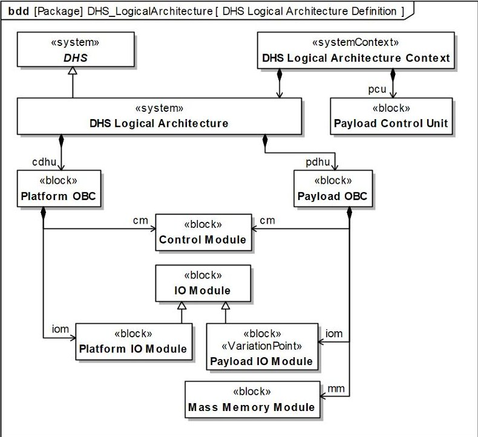

Figure 10. Definition of elements that are part of the functional architecture and its context

It was decided to separate platform processing and I/O from payload processing and I/O, because it is expected that the platform remains relatively stable from mission to mission, while the payload may change a lot. This decision of course introduces overhead. To reduce it, it was decided to design a modular system. Control modules are shared between the Command and Data Handling Unit (CDHU) and the Payload Data Handling Unit (PDHU). The mass memory module is exclusive to the PDHU. I/O modules are similar and derived from the same base design. The payload I/O modules are expected to be different for each mission and therefore marked as variation points.

The current version of SysML does not support modelling variants of a system. To overcome this limitation the Variant Modeling with SysML (VAMOS) profile [13] is used. The profile defines simple model elements that allow to describe which variants can be used at which variation points in the system. Further it provides a way to describe actual configurations of the system, that use a specific set of variants.

In addition to the elements of each architecture, a dedicated context which contains relevant elements of the external systems can be defined. For example, a Payload Control Unit is added as part of the context, which belongs to the payload. It represents the assumption that, no matter what payload is used in a mission, it will include some low-level control unit. The earth observation payload includes an instrument

<!-- PDF_PAGE: 8 -->

control unit that is tightly integrated with the sensor. The technology demonstration payload includes a remote terminal unit that provides control outputs for valves and specialised high accuracy temperature sensor inputs.

Connection between the functional and logical architecture is made by allocating functional blocks to logical blocks. Part of the allocation is shown in Figure 11.

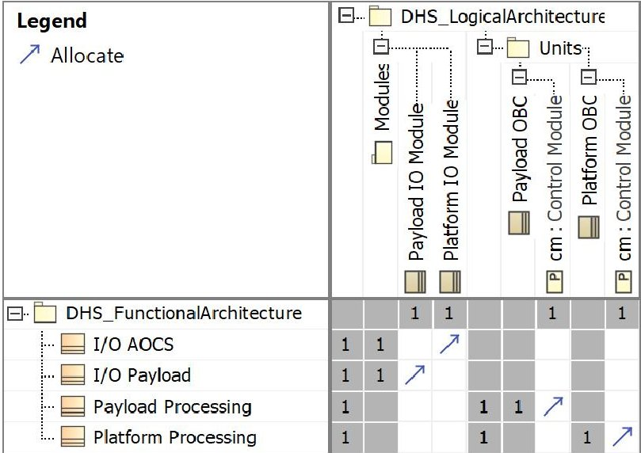

Figure 11. Allocation of functional blocks to elements of the logical architecture

Figure 12 shows a part of the logical architecture. The architecture already indicates the principal physical structure of the data handling system.

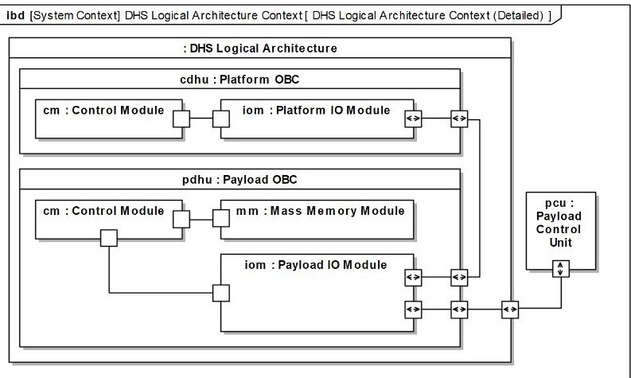

Figure 12. Part of the logical architecture

The CDHU and the PDHU each contain modules that are interconnected. The interfaces are still logical interfaces and do not represent actual, physical connections.

## Design Solution Definition

aspects of the architecture. In this case elements that are different between the missions.

Based on the logical architecture, the product architecture is created as the actual design solution. The product architecture is specific enough to be used as specification for the equipment level design process.

In the preliminary design phase, the product architecture does not yet need to be complete. Instead the focus is on important

In the logical architecture the Payload IO Module is marked as a variation point. Each variation point is assigned a variation. Variations are packages that contain the selectable variants. For each variation the minimum and maximum number of selectable variants can be specified. Additionally constraints can be placed on variants to either exclude or require the selection of other variants. The specification of variations, variants, and constraints is called a feature tree. Figure 13 shows the feature tree for the data handling system.

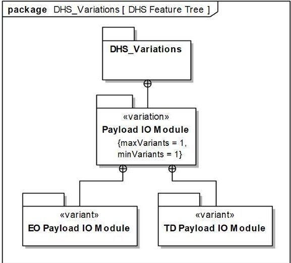

Figure 13. Feature tree of the data handling system

The variant packages EO Payload IO Module and TD Payload IO Module contain the respective model elements for the product architecture.

In order to create a product architecture for a specific mission, a configuration has to be defined. In VAMOS this is done by creating a package that represents the configuration and importing the the package of the variant that is to be used. The relationships between configurations and variants can be visualised in a matrix, as shown in Figure 14.

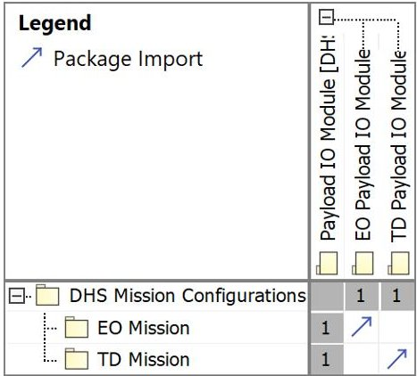

Figure 14. Selection of variants by package import

For the earth observation mission the appropriate I/O module is used. Figure 15 shows the definition of the product architecture elements.

Each element of the product architecture in the lower row is specialised version of an element in the logical architecture. Where necessary, part properties are redefined to be

<!-- PDF_PAGE: 9 -->

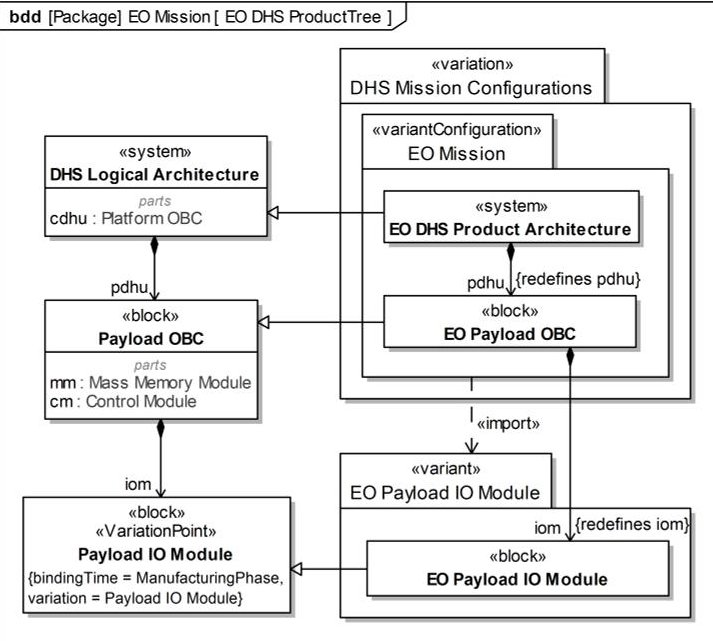

Figure 15. Definition of the earth observation mission specific part of the product tree

## 4. CONCLUSIONS

In the previous sections the first steps towards a systematic application of MBSE to the design process of the data handling system of the small satellite platform were shown.

First, a MBSE methodology to be used was defined. After consideration of the environment, constraints, and expectations, MagicDraw, SysML, SYSMOD, and FAS were selected as the combination of tool, language, and methods to be used. The space project specific design process was then reviewed, in order to map it to the general purpose process described by SYSMOD and FAS.

of the specialised product architecture element. The EO DHS Product Architecture inherits both the logical CDHU and PDHU from the logical architecture. However, the pdhu part property is redefined to be of the EO Payload OBC type. The latter has to be assigned the correct payload I/O module. The import relation defined by the variant configuration between the configuration package EO Mission and the variant package EO Payload Module brings the right module into scope. The iom property of the EO Payload OBC can now be redefined to be of the correct type.

The method was then followed to develop the preliminary design for the data handling system. External systems, users, and use cases identified by the design at system level were supplemented with systems and users specific to the data handling system. For the use cases essential use case steps were identified and the functional architecture was derived. An iterative development of the logical architecture was conducted and functions assigned to it. Most of the logical architecture is shared between the two missions considered. In some cases it was identified that different configurations would be needed for each mission and the SysML profile VAMOS was used to model this.

projects this might not be necessary, but making more small and deliberate design decisions, instead of a few big ones helps to manage the complexity of a design.

Spending effort on reviewing the design process and mapping it to the selected method, proved to be beneficial in scoping and focusing the modelling process. For this work almost all features of SYSMOD and FAS were used. For smaller

Going forward there are some interesting challenges that will have to be faced. The current project environment is designed for document-based reviews. Conducting reviews of the model instead of generating documents would be efficient, but will require careful consideration of the stakeholder needs. A transition to model-based review would also provide the opportunity to re-evaluate which information has to be reviewed at what time.

This work was executed in parallel to the preliminary design in Phase B of both missions. Once reviews are completed there will be a transition to the detailed design in Phase C. In this phase the model will also have to become more detailed and deliberate effort will be required to keep it maintainable.

Further, it is planned to investigate additional possibilities a model-based approach provides regarding system analysis. For example, using existing definitions of design complexity to automatically calculate it and monitor it as performance indicator along the life-cycle.

Improvements to the methodology will also be required. Management of requirements needs to be improved and interfaced with other tools that are common in the project environment. Information exchange with other tools in general has to be evaluated and established in order to make the methodology most effective in an heterogeneous environment.

## REFERENCES

[1] J. Hauslage, S. M. Strauch, O. Essmann, F. W. M. Haag, P. H. Richter, J. Krüger, J. Stoltze, I. Becker, A. Nasir, G. Bornemann, H. Müller, T. Delovski, T. Berger, A. Rutczyńska, K. Marsalek, and M. Lebert, "Eu:cropis - "euglena gracilis: Combined regenerative organicfood production in space" - a space experiment testing biological life support systems under lunar and martian gravity," Microgravity Science and Technology, vol. 30, pp. 933-942, 2018.

[2] J. A. Estefan, "Survey of Model-Based Systems Engineering (MBSE) Methodologies," INCOSE MBSE Initiative, Tech. Rep., 2008.

[3] "OMG MBSE Wiki: Methodology and Metrics." [Online]. Available: https://www.omgwiki.org/MBSE/ doku.php?id=mbse:methodology#mbse_methodology

[4] J. N. Martin, Systems Engineering Guidebook: A Process for Developing Systems and Products. Boca Raton, UNITED STATES: Taylor & Francis Group, 1996.

[5] "ECSS-M-ST-10C Rev.1: Project planning and implementation," Mar. 2009.

[6] T. Weilkiens, SYSMOD - The Systems Modeling Toolbox, 3rd Edition. Leanpub, Oct. 2013.

[7] "Omg systems modeling language (omg sysml $ ^{\mathrm{TM}} $ ) version 1.6," Object Management Group, Inc. (OMG), Standard ISO/IEC TR 29110-1:2016, 2019. [Online]. Available: https://www.omg.org/spec/SysML/1.6

[8] T. Weilkiens, J. G. Lamm, S. Roth, and M. Walker, Model-Based System Architecture. John Wiley & Sons, Incorporated, 2015.

<!-- PDF_PAGE: 10 -->

[9] O. M. Group, "What is SysML?" [Online]. Available: https://www.omgsysml.org/what-is-sysml.htm

[10] "Eclipse papyrus $ ^{\mathrm{TM}} $ modeling environment," https://www.eclipse.org/papyrus/.

[11] "Iso/iec/ieee 15288:2015 systems and software engineering - system life cycle processes," International Organization for Standardization (ISO), Standard ISO/IEC/IEEE 15288:2015(E), 2015. [Online]. Available: https://www.iso.org

[12] NASA Systems Engineering Handbook. National Aeronautics and Space Administration, 2019. [Online]. Available: https://www.nasa.gov/seh/index.html

[13] T. Weilkiens, Variant Modeling with SysML. Leanpub, Apr. 2016.

Michael Jetzschmann works at the Institute of Space Systems of the German Aerospace Center (DLR) in the area of system modelling and functional verification. His research focus is the design of non-deterministic, autonomous systems. He has been involved to several small satellite developments at Technische Universität Berlin, Instituto Tecnológico de Aeronáutica, São José dos

Campos, Brasil and the DLR Institute of Space Systems. He started his career with hardware and software development for onboard data handling and ground control systems before he changed to the system engineering and system modelling perspective. He received his diploma in Space Engineering from Technische Universität Berlin in 2013.

## BIOGRAPHY

Thomas Firchau is a research associate in the field of avionics systems at the Institute of Space Systems of the German Aerospace Center (DLR). His research focuses on the application of MBSE to the development of on-board computers for space applications. Among others, he has been involved in the development of the MASCOT OBC and lead the development of the Eu:CROPIS OBC. His

experience includes systems engineering for data handling systems, high reliability electronics design, verification and manufacturing, and low level software development. He received his diploma in Information Systems Engineering from Technische Universität Dresden in 2012.

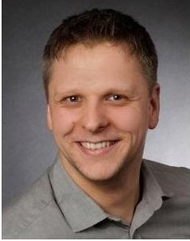

Falk Nohka is team leader of the command and data handling solutions group at the Institute of Space Systems of the German Aerospace Center (DLR). His research focus includes the application of model-based engineering in the integration and verification process of subsystems and systems. In the past he as worked on, among others, the management and conceptual design of the

Eu:CROPIS DHS, as well as management of AIV activities and functional verification in this project. His experience includes design and verification of space systems, design of data handling systems for space applications, as well as quality and process management. He received his diploma in Aerospace and Space Engineering from Technische Universität Berlin in 2008.