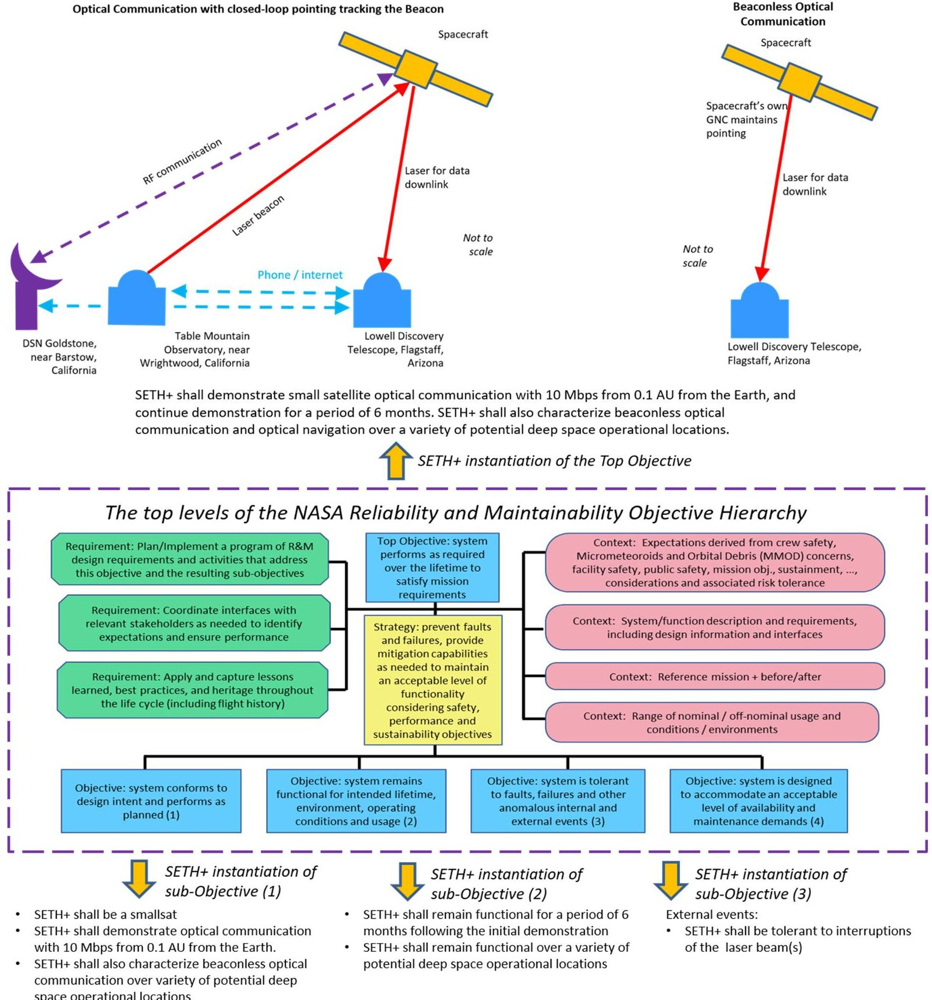
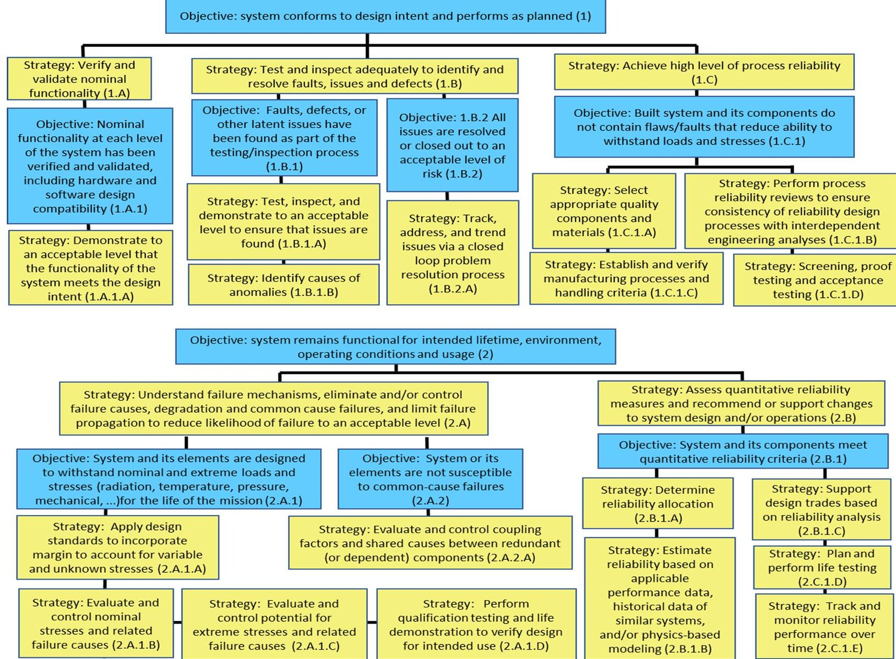
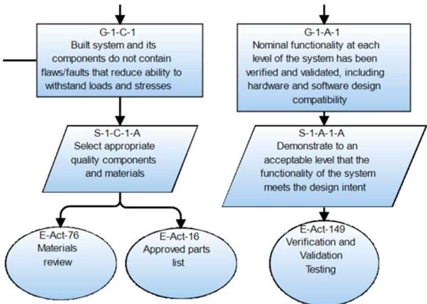
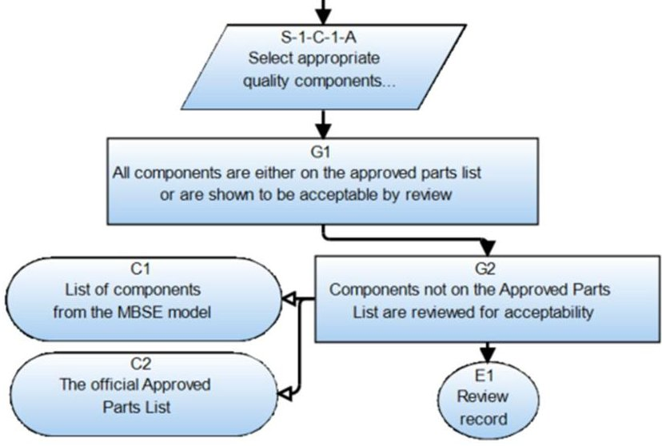

<!-- PDF_PAGE: 1 -->

# Developing an Assurance Case for an Optical Communication Mission in a Model Based Setting

Martin S. Feather, PhD, California Institute of Technology

Steven L. Cornford, PhD, California Institute of Technology

John W. Evans, PhD, NASA Office of Safety and Mission Assurance

Anthony J. DiVenti, NASA Office of Safety and Mission Assurance

David Kotsifakis, NASA/Goddard Flight Center

Josh Bendig, California Institute of Technology

Key Words: assurance, models, spacecraft

## SUMMARY & CONCLUSIONS

NASA's Office of Safety and Mission Assurance has adopted an objectives-based approach to standards to ensure that the Safety and Mission Assurance disciplines and programs are addressing the challenges of NASA's changing missions, acquisition and engineering practices, and technology. Starting with the Reliability and Maintainability discipline, an objectives hierarchy was developed to systematically decompose technical considerations that form the basis for that discipline.

This paper shows how the objectives-based approach can be applied to SETH+. a mission concept with a novel aspect demonstration of optical communication from a smallsat spacecraft to Earth across a distance of 0.1 AU (Astronomical Unit)- approximately 15,000,000 km. The objectives hierarchy supports development of an assurance case, done in a manner that draws upon Model Based Systems Engineering's representations of model information.

## 1 INTRODUCTION

The effort to build this assurance case is part of a digital transformation pilot within NASA's Digital Transformation initiative. The purpose of the assurance case is twofold: to guide the planning of the necessary and sufficient verification and validation of this mission, and to be the organizing structure for the review of this mission concept and plans. In addition, since the pilot effort is following a Model Based Systems Engineering (MBSE) approach, this development explores leveraging the modeled system information to help form the assurance case. This both reduces the time and effort it takes to build the case, and guarantees its consistency and completeness with the system model.

Assurance cases (also called safety cases when human life is at stake) have a long history of application in Europe's prominent installations and projects, e.g., oil platforms, transportation, aviation, and industrial plants. They have

received interest within NASA for its activities in aviation and space [1]. They have been adopted by NASA's Office of Safety and Mission Assurance (OSMA) as a way to develop and express structured guidance for what must be done to demonstrate adequate assurance of a mission, while leaving maximum flexibility to the mission itself to decide how to provide that assurance, i.e., what combination of tests, analyses, inspections, and data extracted from relevant past experience will be performed [2]. OSMA's approach has been to develop "Objective Hierarchies" as the starting point for mission and project assurance cases. These hierarchies cover, at a high level of expression, the gamut of all the potential considerations to be addressed in a mission's assurance case, e.g., that both nominal and off-nominal conditions are considered; that problematic issues identified in the course of development are all tracked and adequately resolved. This ensures the developers of an assurance case are themselves complete in addressing all these considerations.

NASA's Reliability and Maintainability standard [3] includes an objective hierarchy, which was the starting point for an assurance case of a space experiment's radiation tolerance [4]. The focus here, on novel aspects of optical communication from space to Earth, takes into account the following:

- The optical communication equipment itself, both to show it will be capable of achieving the required communication rates, and to show it will be sufficiently robust to survive the rigors of launch, and operation in space.

- The attitude and control system necessary to keep the spacecraft's laser, via which the voluminous amounts of data are to be communicated, accurately pointed at the receiving telescope on the ground as the spacecraft advances along its trajectory.

- The concept of operations involving coordination between the optical communication equipment on board the spacecraft and the ground facilities. The most sophisticated concept of operations uses a laser beacon beamed from Earth to the spacecraft, allowing the

<!-- PDF_PAGE: 2 -->

spacecraft to use that beacon to perform closed-loop accurate pointing of its own laser towards a receiving telescope in another ground facility (see the cartoon in the top-left of Figure 1). At the other extreme, the spacecraft

relies entirely on its own Guidance, Navigation, and Control (GNC) system to point its laser towards the receiving telescope (see the cartoon in the top-right of Figure 1).

Figure 1- Instantiation of the NASA Reliability and Maintainability Objective Hierarchy for the SETH+ mission concept

## 2 NASA'S RELIABILITY AND MAINTAINABILITY OBJECTIVE HIERARCHY

This section briefly explains NASA's Reliability and Maintainability Objective Hierarchy and shows how it is used to develop an assurance case for the example mission concept.

The top levels of this hierarchy are shown within the

dashed border in the center of Figure 1. The blue box in the top center states, in generic terms, the "Top Objective" of the system in question. This is decomposed via the "Strategy" described in the central yellow box into four Objectives Informally, these address (1) the nominal case, (2) survivability, (3) fault tolerance, and (4) maintenance. The purpose of this decomposition is to lead in a logical stepwise fashion to

<!-- PDF_PAGE: 3 -->

identification of guidance for how to design for, and demonstrate, attainment of the Top Objective.

The instantiation of the Top Objective, i.e., SETH+'s Mission Objective, is listed in Figure 1 just above the hierarchy. This succinctly states what the mission is to accomplish.

The instantiations of Objectives 1, 2 and 3 are listed in Figure 1 as groups of bullet points, just below the hierarchy. There is deliberately no instantiation of Objective 4. Its presence in NASA's hierarchy is to address systems that must satisfy availability and/or maintainability criteria. For example, a launch facility needs to be available for use with respect to a planned launch schedule, and needs to be maintainable over its lifetime. Space assets such as the International Space Station, and in the future Gateway, also have maintainability needs. Robotic spacecraft once launched from Earth are generally not

reachable for any kind of physical maintenance (the Hubble telescope was a notable exception, but its replacement, the James Webb Space Telescope will be much further away, at L2). Thus, robotic spacecraft's hardware has to be designed to last the duration of their mission (although it is often the case that their software can be updated). Consideration of Objective 4 is omitted from this study of SETH+.

## 2.1 The full extent of the Objective Hierarchy

NASA's hierarchy extends beyond the four Objectives shown in Figure 1. Specifically, each is decomposed through another "Strategy" layer, into a second layer of Objectives, and in turn to a final "Strategy" layer(s). The complete expansion of Objectives 1 and 2 are shown in Figure 2.

Figure 2 - Expansion of the Objective Hierarchy's Objectives 1 and 2

The NASA Standard [3] containing the Objective Hierarchy provides guidance on how to fulfil each bottom level Strategy. Two examples of this follow:

- Strategy 1.A.1.A, "Demonstrate to an acceptable level that the functionality of the system meets the design intent," the standard lists "Verification and Validation Testing - Test for nominal functionality per systems engineering process requirements for the applicable mission class".

- Strategy 1.B.1.B, "Identify causes of anomalies," the standard lists failure analysis, providing examples of such methods (Fault Tree Analysis, Destructive Physical Analysis, etc.), and indicates analysis be performed on "Problems/Failures/Anomalies critical to mission functions".

Note the mix of tenses in which the hierarchy is written: typically Objectives are expressed in past tense (e.g., within

<!-- PDF_PAGE: 4 -->

1. A.1, "...has been verified..."; within 1.B.1, "...have been found...") , whereas Strategies are in present tense (e.g., within 1.A.1.A, "Demonstrate ... that..."; within 1.B.1.B, "Identify causes..."). The interpretation of these should be done with respect to the project phase. For example, early in formulation, tests, analyses, etc., will not yet have been performed. Thus, the hierarchy can help develop the plan of future testing, analysis, and other activities. Later in development, when tests etc. have been performed and yielded results (and presumably any problems they reveal corrected!), the hierarchy can help assess whether the system is ready for flight.

## 3 OBJECTIVE HIERARCHY APPLIED TO SETH+

SETH+ is a mission concept in the formulation phase, so the hierarchy is useful to help justify the sufficiency of the mission design and plans for its development.

In particular, we are focusing on "Phase A - Concept and Technology Development" [5]. Table 2.2-1 therein describes the purpose of this phase as "To determine the feasibility and desirability of a suggested new system and establish an initial baseline compatibility with NASA's strategic plans. Develop final mission concept, system-level requirements, needed system technology developments, and program/project technical management plans." And the typical outcomes of this phase as "System concept definition in the form of simulations, analysis, engineering models and mock-ups, and trade study definition".

To see how the Objective Hierarchy's detailed levels apply to the SETH+ mission concept, first consider Objective 1 (shown in the upper half of Figure 2). Its bottommost row of Strategies divides into two groups:

- Those for which SETH+ must show a plan to prepare for and achieve over the course of development - 1.B.1.A, 1.B.1.B, 1.B.2.A, 1.C.1.B, 1.C.1.C and 1.C.1.D. For example, 1.B.2.A "Track, address, and trend issues via a closed loop problem resolution process" would be satisfied at this stage by arguing that SETH+'s development will be done by an organization whose practices already include this (e.g., because they are following a standard process such as ISO9001).

- Those for which SETH+ must show a design satisfying them - 1.A.1.A, "Demonstrate to an acceptable level that the functionality of the system meets the design intent" and 1.C.1.A "Select appropriate quality components and materials".

The next two subsections look at this second category.

## 3.1 Satisfying 1.A.1.A

Showing 1.A.1.A "Demonstrate to an acceptable level that the functionality of the system meets the design intent" and "Select appropriate quality components and materials" hinges on what SETH+ is intended to do, and in what conditions it is to do so. Recall from Figure 1 that SETH+'s instantiation of Objective (1) were:

- SETH+ shall be a smallsat.

- SETH+ shall demonstrate optical communication with 10 Mbps from 0.1 AU from the Earth.

- SETH+ shall also characterize beaconless optical communication over variety of potential deep space operational locations.

The first of these subsumes a standard set of spacecraft form factor constraints (e.g., on mass, size, shape, interface with the deployment mechanism) that the SETH+ design must satisfy. The other two related to the functionality that SETH+ must be capable of. The Model Based Systems Engineering community has developed ways to represent these aspects in rigorous models, using machine-supported formalisms. A large mission, the Europa Clipper Project, has shown how these models can be used during formulation to help explore the tradespace of designs to emerge with a demonstrably requirements-compliant design [6].

The SETH+ mission concept, in addition to all of the above, must identify and address the novel aspects of its planned demonstrations of optical communication. These stem from the equipment involved (e.g., a laser) and how it is to be used (e.g., to transmit information to Earth). The concept of operation is key to this. As sketched at the top of Figure 1, and mentioned earlier, there are two versions, one involving a beacon, the other beaconless. The equipment involved is:

- The laser communication system on the spacecraft, to convert data into an optical signal

- The laser receiving system on Earth, to recover the data from the received optical signal

- When a beacon is involved:

- The Earth-based laser to act as the beacon

- The spacecraft receiving system, to detect the beacon and control pointing the spacecraft

- When a beacon is not involved:

- The spacecraft's own Guidance, Navigation, and Control system to point the spacecraft

To establish SETH+'s feasibility of optical communication with 10 Mbps from 0.1 AU from the Earth, its design must be analyzed taking into account the following:

- The spacecraft's laser communication system (e.g., involving the power of the laser, quality of the optics)

- The receiving system's sensitivity

- The accuracy of the spacecraft's pointing

- The attenuation as the laser beam passes through the Earth's atmosphere, which will depend on:

- The frequency of the beam

- The angle of the beam - the further from directly overhead, the greater thickness of atmosphere the beam must traverse

- The atmospheric conditions, e.g., clouds

Factoring all these considerations into an optical link model, populated with values extracted from the MBSE model of the system and its concept of operation, is then used to show satisfaction of the requirement.

## 3.2 Satisfying 1.C.1.A

To show 1.C.1.A "Select appropriate quality components and materials," two sets of components are extracted from the same MBSE model - those used in space on the smallsat, and those used in the Earth-based ground facilities. Only the ones

<!-- PDF_PAGE: 5 -->

in the former set need to be able to survive the space environment. For satisfying this Strategy, the standard lists "Approved Parts List," "Materials Review," and "Parts Control and Traceability" as suggested activities.

SETH+ plans to make use of a Guidance, Navigation, and Control system already flight-proven in conditions that bracket those that SETH+ will experience. This is an acceptable way of satisfying the Strategy. The laser communication system, however, has not seen previous space use, so for this it is necessary to look at its individual components and the materials from which it is to be constructed.

Note that because the MBSE model is the source of component information for both 1.A.1.A and 1.C.1.A, there is no danger of inconsistency. This stems from the model being the "single source of truth," an advantage of MBSE.

## 3.3 Constructing the Assurance Case

The SETH+ mission concept will need to show that it satisfies the Objective Hierarchy of NASA's Reliability and Maintainability standard. In keeping with the aims of that standard, developing an assurance case is a way to plan, and thereafter demonstrate, satisfaction.

Figure 3-A portion of the initially generated assurance case

Software has been developed to auto-generate an initial version of the assurance case from the Objective Hierarchy in the NASA standard, together with selections of activities from those suggested in the standard. A small portion is shown in Figure 3. It uses the Goal Structuring Notation (GSN) [7], and is drawn by the Assurance Case Automation Toolset (AdvoCATE) from NASA Ames [8]. Auto-generation produces the data file representing the assurance case, which AdvoCATE then displays and makes available for editing.

In Figure 5, the parallelogram shapes correspond to the Strategies of the hierarchy, and use the hierarchy number prefixed by "S-" to form the identifier strings recognized by AdvoCATE. Likewise, the rectangle shapes are for the hierarchy's Objectives, which in GSN are referred to as "Goals", hence the "G-" prefix. The oval shapes are for the activities.

incorporate more details of the mission concept. Figure 4 shows the result, where the approach to guaranteeing selection of appropriate components has been made explicit. The round-ended rectangles are GSN "Context" items, i.e., references to external information, in this case to information in the MSBE model, and to an official Approved Parts List.

Some manual editing of this initial version is needed to

## 3.4 Satisfying Objective 2

The bottom half of Figure 2 shows the expansion of Objective 2 to the lowest level of Strategies in the standard. Several of those Strategies hinge on the reliability of the system and its components. Examples of system reliability analyses include Failure Modes and Effects Analysis, Fault Tree Analysis, and Probabilistic Risk Assessment.

A Fault Tree for the SETH+ mission is automatically derived from the MBSE system model using software for this purpose [9], thus ensuring consistency across all assurance aspects because they are derived from information drawn from

that same model.

Figure 5-A portion of the assurance case after editing

## 4 FUTURE WORK

We are working to improve the linking between several of our software tools to make for a more seamless experience, for example, where the assurance case refers to information in the MBSE model. We also plan to improve our software that generates the initial assurance case to percolate the mission-specific requirements throughout, replacing the generic descriptions currently drawn from the standard. With these in place, we will study how the assurance case may serve as the organizing structure in a major project review. Lastly, we aim to maintain the assurance case through development, for example, in the formulation phase we may identify a plan to do testing; as development proceeds and that test is conducted, we would update the assurance case to reference the test results.

## ACKNOWLEDGEMENTS

This research was carried out at NASA HQ, NASA Goddard Space Flight Center, and at the Jet Propulsion Laboratory, California Institute of Technology, the last under a contract with the National Aeronautics and Space

<!-- PDF_PAGE: 6 -->

## REFERENCES

1. D.J. Rinehart, J.C. Knight, J. Rowanhill, "Current practices in constructing and evaluating assurance cases with applications to aviation," NASA/CR-2016-218678, 2015.

2. F. J. Groen, J. W. Evans, A. J. Hall, "A vision for spaceflight reliability: NASA's objectives based strategy," 2015 Annual Reliability and Maintainability Symposium (RAMS), pp 1-6, IEEE.

3. NASA Standard 8729.1 Revision A, "NASA RELIABILITY AND MAINTAINABILITY (R&M) STANDARD FOR SPACEFLIGHT AND SUPPORT SYSTEMS," 2017, available from https://standards.nasa.gov/standard/nasa/nasa-std-87291

4. R.A. Austin, N. Mahadevan, B.D. Sierawski, G. Karsai, A.F. Witulski, J. Evans, "A CubeSat-payload radiation-reliability assurance case using goal structuring notation," 2017 Annual Reliability and Maintainability Symposium (RAMS), pp 1-8, IEEE.

5. NASA SYSTEMS ENGINEERING HANDBOOK: Nasa/sp-2016-6105 Rev2-Full Color Version. 12TH MEDIA SERVICES. Available from https://www.nasa.gov/sites/default/files/atoms/files/nasa systems_engineering_handbook_0.pdf

6. Bayer, T., Day, J., Dodd, E., Jones-Wilson, L., Rivera, A., Shougarian, N., Susca, S. and Wagner, D., 2021, March. "Europa Clipper: MBSE Proving Ground," 2021 IEEE Aerospace Conference (50100) (pp. 1-19). IEEE.

7. T. Kelly, R. Weaver, "The goal structuring notation-a safety argument notation," Proc. Dependable Systems and Networks Workshop on Assurance Cases, Citeseer 2004.

8. E. Denney, G. Pai, J. Pohl, "AdvoCATE: An assurance case automation toolset," Computer Safety, Reliability, and Security, 2012, pp. 8-21.

9. M. Izygon, H. Wagner, S. Okon, L. Wang, M. Sargusingh and J. Evans, "Facilitating R&M in spaceflight systems with MBSE," 2016 Annual Reliability and Maintainability Symposium (RAMS), pp. 1-6, IEEE.

## BIOGRAPHIES

Martin S. Feather, PhD Jet Propulsion Laboratory, California Institute of Technology 4800 Oak Grove Dr., Pasadena, California 91109, USA

e-mail: martin.s.feather@jpl.nasa.gov

Martin Feather is a Principal Software Assurance Engineer in JPL's Office of Safety and Mission Success.

Steven L. Cornford, PhD Jet Propulsion Laboratory, California Institute of Technology 4800 Oak Grove Drive, Pasadena, CA, 91109, USA

e-mail: steven.l.cornford@jpl.nasa.gov

Steven Cornford is a Principal Engineer in JPL's System Modeling and Analysis Program Office.

John W. Evans, PhD Office of Safety and Mission Assurance NASA 300 E St SW Washington, DC, 20546, USA

e-mail: john.w.evans@nasa.gov

John W. Evans is a Program Executive and Senior Advisor for OSMA. He is founder of Model Based Mission Assurance and responsible for development of NASA Standard 8729.1A.

Anthony J. DiVenti, MSci Office of Safety and Mission Assurance NASA 300 E St SW Washington, DC, 20546, USA

e-mail: anthony.j.diventi@nasa.gov

Anthony (Tony) DiVenti is the Reliability and Maintainability (R&M) technical fellow at NASA Headquarters.

David Kotsifakis, MSci NASA/Goddard Space Flight Center 32400 Fulton St., Wallops Island, VA, 23337, USA

e-mail: david.p.kotsifakis@nasa.gov

David Kotsifakis is a Systems Engineer in the Guidance, Navigation, and Control Section of the Systems Engineering Branch at Wallops Flight Facility.

Josh Bendig, MSci Jet Propulsion Laboratory, California Institute of Technology 4800 Oak Grove Drive, Pasadena, CA, 91109, USA

e-mail: joshua.l.bendig@jpl.nasa.gov

Josh Bendig is a Systems Engineer in JPL's Office of Safety and Mission Success.