<!-- PDF_PAGE: 1 -->

# Digital Engineering Development in an Academic CubeSat Project

Evelyn Honoré-Livermore, $ ^{*} $ Roger Birkeland, $ ^{\dagger} $ Sivert Bakken, $ ^{\ddagger} $ Joseph L. Garrett, $ ^{\S} $ and Cecilia Haskins $ ^{I} $

Norwegian University of Science and Technology, 7491 Trondheim, Norway

Digital engineering is increasingly introduced for managing and supporting the development of systems for space. However, few academic teams have the competency needed to manage projects using digital engineering and systems engineering. The subject of this paper is an academic CubeSat project in which a variety of digital engineering techniques are used. The tailoring that has been applied to fit the academic environment including students from different disciplines and levels of maturity is described. This paper shows how a customized Scrum methodology for hardware and software integrated with a workflow in a digital tool environment has given positive results for both the team and the system development. This paper also discusses how to introduce new members to the team and how to train them to work with digital engineering as a multidisciplinary team. This paper presents how the systems engineering and project management activities have been integrated into the academic CubeSat project, evaluate how well this fusion worked, and estimate its potential to be used as a guide for other digital engineering projects.

https://doi.org/10.2514/1.I010981

## I. Introduction

THE digital transformation that is taking place in all elements of society calls for continuously updated knowledge for leaders and for engineers. The increasing project complexity introduced by the advent of embedded systems and cyber-physical systems (CPSs), and the tools needed for developing them challenges managers to rethink the approach to leading projects and people to ensure knowledge management and project success [1]. While this is challenging in industrial settings with experienced engineers and support systems, developing complex systems in an academic environment adds factors such as high turnover, coursework, lack of multidisciplinary teamwork experience, and fewer competent systems engineering and project management resources.

Digital engineering (DE) and model-based systems engineering (MBSE) are proposed as tools to manage the challenges of developing systems, delivering integrated multidisciplinary product development from concept through the product life cycle to retirement. We adopt the DE definition of the U.S. Department of Defense (DoD): "an integrated digital approach that uses authoritative sources of system data and models and a continuum across disciplines to support lifecycle activities from concept through disposal" [2], p. 340). For MBSE, we use the definition provided by International Council of Systems Engineering: "The formalized application of modeling to support system requirements, design, analysis, verification and validation activities beginning in the conceptual design phase and continuing throughout development and later life cycle phases" [3]. However, choosing the approach tools and methods to introduce and adopt DE is equally challenging and requires both human and technical resources.

Concurrent with the advent of DE, approaches such as Scrum and Extreme Programming (XP) have increased in popularity for both hardware and software [4]. The Scrum methodology allows for agile

product development, so that the project can respond to changing demands from stakeholders and new technology developments while continuously delivering features. The digital Scrum tools also provide a system that supports project management through feature and schedule management, and product management through scope and verification management, and may be integrated with the digital design artifacts. XP takes iterative development to an extreme level, with short iterations, continuous test development, pair programming, continuous integration, and frequent releases [5]. In software projects where there is scientific code development and requirements are either unknown at the beginning or frequently change, XP or Scrum are suitable over other traditional approaches [6].

Students in academic projects face the challenge of balancing coursework and project work. The students follow the school year, so long-term academic projects must adapt their expectations to this fluctuation. There is also a high natural turnover when students graduate, which continuously changes the team composition. Academic projects may have fewer resources and fewer support systems that product development often necessitates (e.g., a procurement department or quality assurance knowledge) [7,8]. The university context requires attention to knowledge transfer and management, and DE is a tool that can be applied and must be managed to enable a good development environment.

This paper is based on the longitudinal case study of an academic CubeSat where the students typically join in September and leave in June the following year, although some students join in January and leave in June the same year. They contribute to the development of the CubeSat through work toward a thesis in software, hardware, or theoretical studies. We explore the cycle of development of a CubeSat in an academic environment using DE tools and describe how they have been tailored. Furthermore, we discuss how MBSE has been applied and what barriers for use of were experienced. We found that using agile practices powered with DE tools and processes greatly improved information sharing and knowledge management, and that the introduction of remotely accessible hardware-in-the-loop (HIL) setups coupled with a defined workflow enabled improved verification, validation, and integration activities.

## II. Background

## A. Academic CubeSat Projects

Since the definition of the Cube Satellite (CubeSat) standard around the year 2000, applied space technology and satellite production has become a staple offering at universities [9]. At first, most initial CubeSat projects sought to evaluate the viability of CubeSats as a concept, and limited their initial goal to communication. Over the last 20 years, the missions have evolved in sophistication into projects with more advanced research objectives [10]. To meet the needs of this burgeoning industry, a substantial supply chain for CubeSat

<!-- PDF_PAGE: 2 -->

buses and subsystems has been established so that university researchers can then focus upon their main task: defining and building the payload and without having to build the rest of the spacecraft bus around the payload too. In most cases this saves both cost and development time.

CubeSats are built from units (U) of 10 cm $ \times $ 10 cm $ \times $ 10 cm ranging from 0.25U to 16U, with 3U being the most common size [11]. Larger satellites at 6U and 12U are becoming increasingly popular. As the technology matures, the satellites' capabilities increase, for example, including advanced deployable mechanisms for solar panels and instruments. With this maturity the missions are becoming more advanced and can deliver more valuable results.

The life cycle of an academic CubeSat project typically starts with an idea for a research project or an educational CubeSat, then securing the funding, and moving on to the preliminary design phase, the critical design phase, launch of the CubeSat (when funding is available). Then follows the operational phase with payload data collection and analysis (if successful), and finally decommissioning at the end of spacecraft lifetime. This takes from 1 to 5 years, with an average of 3.8 years [12].

The CubeSat subsystems are usually highly integrated, and modularity is ensured both in software and hardware [13]. As the cost of fixing problems increases later in the development cycle during integration, testing, and maintenance [14], early integration and testing are encouraged. To a large degree, the subsystems can be considered a CPS because their performance depends on both the hardware and software developed. The integration process can be improved by using advanced, industrial type electronics and computational platforms during development and test. Using as many commercial-off-the-shelf (COTS) components as possible, lead time is reduced, and development can be based upon well-known tools with little or no adaptation. There is an opportunity to reduce the risk of late discovery of bugs by proactively using HIL setups throughout the development cycle, enabling iterative development.

To date, over 400 university satellites have been launched, with more than 500 in the pipeline [11]. The educational benefit and the use of CubeSat programs as an introduction to applied space technology has been much discussed in the CubeSat community [7,15-17]. The first educational CubeSats provided students an opportunity to follow a space project from start to launch within their time at a university. Hands-on projects give students a realistic but manageable "first contact" with space projects and space industry [18]. Institutional actors such as NASA and European Space Agency (ESA) promote and support educational CubeSats by enabling contact and access to space professionals, and by facilitating courses and workshops as well as launch for the best qualified satellites through their Educational Launch of Nanosatellites (ELaNa) [19] and Fly-your-satellite [20] programs. This applied work also motivated many university teams to create spin-offs from their projects, becoming central players in the CubeSat community and a part of the supply chain. They now form a substantial ecosystem where it is possible to procure everything from single components to a turn-key mission where you define your payload and the satellite provider does the rest.

## B. Agile Methodology and Development Practices

Using agile methodologies in software and hardware development has gained popularity in the past decades, focusing on continuous feedback from the customer and the ability to react to a changing environment [21,22]. The word "agile" has its etymological source from the Latin word agilis, which means "can be moved easily, light," and from the French word agere, which means "to drive, to be in motion" [23]. In software development, the agile methodology gained popularity in the late 1990s, and "Manifesto for Agile Software Development" [24] with its 12 guiding principles was published in 2001. The manifesto includes principles that focus on delivering the highest value to the customer, to allow for changing requirements, frequent and iterative deliveries of software, motivating individuals, face-to-face conversations, measuring progress through working

software products, simplicity, reflexive practices, and believing that the best designs come from self-organizing teams [24].

At universities, software and hardware development serve both to assist scientists in gathering data and for teaching technology and product development. In most cases, the development is not done with the purpose of delivering a mass-produced product or service, but for the purpose of contributing to new knowledge and research. A key challenge of scientific software development is that the scientists often have formal education in a field other than computer science, for example, in biology, remote sensing, electronics, or radio technology, but need custom software to address their discipline-specific research questions [25,26]. Given the open-ended nature of research projects, the process of requirements specification lacks maturity in comparison to industrial development projects, making it challenging to plan the development and to test the software. Furthermore, the scientific software development does not "stop" when the first research project ends, but it may be reused in a different research project with different goals, and new scientists desiring new functionality [27].

Best practices for scientific software development include write programs so that the other researchers understand and stick to a code style and formatting, make the frequently used commands easily accessible, incremental development with continuous testing, use version control, "plan for mistakes" and use unit testing, improve performance after the functionality is there, document the design and interfaces and choices made during development, and collaborate on code development and do code reviews [25]. Typical challenges facing scientific software teams are "compromising between feature demands and quality control; code ownership and management during evolution; data organization and curation; and quality assurance of heterogeneous components, ... and a tendency for prototyping practices to be employed even when production scientific software was being written ([28] pp. 6-7)." In the work of Arvanitou et al., software practices for scientific development were discussed based on an extensive literature study [26]. They found that most scientific software engineering literature has studied process improvement, ease of development, testing and verification, project management, coding, and quality assurance. Furthermore, performance, maintainability, and development productivity were the highest priorities for the scientists.

In a survey of agile methods in scientific programming in disciplines such as bioinformatics, climate scientists, and aerospace, it was found that the agile method XP has been applied successfully in projects where requirements and design cannot be known in the planning phase of a project [28]. Furthermore, agile practices such as iterative development, continuous integration, and version control were prominent. In contrast to commercial and industrial software development, there is no declared or identified customer to review the software features. However, scientific publications can be analogous to customers in which the scientists receive feedback on what they have developed [28,29]. Sletholt et al. [27] conducted a literature review against 35 agile practices from Scrum and XP, and found some support that agile practices are suited to testingrelated activities.

Agile practices in teaching have gained popularity since the 2000s [30,31], where Scrum or XP have been the most prominent methods, and typically found in either software or capstone projects. The students benefit from learning hands-on project experience, learning to prioritize work tasks, gaining communication skills, and providing and receiving assessment on work done openly. However, there may be challenges in terms of balancing time commitments, for example, having concurrent development sessions, or tailoring the Scrum processes to suit the different needs of team members [31]. Lundqvist et al. [32] reported on teaching agile in cooperation with industry. They highlighted the importance of ownership, the engagement of customer (also called the industrial partner), and the allocation of academic resources to support the academic teams.

According to a study from Australia in 2015, employers want both technical skills and nontechnical professional skills such as "being able to communicate effectively," "ability to organize work and manage time effectively," "being willing to face and learn from errors

<!-- PDF_PAGE: 3 -->

and listen openly to feedback," and "being able to empathize with and work productively with people from a wide range of backgrounds" [33]. pp. 263-264). A similar study conducted in Norway also highlighted these points [34]. However, the traditional form of classroom teaching may not facilitate the development of these skills effectively. Using CubeSats for training students in cross-disciplinary projects has been studied and discussed [7,12,15-17]. Some principles for agile systems engineering that have been suggested include 1) focus on delivering customer value, 2) team ownership, 3) embrace change, 4) continuous integration, 5) test driven, and 6) taking a scientific approach to systems' thinking [29,35]. Many of these principles are aligned with transferable skills students can be expected to have when they graduate [33,34].

## C. Digital Engineering

DE goes beyond just using computer tools to aid engineering, but includes the engineering process and approach to development. Choosing a DE strategy should be done based on the resources available and needs of the organization. A framework that assesses the DE competence was developed by the Systems Engineering Research Center (SERC), which looked at the following areas: adoption, velocity/agility, knowledge transfer, user interface, and quality [36]. Although the framework did not specify how to measure the competence in each of the areas, it listed different factors and examples of processes or outcome metrics that could be used. Some factors identified can be categorized as objectives for why DE measures are incorporated, others as factors that may influence the adoption, and other factors as outcomes and direct competencies the organization can gain with DE practices. DE has a strong relationship with MBSE and model-centric engineering (MCE), and establishing a "single source of truth" for a project [2]. However, there is currently no single solution for the whole system life cycle to provide an authoritative source of truth. Most work forces and organizations need to transition their methods and methodologies to DE and incorporate it into their engineering practices, and ensure possibilities for collaboration and information sharing throughout the system life cycle between developers and the stakeholders. Most university CubeSat teams use some degree of DE, such as employing version-controlled software repositories, using CAD tools, shared cloud documentation, and using cloud-based issue tracking or project management tools to achieve integration in the management of knowledge [12].

Garzaniti et al. [37] also describe the use of Scrum using an online tool to manage the work in an academic CubeSat team. The results presented were from the preliminary design phase of the space hardware. They found that the Scrum approach was helpful for reacting to unforeseen changes and delays, even when the changes impacted external manufacturers. Furthermore, it takes time for the team to become accustomed to Scrum and the scoring of issues, similar to [31]. Huang et al. [38] describe the development of a CubeSat using agile practices. They highlight the importance of tailoring the approach to the needs of the project, using interactive

design reviews to produce as much feedback as possible, empowering smaller teams to enable faster decision making and ownership, and allowing for continuous testing and improvement.

## III. HYPSO Case Study

## A. HYPSO CubeSat Project

In this paper we report on the case study of the CubeSat project Hyper-Spectral SmallSat for Ocean Observation (HYPSO). It is the first research CubeSat mission for the Norwegian University of Science and Technology (NTNU), as a part of a strategy of monitoring coastal areas using autonomous assets [39]. The project's mission is to "To provide and support ocean color mapping through a Hyperspectral Imager (HSI) payload, autonomously processed data, and on-demand autonomous communications in a concert of robotic agents at the Norwegian coast."

The university CubeSat team develops the payload, which consists of an optical telescope, a COTS camera unit, a COTS processing unit, an electronics interface board, an electrical harness, software to control the payload and to perform the image processing, and mechanical support structure that also acts as the mechanical interface to the satellite bus. Block diagrams of the spacecraft and the payload are given in Figs. 1 and 2, respectively. Apart from the above-mentioned COTS components, all have been developed in-house. In addition to the payload, there is also development of a local ground station and the mission operations center and associated procedures and functionality, effectively resulting in a system of systems (SoS).

The CubeSat project team includes 10-20 M.Sc. and B.Sc. students, 1 electronics engineer, a procurement officer, 6-8 Ph.D./PostDoc researchers, and professors supervising the thesis work or offering experience and support. The project manager is a Ph.D. candidate examining the value of MBSE to deliver the CubeSat on time and within schedule. The researchers typically join the project for 2-4 years, and the students for 4 (B.Sc.) or 9 (M.Sc.) months when they write their thesis. The backgrounds of the students vary, but typically they are enrolled in engineering cybernetics, embedded systems, electronic systems, product development, or material science. Some of the students have experience with working in teams, and sometimes multidisciplinary development through previous coursework or volunteer organization. However, not many have experience with product development, which typically has more unknowns than course-organized project work.

The project had its first major milestone in December 2017, the mission design review (MDR). There had been some software development before this, mostly focused on algorithm development for processing, without target hardware or system in mind. The overall system maturity timeline is shown in Fig. 3, and a more detailed timeline of the progress in 2020 is shown in Fig. 4. Most of the integration and HIL testing occurred in 2020.

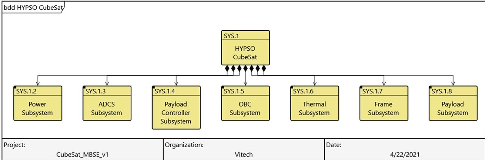

Fig. 1 Overview of the HYPSO CubeSat and its subsystems. Model made using CORE/GENESYS.

<!-- PDF_PAGE: 4 -->

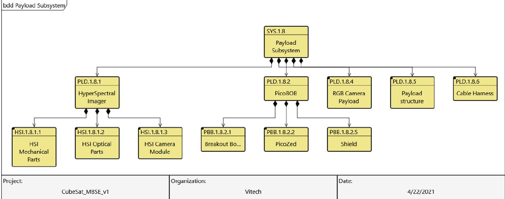

Fig. 2 Overview of the payload developed by the HYPSO team. Model made using CORE/GENESYS.

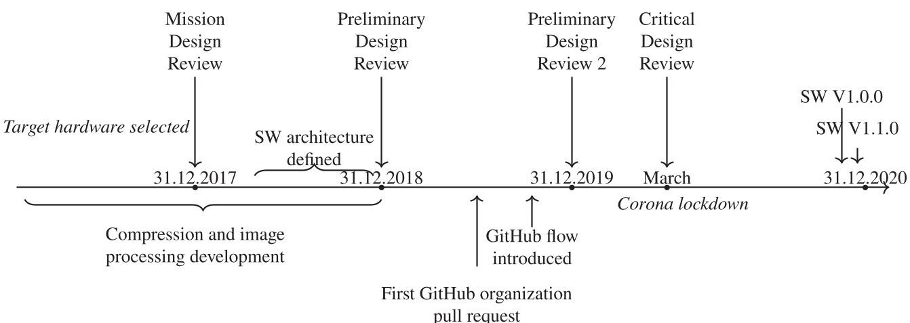

Fig. 3 Overall timeline of in-house-developed product maturity, including both hardware and software (SW).

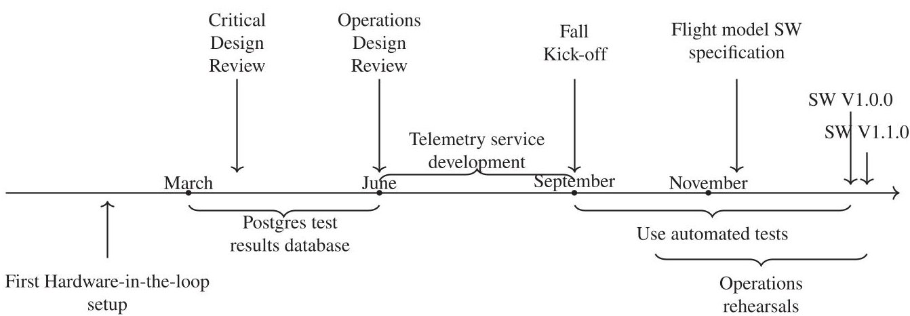

Fig. 4 Timeline of product maturity through 2020. "SW" refers to in-house developed software.

## B. Software System Architecture

The high-level system architecture is given in Fig. 5, where the flow of signals and data is bidirectional. Some of the items in the software architecture are developed in-house, whereas others are delivered by suppliers, or interfaced as a service. The architecture was not clear at the beginning of the project and has been gradually defined throughout the system development life cycle. The components have also undergone continuous development, as well as updates to the interfaces to a certain degree. The reasons for continuous development and changes are new functionality requirements and new performance requirements, the inherent constraints of the chosen components, as well as the learning and discovery process of developing a CubeSat system for the first time.

Modular software components require that interfaces and software architecture are defined. Although the initial software architecture was developed in late 2018, not all interfaces between different components were defined. This meant that a lot of work was required to integrate the in-house-developed components. Furthermore, the interface definition to other spacecraft subsystems had not been considered before 2018, such that the components also needed adaption to enable integration to the satellite bus. The software-based subsystems allow for hardware to host the functionality of several subsystems. For the HYPSO spacecraft (Fig. 1), the subsystems "SYS1.3 ADCS Subsystem" and "SYS1.5 OBC Subsystem" are both hosted on the same physical component, the flight controller (FC). On the payload, the physical on-board processing unit (OPU)

<!-- PDF_PAGE: 5 -->

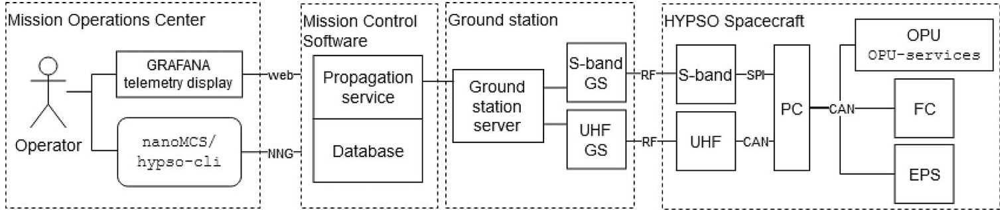

Fig. 5 The software system architecture. CAN, controlled area network; EPS, electrical power subsystem; FC, flight computer; GS, ground station; NNG, nanomsg Next Generation; OPU, on-board processing unit; PC, payload controller; RF, radio frequency.

hosts the image processing pipeline, the camera control, the payload operating system, and telemetry services for the payload.

In Fig. 5, each partition is composed of tightly integrated physical and software subsystems, namely, a cyber-physical SoS. The space environment will affect each of the interfaces between the subsystems and the performance of the spacecraft itself, and the software subsystems need to adjust (e.g., pointing the spacecraft toward the sun when the battery levels get low) to ensure functionality and performance. Additionally, this means that to develop hardware components, one needs to consider the software, and when developing software components, one needs to consider hardware limitations, such as data transfer speed limitations, or processing hardware physical layout. Furthermore, the Mission Control Software and Mission Operations Center were not available until mid-2020, which led to the discovery of new functionality and software adjustments to facilitate operations of the payload. When the spacecraft is operational and commissioned, the operator will only interact with the first box (the telemetry display and the hypso-cli [user interface translating commands to packets used for communicating] or nanoMCS interface) and the OPU services on the HYPSO spacecraft, under the expectation that the underlying system functions as expected. Despite the many hardware and software systems in between the operator and the spacecraft, they must exchange information correctly and in a timely manner.

## C. Tailoring of the Agile Methodology

The Scrum methodology has been tailored such that the team members deliver either a product increment or a thesis, as shown in Fig. 6. The sprints typically lasted 2 weeks, and there was a daily scrum meeting (a stand-up) in which issues were raised or discussed for clarification, in addition to general keeping-in-touch with each other. The team uses GitHub for managing the code repository and schematics and providing version control and release management

[12]. GitHub is a service that provides users of several different backgrounds and development approaches to work together and at the same time have a coherent overview of the current status of the code base. GitHub has a plugin for managing Scrum with a kanban board. Kanban boards, from the Japanese word meaning billboard, are used to visualize and manage workload by providing an overview of work-in-progress, backlogged items, blocked items, done items, and review-in-progress items. A kanban board is based on pulling tasks instead of being pushed, which enables the students to take control of their own workload. At the same time, the Scrum master (called group leader in Fig. 6) can control which items are included on the board, so the work that gets done is pertinent to the schedule and the product to be delivered.

Planning and developing a complex system are not guaranteed to align well with research goals found in academia. Finding synergies and acknowledging what needs to be prioritized can benefit the development of a CubeSat as well as providing a better foundation to build and expand research activities upon. Although Scrum traditionally has a goal of delivering a predefined minimum viable product (MVP) at the end of a sprint, this was not the case for HYPSO. In this case study, participants contribute to components ranging from hardware to user interface (UI). Until the first agreed software release at the end of 2020, as shown in Fig. 4, the sprint backlogs included issues that the team members "wanted to focus on" and had time to work on. There was an agreement between the team members when selecting issues, and there was a continuous focus on working on issues labeled as "bugs" or mission-required functionality (defined by the group leader in conjunction with the project manager) instead of issues categorized as "enhancements" in GitHub. Furthermore, each participant developed modules without defined interfaces between them. This made retaining the value added from different contributions, and especially integration, unnecessarily difficult and time-consuming. To mitigate these

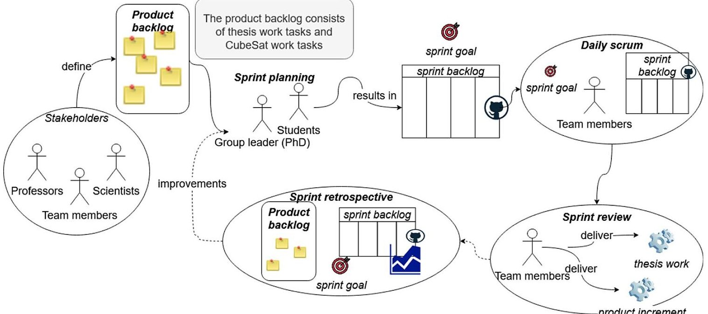

Fig. 6 Tailored Scrum process with a product backlog consisting of both thesis tasks and project work tasks.

<!-- PDF_PAGE: 6 -->

challenges a common workflow was proposed and became a part of the on-boarding procedure, as well as providing the students with a common repository.

Some of the contributors only participate in the development for as little as one semester, and there are limitations to how complicated the workflow and how complicated the development tools can be. To achieve a convenient workflow, development needs to be coherent and a multitude of development considerations have to be made clear, as well as followed-up to ensure the desired quality of the project and product. Continuous integration (CI), or the practice of integrating contributions from multiple developers into a common software product, is beneficial for collaborative code development [40], and it is also promoted in XP practices. A workflow focusing on integration was then proposed, i.e., the GitHub workflow [41]. This workflow states that the main branch shall always be working, and any feature or fix to be included in the code base shall originate from a dedicated branch; i.e., there are no development branches that branch out beyond the main branch. This workflow encourages contributors to frequently merge their code contributions into a central repository for review and testing, as is considered a good practice in software development [41].

## D. Verification and Validation Using Hardware-in-the-Loop Setups

Verification and validation are important to ensure that the product functions as specified (verification) and meets the needs of an end-user (validation). Collectively, these will be referred to as testing. In the HYPSO project several testing regiments were developed to expand the number of reviewers. The software group leader emphasized that approval of a pull request (PR) should be done by reviewers not necessarily involved in the development of the code. In other words, the contributors were required to describe their changes or additions in such a way that any software team member could be able to review them. Even though not every team member is able to review every change, this motivates the developer to make code modifications in such a way that they are understandable to any person responsible for reviewing said changes. For a change to become part of the master branch, at least one other person has to approve the suggested changes. When the code changes are committed to a separate feature branch of the central repository, it is then built and tested by a team member before being accepted as a valid code base addition. If no adverse effects are detected during review, the pending PR is then merged into the master branch. This is the manual process of testing and ensures that specifically the newly added feature or fix is tested independently and sufficiently.

In addition to the manual process, several automatic scripts have been developed to do routine tests of nominal operations of the

system. While simplifying the process of testing any proposed changes on the target hardware, this also provides a platform for other types of testing. Several installations of the system, laid out as closely as possible with the actual satellite, were set up to be interfaced remotely by any team member, namely, the HIL setups. HIL setups can be used for verification of functional requirements [42], and if deployed on target hardware, they can also verify performance requirements. Because university CubeSat projects often have limited funding available, having a full engineering model (an exact replica of the system) of the satellite bus and its subsystems is not always feasible. Instead, using a FlatSat (a flat satellite) with subsystems provides many of the same functions at a much lower cost. The satellite bus providers often sell FlatSat services at lower fees because the subsystems that constitute the FlatSat can be shared between different customers, or the subsystems can be development models used by the satellite bus providers themselves.

Two HIL setups were developed to facilitate verification and validation activities, and to improve early integration efforts. The HIL setups are shown in Fig. 7 and are called LidSat (because the systems are mounted in an Electrostatic Discharge (ESD)-box lid) and pHIL (payload HIL). Both setups use target hardware for the software subsystems and have different purposes. The pHIL setup is mainly for testing payload and its communication interface with the command line interface, whereas the LidSat is used to test both the payload software and the integration of the payload to the spacecraft. The pHIL is connected to a workstation that is running a Jenkins continuous integration server. To test a branch of the software, the branch is first compiled and initiated on the payload. Then Jenkins runs a set of tests on the target hardware. The outcome of the tests (both whether they pass and their performance) is recorded in a database. The central database allows the developers to see how various branches have performed during the test. The test set includes sending several commands that operators commonly use, and ensuring that the correct results are obtained for different sets of parameters. The LidSat has both the electrical power subsystem (EPS) and payload controller connected via a controlled area network (CAN), with an additional connection to the rest of the spacecraft subsystems on a FlatSat in Vilnius through internet with a CAN-over-internet bridge. These are the main interfaces for the payload, and as such, the FlatSat replicates integration with the spacecraft.

Furthermore, integration testing has been automated by scripting commands to be sent from the operator computer to the payload. Scripts have been developed to aid other hardware team members in testing nominal operations when mechanical changes are made, and these scripts are also used in a test-to-failure scheme where the

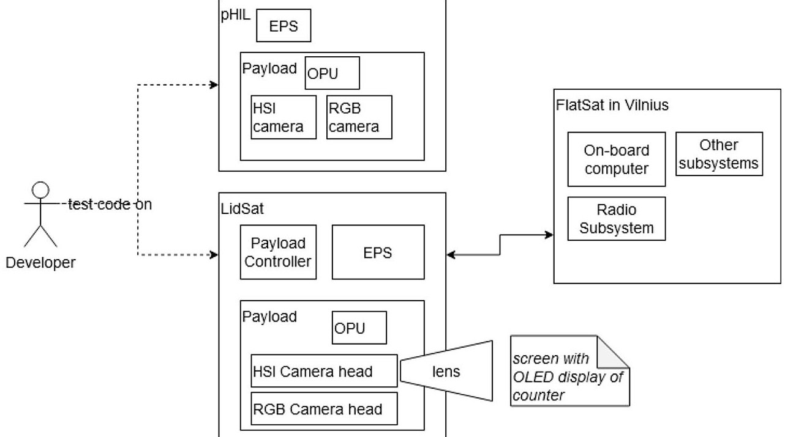

Fig. 7 Hardware-in-the-loop test setups.

<!-- PDF_PAGE: 7 -->

procedures are repeated a set number of times or until failure. A script testing the potential performance alterations was also used on the system, as well as a test of the subsystem communication and integration. All these tests are run routinely in an effort to uncover unforeseen adverse effects of any proposed code changes.

## IV. Experience Using Digital Engineering in an Academic Project

The product development life cycle with its DE tools and methods are shown in Fig. 8. Note that specific tools used for analysis are not shown, as they depend on the specific discipline and task the team member is working on. This life cycle is supported by the GitHub workflow and the Scrum method for daily management of work. There are many improvements that can be made, but the DE strategy presented here is low cost and makes use of well-established processes and tools that are readily available. Furthermore, while some training is needed and there should be an agreement to be consistent, most HYPSO team members agree that the benefits greatly outweigh the cost.

In this section we will discuss which factors influence the approach to DE, evaluate the effectiveness of using agile practices and the educational aspect of the HYPSO project, and also provide some insights gained during the COVID-19 outbreak and how this relates to DE [8].

## A. Choice of Digital Engineering Strategy

The choice of DE processes for the HYPSO project team was continuously evaluated, with introduction of new methods and tools as needed. The overall strategy was to adopt and test different DE approaches throughout the project. Typically, the solutions chosen were based on previous knowledge or experience from the team members in other projects. This previous experience also made training of other team members easier, which is a critical component in the adoption of new methods and tools.

From the list given by McDermott et al. [36], the factors listed in Table 1 were chosen. The factors were selected by reviewing the discussions in the project team that led to the DE approach. No quantitative measures of DE competency before and after introduction of tools were done; however, results from action research have been used as basis for this paper.

Table 1 List of factors influencing digital engineering strategy at HYPSO project

<table border="1"><tr><td colspan="4">Digital engineering competencies</td></tr><tr><td>Category</td><td>Factor</td><td>Category</td><td>Factor</td></tr><tr><td rowspan="6">Quality</td><td>Traceability</td><td rowspan="6">Knowledge transfer</td><td>Better information sharing</td></tr><tr><td>System quality</td><td>Better information accessibility</td></tr><tr><td>Reduce defects/errors</td><td>Improved collaboration</td></tr><tr><td>Improved system design</td><td>Better knowledge capture</td></tr><tr><td>Increased effectiveness</td><td rowspan="6">Adoption</td><td>Improved architecture</td></tr><tr><td>Strengthened testing</td><td>General resources for implementation</td></tr><tr><td rowspan="7">Velocity/Agility</td><td>Improved consistency</td><td>Workforce knowledge</td></tr><tr><td>Reduce time</td><td>DE processes</td></tr><tr><td>Increased capacity for reuse</td><td>Training</td></tr><tr><td>Early V&amp;V</td><td>DE tools</td></tr><tr><td>Easy to make changes</td><td>Demonstrating benefits</td></tr><tr><td>Higher level of support for integration</td><td>People willing to use tools</td></tr><tr><td></td><td></td><td>User experience</td><td>Improved system understanding
Reduce effort
Higher level support for automation
Better decision making</td></tr></table>

Right-hand side shows the sociotechnical factors, whereas the left-hand side is more technical.

## 1. Adoption

The DE tools were based on what would have a high adoption rate, be open source or free license, and that there would be little resistance from the students. For example, the project team conducted polls to decide on which cloud file repository to use, which communication platform to use, and which video conferencing tool to use. This means choosing tools with good user interface, or tools that have been used in other courses, closely linked to workforce knowledge, to reduce the need for training as there are little general resources for

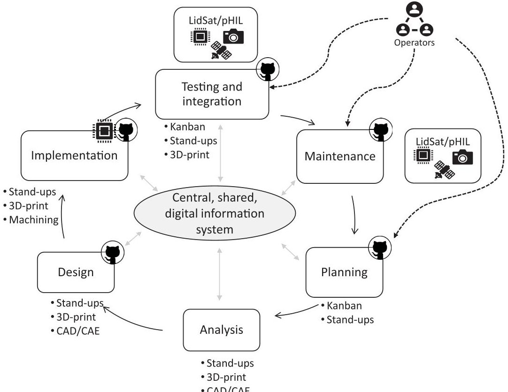

Fig. 8 Product development life cycle with digital engineering methods and tools.

<!-- PDF_PAGE: 8 -->

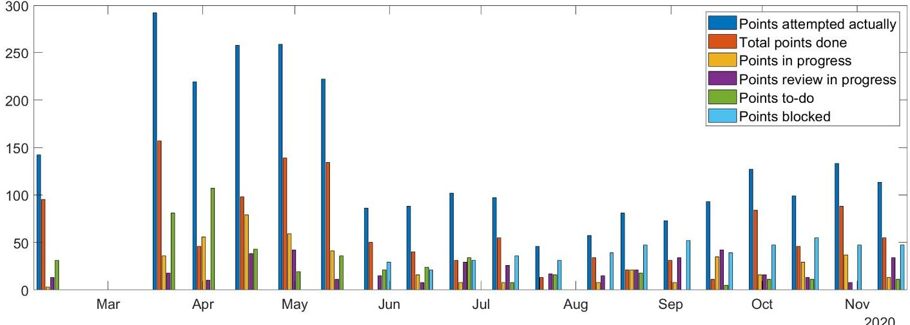

Fig.9 Full SW sprint.

implementation. The implementation efforts mainly have to be performed by students or group leaders (Ph.D. candidates). The DE processes were selected based on recommendations in literature review [24,41,43] and recommendations from other CubeSat teams at informal discussions at conferences such as the International Astronautical Conference or Small Satellite Conference. Considerations were made to find processes that would not require too much general resources for implementation and that would quickly demonstrate benefits to the project team, to ensure that the team members were willing to use tools.

## 2. Knowledge Transfer

During the first year of the HYPSO project, challenges with information sharing occurred frequently, such as missed hardware changes that influenced both software and hardware performance but were not communicated clearly. Furthermore, the complexity of the system necessitates better information accessibility and better knowledge capture, which were two of the main objectives to fulfill for the DE tools and processes chosen. The agile methodology in hardware and software improved collaboration and information sharing both by having the issues documented in GitHub, but also through the common stand-up meetings held daily. In addition to the technical benefits of using the GitHub workflow, having a common workflow could also increase the feeling of team cohesiveness, and shared understanding of how the fragments can work and should work together through, for example, testing each other's code. The common stand-up meetings enabled a better understanding of how hardware and testing worked for the software developers, and limitations in, for example, physical interfaces, from the perspective of hardware developers. On the other hand, the hardware developers got a better understanding of how the system would be used operationally, and could align their development and prototyping schedule to accommodate for verification and validation activities.

## 3. User Experience

Because the DE strategy involved stand-up meetings, 3D-printed hardware prototypes, and HIL test setups, team members acquired an improved system understanding. Although it is difficult to prove an improvement, discussions during review meetings have been less about clarification and more about design enhancements and future development. The first iteration of the agile methodology used a physical kanban board, which was not adopted well by the team. Introducing a GitHub kanban board reduced the effort needed to separate software code development from the process of managing the development. This is a clear advantage of using DE tools and processes. Decision making has been improved for hardware by employing 3D-printing to prototype and test design alternatives, thus giving more data for making decisions. Automatic unit tests are run on HIL setups before and after software updates are merged to the master branch, providing higher level support for automation. However, all unit tests must be developed manually, so there is an effort required there for the developers. The compilation of code generates

code documentation in Doxygen automatically. Doxygen can provide information about how functions are related, which further helps information accessibility and sharing. Future work could be on enabling more automatic generation of unit tests in parallel with code development.

## 4. Velocity and Agility

The HYPSO project is a part of a long-term strategy for establishing capabilities for developing small satellites for scientific purposes at NTNU [39]. There is thus a need for the development strategy to have a capacity for reuse so that the different subsystems can be used across a variety of platforms with some changes, and reused in new satellites. Introducing the different HIL setups have increased the capabilities for early Verification and Validation (V&V) which has reduced time required to discover bugs. In addition, the increased employment of 3D-printing technology (also a digital technology) in prototyping and the development of ground support equipment (GSE) have reduced the time for hardware development through increased early V&V. Having 3D-printing technology in-house in the laboratory has made it easier for the team to try out new designs or satellite physical architectures. Furthermore, there is a higher level of support for integration when combining 3D-printed prototypes of hardware, mature HIL setups, and test software that can emulate physical conditions such as lost packets on the radio communication link. The GitHub workflow process introduced an improved consistency, together with other standards. The shared repositories enabled students to see how others write code and test, improving consistency across the whole codebase, as well as functioning as a resource for reuse in other platforms or future satellites.

## 5. Quality

The goal of introducing HIL setups and the GitHub workflow was to strengthen testing and thus reduce defects and errors. However, before the introduction of the HIL setups, the Github flow also helped with increased testing and integration into master branch from mid 2019. There were no measures of effectiveness before the introduction of DE measures, and the discussion regarding effectiveness is given in Sec. IV.B. Although not considered explicitly when choosing GitHub, the issue tracking and discussion has enabled better traceability of design choices. For example, if a bug or unwanted behavior of code during testing resurfaces, it is possible to search for keywords in GitHub and find similar bugs and investigate if similar solutions can be used to mitigate the unwanted behavior. This can reduce the time spent bug fixing for new developers who were not a part of the project at the time of the original bug. An added benefit from incorporating the design into DE tools such as GitHub was that it required a conscious decision and discussions regarding architecture and system design (related to both knowledge transfer and quality), and there have been three instances of refactoring of code systematically to improve the maintainability and modularity of the codebase.

<!-- PDF_PAGE: 9 -->

## B. Effectiveness of Using Agile Digital Engineering: Software and Hardware

## 1. Tailoring of Scrum

The Scrum process was tailored to include issues related to thesis work as well as product development tasks, as shown in Fig. 6. The stand-ups have included both the hardware and the software team, and people could join either physically or with their phone or computer. Most team members have reported that stand-ups have increased their understanding of the system and sharing of information. Some students have reported that the stand-ups increased in relevance as they were working on integration of subsystems, but not so much when they were developing the prototype modules. Another tailoring that was done was to agree on which issues would be performed and ensure that each student had something to work on. This was needed to accommodate thesis work. Unlike traditional Scrum processes, such as the one described by Garzaniti et al. [37], the team did not agree on the functionality for each MVP to deliver at the end of each sprint. In hindsight, a better defined MVP might have improved the results by having a shared goal for each sprint, which can contribute to team cohesiveness and commitment.

## 2. Scrum Performance

a. Software. The first sprint using GitHub kanban was held in early 2019, and apart from the first sprint, all sprints were two weeks long. The sprints started long after the software development began, and the team had a good enough overview of functionality. An overview of the software Scrum performance is given in Fig. 9. The first couple of sprints had a high number of attempted points, with a high "miss-factor" of points not done (February to June). This can be attributed to the learning process and is not uncommon for new Scrum teams. Team members mentioned that it was challenging to figure out how to score their tasks. The Scrum leader can support this process by guiding the students, for example, by referring to previous work they have done and how long it took them to complete. An ongoing challenge has been to have enough reviewers to reduce the amount of points in the "Review-in-progress" column. Because the workflow requires that someone else reviews the code, there needs to be at least one other person with similar knowledge and capabilities to be able to review the code. This may not always be available when the students' priorities are changing to consider coursework and such.

In April 2019, it was decided that the software team leader would be the Scrum leader moving forward, and also run the sprint meeting. Furthermore, that sprint reviews should include an aspect of code demonstration or a more rigorous documentation of how an issue was closed. The team has also discussed how to agree on a "definition of done." This definition has not been finalized yet, but there is agreement that it should be related to the type of issue being solved. For example, issues related to theses can be draft sections or chapters, and code issues could be a bugfix, a functioning module, or function that has resulted in a PR.

b. Hardware. The hardware team started using the agile framework and sprint methodology at the end of Q2 2020. The payload design had reached a high level of maturity by then, and most of the parts and suppliers chosen. All satellite bus components had been procured. The work that remained was focused on verification and validation activities, and coordination with external test facilities and the in-house mechanical and optical laboratories. In addition, planning began for the updates of design for HYPSO-2, the next CubeSat to be developed. As shown in Fig. 10, there is a break during the summer holidays. The performance has varied over the nine 2-week sprints that have been so far. Many Scrum teams take a while to learn how to estimate points to issues, and to estimate how much work can be done in one sprint. Toward the end of the semester, the total points done matched the points attempted better. This could be because the team became more accustomed to the Scrum workflow, or because the deadline for delivery of the flight model was getting closer and people felt committed to this milestone. The blocked issues were typically due to external factors, such as lack of access to testing or machining facilities, similar to the findings in [37]. There have been continuous redesign and rework activities. The stand-ups helped in coordinating the activities between designers and the group leaders organizing the support facilities. Some hardware team members stated that using Scrum helped them prioritize tasks and not get "distracted" during the two-week period.

However, the greatest issues were related to attendance and commitments to sprints. It was challenging for the group leader to motivate the students when there were too few collaborative tasks. We found that a two-week duration of sprints were suitable for the team because the students were available to deliver increments in that time period. Longer sprints could make it harder to motivate the students, and shorter duration would make it difficult to deliver increments [37]. The motivation could be improved by introducing stricter MVPs or by spending more time planning the work up-front. The MVPs could, for example, specify new features to be included on the hardware prototypes, iterated simulation results, increased performance, or lower manufacturing cost. The MVPs could also be tangible, for example, 3D-printed prototypes and parts that can be validated by other team members, or simulated assembly and incremental tests.

c. Lessons Learned. The team experienced challenges with commitment and attendance at stand-up meetings, especially with team members who started during the COVID-19 lockdown (fall of 2020). There were fewer on-boarding and team building activities than previous years, and little or no chance of face-to-face meetings. Some students used the kanban board to organize their own work, but did not join many of the stand-ups. Based on this experience, we see that it is not sufficient to have good workflows and tools alone, but that the social aspects matter as well. The team members need to be a part of the culture, and people need to feel that they are a part of the team, which is consistent with findings of Garzaniti et al. [37] and Masood et al. [31]. The HYPSO team combined the sprint planning and review meeting to reduce time spent in meetings [31], and adjusted the sprint scoring and length to accommodate the overall school schedules and workload [31,37].

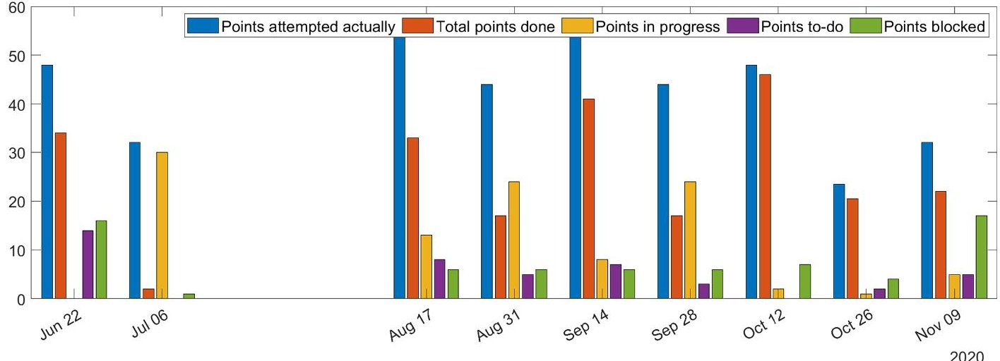

Fig. 10 HW sprint in bar plot. There was a break during the summer holiday.

<!-- PDF_PAGE: 10 -->

## 3. Integration and Verification and Validation

The HIL setups have been instrumental in easing integration between different systems, for software development, operations development, and hardware development. For software development, the HIL setups facilitate not only verification of software changes before merging with the master branch, but also verification that the changes work with the satellite bus via local engineering model versions of subsystems or the FlatSat. There have been HYPSO-initiated interface changes, and NanoAvionics (the satellite bus provider)-initiated interface changes. These interface changes have been to improve performance or add functionality. By having a HIL FlatSat setup with physically distributed subsystems, engineers in Vilnius could update the modules remotely and work concurrently with HYPSO project members. Challenges with the HIL setups included finding people to work on setting them up and developing required functionality, such as automatic tests, and maintaining them. It was also challenging to find sufficiently interesting thesis topics for working with HIL and testing activities.

The HYPSO project team can choose which subsystems they need to locally with the payload (as shown in Fig. 7), and which subsystems that can be located at the supplier premises. The subsystems located at supplier premises can easily receive hardware upgrades without the need for shipping modules back and forth. Additionally, the distributed system still allows the supplier to log in to subsystems located in the university to perform software upgrades, configuration changes, or other fixes.

For operations development, the HYPSO operations' developers have been able to perform rehearsals to validate that the software functions and performs as expected. This has been enabled by allowing the operator to connect to the HIL LidSat setup using the hypso-cli user interface (as shown in Fig. 5). Experiences from the operators were critical for preparing the first official software release for deployment on the flight model.

## 4. COVID-19

The COVID-19 pandemic caused the university to lock down on March 12, 2020. Luckily for the team, the HIL setups had been implemented in the end of February, which allowed for remote access and testing of software on target hardware. In addition, the regular stand-up meetings had begun the year before and only required a shift to full virtual meeting. The stand-ups were a bit longer than they had been previously, because more people joined regularly and there was a need to move some of the informal discussions that usually take place in the physical laboratory to the stand-ups. Team members also said that they appreciated the stand-up meetings because they were a forum for social interaction. The issue tracking on GitHub for software helped to follow-up the work and monitor the progress of the project, and it was not affected by the lockdown. There was an increase in commits (when a developer commits their code changes and additions to the main repository) to the main software repositories around the time of the lockdown, and the high frequency persisted until the end of semester, as shown in Fig. 11.

However, no hardware integration and testing could be performed during the lockdown, because the team members were not allowed on campus or to travel to external test facilities. This created a severe schedule delay to the project. The hardware team spent time preparing design documentation and refining test plans until the lockdown restrictions eased.

## C. Educational Aspects

In the context of DE, the HYPSO project organization described in this paper have many similarities with the projects described by Berthoud et al. [12]. The university CubeSat project format is an inherently interdisciplinary project that prepares students for future work, even if it may be in different industries. Additionally, the use of HIL setups, a strict GitHub development flow, and agile practices in software and hardware development provide the students with a larger skill set for future employers. The students gain practical experience with using DE methods and tools, while still delivering the required coursework and thesis work. Although these skills may be gained through capstone courses as well, having an active customer with strict deadlines and objectives in addition to educating students can motivate teams to work even harder with delivering results [32]. The customer for the HYPSO project was the group of scientists who needed the data from the CubeSat, and the deadline was set by the commercial launch date. However, managing CubeSat projects with agile practices requires coordination and training, and should not be underestimated [30-32].

Although we have not done a systematic study of the transferability of skills learned during the HYPSO project, one student mentioned the following:

I have noticed that in my job, where they use Scrum with Kanban on a digital platform, I at once felt at home and prepared for how to do my work. And I also felt that I could contribute fast. The meeting structure and documentation (templates, as-built documents, internal and external design reviews) were similar to how we did it in the HYPSO project, which made it easier for me to see the value of what I had learned and realized the relevance of the HYPSO practices. . I felt I was prepared to start a job because I know how the workday is structured and how to organize my work.

Some of the graduated students have joined the team as Ph.D. candidates and taken on leadership roles. The rest of the graduated students have joined companies in various industries, and some still join HYPSO design reviews or contribute to the code repository.

## D. Future Satellite Development

The HYPSO team has started the development of their second CubeSat that will have an upgraded version of the hyperspectral payload, increased processing capabilities, and a software defined radio (SDR) [44]. Based on the experiences from HYPSO-1, the team plans to continue the agile work methodology for both hardware and software, and increase the importance of team building and team cohesiveness. They are also considering introducing MVPs and a

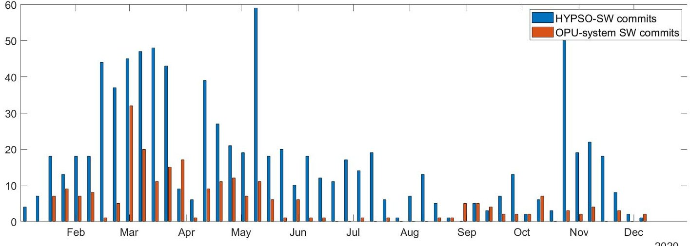

Fig.11 The two main software repositories commit frequencies.

<!-- PDF_PAGE: 11 -->

clearer "definition of done" [31,45], which could increase the sprint performance.

The team has introduced a cloud-based digital tool for managing requirements, system budgets, analysis, verification planning, and project planning. Previously, this effort was managed through the systems engineer, but now, the team can collaborate real-time from different sites on the same set of requirements. These updates also feed automatically into system budgets and the product breakdown structure. The team members can create discussions and flag components or requirements, and assign tasks to each other. This is a part of the "central, shared, digital information system" shown in Fig. 8.

## V. Conclusions

DE is needed for managing the development of complex systems. This requires a conscious effort throughout the organization, and the strategy must be tailored to the specific needs and constraints. There is also a need for engineers who are trained to use DE approaches in their work, in all life-cycle phases of a project. Academic CubeSat projects provide an arena to training future engineers by collaborating in interdisciplinary system development. The students gain both technical and nontechnical professional skills. For academic CubeSat projects, the needs for a DE strategy are often similar to the industrial setting, but the context and constraints are quite different.

This paper has described the case of an academic CubeSat project in Norway, where they are developing a scientific 6U satellite and ground segment. Because of the challenges with knowledge sharing, unclear decision making, lack of coordinated planning, and poor code quality and documentation, the project organization introduced some measures that include DE tools and methods. This paper has outlined the project development life cycle and highlighted how agile practices supported by a digital kanban, a GitHub workflow, and HIL setups have been essential in managing the development of the complex CubeSat. In addition, the paper has discussed in which ways the DE strategy chosen contributed to verification and validation activities, integration of systems, knowledge sharing, and how the tools and methods supported development even during the COVID-19 lockdown. However, the tools and processes alone are not sufficient for adoption of the DE work environment. People need to be encouraged to use them, and social aspects such as team cohesiveness and commitment are important. Throughout this process the project manager has used a participatory approach in which all team members could influence the practices and processes.

The DE strategy adopted by the HYPSO team is a low-cost,loweffort approach using readily available tools and methods. Some of the methods, such as agile practices and software repositories, have been used in other CubeSat projects. There are valuable lessons to be learned between different academic teams and between industry and academia on how to best approach and implement DE in the organization. Future work will look at including more MBSE tools and incorporating them with the product life cycle proposed, to increase the common understanding of the system and support knowledge management. Lastly, to combat the hurdles that using target hardware for testing can cause, it is common to simulate the hardware responses. The caveat will always be that the addition of mocking software as well as the addition of unit tests will be prone to the same coding mistakes as any type of software development. The additional overhead of producing and maintaining a mocking library can take away resources from code development that would otherwise provide the needed functionality or enhance it. The addition of unit tests should be added when possible and could help uncover undesirable side effects of any proposed changes to the code base.

Future studies could look at 1) how the graduated students have experienced transferability of skills and practices gained during the HYPSO project; 2) how other university projects use DE and how the students experience it there; and 3) opportunities for cooperation between the CubeSat project and the wider university context, for example, by introducing aspects with DE as a part of the student curriculum to prepare for joining cross-disciplinary projects.

## Acknowledgments

This work is supported by the Norwegian Research Council (Grant No.270959) and the Centre of Autonomous Marine Operations and Systems (NTNU AMOS, Grant No.223254). It has been approved by the Norwegian Centre for Research Data (Project No. 560218). The authors would like to acknowledge all the team members at the NTNU SmallSatLab for their participation in the CubeSat project. The authors also thank all the professors and technical support staff at the university departments for their contributions with theoretical insights and practical solutions to developing a CubeSat. Evelyn Honoré-Livermore would like to thank Vitech Corporation for making the CORE/GENESYS software available for this work.

## References

[1] Törngren, M., and Sellgren, U., "Complexity Challenges in Development of Cyber-Physical Systems," Principles of Modeling: Lecture Notes in Computer Science, edited byM. Lohstroh, P. Derler, and M. Sirjani, Springer, Cham, Switzerland, 2018, pp. 478-503. https://doi.org/10.1007/978-3-319-95246-8_27

[2] Bone, M. A., Blackburn, M. R., Rhodes, D. H., Cohen, D. N., and Guerrero, J. A., "Transforming Systems Engineering Through Digital Engineering," Journal of Defense Modeling and Simulation, Vol. 16, No. 4, 2019, pp. 339-355. https://doi.org/10.1177/1548512917751873

[3] "Model-Based Systems Engineering (MBSE) (glossary)—SEBoK," SEBoK, 2020, https://www.sebokwiki.org/w/index.php?title=Model-Based Systems Engineering (MBSE) (glossary)&oldid=59725 [retrieved 15 Feb. 2021].

[4] Aigner, A., and Khelil, A., "Assessment of Model-Based Methodologies to Architect Cyber-Physical Systems," Proceedings of the International Conference on Omni-Layer Intelligent Systems (COINS'19), Assoc. for Computing Machinery, New York, 2019, pp. 146-151. https://doi.org/10.1145/3312614.3313779

[5] Beck, K., "Embracing Change with Extreme Programming," Computer, Vol. 32, No. 10, 1999, pp. 70-77. https://doi.org/10.1109/2.796139

[6] Könnöla, K., Suomi, S., Mäkilä, T., and Lehtonen, T., "Can Embedded Space System Development Benefit from Agile Practices?" EURASIP Journal on Embedded Systems, Vol. 1, Dec. 2017, pp. 1-16. https://doi.org/10.1186/s13639-016-0040-z

[7] Grande, J., Birkeland, R., Lindem, T., Schlanbusch, R., Houge, T., Mathisen, S. V., and Dahle, K., "Educational Benefits and Challenges for the Norwegian Student Satellite Program," Proceedings of the 64th International Astronautical Congress, International Astronautical Federation, Paper 18767, 2013.

[8] Honoré-Livermore, E., and Birkeland, R., "Managing Product Development and Integration of a University CubeSat in a Locked down World," 2021 IEEE Aerospace Conference (50100), IEEE, New York, 2021, pp. 1-0. https://doi.org/10.1109/AERO50100.2021.9438490

[9] Puig-Suari, J., Turner, C., and Ahlgren, W., "Development of the Standard CubeSat Deployer and a CubeSat Class PicoSatellite," 2001 IEEE Aerospace Conference Proceedings (Cat. No. 01TH8542), Vol. 1, Inst. of Electrical and Electronics Engineers, New York, 2001, pp. 1- 347.

[10] Sweeting, M. N., "Modern Small Satellites-Changing the Economics of Space," Proceedings of the IEEE, Vol. 106, No. 3, 2018, pp. 343-361. https://doi.org/10.1109/JPROC.2018.2806218

[11] Kulu, E., "NanoSats Database," 2020, https://www.nanosats.eu [retrieved 11 Dec. 2020].

[12] Berthoud, L., Swartout, M., Cutler, J., Klumpar, D., Larsen, J. A., and Nielsen, J. D., "University CubeSat Project Management for Success," Proceedings of the Conference on Small Satellites, AIAA/USU, Paper SSC19-XIX-63, 2019. https://digitalcommons.usu.edu/smallsat/2019/ all2019/63/.

[13] "State-of-the-ArtSmall Spacecraft Technology," NASA TP-2020 5008734, 2020, https://www.nasa.gov/sites/default/files/atoms/files/ soa2020 final3.pdf.

[14] Dawson, M., Burrell, D., Rahim, E., and Brewster, S., "Integrating Software Assurance into the Software Development Life Cycle (SDLC)," Journal of Information Systems Technology and Planning, Vol. 3, No. 6, 2010, pp. 49-53.

[15] Jayaram, S., and Swartwout, M., "Significance of Student-Built Spacecraft Design Programs: Its Impact on Spacecraft Engineering Education over the Last Ten Years," 2011 ASEE Annual Conference & Exposition,

<!-- PDF_PAGE: 12 -->

American Soc. for Engineering Education, 2011, pp. 22.1290.1- 22.1290.17. https://doi.org/10.18260/1-2-18345

[16] Howell, E., "CubeSats: Tiny Payloads, Huge Benefits for Space Research," 2018, https://www.space.com/34324-cubesats.html [retrieved 10 Feb. 2020].

[17] Straub, J., and Whalen, D., "Evaluation of the Educational Impact of Participation Time in a Small Spacecraft Development Program," Education Sciences, Vol. 4, No. 1, 2014, pp. 141-154. https://doi.org/10.3390/educsci4010141

[18] Grande, J., Birkeland, R., Gjersvik, A., Mathisen, S. V., and Stausland, C., "Norwegian Student Satellite Program—Lessons Learned," Proceedings of the 68th International Astronautical Congress, International Astronautical Federation, Paper 41498, 2017.

[19] "ELaNa - Educational Launch of Nanosatellites," NASA, 2020, https:// www.nasa.gov/mission_pages/smallats/elana/index.html [retrieved 11 Dec. 2020].

[20] "CubeSats - Fly Your Satellite!" European Space Agency, 2020, https:// www.esa.int/Education/CubeSats - Fly Your Satellite [retrieved 11 Dec. 2020].

[21] Paluch, S., Antons, D., Brettel, M., Hopp, C., Salge, T.-O., Piller, F., and Wentzel, D., "Stage-Gate and Agile Development in the Digital Age: Promises, Perils, and Boundary Conditions," Journal of Business Research, Vol. 110, March 2020, pp. 495-501. https://doi.org/10.1016/j.jbusres.2019.01.063

[22] Cooper, R. G., "The Drivers of Success in New-Product Development," Industrial Marketing Management, Vol. 76, Jan. 2019, pp. 36-47. https://doi.org/10.1016/j.indmarman.2018.07.005

[23] "Agile," Merriam-Webster Dictionary, 2020, https://www.merriamwebster.com/dictionary/agile [retrieved 13 Oct. 2020].

[24] Beck, K., Beedle, M., Bennekum, A. V., Cockburn, A., Cunningham, W., Grenning, J., Highsmith, J., Hunt, A., Jeffries, R., Kern, J., Martin, R. C., Mellor, S., Schwaber, K., Sutherland, J., and Thomas, D., "Manifesto for Agile Software Development," 2001, https://agilemanifesto.org/ [retrieved 12 Oct. 2020].

[25] Wilson, G., Aruliah, D. A., Brown, C. T., Chue Hong, N. P., Davis, M., Guy, R. T., Haddock, S. H. D., Huff, K. D., Mitchell, I. M., Plumbley, M. D., Waugh, B., White, E. P., and Wilson, P., "Best Practices for Scientific Computing," PLOS Biology, Vol. 12, No. 1, 2014, Paper e1001745. https://doi.org/10.1371/journal.pbio.1001745

[26] Arvanitou, E.-M., Ampatzoglou, A., Chatzigeorgiou, A., and Carver, J. C., "Software Engineering Practices for Scientific Software Development: A Systematic Mapping Study," Journal of Systems and Software, Vol. 172, Oct. 2021, Paper 110848. https://doi.org/10.1016/j.jss.2020.110848

[27] Sletholt, M. T., Hannay, J., Pfahl, D., Benestad, H. C., and Langtangen, H. P., "A Literature Review of Agile Practices and their Effects in Scientific Software Development," Proceedings of the 4th International Workshop on Software Engineering for Computational Science and Engineering, Assoc. for Computing Machinery, Honolulu, 2011, pp. 1-9. https://doi.org/10.1145/1985782.1985784

[28] Storer, T., "Bridging the Chasm: A Survey of Software Engineering Practice in Scientific Programming," ACM Computing Surveys, Vol. 50, No. 4, 2017, pp. 1-32. https://doi.org/10.1145/3084225

[29] Rother, M., and Rosenthal, M., "An Approach to Becoming Agile in a Dynamic World: Helping Employees Develop Scientific Thinking Empowers Them to Solve Problems and Make Decisions," Association for Manufacturing Excellence: TARGET, Vol. 34, No. 2, 2018, pp. 18-22.

[30] Sharp, J. H., and Lang, G., "Agile in Teaching and Learning: Conceptual Framework and Research Agenda," Journal of Information Systems Education, Vol. 29, No. 2, 2018, pp. 45-52. http://jise.org/Volume29/n2/JISEv29n2p45.html.

[31] Masood, Z., Hoda, R., and Blincoe, K., "Adapting Agile Practices in University Contexts," Journal of Systems and Software, Vol. 144, No. Special Issue on Software Engineering Education and Training,

2018, pp. 501-510.

https://doi.org/10.1016/j.jss.2018.07.011

[32] Lundqvist, K., Ahmed, A., Fridman, D., and Bernard, J., "Interdisciplinary Agile Teaching," 2019 IEEE Frontiers in Education Conference (FIE), IEEE, New York, 2019, pp. 1-8. https://doi.org/10.1109/FIE43999.2019.9028544

[33] Shah, M., Grebennikov, L., and Nair, C. S., "A Decade of Study on Employer Feedback on the Quality of University Graduates," Quality Assurance in Education, Vol. 23, No. 3, 2015, pp. 262- 278.

https://doi.org/10.1108/QAE-04-2014-0018

[34] Støren, L. A., Reiling, R. B., Skjelbred, S.-E., Ulvestad, M. E. S., Carlsten, T. C., and Olsen, D. S., "Utdanning for Arbeidslivet: Arbeidsgivers Forventninger til og Erfaringer med Nyutdannede fra Universiteter, Høgskoler og Fagskoler [Education for Employment: The Employers Expectations for and Experiences with Newly Graduates from Universities, Colleges and Vocational Schools]," Nordic Inst. for Studies in Innovation, Research and Education TR 2019-3, Oslo, Norway, 2019.

[35] Turner, R., "Toward Agile Systems Engineering Processes," Journal of Defence Software Engineering, Vol. 20, 2007, pp. 11-15.

[36] McDermott, T., Van Aken, E., Hutchison, N., Blackburn, M., Clifford, M., Chean, N., Salado, A., and Henderson, K., "Summary Report Task Order WRT-1001: Digital Engineering Metrics," Stevens Inst. of Technology TR ERC-2020-SR-003, Hoboken, NJ, 2020.

[37] Garzaniti, N., Briatore, S., Fortin, C., and Golkar, A., "Effectiveness of the Scrum Methodology for Agile Development of Space Hardware," 2019 IEEE Aerospace Conference, IEEE, New York, 2019, pp. 1-8. https://doi.org/10.1109/AFRO.2019.8741892

https://doi.org/10.1109/AERO.2019.8741892

[38] Huang, P. M., Darrin, A. G., and Knuth, A. A., "Agile Hardware and Software System Engineering for Innovation," 2012 IEEE Aerospace Conference, IEEE, New York, 2012, pp. 1-10. https://doi.org/10.1109/AERO.2012.6187425

[39] Grøtte, M. E., Birkeland, R., Honoré-Livermore, E., Bakken, S., Garrett, J. L., Prentice, E. F., Sigernes, F., Orlandic, M., Gravdahl, J. T., and Johansen, T. A., "Ocean Color Hyperspectral Remote Sensing with High Resolution and Low Latency—The HYPSO-1 CubeSat Mission," IEEE Transactions on Geoscience and Remote Sensing. https://doi.org/10.1109/TGRS.2021.3080175

[40] Fowler, M., and Foemmel, M., "Continuous Integration," 2006, https:// moodle2019-20.ua.es/moodle/pluginsfile.php/2228/mod_resource/ content/2/martin-fowler-continuous-integration.pdf.

[41] Chacon, S., and Straub, B., Pro git, Apress, Berkeley, CA, 2014. https://doi.org/10.1007/978-1-4842-0076-6

[42] Corpino, S., and Stesina, F., "Verification of a CubeSat via Hardware-in the-Loop Simulation," IEEE Transactions on Aerospace and Electronic Systems, Vol. 50, No. 4, 2014, pp. 2807-2818. https://doi.org/10.1109/TAES.2014.130370

[43] Waswa, P. M. B., and Redkar, S., "A Survey of Space Mission Architecture and System Actualisation Methodologies," International Journal of Aerospace Engineering, Vol. 4, No. 3, 2017, p. 38. https://doi.org/10.1504/IJSPACESE.2017.085674

[44] Quintana-Diaz, G., Birkeland, R., Ekman, T., and Honoré-Livermore, E., "An SDR Mission Measuring UHF Signal Propagation and Interference Between Small Satellites in LEO and Arctic Sensors," Small Satellite Conference, AIAA/USU, Paper SSC19-WP201, 2019.

[45] Garzaniti, N., and Golkar, A., "Performance Assessment of Agile Hardware Co-Development Process," 2020 IEEE International Symposium on Systems Engineering (ISSE), IEEE, New York, 2020, pp. 1-6. https://doi.org/10.1109/ISSE49799.2020.9272209

J. Newcamp Associate Editor