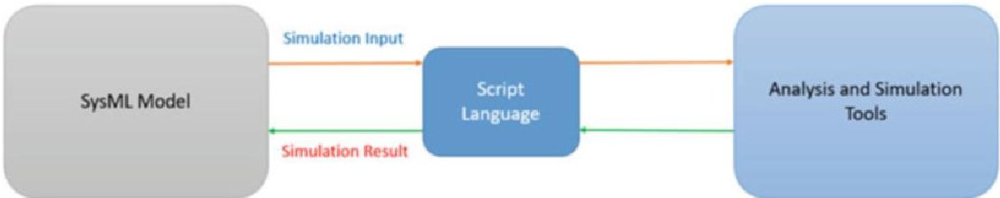
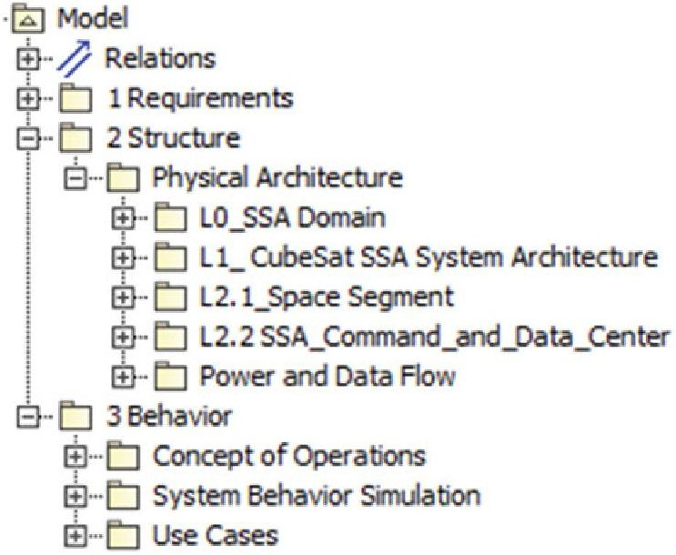
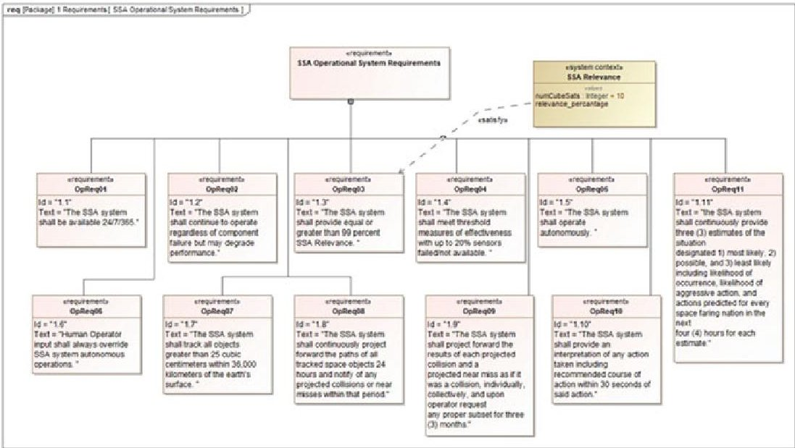
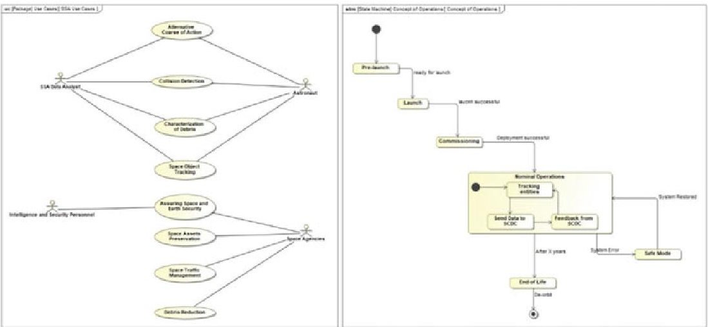
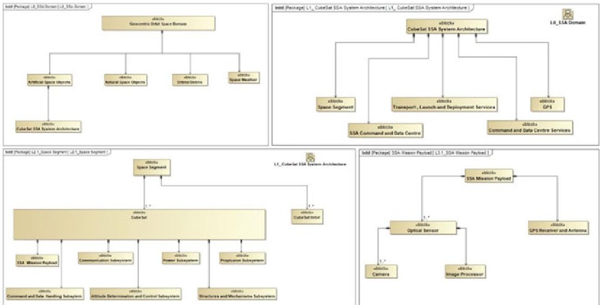
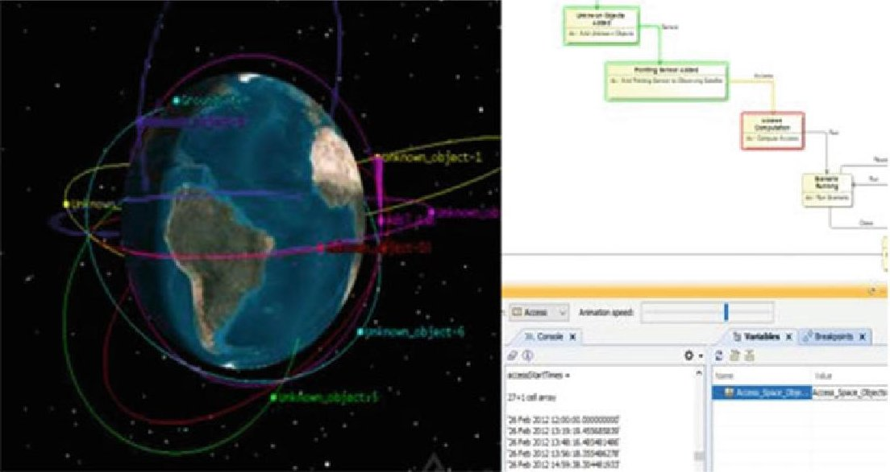
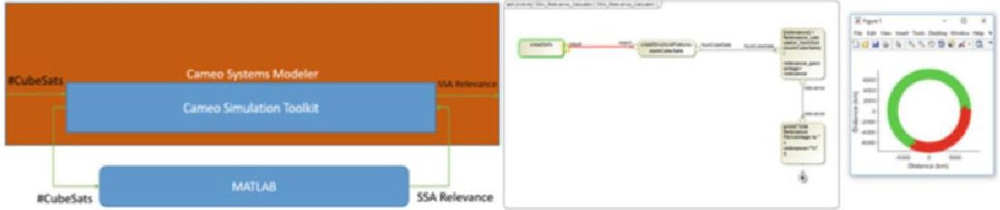
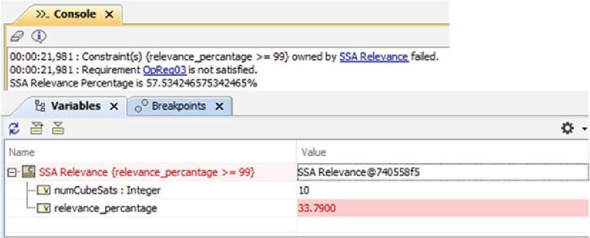

<!-- PDF_PAGE: 1 -->

# Executable Modeling of a CubeSat-Based Space Situational Awareness System

Mostafa Lutfi and Ricardo Valerdi

Abstract As systems grow in complexity, systems engineers have embraced Model-Based Systems Engineering (MBSE) to tackle this complexity. The Systems Modeling Language (SysML) is the most commonly used language by the systems engineers to implement MBSE. SysML is not highly capable of expressing conceptual but not executable models. In order to perform requirements/behavior verifications, systems engineers/designers mostly use separate simulation tools. Hence, the efficiency of the systems engineering process is often reduced due to the isolated and consecutive use of both SysML modeling tool and other simulation tools, for example, defining simulation inputs to each simulation tool separately. Hence, executable SysML is the next logical step towards achieving true MBSE support for all systems engineering activities in the life cycle phases system requirements, analysis, design, implementation, integration, verification, transition, validation, acceptance testing, training, and maintenance. Therefore, various research efforts are being conducted to develop executable SysML modeling approaches. This research develops a SysML Executable Modeling Methodology (SEMM), which is demonstrated by modeling a CubeSat-based Space Situational Awareness (SSA) system in SysML. The SysML SSA-CubeSat system model is made executable by integrating with Commercial-Off-The-Shelf (COTS) simulation software, namely, Systems Tool Kit (STK) and MATLAB, following the approaches defined in the SEMM.

Keywords MBSE·SysML·Executable modeling·Space Situational Awareness

<!-- PDF_PAGE: 2 -->

## 1 Introduction

Model-Based Systems Engineering (MBSE) focuses on formalized application of modeling to support systems engineering artifacts development from the conceptual design phase throughout the end of the system of interest (SOI) life cycle (Hart 2015). SysML has emerged as the de facto standard system modeling language for MBSE (Delligatti 2014). MBSE is advancing in a way that intends to combine modeling with its natural next step simulation, to support the definition of system requirements, system design, system analysis, and system verification and validation. Therefore, SysML needs to be an executable language in order to directly support system's life cycle activities (Nikolaidou et al. 2016). This research paper presents a practical approach for enabling execution of models described in SysML. Specifically, the authors modeled a SSA system using CubeSats in SysML and integrated with MATLAB and Systems Tool Kit (A. G. Inc 2013). The approach described in the methodology can be expanded to other simulation tools too.

## 2 Literature Review

## 2.1 Recent Research on SysML Executable Modeling

Tsadimas et al. presented the transformation procedure of Enterprise Information System (EIS) SysML models to executable simulation code (Tsadimas et al. 2014). The author used QVT as the transformation tool. The paper also demonstrated how simulation results can be incorporated into the source SysML model using ModelDriven Architecture (MDA). Robinson et al. introduced a new analysis framework to develop executable and object-oriented SysML models through Python programming interface (Balestrini-Robinson et al. 2015). The analysis framework demonstrated a new procedure to enable rapid prototyping through the integration of SysML model and existing diagramming languages. In order to lower the financial implications, the framework used the following open-source software (OSS) Python, MongoDB, Django, MongoEngine, OpenMDAO, RDFLib, BerkelyDB, and Django Rest Framework.

Chabibi et al. presented a taxonomy of links between SysML and various simulation environments (Chabibi et al. 2015). The paper studied an integration approach of several simulation environments into a common platform and enable two-way transformation between those environments and SysML. Chabibi et al. in another paper proposed an integration of SysML and Simulink utilizing modern techniques of Model-Driven Engineering (MDE) (Chabibi et al. 2016). The proposed integration approach consists of following steps - SysML modeling of a system using SysML4Simulink profile, executable MATLAB code generation from SysML source diagrams, and conducting simulation in order to verify system behavior through Simulink.

<!-- PDF_PAGE: 3 -->

Kotronis et al. developed a framework that supports continuous performance assessment of Railway Transportation System (RTS) SysML model (Kotronis et al. 2016). The authors used QVT for generation of executable simulation models from the RTS SysML model. The executable simulation models are simulated in Discrete Event System Specification (DEVS) simulators, and the simulation results are incorporated into the RTS SysML model. Cawasji and Baras studied different methods to perform integration of SysML and other simulation tools (Cawasji and Baras 2018). Then, they proposed a new method by constructing a SysML executable model of a two-room house. They used the Functional Mock-up Interface (FMI) standard to integrate the SysML model with a Modelica model. The authors exported the Modelica model as Functional Mock-up Unit (FMU). Then, they used Simulink as an interface between the FMU and the SysML model. Finally, a tradeoff analysis was run through SysML, in MATLAB, to demonstrate the decision-making capability of the proposed approach for SysML executable modeling.

In order to reduce the gap between high-level modeling and evaluation of system performance through simulation, Gauthier et al. proposed a Model-Driven Engineering (MDE) tooled approach for automatic system requirements validation (Gauthier et al. 2015). The OMG SysML-Modelica working group has officially adopted this integration approach as the "SysML4Modelica" profile.

Karban et al. proposed a new Executable Systems Engineering Method (ESEM) for automatic requirements verification (Karban et al. 2016). ESEM is based on executable SysML modeling patterns and consists of structural, behavioral, and parametric diagrams. The authors used MagicDraw as the SysML modeling tool and Cameo Simulation Toolkit (CST) as the simulation engine. The authors developed an eight-step method to follow for executable SysML modeling - formalize requirements, specify design, characterize components, specify analysis context, specify operational scenarios, specify configurations, run analysis, and evaluate requirement satisfaction.

## 2.2 Space Situational Awareness

Space Situational Awareness is the ability to observe, understand, and predict the physical location and behavior of natural and manmade objects in orbit around the earth (Space Situational Awareness n.d.). Space traffic (both physical and informational) is increasing at an exponential rate. Since the start of space exploration in 1957, about 5500 rockets have been launched into earth orbit, resulting in approximately 5000 satellites and 23,000 debris still in space (esa n.d.). SSA could deliver knowledge of potential threats posed to both space assets and Earth by adversaries and environments, including space weather, space debris, uncontrolled spacecrafts, and space weapons (Gasparini and Miranda 2010; Kennewell and Vo 2013).

<!-- PDF_PAGE: 4 -->

## 3 SysML Executable Modeling Methodology

SysML Models can be made executable by enabling integration of COTS simulation software through scripting languages supported by the MBSE tool. For example, Cameo Systems Modeler by Nomagic supports the following scripting languages JavaScript, Groovy, Ruby, MATLAB, Python, and BeanShell (N. M. Inc. 2020). So, these scripting languages can take input from the SysML model and return the output/result from the integrated simulation tool into the model (Fig. 1).

In this research paper, CSM with Cameo Simulation Toolkit (CST) plug-in from Nomagic was used to create the SysML model. Moreover, MATLAB and Systems Tool Kit (STK) were two other COTS simulation tools being integrated with the system model to make it executable (A. G. Inc 2013). CST is a plug-in attached to the CSM in order to provide extendable model execution framework based on OMG fUML standards. fUML stands for Foundational Subset for Executable UML Models (Seidewitz and Tatibouet 2015). STK is a physics-based 3D modeling, simulation, and visualization tool used by engineers, space mission analysts, space operators, and decision-makers in order to model and simulate complex land, sea, air, or space systems (A. G. Inc 2013). The following steps describe the procedure to implement the SEMM for any system of interest (SOI). For this research paper, CubeSat-SSA system has been chosen as the SOI.

Model Organization The model is organized by the package names according to the four pillars of SysML (Requirements, Structure, Behavior, and Parametric). For this research paper, Parametrics package was excluded. SysML Requirements diagram falls under Requirements package. SysML Block Definition Diagram and SysML Internal Block Diagram reside inside Structure package. All the behavior diagrams (SysML Use Case, SysML Activity Diagram, and SysML State Machine Diagram) used in the model are being placed inside Behavior package. Further package decomposition was used for organization of the model elements inside these three major packages (Requirements, Structure, and Behavior) (Fig. 2).

Defining System Requirements/Use Cases/Concept of Operations (ConOps) The research paper assumed preliminary stakeholder analysis and customer requirements identification already being conducted to produce the following operational requirements for the CubeSat-SSA system (Fig. 3). The OpReq-03 has been tested for automatic verification later in the paper. Use case diagram is drawn with the aid

Fig.1 SysML executable modeling framework

<!-- PDF_PAGE: 5 -->

Fig. 2 Model containment tree showing package

Fig. 3 Operational requirements for CubeSat-SSA system

of SysML Use Case diagram (Fig. 4). SysML State Machine Diagram enabled the creation of Concept of Operations in the model (Fig. 4).

Modeling System Architecture (Physical)/Internal Structure/Subsystem Communication SysML Block Definition Diagram was used to model Physical Architecture of the CubeSat-SSA system. Moreover, the physical architecture leveraged INCOSE's CubeSat Reference Model to represent standard CubeSat components and subsystems (Kaslow et al. 2018). SSA Domain is comprised of Artificial Space

<!-- PDF_PAGE: 6 -->

Fig. 4 (a) CubeSat-SSA system use cases (left); (b) concept of operations (right)

Fig. 5 (a) SSA Domain (top left); (b) CubeSat-SSA System Architecture (top right); (c) Space Segment (bottom left); (d) SSA Mission Payload (bottom right)

Objects, Natural Space Objects, Orbital Debris, and Space Weather. CubeSat-SSA System Architecture falls under Artificial Space Objects. CubeSat-SSA System Architecture consists of Space Segment, SSA Command and Data Centre, Command and Data Centre Services, Transport, Launch and Deployment Services, and GPS. Space Segment and SSA Command and Data Centre were further decomposed into subsystems (Fig. 5).

Integration with the COTS Analysis/Simulation Tools After defining the system context and corresponding behaviors for each of the scenario to be simulated, next step was to integrate the COTS tools (MATLAB and STK) with those behaviors. An activity diagram consists of different types of action elements. This research

<!-- PDF_PAGE: 7 -->

paper used CSM's Opaque Action, Read Structural Feature Action, and Read Self Action to facilitate the integration process. Opaque Action facilitated the integration of MATLAB script into CSM. CSM does not allow integration of Systems Tool Kit (STK), which is a widely used space mission analysis tool. STK was run from CSM via MATLAB scripts. STK and MATLAB interoperate with each other through STK's COM interface. STK_Relevance's classifier behavior used a MATLAB function script, which automated and modified the SSA relevance function defined in a previous research. In that research work, authors used SSA relevance measures of effectiveness for comparing SSA system architectures using a network of CubeSats (Chandra et al. 2018). However, the authors were forced to run the MATLAB script independently due to the non-executable nature of the model they defined.

Illustrative Example Scenarios The first scenario utilizes co-simulation in STK to visualize the scenario and calculate the results. In this scenario, an observation satellite (CubeSat) tracks ten unknown objects. A pointing sensor is attached to the observation satellite, namely, ADSLSat. Random creation of the unknown objects is based on the following assumptions radius of earth is 6371 km, low earth orbit ranges from 100 to 2000 km, minimum semimajor axis is 6471 km, and maximum semimajor axis is 8371 km. The scenario returns the access values (access start times and access stop times) for each of the unknown object. The scenario can be run/reset/closed solely from SysML model without opening the STK application. SysML state machine diagram perfectly worked to create the scenario in STK by a systematic process with signals and triggers. For example, when the "Access Computation" state is running in CST, STK 3D model sends all the access data to the CST console in real time (Fig. 6). Each state was integrated with activity diagram which defines the MATLAB script.

In the second scenario, SSA Relevance function is simulated in MATLAB taking "number of CubeSats" as input (through read structural feature action in the activity diagram) from the CubeSat-SSA SysML model (Fig. 7). Value properties were added to the system context in order to provide input and accept output from MATLAB tool (Fig. 8). Relevance percentage value was not populated initially because it would be populated by the simulation result of an external MATLAB script. Moreover, for simplicity the number of mesh layers (3), mesh resolution (5 degrees), analysis period (30 days), orbit period (1 day), and time step (1 day) for analysis were kept as constant. Moreover, inertial angle, altitude, camera line of sight, and camera FOV were generated randomly.

After the simulation finishes, a MATLAB plot showing SSA relevance is generated, and SSA relevance percentage is returned to the CubeSat-SSA system model through Opaque Action in the activity diagram. The Operation Requirement-03 states that the SSA system shall provide equal or greater than 99% SSA Relevance. Based on the relevance percentage value property, the OpReq-03 was automatically verified (Fig. 8). Satisfy relationship exists between the OpReq-03 and SSA Relevance block (Fig. 3). When the "relevance_percantage" value property automatically populated, it check whether it satisfies the requirement

<!-- PDF_PAGE: 8 -->

Fig. 6 Synchronization of SysML state machine diagram with STK for Scenario 1

Fig. 7 Interaction between CSM and MATLAB for Scenario 2

Fig. 8 (a) Console panel showing requirements not satisfied (top), (b) red color indicating requirement was not satisfied

specified value or not (Fig. 8). The following table summarizes the key Scenario 1 and 2 parameters (Table 1).

<!-- PDF_PAGE: 9 -->

Table 1 Data exchange between integrated simulation tool and SysML model

<table border="1"><tr><td>Scenario no.</td><td>Integrated simulation tool</td><td>Simulation input</td><td>Simulation results to SysML model</td></tr><tr><td>1</td><td>STK</td><td>Space object properties</td><td>Access between objects</td></tr><tr><td>2</td><td>MATLAB</td><td>Number of CubeSats</td><td>Relevance percentage</td></tr></table>

## 4 Discussion

The above section demonstrates the benefits of executable modeling instead of modeling for communication purpose. Scenario 1 demonstrated how to create/run/resent a STK scenario inside the SysML CubeSat-SSA system model. Moreover, access values from a known satellite to a number of unknown objects were returned to the system model automatically. In Scenario 2, a number of CubeSats were fed into MATLAB simulation from the SysML CubeSat-SSA system model and simulation result, i.e., relevance percentage was returned to the model in order to verify a requirement. So, different CubeSat-SSA Architecture based on the number of CubeSats network can be evaluated from the SysML CubeSat-SSA system model. It was apparent that some of the SysML diagrams were not executable in nature that may change when SysML v2 will be implemented. There were some lag between the CST simulation and STK/MATLAB simulation scenario. Moreover, CSM does not support all data types as input.

## 5 Conclusion

The purpose of the SysML model was to demonstrate how executable modeling could incorporate the systems engineering artifacts, namely, system design (System Architecture, ConOps, Use Case, and Requirements), analysis/simulation, and requirements verification into the model itself. Hence, the user does not need to create separate simulation parameters into a separate software as that software can be run from SysML model with the capability of defining/exchanging all the simulation parameters. Hence, SysML models alone will be sufficient for system behavior verifications. Further work needs to be done to make the integration of different COTS tools from a variety of domain with the SysML models to achieve the true purpose of MBSE.

## References

<!-- PDF_PAGE: 10 -->

Cawasji, K.A., and J.S. Baras. 2018. SysML Executable Model of an Energy-Efficient House and Trade-Off Analysis. IEEE International Systems Engineering Symposium (ISSE) 2018: 1-8. https://doi.org/10.1109/SysEng.2018.8544402.

Chabibi, B., A. Anwar, and M. Nassar. 2015. Towards an alignment of SysML and simulation tools. In 2015 IEEE/ACS 12th International Conference of Computer Systems and Applications (AICCSA), 1-6. https://doi.org/10.1109/AICCSA.2015.7507216.

Chabibi, B., A. Douche, A. Anwar, and M. Nassar. 2016. Integrating SysML with Simulation Environments (Simulink) by Model Transformation Approach. In 2016 IEEE 25th International Conference on Enabling Technologies: Infrastructure for Collaborative Enterprises (WETICE), 148-150. https://doi.org/10.1109/WETICE.2016.39.

Chandra, A., Lutfi, M., & Gross, D. C. (2018). Leveraging the Emerging CubeSat Reference Model for Space Situational Awareness.

Delligatti, L. (2014). SysML Distilled: A Brief Guide to the Systems Modeling Language. Pearson Education.

esa. n.d. Space debris by the numbers. European Space Agency. Retrieved August 3, 2019, from https://www.esa.int/Our_Activities/Space_Safety/Space_Debris/ Space_debris_by_the_numbers

Gasparini, G., and V. Miranda. 2010. Space situational awareness: An overview. In The Fair and Responsible Use of Space: An International Perspective, ed. W. Rathgeber, K.-U. Schrogl, and R.A. Williamson, 73-87. Vienna: Springer. https://doi.org/10.1007/978-3-211-99653-9_7.

Gauthier, J.-M., F. Bouquet, A. Hammad, and F. Peureux. 2015. Tooled Process for Early Validation of SysML Models Using Modelica Simulation. FSEN. https://doi.org/10.1007/978-3-319-24644-4_16.

Hart, L. 2015. Introduction to Model-Based System Engineering (MBSE) and SysML. 43.

Inc, A. G. 2013, July 24. Bringing in External Data to Model Space Objects in STK. https:// vimeo.com/70964608

Inc, N. M. n.d.. Cameo Systems Modeler. Retrieved June 19, 2020, from https:// www.nomagic.com/products/cameo-systems-modeler

Karban, R., N. Jankevičius, and M. Elaasar. 2016. ESEM: Automated Systems Analysis using Executable SysML Modeling Patterns. INCOSE International Symposium 26 (1): 1-24. https:// doi.org/10.1002/j.2334-5837.2016.00142.x.

Kaslow, D., B. Ayres, P.T. Cahill, L. Hart, A.G. Levi, and C. Croney. 2018, September 17. Developing an MBSE CubeSat Reference Model - Interim Status #4. 2018 AIAA SPACE and Astronautics Forum and Exposition. 2018 AIAA SPACE and Astronautics Forum and Exposition, Orlando, FL. https://doi.org/10.2514/6.2018-5328.

Kennewell, J.A., and B. Vo. 2013. An overview of space situational awareness. In Proceedings of the 16th International Conference on Information Fusion, 1029-1036.

Kotronis, C., A. Tsadimas, G.-D. Kapos, V. Dalakas, M. Nikolaidou, and D. Anagnostopoulos. 2016. Simulating SysML transportation models. In 2016 IEEE International Conference on Systems, Man, and Cybernetics (SMC), 001674-001679. https://doi.org/10.1109/SMC.2016.7844478.

Nikolaidou, M., G.-D. Kapos, A. Tsadimas, V. Dalakas, and D. Anagnostopoulos 2016. Challenges in SysML Model Simulation.

Seidewitz, E., and J. Tatibouet 2015. Tool Paper: Combining Alf and UML in Modeling Tools An Example with Papyrus.

Space Situational Awareness. n.d. Retrieved August 4, 2019, from https:// www.spaceacademy.net.au/intell/ssa.htm

Tsadimas, A., G.-D. Kapos, V. Dalakas, M. Nikolaidou, and D. Anagnostopoulos. 2014. Integrating simulation capabilities into SysML for enterprise information system design. In 2014 9th International Conference on System of Systems Engineering (SOSE), 272-277.