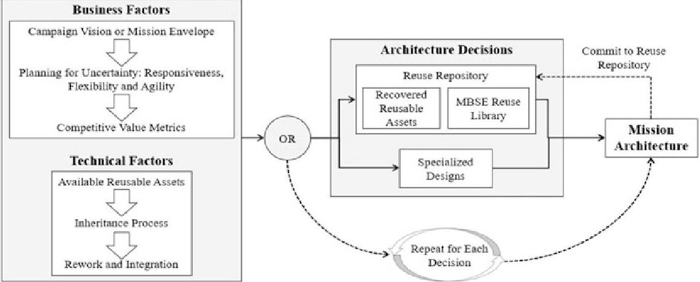
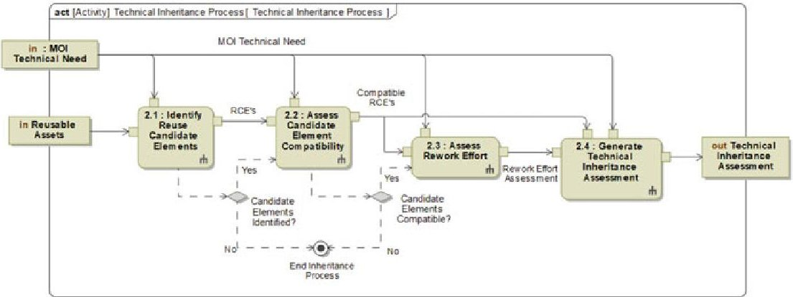
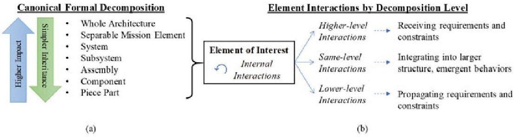
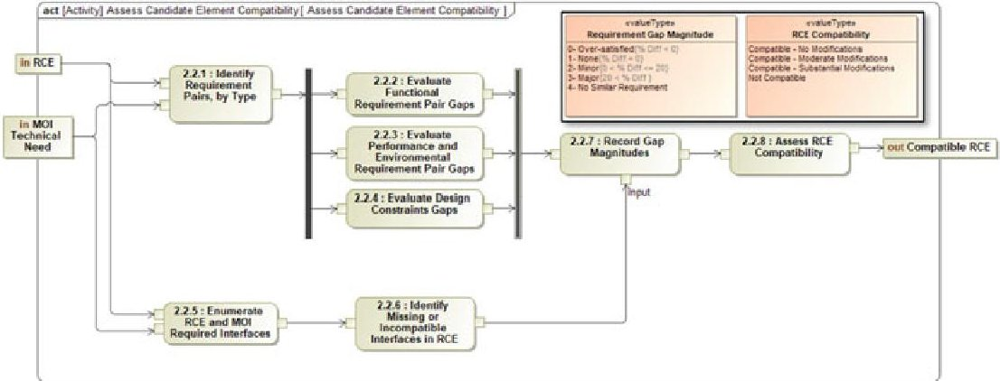

<!-- PDF_PAGE: 1 -->

# Exploration of MBSE Methods for Inheritance and Design Reuse in Space Missions

Alejandro E. Trujillo and Azad M. Madni

Abstract Design reuse, a common and valuable practice in complex engineering projects, is particularly important within the space industry. However, design reuse in this discipline is often conducted in an ad hoc fashion that limits the upside while introducing potential pitfalls. Model-based systems engineering (MBSE), while in the early stages of adoption in the industry, may form the foundation of a new strategic and systematic methodology for investigating and implementing design reuse for space missions and campaigns. To that end, this paper explores one aspect of that envisioned methodology, namely, the technical inheritance process which assesses the technical feasibility of adapting design elements from their native missions to new missions of interest. First, we investigate the impact of the level of architectural decomposition of the element to be reused. Then, we synthesize a generalized version of the process from a historical survey of design reuse examples and suggest MBSE methods, specifically using SysML, to implement them. Lastly, we discuss where this inheritance process fits in the larger picture of the systematic reuse strategy.

Keywords Design reuse . Design inheritance . Space systems architecting Model-based systems engineering (MBSE)

## 1 Introduction and Motivation

The concept of reuse, and especially design reuse, is common in many engineering disciplines. It is particularly important in space systems engineering as high development and operations costs, long development timelines, and inaccessibility

<!-- PDF_PAGE: 2 -->

of assets once emplaced make space missions highly risk averse. Thus, any action that may reduce risk in the case of reuse, by leveraging and redeploying proven concepts is highly valued. Additional benefits of reuse typically cited include reduced design, development, and testing (DD&T) costs and increased responsiveness (reduced time-to-flight from initial need identification).

One commonly cited issue for reuse in the space industry is the often ad hoc nature with which it is implemented. This leads to efforts which may not realize all the potential benefits of reuse. Indeed, in its Systems Engineering Vision for 2025, INCOSE identifies a key challenge currently facing the systems engineering (SE) discipline, namely, that "Knowledge and investments are lost between projects...increasing cost and risk" (INCOSE 2014). A lack of systematic understanding of reuse also leads to mistaken attempts to implement reuse in scenarios where it may in fact be detrimental (i.e., where rework and integration costs exceed costs of designing new elements).

Thus, to fully leverage its potential, a systematic approach that looks at reuse from a strategic perspective is required for implementing reuse (Lange et al. 2018). Developing such an approach within the paradigm of MBSE would help realize an aspect of INCOSE's envisioned solution to the SE challenge mentioned above: that "composable design methods in a virtual environment [will] support rapid, agile and evolvable designs of families of products" (INCOSE 2014).

## 1.1 Problem Statement

This paper is part of a larger research effort concerned with developing a systematic, MBSE-centric methodology for exploring reuse scenarios for space missions and campaigns. Figure 1 depicts the decision-making process and key factors we have previously identified for a generalized reuse scenario (Trujillo and de Weck 2019). It is a balance of both technical and business factors which combine to yield both costs and benefits to reuse. These must then be compared to the status quo (i.e., the non-reuse approach) to yield important insights for decision makers.

In this paper, we specifically look at the inheritance process in the technical factors shown in Fig. 1. Inheritance is the process which explores the technical feasibility of adapting design elements from past missions as solutions for new missions being architected. We define a generalized set of procedures in the inheritance process and discuss how these may be implemented in an MBSE environment (Sect. 3). Then, we investigate how that approach can act as a foundational step in larger reuse efforts including composition of new designs from MBSE libraries/catalogs and reconfiguration of designs and product families to meet new mission needs (Sect. 4). First, we begin with a brief survey of the current state of MBSE in the space industry in Sect. 2.

<!-- PDF_PAGE: 3 -->

Fig.1 Key factors and high-level process with which firm may make reuse decisions

## 2 MBSE, Reuse, and the Space Industry

## 2.1 MBSE and the Space Industry

Since the mid-2000 timeframe, INCOSE's Space Systems Working Group (SSWG) has been an advocate for demonstrating the potential of MBSE for engineering space systems. The SSWG has collaborated with the space industry, notably with NASA's Jet Propulsion Laboratory (JPL) (Delp 2012), to develop exemplar MBSE capabilities including SysML modeling of hypothetical satellite missions (Kaslow et al. 2015), development of CubeSat reference models (Kaslow and Madni 2017), and application of reference models to real-world CubeSat missions (Spangelo et al. 2012). Partly from these early efforts, the aerospace industry has begun to recognize the value of model-based approaches and increased digitization of system information for complex missions requiring multidisciplinary expertise.

For example, in 2016, NASA conducted a pathfinder effort to develop and advance MBSE capabilities throughout the agency upon discovering that MBSE adoption was still in the nascent stages (Phojanamongkolkij et al. 2017). This led to the application of MBSE methods on various missions with a specific focus on information systems of Orion's Exploration Flight Test 1 (EFT-1) (McVittie et al. 2012), the Asteroid Redirect Mission (ARM) prior to project cancellation, and to a limited extent for the development of the Space Launch System (SLS) (Parrot et al. 2016). Moreover, there is a desire at NASA to demonstrate the capabilities of MBSE at larger scales, including for architecting Moon/Mars campaigns as well as for the development of databases of system models to facilitate future reuse efforts. Beyond NASA, the use of MBSE in space systems development and research has been demonstrated at other national agencies, such as at Germany's DLR for its small satellite multi-mission platform known as S2TEP (Fischer et al., 2017) and for educational efforts such as Pakistan's use of Object-Oriented Systems Engineering

<!-- PDF_PAGE: 4 -->

Method (OOSEM) for scalable/repeatable student satellite projects (Waseem and Sadiq 2018).

Upon synthesizing insights from the above examples, we discover that space systems engineering imposes several unique requirements on MBSE methodologies. Among these are:

- System models must integrate a variety of discipline-specific technical analysis tools used by mission designers as a result of the multidisciplinary nature of space systems.

- Interactions within and across all spacecraft systems and mission environments must be modeled to understand performance and capture emergent behaviors both beneficial and detrimental.

- MBSE methodologies must assess and promote critical value attributes desired of the new generation of space architectures, namely, flexibility, evolvability, reusability, and safety.

- MBSE methodologies must accommodate technological and managerial uncertainties inherent in the long timelines that are typical of space missions and campaigns.

These requirements add to the complexity that MBSE methodologies must address to become value-adding tools for space systems architects. Further, new methodologies must satisfy these requirements in a way that is not mission-specific but rather applicable (i.e., reusable) across diverse missions.

## 2.2 MBSE and Reuse

We have previously shown in Trujillo and de Weck (2019) that reuse can generally be classified into three broad categories: reuse of physical artifacts, reuse of codified design knowledge, and reuse of design effort. To explore the value of MBSE in enabling reuse, it is important to first define and distinguish the latter two types of reuse. Codified design knowledge can be defined as the set of architectural concepts and physical principles (and the relationships between them) that address a particular objective or requirement in a mission of interest. Design effort is the set of value-adding work products of the systems architecting process that capture and record design knowledge. Design efforts are increasingly being digitized as MBSE system models, metamodels, and patterns. If prudently designed, these are especially amenable to standardization and reuse on missions beyond their original mission.

Metamodels can be defined as the specification (i.e., syntax, structure, relationships) for constructing a system model (Madni and Sievers 2018). While metamodels can exist at multiple levels of abstraction and for different modeling contexts, a reuse metamodel may be viewed as laying out how the integration of heritage designs may be modeled for a new mission of interest. Conforming to a reuse metamodel is essential for developing the requisite model consistency for

<!-- PDF_PAGE: 5 -->

building and using model libraries and catalogs. A stretch goal for the usage of such model catalogs is the rapid composition of existing design features or architectural elements into new mission systems. Progress has been made in this direction with the MBSE-based composable design methodology developed at Lockheed Martin and demonstrated on its A2100 line of communications satellites (Kaiser and Oster 2015).

## 2.3 What Is Missing?

Substantial progress has been made toward broader adoption of MBSE in the space industry. However, usage of MBSE even within companies continues to be a mission-to-mission decision. By building on current work in the area of reference models, metamodels, and pattern-based approaches, it may be possible to further develop MBSE capabilities and foster greater adoption within the space enterprise (Madni and Purohit, 2019). Specifically, in the area of design and model reuse, a productive first step could be the definition and codification of the technical inheritance process.

## 3 Design Reuse via Inheritance

Most examples in current practice of design reuse in the space industry have not been carried out within an MBSE context. Nevertheless, these examples exhibit commonalities in how they identify reuse candidates, assess their compatibility, and make technical recommendation to decision makers. Thus, it may be possible to synthesize a generalized approach or pattern from these observations which in turn can be used in a systematic MBSE reuse methodology. In what follows, we first develop the steps of the inheritance process and then explore how MBSE techniques can be employed to implement the process, with emphasis on the compatibility assessment step.

## 3.1 Technical Inheritance Process

Reuse decisions encompass both technical and business considerations. On the technical side, a key analysis supporting that decision-making progress is the determination of the feasibility and technical value of adapting a proven design to satisfy the needs of a new mission. Figure 2 is a SysML activity diagram depicting this generalized technical inheritance process. This diagram was developed from the explored examples of design reuse. In this diagram, solid path lines indicate the flow of information from action to action, while the dashed lines indicate the action-

<!-- PDF_PAGE: 6 -->

Fig. 2 SysML activity diagram of the technical inheritance process for systematic reuse analyses

token flow which controls whether actions are carried out, depending on conditional rules marked by the diamond-shaped decision nodes.

As shown on the frame of the diagram, the overall inputs to the process are a description of the mission of interest (MOI) and the set of reusable assets available to the developing organization. The MOI description may be sourced from an existing system model or may require digitization of document-sourced information. The MOI contains objectives, system-level requirements, and design decisions made to date. The reusable asset survey may be a compilation of system models for the firm's past and current designs (at an arbitrary level of decomposition). Further development of these inputs to the process is beyond the scope of this paper it is assumed that these inputs contain sufficient design detail, using a consistent modeling scheme, to enable inheritance analysis. The output of the process is a technical assessment for inheritance of candidate reusable elements with details on required rework and integration (the next technical factor of the reuse process, per Fig. 1). The steps of the process are described below:

Step 1: Identify Reuse Candidate Elements - From the asset survey that acts as input to the process, we first extract those missions whose designs may be applicable to the MOI. This requires mission designers to make a preliminary, subjective judgment on the degree of similarity shared by missions. This judgment includes qualitative comparisons of the major technical and functional overlaps across missions. This acts as a first-pass screening of all of a company's missions recorded in the RAS down to a set of reuse candidate missions (RCMs). Mission designers now step within the identified RCMs to extract specific architectural elements or designs that may be suitable to the MOI. These will likely emerge from the major technical and functional overlaps identified in the previous step and are designated reuse candidate elements (RCEs). Here it is critical to specify the level of decomposition of the element needed to enable inheritance by a new mission. This decompositional level determines the types of interactions that must be considered during adaptation to the new mission and

<!-- PDF_PAGE: 7 -->

Fig. 3 (a) Formal decomposition hierarchy; (b) interactions among elements to be investigated/resolved when applying reuse

also defines the potential impacts (in terms of cost and schedule reductions) of reuse decisions.

Figure 3 illustrates (a) a standard architectural breakdown for specifying the RCE's decompositional level within its RCM and (b) a description of interactions that occur between the RCE and the new mission architecture. In (a) we see that while lower-level reuse is generally a simpler practice to implement, greater valueadded of reuse is typically expected for higher levels. In (b) we see that these interactions occur at higher, similar, and lower levels of decomposition. Further, the modularity of the reused element determines the balance of internal vs. external interactions. Thus, in order to limit interactions to be considered (a zeroth-order proxy for rework effort), a more modular element would be preferred as a reuse candidate; some interactions cannot be encapsulated in the element of interest, including those dealing with structural, energetic, and informational integration of the RCE into the larger architecture. Additionally, beyond physical modularity, this process must also consider the functional, organizational, and implementation-related aspects of the mission. These also impact the type and degree of interactions that may arise with the reused element.

The output of this step is a listing of RCEs, with decomposition specified, from within the previously identified RCMs along with information about the likely technical overlaps.

Step 2: Assess Candidate Element Compatibility - The preliminary and qualitative judgments made in the previous step are now refined with supporting analyses. A detailed procedure for this compatibility assessment is depicted in the activity diagram shown in Fig. 4. Compatibility, that is, the suitability of an RCE to be redeployed with or without modifications on the MOI, is determined by considering two key indicators: requirements and interfaces. Requirements deal primarily with the functionality and performance of the element considering objectives and design constraints; interfaces capture how the element interacts with other elements in the larger architecture of the RCM or MOI. In both cases, compatibility is assessed by pairing like with like across the native mission and the mission of interest at the appropriate decompositional level.

<!-- PDF_PAGE: 8 -->

Fig. 4 SysML activity diagram of Step 3: assessment of the RCE's technical compatibility to the new mission context

A pair-wise comparison of relevant requirements recorded for the RCM and MOI yields some combination of (a) similar requirement text with similar metrics, (b) similar requirement texts with dissimilar metrics (i.e., metric gaps), or (c) dissimilar requirement texts. This comparison reveals (a) MOI requirements already satisfied by the RCE, (b) the gap in the RCE's functionality, performance, or design that must be bridged by rework or adaptation efforts, and (c) requirements in the MOI for which no RCE requirement is comparable. In the last case, this indicates where new, from scratch development will be needed to address the unique MOI requirement. RCEs which demonstrate an inability to satisfy the requirements of the MOI (within some rework and adaptation tolerance) are rejected. A similar comparative analysis is conducted for all relevant interfaces - including structural/mounting, data, material, and energy interfaces. Where interfaces are missing or incompatible, additional gaps in compatibility are noted. Gap magnitudes (shown as the inset in Fig. 4) are determined for each requirement and interface pair, and a determination of compatibility is made for each, with qualifiers for estimated rework or modification required for the RCE. The output of this step is an enumeration of "compatible RCEs."

Step 3: Assess Rework Effort - The compatible RCEs that make it to this step are now further evaluated to estimate the amount of rework needed to adapt the RCE to the new MOI context. This analysis begins with the technical gaps (as captured in requirements and interface specifications) identified in the previous step. The reuse engineer then solicits inputs from subject matter experts and discipline engineers about corrective actions necessary to bridge these gaps. For each requirement or interface pair, a set of rework actions is generated. Supporting domain analyses (e.g., thermal, structural, communications, etc.) are integral to this step in order to verify if each rework action is necessary and appropriate. Such analyses ideally would be integrated into the underlying MBSE model which acts as the authoritative data source for necessary parameters and design elements. After determining the feasibility of the rework regime on the RCE

<!-- PDF_PAGE: 9 -->

and its impact on programmatic aspects such as testing campaigns, a high-level rework work breakdown structure is generated. RCEs for which the rework effort is deemed too extensive or infeasible are rejected. The rest are passed on to the final step of the process.

Step 4: Generate Technical Inheritance Recommendation - The full set of data on an RCE, from preliminary compatibility judgment to an enumeration of necessary adaptation, is now available to the user to develop a technical inheritance summary. These assessments are compiled for the RCEs considered and form on half of the reuse report on an item; the report details those RCEs that are most likely to be adaptable to the needs of the current mission, the rationale for such findings including supporting technical analyses, and estimates (including a preliminary work breakdown structure) for rework efforts required. The other half of the methodology is a valuation and programmatic impact assessment which is ultimately delivered to decision makers. The reuse valuation analysis (which is out of the scope of this paper) relies on the outputs of the technical inheritance process detailed here in order to determine cost and schedule impacts of the reuse scenario.

## 3.2 MBSE Methods for Compatibility Assessments

While above we depicted the technical inheritance process using SysML formalisms, we now explore how the steps in that process might actually be implemented. Specifically, we explore methods for carrying out Step 3, the RCE compatibility assessment in a SysML environment. Here, it is assumed that a system model of the MOI is being developed and maintained by the hypothetical firm. Additionally, the firm has also developed system models for the RCMs it is exploring (or at the very least, has gathered required information in a traditional, document-centric format). Table 1 describes possible options for each of the substeps in the compatibility assessment step as laid out in Fig. 4. It is left to future work to attempt, evaluate, and select a set of MBSE implementation options for each of the sub-steps.

## 4 Inheritance and MBSE in Larger Systematic Reuse Strategy

The approach developed in Sect. 3 is a building block for a more comprehensive, systematic reuse methodology. The technical inheritance process provides decision makers with sound technical judgments to support prudent reuse efforts. This will be augmented with additional analysis modules for consideration of nontechnical business and programmatic aspects which place an engineering project in a real-

<!-- PDF_PAGE: 10 -->

Table 1 Enumeration of MBSE implementation options for sub-steps within the compatibility assessment step

<table border="1"><tr><td>Comparison</td><td>Description</td><td>MBSE (SysML-specific) implementation options</td></tr><tr><td>Functional requirements</td><td>Form neutral comparison of delivered vs. desired functionality</td><td>RD: compare RCM requirement satisfied by RCE vs. similar requirements in MOIBDD: logical/functional decomposition of architectures + comparisonUCD: scenarios for usage of RCE vs. desired element in MOI</td></tr><tr><td>Performance and environmental requirements</td><td>Does the RCE meet the technical performance required by the MOI objectives? And will it perform in the environmental conditions of the MOI?</td><td>RD: compare RCM requirement satisfied by RCE vs. similar requirements in MOIPD: technical analyses of performance metrics and operability of RCE compared with MOI requirements and environmental factors</td></tr><tr><td>Physical/design constraints</td><td>Is this RCE compatible with the physical and design constraints imposed by the MOI (e.g., SWaP, nonengineering constraints, etc.)?</td><td>RD: compare RCM constraint satisfied by RCE vs. similar constraint in MOIPDD+Constraints: impose and check satisfaction of constraints on structure of system</td></tr><tr><td>Interfaces</td><td>Comparison of material/structural, material, data, or energy interfaces across the RCE and MOI. Are interfaces missing?</td><td>IBD: generate/compare interface diagrams from physical decomposition of RCE and MOI modelsPD: similar to IBD, can “size” interfaces with relevant FOMs</td></tr></table>

Key: BDD block definition diagram, UCD use case diagram, AD activity diagram, RD requirements diagram, PD parametric diagram, IBD internal block diagram, SD sequence diagram

world environment. The inheritance process may be carried out multiple times, in parallel, for various architectural decisions in complex space missions. Thus, future research efforts will take the process laid out here and "zoom out" from the individual element level to the various reuse decisions made throughout the life of a project.

The horizon goal for the framework is to address two major use cases: First, the predecessor-successor use case is a standard heritage reuse scenario where multiple design elements in a current MOI have been adapted from past missions after technical judgments and additional analyses have deemed them compatible and value-adding. Second, the composable design use case is a more agile scenario in which a model library enables rapid configuration of new mission systems from a catalogue of existing and proven capabilities, payloads, infrastructure systems, etc. In either case, the inheritance process is instrumental in rendering the technical judgments about the underlying adaptability of a proven design to a new mission.

<!-- PDF_PAGE: 11 -->

## 5 Limitations, Future Work, and Conclusions

There are several limitations of the generalized inheritance process as developed here. These limitations arise from certain simplifying assumptions that were made. The most important assumption for applying the procedure in an MBSE environment is that consistently represented system models exist for both the MOI and the RCM. These capture sufficient detail to make the necessary comparisons across architectures as well as the supporting technical analyses. The limited level of adoption of MBSE in the industry currently means that this is an unrealistic assumption. It also makes it difficult to test and validate the proposed procedures on real-world examples. Practically, we must accommodate for cases where system information is captured in a variety of locations and inconsistent formats. Secondly, as demonstrated in Table 1, the SysML specification currently allows for multiple ways of accomplishing similar modeling tasks; these alternatives must be explored and down-selected. More immediate future work will seek to further elaborate the other steps in the inheritance process, as was done for the compatibility assessment step.

Codification of the technical inheritance process is an initial step in a larger research effort. Our goal is to enable space mission and campaign architects to fully leverage the potential of reuse of proven designs and concepts. MBSE is a powerful paradigm and SysML is a powerful tool for developing and implementing systematic approaches for realizing reuse benefits while avoiding its pitfalls.

## References

Delp, C. 2012. INCOSE Space Systems Challenge Team and JPL MBSE. Pasadena.

Fischer, P.M., et al. 2017. Implementing model-based system engineering for the whole lifecycle of a spacecraft. CEAS Space Journal 9 (3): 351-365. https://doi.org/10.1007/s12567-017-0166-4.

INCOSE. 2014. Systems Engineering Vision 2025 - A World in Motion.

Kaiser, M.J., and C. Oster. 2015. Managing a satellite product line utilizing composable architecture modeling. In AIAA SPACE 2015 Conference and Exposition, 1-10. https://doi.org/10.2514/ 6.2015-4436.

Kaslow, D., and A.M. Madni. 2017. Validation and verification of MBSE compliant CubeSat reference model. Disciplinary Convergence in Systems Engineering Research: 381-393. https:// doi.org/10.1007/978-3-319-62217-0_27.

Kaslow, D., et al. 2015. Developing and distributing a Cubesat Model-Based Systems Engineering (MBSE) reference model. In 31st Space Symposium, Technical Track. Colorado Springs.

Lange, C., et al. 2018. Systematic reuse and platforming: Application examples for enhancing reuse with model-based systems engineering methods in space systems development. Concurrent Engineering Research and Applications 26 (1): 77-92. https://doi.org/10.1177/ 1063293X17736358.

Madni, A., and S. Purohit. 2019. Economic analysis of model-based systems engineering. Systems 7 (1): 12. https://doi.org/10.3390/systems7010012.

<!-- PDF_PAGE: 12 -->

Madni, A.M., and M. Sievers. 2018. Model-based systems engineering: Motivation, current status, and research opportunities. Systems Engineering 21 (3): 172-190. https://doi.org/10.1002/sys.21438.

McVittie, T.I., O.V. Sindiy, and K.A. Simpson. 2012. Model-based system engineering of the Orion flight test 1 end-to-end information system. In 2012 IEEE Aerospace Conference, 1-11. IEEE. https://doi.org/10.1109/AERO.2012.6187440.

Parrot, E., et al. 2016. NASA GRC MBSE Implementation Status.

Phojanamongkolkij, N., et al. 2017. Modeling to Mars: a NASA model based systems engineering pathfinder effort. In AIAA SPACE and Astronautics Forum and Exposition, 1-15. Orlando, FL. https://doi.org/10.2514/6.2017-5235.

Spangelo, S.C., et al. (2012) Applying model based systems engineering (MBSE) to a standard CubeSat. In IEEE Aerospace Conference Proceedings, 1-20. Big Sky: IEEE. https://doi.org/ 10.1109/AERO.2012.6187339.

Trujillo, A.E., and O. L. de Weck. 2019. Towards a comprehensive reuse strategy for space campaigns Alejandro Trujillo. In 70th International Astronautical Congress, 21-25. Washington, DC.

Waseem, M., and M.U. Sadiq. 2018. Application of model-based systems engineering in small satellite conceptual design-A SysML approach. IEEE Aerospace and Electronic Systems Magazine 33 (4): 24-34. https://doi.org/10.1109/MAES.2017.180230.