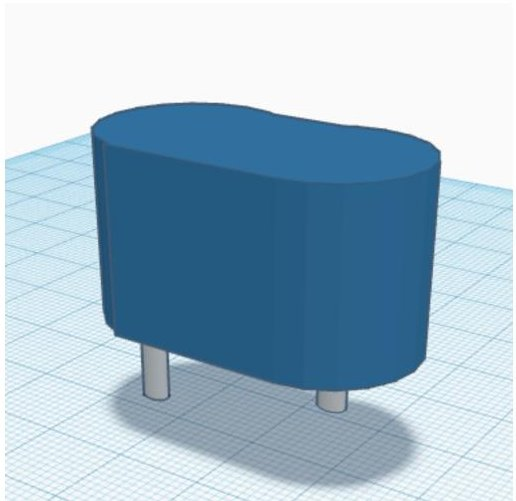
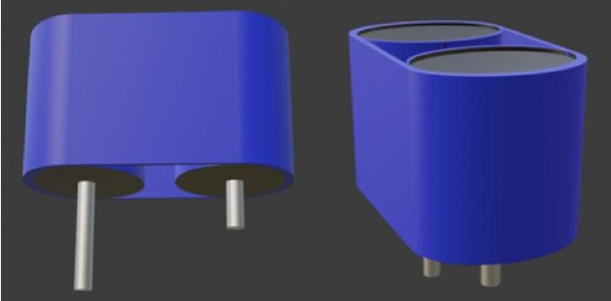
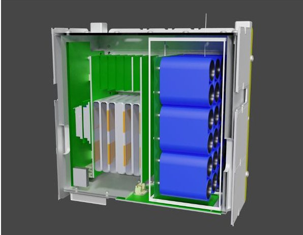
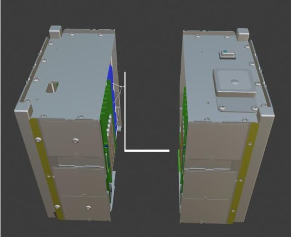
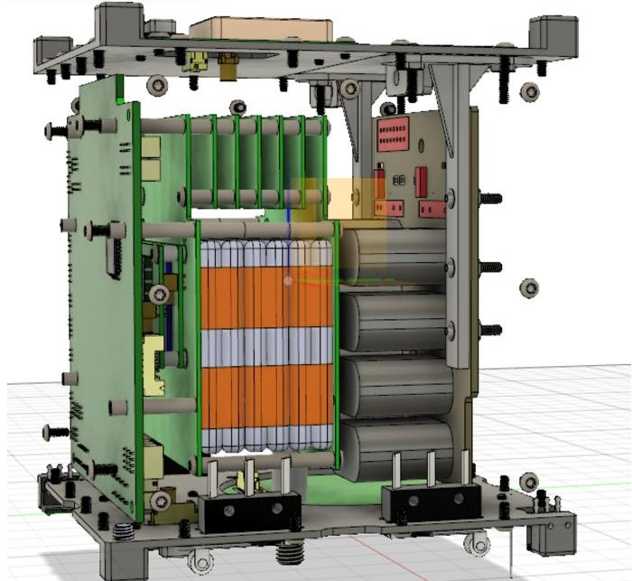

<!-- PDF_PAGE: 1 -->

IAC-22,E1,2,x67590

# From Concept to Launch: Significance and Challenges of Digital Engineering in Student CubeSat Projects

Dylan Kiesling $ ^{a*} $ , Paul Kiesling $ ^{b} $ , Kevin L. Simmons $ ^{c} $

$ ^{a} $ Aerospace and Innovation Academy,1303 Vision Dr, Palm Beach Gardens, FL. 33418, Dylan.Kiesling@icloud.com

$ ^{b} $ BLUECUBE Aerospace, 1303 Vision Drive, Palm Beach Gardens, FL 33410, Pkiesling@bluecubesat.com

$ ^{c} $ BLUECUBE Aerospace, 1303 Vision Drive, Palm Beach Gardens, FL 33410, Ksimmons@bluecubesat.com

* Corresponding Author

## Abstract

On December 3, 2018, a small research satellite, or CubeSat, built by middle school students from Palm Beach Gardens, Florida lifted off on a Falcon 9 rocket from Vandenberg Air Force Base. Subsequently, on July 15, 2022, new students from the same team launched their second mission. What makes this team particularly interesting is that it is comprised of middle and high school students who utilize NASA's CubeSat Launch Initiative (CSLI), a program that offers a rare opportunity for younger students to learn about satellites in a hands-on way. According to NASA, more than 200 students have been involved in the design, development, and construction of CubeSats that will be deployed through CSLI. Overall, as of January 1, 2022, 1,663 CubeSats have been launched, with hundreds of them built by students worldwide. CubeSat programs are becoming increasingly popular as they provide students with hands-on introduction to applied space technologies and an opportunity to follow a space project from concept to launch and beyond.

Designing, building, testing and launching a CubeSat is a lengthy process that involves a series of demanding tasks and requires an interdisciplinary approach. Computer-aided design (CAD) is a very important function during the entire process. From the very beginning, students rely on CAD models to visualize their payload idea and convey it to others. Additionally, CAD modeling is essential in the building process as it allows students to virtually assemble the payload and integrate it into the CubeSat to ensure proper alignment and reduce errors. However, due to limited CAD education available in schools, students struggle even at the university level because CAD skills take time to develop and master. As a result, students might have to outsource this task to professionals, which would be expensive, time consuming and ineffective. When CAD personnel are not integrated members of the team, it could be challenging to communicate the team vision and manage the expectations to design, build, and ultimately, launch a CubeSat. More importantly, outsourcing this task would eliminate an opportunity for students to receive hands-on learning of real life CAD work in an engineering project.

As the world prepares for the next era of space exploration, digital transformations need to take place to provide a high quality technical education. Increasing accessibility of design technology education is important for the aerospace industry and its future workforce. This paper will discuss the challenges and solutions from the perspective of a CAD student member of the Wolfpack CubeSat Development Team (WCDT).

## Keywords: CubeSat, CAD, Digital Engineering Acronyms/Abbreviations

Computer-aided design (CAD), National Aeronautics and Space Administration (NASA), CubeSat Launch Initiative (CSLI), Educational Launch of Nanosatellites (ELaNa), BLUECUBE Aerospace, LLC (BLUECUBE) Wolfpack CubeSat Development Team (WCDT)

## 1. Introduction

Considered the largest in the world, the United States Aerospace sector has come a long way since the Wright brothers inaugurated the aerial age with the world's first successful flight in 1903. With a trillion dollars in sales revenue in the United States alone, the Aerospace and Defense (A&D) industry is responsible for the design, advancement, and manufacture of aircraft, space systems, and defense utilities [1]. With that said, the A&D industry has been one of the earliest adopters of

digital technologies because CAD plays an integral role in aerospace engineering. For example, weighing 183,500 kg and made up of 6 million parts, the construction of a Boeing 747 requires over 14,000 individual jobs to be completed. Completing a project of this magnitude only to discover that the airplane cannot fly would be an enormous waste of financial and human resources. Therefore, over the last decades, software simulation programs have become instrumental in achieving higher efficiency, accuracy, and speed in completion of spacecraft assembly projects. Nowadays, to ensure successful creation of innovative spacecraft designs and functionality, the A&D industry heavily depends on the use of CAD applications from preliminary planning, concept sketching, 3D modeling, prototyping, performance, and safety analysis to deployment and beyond. CAD platforms save

<!-- PDF_PAGE: 2 -->

manufacturers money and time by reducing the need for multiple prototypes for testing and increasing operational efficiency by simulating and verifying the assembly of different parts. Most importantly, with the capability to create 2D and 3D objects, CAD applications are parametric, which means that designers can change the calibration of the objects according to the specifications.

## 1.1 CAD in Schools

From middle schools to universities, CAD instruction is becoming more important than ever before because more jobs are now using 3D technologies. With the $9.95 billion market size value in 2021 and $15.41 billion revenue forecast by 2028, the CAD software market is expected to grow exponentially as software technologies become more essential to various sectors and continue to evolve quickly with continuous improvements [2]. With the increasing market share, these CAD programs have to be adapted to the new users and future leaders in engineering; however, CAD and 3D printing are not yet adequately integrated in school curricula. Most students who are interested in CAD only get exposed to these skills at university level, which is too late because it does not allow them enough time to learn these skills and actively apply them by participating in real-life engineering projects. For example, the project of building a Cube Satellite can take several years from concept to launch. Therefore, for a four-year college student to be able to actively participate as a CAD technician on such a project, it is very important for them to start their CAD education before college, arguably as early as middle and high school.

Due to limited CAD educational availability in schools, students struggle even at the college level because CAD skills take time to develop and master. By focusing on an earlier exposure to beginner-level CAD programs, students can progress to more professional softwares, and once in college, they can actively participate in hands-on projects as opposed to having to learn the fundamentals. Without prior exposure, students may find it challenging to pick up these skills in college, and once discouraged, may choose to follow different career paths. This outcome could have a significantly negative effect on the future of the CAD field. As pointed out by Sithole et al in the Higher Education Studies journal, due to the lack of academic preparedness in early years, many students often end up leaving STEM fields in which they originally expressed interest and switch to non-STEM fields [3]. Additionally, as noted by the United States President's Council of Advisors on Science and Technology, 40% of US students enter university with an interest in STEM, but only about half of them actually complete a STEM degree [4]. Lack of exposure to CAD technologies at middle and high school level may make it less likely that students will be able to or willing to pursue this path in college. Furthermore, while students

may be able to learn CAD on their own as a hobby, it is not the same as hands-on learning experience that would be offered in a well-rounded curriculum with real building and design as components. Active learning and its correlation to students' performance in STEM was recently noted by Freeman, Eddy, and McDonough et al through meta-analysis of 225 studies in published and unpublished literature. They found that students who did not engage in relevant hand-on learning early on were 1.5 times more likely to fail a later course than students who did [5].

## 1.2 The Wolfpack CubeSat Development Team

The authors of this paper are members of the Wolfpack CubeSat Development Team (WCDT) located in Palm Beach Gardens, Florida. Also referred to as the Wolfpack, this team consists of middle and high school aerospace students and is led by Kevin Simmons, the founder of BLUECUBE Aerospace (BLUECUBE). Created by educators with the aim to build, launch, utilize, and educate using CubeSat technology, BLUECUBE's mission is to inspire students, equip teachers, and prepare the next generation to be a part of a competitive technology-focused workforce.

Founded in August of 2015 as an after-school club, the Wolfpack's ultimate goal was to deploy a CubeSat into space within three years. In December 2018, the Wolfpack successfully launched WeissSat-1, a 1U CubeSat selected in the 24th round of NASA's Educational Launch of Nanosatellites (ELaNa) Program and the CSLI. Launched aboard a Falcon-9 rocket from the Vandenberg Air Force Base and deployed from the SpaceFlight Industries FreeFlyer into a sun-synchronous orbit, WeissSat-1 made history as one of the first CubeSats to be built and launched by middle school students.

On the heels of this success, the Wolfpack submitted another CubeSat proposal to NASA's CSLI and in 2019, received an acceptance for their second CubeSat mission called CapSat-1. CapSat-1 mission was to test the efficiency of capacitors as a replacement for lithium-ion batteries in space flight. On July 15, 2022, CapSat-1 was launched to space on a Falcon-9 rocket from Kennedy Space Center as part of SpaceX's CRS-25 mission.

Over the years, the WeissSat-1 and CapSat-1 missions have played a very important part in student learning and success in the field of aerospace science and engineering. In addition, one of the authors of this paper, a student of only twelve years of age, gained invaluable experience as the CAD technician on the entirety of the CapSat-1 project over a two year span.

## 1.3 The Significance of CAD in student-built CubeSat projects

A CubeSat team may be made up of several students from different fields of studies and interests. Some students

<!-- PDF_PAGE: 3 -->

may be skilled in coding and engineering, which is necessary to make the CubeSat work, while others may be more interested in the development of the scientific idea of the payload. The CAD technician must be able to work with all team members to visualize their ideas and bring them to life in a 3D modeling software; therefore, CAD work allows students to be involved in engineering projects in a valuable hands-on way from start to finish. From the very beginning stages when a CubeSat mission is just an idea, CAD comes into play when developing a payload design. Creating 3D models of the payload helps further develop an understanding of what the payload will look like and the functionalities required to complete the mission.

When a team works with the CAD technician on payload design, students are forced to use their imagination as well as communication skills to relay the message so that CAD technician is able to capture the idea. For example, during the CapSat-1 project, where payload included capacitors, there were many design iterations of the layout of the capacitors. These iterations took place during two years of the planning and the building stages of the project. Having a consistent CAD technician who is familiar with how the payload is supposed to function was very helpful because it allowed the team to easily revisit prior design ideas and understand the options that have already been ruled out. For example, during CapSat-1, in order to properly position the capacitors in the 3D model, the CAD technician needed to know if they are close enough to the energy source, or if the layout needed to be adjusted altogether to fit the needs of the new iteration. Due to the constant exposure that CAD technician has to the entire project, even without ever physically having to touch the CubeSat, CAD is a key function of the project that provides a very interesting and important hands-on learning experience.

Building a CubeSat, regardless of age or grade, is a multi year project, and of the main challenges is the long-term availability of students to continue working on their assignments. Often, students graduate, leave for other reasons, or simply become too busy with their coursework or lose interest. This creates risk if other students are not able to take over. This is especially true for CAD development. Ideally, multiple people would be trained in positions, especially CAD, who can easily pick up the work. However, continuity and replacement in CAD workflow of the project become more difficult because CAD education is not widely implemented in primary and secondary schools.

## 2. Materials and Methods

be retrieved from one's imagination or generated by following blueprints, both of which require the ability to visualize, formulate and manipulate mental images.

Teaching CAD at different age levels and stages of knowledge requires covering different concepts, but the fundamentals should start with teaching spatial ability. Designs are descriptions of things that don't yet exist, and to get them on paper or in digital format, visuals need to

## 2.1 Developing Spatial Ability

Spatial ability skills are crucial for success in STEM and especially in current times of digitization when students have to increasingly deal with virtual and 3D representations. Dilling and Vogler explain that in literature, there is no generally accepted definition of the term spatial ability, but scientists have defined it as the ability to generate, retain, retrieve, and transform well-structured mental visual images, as well as the ability to manipulate them in the mind [6]. Dilling and Vogler further provide empirical evidence for inter-dependency between spatial ability and the use of 3D software; therefore, to help the students develop better CAD skills, it is important that spatial ability is obtained early in life. Spatial abilities, such as mental rotations and spatial scaling, are important for CAD skill development because they help students reason about shapes, angles, and distances [7]. Additionally, the ability to visualize the cross-section of a 3D object is crucial in a wide range of problem solving in fields ranging from architecture to engineering to even medicine. Many studies have shown that spatial skills can be improved with practice. For example, Newman, et. al found that structured block play, where students use blueprints to recreate a structure with a set of blocks, showed major improvements in student's mental rotation abilities after just five 30-minute play sessions. They also found that after this training, there were changes in brain activity suggesting that structured block play had changed the way they processed spatial information [8]. Studies also revealed that solving tangram puzzles activated parts of the brain associated with creative thinking and trial-and-error problem solving skills [9]. Engaging in such activities encourages students to consider shapes from a variety of angles and perspectives, which turns into necessary skills when they start using 3D software. If students are not engaged in such activities early on, it may be more challenging for them to pick up on CAD skills when they get introduced to various 3D design tools.

## 2.2 Developing CAD skills

Learning how to use technology is now part of the educational process, and just like students have to learn how to use tools such as Microsoft Word and PowerPoint, they should be exposed to CAD software as well. Teaching CAD in schools can provide younger students with valuable experience of working in a 3D environment. Students would also be able to apply numeracy skills to use the software because even the most basic use of CAD software requires the application of geometry, measurements and mental strategies. More importantly, learning CAD from an early age allows

<!-- PDF_PAGE: 4 -->

students to start from the beginner softwares and work their way to more advanced professional programs that are used at college level and beyond.

## 2.1.1 Tinkercad as a Beginning Program

A good 3D software that can be learned in middle school for CAD and 3D printing is Tinkercad. This is a free browser-based application provided by Autodesk. Due to its user-friendly interface, it is the simplest 3D modeling software to use, making it great for beginners. It enables direct modeling, meaning that basic geometric solids such as cubes and cylinders can be moved on the work plane and directly changed by dragging individual elements such as surfaces and edges. Tinkercad allows users to learn how to design and print in 3D, as well as how to code, and create circuits.

Tinkercad, however, comes with many limitations because it is a beginner software, and, as such, is not suitable for professional engineering projects like building a CubeSat. As can be seen in the image below, when creating an image of a capacitor for CapSat-1 payload, the author had to combine multiple shapes together. Combining multiple shapes or objects to create another is time consuming and inefficient, and it also does not create an accurate or aesthetically pleasing end product.

Fig.1 Capacitor image created in Tinkercad Image courtesy Dylan Kiesling

## 2.1.2 CAD skills through Blender

For a more professional imaging, a software can be used called Blender. Created in 1998, Blender is also an open-source 3D computer graphics suite which means that its source code is freely distributed and openly available for customization. It is designed to create 3D art, visual effects, animations, video games and 3D printable models. Blender is completely free to download and use, even for commercial projects. This access is what makes Blender an excellent choice for those who want to CAD as a hobby; however, this does not mean Blender is easy or basic as a tool itself. Blender is a high-end

professional tool used by major companies such as Meta and Ubisoft [10]. Blender may be challenging to new users who have no prior knowledge of CAD because it has many features and toolsets that can be confusing at first. Once learned, however, these features are very helpful because they provide shortcuts and can expedite the workflow.

One of Blender's best features is its ability to easily sculpt natural shapes and tweak geometry by distorting and deforming specific regions of the model. Blender also offers the added functionality provided by add-ons and modifiers, which make it easier for an artist to create images. For example, the Bevel modifier polishes the edges of the mesh it is applied to, with some control of how and where the bevel is applied to the mesh. This was especially helpful when creating the round edges on the capacitor as can be seen in Fig. 2.

Fig. 2 Capacitor image created in Blender Image courtesy Dylan Kiesling

The Array modifier enables the artist to create an array of copies of the base object, with each copy being offset from the previous one in any number of possible ways. Vertices in adjacent copies can be merged if they are nearby, allowing smooth Subdivision Surface frameworks to be generated. The Array modifier can be useful when combined with tile-able meshes for quickly developing large scenes. It is also useful for creating complex repetitive shapes. As can be seen in Fig. 3, the Array modifier was particularly helpful for CapSat-1 payload imagery, because it required the author to stack capacitors together and create various options to find the most optimal layout.

<!-- PDF_PAGE: 5 -->

## Fig. 3 Cutaway View of CubeSat in Blender Image courtesy Dylan Kiesling

Additionally, Blender's Boolean modifier performs operations on meshes that are otherwise too complex to achieve with a few steps editing meshes manually. For example, it enables the user to cut and split an object into sections. This was particularly useful during CapSat-1 imagery to create a cutaway view of the CubeSat and enable the author to create and add components inside the CubeSat shell.

Fig. 4 Split CubeSat View created in Blender Image courtesy Dylan Kiesling

Overall, Blender provides the user with much more advanced functionality for professional engineering projects. However, one important issue to note is that Blender offers poor functionality when it comes to precise measurements and scaling. Because the measurement functionality is not built in, this feature needs to be outsourced to different add-ons that need to be installed. This can be time consuming and most of the add-ons work with different versions of Blender, making this process often challenging and glitchy.

For the CapSat-1 project, precise measurements were of utmost importance as all of the CubeSat components had to fit tightly and align properly without touching and interfering with one another. As such, the team decided to transition the project to Fusion 360 which offers precise and easy measurement functionality.

## 2.1.3 CAD skills through Fusion 360

Fusion 360 was created by Autodesk in 2012 as a complete engineering platform that is best known for its design and CAD capabilities. This is a subscription-based CAD software but is still very accessible for about $60 per month with access to all 3D design functionalities For the purposes of learning as a hobby, this program can be obtained for free with limited functionality and restricted for personal use only; however, as with all Autodesk products, there are full educational licenses available for students and educators upon status verification. Unlike Blender, Fusion 360 requires

internet connection, but this allows for all its files to be stored in iCloud and is then accessible from any devices. For the purposes of a CubeSat project, Fusion 360 was the optimal software because of its precise measuring capability. 3D modeling in Fusion 360 requires accurate measurements for every single object. This was particularly important for CapSat-1 payload design where precise accommodations had to be created for numerous components and the relevant wiring. Modeling in Fusion 360 allowed for optimization of space as can be seen in Fig. 5, where all of the components of the payload are closely together.

Fig. 5 Payload See-Through View created in Fusion 360 Image courtesy Dylan Kiesling

Additionally, one of the most significant advantages of Fusion 360 is the parametric modeling through design history feature. Every action performed is recorded in a timeline and can be returned to at any point to make modifications and changes. This is very important for prototyping and quick design iterations that are necessary when building a CubeSat.

## 3. Theory

The history of CAD dates back to the 1960's and Dr. Patrick Hanratty, a computer scientist who is often referred to as the "Father of CAD". When Dr. Hanratty created the first numerical control system, which would later become CAD; the precision, versatility, and editing capabilities of CAD revolutionized the engineering, architecture and manufacturing landscape. Lansdown notes, however, that CAD is an essentially practical subject in which theoretical discussion has largely been ignored, which means that the subject is strong on technique but weak on rationale [11]. Creating a theory for CAD could increase its effectiveness and change the way students and professionals approach it. Currently, one of the main theories that relates to CAD is the Design

<!-- PDF_PAGE: 6 -->

theory. However, there has been comparatively little critical attention paid to the problem of specifying Design theory so that it can be communicated, justified and developed cumulatively.

## 3.1. Value of Experiential Learning in CAD

CAD education is a great example of experiential learning because it allows students to learn digital design and technology through hands-on techniques and real-life applications. In turn, this helps students retain information and grow their skill set for future real life applications such as designing and building a CubeSat. Experiential learning has deep roots in Progressive education theory, which was developed by the most significant educational philosopher of his era, John Dewey. Springing from the educational philosophy of Pragmatism, which is based on the belief that reality must be experienced, Dewey's progressive education theory emphasized the need to learn by doing [12]. Experiential learning experiences, such as CAD work, can help students improve their long-term retention of the basic skills and allow them to build upon more advanced skills. In a key scientific study, Louis Deslauriers, Director of Science Teaching and Senior Physics preceptor at Harvard University, noted that students learn more through active participation and hands-on engagement in the classroom than they do in a passive lecture environment [12]. This study identified a direct correlation between active learning and students' long-term retention of the knowledge and its application to problem solving. If students are not exposed to hands-on CAD learning in early years, it will be difficult for them to pick up on these skills later when they are exposed to advanced engineering projects such as building a CubeSat. Students who start college without CAD skills will likely have a more difficult time learning these skills by following lectures and textbooks than those students who experienced a lot of hands-on opportunities to learn and work with CAD software in schools.

## 4. Conclusion

CAD is a life skill, and it serves the purpose of conveying ideas and imagination on a lot of instances and life experiences. Learning CAD early is one way to enable students to participate and hold leadership positions in complex engineering projects that require 3D technology skills. Above all else, CAD is a vital function of the aerospace industry, and therefore, CAD education is vital for the prosperity of the future aerospace workforce. Further innovation in the space sector requires a workforce that is properly trained in CAD and various 3D softwares. However, in order to foster a workforce that has adequate CAD knowledge, it is essential that CAD is taught at early ages to provide the training and inspiration necessary for students to pursue this important field of work. As the world continues to advance in space

exploration, resources must be prioritized to improve policies to increase STEM education and to incorporate CAD education as part of school curriculum. Securing the aerospace industry with greater access to a qualified technical workforce will allow humanity to accomplish significant goals and meet the challenges of the new era of space exploration.

## References

[1] V. Baractari, How Software is Making the Aerospace and Defence Industry Beautiful and Sturdy, 6 May 2020, https://openlm.com/blog/how-software-is-making-t he-aerospace-and-defence-industry-beautiful-and sturdy/, (accessed 05.06.22)

[2] 3D CAD Software Market Size, Share & Trends Analysis Report 2021 - 2028, Grand View Research https://www.grandviewresearch.com/industry analysis/3d-cad-software-market, (accessed 05.06.2022)

[3] A. Sithole, E. T. Chiyaka, P. McCarthy, et al. Student Attraction, Persistence and retention in STEM Programs: Successes and Continuing Challenges. 16 January 2017. https://files.eric.ed.gov/fulltext/EJ1126801.pdf. (accessed 05.06.22)

[4] PCAST STEM Undergraduate Working Group (2012) Engage to Excel: Producing One Million Additional College Graduates with Degrees in Science, Technology, Engineering, and Mathematics, eds Gates SJ, Jr, Handelsman J, Lepage GP, Mirkin C (Office of the President, Washington).

[5] S. Freeman, S. Eddy, M. McDonough et al, Active learning increases student performance in science, engineering, and mathematics. Scott Freeman, Sarah 12 May 2014, https://www.pnas.org/content/pnas/111/23/8410.full.pdf (accessed 06.02.22)

[6] F. Dilling, A. Vogler, Fostering Spatial Ability Through Computer-Aided Design: a Case Study, 7 April 2021, https://doi.org/10.1007/s40751-021-00084-w, (accessed, 13.06.22)

[7] KA. Gilligan KA, MSC. Thomas, EK. Farran, First demonstration of effective spatial training for near transfer to spatial performance and far transfer to a range of mathematics skills at 8 years, July 2020,

<!-- PDF_PAGE: 7 -->

$ 73^{\mathrm{rd}} $ International Astronautical Congress (IAC), Paris, Friday, 18-22 September 2022. Copyright $ \textcircled{2} $ 2022 by the International Astronautical Federation (IAF). All rights reserved.

https://www.ncbi.nlm.nih.gov/pmc/articles/PMC737933 8/, (accessed 13/06/22)

[8] SD. Newman, MT. Hansen, A. Gutierrez, An fMRI study of the impact of block building and board games on spatial ability. Frontiers in Psychology, 29 August 2016. https://www.frontiersin.org/articles/10.3389/fpsyg.2016. 01278/full, (accessed 13.06.22)

[9] Z. Hu, KF. Lam, Z. Yuan, Effective Connectivity of the Fronto-Parietal Network during the Tangram Task in a Natural Environment. Neuroscience. 2019 Dec 1;422:202-211

[10] Blender vs fusion 360: The differences in 2022 All3DP, 27 April 2022, https://all3dp.com/2/fusion-360- vs-blender-cad-software-compared/, (accessed 06.14.22)

[11] J. Lansdown, A Theory of Computer-Aided Design: A Possible Approach, Computers in Art, Design and Animation, Springer-Verlag New York Inc, 1989

[12] L. Deslauriers, Learning and retention of quantum concepts with different teaching methods, Physics Education Research, 2011. https://journals.aps.org/prper/pdf/10.1103/PhysRevSTP ER.7.010101, (accessed 06.16.22)