<!-- PDF_PAGE: 1 -->

$ 73^{\mathrm{rd}} $ International Astronautical Congress (IAC), Paris, France, 18-22 September 2022. Copyright $ \textcircled{2} 2 0 2 2 $ by the International Astronautical Federation (IAF). All rights reserved.

IAC-22,C1,3,x69254

# Hardware-in-the-loop simulation framework for CubeSats proximity operations: application to the Milani mission

Antonio Rizza $ ^{1} $ , Felice Piccolo $ ^{2} $ , Mattia Pugliatti $ ^{3} $ Paolo Panicucci $ ^{4} $ , Francesco Topputo $ ^{5} $

Milani is a 6U CubeSat that will be released by Hera in proximity of the Didymos binary asteroid. The spacecraft will demonstrate autonomous Guidance Navigation and Control (GNC) capability for CubeSats in deep space, enhancing the scientific outcome of the mission. The Deep-space Astrodynamics Research and Technology (DART) Group at Politecnico di Milano is responsible for Milani Mission Analysis (MA), GNC and Image Processing (IP) design. Operations in proximity of minor bodies demand high levels of autonomy to achieve cost-effective, safe, and reliable solutions. The on-board software has a central role in these applications, thus it must be extensively tested and validated to satisfy mission requirements and to guarantee robustness to uncertainties. A robust and standardized methodology to design, validate, and test vision-based Attitude and Orbit Control Systems (AOCS) algorithms is fundamental to achieve fast prototyping while facing at the same time limited availability of resources and time. This paper presents a modular and flexible approach, developed at DART lab, to test GNC algorithms with camera- and processor-in-the-loop simulations. This framework is characterized by three elements: 1) a functional engineering simulator for six-degrees-of-freedom closed-loop analyses, 2) a vision-based navigation test-bench for camera-in-the-loop simulations, and 3) a single-board computer to test the algorithm in a representative computational environment. The first element is the modular CUBesat ORbit and GNC (CUBORG) tool, developed in MATLAB/Simulink. This contains a high-fidelity model of the environment suitable for simulating different operative scenarios, and a prototype of the spacecraft AOCS. Camera-in-the loop simulations are performed thanks to the in-house developed Tiny Versatile 3D Reality Simulation Environment (TinyV3RSE). This is composed of a high-resolution screen which displays synthetic images as they would be acquired from the probe during the mission, and stimulates, through a collimator, the camera mounted in the facility. The third element is a Raspberry Pi which is selected as external board to run processor-in-the-loop simulations. The proposed approach is tested on the Milani case simulating the GNC and IP subsystems in a real-hardware environment, doing a step forward towards the hardware-in-the-loop validation and verification of them.

## 1 Introduction

The on-going trend of using miniaturized platforms for the systematic exploration of Small Solar System Bodies is demanding always higher levels of autonomy on board. The Attitude and Orbit Control System (AOCS) clearly plays a pivotal role in achieving this, and thus requires a significant design effort. Proximity operations

often rely on vision-based systems to perceive the external environment, navigate through it, and planning scientific activities. The increased complexity in software architecture, together with the stringent requirements in pointing accuracy and operational constraints needs to be tackled by considering the limited availability of resources typical of CubeSat platforms. High-fidelity numerical simulations allow for validation, and verification of mission requirements. These are typically achieved with Models In the Loop (MIL) simulations in which a model of the software is built and its behaviour is assessed. However, when aiming at on-board implementation, deviations from the simulated behaviour occurs because of unmodelled effects such as noise or limited computational capacity. Hardware-In-the-Loop (HIL) simulations allow for testing in a more representative environment by coupling the numerical simulation with hardware components. This paper presents an overview of the simulation and software prototyping framework implemented from the Deep-space Astrodynamics Re-

<!-- PDF_PAGE: 2 -->

search and Technology (DART) $ ^{1} $ Group at Politecnico di Milano. The team is also responsible for the design of mission analysis, Image Processing (IP) and Guidance Navigation and Control (GNC) subsystems for Milani [1], one of the two Hera's CubeSats that will be released in proximity of the 65803 Didymos binary asteroid [2]. Milani is a 6U CubeSat with semi-autonomous GNC capabilities. The mission is developed in the framework of the ESA-NASA joint collaboration AIDA [3] (Asteroid Impact & Deflection Assessment) aiming at assessing the deflection capability of a kinetic impactor on potentially hazardous Near Earth Objects (NEO). NASA's Double Asteroid Redirection Test (DART) [4], will impact on the secondary asteroid Dimorphos at the end of September 2022 while Hera will rendezvous and characterize the system by the end of 2026 [2]. The ESA's spacecraft will carry two CubeSats, Milani and Juventas [5], to enhance the scientific income of the mission while providing opportunity for technological demonstration [6]. In particular global mapping and high-resolution images of the two asteroids, and of the DART impact craters are foreseen. This will be achieved thanks to the Milani primary payload, ASPECT [7], a visible to near-infrared hyperspectral imager. The dust environment will also be characterize with the passive payload VISTA [8]. Finally, autonomous deep-space capabilities and Inter-Satellite-Link (ISL) communications with Hera will be demonstrated. The latter ones will also support the estimation of the asteroids gravity fields. Milani successfully passed the Critical Design Review (CDR) and entered in phase D during Summer 2022. Extensive numerical simulations with synthetic images-in-the-loop (IIL) have been carried on to assess IP and GNC performances, and to achieve preliminary validation and verification (V&V) of the two systems. Details on this analysis can be found in Piccolo et al. [9]. An autocode version is also generated for the two systems with the Simulink coder. This consists in source code in C that is ready to be interfaced with the onboard software. Previous work was also performed to test the IP of Milani with camera images obtained from a selected dataset allowing to prove the robustness of the subsystem against hardware limitations, see Piccolo et al. [10]. However, these were open-loop analyses in which the scene observed by the IP was generated with an ideal attitude, thus they provides few information on the impact of IP degradation on Milani's pointing performances. In this work a methodology to address this is presented performing high-fidelity AOCS simulations with Camera-In-the-Loop (CIL). Preliminary assessment of IP and GNC computational performances is also carried out performing Processor-In-the-Loop (PIL)

simulations. This is achieved running the generated autocodes on an external single board computer that is more representative of the spacecraft environment. The topics will be presented as follows: Sec. 2 describes the methodology in details, depicting the simulation framework and describing how that can be adapted for HIL analyses. Sec. 3 provides a brief description of the semi-autonomous vision-based GNC sub-system of Milani underlining the list of PIL and CIL simulations that are shown in this work as application examples of the methodology. Sec. 4 illustrates and comments the results of the HIL analyses performed, and finally, Sec. 5 contains the conclusion and some general consideration on the approach and its expected future developments.

The methodology developed by the DART Group to design, test and validate vision-based AOCS algorithms for proximity operation scenarios consists of four elements. These are: 1) an high-fidelity six-degrees-offreedom simulator. 2) A toolbox to generate synthetic images of the scene observed by the probe. 3) An optical facility and, 4) an external single-board computer. These elements are interfaced to obtain an integrated simulation framework that will be described in this section.

## 2 Methodology

## 2.1 The CubeSat simulator: CUBORG

The CubeSat Orbit and GNC (CUBORG) toolbox is a general purpose functional engineering simulator developed in MATLAB/Simulink. Its purpose is to promote fundamental research on spacecraft autonomy, but also to support the validation of the AOCS subsystems the team is designing for upcoming space missions, such as Milani [9, 11], LUMIO [12], and M-ARGO [13]. The design of the simulator aims at achieving some general features such as simplicity, and modularity for parallel development. Flexibility and easiness of interfacing with, proper balance between efficiency and accuracy, tunability of different level of complexity and fidelity and a clear and simple management of the output is also foreseen. Moreover, it should be possible to easily extract from it source code to be used in hardware implementations. State-of-the-art is considered in its development taking inspiration from already existing simulators. Some example is given by the Aerospace Blockset CubeSat Simulation Library developed in MathWorks, the GNC and AOCS Simulations Toolbox (GAST), developed in partnership with ESA [14], and the Basilisk Astrodynamics Framework developed jointly by the University of Colorado, Autonomous Vehicle Systems (AVS)

<!-- PDF_PAGE: 3 -->

Lab, and the Laboratory for Atmospheric and Space Physics (LASP) [15]. CUBORG is made of three functional segments: an input/data set, a MATLAB segment and a Simulink segment, as shown in Figure 1. The input/data set contains all the configuration parameters required to set up the simulation together with different kind of data like kernels and shape models. The MATLAB segment is formed by a set of functions that are used to read the input parameters, set up the simulation, manage the toolbox interfaces and post-process the outputs. The Simulink segment is composed of two Simulink files: a library and a simulation model. The former contains a wide list of in-house developed models that can be used to simulate both the environment and the spacecraft behaviors. Different levels of fidelity can be achieved by them enabling for a modular simulation approach with progressively growing complexity. In particular five categories can be found within the library:

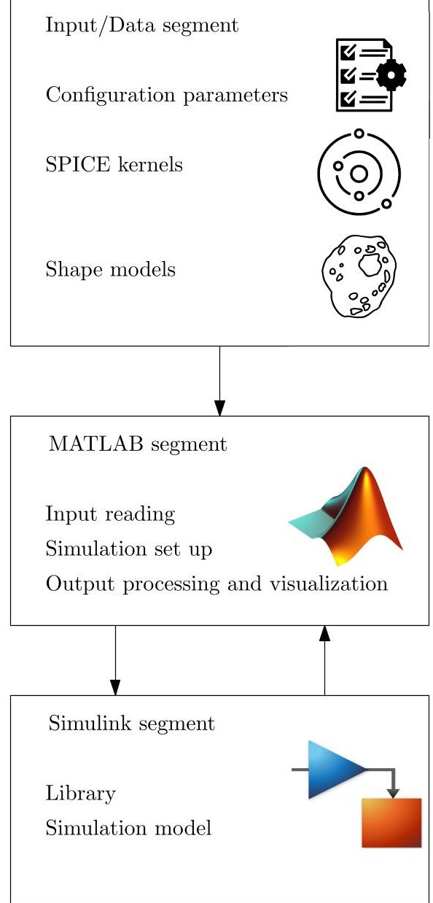

Fig. 1: Scheme of high-level CUBORG working flow3.

CUBORG tools, environmental disturbances, sensors, actuators and AOCS surrogates as shown in Figure 2. The first one contains a set of utilities with high level functionalities that are needed for the simulation such as time triggers or output saving functions. The environment category contains blocks to model environmental disturbances such as the Solar Radiatio Pressure (SRP), and different levels of fidelity can be selected. A similar modular approach is followed for sensors and actuators models. For most of them, in fact, three types of components can be selected: a behavioral one with ideal input-output transfer function, a functional one where noise is included and a physical one in which physical phenomena are modeled through their governing laws. The simulation model, instead, is the core of the simulator, and in turn is divided into three sections: environment, spacecraft and output as shown in Figure 3. The first two contains a pre-defined template, respectively for the environment and for the spacecraft, in which library elements can be plugged. An output section is also implemented to process the simulation data and saving them to MATLAB files. The environment simulates the six-degrees-of-freedom dynamics of the spacecraft using an ephemerides model for the trajectory propagation, and the Euler's equation of rigid body motion for the attitude dynamics. Attitude kinematics is parameterized in terms of quaternions to speed up the computation. Perturbation terms, for both the translational and rotational motion can be added with library elements to model high-fidelity contributions, to study the effect of Solar Radiation Pressure (SRP) induced torque or the impact on the trajectory of distributed gravity fields. While the environment runs in continuous time, the spacecraft section can be seen as a virtual board that runs at a fixed frequency defined as the highest frequency at which any portion of the AOCS software is to be executed on-board. Sensors and actuators models are then enabled-subsystems in Simulink that can be plugged from the library on this board. A Modes Vehicle Manager (MVM) module controls their activation frequency by sending periodic enabling signals to each of them when required. The AOCS module containing the algorithms is then located between sensors and actuators, but it is managed in a different way. Being very specific for each application, in fact, this module is developed from scratch containing all the IP and GNC functionalities that needs to be tested. This implementation in Simulink allows to be compliant with autocoding requirements and easily extract a translated version of the code in C or C++. This need is justified by the fact that Automated Code Generation (ACG) is more and more used by ESA missions/projects and in particular it is becoming the baseline approach for the AOCS &

<!-- PDF_PAGE: 4 -->

$ 73^{\mathrm{rd}} $ International Astronautical Congress (IAC), Paris, France, 18-22 September 2022. Copyright $ \textcircled{2} $ 2022 by the International Astronautical Federation (IAF). All rights reserved.

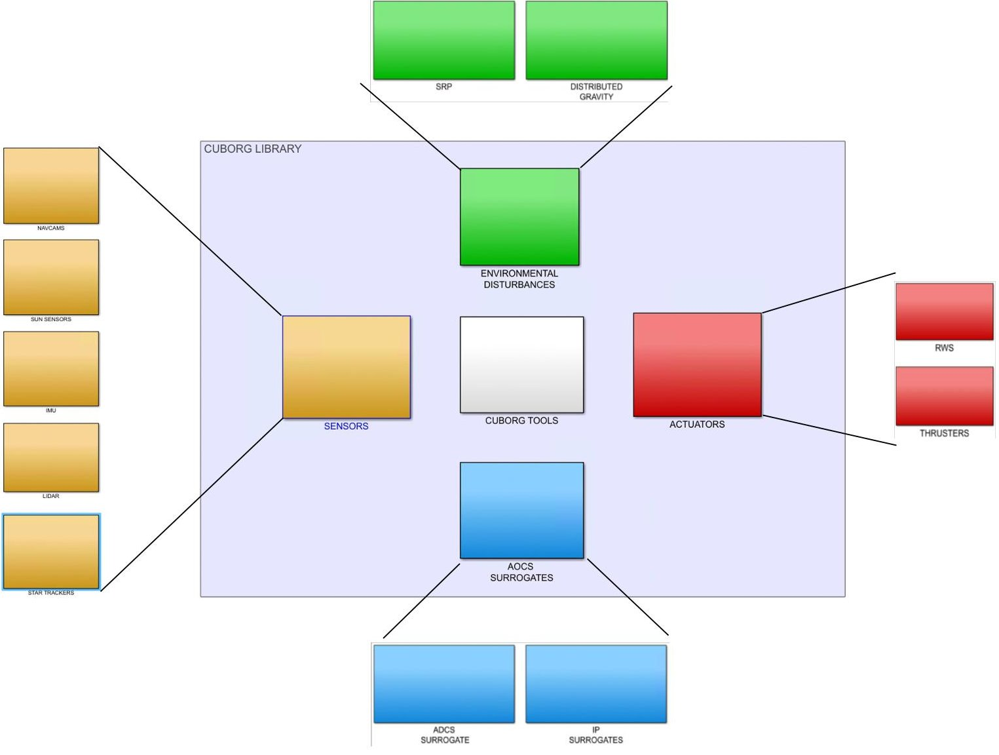

Fig. 2: Exploded of CUBORG library.

GNC flight software applications as mentioned in [16]. The toolbox makes extensive use of the NASA/NAIF SPICE information system $ ^{1} $ . This is done first of all to retrieve the celestial bodies ephemerides to be used in the trajectory propagation. In this way it is sufficient to load the appropriate set of Spacecraft and Planet Kernels (SPK) into the MATLAB kernel pool to simulate a large variety of scenarios. SPICE is then used to manage the majority of reference frame conversions inside CUBORG. In particular celestial reference frames transformations are handled in this way by loading the associated Frame Kernels (FK). On the contrary, onboard reference frames transformations such as the ones involving sensors and actuators frames are not managed with SPICE. Camera Frames (CK) were thought to be used for this purpose but they requires to be attached to an SPK to work properly. However, in a six-degrees-offreedom propagation the trajectory is clearly unknown therefore this was not an option anymore. Thus, a set of utilities is developed in MATLAB to handle spacecraft

internal transformations. Finally physical parameters, such as the planetary constants, can also be retrieved with the NASA library by loading the necessary Planetary Constants Kernels (PCK), and thus reducing the user effort in manually specifying them.

Since calling SPICE from Simulink every time that is needed would have resulted in a computational burden, all the required data are pre-computed in the MATLAB environment before running the simulations ensuring the toolbox efficiency.

An other CUBORG feature worth to be mentioned is the autonomous building capability. Configuring the toolbox manually by selecting the elements from the library and plugging them into the spacecraft section can be an heavy task, particularly for complex architectures. For this reason an additional configuration file has been thought containing all the information on the desired AOCS configuration. A series of utilities is then designed to read this file, search for the specified models in the library and plug them where necessary on the spacecraft board. This optional procedure allows at the

<!-- PDF_PAGE: 5 -->

same time robustness and a user-friendly set up of the toolbox. Similar functionalities are implemented for the selection of CUBORG outputs, allowing to chose only a relevant sub-set of the environment and spacecraft data produced during the simulation.

## 2.2 Synthetic images rendering: CORTO

To test a vision-based GNC system such as the one of Milani, the capability to generate high-fidelity imagery is of paramount importance.

To do so, the Celestial Object Rendering TOol (CORTO) is used, which comprises a combination of Matlab/Simulink, Spice, and Blender to generate high-fidelity synthetic images of celestial objects as function of the spacecraft position and attitude at specific times. In Matlab or Simulink, and through SPICE, the trajectories relative to the spacecraft and a specific celestial object are retrieved, together with the Sun position and the spacecraft and camera attitude. These are processed and sent in a simplified format to the image rendering software, which is based on a python script commanding the Blender rendering software. Both the shape model and the material of the celestial object as well as the properties of the camera are defined in Blender beforehand, according to the specific simulation environment. After an image is rendered in Blender various sources of noise are artificially added.

Blender has been chosen as rendering software since its simplicity, flexibility, its capability to enable python scripting and the large community supporting it. Contrary to other rendering software, Blender is also open-source, which poses a significant advantage and flexibility of use over other alternatives.

With CORTO, high-fidelity synthetic images of Didymos system are created. An example of such image is illustrated in Figure 4.

## 2.3 The optical facility: TinyV3RSE

Even if synthetic images allow for a preliminary characterization of IP performances, V&V against HIL simulations remains a necessary step toward the feasibility assessment for on-board implementation.

In the literature, CIL analysis is performed either with static or with dynamic test benches. The former ones are compact assembly in which a camera is mounted on a fixed support and acquires images from an highresolution screen. A collimator is typically placed between the camera and the screen to simulate realistic illumination conditions as if light was coming from infinity. The assembly is then enclosed into a dark room to accurately reproduce the space environment without external interference. On the contrary, dynamic test benches are typically larger facilities, in which the camera is mounted on a robotic arm that is moving around one or more mock-ups of the celestial body in proximity of which the probe is moving. While light shielding from the external world is still necessary here, proper lighting conditions needs to be reproduced inside the facility. This results in larger, expensive and bulky solutions. The optical facility designed by the DART Group belongs to the first family and is the Tiny Versatile 3D Reality Simulation Environment (TinyV3RSE) [17, 18]. The facility is composed of three main elements: 1) a high-resolution stimulating screen, 2) a camera, and 3) a collimating lens. These three elements are mounted on a dedicated optical supports and placed on an optical breadboard within a black enclosure. The screen and the optical elements are shown in a Computer-Aided Design (CAD) rendering in Figure 5. The design of the facility is outside the scope of this work, the interested reader can find detailed information in Panicucci et al. [18]. TinyV3RSE's hardware used in this work has the following characteristics:

- The camera is a Balser acA1300-22gm (CS-Mount) 2 with a 12 mm C Series Fixed Focal Length Lens. The camera resolution is 1280 pixels $ \times $ 960 pixels with squared pixels of $ 3.75 \ \mu\mathrm{m} \times 3.75 \ \mu\mathrm{m} $

- The screen is a Galaxy S7 phone. It has a resolution of 2560 pixels $ \times $1440 pixels with squared pixels of 44.1 $ \mu $ m $ \times $ 44.1 $ \mu $ m.

- The collimator is a $ \varnothing $ $ 2^{\prime\prime} $ N-BK7 Plano-Convex lens with a focal length of 200 mm.

## 2.4 The external processor: Raspberry Pi-4

An other important property to assess is the feasibility of on-board implementation in terms of computational resources availability. A step forward in proving this feasibility can be obtained by running the generated autocodes on a machine that is more representative of the on-board computer with respect to a common work station. This is the last building element of the simulation framework presented in this paper: the external single board computer. The selected device for this purpose is a Raspberry Pi 4. It has a Broadcom Quad core CortexA72 (ARM v8) 64-bit processor working at 1.5 GHz, 4 GB RAM and run a Raspberry Pi OS $ ^{1} $ . This hardware is selected because on one side its growing popularity

<!-- PDF_PAGE: 6 -->

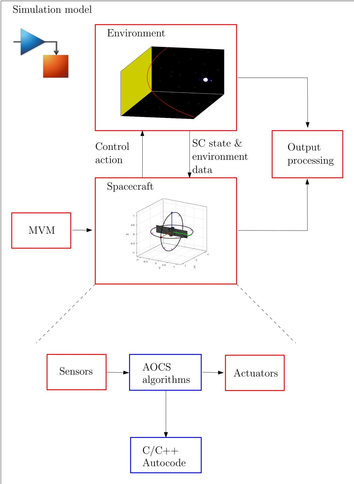

Fig. 3: CUBORG simulation model. Red blocks indicate modules that are build with library elements.

<!-- PDF_PAGE: 7 -->

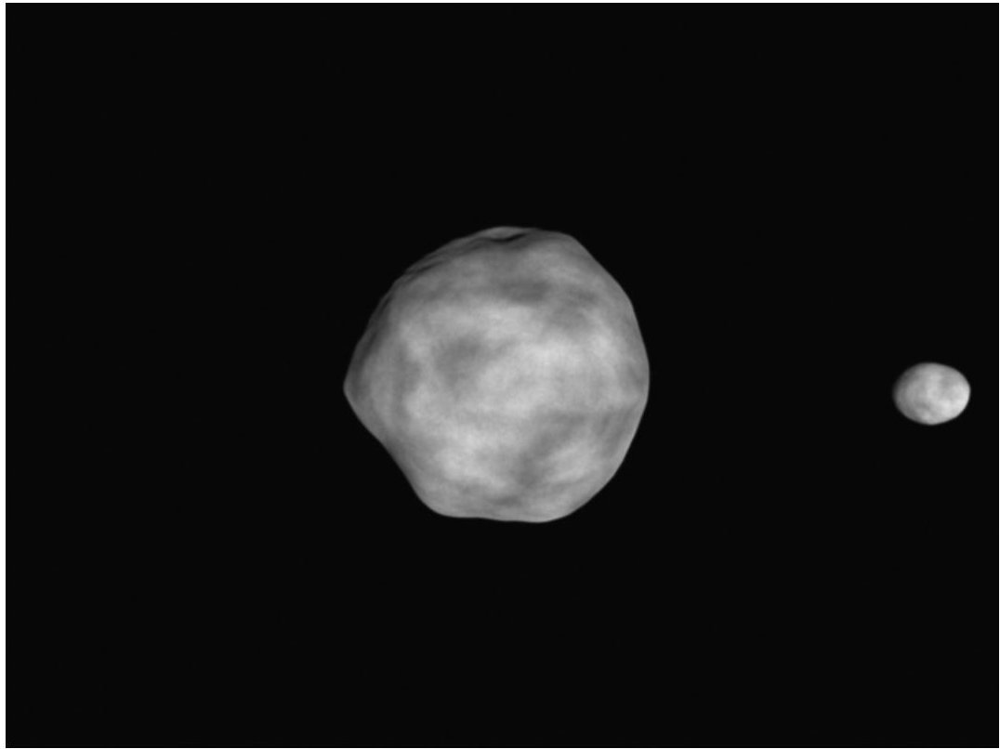

Fig. 4: Example of synthetic image of the Didymos system generated with CORTO

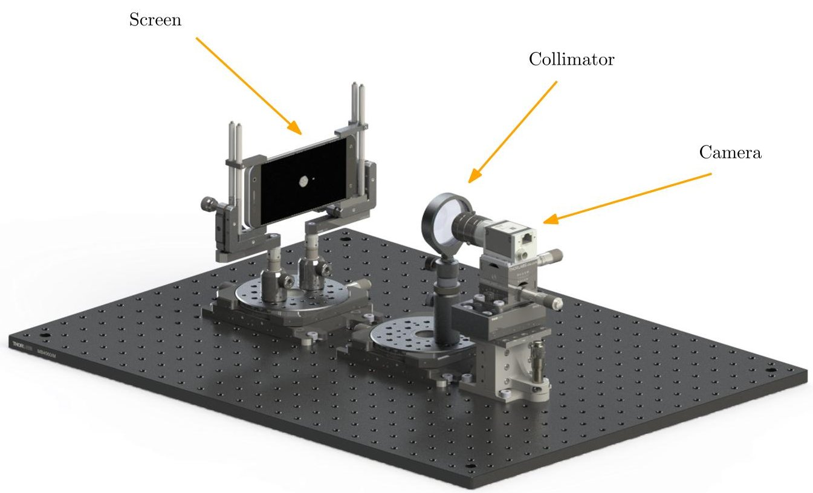

Fig. 5: CAD model of TinyV3RSE, extended from [18]

<!-- PDF_PAGE: 8 -->

makes it more affordable than more sophisticated solutions, and on the other, it is among the boards for which well documented Mathworks packages exists to interaface them with Simulink.

## 2.5 Framework integration and interaction

The four building blocks described above: CUBORG, CORTO, TinyV3RSE and the Raspberry Pi needs to be properly integrated to obtain a unified simulation framework. This is necessary if closed-loop HIL simulations are to be performed.

The interfaces among the different elements can be conceptually divided in two types: hardware and software interfaces. The former are trivial and consist in connecting the work station (WS) on which CUBORG is running with the TinyV3RSE's camera and with the Raspberry Pi with ethernet cables. The screen is instead connected via USB both for power and data transmission. Software interfaces are instead more involving and will be discussed one by one below.

The coupling with the rendering engine is achieved by developing a series of navcam models inside the sensors category of the CUBORG library which are part of the CORTO interfaces. When this models are plugged and executed the inputs required by CORTO are retrieved from the environment, and a communication with Blender is achieved via TCP connection. When the connection is established, Simulink is put on hold and the synthetic image is rendered on the base of the spacecraft pose and the observed scene.

This coupling can be exploited in two ways: 1) to perform IIL simulations and, 2) to perform CIL simulations. In the former case, CORTO is set to render the image at the on-board camera resolution, and once the process is completed the synthetic image is sent back to Simulink the simulation restarts and a byte array is produced as output of the navcam model. When the target is instead on CIL simulations, some further step is necessary because TinyV3RSE is to be coupled. In this case CORTO is set to render the image at the screen resolution, when the rendering is completed the synthetic image is sent to the screen, TinyV3RSE's camera is triggered, the optical device is stimulated by the screen through the collimator and it captures the facility image. If the camera mounted in TinyV3RSE is different from the on-board one, a proper homography transformation is needed to map the facility image into an equivalent on-board camera image. When also this step is finished, the image is sent back to Simulink and the simulation restarts. This process is shown in Figure 6. TinyV3RSE MATLAB utilities are used to drvie the acquisitions. At the moment, no direct connection between Simulink and the

optical facility is achieved. Two MATLAB instances running in parallel are used instead, and a log file is used from both the TinyV3RSE's software and Simulink to mark the events and understand when to proceed.

The simulation framework presented above is easily enriched with the capability of performing PIL simulations. This is achieved by exploiting the Simulink Support Package for Raspberry Pi Hardware $ ^{2} $ that helps managing the Simulink-Raspberry interface. The procedure thus becomes the following: starting from the AOCS software, or a portion of it, a version of autocode is built and deployed on the board before running the simulation. The Simulink package generates a PIL block with same inputs and outputs of the parent model from which the code is generated, but with the proper software interfaces implemented in it. To run the simulation with PIL then, it is sufficient to replace the AOCS software block, or the selected portion of it, with the generated PIL block. The link with the Raspberry is established at the beginning of the simulation, when this model is executed a step function of the code is called on the board, computation is performed and results are returned to Simulink. When deploying the algorithm it is also possible to set up profiling functionalities that helps monitoring the code execution performances. This process is shown in Figure 7. While it is perfectly possible to run a PIL and CIL simulations simultaneously, they are treated separately when applying this methodology to Milani. The reason is that PIL may require several short runs to have a statistical estimation of the computational performances, while CIL may need a few long simulations to properly assess the GNC response.

## 3 Milani vision-based GNC

This section wants to provide the reader with the basic knowledge of how the Milani's GNC subsystem works. Details on the mission analysis are out of the scope of this work, the interested reader can find more information in Ferrari et al. [1], Bottiglieri et al. [11], Ferrari et al. [19]. As already mentioned in Sec. 1 Milani's GNC is indeed characterized by semi-autonomous capabilities enabled by innovative Image Processing techniques [20] and autonomous navigation components, paired with traditional attitude guidance and control methods. In Piccolo et al. [9] a detailed description of the GNC design is proposed. Here the focus is given only to a brief overview of its functionalities. Milani's GNC subsystem has the task to provide a primary pointing direction for a specific target axis in body frame to the Attitude Determination and Control System (ADCS) with the pos-

<!-- PDF_PAGE: 9 -->

$ 7 3 ^{\mathrm {r d}} $ International Astronautical Congress (IAC), Paris, France, 18-22 September 2022. Copyright $ \textcircled{2} 2 0 2 2 $ by the International Astronautical Federation (IAF). All rights reserved.

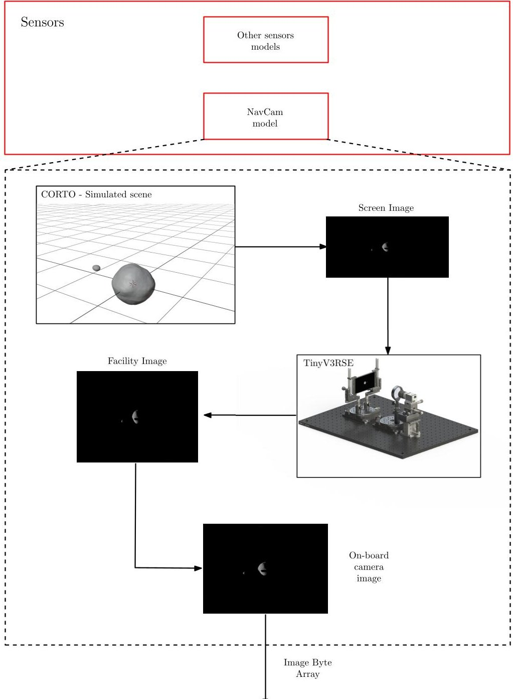

Fig. 6: CUBORG coupling with TinyVERSE, extended from [18].

sibility to switch among Didymos, Dimorphos, Hera or a pre-defined pointing profile. Three guidance strategies are implemented to achieve this task: 1) pointing provided on the base of on-board ephemerides (Reference), 2) target tracking exploiting IP observables (Tracking) and, 3) pointing generated combing an on-board navigation solution with ephemerides data of the targets (Predicted). The former uses the result of the Orbit Determination (OD) uploaded from ground, together with the ephemerides of the asteroids and Hera to compute the pointing direction. This is a fully ground based guidance and is equivalent to uploading directly a pointing profile on-board. The second and third strategy are instead based on the on-board image processing. This detects the asteroids in the camera field-of-view (FOV) and estimates their centre of mass in the image plane. In particular, the image acquired by the navigation camera goes through two different steps in the IP pipeline: the Blobs characterization and the Observable extraction [20]. In the former the image is binarized, a series of morphological operations are performed to reduce the number of obtained blob of pixels and to smooth their geometrical properties, and finally blob analysis is performed to reconstruct the features of each blobs and to assign them to Didymos or Dimorphos. This characterization is further improved for the larger detected body inside the Observable extraction block to extract an estimate of the body center of mass. This can be achieved with three different algorithms, namely Center of Brightness (COB), Weighted Center of Brightness (WCOB), and

<!-- PDF_PAGE: 10 -->

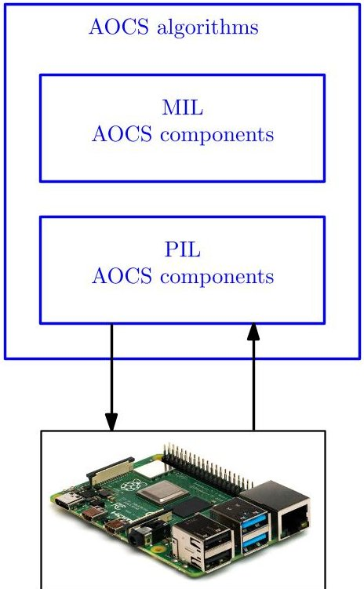

Fig. 7: CUBORG coupling with Raspberry Pi.

Sun Sensor Weighted Center of Brightness (SSWCOB) [21]. The former is the simplest one, and exploits centroiding of the largest blobs of pixels in the image. On the other hand, the weighted strategies are data-driven methods, as deeply explained in [22] that improve the estimation by applying a correction depending on range and phase angle. The difference between the two is that while in the SSWCOB the Sun direction is read directly from Sun sensors, in the WCOB this information is extracted from the image.

The IP observables can be used by the GNC either in a direct way, when Tracking pointing is enabled, or in an indirect way, when Predicted pointing is used. The former reads the CoF of the target body from the IP and computes the attitude rotation necessary to bring the body at the center of the FOV. On the contrary, Predicted does the same of Reference, but instead of using the spacecraft position provided by OD, exploits the navigation solution computed by an Extended Kalman Filter (EKF) on-board. This, in fact, estimates the spacecraft position and velocity correcting the solution of a trajectory propagation with IP observables and range measurements. While autonomous transition among one strategy and the others depending on the GNC information availability is implemented, Predicted is considered the baseline approach being able to provide accurate pointing in a larger variety of mission scenarios [9]. Pointing performances with this three methodologies, depend on the algorithm executed inside the image processing.

In this work, the Milani AOCS architecture is implemented in CUBORG, as shown in the spacecraft section scheme of Figure 8. The sensors set include models for an Inertial Measurement Unit (IMU), a Star Tracker (ST), a Sun Sensor (SS), a NavCam and a Laser Imaging Detection And Ranging (LIDAR). Reaction Wheels (RW) and Thrusters are instead selected in the actuators section of the simulator. The AOCS module, contains the IP and the GNC algorithms developed by the team, together with a surrogate model of the spacecraft ADCS tuned to mimic its performances. In this paper two types of analyses are shown: the first one is associated with autocode profiling during PIL simulations, to measure the computational effort of IP and GNC depending on the executed algorithm. The second set, instead, shows an application of closed-loop CIL analyses to the Milani GNC subsystem. For all the simulations shown in this paper, and reported in Table 1, the initial condition is set at as the nominal state of the spacecraft at the beginning of the first science arc [11], different simulation times are selected. Furthermore, a Monte Carlo approach is followed for PIL simulations to gain some statistical insight on the computational performances.

It is important to remark that these results have the sole purpose of showing an example of how this methodology can be applied within the framework of activities performed at DART lab. A proper HIL validation would require extensive simulations with this framework on all trajectories arcs and under nominal and off-nominal conditions, which are out of the scope of this work.

## 4 Results

First of all the results of the two processor-in-the-loop simulations are analyzed. PIL analyses allow to retrieve different metrics such as the overall execution time, number of calls, profiling of the code sections or CPU utilization. An estimation of the single call execution time can be obtained by dividing the overall execution time by the number of calls. Figures 9 ans 10 show the average CPU time per call, from a series of run, respectively for simulations PIL-A,B,C and PIL-D,E,F.

No significant difference is observed in the GNC execution time using the three different algorithms and the average computational time is observed to be well below the software working frequency of 1Hz. The reason for this is that the GNC task in Milani is relatively simple and the heaviest part of the algorithm, the on-board EKF, is always running in background regardless from the pointing strategy exploited. On the other hand, looking at Figures 9, a characteristic trend is identified. The instances executed with WCOB take systematically more than the others to run. This expected phenomena is due to the additional overhead

<!-- PDF_PAGE: 11 -->

$ 73^{\mathrm{rd}} $ International Astronautical Congress (IAC), Paris, France, 18-22 September 2022. Copyright $ \textcircled{2} 2 0 2 2 $ by the International Astronautical Federation (IAF). All rights reserved.

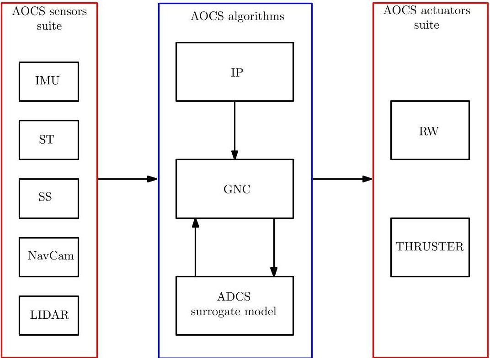

Fig. 8: Architecture of Milani's Attitude and Orbit Control System.

<table border="1"><tr><td>Simulation ID</td><td>Description</td><td>Duration &amp; Instances</td></tr><tr><td>PIL-A</td><td>IP PIL simulation with SSWCOB</td><td>30×12h</td></tr><tr><td>PIL-B</td><td>IP PIL simulation with WCOB</td><td>30×12h</td></tr><tr><td>PIL-C</td><td>IP PIL simulation with COB</td><td>30×12h</td></tr><tr><td>PIL-D</td><td>GNC PIL simulation with Predicted</td><td>30×6h</td></tr><tr><td>PIL-E</td><td>GNC PIL simulation with Tracking</td><td>30×6h</td></tr><tr><td>PIL-F</td><td>GNC PIL simulation with Reference</td><td>30×6h</td></tr><tr><td>CIL-A</td><td>CIL simulation using Predicted with SSWCOB</td><td>1×12h</td></tr><tr><td>CIL-B</td><td>CIL simulation using Predicted with WCOB</td><td>1×12h</td></tr><tr><td>CIL-C</td><td>CIL simulation using Predicted with COB</td><td>1×12h</td></tr><tr><td>CIL-D</td><td>CIL simulation using Tracking with SSWCOB</td><td>1×12h</td></tr><tr><td>CIL-E</td><td>CIL simulation using Tracking with WCOB</td><td>1×12h</td></tr><tr><td>CIL-F</td><td>CIL simulation using Tracking with COB</td><td>1×12h</td></tr></table>

Tab. 1: List of the simulations performed.

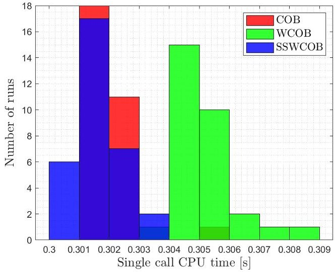

Fig. 9: CPU time in seconds for the Image Processing.

necessary for this algorithm to autonomously estimate the Sun direction and phase angle. Moreover, the computational cost of the IP algorithms is observed to be several order of magnitudes larger than the GNC one. Observing the code profiling, the computational bottleneck is identified in the morphological operations performed in the Blobs characterization block that are responsible for the 90% of the computational cost. This impose a practical limitation on the IP execution frequency which needs to allow for the image array to be fully processed before receiving the next one. On the proposed hardware used in this work the image processing execution takes always less than a second

<!-- PDF_PAGE: 12 -->

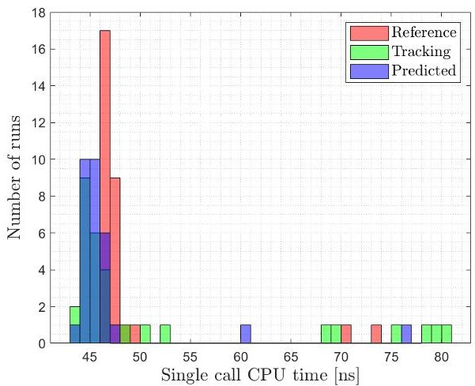

Fig. 10: CPU time in nanoseconds for the GNC.

in all the runs suggesting little impact on the selection of the camera acquisition frequency. However further analysis with a more representative hardware may be needed to have a clearer picture of the on-board performances.

Results of camera-in-the loop simulations are shown and discussed in the following. Navigation filter performances are reported in Figure 11. Solid lines represents the estimated state component in camera frame, for the three different IP algorithms while dashed lines indicates the associated 3 $ \sigma $ values. Only the case of Predicted pointing is shown, CIL-A to CIL-C, since this are the only cases in which the solution of the navigation filter affects the pointing performances. The estimated state falls for the majority of the simulation within the three sigma value for WCOB and SSWCOB. With the COB the errors on the estimation of Didymos' center of mass are larger and this leads the x component outside the bound. This is a well known behavior documented in Piccolo et al. [9] due to the lower accuracy of this method with respect to the others. However, it is reminded that the COB is thought to be used in contingency scenarios in which the primary objective is to keep the target inside the camera FOV and not to achieve precise pointing.

Despite this convergence issue, the error on the estimated position always fall within the 10% of the true range as shown in Figure 12. The jump observed is due to the fact that the simulated arc belongs to the nominal trajectory profile, meaning that no dispersion is introduced. At the beginning of the arc, while waiting for the filter to converge, a navigation solution is provided by the GNC on the base of the on-board ephemerides. These, despite being perturbed with the expected knowledge are very close to the real trajectory. Therefore when the filter reaches convergence and start correcting the estimation, the estimation actually gets slightly worse. Pointing performances with Tracking and Predicted are shown respectively in Figure 13 and 14. The former exhibits the typical oscillating behaviour due to the re-centering of Didymos at the centre of the camera field of view when a new image is acquired. On the other hand, when Predicted pointing is enabled smaller jumps are observed in the pointing accuracy in correspondence of new images acquisition. These are due to the the correction step in the on-board EKF that updates the estimated spacecraft states used to retrieve the pointing.

## 5 Conclusion

This paper presented a novel validation framework that combines high fidelity simulations with hardware and processor in the loop testing for CubeSats proximity operations to small bodies. The proposed methodology allows to perform hardware feasibility and robustness assessments; this can be done before the platform integration during the design phase identifying bottlenecks and allowing for rapid re-iteration in the design. This approach is applied to the Milani IP and GNC subsystems showing an example of navigation, pointing and computational performances. A final consideration is necessary at this point: results obtained on hardware that differs from the actual on-board one provides only preliminary results. One one hand, the homographic transformation from the Tinyv3RSE camera image into the mission camera image may introduce distorsions which are currently not investigated. On the other hand, when performing processor in the loop simulations with a single board computer such as the Raspberry Pi many factors come into play that may affect the result in terms of computational cost. These include for example the processor working frequency and the number of cores exploited during the computation. A more accurate approach to adopt whenever the real computer is not available, would be to tune the tested hardware in a proper way to mimic the performance of the on-board components or alternatively mapping the lab results with an estimated flight computational cost on the base of the floating point operations capability of the two [23]. Finally, even in this case additional factors such as the Random Access Memory (RAM) saturation are still not taken into account. Processing large data array such as the ones associated with images may indeed represent a serious limitation from this point of view. A proper similitude taking into account all these effects, is to be implemented to accurately map lab to on-board performances. All of these open points constitute the base for future iterations and improvements of the developed methodology.

<!-- PDF_PAGE: 13 -->

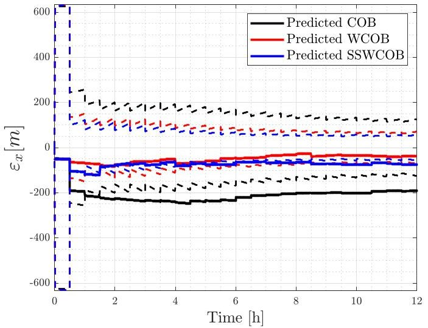

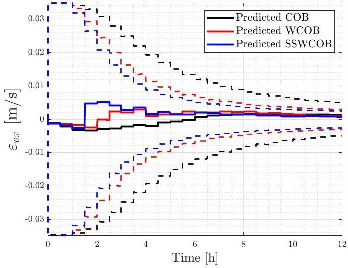

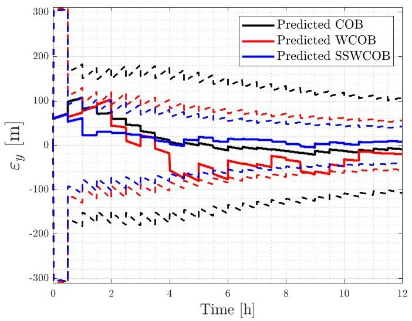

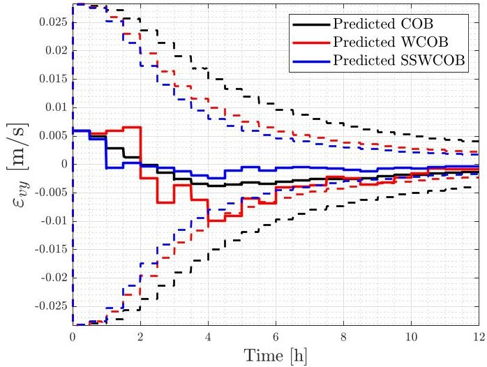

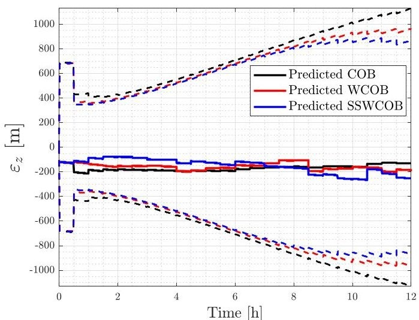

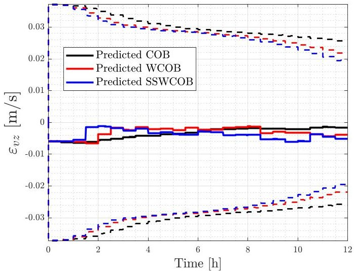

Fig. 11: Navigation performances. The plots show the estimated spacecraft state in camera frame, solid lide, against the associated 3 $ \sigma $ value, dashed line, for the three simulations in Predicted.

<!-- PDF_PAGE: 14 -->

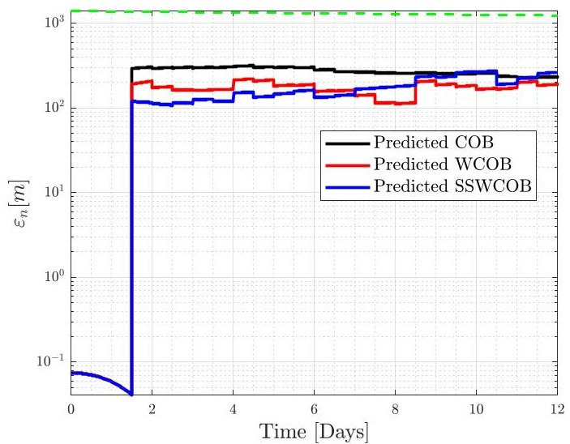

Fig. 12: Navigation performances. Solid lines show the estimated range, the dashed line represent the 10% of the true value.

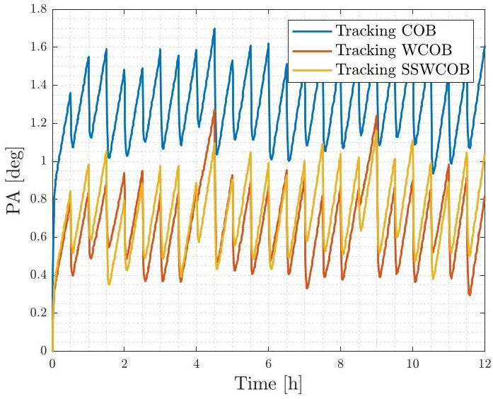

Fig. 13: Pointing performances in Tracking.

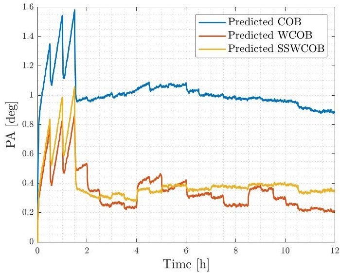

Fig. 14: Pointing performances in Predicted. Solid lines indicate the pointing accuracy.

## Acknowledgments

Milani activities are developed under the ESA contract No. 4000131925/20/NL/GLC for the mission phases A/B/C/D/E of Milani. The authors would like to acknowledge the support received by the whole Milani consortium, which is led by Tyvak International. Mattia Pugliatti and Francesco Topputo would like to acknowledge the funding received from the European Union's Horizon 2020 research and innovation programme under the Marie Skłodowska-Curie grant agreement No 813644. Paolo Panicucci and Francesco Topputo would like to acknowledge the funding within EXTREMA, a project that has received funding from the European Research Council (ERC) under the European Union's Horizon 2020 research and innovation programme (Grant Agreement No. 864697).

## Bibliography

[1] Fabio Ferrari, Vittorio Franzese, Mattia Pugliatti, Carmine Giordano, and Francesco Topputo. Preliminary mission profile of Hera's Milani CubeSat. Advances in Space Research, 67(6):2010-2029, 2021.

[2] Patrick Michel, Michael Küppers, and Ian Carnelli. The Hera mission: European component of the ESA-NASA AIDA mission to a binary asteroid, Pasadena, California, 2018.

[3] Patrick Michel, Andrew F Cheng, and Michael Küppers. Asteroid Impact and Deflection Assessment (AIDA) mission: science investigation of a binary system and mitigation test. In European Planetary Science Congress, volume 10, pages 123-124, 2015.

[4] Andrew F Cheng, Andrew S Rivkin, Patrick Michel, Justin Atchison, Olivier Barnouin, Lance Benner, Nancy L Chabot, Carolyn Ernst, Eugene G Fahnestock, Michael Kueppers, et al. AIDA DART asteroid deflection test: Planetary defense and science objectives. Planetary and Space Science, 157:104115, 2018.

[5] Özgür Karatekin, Etienne Le Bras, Stefan Van val, Alain Herique, Paolo Tortora, Birgit Ritter, Mehdi Scoubeau, and Victor Manuel Moreno. Juventas Cubesat for the Hera mission. In 15th European Planetary Science Congress, 2021.

[6] Patrick Michel et al. The ESA hera mission: Detailed characterization of the DART impact outcome and of the binary asteroid (65803) didymos.

<!-- PDF_PAGE: 15 -->

The Planetary Science Journal, 3(7):160, jul 2022. doi:10.3847/psj/ac6f52. URL https://doi.org/ 10.3847/psj/ac6f52.

[7] Tomas Kohout, Antti Nasilä, Tuomas Tikka, Mikael Granvik, Antti Kestilä, Antti Penttilä, Janne Kuhno, Karri Muinonen, Kai Viherkanto, and Esa Kallio. Feasibility of asteroid exploration using CubeSats ASPECT case study. Advances in Space Research, 62(8):2239-2244, 2018. ISSN 0273-1177. doi:https://doi.org/10.1016/j.asr.2017.07.036.

[8] Fabrizio Dirri et al. VISTA Instrument: A PCM-Based Sensor for Organics and Volatiles Characterization by Using Thermogravimetric Technique. In 2018 5th IEEE International Workshop on Metrology for AeroSpace (MetroAeroSpace), pages 150-154. IEEE, jun 2018. doi: 10.1109/MetroAeroSpace.2018.8453532.

[9] Felice Piccolo, Antonio Rizza, Mattia Pugliatti, Vittorio Franzese, Claudio Bottiglieri, Carmine Giordano, Fabio Ferrari, and Francesco Topputo. Design of the vision-based GNC subsystem of Hera's Milani mission. In IAC-22,B4,8,6,x72031, 2022.

[10] Felice Piccolo, Mattia Pugliatti, Paolo Panicucci, and Francesco Topputo. Toward verification and validation of the Milani image processing pipeline in the hardware-in-the-loop testbench TinyVERSE. In AAS 22-116, 2022.

[11] Claudio Bottiglieri, Felice Piccolo, Antonio Rizza, Mattia Pugliatti, Vittorio Franzese, Carmine Giordano, Fabio Ferrari, and Francesco Topputo. Mission Analysis and Navigation Assessment for Hera's Milani CubeSat. In 4S Symposium 2022, 2022.

[12] Francesco Topputo and Chrysa Avdellidou. Lunar Meteoroid Impact Observer (LUMIO): A CubeSat at Earth-Moon L2. In European Planetary Science Congress, pages EPSC2018-320, 2018.

[13] Francesco Topputo, Yang Wang, Carmine Giordano, Vittorio Franzese, Hannah Goldberg, Franco Perez-Lissi, and Roger Walker. Envelop of reachable asteroids by M-ARGO CubeSat. Advances in Space Research, 67(12):4193-4221, 2021.

[14] Louise Lindblad. Modelling and Simulation of GNC/AOCS Systems for Conceptual Studies. Master's thesis, Royal Institute of Technology Department of Mechanics and the European Space Research and Technology Centre (ESTEC), Stockholm, Sweden and Noordwijk, The Netherlands, 2013.

[15] Patrick W Kenneally, Scott Piggott, and Hanspeter Schaub. Basilisk: A flexible, scalable and modular astrodynamics simulation framework. Journal of aerospace information systems, 17(9):496-507, 2020.

[16] European Space Research and Techbology Centre (ESTEC). Guidelines for the Automatic Code Generation for AOCS/GNC Flight SW Handbook: Volume 1 - General concepts.

[17] Mattia Pugliatti, Vittorio Franzese, Paolo Panicucci, and Francesco Topputo. TINYV3RSE: The DART Vision-Based Navigation Testbench. In AIAA SCITECH 2022 Forum, 2022. doi:10.2514/6.2022-1193.

[18] Paolo Panicucci, Mattia Pugliatti, Vittorio Franzese, and Francesco Topputo. Improvements and applications of the DART vision-based navigation test-bench TinyV3RSE. In AAS GN&C conference, 3 - 9 February 2022, 2022.

[19] Fabio Ferrari, Vittorio Franzese, Mattia Pugliatti, Carmine Giordano, and Francesco Topputo. Trajectory Options for Hera's Milani CubeSat Around (65803) Didymos. The Journal of the Astronautical Sciences, 68(4):973-994, 2021.

[20] Mattia Pugliatti, Vittorio Franzese, Antonio Rizza, Felice Piccolo, Claudio Bottiglieri, Carmine Giordano, Fabio Ferrari, Francesco Topputo, et al. Design of the on-board image processing of the Milani mission. In 44th AAS Guidance, Navigation and Control Conference, 2022.

[21] Mattia Pugliatti, Antonio Rizza, Felice Piccolo, Vittorio Franzese, Claudio Bottiglieri, Carmine Giordano, Fabio Ferrari, and Francesco Topputo. The Milani mission: overview and architecture of the optical-based GNC system. In AIAA Scitech 2022 Forum, 2022.

[22] Mattia Pugliatti, Vittorio Franzese, and Francesco Topputo. Data-Driven Image Processing for Onboard Optical Navigation Around a Binary Asteroid. Journal of Spacecraft and Rockets, 59(3):943- 959, 2022.

[23] Thomas Claudet, Kento Tomita, and Koki Ho. Benchmark analysis of semantic segmentation algorithms for safe planetary landing site selection. IEEE Access, 10:41766-41775, 2022. doi:10.1109/ACCESS.2022.3167763.