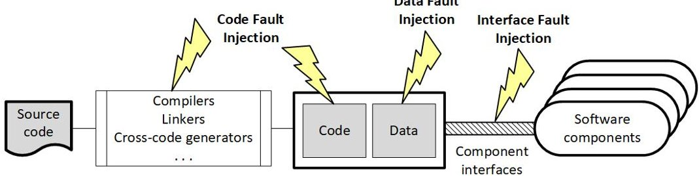
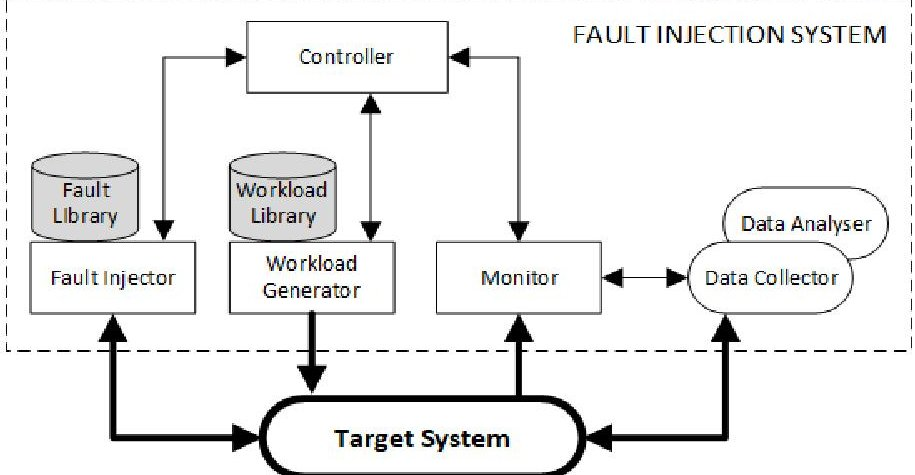
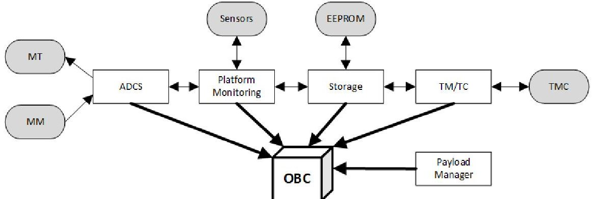
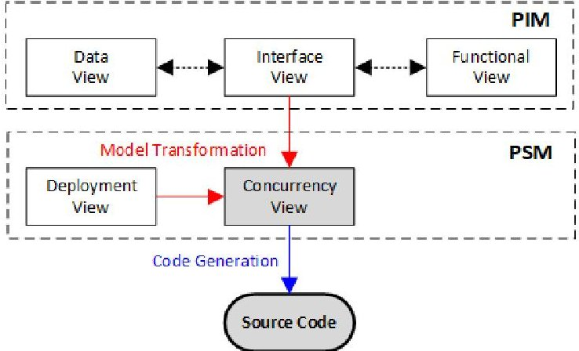
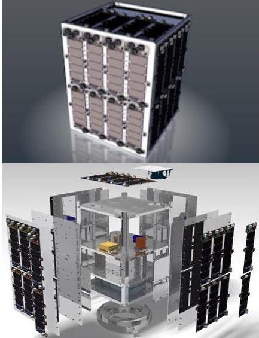
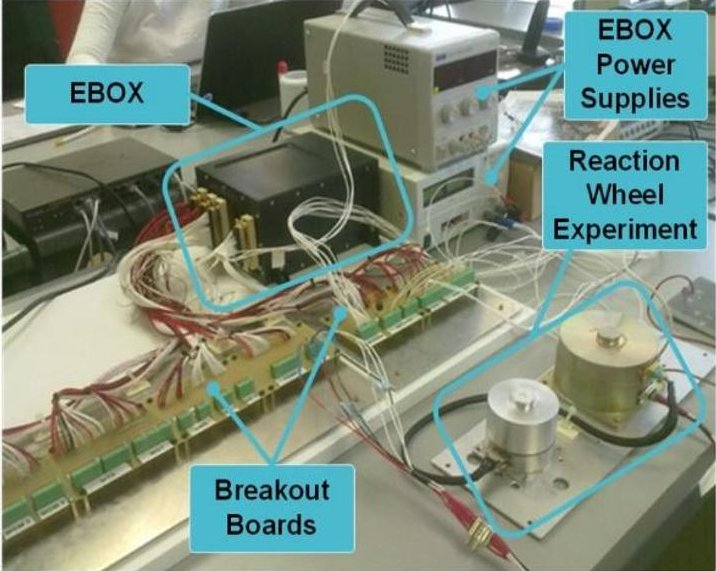
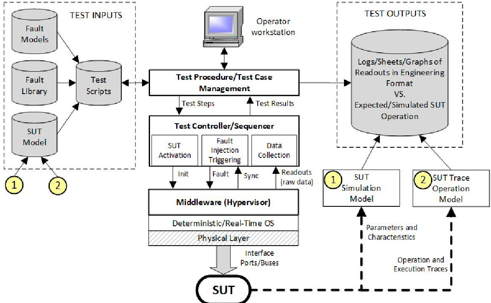
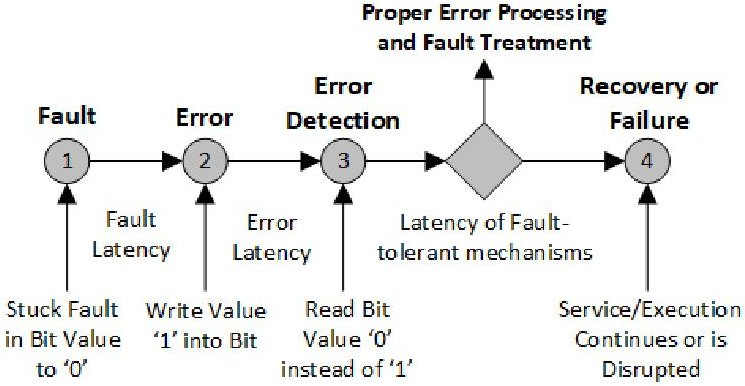

<!-- PDF_PAGE: 1 -->

# Integration of COTS Processing Architectures in Small Satellites for Onboard Computing using Fault Injection Testing Methodology

Jose-Carlos Gamazo-Real $ ^{1} $ [0000-0003-3918-3265] , Juan Rafael Zamorano-Flores $ ^{2} $ [0000-0002- 6006-4335] , Ángel Sanz-Andrés $ ^{3} $ [0000-0001-5890-6065]

$ ^{1,2,3} $ University Institute of Microgravity "Ignacio Da Riva" (IDR), Universidad Politécnica de Madrid, 28031 Madrid, Spain

{josecarlos.gamazo, juanrafael.zamorano, angel.sanz.andres} @upm.es

Abstract. Over the last decade, the interest of the space industry has increased towards smaller missions with reduced instruments. Advances in miniaturization technologies for electronics have increased the development of small spacecrafts, such as nanosatellites and microsatellites, from commercial-off-the-shelf (COTS) devices of low size, weight, and power. However, the effects of harsh space environment conditions on COTS electronic devices limit their use in high-performance multicore and heterogenous architectures, such as onboard edge computing based on Graphics Processing Units (GPU) for Artificial Intelligence (AI) applications. This article analyses the main considerations for adopting the Fault Injection Testing (FIT) methodology for software-intensive developments based on COTS, primarily intended to test embedded faults that emulate potential faults triggering to allow verification of fault detection, isolation, reconfiguration, and recovery capabilities in fault-tolerant and safety-critical systems. Two variants of techniques can be considered in the FIT methodology, based on hardware and software, but it is the software FIT variant (SFIT) that provides an inexpensive and time-efficient framework to replicate the fault triggering effects by injecting faults into code, data, and interfaces. A proposal is presented to apply the FIT methodology in the testing of future versions of the UPMSat-2 microsatellite payload at Spanish University Institute of Microgravity "Ignacio Da Riva" (IDR/UPM). The scope of the proposed methodology aims to facilitate the future validation of satellite real-time control systems, designed with model-driven engineering processes, and the future onboard integration of high-performance COTS GPUs to process sensor-fusion payload data and to implement auxiliary controllers with AI computing techniques.

Keywords: Fault Injection Testing (FIT), Commercial-off-the-self (COTS), Small satellite, Onboard computing, Graphics Processing Unit (GPU), Fault-tolerant, Safety-critical, Real-time control system, Sensor-fusion payload data.

<!-- PDF_PAGE: 2 -->

## 1 Introduction

The satellite launch mass gradually dramatically increased in early 2000, such as Envisat Earth Observation satellite or Cassini planetary exploration missions, envisioned to reduce the cost per weight of payload launched and to increase synergistic measurements by incorporating multiple instruments in a single satellite. However, issues related to micro-vibrations, electromagnetic compatibility, and the different maturity levels of instruments could create significant engineering problems during the development. Furthermore, over the last decade the space industry has experienced an increased interest towards smaller missions with reduced instruments or single sensors, and to build these small spacecrafts from readily available, low cost, low power and compact commercial-off-the-shelf (COTS) components. The small satellites or nanosatellites, were initially envisioned as educational tools or low-cost technology demonstrators, such as the CubeSats [32, 37], with several studies to increase the onboard autonomy and data processing [7]. In the last ten years, more than eight hundred nanosatellites had been launched [33] and most of them based in the CubeSat standard [31].

In the development of CubeSats missions, the COTS technology has played a relevant role with respect to radiation-hardened (rad-hard) space qualified devices. Radhard devices often lag several generations behind their terrestrial counterparts with regards to computational resources. As the data volume and bottleneck are now increasing exponentially, more sophisticated processing algorithms will need to be implemented onboard, such as those based on Artificial Intelligence (AI), so the onboard processing resources are becoming a growing priority [13]. To cover those needs it is important to minimize the size, weight, and power ratios, so the devices for reconfigurable and heterogeneous computing has increased their relevancy, such as Field-programmable Gate Arrays (FPGA), general-purpose processors (GPP), and Graphics Processing Units (GPU) [5]. The increasing demands of onboard sensor and autonomous processing has focused the research on GPUs in space, which has added remarkable advances in AI processing. To develop more capable science instruments that capture larger volumes of data onboard [7], several worldwide actions have appeared such as European Space Agency (ESA) $ \Phi $ -Lab for AI for Earth Observation [15, 16].

The short development life cycle and the low cost of small satellites have motivated the growing number of missions, but faster and cheaper space projects do not guarantee the success in orbit. The lack of good practices on design, assembly and tests has been considered as one of the major causes to nanosatellite mission failures, so the use of verification and validation techniques are required, such as the CubeSat standard [31]. A remarkable test method is the Fault Injection Testing (FIT) to perform verification and validation activities in a low or non-invasive manner. FIT was first employed in the 1970s to assess the dependability of fault-tolerant computers, but not until the mid 1980s academia began actively using fault injection to conduct experimental research [11]. This method considers the fault tolerant computing as the main need for space computers and checks the performance of fault tolerant strategies, such as the information redundancy given by error detection and correction coding (EDAC), or cyclic redundancy check. A real example is the fault emulator mechanism used in the NanoSatC-Br2 CubeSat project for robustness testing of interoperable software-

<!-- PDF_PAGE: 3 -->

intensive subsystems [4]. Some studies consider that FIT is an effective solution to the problem validating highly reliable computer systems [11].

With this approach, this article covers architectural and software aspects for the use of FIT in the integration of COTS devices in small satellites, with a special interest on GPUs for onboard AI processing. The presented work analyses the main effects of the space environments over COTS components as a limitation to their use, and drawn the availability of COTS GPUs for heterogenous computing in space projects despite their limitations. The description of FIT as testing methodology is presented and the proposal for its application in future versions of the UPMSat-2 microsatellite is described, where the control system of the current operational version was designed under a modeldriven engineering perspective [29]. In addition, the article proposes a generic test system based on FIT for the development of space systems, where the manufacturers' proprietary tools that are specific to each device or system have typically been used.

The remainder of this article is structured as follows. In Section 2, the main effects of the space environment over electronics devices is explained, followed by the analysis of these effects over COTS devices and some examples of the specific behaviour of COTS GPUs in space. Then, in Section 3, a description of the typical software fault tolerant techniques in COTS is included, followed by the description of the FIT methodology with emphasis on the software variant. In Section 4, the UPMSat-2 project is described from an architectural and software perspective, and a proposal for application of the software FIT methodology in future versions of the UPMSat-2 is presented as a complement to the existing testing tools and as an attempt to reduce dependency on using manufacturers' proprietary tools in low-cost small space missions. Finally, the conclusions and future work are drawn in Section 5.

## 2 Motivation Scenario: COTS Processors for High-performance Processing in the Space Environment

## 2.1 COTS Devices in Space

In traditional onboard data handling and processing systems, a qualified rad-hard onboard computer (OBC) is connected to redundant subsystems with a high integrity bus, such as MIL-STD-1553 or RS-422 [13], as in the UPMSat-2 studied in the Section 4. Rad-hard devices are designed to provide levels of immunity to the radiation effects, typically the total ionizing dose (TID) exceed 100 krad up to over 1 Mrad, single event upset (SEL) immunity above 75 MeVcm2/mg, and non-destructive single event effects (SEE) that typically appear once in 20 years [7]. Recent trends in the space industry require a more complex data handling, autonomous decisions, and massive signal processing, which opens the way to the COTS devices as competitors of conventional rad-hard ones, so currently ESA and United States are moving to accept COTS devices in space [30]. However, when non-rad-hard COTS devices are deployed in space can be severely harmed by harsh environmental conditions of extreme temperatures, high levels of ionizing radiation, etc. as they typically operate in a range of $ - 3 0 $ to $ + 7 0 $ $ ^{\circ} \mathrm{C} $ and will suffer from TID and SEEs owing to cosmic particles. Space avionics are typically

<!-- PDF_PAGE: 4 -->

tolerant to 100-300 krad TID, but radiation tolerance is 10-50 krad in low Earth orbits (LEO) which can be tolerable by COTS for a short period of time [35] and COTS devices can be validated at lower cost with extensive radiation testing [19].

## 2.2 High-performance Processing in Space with COTS GPUs

Trends in space missions show the generalization of computing requirements, so new generation flight computing systems must provide a heterogeneous architectural support by combining different technologies of processors, taking into account that a budget of 10 W is enough to deploy many-core DSPs, GPUs, or FPGAs to accelerate a conventional space-qualified CPU by one to three orders of magnitude [27, 30]. As hardware accelerators, the FPGAs normally provide an efficient data interface to payloads and GPUs implement a highly parallel Single-Instruction Multiple-Data architecture for onboard processing tasks [13, 14]. However, GPUs are not currently manufactured to provide radiation tolerance at the silicon gate level, which is an obstacle in their deployment for space systems. To overcome these problems, techniques of Radiation Hardening by Software Design could be implemented to ensure that radiation effects are mitigated [39, 41], such the NASA studies with Nvidia and AMD GPUs [7, 8].

## 3 Software-Based FIT Methodology

## 3.1 Description of the FIT Methodology

Scalable architectures and multicore processors have a range of capabilities for fault tolerance and recovery needed in radiation fields to support software-intensive onboard deployments. Typically, one of the most common methodologies for characterising the error resilience of a system is to perform beam testing, which uses a radiation source to radiate a physical system under test (SUT) and analyse the probability that a hardware gate-level error propagates to a software application. However, the radiation rates are difficult to control and experiments can be extremely costly. It limits the validation of small satellite missions in the so-called New Space industry [1], such as the projects of Airbus OneWeb [2], or SpaceX Starlink [40] to provide Internet access globally with a fleet of low-cost and high-performance satellites manufactured at high volumes.

Considering the increasing use of small satellite missions, such as nanosatellites or microsatellites, a faulty behaviour of New Space payload subsystems can be expected [4], as the satellite integration process includes a growing number of software functions. With this perspective, this article considers the FIT methodology as a valid approach for identification and comprehension of faulty events when the behaviour of a subsystem is characterised in the prototype, operation and integration phases [11]. FIT consists of testing the faults embedded in the system that emulate the triggering of potential faults to verify the system capabilities of fault detection, isolation, reconfiguration, and recovery [3], and it is mentioned by some safety standards, such as ISO 26262 and NASA-GB-8719.13. Although recent standards recommend fault injection, it is not yet clear how to use this approach effectively because those standards do not provide

<!-- PDF_PAGE: 5 -->

detailed information [12], even in safety standards such as DO-178B/C. This article proposes a realistic FIT implementation that offers some guidance.

A fault is a deviation in a hardware or software component from its intended function, and can arise during all stages in a system evolution. There are two sets of techniques in the FIT methodology that focused on hardware and interfaces (HFIT) or on software (SFIT). The HFIT variant related to the injection of faults in the interface are for robustness tests and represent a good option for space systems [12]. The SFIT variant provides an inexpensive and time-efficient framework for replicate the effects of physical hardware faults, such as bus and memory faults, by intentionally altering instructions in a controlled manner, or by changing the data at the application level (data corruption). The approaches normally considered for SFIT are code, data, and interface fault injection [4], as shown in Fig. 1. The SFIT becomes a feasible way to achieve better quality in small satellite missions, but it is limited to manipulating only visible states and software accessible blocks in the system architecture [14].

Fig. 1. Typical SFIT approaches.

## 3.2 Software Techniques for Fault Tolerance in COTS Devices

The COTS components could relatively replace rad-hard components by means of software techniques that mitigate the risks posed by the radiation environment, such as:

- Generic Fault Tolerance. They include EDAC and redundancy-based mechanisms for both memory and computational blocks [14]. From redundancy-based techniques, DMR or TMR can be used [38].

- Algorithm-based Fault Tolerance. These techniques consider the encoding of the data and changes in the algorithm to provide a greater error resilience, but they are not applicable for all algorithms, which promotes the use of the Generic ones [14].

- Reboot. A technique to mitigate the effects of SEE is to perform frequent reboots, but the frequency varies with the technology from weeks to days [7].

- Middleware. It is software layer between the application and the operating system to provide resource, fault, and power management [7]. It is an option used to overcome the reboot limitation, such as the Troxel Aerospace middleware [42].

<!-- PDF_PAGE: 6 -->

## 3.3 Deployment of SFIT for Fault-tolerant and Safety-Critical Systems

The SFIT techniques are attractive because they do not require expensive hardware and the realism of fault injection is an important condition for reproducing the faulty behaviours. Studies observed the same trend in the distribution of faults where algorithm faults dominate, assignment and checking faults have approximately the same weight, and interface and function faults are less frequent [12]. The objective of a FIT methodology is not only the estimation of coverage and latency parameters for analytical dependability models, but also the evaluation of other measures such as reliability, availability, and mean time between failures that are the basic characterisation of fault-tolerant and safety-critical systems.

Software faults are caused by the incorrect specification, design, or coding of a program. Although software does not physically break after being installed in a computer system, latent faults or bugs in the code can surface during operation especially under unusual workloads and extreme environments such as space. For this reason, SFIT is used primarily for testing software that implements fault-tolerance mechanisms. Fig. 2 shows a generic FIT environment, which typically consists of the target system plus a fault injector, workload generator, controller, monitor, data collector, and data analyser [21]. The deployment of a FIT methodology requires selection of a fault model, such as the Stuck-at Fault model for permanent faults and the Inversion model for studies of transients. After choosing the fault model, a method to inject the faults into the system shall be determined, such as the Signal Corruption method to inject faults in interfaces, the State Mutation method that halt the normal processing, and the Trace Injection method to periodically sample machine states or record memory references [11].

Fig. 2. Generic architecture of a FIT environment [21].

The development of fault-injection tools for SFIT accelerates the injection and measurement processes, enabling accurate results to be obtained in the shortest time using a formalised methodology in conducting automated experiments on a variety of systems. Table 1 shows examples of tools for SFIT automation developed in different institutions and companies, mainly universities due to the scientific and innovative nature of this methodology.

<!-- PDF_PAGE: 7 -->

Table 1. Fault-injection tools developed for SFIT automation [11, 12, 21].

<table border="1"><tr><td>Tool</td><td>Description</td><td>Developer</td><td>Characteristics</td></tr><tr><td>FERRARI</td><td>Fault and Error Automatic Real-Time Injection</td><td>University of Texas (USA)</td><td>Software traps to inject CPU, memory, and bus faults.</td></tr><tr><td>FTAPE</td><td>Fault Tolerance and Performance Evaluator</td><td>University of Illinois (USA)</td><td>Fault injection as bit-flips into registers in CPU modules and memory locations.</td></tr><tr><td>DOCTOR</td><td>Integrated Software Fault Injection Environment</td><td>University of Michigan (USA)</td><td>Fault injection on CPU, memory, and network with timeouts, traps, and code.</td></tr><tr><td>XCEPTION</td><td>Enhanced Automated Fault Injection Environment</td><td>University of Coimbra (Portugal)</td><td>Inject faults using debugging and performance monitoring in processors.</td></tr><tr><td>FIAT</td><td>Fault-Injection-Based Automated Testing Environment</td><td>Carnegie Mellon University (USA)</td><td>Set and clear bytes in the memory images of programs.</td></tr><tr><td>DEPEND</td><td>Dependability and performance evaluation</td><td>University of Illinois (USA)</td><td>Fault-tolerant analysis with permanent, transient, and workload fault injection.</td></tr><tr><td>REACT</td><td>Reliable Architecture Characterization Tool</td><td>Univ. Massachusetts-Texas (USA)</td><td>Abstracts multiprocessor architectural level. Life testing with fault injection.</td></tr><tr><td>SAFE</td><td>SoftwAre Fault Emulator</td><td>University of Naples (Italy)</td><td>Injection of software faults in C/C++ programs for dependability assessment.</td></tr></table>

## 4 Case Study: UPMSat-2 Microsatellite

## 4.1 System Overview

UPMSat-2 is a micro-satellite of an approximate mass of 50 kg and an external dimension of 0.5 x 0.5 x 0.6 m. The system architecture of the spacecraft includes a magnetic attitude control system, voltage, intensity and temperature sensors for monitoring platform, and experiments and other devices to properly operate the satellite. The UPMSat-2 is conceived as a technology demonstrator with a payload of experiments from research groups and industry. There is an OBC that carries out the data handling and control functions of the satellite and the experiments, which is based on a Gaisler LEON3 processor and includes peripherals such as EEPROM and analog/digital ports.

The main functions to be carried out by the on-board computer are summarised in its software control architecture of Fig. 3. It is remarkable the telemetry and telecommand (TMTC) to maintains the communications with the ground station by means of the telecommunications hardware (TMC) and the attitude determination and control system (ADCS) to keep the proper orientation of the satellite with respect to the Earth.

<!-- PDF_PAGE: 8 -->

Fig. 3. UPMSat-2 software architecture.

## 4.2 Model-based Development Process

The onboard software has been developed using a model-based systems engineering (MBSE) process consisting of a series of models that are progressively refined until the implementation code can be generated, as shown in Fig. 4. To support the development process, the TASTE toolset [36] was used. The design includes two main models, such as the Platform Independent Model (PIM) and the Platform Specific Model (PSM). PIM represents the intended behaviour of the system without considering the platform-specific details and includes several model views, such as data view based on ASN.1 [24], functional view based on SDL [25], and interface view that use the language AADL [17]. From PIM, the PSM considers the characteristics of the OBC with the deployment and concurrency views. The code was generated in Ada 2005 with Ravenscar profile for tasking [9] and a runtime based on GNAT/ORK+ kernel for LEON3 [28] was used.

Fig. 4. UPMSat-2 model-based software development process

## 4.3 Validation approach

The validation of the software and hardware was carried out using a V-model. Because a model-based development process was used, it allowed for model validation through simulation. Regarding the embedded systems, as the real space environment was not available, a Software Validation Facility (SVF) based on Hardware-In-the-Loop (HIL)

<!-- PDF_PAGE: 9 -->

allowed application software execution with a simulated environment. The ADCS software is executed on the embedded computer, while the system sensors, actuators, and the spacecraft dynamics are simulated on a development computer. The final SVF included systems and experiments from different companies, such as a SSBV reaction wheel, a Bartington magnetometer, or an IDR/UPM thermal controller. The Fig. 5 shows the general view of the platform and the SVF setup with the satellite electronics box (EBOX) connected to different systems by using a breakout board. Several tools were used to analyse response times, such as RapiTime [6] and MAST [18].

(a)

(b)

Fig. 5. a) UPMSat-2 platform. b) SVF setup with EBOX connected to other systems.

## 4.4 Application of SFIT: Integration of COTS Processing Devices

Proposal of Test System. The proposed SFIT methodology for future versions of the UPMSat-2 is under consideration to be implemented, which could serve as a complement to the existing testing tools and as an attempt to reduce dependency on using manufacturers' proprietary tools for low-cost small space missions in the New Space era. The interest of SFIT is based on an inexpensive, minimally invasive and timeefficient framework for replicate system faults by only influencing over application or interface levels. The application of the methodology in the integration of COTS devices for AI processing has been analysed by some authors, such as Iorgulescu [23] and Harrison [20], to comply with standards such as DO-178B/C, ECSS-E-ST-40C, or from the International Council of Systems Engineering (INCOSE) [26].

The proposed test system shown in Fig. 6 represents a SFIT environment consisting of a fault injector, a data collector, and a controller, which is based on the generic architecture explained above in the Fig. 2 and that could also be include some low-invasive features of other existing fault-injection tools listed in Table 1. A middleware layer (hypervisor) provides independency from the hardware and enable the use of a specific OS for (quasi) real-time and deterministic operations. The fault injector includes fault

<!-- PDF_PAGE: 10 -->

models that emulates system failures, a library with the components associated with each fault model, and script-based sequencer to dynamically program the behaviour of the faults injected depending on the functionality to be tested. According to the test procedure implemented in a script, the test system will inject or not faults on the messages exchanged with the SUT through its communication interface ports that can be a software-intense subsystem such as a satellite processing unit or a payload controller. These faults emulate controlled failures and errors in the SUT, avoiding application program modifications to inject faults in compile-time of the embedded code for realtime validation, thus improving the development and validation cycle. This approach can be compatible with MBSE and embedded testing standards such as ISO/IEC 9646.

Fig. 6. Architecture of the proposed test system environment for SFIT.

In the proposed FIT-based test system, the cost of a fault injection campaign is influenced by the times to set up the environment, to run experiments, and to analyse the experimental data. The faults will be injected at runtime instead of the typical compiletime techniques in which the program is previously modified and then executed. To trigger a fault injection, the program in the SUT will have little or no modifications by means of timeouts and exceptions/traps that needs to be linked to the SUT interrupt handler vector, or applying the State Mutation and Trace Injection methods. The steps of the process from a fault injection is shown in Fig. 7, such as a stuck that affects a memory bit. A timer of the test system will be linked with the SUT interrupt handler vector, so a timeout will generate an interrupt to trigger the fault injection, providing emulation of transient faults and instantaneous hardware faults in the SUT. Unlike timeouts, the test system can also implement exception and traps to inject faults whenever events or conditions occurs. The State Mutation method can use SUT manufacturer frameworks and the Trace Injection method can register states and memory references.

<!-- PDF_PAGE: 11 -->

Fig. 7. Fault-error-failure process in a fault-tolerant system.

Various levels of abstraction may be identified for FIT implementation [10], such as the axiomatic models to provide a means to account for the behaviour of fault-tolerance mechanisms [44], which can be viewed as a shield intended to prevent errors. For experimental fault forecasting, the readouts R in an experiment can be used to determine the state S of the SUT, which can be defined in terms of the predicates P (fault activated, error signalled). A statistical characterisation of a test sequence as Bernouilli trials [3]:

$$
P \{N (t) = k; n \} = \binom {n} {k} [ C (t) ] ^ {k} [ 1 - C (t) ] ^ {n - k}
$$

where n is the number of independent fault injection experiments, N(t) the total number of assertions of P (coverages) observed in a time interval [0, t] that follows a binomial distribution.

Accordingly, the mathematical expectation of the number of coverages is written as:

$$
E [ N (t) ] = n C (t)
$$

A rigorous approximation of the coverage requires that the effect of a second fault occurring during the processing of the first one be accounted in the analysis as:

$$
C ^ {\prime} \approx C \left(1 - \lambda^ {\prime} E \left[ T _ {P} ^ {\prime} \right]\right)
$$

where C is the asymptotic coverage factor, $ \lambda^{\prime} $ is the second fault occurrence rate, and $ T_{P} $ is the random variable characterizing the coverage finite time.

The results of an experimental test sequence can be used for coverage estimation as:

$$
\hat {C} (T) = \frac {N (T)}{n}
$$

Although the proposed fault injection approaches are intended to be minimally invasive, they have some limitations, such as to inject faults into locations inaccessible to software, to measure latencies, and to appear low perturbations over SUT workload.

Onboard Data Processing based on COTS Devices. As commented, GPUs are currently one of the most promising devices for processing of AI algorithms, such as artificial neural networks (ANN). The use of COTS GPUs in low-cost space projects

<!-- PDF_PAGE: 12 -->

represents a great innovation instead of using rad-hard hardware, but the proposed FITbased test system should consider the effects of a SEE on a GPU application, which can be a functional interrupt (FI), a silent data corruption (SDC), and a masked event. A FI is an error that causes an application to hang or malfunction, a SDC occurs when the application successfully completes but the output data is incorrect, and a in masked event the application completes successfully and no data errors are found in the output [14]. The test system shall be aimed to test FI errors because their mitigation is particularly important due to they often have strict timing requirements, and SDC errors because any data corruption in the processing chain will result in a permanent loss of data.

Relevant aspects to consider in the implementation of AI algorithms is to test their biased behaviour to reproduce and reinforce the bias that is present in the training data, and the verification of the dependency fairness in classification tasks as a special form of robustness. A neural network is fair if the output classification is not affected by different values of the chosen features, and in its verification several techniques can be used, such as generate discriminatory inputs, adaptive concentration inequalities for scalable sampling, or to repair the bias by introducing fairness properties in the code for runtime checking [43]. In several cases, such as deep neural networks, research has shown that they are not robust to small perturbations of their inputs and can even be easily fooled, so subtle imperceptible perturbations of inputs can change their prediction results [34] so their formal verification has mainly focused on safety properties [22]. Using the proposed test system, the testing of the ANNs implemented on a GPU could be performed by corrupting the input training data according to the fault model stored in the test system library, and calculating metrics such as F-score or the accuracy with the precision and the recall to assess the estimation. ANN training data could be received from satellite sensors, such as thermals or magnetometer, or controllers, such as the platform attitude control and objects detectors like asteroids [32]. The proper testing of the ANN model can provide a cost/time efficient implementation regarding a conventional controller, which could highlight the test system for the New Space era.

## 5 Conclusion and Future Work

In this article, a test system environment is proposed for FIT based on software, called SFIT, in order to integrate COTS devices in low-cost space projects, such as small scientific satellites. The proposed test system is composed of a test procedure/cases manager, a test controller, and a middleware to have independency from the physical layer and to obtain deterministic (quasi) real-time operations for communication with the SUT. The test system inputs are test sequences based on test scripts that can be developed using fault models, fault libraries, and a specific SUT model. The obtained outputs provide readouts from SUT that can be compared with the expected SUT operation according the initial test procedure. The proposed test system shows the advantage that it can inject faults on the messages exchanged with SUT through its communication interface ports in order to emulate controlled failures and errors in the SUT in real-time, avoiding modifications of application programs to inject faults in compile-time, thus improving the time of development and validation cycle. The real case study of the

<!-- PDF_PAGE: 13 -->

UPMSat-2 scientific microsatellite has been analysed, exposing the system overview, the model-based development process, and the validation approach using a HIL-based software facility.

The future aspects of this research work are related to apply the proposed SFIT environment to the development of new onboard applications for future versions of UPMSat-2 according to the time and cost needs of New Space trends, such as AI models built into COTS GPUs. Some applications can be processing of sensor-fusion data, such as magnetometers and reaction wheels, and the synthesis of auxiliary controllers, such as attitude control, by properly training machine learning models with payload data.

Acknowledgements. This work was supported by the Comunidad de Madrid under Convenio Plurianual with the Universidad Politécnica de Madrid in the actuation line of Programa de Excelencia para el Profesorado Universitario. We thank the support of the institute IDR and the department "Sistemas Informáticos" of ETSISI/UPM, Spain.

## References

1. Airbus: New Space, https://www.airbus.com/public-affairs/brussels/ourtopics/space/new-space.html, last accessed 2021/10/06.

2. Airbus Oneweb Satellites: Building an Accessible Space for All: Revolutionizing the Economics of Space, https://airbusonewebsatellites.com/, last accessed 2021/10/06.

3. Arlat, J. et al.: Fault Injection for Dependability Validation: A Methodology and Some Applications. IEEE Trans. Softw. Eng. 16, 2, 166-182 (1990). https://doi.org/10.1109/32.44380.

4. Batista, C.L.G. et al.: Towards increasing nanosatellite subsystem robustness. Acta Astronaut. 156, 187-196 (2019). https://doi.org/10.1016/J.ACTAASTRO.2018.11.011.

5. Behrens, J.R., Lal, B.: Exploring trends in the global small satellite ecosystem. New Sp. 7, 3, 126-136 (2019). https://doi.org/10.1089/SPACE.2018.0017.

6. Bernat, G. et al.: Probabilistic timing analysis: An approach using copulas. J. Embed. Comput. 1, 2, 179-194 (2005).

7. Bruhn, F.C. et al.: Enabling radiation tolerant heterogeneous GPU-based onboard data processing in space. CEAS Sp. J. 12, 4, 551-564 (2020). https://doi.org/10.1007/S12567-020-00321-9.

8. Buonaiuto, N. et al.: Satellite Identification Imaging for Small Satellites Using NVIDIA. In: Small Satellite Conference. (2017).

9. BurnsAlan et al.: Guide for the use of the Ada Ravenscar Profile in high integrity systems. ACM SIGAda Ada Lett. 40, 2, 110-127 (2004). https://doi.org/10.1145/997119.997120.

10. Carter, W.C., Abraham, J.: Design and evaluation tools for fault tolerant systems. In: AIAA Computers in Aerospace Conf. pp. 70-77 (1987).

11. Clark, J.A., Pradhan, D.K.: Fault Injection A Method for Validating Computer- System Dependability. Computer (Long. Beach. Calif). 28, 6, 47-56 (1995). https://doi.org/10.1109/2.386985.

12. Cotroneo, D., Natella, R.: Fault injection for software certification. IEEE Secur.

<!-- PDF_PAGE: 14 -->

Priv. 11, 4, 38-45 (2013). https://doi.org/10.1109/MSP.2013.54.

13. Davidson, R.L., Bridges, C.P.: Adaptive multispectral GPU accelerated architecture for Earth Observation satellites. In: IST 2016 - 2016 IEEE International Conference on Imaging Systems and Techniques. pp. 117-122 Institute of Electrical and Electronics Engineers Inc. (2016). https://doi.org/10.1109/IST.2016.7738208.

14. Davidson, R.L., Bridges, C.P.: Error Resilient GPU Accelerated Image Processing for Space Applications. IEEE Trans. Parallel Distrib. Syst. 29, 9, 1990-2003 (2018). https://doi.org/10.1109/TPDS.2018.2812853.

1трект 15. European Space Agency: ESA AI4EO Portal. AI4EO projects from ESA $ \Phi $ -Lab https://ai4eo.esa.int/, last accessed 2021/10/22.

16. European Space Agency: GSTP Element 1 "Develop" compendium 2019.

17. Feiler, P., Gluch, D.: Model-Based Engineering with AADL: An Introduction to the SAE Architecture Analysis & Design Language. (2012).

18. González Harbour, M. et al.: MAST: Modeling and analysis suite for real time applications. In: Proceedings - Euromicro Conference on Real-Time Systems. pp. 125-134 (2001). https://doi.org/10.1109/EMRTS.2001.934015.

19. Haddad, N.F. et al.: Second generation (200MHz) RAD750 microprocessor radiation evaluation. In: Proceedings of the European Conference on Radiation and its Effects on Components and Systems, RADECS. pp. 877-880 (2011). https://doi.org/10.1109/RADECS.2011.6131320.

20. Harrison, L.H. et al.: Artificial intelligence and expert systems for avionics. In: Proceedings of the IEEE/AIAA 12th Digital Avionics Systems Conference. pp. 167-172 Publ by IEEE (1993). https://doi.org/10.1109/DASC.1993.283552.

21. Hsueh, M.C. et al.: Fault injection techniques and tools. Computer (Long. Beach. Calif). 30, 4, 75-82 (1997). https://doi.org/10.1109/2.585157.

22. Huang, X. et al.: Safety Verification of Deep Neural Networks. In: Lecture Notes in Computer Science. pp. 3-29 Springer, Cham (2017). https://doi.org/10.1007/978-3-319-63387-9 1.

23. Iorgulescu, D.T. et al.: Artificial expertise in systems engineering (aerospace systems). Presented at the December 9 (2002). https://doi.org/10.1109/DASC.1991.177200.

24. ITU: X.683: Information technology - Abstract Syntax Notation One (ASN.1): Parameterization of ASN.1 specifications, https://www.itu.int/rec/T-REC-X.683, last accessed 2021/10/22.

25. ITU: Z.100: Lenguaje de especificación y descripción - Visión general de SDL- 2010, https://www.itu.int/rec/T-REC-Z.100/es, last accessed 2021/10/22.

26. Kaslow, D. et al.: A model-based systems engineering (MBSE) approach for defining the behaviors of CubeSats. IEEE Aerosp. Conf. Proc. (2017). https://doi.org/10.1109/AERO.2017.7943865.

27. Kosmidis, L. et al.: GPU4S: Embedded GPUs in Space. In: Proceedings - Euromicro Conference on Digital System Design, DSD 2019. pp. 399-405 Institute of Electrical and Electronics Engineers Inc. (2019). https://doi.org/10.1109/DSD.2019.00064.

28. de la Puente, J.A. et al.: The ASSERT Virtual Machine: A Predictable Platform for Real-Time Systems. In: IFAC Proceedings Volumes. pp. 10680-10685 Elsevier

<!-- PDF_PAGE: 15 -->

(2008) . https://doi.org/10.3182/20080706-5-KR-1001.01810.

29. De La Puente, J.A. et al.: Model-driven design of real-time software for an experimental satellite. In: IFAC Proceedings Volumes. pp. 1592-1598 IFAC Secretariat (2014). https://doi.org/10.3182/20140824-6-ZA-1003.01967.

30. Lentaris, G. et al.: High-performance embedded computing in space: Evaluation of platforms for vision-based navigation. J. Aerosp. Inf. Syst. 15, 4, 178-192 (2018). https://doi.org/10.2514/1.I010555.

31. Mehrparvar, A.; Pignatelli, D.; Carnahan, J.; Munakat, R.; Lan, W.; Toorian, A.; Hutputanasin, A.; Lee, S.: Cubesat Design Specification Rev 13, the CubeSat Program. Cal Poly San Luis Obispo, US.

32. Moore, C.: Technology Development for NASA's Asteroid Redirect Mission. Int. Astronaut. Fed. IAC-14,D2,8-A5.4,1,x22696, (2014).

33. Nanosats Database: World's largest database of nanosatellites, over 3200 nanosats and CubeSats, https://www.nanosats.eu/, last accessed 2021/09/30.

34. Nguyen, A. et al.: Deep neural networks are easily fooled: High confidence predictions for unrecognizable images. In: IEEE Computer Society Conference on Computer Vision and Pattern Recognition. pp. 427-436 IEEE Computer Society (2015). https://doi.org/10.1109/CVPR.2015.7298640.

35. Ottavi, M. et al.: Dependable multicore architectures at nanoscale. Springer International Publishing (2017). https://doi.org/10.1007/978-3-319-54422-9.

36. Perrotin, M. et al.: TASTE: A Real-Time Software Engineering Tool-Chain Overview, Status, and Future. In: Lecture Notes in Computer Science. pp. 26-37 Springer, Berlin, Heidelberg (2011). https://doi.org/10.1007/978-3-642-25264-8_4.

37. Poghosyan, A., Golkar, A.: CubeSat evolution: Analyzing CubeSat capabilities for conducting science missions. Prog. Aerosp. Sci. 88, 59-83 (2017). https://doi.org/10.1016/J.PAEROSCI.2016.11.002.

38. Samudrala, P.K. et al.: Selective triple modular redundancy (STMR) based single-event upset (SEU) tolerant synthesis for FPGAs. IEEE Trans. Nucl. Sci. 51, 5 IV, 2957-2969 (2004). https://doi.org/10.1109/TNS.2004.834955.

39. Schmidt, A.G. et al.: Applying radiation hardening by software to fast lossless compression prediction on FPGAs. In: IEEE Aerospace Conference Proceedings. (2012). https://doi.org/10.1109/AERO.2012.6187254.

40. SpaceX: Astronomy Discussion with National Academy of Sciences, https://www.spacex.com/updates/starlink-update-04-28-2020/index.html, last accessed 2021/10/06.

41. Takizawa, H. et al.: CheCUDA: A checkpoint/restart tool for CUDA applications. In: Parallel and Distributed Computing, Applications and Technologies, PDCAT Proceedings. pp. 408-413 (2009). https://doi.org/10.1109/PDCAT.2009.78.

42. Troxel Aerospace: SEU Mitigation Middleware (SMM) https://troxelaerospace.com/products/software-solutions/, last accessed 2021/10/06.

43. Urban, C. et al.: Perfectly Parallel Fairness Certification of Neural Networks. In: ACM on Programming Languages. Association for Computing Machinery (2019).

44. W. G. Bouricius, W. C. Carter, P.R.S.: Reliability modeling techniques for selfrepairing computer systems. In: 24th ACM Nat. Conf. pp. 295-309 (1969).