<!-- PDF_PAGE: 1 -->

# 73rd International Astronautical Congress (IAC), Paris, France, 18-22 September 2022. Copyright 2022 by the authors. Published by the IAF, with permission and released to the IAF to publish in all forms.

IAC-22,E2,3-GTS.4,13,x74358

STRATHcube: A CubeSat Against Space Debris

Lewis Gray*, Ewan Leitch, Julie Graham, Andrew R. Wilson, Massimiliano Vasile

Aerospace Centre of Excellence, Department of Mechanical & Aerospace Engineering, University of Strathclyde, 75 Montrose Street, Glasgow, G1 1XJ, United Kingdom

*Corresponding Author: lewig1999@hotmail.co.uk

## Abstract

The responsible management of space debris is critical for the continued use of space. The STRATHcube project proposes a CubeSat which focusses on two issues of space debris - detection and removal. There is an increasing need to detect, track and catalogue debris in the Low Earth Orbit (LEO).

The first payload tracks orbital debris by using Passive Bistatic Radar (PBR). The project purposes to launch the CubeSat into LEO as a PBR technology demonstrator, where a signal processor algorithm developed at the University of Strathclyde to detect debris will be tested. If debris were to pass between the CubeSat and the transmitting satellite, this signal would be disturbed, indicating the presence of debris. If adopted in industry, this method can be upscaled to provide data at increased accuracy, reduced cost, and higher availability.

As a secondary payload, the STRATHcube project aims to provide data on fragmentation of solar panels upon reentry into the atmosphere. To reduce the volume of debris in low orbits, the Design for Demise (D4D) initiative champions removal of debris via uncontrolled atmospheric re-entry in which satellites completely demise. Current D4D analysis tools under-predict the effectiveness of break up upon re-entry due to a lack of re-entry data in particular fragmentation data. With this flight data, STRATHcube aims to provide greater validation and verification of satellite re-entry modelling tools that currently exist, as well as providing the framework for future fragmentation studies.

To verify the life cycle of the CubeSat, an Integrated Systems Tool (IST) has been developed. Using MATLAB code, the IST creates a digital twin of the CubeSat which provides a high-fidelity simulation of the propagation as well as interlinking subsystems of STRATHcube (mission analysis, AOCS, power, thermal). This provides an important initial step to verify the component and orbit selection prior to product procurement and launch of the STRATHcube mission. The IST uses a Runge-Kutta 4th Order (RK4) numerical integrator, which currently includes the core mechanics (idealised control, actuator control) and determination (Wahba's problem with two separate methods) of the orientation of the CubeSat, with the power profile developed, but not integrated. Some results have been confirmed with additional resources to verify their accuracy, and any future results are recommended to have validation. Notable considerations for further development include integrating the power profile, developing the thermal model, and creating a GUI.

Keywords: Debris Detection; CubeSat; Radar; Passive Bistatic Radar, Simulation

Nomenclature

<table border="1"><tr><td>Symbol(s)</td><td>Variable(s)</td><td>Unit</td></tr><tr><td>[BN]</td><td>Rotation matrix from the inertial to estimated body frame</td><td>N/D</td></tr><tr><td>e1,e2,e3,hat e</td><td>PRV x,y,z components,and unit vector</td><td>km</td></tr><tr><td>hx,hy,hz,hat h</td><td>Components,and unit vector of orbit angular momentum</td><td>kgm2/s</td></tr><tr><td>bar L</td><td>Estimated torque vector for idealized control</td><td>Nm</td></tr><tr><td>L,M,N</td><td>Magnetorquer torque x,y,z components</td><td>Nm</td></tr></table>

<table border="1"><tr><td>$\hat{n}_{Ri}$</td><td>Unit direction of reaction wheel in body frame</td><td>N/D</td></tr><tr><td>[NT]</td><td>Rotation matrix from T to N frame</td><td>N/D</td></tr><tr><td>$q_{0},q_{1},q_{2},q_{3}$</td><td>Quaternion components</td><td>0123</td></tr><tr><td>$q_{1},q_{2},q_{3},q_{4}$</td><td>Quaternion components</td><td>1234</td></tr><tr><td>$\dot{q}_{0},\dot{q}_{1},\dot{q}_{2},\dot{q}_{3}$</td><td>Quaternion rate components</td><td>1234</td></tr><tr><td>$q_{c1},q_{c2},q_{c3},q_{c4}$</td><td>Quaternion components-Commanded orientation</td><td>1234</td></tr><tr><td>$\overline{q},q,q_{c}$</td><td>Estimated, actual,and commanded unit quaternion</td><td>1234Or 0123</td></tr></table>

<!-- PDF_PAGE: 2 -->

<table border="1"><tr><td>$^{N}\hat{\boldsymbol{r}}_{measured}$</td><td>Zenith sensor model position</td><td>km</td></tr><tr><td>$^{N}\hat{\boldsymbol{r}}_{position}$</td><td>Simulation radial vector position in Inertial frame</td><td>km</td></tr><tr><td>$R_{1}(\theta),R_{2}(\theta),R_{3}(\theta)$</td><td>Rotation matrix of the x,y,z axis</td><td>N/D</td></tr><tr><td>$^{B}\hat{\boldsymbol{v}}_{k}$</td><td>Measured vector from the sensor in the body frame (has error applied)</td><td>Sensor dependent</td></tr><tr><td>$^{N}\hat{\boldsymbol{v}}_{k}$</td><td>Measured vector from the sensor in the inertial frame (no error applied)</td><td>Sensor dependent</td></tr><tr><td>$w_{k}$</td><td>Weights vector of the sensors</td><td>N/D</td></tr><tr><td>$\hat{x}_{em}$</td><td>x-axis error vector with the 90degree offset</td><td>km</td></tr><tr><td>$\hat{x}_{t}$</td><td>x-axis true vector</td><td>km</td></tr><tr><td>$\hat{x}_{tm}$</td><td>x-axis error vector with the 90degree offset</td><td>km</td></tr><tr><td>$x_{x},x_{y},x_{z},\hat{x}$</td><td>Components, and unit vector of y axis</td><td>km</td></tr><tr><td>$y_{x},y_{y},y_{z},\hat{y}$</td><td>Components, and unit vector of y axis</td><td>km</td></tr><tr><td>$z_{x},z_{y},z_{z},\hat{z}$</td><td>Components, and unit vector of z axis</td><td>km</td></tr><tr><td>$\beta_{x},\beta_{y},\beta_{z}$</td><td>Magnetic field x,y,z components</td><td>T</td></tr><tr><td>$\beta$</td><td>CRP vector</td><td>N/D</td></tr><tr><td>$\delta q_{1:3},\delta q_{4}$</td><td>Error quaternion</td><td>1234</td></tr><tr><td>$\theta,\theta_{t},\theta_{e}$</td><td>$2^{\mathrm{nd}}$ sequential rotation, true vector, error vector</td><td>Rad</td></tr><tr><td>$\Phi$</td><td>PRV rotation angle</td><td>Degree</td></tr><tr><td>$\phi,\phi_{t},\phi_{e}$</td><td>$3^{\mathrm{rd}}$ sequential rotation, true vector, error vector</td><td>Rad</td></tr><tr><td>$\psi,\psi_{t},\psi_{e}$</td><td>$1^{\mathrm{st}}$ sequential rotation, true vector, error vector</td><td>Rad</td></tr><tr><td>$\omega_{x},\omega_{y},\omega_{z}$</td><td>Angular velocity x,y,z components</td><td>Rad/s</td></tr><tr><td>$\omega_{B},\dot{\omega}_{B}$</td><td>Angular velocity and angular velocity rate in body frame</td><td>Rad/s</td></tr><tr><td>$\omega$</td><td>Arbitrary angular velocity</td><td>Rad/s</td></tr></table>

Acronyms/Abbreviations

ADCS Attitude Determination and Control System

AOCS Attitude and Orbit Control System

CONOPS Concept of operations

CRP Classical Rodrigues Parameter

DRAMA Debris Risk Assessment and Mitigation Analysis

D4D Design for Demise

FOV Field of View

ESA End of Life

GUI Graphical User Interface

IGRF International Geomagnetic Reference Field

IMU Inertial Measurement Unit

ISS International Space Station

IST Integrated Simulation Tool

LEO Low Earth Orbit

LOS Line of Sight

N/D Non-Dimensional

NR Number of Reaction Wheels

PBR Passive Bistatic Radar

PD Proportional-Derivative

PRV Principal Rotation Vector

PSD Power Spectral Density

RK4 Runge Kutta 4th Order

RW Reaction Wheel

Sat Satellite

## 1 Introduction

Since the launch of the first satellite in 1957, the number of objects being launched into orbit, in particular Low Earth Orbit (LEO), has increased exponentially. Consequently, the level of space debris present within LEO is rapidly approaching catastrophic levels due to the ever-increasing chances of a Kessler Syndrome event occurring in which a collision, even amongst small pieces of debris, escalates via a domino effect of the resulting shrapnel from the collision. As a result, potentially thousands of operational satellites could be critically damaged and, furthermore, the possibility for future launches into LEO could be severely diminished. Henceforth, the need to detect, catalogue and track debris in LEO is essential.

Currently, it is estimated that there are over 19,000 objects currently in LEO around the Earth and over 52% of those objects are thought to be considered space debris [1]. This is a stark increase from 2020 when only 14,000 bodies were recorded in orbit. This trend highlights the increasing number of satellites that are being launched into LEO, partially due to private companies providing more regular and affordable access to launches. To date there have been four known collisions between artificial satellites [2], the largest of them occurring in 2007 when a collision between Iridium 33 and Cosmos 2251 generated over 1,500 fragments of debris.

<!-- PDF_PAGE: 3 -->

Currently, orbital debris and meteoroids in LEO are detected via telescopes, radar and laser systems, all of which are ground-based. These methods are limited as optical detection of satellites of debris can only be made during short periods each day and furthermore dependent on weather conditions, radar technologies are very energy demanding and laser systems, although highly accurate, lack consistency [3][4].

The STRATHcube projects offers a novel solution to debris detection by proposing the first ever in-orbit debris detection system using Passive Bistatic Radar (PBR). As a technology demonstration, STRATHcube will hopefully prove the potential to provide high resolution data on space debris in LEO via the use of PBR, whilst bypassing the severe energy demands, inconsistencies and time constraints posed by current methods. This will be the primary payload of the STRATHcube satellite.

To avoid the further cluttering of LEO, artificial satellites launched into orbit must have a strategy to remove themselves from LEO after end of life. There are two options for moving a satellite out of LEO; either moving it to a graveyard orbit or letting it re-enter the atmosphere in a controlled or uncontrolled fashion. To manoeuvre a satellite from LEO to a graveyard orbit (over 40,000km altitude) requires an immense amount of fuel which would be infeasible for most missions [5]. Likewise, controlled re-entries where satellites are manoeuvred to land in an ocean and later recovered can require major fuel masses and add further complexities to missions. Therefore, the most feasible solution is uncontrolled re-entry for satellites.

However, uncontrolled re-entry introduces the problem of ensuring objects re-entering the atmosphere are fully disintegrated before reaching ground level. The Design for Demise (D4D) initiative was introduced to minimise the risk involved in re-entry by encouraging responsible material selection and the use of re-entry models that predict the position and timing of re-entry. In addition to this analysis tools are used to estimate how the satellite will fragment upon re-entry and if there is any risk of components surviving. Despite this, a 2013 study into re-entry predictions for uncontrolled satellites found that relative error in predictions can often reach up to 20% [6].

The secondary payload onboard STRATHcube aims to help address the unpredictability in re-entry models by sending flight data throughout its re-entry through the atmosphere. This involves tracking the fragmentation of the solar panels that will burn up prior to the chassis of the CubeSat. A thermal imaging camera paired with mechanical and thermal sensors are used to capture detail the fragmentation process of the solar panels and provide data to contribute to the D4D program.

To verify the design of the STRATHcube mission, a digital twin is being created to simulate the lifespan of the CubeSat. This is known as the Integrated Systems

Tool (IST). The IST currently simulates the Attitude, Orbit and Control System (AOCS) of the satellite using quaternions to simulate the behaviour of control methods on board the spacecraft.

Ultimately, the IST will be able to verify the feasibility of the STRATHcube mission with regards to power and thermal requirements given any orbit parameters, which is essential as it is uncertain exactly what orbit STRATHcube will be launched into.

## 1.1 STRATHcube Mission

The concept of operations (CONOPS) for the STRATHcube mission can be seen in Fig 1.

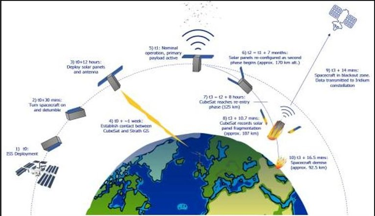

Fig 1. STRATHcube CONOPS [7]

STRATHcube will be launched into LEO, currently the mission is modelled around a launch from the International Space Station (ISS), however the mission is designed to be flexible to accommodate any launch provider. After the detumble phase is completed, the solar panels are deployed into their nominal operation position at 90 degrees to the body of the spacecraft and a week later the primary payload is activated. From this point onwards, STRATHcube will be able to detect, track and catalogue debris.

After 7 months of operation of the primary payload, STRATHcube's orbit will have naturally decayed to an altitude where it is approaching re-entry, at which point the spacecraft prepares for operation of the secondary payload. To do so, the solar panels are reconfigured to a shuttlecock position to allow for a controlled orientation during re-entry. As the CubeSat begins re-entry, it broadcasts data from the thermal and mechanical sensors as well as images from the thermal camera to the Iridium constellation, detailing the aerothermodynamic behaviour during re-entry as well as providing data of the fragmentation process.

After 16 minutes of broadcasting, the satellite will no longer be able to broadcast data to the Iridium constellation and will proceed to demise, signalling the successful end of the STRATHcube mission.

<!-- PDF_PAGE: 4 -->

## 1.2 Primary Payload - Passive Bistatic Radar (PBR)

A bistatic radar describes a radar system in which the transmitter and receiver are sufficiently distanced so that the ranges or angles are adequately different. Persico et al. [8] explored the concept of Spaceborne PBR which offers a solution to in orbit debris tracking which can bypass the attenuation experienced during receiving signals through the Earth's atmosphere. Using an algorithm developed at the University of Strathclyde, the spacecraft will be able to detect, track and catalogue debris. Fig 2 shows how the forward scatter region created by an intercepting object passing through the line of sight of the transmitter and receiver.

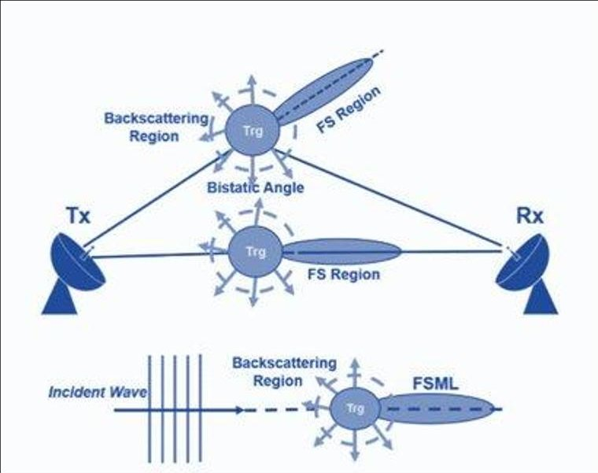

Fig 2. PBR Demonstration

Jenkins et al.[7] conceptualised how to adapt the technology to be suitable for applications in CubeSats. To do so the spacecraft had to be able to receive signals from the transmitting satellite, known as the illuminator of opportunity. The Iridium constellation was chosen due to its reliability. By choosing a compact patch antenna that was compatible with the Iridium constellation broadcasted signal, the technology was able to be incorporated into the STRATHcube design conveniently and affordably. A radar receiver is still to be developed to complete the technology.

## 1.3 Secondary Payload-Fragmentation Analysis of Solar Panels Upon Re-Entry

The secondary payload of STRATHcube looks to collect data of the satellites aerothermodynamic properties during re-entry. Graham et al. [9] designed a secondary payload which, through the use of thermal and mechanical sensors, will collect data from the fragmentation of the spacecraft during re-entry. This data can then be used to contribute to the D4D initiative.

behind the body of the satellite, it is possible to manipulate the centre of pressure behind the centre of gravity, creating stability during re-entry.

Due to the severe conditions experienced upon reentry, it is impossible to broadcast during this phase to a ground station on Earth. Therefore, during re-entry STRATHcube will broadcast data throughout its descent to the Iridium constellation and downlink the data later via dial up connection. To verify the feasibility of STRATHcube's secondary payload, a link budget was generated using the currently selected components used for transmission during re-entry (Maxtena and Iridium Certus modem) and properties of the Iridium constellation.

In order to control the orientation of the CubeSat at the beginning of re-entry, a passive stabilisation system is implemented. By reorientating the solar panels to

Table 1. Link Budget for STRATHcube's Secondary Payload

<table border="1"><tr><td colspan="3">Uplink CubeSat Tx Iridium Constellation</td></tr><tr><td rowspan="2"></td><td colspan="2">Range(km)</td></tr><tr><td>655</td><td>700</td></tr><tr><td>Frequency(GHz)</td><td>1.626</td><td>1.626</td></tr><tr><td>Antenna Size</td><td>0.019</td><td>0.019</td></tr><tr><td>Ptx</td><td>2.5</td><td>2.5</td></tr><tr><td>Gtx</td><td>2.8</td><td>2.8</td></tr><tr><td>Lfs</td><td>152.9872368</td><td>153.5643716</td></tr><tr><td>Lm</td><td>10</td><td>10</td></tr><tr><td>Lc</td><td>2</td><td>2</td></tr><tr><td>Grx</td><td>24.9</td><td>24.9</td></tr><tr><td>EIRP(dBW)</td><td>9</td><td>9</td></tr><tr><td>Prx(W)</td><td>-134.787237</td><td>-135.3643716</td></tr><tr><td>System Temperature[10]</td><td>13</td><td>13</td></tr><tr><td>Boltzmann&#x27;s constant</td><td>-228.599167</td><td>-228.5991672</td></tr><tr><td>Data Rate(b/s)</td><td>88000</td><td>88000</td></tr><tr><td>Eb/N0</td><td>31.36710365</td><td>30.78996885</td></tr><tr><td>Eb/No Required</td><td>9.9</td><td>9.9</td></tr><tr><td>Link Margin</td><td>21.46710365</td><td>20.88996885</td></tr></table>

The link budget of Table 1 details two scenarios: transmission from the CubeSat to the Iridium constellation at the beginning of re-entry (655km) and the transmission from the CubeSat to the Iridium constellation at the estimated end of its re-entry (700.05km). As can be seen, even in the worst-case scenario where the distance between transmitter and receiver is at a maximum, the link margin is substantially above the recommended value of 3dB for a successful transmission. However, assumes the signal is travelling

<!-- PDF_PAGE: 5 -->

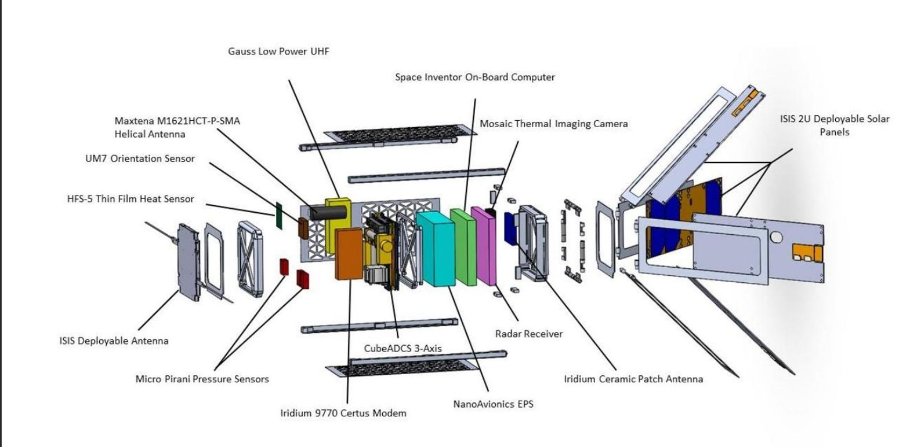

Fig 3. Exploded View of STRATHcube

through the vacuum of space which will not be the case as the satellite re-enters the atmosphere. Regardless, the link budget margin remains >9dB for both cases for when full atmosphere attenuation is accounted for [11] demonstrating the capability of the selected components.

## 1.4 STRATHcube Design

STRATHcube is a 2U CubeSat designed from Aluminium 7075-T6. The structure is custom designed to accommodate for deployables that extrude from the body and has been subjected to virtual modal testing, verifying its compliance with ESA FYS! launch standards. The qualification and acceptance test profiles can be seen as power spectral density (PSD) against frequency shown in Fig 3.

The design encompasses four 2U deployable solar panels which use a step geared motor to control the deployment of the panels. The solar panels are required to change orientation dependent on the phase of the mission (as illustrated in Fig 1). Furthermore, the possibility of manoeuvring the solar panels in order to maximise power generation is also being explored, however a further risk analysis must be conducted to explore the feasibility.

The satellite is equipped with a high data rate antenna (250 kbps) to allow for successful data transmission to the James Weir ground station, located at the University of Strathclyde, Glasgow. The high data rate is required to combat the short daily view times experienced during the operation of the primary payload.

A full breakdown of the STRATHcube design can be seen in Fig 3.

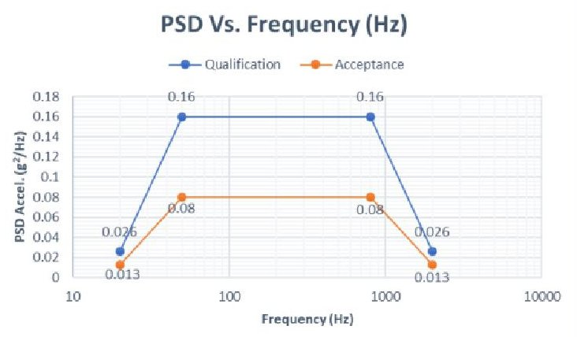

Fig 4. Acceptance/Qualification Test Profiles

## 2 IST Background

The IST is used for the purpose of verifying the design of the CubeSat and future alterations so that components can be bought with confidence for further testing. It is an integrated simulation which currently combines the Mission Analysis, and Attitude Determination and Control System (ADCS), with the power profile completed but as an independent script. It uses a numerical integration method called RK4 [12]. Previous work has included development of the thermal subsystem; however, this has not been integrated. Visualisation has been setup for more intuitive understanding of the data which uses numerous orientation parameters such as; Euler Angles (easier intuition), Rotation Matrix (non-singular, tracking), Quaternions (non-singular transformations at speed), and Classical Rodrigues Parameters (determination).

<!-- PDF_PAGE: 6 -->

## 2.1 Orientation Parameters

The CubeSat will need to describe its orientation in space. To do this particular parameters have been used throughout the development of the IST which has a specific use for each section. Orientation is being able to define three orthonormal vectors (rotated frame) relative to a separate frame.

## 2.1.1 Euler Angles

Euler angles are a more complicated version of spherical coordinates which instead of describing a single point in space, represents the orientation of three orthonormal vectors using angles. The Euler angles are sequential rotations, which come in 12 different sets [13]. In Fig 5, a 3-2-3 set can be seen.

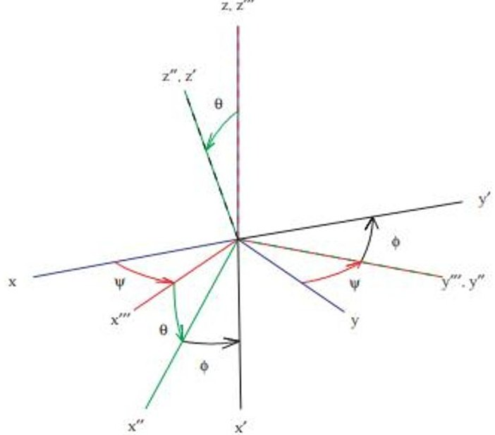

Fig 5. 3-2-3 Euler Angle Rotations [13]

## 2.1.2 Principal Rotation Vector (PRV)

The PRV is a more compact way of representing the Euler angles, which instead of having three sequential fixed axis to rotate round, there is a single alterable axis. The rotation angle is round the changeable axis, which can represent a single angle offset between two different frames. This is useful for error comparison of separate orientations [14].

## 2.1.3 Rotation Matrix

This variable is a 3*3 matrix which describes rotations round specific axis. These specific axis can be related to the Euler angles and combined into the different sets [13]. The individual rotations can be seen in Equations (1)-(3), where $ \theta $ is an arbitrary rotation.

$$
R _ {1} (\theta) = \left[ \begin{array}{c c c} 1 & 0 & 0 \\ 0 & \cos \theta & \sin \theta \\ 0 & - \sin \theta & \cos \theta \end{array} \right]
$$

$$
R _ {2} (\theta) = \left[ \begin{array}{c c c} \cos \theta & 0 & - \sin \theta \\ 0 & 1 & 0 \\ \sin \theta & 0 & \cos \theta \end{array} \right]
$$

$$
R _ {3} (\theta) = \left[ \begin{array}{c c c} \cos \theta & \sin \theta & 0 \\ - \sin \theta & \cos \theta & 0 \\ 0 & 0 & 1 \end{array} \right]
$$

By relating the individual rotations, a 3-2-1 Euler set can be obtained as seen in Equation (4) [13].

$$
R _ {3 2 1} (\psi , \theta , \phi) = R _ {1} (\phi) R _ {2} (\theta) R _ {3} (\psi)
$$

Fundamentally the rotation matrix will describe the position of the rotated frame relative to the original frame, which can be applied to the Track Frame (Equation (5)) for the first payload operation.

$$
[ N T ] = \left[ \begin{array}{c c c} - h _ {x} & - h _ {y} & - h _ {z} \\ y _ {x} & y _ {y} & z _ {z} \\ z _ {x} & z _ {y} & z _ {z} \end{array} \right]
$$

This format allows the use of the orbit angular momentum vector (Equation (6)) the zenith vector (Equation (7)) and the last vector can be found using the cross product (Equation (8)) to uphold the orthonormal constraints. The reason h is negative is to have the y vector pointing towards the direction of the velocity, which was initially for easier understanding of simulations.

$$
\widehat {\boldsymbol {h}} = \left[ h _ {x}, h _ {y}, h _ {z} \right] ^ {T}
$$

$$
\hat {\mathbf {z}} = \left[ z _ {x}, z _ {y}, z _ {z} \right] ^ {I}
$$

$$
\widehat {\mathbf {y}} = \widehat {\mathbf {z}} \times \left(- \widehat {\boldsymbol {h}}\right)
$$

## 2.1.4 Quaternions

A quaternion is a 4D number which describes the orientation by a point on the surface of a hypersphere. This is for mathematical reasons which can circumvent singularity issues related to the Euler angles but be more efficient than the Rotation Matrix. They also come in two different sets, 1234, and 0123, which are both used within the simulation so they will specified on each occasion. For a 0123 set, the quaternion is related to a PRV through Equation (9)-(12) which highlights the real (0) and vector (123) component of the unit quaternion through the components of $ \hat{e} $ [14].

$$
q _ {0} = \cos \left(\frac {\Phi}{2}\right)
$$

$$
q _ {1} = e _ {1} \sin \left(\frac {\Phi}{2}\right)
$$

$$
q _ {2} = e _ {2} \sin \left(\frac {\Phi}{2}\right)
$$

$$
q _ {3} = e _ {3} \sin \left(\frac {\Phi}{2}\right)
$$

<!-- PDF_PAGE: 7 -->

## 2.1.5 Classical Rodrigues Parameter (CRP)

A CRP is the stereographic projection of a 4D unit quaternion into 3D space, similar to how the 3D spherical surface of Earth is projected into a 2D map. This parameter, in this case, is only used for orientation determination purposes. Where the CRP converting to a unit quaternion is shown in Equation (13) [14].

$$
\bar {q} = \frac {1}{1 + \beta^ {T} \beta} \left[ \begin{array}{l} 1 \\ \beta \end{array} \right]
$$

## 2.2 Mechanics

## 2.2.1 Kinematics

Kinematics describes how a body moves without external forces, which is shown in Equation (14) [14].

$$
\left( \begin{array}{l} \dot {q} _ {0} \\ \dot {q} _ {1} \\ \dot {q} _ {2} \\ \dot {q} _ {3} \end{array} \right) = \frac {1}{2} \left[ \begin{array}{c c c c} 0 & - \omega_ {x} & - \omega_ {y} & - \omega_ {z} \\ \omega_ {x} & 0 & \omega_ {z} & - \omega_ {y} \\ \omega_ {y} & - \omega_ {z} & 0 & \omega_ {x} \\ \omega_ {z} & \omega_ {y} & - \omega_ {x} & 0 \end{array} \right] \left( \begin{array}{l} q _ {0} \\ q _ {1} \\ q _ {2} \\ q _ {3} \end{array} \right)
$$

Where $ \omega_{B}=\left[\omega_{x},\omega_{y},\omega_{z}\right]^{T} $ represents the angular rate vector in the orbit reference frame.

## 2.2.2 Dynamics

Dynamics considers forces acting on the object as seen in Equation (15).

$$
I _ {s c} \dot {\omega} _ {B} = T _ {c} + T _ {d} - \omega_ {B} \left(I _ {s c} \omega_ {B} + h _ {w}\right)
$$

I $ _{sc} $ is the satellite inertia matrix in the body frame, $ T_{C} $ is the control vector, $ T_{d} $ is the sum of disturbances and $ h_{w} $ is the reaction wheel angular momentum vector. The disturbances could potentially include drag, magnetic field strength, solar radiation pressure, and gravity gradient, however these are not included in the ADCS model. Although, the orbit perturbations include J2, drag, and $ 3^{\mathrm{rd}} $ body effects from the Sun and Moon. Thus the ADCS perturbations are recommended for integration to have more realistic results.

## 2.2.3 Idealised Control

The ADCS platform requires two main aims to be met, detumbling and zenith orientation tracking. The detumbling is primarily at initial ejection from the launch vehicle into space. This is trying to achieve the CubeSat angular velocity to tend towards zero. The tracking case will have the CubeSat orientating away from the surface of Earth to point in the direction of the Iridium constellation which will enable first payload operation and debris detection. A non-tracking controller is used as an ideal case (non-actuator specific) to prove the functionality of the IST and allows further development of other subsystems. This uses a Linear Controller

(Equation (16)) which is used for verification later in this report, Equation 7.17a in [15].

$$
\bar {\boldsymbol {L}} = - k _ {p} \operatorname {s i g n} \left(\delta q _ {4}\right) \delta \boldsymbol {q} _ {1: 3} - k _ {d} \boldsymbol {\omega}
$$

Where the components of Equation (16) are shown in Equation (17)-(19) [15].

$$
\delta \boldsymbol {q} _ {1: 3} = \Xi^ {T} \left(\boldsymbol {q} _ {c}\right) \boldsymbol {q}
$$

$$
\delta q _ {4} = \boldsymbol {q} ^ {T} \boldsymbol {q} _ {c}
$$

$$
\Xi \left(\boldsymbol {q} _ {c}\right) = \left[ \begin{array}{c c c} q _ {c _ {4}} & - q _ {c _ {3}} & q _ {c _ {2}} \\ q _ {c _ {3}} & q _ {c _ {4}} & - q _ {c _ {1}} \\ - q _ {c _ {2}} & q _ {c _ {1}} & q _ {c _ {4}} \\ - q _ {c _ {1}} & - q _ {c _ {2}} & - q _ {c _ {3}} \end{array} \right]
$$

The IST can be used with Equation (20), a nonlinear control law from Equation 7.17b [15]. It is thought that due to its nonlinearity it is more robust than Equation (16).

$$
\begin{array}{l} \bar {L} = - k _ {p} \operatorname {s i g n} \left(\delta q _ {4}\right) \delta q _ {1: 3} \\ - k _ {d} \left(1 \pm \delta q _ {1: 3} ^ {T} \delta q _ {1: 3}\right) \omega \\ \end{array}
$$

## 2.2.4 Magnetorquer

The detumble manoeuvre can be completed using a magnetorquer. The B-dot control law is shown in Equation (21), which uses 3 magnetorquers on each axis, and a gain value of k [16].

$$
\left[ \begin{array}{l} L \\ M \\ N \end{array} \right] = - k \left[ \begin{array}{c c c} \beta_ {y} ^ {2} + \beta_ {z} ^ {2} & - \beta_ {x} \beta_ {y} & - \beta_ {x} \beta_ {z} \\ - \beta_ {x} \beta_ {y} & \beta_ {x} ^ {2} + \beta_ {z} ^ {2} & - \beta_ {y} \beta_ {z} \\ - \beta_ {x} \beta_ {z} & - \beta_ {y} \beta_ {z} & \beta_ {x} ^ {2} + \beta_ {y} ^ {2} \end{array} \right] \left[ \begin{array}{l} \omega_ {x} \\ \omega_ {y} \\ \omega_ {z} \end{array} \right]
$$

The magnetorquers have different properties on each axis, which will need to be accounted for in the simulation as future work.

## 2.2.5 Reaction Wheel

Whilst the magnetorquers are useful for detumble, the reaction wheels are beneficial for accurate 3-axis control. An inertia matrix for an individual reaction wheel is in Equation (22), where the subscript R refers the centre of mass of the reaction wheel, and the superscript R refers to the frame of reference [16].

$$
I _ {R i} ^ {R} = \left[ \begin{array}{c c c} \frac {m _ {R W} r _ {R W} ^ {2}}{2} & 0 & 0 \\ 0 & \frac {m _ {R W}}{1 2} \left(3 r _ {R W} ^ {2} + h _ {R W} ^ {2}\right) & 0 \\ 0 & 0 & \frac {m _ {R W}}{1 2} \left(3 r _ {R W} ^ {2} + h _ {R W} ^ {2}\right) \end{array} \right]
$$

The proportional-derivative (PD) control law is shown in Equation (23) which has the current $ (\vec{\epsilon}_{i}) $ and desired $ (\vec{\epsilon}_{desired}) $ Euler angles (321 set), with the current $ (\vec{\omega}_{i}) $ and desired $ (\vec{\omega}_{desired}) $ angular velocity. The desired

<!-- PDF_PAGE: 8 -->

torque $ (\overrightarrow{M}_{desired}) $ is influenced by the proportional $ (k_{p}) $ and derivative $ (k_{d}) $ gains.

$$
\begin{array}{l} \vec {M} _ {d e s i r e d} = - k _ {p} \left(\vec {\vec {\epsilon}} _ {i} - \vec {\vec {\epsilon}} _ {d e s i r e d}\right) \\ - k _ {d} \left(\vec {\omega} _ {i} - \vec {\omega} _ {d e s i r e d}\right) \\ \end{array}
$$

Through the process in [16], the inertia of the reaction wheels (J), helps to find the desired angular acceleration of the reaction wheels.

$$
\vec {\alpha} = J ^ {T} \left(J J ^ {T}\right) ^ {- 1} \overrightarrow {M} _ {d e s i r e d}
$$

The angular acceleration is limited based on saturation conditions, which leads to finding the true torque in Equation (25), which refers to the direction of the reaction wheels in the body frame [16].

$$
\vec {M} _ {d e s i r e d} = \sum_ {i = 1} ^ {N R} I _ {R i} ^ {B} \alpha_ {R i} \hat {n} _ {R i}
$$

## 2.3 Wahba

For the CubeSat to know where to point in space it must be able to predict its current orientation with the sensor data. This is calculated using Equation (26), known as Wahba's problem [14].

$$
J \left(\left[ \bar {B} N \right]\right) = \frac {1}{2} \sum_ {k = 1} ^ {N} \boldsymbol {w} _ {k} \left| ^ {\mathcal {B}} \widehat {\boldsymbol {v}} _ {k} - \left[ \bar {B} N \right] ^ {\mathcal {N}} \widehat {\boldsymbol {v}} _ {k} \right| ^ {2}
$$

The equation uses the sensor weights of Table 2 which depend on the sensor accuracy and is then related to a range of 0 to 1.

Table 2. Weights in relation to the sensor measurements onboard the CubeSat [17][18].

<table border="1"><tr><td>Sensor</td><td>Accuracy</td><td>‘FOV’</td><td>wk</td></tr><tr><td>Magnetometer</td><td>&lt;50nT</td><td>25,000nT</td><td>0.556</td></tr><tr><td>Sun/Nadir Sensor</td><td>&lt;0.2°</td><td>180°</td><td>1</td></tr><tr><td>Coarse Sun Sensor</td><td>&lt;10°</td><td>180°</td><td>0.02</td></tr></table>

Wahba's problem takes in known readings from the sun, magnetometer, and nadir sensor on board the CubeSat to then estimate the orientation. The sun measurement uses the ephemerides of the planets, the magnetometer is taken from the International Geomagnetic Reference Field (IGRF) model in MATLAB [19], and the nadir sensor reverses the position vector (Equation (27)) from the simulation.

$$
{} ^ {\mathcal {N}} \hat {\boldsymbol {r}} _ {m e a s u r e d} = - ^ {\mathcal {N}} \hat {\boldsymbol {r}} _ {p o s i t i o n}
$$

## 2.3.1 Error Model

The ADCS platform on the CubeSat is taken from [17], which has the errors of the sun and nadir measurement as a single angle offset [18], geometrically it is seen in Fig 6. This is applied within the body frame vector of Equation (26).

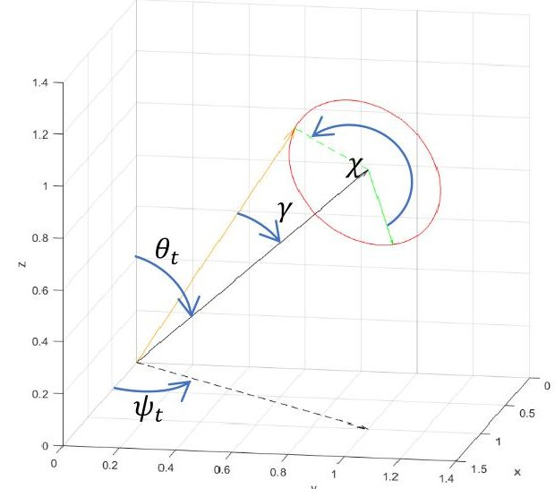

Fig 6. Angle Geometry of the Error Model, Solid Black line - measured data, Orange line - Output Error data, Red line - bounding limit

In Fig 6 the true black line is taken directly from the environment data and is related to spherical coordinates. When the single angle $ \gamma $ offset and $ \chi $ (chosen randomly) error is applied, the orange line is obtained. This is shown in Equation (28).

$$
\begin{array}{l} \widehat {\boldsymbol {x}} _ {e m} = \left(c _ {(\gamma S _ {\chi})} s _ {(\theta_ {t} + \gamma c _ {\chi})} c _ {\psi_ {t}} - s _ {(\gamma S _ {\chi})} s _ {\psi_ {t}}\right) \boldsymbol {i} \\ + \left(c _ {(\gamma S _ {\chi})} s _ {(\theta_ {t} + \gamma c _ {\chi})} s _ {\psi_ {t}} + s _ {(\gamma S _ {\chi})} c _ {\psi_ {t}}\right) \boldsymbol {j} \\ + \left(c _ {(\gamma S _ {\chi})} c _ {(\theta_ {t} + \gamma c _ {\chi})}\right) \boldsymbol {k} \\ \end{array}
$$

Currently the same error is applied through the orbit; it is suggested to update the error based on environment. This would mean changing the value of $ \gamma $ depending on the orientation of the CubeSat. The nadir sensor won't be able to determine its position accurately if pointing away from Earth. Similarly, the sun sensor won't be as accurate if it is in eclipse or is shadowed by the solar panels of the CubeSat. Further investigation is recommended for determining line of sight with the sensors and the required environment data.

## 2.3.2 Devenport-q

This method solves Wahba's problem through the use of an eigen value-eigen vector problem (Equation (29)) where the resulting estimated attitude is from the largest eigen value $ (\lambda) $ . From the derivation [14], the largest eigen value minimises the error, meaning that $ [\bar{B} N] $ of Equation (26) will be better approximated.

<!-- PDF_PAGE: 9 -->

$$
[ K ] \bar {\boldsymbol {q}} = \lambda \bar {\boldsymbol {q}}
$$

The components to solve Equation (29) are shown in Equation (30)-(34), where $ I_{3 x 3} $ is a 3x3 identity matrix.

$$
[ K ] = \left[ \begin{array}{c c} \sigma & Z ^ {T} \\ Z & S - \sigma I _ {3 x 3} \end{array} \right]
$$

$$
Z = \left[ \begin{array}{l l} B _ {2 3} - B _ {3 2} \\ B _ {3 1} - B _ {1 3} \\ B _ {1 2} - B _ {2 1} \end{array} \right]
$$

$$
S = B + B ^ {T}
$$

$$
\sigma = t r (B)
$$

$$
B = \sum_ {k = 1} ^ {N} \boldsymbol {w} _ {k} ^ {\mathcal {B}} \widehat {\boldsymbol {v}} _ {k} ^ {\mathcal {N}} \widehat {\boldsymbol {v}} _ {k} ^ {T}
$$

## 2.3.3 QUEST

This method solves the eigen value-eigen vector problem (Equation (29)) with a Newton Raphson method. The first iteration is the sum of the weights applied to each measurement (Equation (35)), which is then iterated through Equation (36) [14], until a maximum is reached.

$$
\lambda_ {0} = \sum_ {k = 1} ^ {N} w _ {k}
$$

$$
\lambda_ {i} = \lambda_ {i - 1} - \frac {f \left(\lambda_ {i - 1}\right)}{f ^ {\prime} \left(\lambda_ {i - 1}\right)}
$$

Equation (37) is taken from [14] and Equation (38) is found using Jacobi's Formula [20].

$$
f (\lambda) = \det \left([ K ] - \lambda \left[ I _ {4 * 4} \right]\right)
$$

$$
f ^ {\prime} (\lambda) = f (\lambda) * t r \left(\left[ - \left([ K ] - \lambda \left[ I _ {4 * 4} \right]\right) \left[ I _ {4 * 4} \right] \right] ^ {- 1}\right)
$$

When the max eigenvalue is reached, it is related to a CRP (Equation (39) [14]) and is converted to the relevant quaternion orientation (Equation (13)).

$$
\bar {\boldsymbol {\beta}} = \left((\lambda_ {m a x} + \sigma) \left[ I _ {3 x 3} \right] - S\right) ^ {- 1} Z
$$

It is expected that Devenport-q is the more reliable method, however QUEST is anticipated to be faster, and is implemented more regularly on spacecraft during operation. Despite this, timings have not been compared for the methods and this report is limited to the accuracy of the determination. The QUEST method has an inverse in matrix form which can slow down the algorithm (Equation (39)). If this is removed then the method could be faster. Alternatively other methods such as ESOQ and OLAE could be included, which would enable a more rigorous timing comparison [14].

## 3 Results

The results consist of visualisation, mechanics verification, detumble with actuators, and idealized tracking control. This gives an overview for the core mechanics and user functionality related to the IST. The power profile has been developed but is not integrated, and the thermal model is tasked for future work.

## 3.1 Visualisation

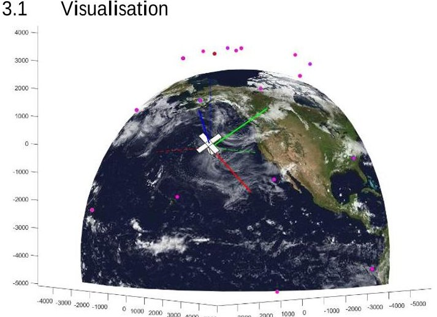

Fig 7. Orientation Visualisation: r-g-b Dotted Lines are Inertial Frame x-y-z Axis; r-g-b Solid Lines are Track Frame x-y-z axis; Purple Markers are Iridium Satellites

## 3.2 Mechanics Verification

Table 3. Initialisation parameters for mechanics verification simulation (Example 7.1 of [15])

<table border="1"><tr><td>Name</td><td>Symbol</td><td>Value</td><td>Unit</td></tr><tr><td colspan="4">Satellite Mass properties</td></tr><tr><td>x-axis moment of Inertia</td><td>$I_{xx}$</td><td>10000</td><td>kgm^{2}$</td></tr><tr><td>y-axis moment of Inertia</td><td>$I_{yy}$</td><td>9000</td><td>kgm^{2}$</td></tr><tr><td>z-axis moment of Inertia</td><td>$I_{zz}$</td><td>12000</td><td>kgm^{2}$</td></tr></table>

Initial Orientation properties

<table border="1"><tr><td>Initial quaternion orientation</td><td>q(t0)</td><td>$\begin{bmatrix}0.6853\\0.6953\\0.1531\\0.1531\end{bmatrix}$</td><td>1234</td></tr><tr><td>Initial rotation</td><td>ω(t0)</td><td>$\begin{bmatrix}0.5300\\0.5300\\0.0530\end{bmatrix}$</td><td>$\frac{0}{-s}$</td></tr></table>

Controller Parameters

<table border="1"><tr><td>Commanded quaternion orientation</td><td>$q_{c}$</td><td>$\begin{bmatrix}0\\0\\0\\1\end{bmatrix}$</td><td>1234</td></tr><tr><td>Proportional Gain</td><td>$k_{p}$</td><td>50</td><td>-</td></tr><tr><td>Derivative Gain</td><td>$k_{d}$</td><td>500</td><td>-</td></tr></table>

<!-- PDF_PAGE: 10 -->

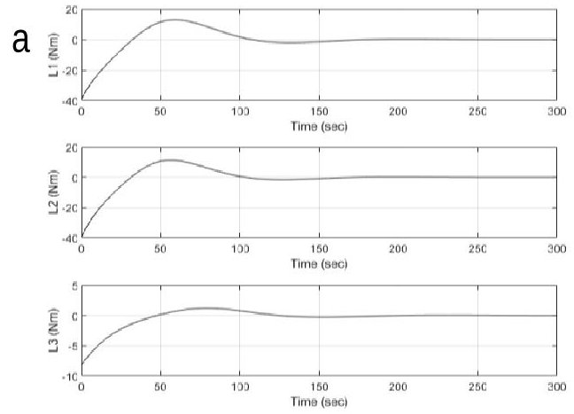

b

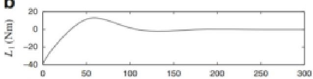

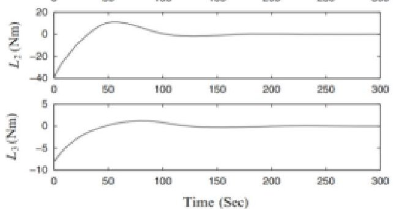

Fig 8. Torque Applied by the Satellite for the Initialisation in Table 3, a - STRATHcube Software Results, b - External Results [15].

## Detumble

Table 4. Initialisation for the Detumble Simulation

<table border="1"><tr><td>Name</td><td>Symbol</td><td>Value</td><td>Unit</td></tr><tr><td colspan="4">CubeSat mass properties</td></tr><tr><td>Moment of Inertia-x</td><td>Ixx</td><td>0.00962</td><td>kg.m2</td></tr><tr><td>Moment of Inertia-y</td><td>Iyy</td><td>0.0102</td><td>kg.m2</td></tr><tr><td>Moment of Inertia-z</td><td>Izz</td><td>0.00445</td><td>kg.m2</td></tr><tr><td>RW CoG offset-x</td><td>xcm</td><td>0.00127</td><td>m</td></tr><tr><td>RW CoG offset-y</td><td>ycm</td><td>0.00029</td><td>m</td></tr><tr><td>RW CoG offset-z</td><td>zcm</td><td>0.00798</td><td>m</td></tr><tr><td>Mass of Satellite</td><td>m</td><td>2.41486</td><td>kg</td></tr><tr><td colspan="4">Reaction Wheel Properties</td></tr><tr><td>Mass of Wheel</td><td>mrw</td><td>0.06</td><td>kg</td></tr><tr><td>Height of Wheel</td><td>hw</td><td>26.1</td><td>mm</td></tr><tr><td>Radius of Wheel</td><td>rrw</td><td>14</td><td>mm</td></tr><tr><td>RW Angular velocity</td><td>ωrw</td><td>0</td><td>rad/s</td></tr><tr><td colspan="4">Other Properties</td></tr><tr><td>Sat. x angular velocity</td><td>p0</td><td>0.8</td><td>rad/s</td></tr><tr><td>Sat. y angular velocity</td><td>q0</td><td>-0.2</td><td>rad/s</td></tr><tr><td>Sat. z angular velocity</td><td>r0</td><td>0.3</td><td>rad/s</td></tr><tr><td>Commanded quaternion</td><td>qc</td><td>[1000]T</td><td>0123</td></tr></table>

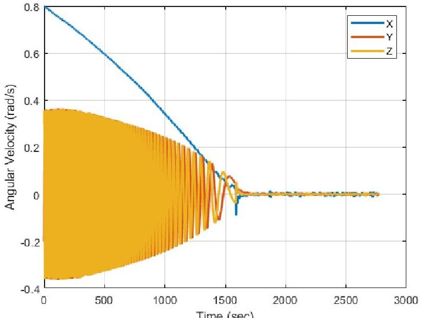

Fig 9. Angular Velocity of CubeSat During Detumble

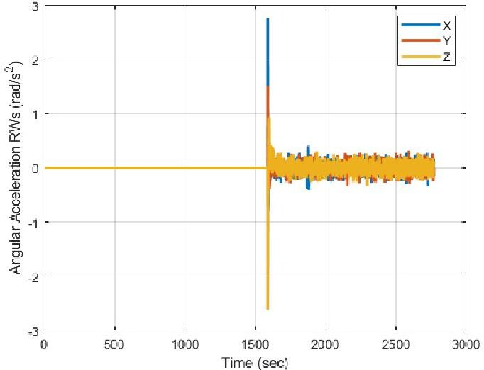

Fig 10. Angular Acceleration of CubeSat Reaction Wheels

Idealised tracking control

Table 5. Initialisation for the Idealised Tracking Control Simulation (Other values are from Table 4)

<table border="1"><tr><td>Name</td><td>Symbol</td><td>Value</td><td>Unit</td></tr><tr><td colspan="4">Other Properties</td></tr><tr><td>Sat. x angular velocity</td><td>$p_{0}$</td><td>0.8</td><td>rad/s</td></tr><tr><td>Sat. y angular velocity</td><td>$q_{0}$</td><td>1.09</td><td>rad/s</td></tr><tr><td>Sat. z angular velocity</td><td>$r_{0}$</td><td>-0.8</td><td>rad/s</td></tr><tr><td>Commanded quaternion</td><td>$q_{c}$</td><td>Track Frame</td><td>-</td></tr></table>

The reason this section has idealised control is linked to the control law. This uses Equation (20), which is the nonlinear controller, and is not related to the dynamics of the reaction wheel and magnetorquer. This created a stepping stone for finding bugs in the software before further pushing forward with actuator control for the full lifecycle.

<!-- PDF_PAGE: 11 -->

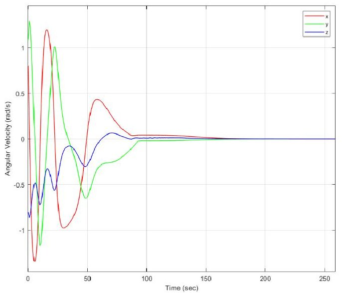

Fig 11. Angular Velocity of STRATHcube During the Idealised Tracking Control Simulation

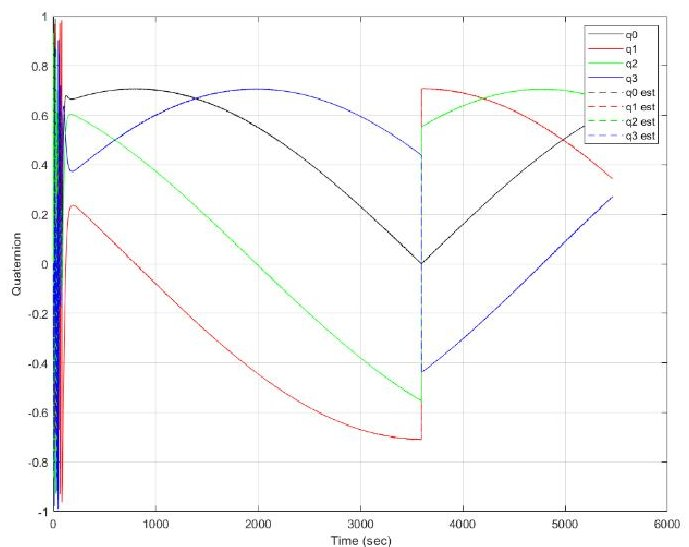

Fig 12. Quaternion Orientation of the CubeSat for the Simulation ran With Initialisation in Table 5

3. 3 Determination Comparison

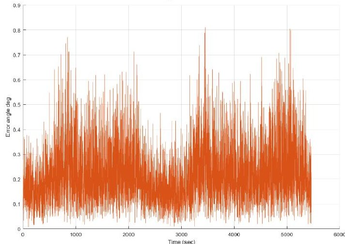

Fig 13. QUEST method error angle results of solving Wahba's problem for Table 5 Initialisation

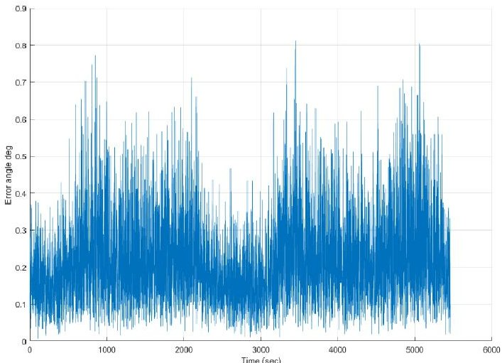

Fig 14. Devenport-q error angle results of solving Wahba's problem for Table 5 initialisation

Table 6. Determination statistics comparison of solving Wahba's problem

<table border="1"><tr><td>Error angle comparison</td><td>Devenport-q method(°)</td><td>QUEST(°)</td></tr><tr><td>Standard Deviation</td><td>0.1201</td><td>0.1201</td></tr><tr><td>Mean</td><td>0.2147</td><td>0.2147</td></tr><tr><td>Max</td><td>0.8116</td><td>0.8116</td></tr></table>

## 4 Discussion

Within the visualisation the IST developed from a 2D static plot in polar coordinates to an animated 3D cartesian simulation of the core mechanics. In Fig 7 the CubeSat is centred at (0,0,0) throughout the simulation, which enables easier understanding of the pointing direction of the CubeSat. It is a pseudo orbit frame as only translation is accounted for, not rotation, and has the same axis as the inertial frame. Further development can include making a Graphical User Interface (GUI), so that the IST is more user friendly.

The Iridium satellites position is based on the orbital parameters a (777.5 km), e (0), i $ (90^{\circ}) $ $ \Omega $ (0), $ \omega $ (0) and $ \theta $ (0), which have 6 evenly spaced planes of 11 satellites. The Iridium constellation does not have any perturbations applied and is considered ideal. Real ephemerides are recommended for further analysis. Unless stated otherwise the CubeSat has orbital parameters of altitude (401km), e (0.01), i $ (51.6^{\circ}) $ $ \Omega $ (0), $ \omega $ (0) and $ \theta $ (0) when initialised. This is due to the ISS as the baseline orbit, which was related to ESA FYS!

For the IST to accurately confirm potential hardware, the software needs to be verified against external results. From [15], a simulation is completed using a linear controller (Equation (16)), which can be used as a comparison for the fundamental mechanics. Due to a generic control example, it is not orbit specific.

The initialisation is seen in Table 3, which highlights that the simulation is not tracking a slew frame (as is the

<!-- PDF_PAGE: 12 -->

case for STRATHcube) but is a constant unit quaternion. The inertia matrix has zeros on the diagonals.

From the results in Fig 8a and Fig 8b it is clear the output is qualitatively identical. The shape and numerical magnitude of the graphs is very similar; however it has not been compared quantitively. Despite this it is thought the STRATHcube software is mechanically accurate due to the simulation being an accurate qualitative match.

The detumble simulation includes using the magnetorquer to detumble, then using the reaction wheels to control the CubeSat to the constant unit quaternion orientation with an angular velocity of zero (Fig 9, Fig 10). Due to simulation issues the CubeSat could not be maintained at a slew frame with actuators, and only a constant frame could be maintained. This simulation also uses Equation (23), which has Euler angles within it and potentially causes some of the problems. Other reasoning can be due to the gain selection which is currently manually estimated.

The CubeSat initialises with a total rotation of 0.877 rad/s (50.3 deg/s) and completes the detumble (reaction wheels turn on) at roughly 1600s. This is using the CubeADCS platform from [17]. There is also a large kick when the reaction wheels turn on (Fig 10), potentially meaning a relatively large proportional gain causing overshoot. Despite the results being able to track a stationary frame, the actuators are currently not verified externally, which is recommended for future work alongside the slew frame developments.

In idealised tracking the initialised parameters are very similar to the detumble simulation; however it is initialised with a larger value of angular velocity for a more rigorous detumble, as seen in Table 5. The detumble is substantially faster than the reaction wheels, where it finishes at ~100s (reaction wheels would turn on when < 0.1rad/s) in Fig 11. Once the detumble is complete, the CubeSat then positions itself for the track frame orientation (Fig 7, Fig 12). This then has the quaternion orientation varying throughout its orbit. The graph appears discontinuous at roughly 3500s, which is due to the quaternions representing the short rotation. This allows a comparison with the estimated quaternion from determination. If the short rotation is not accounted for the estimated quaternion can oscillate between the short and long rotation, creating a noisy and unclear appearance.

The determination is completed using the two methods described in 2.3.2 Devenport-q and 2.3.3 QUEST. By using two separate methods, it is thought to verify the output by comparing the separate methods. This gives a level of confidence for using the software and further parts verification. Currently it assumes the maximum error limits applied to the environment data does not change, however in practice this is not true.

From the hardware description only a single error angle is given, however with the sun sensor, it is unlikely

to be operating with the same accuracy for eclipse and direct sunlight which also needs to consider shadowing of the body and solar panels.

The QUEST method in Fig 13 and Devenport-q method in Fig 14 show a very similar qualitative resemblence. The graphs represent the PRV error angle between the true quaternion orientation, and the estimated quaternion orientation. The reason for the shapes of the graph relate to how the environment data interacts. As the magnetic field, zenith vector, and sun vector become near parallel the orientation becomes more uncertain therefore there are sections of larger inaccuracies.

The data is not only qualitatively similar but quantitatively identical. By comparing each value the error angle data (Fig 13, Fig 14) ends up as an exact match to 5 significant figures, where some statistics are represented in Table 6 which shows a quantitative comparison. The error angle is related to a Principal Rotation Vector, which enables comparing two separate frames, but with a single angle. It highlights that the error for determining the pointing is relatively low for the mission requirements. This is before filtering has been applied, which could reduce the error angle further. However, the max error angle is expected to increase once the eclipse is accounted for, as this will cause one of the main sensors to be erroneous.

## 5 Conclusion

STRATHcube presents a novel solution to combat debris in LEO through its two payloads, the first providing detection, tracking, and cataloguing of debris capabilities through PBR, and the second generating data in the aid for the D4D program by collecting structural and thermal behaviour data of the spacecraft as it reenters the atmosphere.

Throughout the project, development has consisted of software and hardware. The structures have been updated, including modal analysis of the spacecraft, and link budgets have confirmed the feasibility of transmission during the secondary payload. The IST has managed to implement visualisation, orbital mechanics, and ADCS simulations, whilst having a basic verification process. The power has been developed but is not integrated with the IST. Several points are still to be met with recommendations for further development:

- Thermal model

- Integrate power

- ADCS perturbations

- Verify actuators

- Filtering

- Account for environment with the sensor errors (sun sensor in eclipse)

- GUI

<!-- PDF_PAGE: 13 -->

## Acknowledgements

This works was sponsored by the University of Strathclyde Alumni Fund, Royal Aeronautical Society, and the Institute of Mechanical Engineers. The authors would like to also thank Andrew Gibb, Ciaran Jenkins, David Peacock, David Polley, Iain Hall, and Maria Kardassi for their support and guidance. The University of Strathclyde Department of Mechanical and Aerospace Engineering (MAE) and the Aerospace Centre for Excellence (ACE) has enabled substantial development of this project, and we are grateful for their help and support.

## 6 References

[1] "Space Environment Statistics · Space Debris User Portal." https://sdup.esoc.esa.int/discos web/statistics/ (accessed Aug. 23, 2022).

[2] D. J. Kessler, N. L. Johnson, J.-C. Liou, and M. Matney, "The Kessler Syndrome: Implications to Future Space operations".

[3] "ESA - Using lasers to track space debris." https://www.esa.int/Enabling_Support/Space_Engineering_Technology/Shaping_the_Future/Using_lasers_to_track_space_debris (accessed Sep. 01, 2022).

[4] D. Mehrholz, L. Leushacke, W. Flury, R. Jehn, H. Klinkrad, and M. Landgraf, "Detecting Tracking and Imaging Space Debris," 2002.

[5] "ESA - Mitigation scenarios: Graveyard orbit 300 km above GEO." https://www.esa.int/ ESA_Multimedia/Images/2008/03/Mitigation_scenarios_Graveyard_orbit_300_km_above_GE O (accessed Sep. 01, 2022).

[6] L. Anselmo, "RE-ENTRY PREDICTIONS FOR UNCONTROLLED SATELLITES: RESULTS AND CHALLENGES".

[7] C. Jenkins, R. Hope, A. R. Wilson, and A. Berquand, "STRATHcube: The design of a student CubeSat using concurrent engineering methods," Uniwersytet slqski, pp. 343-354, Oct. 2020, doi: 10.2/JQUERY.MIN.JS.

[8] A. R. Persico, P. Kirkland, C. Clemente, J. J. Soraghan, and M. Vasile, "CubeSat-based passive bistatic radar for space situational awareness: A feasibility study," IEEE Trans Aerosp Electron Syst, vol. 55, no. 1, pp. 476-485 Feb. 2019, doi: 10.1109/TAES.2018.2848340.

[9] J. Graham, L. Creed, C. Jenkins, A. R. Wilson, and M. Vasile, "The design of a fragmentation experiment for a CubeSat during atmospheric reentry," Uniwersytet slqski, pp. 343-354, Oct. 2021, doi: 10.2/JQUERY.MIN.JS.

[10] S. McKenzie-Picot and P. Gavigan, "Communication Link Analysis for a Nanosatellite Constellation in Low Earth Orbit ," 2013. https://publications.gc.ca/collections collection_2016/rddc-drdc/D68-6-068-2013- eng.pdf (accessed Sep. 01, 2022).

[11] S. Dey Asst Professor, D. Kumar Mohapatra AsstProfessor, and S. Devashish Rajanandini Pummy Archana, "An Approach to calculate the Performance and Link Budget of LEO Satellite (Iridium) For Communication Operated at frequency Range (1650-1550) MHz".

[12] M. Mehdizadeh Khalsaraei, "Positivity of an explicit Runge-Kutta method," Ain Shams Engineering Journal, vol. 6, no. 4, pp. 1217- 1223, Dec. 2015, doi: 10.1016/J.ASEJ.2015.05.018.

[13] J. Diebel, "Representing Attitude: Euler Angles, Unit Quaternions, and Rotation Vectors," 2006.

[14] H. Schaub and L. J. Junkins, Analytical Mechanics of Space Systems - Hanspeter Schaub, John L. Junkins - Google Books, 4th ed. 2018.

[15] F. Landis Markley and J. L. Crassidis, Space Technology Library Fundamentals of Spacecraft Attitude Determination and Control. Accessed: Sep. 01, 2022. [Online]. Available: http://www.springer.com/series/6575

[16] "LaTeX/aerospace_mechanics.pdf at master cmontalvo251/LaTeX GitHub." https://github.com/cmontalvo251/LaTeX/blob/master/Aerospace_Mechanics/aerospace_mechanics.pdf (accessed Sep. 01, 2022).

[17] "CubeADCS Gen 1 | CubeSpace Satellite Systems." https://www.cubespace.co.za/ products/gen-1/integrated-adcs/cubeadcs/ (accessed Sep. 01, 2022).

[18] "CubeSense Gen 1 | CubeSpace Satellite Systems." https://www.cubespace.co.za/ products/gen-1/sensors/cubesense/ (accessed Sep. 01, 2022).

[19] "International Geomagnetic Reference Field (IGRF) Model - File Exchange - MATLAB Central." https://uk.mathworks.com/matlabcentral/fileexchange/34388-international-geomagnetic-reference-field-igrf-model (accessed Sep. 01, 2022).

[20] J.R Magnus and H. Neudecker, "Matrix Differential Calculus with Applications in Statistics and Econometrics," John Wiley & Sons, 2019.