<!-- PDF_PAGE: 1 -->

<div align="center">

# SYSTEMS DESIGN AND INTEGRATION OF SMALL SCALE NANO AND PICO SATELLITES

</div>

<div align="center">

# Thesis work Presented to the Faculty of the Graduate School of Cornell University in Partial Fulfillment of the Requirements of the degree of Masters of Science

</div>

by Philip Naumann May 2022

<!-- PDF_PAGE: 2 -->

$ \textcircled{c} $ 2022 Philip Alexander Naumann ALL RIGHTS RESERVED

<!-- PDF_PAGE: 3 -->

<div align="center">

# SYSTEMS DESIGN AND INTEGRATION OF SMALL SCALE NANO AND PICO SATELLITES

</div>

Philip Naumann, M.S. Cornell University 2022

Within the past decade, the aerospace engineering industry has evolved outside the constraints of using single, large, custom satellites. Due to increased reliability and robustness of commercial off the shelf (COTS) printed circuit board (PCB) components, missions instead have transitioned towards deploying swarms of smaller satellites. This approach significantly decreases the mission cost by reducing custom engineering and deployment expenses. Nanosatellites are able to be quickly developed with a more modular design at lowered risk. The Alpha mission at Cornell Space Systems Studio is fabricated in this manner. However, for the purpose of this mission, only one satellite was initially developed. This paper will discuss a systems engineering approach to the development of this satellite.

As a disclaimer, this paper is written from a systems perspective. Therefore it will follow many subsystems from a wide range of functionalities. The research in this paper was kept broad with the hope to contribute to the mission as a system, through a range of development phases including validation and verification of existing methods.

The two systems that will be primarily focused on are the Attitude Control System (ACS) of the carrier nanosatellite (cubesat), and the RF communications on the excreted picosatellites (chipsat). Milestones achieved in chipsat RF include chipsat to chipsat communication, chipsat to SDR ground station communication, packet creation, error correction, appending a preamble, and filtering the signal. Achievements on the

<!-- PDF_PAGE: 4 -->

ACS side included controller traceability/verification and validation, software rigidity tests, hardware endurance testing, Kane damper and IMU tuning. These developments matured the technological readiness level (TRL) of our systems in preparation for satellite deployment.

<!-- PDF_PAGE: 5 -->

## Biographical Sketch

Philip Naumann was born in Denver, CO but grew up in southern California in Santa Barbara. As the son of a German engineer, he was taught to reason quantitatively and apply the scientific method to problems he encountered. During his freshman year in high school, Philip participated in the JPL invention challenge. His team was successful, advancing to the final round of the competition held at JPL and earning fifth place. Participating in this challenge and getting the opportunity to see several missions being worked on at JPL, drove Philip's fascination with aerospace engineering. The inquisitive thinking prompted a deep curiosity and appreciation of the field. Propelled by this experience, Philip started research on the DE-STAR mission at the University of California at Santa Barbara in 2016 where he worked on high energy systems with application to the "Breakthrough Starshot" laser propulsion.

Philip earned his bachelor's degree in mechanical engineering at the University of California at San Diego. During this time, Philip enhanced his theoretical education through practical experiences. Philip worked as an engineering co-op at Pipe Stress Inc, deriving piping solutions for large scale industry. Towards the end of his degree, Philip also launched a startup company with the help of two college peers. This company aimed to create a low profile and lightweight cooling vest, which was achieved in 2020. The company was picked up by an investor at the UC San Diego Medical School. This experience led Philip's to desire a more broad, holistic and multifaceted engineering approach. Philip decided he wanted to study systems engineering.

In 2020 Philip was admitted to Cornell University to pursue his masters of science in systems engineering. Because of his previous experience with DE-STAR, Philip decided to join the ALPHA group to continue work with high energy propulsion systems. Philip worked on both the RF communication between chipsats, and the ACS control system on the cubesat. With a more theoretical research pursuit, Philip diversified his coursework by pursuing practical

<!-- PDF_PAGE: 6 -->

certificates within MBSE. He earned his ASEP in systems engineering from INCOSE and his six sigma black belt.

Throughout his time at Cornell, Philip also gained industry experience by working for Raytheon Technologies as an automation systems engineer. This job brought real-world application to the MBSE models taught in class. It also expanded his mindset for industry standard automation engineering practices. Philip was able to work with high precision 6 DoF robotics and industry 4.0 data logging systems. Philip also invented a mechanical weld tool to decrease welding HPUs by 60%.

Philip has decided to continue at Raytheon to further develop himself as a systems engineer. He looks forward to the stay in the aerospace and defense sector. Philip hopes to bring his knowledge of MBSE to Raytheon to grow traceability in the automation production process.

<!-- PDF_PAGE: 7 -->

to my dad

<!-- PDF_PAGE: 8 -->

## Acknowledgements

I would like to thank...

Dr. Mason Peck for mentoring me, and providing me with this project. I thank him for his guidance throughout my time at Cornell. He has increased my understanding of aerospace systems architecture and given me an appreciation for the satellite/space industry that I will continue to cherish.

Dr. Timothy Sands for greatly furthering my knowledge in controls engineering. His class "Astronautic Optimization" was the best class that I have taken in college. I want to thank him for his mentorship throughout the past two years. I am grateful for his efforts and support with my thesis.

Dr. Ricardo Daziano for teaching me the principles of MBSE. I appreciate his extensive support and advice throughout my time at Cornell.

Josh Umansky-Castro for being a strong peer through my research endeavors. I want to thank him for providing me guidance and support for my work from start to finish.

Justin Tahmassebpur for his friendship. Also for helping me solve Euler's coupled differential equations.

Raytheon for mentorship from Jake Adams, Jake Hays, Veronica Molina, Blair Simons, Alex Cintron and Kelly Dodds throughout my degree. Raytheon provided me with industry experience to elevate my SE understanding.

<!-- PDF_PAGE: 9 -->

My Family, specifically my dad, my mom, Louise, Christine and Sophia.

My dad is the reason I went into engineering. I want to thank him for his never-ending support throughout my education; intellectually, financially and emotionally. I hope someday I will parallel his rigorous work ethic and engineering accomplishments in my own career.

I want to thank my sisters for being some of my best friends and funniest jokesters. I am honored to be their brother.

I want to thank my mom for her encouragements.

<!-- PDF_PAGE: 10 -->

## Table of contents

Biographical Sketch 4

Acknowledgements 8

Introduction 12

Background on satellite development 12

Background of the Alpha Mission 12

Background on Subsystems Covered in this paper 13

Systems Analysis Approach 14

Chapter 1: Systems modeling of the Cubesat 16

Function Centric Models 16

Network Models 20

Flight assembly 23

Chapter 2: Chipsat RTOS and RF development 25

Testing RF on the TI LaunchPads 26

Using SmartRF studio 26

Switching to a Code based RTOS structure 28

Implementing RF communications on TI launchpad using CCS 32

RF signal modulation with Gaussian Frequency Shift Keying (GFSK) 33

Packet Formulation 36

Raw data 37

S/N ratio 38

Error Correction 38

Pre and post amble 41

Filtering 42

Groundstation 44

Software defined radio RTL-SDR 44

Verifying transmitting using SDR sharp 45

Receive FEC signal on Raspberry Pi 46

Tiny GS satellite balloon launch 47

Chapter 3: ACS development 51

Duties of the Cubesat ACS 52

Cubesat ACS Actuators 54

Attitude control 56

Passive techniques 56

Active techniques 57

<!-- PDF_PAGE: 11 -->

Kane Damper 57

PD controller 58

Validating PD control method 60

Traceability, Verification and Validation 62

The controller software 62

Experimentally calculating the moment of inertia of the chipsat 64

Calculating the amplification factor of the Mu-metal core 67

ACS verification conclusion 68

The Hardware 70

Tested software on Teensy flight computer 70

Magnet Coil Endurance tests 71

Longevity test 71

Fluctuation test 73

Tuning the system 73

Kane damper tuning 73

Tuning the IMU 80

Soft iron offsets 81

PWM Offsets 81

Battery Voltage Offset correction 84

Hard Iron offsets 86

Temperature Offset 88

**Conclusion** 91

**Works Cited** 93

References 93

**Appendix** 95

Cubesat Flight Assembly 95

MBSE Chipsat Modeling 95

MBSE Portfolio 95

Chipsat MBSE Lifecycle 95

Controller Optimality Verification 95

Endurance Test Procedures 95

Endurance Test 95

Longevity test 95

<!-- PDF_PAGE: 12 -->

## Introduction

## Background on satellite development

Development of satellites has always been an expensive venture, only accessible to government agencies and large industry at a high cost. There is a growing importance to expanding our horizons in space, not only for scientific knowledge and exploration but also for interplanetary travel and access to natural resources.

Currently, extraterrestrial commercial operations are rapidly growing. In recent years, space travel has become significantly less expensive. Due to the extreme technological advances in microchips, semiconductors, and batteries, satellites can now be produced on the nano/picosatellite scale. Satellite designs are becoming more modular and using inexpensive COTS electronics, allowing for faster turnaround times.

## Background of the Alpha Mission

This paper will discuss the development done on the Alpha mission at the Cornell Space Systems Studio. Specifically, the Alpha mission matures many technologies such as cubesat design, and light sail propulsion. These techniques parallel methods proposed for interstellar travel through the Breakthrough Starshot initiative.

Cubesat missions are often used to test and mature technologies. Because of the modular and versatile chassis, this was the satellite medium Alpha chose to use. Developing subsystems on the cubesat could provide methods for other cubesat missions in the future to reference.

<!-- PDF_PAGE: 13 -->

A mission in particular that used both the cubesat approach and lightsail technique is Breakthrough Starshot. Breakthrough Starshot aims to be the first interstellar mission. The idea was theorized by Steven Hawking, to be able to accelerate an extremely small payload (on the order of one gram) to a quarter of the speed of light using laser light propulsion. With a retro reflective sail, this tiny payload could reach this speed within seconds. If directed towards Alpha Cantari (our closest neighboring star system) 4.37 light years away, we could reach this system within 20 years.

The purpose of the Alpha mission is to successfully deploy and stabilize a single payload lightsail system. In order to do this, the carrier cubesat must stabilize itself, eject the lightsail payload, and the payload must communicate with the groundstation

## Background on Subsystems Covered in this paper

This paper will discuss two of the primary systems responsible for a successful mission. Specifically the stabilization of the cubesat and the ability of the picosatellite (chipsat) to establish communication with a groundsation.

The first half of the paper will discuss how RF could be used with the picosatellite to still receive and debug low power transmissions.

For the Alpha project, the picosatellite payload was developed by Dr. Van Hunter Adams (previously at Cornell). This satellite is printed on a thin kapton substrate and only has a solar panel, processor, IMU, GPS, light sensor, and RF transceiver. The satellite was named chipsat.

<!-- PDF_PAGE: 14 -->

The second half will discuss the ACS of a 1U cubesat. For the Alpha mission, a cubesat was used to transport our payload because of the affordability of the satellite type, and the simplicity this satellite structure offered.

The one unit (1U) cubesat is a 10cm by 10 cm by 10cm sized satellite with 5mm by 5mm rectangular rails on each of the corners. cubesats can exist in several multiples of this size from 1-12U. This modular size standard is chosen such that several of these satellites can be easily loaded onto a Canisterized Satellite Dispenser (CSD). This dispenser is spring loaded and fastened to the payload of a launch vehicle. When activated the CSD will eject the payloads into Low Earth Orbit (LEO).

## Systems Analysis Approach

This paper will follow a model based systems engineering approach for the analysis and design of both the cubesat and the chipsat. This provides traceability throughout the lifecycle of the satellites.

The timeline of the design process can be modeled by the systems engineering Vee diagram. The Vee diagram serves as a flow chart of the product life cycle. On the left diagonal, the Vee diagram breaks down the design process from concept to the individual component level. This allows for the requirements to be broken down to the individual component level. Next, the right handed diagonal represents the integration process. On this side, the system is built back up from component to working prototype through validation and verification methods.

To summarize, a product is designed from the top down, but tested from the bottom up. This ensures that the design stays true to the original problem description. It

<!-- PDF_PAGE: 15 -->

also guarantees final functionality. Testing starts at the component level, such that functionality is tracked up though final acceptance testing.

Below is a visual representation of the Vee diagram used in this paper in Diagram 1 below.


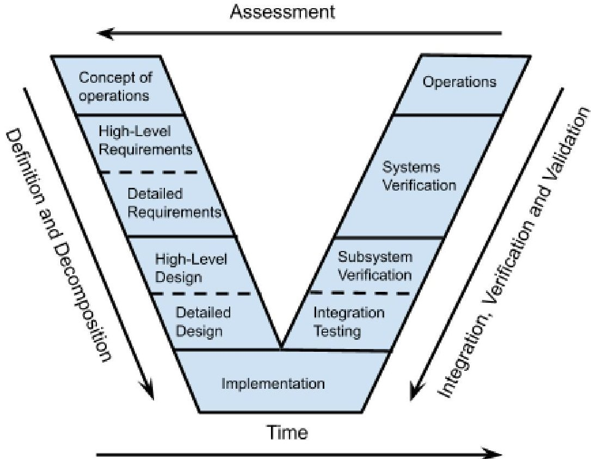


<div align="center">

Diagram 1: The Systems Engineering Vee Diagram

</div>

This paper will follow the Vee diagram process. Chapter 1 begins by modeling the mission systems. The satellite systems are discussed and then decomposed (top-down) from concept design to the component level.

Chapter 2 and 3 follow the chipsat and cubesat development. The satellite requirements are given and then followed (bottom-up) though verification and validation tests.

<!-- PDF_PAGE: 16 -->

## Chapter 1: Systems modeling of the Cubesat

## Function Centric Models

An effort was made to model the cubesat microsatellite in order to better understand the requirements of the system. This was done using the systems models developed by George E. Mobus Michael C. Kalton in the book "Principles of Systems Science".

Models were made by breaking down the subsystems and identifying the scores, sinks, stocks and interfaces. These were first discovered externally. Figure 1 shows the "Black Box" of the cubesat system. Here all of the system inputs and outputs can be clearly observed. The inputs are labeled as scores, noted on the left of the diagram. The sinks are shown coming out of the system to the right. In equilibrium, there is conservation of mass and energy across the system. See Figure 1. (George E. Mobus Michael C. Kalton, p.604)


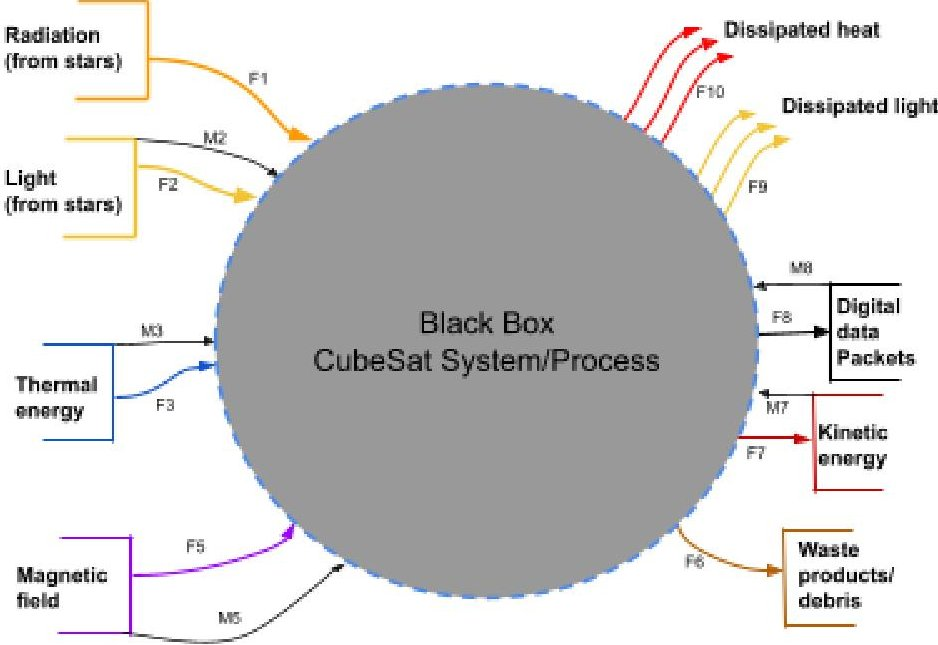


<div align="center">

Figure 1: Black Box diagram

</div>

<!-- PDF_PAGE: 17 -->

In Figure 1, the F values represent the function in which a resource flows. The M denotes a transfer of data within the function. See Table 1 for the function definitions of in Figure 1.

<div align="center">

(Table 1)

</div>

<table border="1"><tr><td>Dia. Label</td><td>Function definition</td></tr><tr><td>F1</td><td>Solar panel</td></tr><tr><td>F2</td><td>Ambient light sensor</td></tr><tr><td>F3</td><td>Thermistor</td></tr><tr><td>F5</td><td>Gyroscope</td></tr><tr><td>F6</td><td>Malfunctions/ damage</td></tr><tr><td>F7</td><td>Torque coils</td></tr><tr><td>F8</td><td>RF transceiver</td></tr><tr><td>F9</td><td>Dissipated light</td></tr><tr><td>F10</td><td>Dissipated heat</td></tr></table>

It can be beneficial to break the system down even further in order to understand the interactions between the internal subsystems. The resources created in the "Black Box" can be bi-products, waste products, catalysts, or reaction intermediates used to meet the desired functional requirements. Understanding how subsystems and their products interact both inside and outside of the system made it possible to more appropriately optimize interfaces within the software. See Figure 2. (George E. Mobus Michael C. Kalton, p.607)

<!-- PDF_PAGE: 18 -->


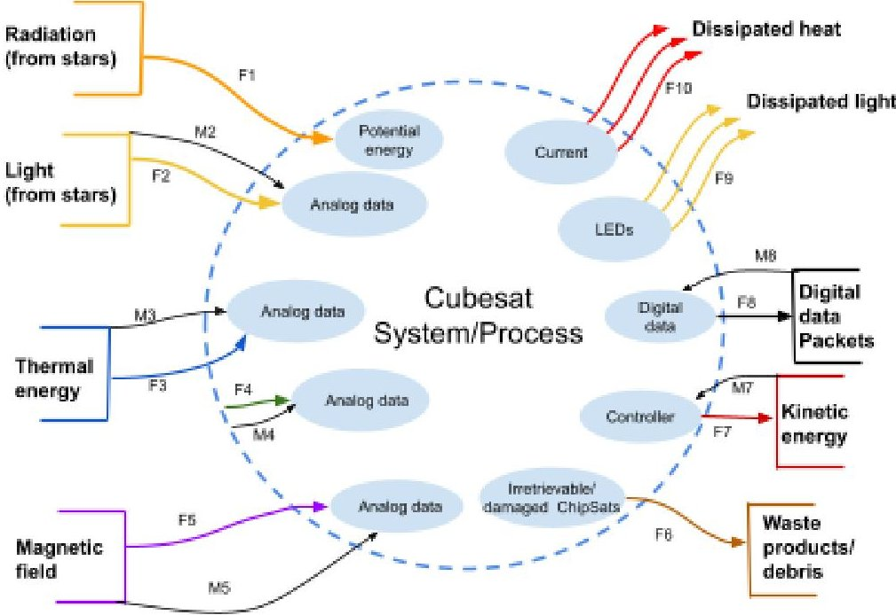


<div align="center">

Figure 2: Subsystem Box diagram

</div>

Table 2 below specifies the GPS function used by the system. There is no outside source since the GPS location is not determined by an environmental input.

<div align="center">

(Table 2)

</div>


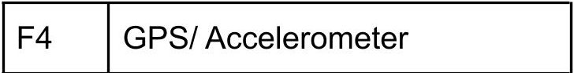


Finally, this model can be further developed to show the transfer of energy and information can be seen within the system. This includes modeling the flow, stocks, buffers, amplifiers and valves. Through this network, the resources can be mapped and flows can be tracked from source to sink. This gives a holistic view of every function that the cubesat must go through to go from its inputs to outputs.

In the middle of Figure 3, S1 can be seen. S1 represents the (buffer) memory of the Teensy microcontroller. The data collected is communicated to the buffer and then transferred into digital data packets that are then sent though the transceiver.

See Figure 3. (George E. Mobus Michael C. Kalton, p.609)

<!-- PDF_PAGE: 19 -->


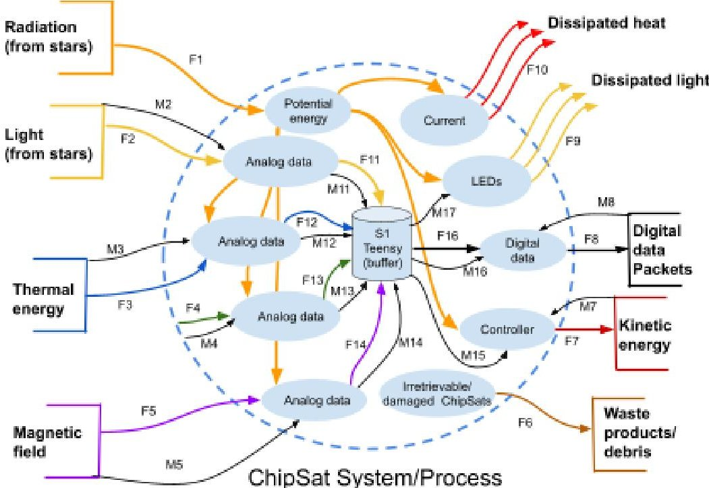


<div align="center">

Figure 3: Process diagram

</div>

Table 3 specified the processes shown in Figure 3 within the satellite system.

These deal with the processing and configuring of the data packets.

<div align="center">

(Table 3)

</div>

<table border="1"><tr><td>F11</td><td>Analog to digital converter</td></tr><tr><td>F12</td><td>Analog to digital converter</td></tr><tr><td>F13</td><td>Analog to digital converter</td></tr><tr><td>F14</td><td>Analog to digital converter</td></tr><tr><td>F15</td><td>Controller feedback</td></tr><tr><td>F16</td><td>Data Packaging</td></tr><tr><td>F17</td><td>Digital signal</td></tr></table>

These models made it possible to visualize the interactions outside of the system, and the flow of resources within.

<!-- PDF_PAGE: 20 -->

## Network Models

Figures 1, 2 and 3 are function-centric models; a model is needed to represent subsystems on the individual level. A more appropriate approach to analyzing a system on the component level would be to use a network model. Analyzing the network sheds light on the interface between the subsystems.

Introducing network theory allowed for a more precise outlook on how the components interact. There are several network models that could be used to model the cubesat system. Although the subsystems could be modeled as using clusters, in a more broad sense, all of the systems tie back into the processor. Therefore for the purposes of this paper, using a central network model is sufficient.

To create a network, the context of each component is recorded. This is commonly accomplished by listing all of the components of a subsystem and creating an interface matrix. For simplicity, a more general system interface matrix was made. See Table 4 below.

(Table 4)

<!-- PDF_PAGE: 21 -->

<table border="1"><tr><td>Interface Matrix</td><td>Solar panel</td><td>Processor</td><td>Transceiver</td><td>IMU</td><td>Thermistor</td><td>GPS</td><td>LEDs</td><td>ADC</td><td>Torque coils</td></tr><tr><td>Solar panel</td><td></td><td>X</td><td></td><td></td><td></td><td></td><td></td><td></td><td></td></tr><tr><td>Processor</td><td></td><td></td><td>X</td><td></td><td></td><td></td><td></td><td></td><td>X</td></tr><tr><td>Transceiver</td><td></td><td></td><td></td><td></td><td></td><td></td><td></td><td></td><td></td></tr><tr><td>IMU</td><td></td><td>X</td><td></td><td></td><td></td><td></td><td></td><td>X</td><td></td></tr><tr><td>Thermistor</td><td></td><td>X</td><td></td><td></td><td></td><td></td><td></td><td>X</td><td></td></tr><tr><td>GPS</td><td></td><td>X</td><td></td><td></td><td></td><td></td><td></td><td>X</td><td></td></tr><tr><td>LEDs</td><td></td><td>X</td><td></td><td></td><td></td><td></td><td></td><td></td><td></td></tr><tr><td>ADC</td><td></td><td>X</td><td></td><td></td><td></td><td></td><td></td><td></td><td></td></tr><tr><td>Torque coils</td><td></td><td>X</td><td></td><td></td><td></td><td></td><td></td><td></td><td></td></tr></table>

Table 4 also shows the directionality of the relationships. Each cell with an X, shows an interaction between two subsystems. The course of the interaction can be determined by the side relative to the diagonal that an entry is found. An X is shown such that a flow originates from the subsystem represented in the row, and concludes in the subsystem noted by the correlating column.

Using the information found in Table 4, the interface matrix can be translated into a network diagram. Figure 4 outlines the basic structure of the network in the ChipSat. This network is able to show which of the elements within the ChipSat will have interfaces.

<!-- PDF_PAGE: 22 -->


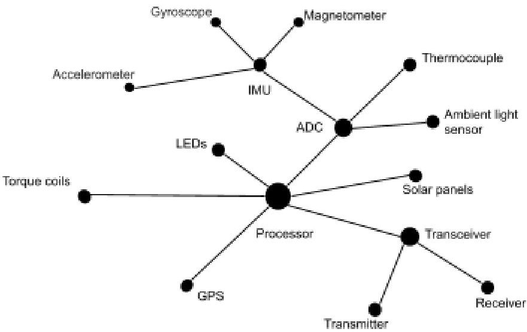


<div align="center">

Figure 4: Granular network

</div>

Breaking down the subsystems and including directionality to Figure 4 adds additional clarity. Figure 5 shows the five different sensors, the torque coils, solar panels and RF transceiver that the cubesat is equipped with. Visualizing these interactions is helpful in understanding the flow of data in the system. See Figure 5 below.


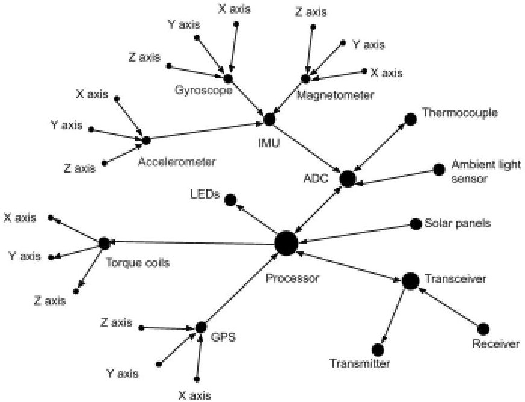


<div align="center">

Figure 5: Full Network diagram

</div>

In Figure 5, each of the sensors was additionally broken down into each value recorded by the sensor. This gives perspective to the data points that are recorded by

<!-- PDF_PAGE: 23 -->

the Teensy 3.5 microcontroller in real time. Counting the data in the network, each data packet must be assembled with 14 different data points.

A more holistic model based systems engineering (MBSE) model can be seen in the appendix.

## Flight assembly

To expand this systems perspective into the hardware and assembly of the cubesat, flight assembly of the EDU satellite was performed. This helped solidify the interfaces of the satellite while documenting the full assembly procedure. A full flight ready version (EDU) of the satellite was built. This version would be identical to the flight version. However, it would not deploy; it simply works as the reference to the flight satellite. For example, the integration testing and calibration could be experimented on this replica. See Image 1 below:


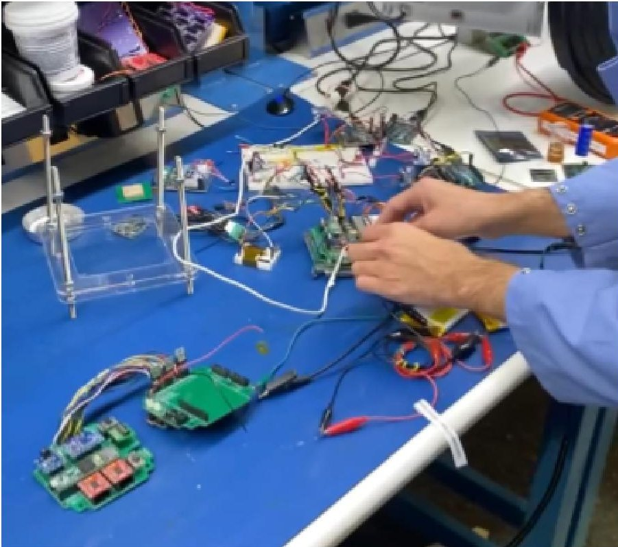


Image 1: Integration testing and calibration

Image 2 shows the flight ready electronics aboard the cubesat. This includes the

<!-- PDF_PAGE: 24 -->

- Teensy 3.5 flight computer microcontroller

- Rockblock system (iridium network)

- Adafruit LSM9DS1 IMU

- Two SparkFun TB6612FNG dual Motor Drivers

- INA169 Analog DC Current Sensor Breakout Board

- 5V regulator

- 5V Reg cam


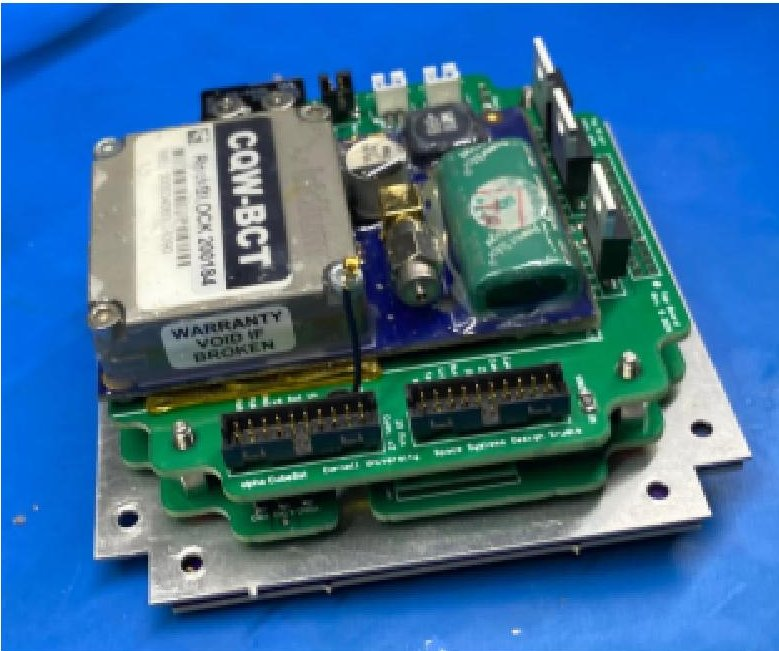


Image 2: Flight ready electronics

The documentation produced while assembling the EDU version was used as instructions to manufacture the flight ready cubesat. In addition, this version can serve as a guide for similar modular cubesat chassis used in future missions. The updated flight assembly instructions can be found in the appendix.

<!-- PDF_PAGE: 25 -->

## Chapter 2: Chipsat RTOS and RF development

The first system that was worked on was the RF system on the chipsat picosatellites. The following section reviews the methods used to test and modify the system to fit the requirements of Alpha. See the system level requirements below in Table 5.

<div align="center">

(Table 5)

</div>

<table border="1"><tr><td></td><td>Requirement</td></tr><tr><td>1.0</td><td>The systems SHALL communicate over RF</td></tr><tr><td>2.0</td><td>The system SHALL capture IMU data in a packet</td></tr><tr><td>2.1</td><td>The system SHALL have 16 bit data</td></tr><tr><td>2.2</td><td>The system SHALL collect magnetometer, accelerometer and gyroscope data in 3D space</td></tr><tr><td>3.0</td><td>The system SHALL be frequency modulated</td></tr><tr><td>4.0</td><td>The system SHALL FEC the data</td></tr><tr><td>5.0</td><td>The system SHALL add a preamble</td></tr><tr><td>5.1</td><td>The preamble SHALL consist of 4 8-bit barker codes</td></tr><tr><td>6.0</td><td>The system SHALL apply matched filtering</td></tr><tr><td>7.0</td><td>The signal SHALL be caught by a ground station</td></tr><tr><td>7.1</td><td>The signal SHALL be demodulated</td></tr></table>

<!-- PDF_PAGE: 26 -->

## Testing RF on the TI LaunchPads

Since the chipsats do not store the data locally, EM communication must be established such that the sensor readings can be recorded. In order to meet requirement 1.0 (see Table 5), RF communication was developed.

## Using SmartRF studio

When developing the code for the RF transmissions, TI Launchpad CC1310 were used as a testing device because they have the same microcontrollers. The TI boards were used as a substitute to mitigate risk of damage to the chipsats, in case anything failed early on.

SmartRF studio could be used to verify the TI Launchpad's functionality and test their transmitting speeds, range, power and filtering capabilities. When performing these tests, two TI Launchpad CC1310 were used with SmartRF Studio 7. After installing SmartRF Studio 7 and opening it, this screen will appear. See Figure 6.


<div align="center">

Figure 6: Connecting to TI launchpads on SmartRF Studio 7

</div>

<!-- PDF_PAGE: 27 -->

As can be seen in Figure 6, a list of connected devices comes up in the bottom command window. It was found best to avoid connecting both TI Launchpads to the computer initially, since you may not be able to distinguish between them. In stead plugging the boards in separately would allow the user to choose which board should be the transmitter and which one will be the receiver (labeling might help). The Device Control Panel could be accessed by double clicking on the device from the list of connected devices. For the transmitter, packet TX mode should be used. The transmitter should be configured as shown in the following screenshot. See Figure 7.


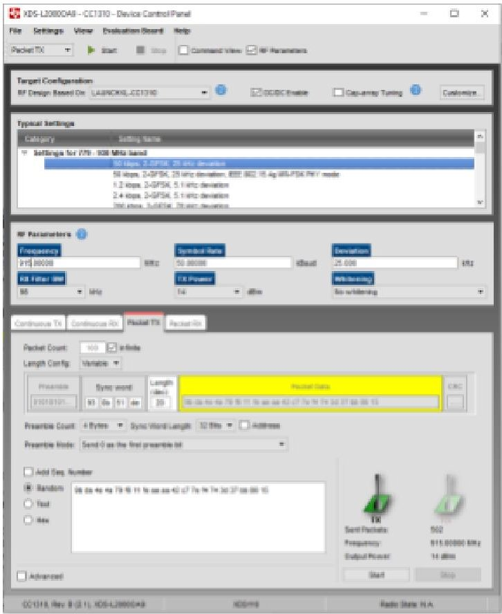


<div align="center">

Figure 7: Configuring the PacketTX in SmartRF Studio 7

</div>

For the RX receiver, the packet RX mode should be chosen. It will help to have two separate windows pulled up, so both the RX and TX screens can be seen at once. Make sure the sync words match for both the RX and the TX. Appropriate settings for the RX receiver can be seen in the screenshot, Figure 8, below.

<!-- PDF_PAGE: 28 -->


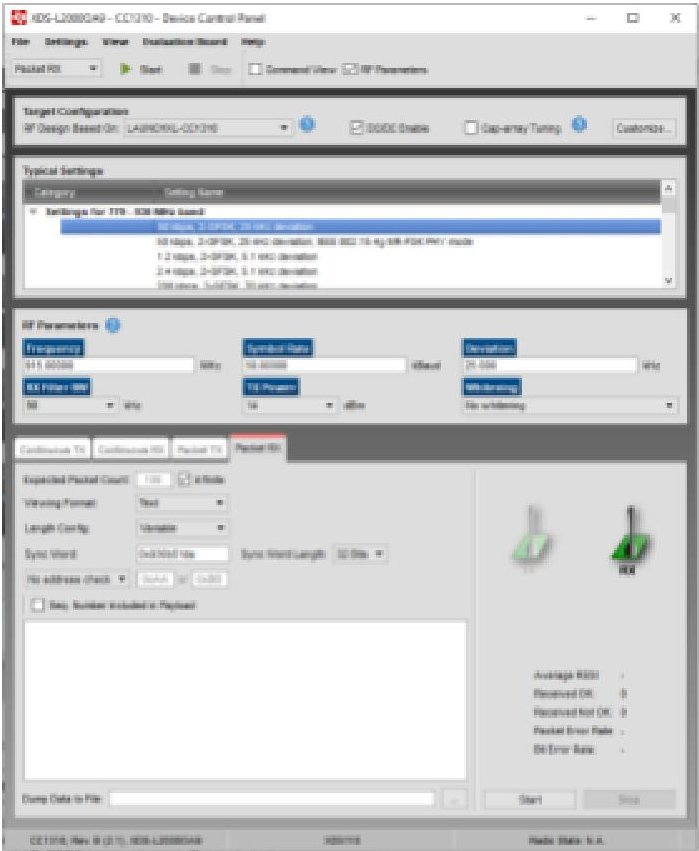


<div align="center">

Figure 8: Configuring the PacketRX in SmartRF Studio 7

</div>

The start button at the top of the screen should be pressed for both the transmitter and receiver. The receiver will listen for the code word. Therefore, starting the receiver before the transmitter is necessary if one wishes to receive all of the packets.

Through this interface, the transmitting speeds, range, and power could be verified. It was found that the TI launchpads transmitted well at 915 MHZ. The power available was around 14dB. The transmission distance was about 400m.

## Switching to a Code based RTOS structure

The TI Launchpads were coded using Code Composer Studio (CCS), a C++ based Texas Instruments coding platform.

When writing RF code, bare metal programming was not possible as it relies on a sequential timescale to flow through the progression of the code. Prioritizing tasks

<!-- PDF_PAGE: 29 -->

appropriately would have been impossible. For example, if you had two tasks, stabilize and transmit, it would be important to stabilize before one would transmit. In bare metal coding, scheduling would have to be done by placing one task above the other in the topological code sequence. However, if these tasks run intermittently, this becomes complicated. Therefore a scheduler or operating system (OS) is used. The OS assigns a priority to each task and schedules them accordingly.

The most popular OS is the real time OS or RTOS. As can be inferred by the name, this scheduler works in real time. In CCS, the RTOS is called TI-RTOS. The TI-RIOS scheduler has 4 main modes. If at any time during any operation, a higher mode or priority operation is scheduled, the OS will pause the current operation and go to the higher priority one. The highest priority mode is the hardware interrupts (hwis). Priority between the hardware interrupts are determined by which semiconductor is used. Once a hwi is finished executing, the scheduler will go back to finish the next highest hwi.

If there are no more hwis, the scheduler will move to the next level; software interrupts (swis). The swis will execute in a similar manner. However, as the name implies, the priority is established in the software. There are 32 different priority levels available.

If the hwis and the swis are not being executed, the scheduler reverts to the task thread. This is where the normal tasks are carried out. Normal tasks would include receiving GPS data, IMU data, or even the RF tasks. This also has 32 priority levels.

The lowest mode is the idle mode. This mode only occurs when there are no interruptions or tasks. In this mode there is no priority level, and low level background

<!-- PDF_PAGE: 30 -->

computation takes place. This mode is used to track time, run low priority background programs and monitor for hwis, swis or tasks. Mainly the idle mode is used to conserve energy. It is like a standby mode for the chipsat.

See Figure 9 below for summary of the scheduler priority levels.


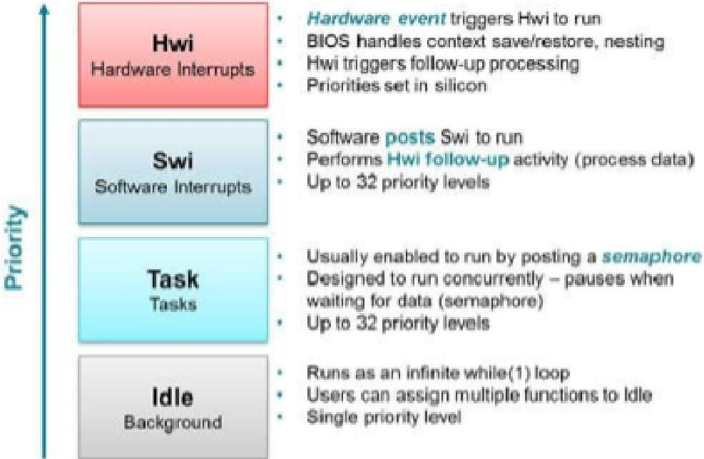


<div align="center">

Figure 9: TI-RTOS Kernel priority levels. Image credit from TI (link in references)

</div>

The task mode also has a scheduler in-and-of itself. This allows for programs to run concurrently, while limiting resources or timesets of data collection. A semaphore is used to schedule tasks appropriately. The semaphore keeps track of how many tasks are accessing a resource, regulates the use of the resource, and keeps a queue. There are two kinds of semaphores: a binary semaphore, and a counting semaphore.

The binary semaphore only lets one task run at a time. When the binary semaphore is equal to 1, the resource is available. After a task occupies the resource, a semaphore pend is posted. This subtracts one from the semaphore, making it zero, and blocking the channel. When the task stops using the resource, a semaphore post is posted. This once again increases the count of the semaphore.

<!-- PDF_PAGE: 31 -->

On the chipsat, a counting semaphore is used. This semaphore works similarly to the binary semaphore, however it allows for n different tasks to access a resource at once. The semaphore is initialized at n. Tasks can post and pend to the semaphore in the same way as in a binary semaphore, but when the semaphore is less than 1, the resource is blocked. See the flowchart below in Figure 10.


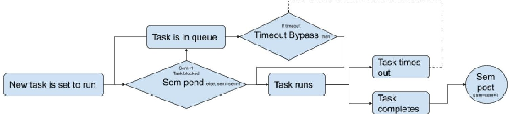


<div align="center">

Figure 10: Process flow for a semaphore

</div>

The counting semaphore allows for a task to time out. This sends a message in order to timeout Bypass the next task in the queue. This is seen by the dotted line in Figure 10.

In the TI-RTOS kernel, the following APIs are used to post and pend to a semaphore See Figure 11 below.


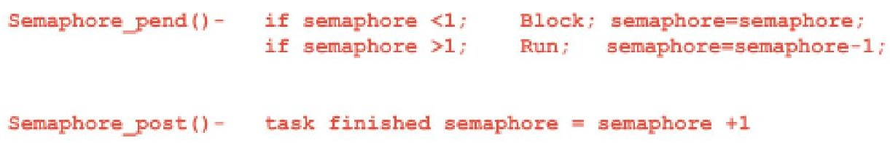


<div align="center">

Figure 11: TI-RTOS Semaphore APIs

</div>

Using the RTOS structure allows for easy switching between sensors and actuators on the chipsat.

<!-- PDF_PAGE: 32 -->

The next step was to be able to transmit and receive between two chipsats. Code Composer Studio (CCS) was used to code the RF tasks. For the Alpha mission only the transmissions were necessary, however, both were accomplished on the chipsats.

A TI-RTOS program had already been written for monarch PCB boards by Dr. Hunter Adams. This incorporated the use of an IMU, a GPS, and analog to digital converter (ADC), Radio communication (RF) and a hygrometer. However for the purpose of the RF development, only the RF tasks were relevant. Dr. Hunter Adams code was used as a structure for the new test code. The code contained a main script that called two task scripts, receiving and transmitting. However, the new code required restructuring the semaphore post and pendants. Previously the semaphores had been posted and pended in various locations throughout the different tasks based on the expected run order. Having only two tasks resulted in an unbalanced semaphore. After a single transmission, the channel was blocked indefinitely.

This issue was solved, and the semaphores were restructured to pend at the start of the task and post after completion of the task.

The code was successfully implemented for both transmission and receiving between each of the two TI Launchpads. However the transmissions were set up to send the raw modulated data without any error correction or filtering. The theory behind the modulation used will be discussed in the next section.

The modulation was programmed using the EasyLink APIs available in Code Composer studio. Non-blocking calls were chosen such that the packets would be transmitted without needing an indicator from the receiver that they had been received.

<!-- PDF_PAGE: 33 -->

Also a clear channel checker was added in order to verify that the transmitter would only transmit if the chosen channel is available (not busy). The following basic sequence is used to send a packet from the Launchpad:

EasyLink_setRfPower(14);

EasyLink_setFrequency(915000000);

EasyLink_transmitCcaAsync(&txPacket, IbtDoneCb);

Here the packet name is txPacket and the TX done function pointer is IbtDoneCb. The power of the transmission is 14dB at 915MHz. These packets can then be received in the RX taks with the following API:

## EasyLink_receiveAsync(rxDoneCb, 0);

Async was also used on the receiver to make sure this function is also non-blocking. The zero represents the relative start time of the receiver.

The APIs used above were able to be programed with help of the EasyLink API guide (see references)

RF signal modulation with Gaussian Frequency Shift Keying (GFSK)

The modulation technique used on the chipsats is frequency shift keying. This technique was determined by requirement 3.0 (See Table 5). In frequency shift keying, data is sent through a discrete change in the carrier signal frequency, with no effect on the signal power. This allows the chipsat to send signals at maximum power.

<!-- PDF_PAGE: 34 -->

The data sent by the chipsats is coded in binary. With Binary frequency shift keying, the carrier signal oscillates between a high and low frequency. The high frequency represents the 1, and the low represents a 0. Figure 12 is an example of an 8 bit carrier signal.


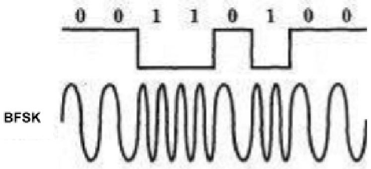


<div align="center">

Figure 12: Binary frequency shift keying (BFSK). High frequency represents a 1 and low frequency represents a zero

</div>

BPSK is an effective method for the chipsats because frequency modulation has a good signal to noise ratio, it has a smaller risk of interference, and the signal power radiates less (it is relatively unidirectional).

However frequency modulation can be expensive. Having to shift frequency (theoretically) instantaneously, is straining on the transmitter. It requires costly, powerful, bulky electronic equipment; all of which are unaffordable for a chipsat. To resolve this issue, the chisats use a transmitter that implements gaussian frequency shift keying (GFSK). The receiver measures the period of change of the incoming signal. In approximately the middle of each of these periods it reads the frequency of the transmission and translates it into a binary 1 or 0.

This allows for gradual frequency changes, lowering the cost of the equipment and decreasing the RF leakage.

<!-- PDF_PAGE: 35 -->

There are several levels of GFSK. At the base case, a 2GFSK will oscillate between a higher and lower frequency. The transmitter records the frequencies at each of the gray circles. This gives the transmitter the ability to gradually change its frequency. See Figure 13.


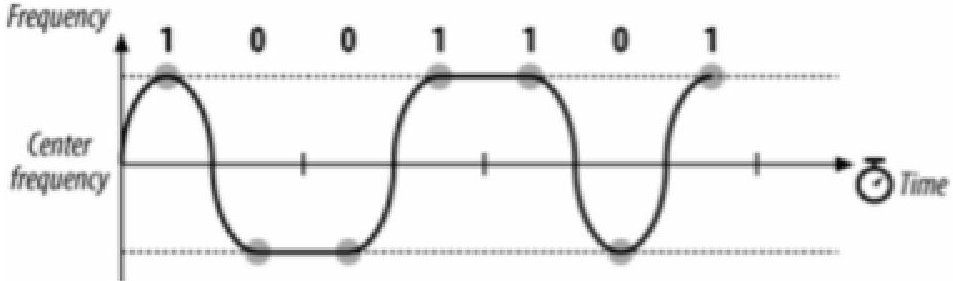


<div align="center">

Figure 13: Dual gaussian frequency shift keying (2GFSK)

</div>

*Note that the Y axis in this instance displays frequency.*

To increase transmission speed, one can use a 4GFSK. This is what is implemented in the chipsat modulator. The 4GFSK splits the input signal into 2 bit sequences. With binary, there are 4 such possible sequences; 00, 01, 11, and 10. Each of these instances is given its own carrier frequency. Figure 14 below shows the different discrete frequencies.


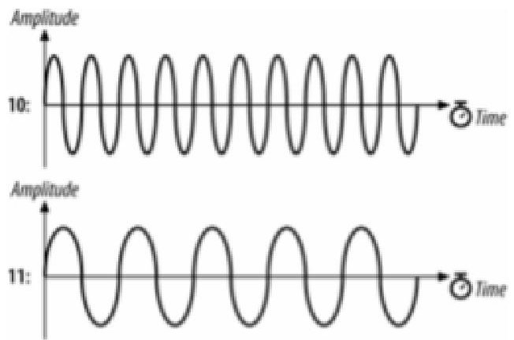


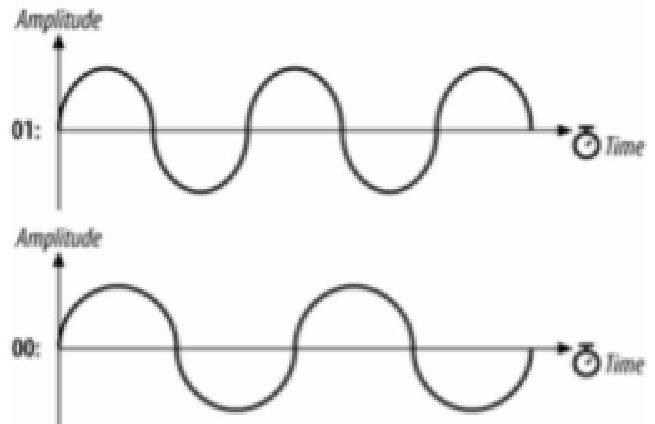


<div align="center">

Figure 14: 4 GFSK. Four different frequencies represent the 4 different 2-bit sequences

</div>

<!-- PDF_PAGE: 36 -->

Because two bits are able to be sent with each frequency change, 4GFSK is able to transmit and receive twice as fast as 2GFSK. The next step is going to 8GFSK. Figure 15 below shows a sample 8 bit carrier signal.


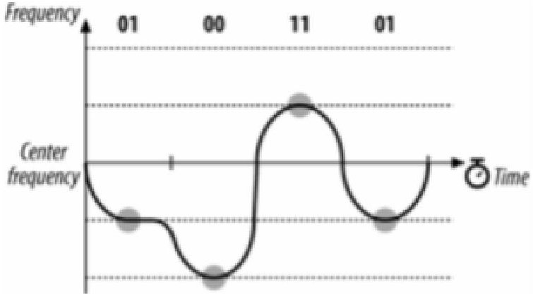


<div align="center">

Figure 15: Four chanel Gaussian Frequency Shift Keying 4GFSK

</div>

8GFSK can also be implemented to send 3 bits. However this only increases transmission speeds 50% from 4GFSK. With 8 discrete frequencies, demodulating becomes more complicated, expensive, and error prone (because of the many different frequencies). Therefore, for Alpha, 4GFSK was chosen as the modulation technique.

## Packet Formulation

This section will cover how the packets sent from the chipsat RF transmitter are constructed. To increase robustness, the data goes through forward error correction (FEC) and matched filtering (MF). These strategies were proposed by Dr. Zach Manchester, because they are commonly used in satellite communication. Using them for small sat communications is new. However, both FEC and MF greatly increase the signal-to-noise ratio which was sought after in order to achieve long range transmissions. Since the power budget is low, another method to increase the signal

<!-- PDF_PAGE: 37 -->

robustness is to pad the signal with extra bits. This can function as a gain-of-sorts. By coding the original binary sequence into one with repetition, if the signal experiences interference, the original data can be reconstructed from the repetition. In addition, these techniques add a security feature to the transmitted data, since the MF PRN sequences and FEC skew matrix would need to be known to decrypt the signal. (More detail provided in the appropriate sections.)

## Raw data

The data from the chipsats is sent synchronously in a packet format. The packets contained data from each of the sensors onboard. This was done to meet requirement 2.0, to record IMU data periodically (See Table 5). In addition, packet transmission allows for the sample data to be taken from a single timestamp, and for a complete set of data to be sent with each transmission. An advantage to this is to be able to have consistent parsing of the data from each transmission. Since the chipsats do not use unique identifiers for each sensor, a known chronological order of the data sets could help identify each component. That way the data could be identified on the basis of the expected transmission order. Figure 16 below shows the packet creation from the IMU values on the chipsat.

<table border="1"><tr><td>Gyro X</td><td>Gyro Y</td><td>Gyro Z</td><td>Accel X</td><td>Accel Y</td><td>Accel Z</td><td>Mag X</td><td>Mag Y</td><td>Mag Z</td></tr></table>

<div align="center">

Figure 16: Data packet formulation

</div>

For simplicity, the packets were initially created to just send the IMU data. The packets start by sending three directional gyroscope values, followed by the accelerometer and magnetometer values (see requirement 2.3 in Table 5). This made

<!-- PDF_PAGE: 38 -->

for a total of 9 values that would be transmitted. In the future we would incorporate data from the GPS, thermocouple and ambient light sensors.

For each of the 9 transmitted values, 16 bit resolution was desired as per requirement 2.1 (see Table 5). Because the RTOS had been written to send the packet in 8-bit parcel increments, each of the values were split into two halves. This made for a total of 18 8-bit data transmissions sent.

## S/N ratio

Commonly when transmitting signals, the signal-to-noise ratio (S/N ratio) can be increased by adding a gain to the signal in the form of increased amplitude. This requires extra power, and boosts the signal such that the ambient noise has less of a relative effect on the transmission. However, because the chipsat mission has a very low power budget, other techniques had to be considered in order to increase the S/N ratio. The two techniques used were forward error correction (FEC) and matched filtering. These methods encode extra repetitive bits. If a bitflip occurs (a binary one turns to a binary zero or vice versa), the original data can be reproduced from the repetition of the transmitted data.

## Error Correction

The chipsats in the Alpha mission use forward error correction (FEC) techniques in their transmission to fulfill requirement 4.0 (See Table 5). This is a common method used in radio transmissions to pad the signal with extra bits in order to improve robustness. FEC guarantees that the signal will not have to be retransmitted, and therefore makes communication much more reliable. For the chipsats, each 8-bit

<!-- PDF_PAGE: 39 -->

transmission is initially encrypted using a generator matrix. The generator matrix is a 8 by 16 matrix that is multiplied by the 8-bit signal to produce an encoded 16-bit output. This relationship can be seen in Equation 1 below, where m is the original signal, G is the generator matrix, and c is the resultant 16-bit output.

$$
c = m G
$$

The generator matrix was made by appending a cross correlation 8 by 8 matrix, P, with an 8 by 8 identity matrix (I). This retains a copy of the original data as well as a cross correlated version. Equation 2 shows how the generator matrix is appended.

$$
G = \left[ P \mid I _ {k} \right]
$$

The generator matrix used for Alpha is shown in Equation 3 below. This matrix was created by Dr. Zach Manchester.

$$
\left[ \begin{array}{c c c c c c c c c c c c c c} 1 & 0 & 0 & 1 & 1 & 1 & 1 & 0 & 1 & 0 & 0 & 0 & 0 & 0 \\ 0 & 1 & 0 & 0 & 1 & 1 & 1 & 0 & 0 & 1 & 0 & 0 & 0 & 0 \\ 1 & 1 & 0 & 0 & 1 & 1 & 0 & 1 & 0 & 0 & 1 & 0 & 0 & 0 \\ 0 & 1 & 1 & 0 & 0 & 1 & 1 & 1 & 0 & 0 & 0 & 1 & 0 & 0 \\ 0 & 0 & 1 & 1 & 0 & 0 & 1 & 1 & 0 & 0 & 0 & 0 & 1 & 0 & 0 \\ 1 & 1 & 1 & 1 & 0 & 0 & 1 & 0 & 0 & 0 & 0 & 0 & 1 & 0 & 0 \\ 0 & 1 & 1 & 1 & 1 & 0 & 0 & 0 & 0 & 0 & 0 & 0 & 0 & 1 & 0 \\ 1 & 1 & 0 & 1 & 0 & 1 & 1 & 1 & 0 & 0 & 0 & 0 & 0 & 0 & 1 \end{array} \right]
$$

After undergoing FEC, the data now has a hamming distance of 5. This means up to 5 errors can be fixed, or up to two bit flips.

<!-- PDF_PAGE: 40 -->

Each 8-bit data block from the packet undergoes matrix multiplication with the generator matrix at the beginning of the TX task. For improved computational speed, only the left half of the generator matrix was multiplied. This is because the right hand side is the identity matrix, so the original data is preserved (and therefore can just be appended to the cross correlated data). When coding FEC into the flight code, a traditional matrix multiply could not be used since the data is in binary. Instead, binary matrix operations were used.

Binary matrix multiply mirrors the process used by regular matrix multiply. Each of the entries in the columns of G are multiplied by the respective value in the data vector, and the values are added to produce a scalar entry in the output vector. Binary multiplication is done using the "binary and" operator noted by "&" in C. Since a binary 1 is only produced when both product elements are 1, only the entries in G with a 1 have to be considered. For the first column, that is entry 7,5,2 and 0. Similar to matrix multiplication, the resultant values are added to produce a scalar value. This is done by first bit shifting the values right, to the same position. In C the double greater-than symbol is used, followed by the nth number of shifts (ex ">>4" is right 4 entries). This puts all of the values into the zero index position so they are in the same column. Then, a "binary or" is used to add them. In C, the "binary or" operator is the " $ ^{^}$ ". Finally, bit shifting left is done to move the entry from the zero position back to the respective position. Analogous to the notation used when shifting right, the left bitshift also uses sideways carrots. Instead they are pointed left (double less-than symbol). See Figure 17 below for the binary multiplication code.

<!-- PDF_PAGE: 41 -->

$$
p \mid = (((\text {d a t a} \& \text {B I T 7}) > > 7) ^ {\wedge} ((\text {d a t a} \& \text {B I T 5}) > > 5) ^ {\wedge} ((\text {d a t a} \& \text {B I T 2}) > > 2) ^ {\wedge} (\text {d a t a} \& \text {B I T 0})) < < 7;
$$

$$
p \mid = (((\text {d a t a} \& \text {B I T 6}) > > 6) ^ {\wedge} ((\text {d a t a} \& \text {B I T 5}) > > 5) ^ {\wedge} ((\text {d a t a} \& \text {B I T 4}) > > 4) ^ {\wedge} ((\text {d a t a} \& \text {B I T 2}) > > 2) ^ {\wedge} ((\text {d a t a} \& \text {B I T 1}) > > 1) ^ {\wedge} (\text {d a t a} \& \text {B I T 0})) < < 6;
$$

$$
p \mid = (((\text {d a t a} \& \text {B I T 4}) > > 4) ^ {\wedge} ((\text {d a t a} \& \text {B I T 3}) > > 3) ^ {\wedge} ((\text {d a t a} \& \text {B I T 2}) > > 2) ^ {\wedge} ((\text {d a t a} \& \text {B I T 1}) > > 1)) < < 5;
$$

$$
p \mid = (((\text {d a t a} \& \text {B I T 7}) > > 7) ^ {\wedge} ((\text {d a t a} \& \text {B I T 3}) > > 3) ^ {\wedge} ((\text {d a t a} \& \text {B I T 2}) > > 2) ^ {\wedge} ((\text {d a t a} \& \text {B I T 1}) > > 1) ^ {\wedge} (\text {d a t a} \& \text {B I T 0})) < < 4;
$$

$$
p \mid = (((\text {d a t a} \& \text {B I T 7}) > > 7) ^ {\wedge} ((\text {d a t a} \& \text {B I T 6}) > > 6) ^ {\wedge} ((\text {d a t a} \& \text {B I T 5}) > > 5) ^ {\wedge} ((\text {d a t a} \& \text {B I T 1}) > > 1)) < < 3;
$$

p |= (((data&BIT7)>>7)^((data&BIT6)>>6)^((data&BIT4)>>4)^((data&BIT3)>>3)^((data&BIT2)>>2)^(data&BIT0))<<1;

$$
p | = (((\text {d a t a} \& \text {B I T 5}) > > 5) ^ {\wedge} ((\text {d a t a} \& \text {B I T 4}) > > 4) ^ {\wedge} ((\text {d a t a} \& \text {B I T 3}) > > 3) ^ {\wedge} (\text {d a t a} \& \text {B I T 0}));
$$

<div align="center">

Figure 17: Binary matrix multiplication of the LHS G matrix with the data

</div>

After undergoing these operations, the left half of the FEC encoded data is produced. In Figure 17 this is the p vector. Since the right half of the FEC encode is the original data, the left half and right half are appended to produce the final 16-bit vector. See Figure 18.

<table border="1"><tr><td>LHS 8-bit cross correlated data</td><td>RHS 8-bit original data</td></tr></table>

<div align="center">

Figure 18: Appended FEC

</div>

Once the data has been appended, the FEC encoded message can now add preamble identifiers. Since the message length was doubled, the signal to noise ratio also increases by 2 by using FEC. The packet length therefore is doubled from 18 8-bit sequences to 36 8-bit sequences.

## Pre and post amble

After the data goes through FEC, identifiers can be added to the packet to help with demodulating the signal. This packet generally is sandwiched with an identifier at the beginning and the end to be able to differentiate where the packet starts and stops. An identifier placed before the packet is known as a preamble whereas the one sent after a packet is called a postamble. In the case of the Alpha mission, only a preamble was used. Adding a preamble fulfilled requirement 5.0 (see Table 5)

<!-- PDF_PAGE: 42 -->

The demodulator uses the preamble for two reasons; to recognize the signal itself, and to locate where each packet starts. With this information, the signal can be caught and demodulated. For Alpha, the preamble was made with four 8-bit Barker codes (following requirement 5.1 in Table 5). This was then followed by the FEC encoded data. See Figure 19 below.

<table border="1"><tr><td>8-bit Barker code</td><td>8-bit Barker code</td><td>8-bit Barker code</td><td>8-bit Barker code</td><td>18 byte Data</td></tr></table>

<div align="center">

Figure 19: Addition of a preamble

</div>

These Barker codes can be set to any desired value as long as they are kept constant between transmitter and receiver. Using four 8-bit Barker codes statistically ensured a unique sequence of data that makes identification of the signal possible. In simpler terms, a preamble of this length guarantees that a random ambient transmission is not accidentally caught instead.

Adding 4 8-bit identifiers drew the total packet length to 40 8-bit transmissions

## Filtering

The filtering technique used on the chipsats was matched filtering determined by requirement 6.0 (See Table 5). Like FEC, matched filtering both increases the S/N ratio, and adds signal rigidity. However, the theoretical gain can be increased to a much greater degree. For the chipsats, the matched filtering increases the S/N ratio by 511 times. It does this by assigning a 64 byte sequence for each binary bit. These 64 byte codes are known as PRN codes. Two PRN codes are assigned to each chipsat; one for transmitting a binary 1 and the other for transmitting a binary 0.

<!-- PDF_PAGE: 43 -->

Another unique feature of matched filtering is the ability to share the communication channel with multiple devices. This is called code division multiple access (CDMA). CDMA assigns different pairs of PRN codes for each device that are as orthogonal as possible. The receiver then tunes to recognize the set of PRN codes that are being received.

See Figure 20 for a visual representation.


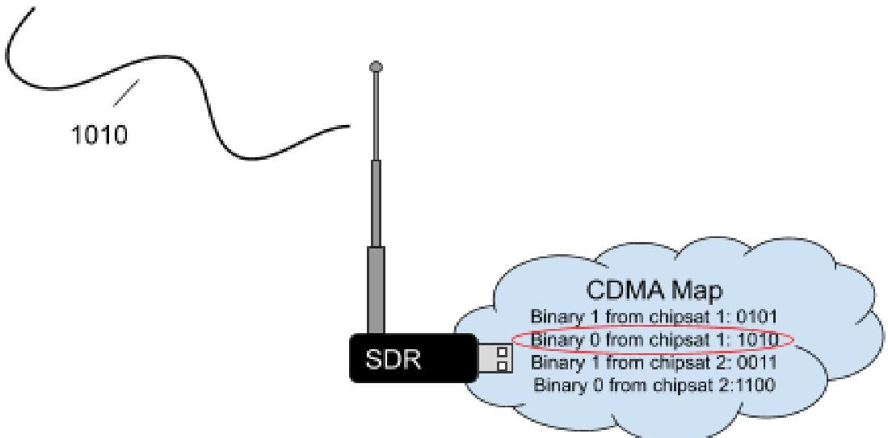


<div align="center">

Figure 20: CDMA allows for the receiver to recognize which device is transmitting

</div>

When coding the CDMA, the number of devices present will dictate how the PRN codes are chosen. The PRN codes are generated in order to achieve maximum orthogonality between codes. This is done to optimize the allowable hamming distance. For example, with only one device, one could simply send a binary zero 511 times and a binary one 511 times. However with multiple devices, to be able to recognize which device is sending the data, the PRN codes can not be perfectly opposite. Therefore, the more devices present in a system, the more likely one is to experience cross correlation. Luckily, in Alpha, only two chipsats are used, so 4 PRN sequences. This allows for a hamming distance of 127 or 63 possible bit flips.

<!-- PDF_PAGE: 44 -->

In the chipsat flight code, matched filtering took place after FEC. The respective PRN sequences are defined at the beginning of the TX task. A set of "for" loops run though the preambles and each of the FEC encoded bits. An "if" statement assigns them either PRN[0] or PRN[1] according to the respective binary value. The final transmitted parcel is built chronologically by appending each of the 16 PRN sequences (From the 16-bit FEC encoded data). All in all, the final transmitted parcel length is 1,024 bytes. Since there are 22 parcels, that makes each packet length a total of 22,528 bytes.

## Groundstation

The last step for a successful RF transmission was to configure a ground station to catch the signal as per requirement 7.0 (See Table 5). This was attempted in two ways, both of which will be used for Alpha. The first was to use a software defined radio (SDR). This would allow Alpha Team Members and other hobbyists to try to catch the signal. The second method was to use a receiver network. This could allow for a greater network to monitor for the signal and report back any data collected.

## Software defined radio RTL-SDR

For the Alpha groundstation, a SDR was used. This was chosen because it is extremely versatile in its application. Traditionally, radio receivers are built with hardware components for a very specific signal recognition type. With a SDR, all of the signal processing is done in the software. Anything from mixers, filters, amplifiers,

<!-- PDF_PAGE: 45 -->

modulators/demodulators, detectors are all processed in the software instead of the hardware.

For Alpha, we used a Realtek RTL2832U SDR (RTL-SDR). The RTL-SDR is an inexpensive SDR that is tuned using DVB-T TV tuners and has an RTL2832U chip. It communicates through a USB port to a COMs channel.

## Verifying transmitting using SDR sharp

The first test performed to verify that the RTL-SDR was to observe if it was able to sense the transmissions sent by the TI Launchpad. To do this SDRSharp was used. SDR sharp is an SDR software developed by AIRSPY. This software reads the RTL-SDR though the COM port records signals captured within a specified range. SDRSharp can be installed though the AIRSPY website and set up with the RTL-SDR (see references).

Once SDRSHarp has been set up with the RTL-SDR, the TI Launchpad can be plugged in. If the packages are transmitting, the RTL should be able to pick up the packages. A visual representation of the packages can be seen at the top of the screen. Figure 21 shows a visual representation of the AIRSPY dashboard sensing the chipsat transmissions at 915 MHz.

<!-- PDF_PAGE: 46 -->


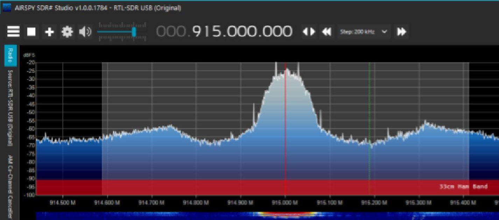


<div align="center">

Figure 21: AIRSPY dashboard identifies chipsat transmissions at 915 MHz

</div>

## Receive FEC signal on Raspberry Pi

To complete the SDR ground station, the last step was to receive a signal transmitted from the TI Launchpad though the RTL-SDR, and undo both the matched filtering and the forward error correction. A demodulation script had already been written by Dr. Hunter Adams. However this script was written to demodulate an unencrypted raw signal.

The demodulating script coded by Dr. Hunter Adams was intended to run on a Raspberry Pi connected to the RTL-SDR. The script would search for the four 8-bit Barker codes before demodulating.

The script was updated to run on the Raspberry Pi 4 Model B. Unencrypted signals were successfully sent to the Pi, demodulated, and stored in a .txt file. This meets requirement 7.1 (See Table 5). Taking this a step further, FEC was built into the demodulating code. Every two 8-bit transmissions were appended again to regenerate the 16-bit FEC vector. The 16-bit vector was then multiplied though the Parity check matrix, H, to get the original data back. The parity check matrix can be formed by appending the identity matrix (I) with the negative transposed cross correlation matrix, P. See Equation 4 below:

<!-- PDF_PAGE: 47 -->

$$
H = \left[ I _ {K} \mid - P ^ {T} \right]
$$

(Equation 4)

The parity check matrix will automatically correct for any hamming distance of the received transmission. This process was implemented into the demodulating code. To test the code, a FEC encoded transmission was then sent from the TI Launchpads. Demodulation of this signal was both accurate and successful.

The next step was to find a way for the demodulating script to undo matched filtering. This was difficult because the search algorithm in the demodulating script would no longer be able to identify the preamble, since each Barker code is now filtered. The solution to this problem will not be discussed in this paper. However, a new approach to the demodulation was found and full demodulation of a FEC and match filtered signal is possible.

## Tiny GS satellite balloon launch

In case the chipsat transmission could not be caught though our SDR, another option was to use a receiver network. The receiver network however relies on the microchip being able to receive LoRa (long range). The CC1310 does not have this capability, however the next generation chipsat will be upgraded to include this capability. The receiver network was tested during a balloon launch on October 10, 2021.The goal was to try and establish a connection with the LoRa on the chipsat throughout the mission using an Adafruit feather receiver.

This balloon launch was done to test the process flow of the satellite, and to get footage of our satellite to gain awareness of our mission. See Image 3 below for a picture taken by the cubesat from space.

<!-- PDF_PAGE: 48 -->


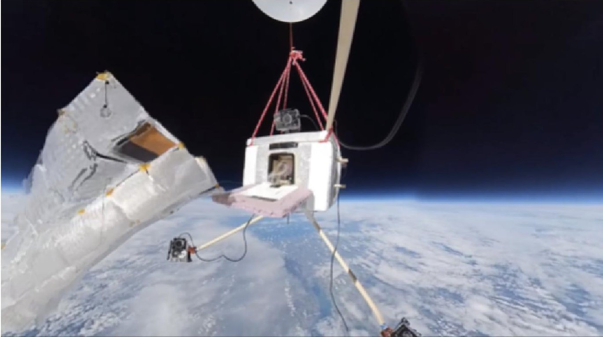


<div align="center">

Image 3: Photo from balloon launch

</div>

A TinyGS ground station (an Adafruit feather and antennae) was chosen to communicate with the LoRa transceiver. The TinyGS system allows anyone from around the world to receive signals from LoRa satellites or any other flying device that use low power communication techniques. The TinyGS module uses a ESP32 board. It is compatible to communicate with the sx126x and sx127x LoRa transceivers.

To connect to the TinyGS system, the TinyGS software is installed. After this is complete, the TinyGS board can be connected to the computer. The software will identify it and an IP address will appear on the LCD screen on the board. At this point the operator will connect their laptop WiFi to the TinyGS SSID. Once connected, the IP address displayed on the LCD screen can be typed in the internet browser. This will display a dashboard that will allow the user to configure the parameters of the groundstation. Once this is complete, the user can listen to the chipsat LoRa though the TinyGS system. The received packets will display to the dashboard on the network. See Figure 22 below for an example of the dashboard.

<!-- PDF_PAGE: 49 -->


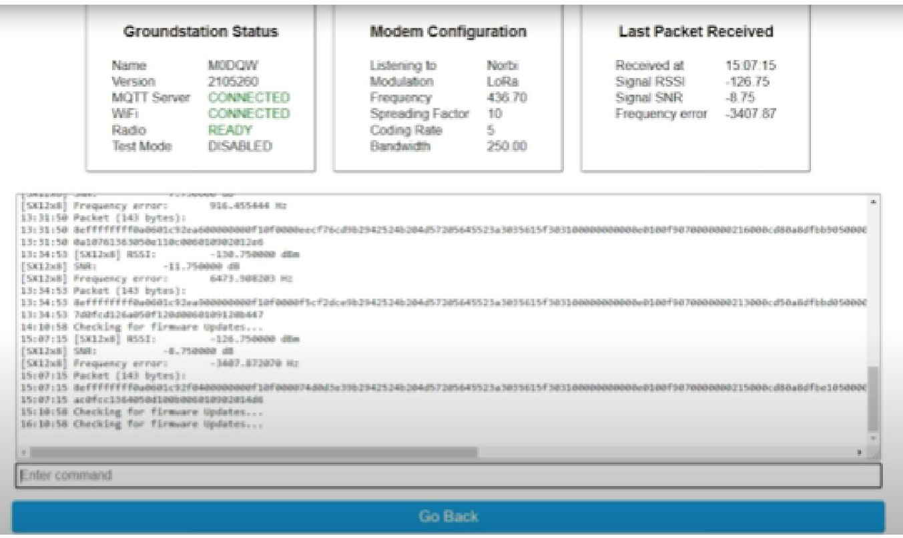


<div align="center">

Figure 22: Example TinyGS dashbord

</div>

At the time of the cubesat balloon launch, packets were not ready to be sent. However, the test was done to prove that we could successfully pick up signals from the chipsat LoRa transmitter. Although the transmissions could not be read, a timestamp was shown when the TinyGS ground station made a connection to the chipsat (inside of the cubesat). Each time the signal was found, the timestamp and current height of the satellite were recorded. The current height was measured using GPS onboard the cubesat. Figure 23 below shows the time of the transmissions we received, and the respective height of the CubeSat.

<!-- PDF_PAGE: 50 -->


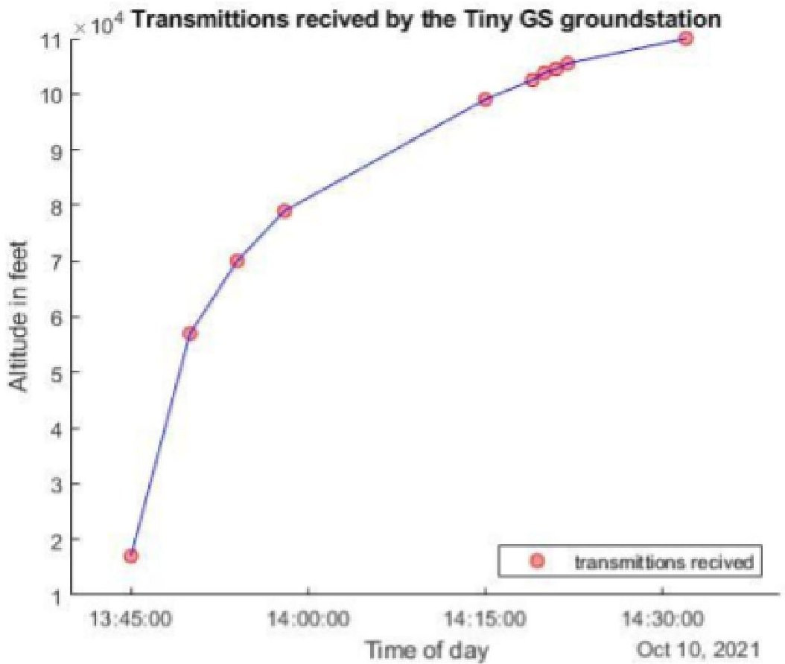


<div align="center">

Figure 23: Satellite height as a function of TinyGS transmission timestamps

</div>

This experiment proved that it was possible to pick up a signal from the cubesat even as it neared LEO. In conclusion, successful verification of the TinyGS system as a receiver option for Alpha was achieved.

<!-- PDF_PAGE: 51 -->

## Chapter 3: ACS development

On a satellite, it is important to be able to control angular momentum. The subsystem responsible for this is referred to as the attitude control system (ACS). For Alpha, it is a requirement for the ACS system to detumble, spin stabilize, and point the satellite. See Table 6 below.

<div align="center">

(Table 6)

</div>

<table border="1"><tr><td></td><td>Requirement</td></tr><tr><td>1.0</td><td>The system SHALL detumble to 10% of the initial angular velocity</td></tr><tr><td>2.0</td><td>The system SHALL spin stabilize within 10% of omega $ \mathrm{f}=[0 0 1] $ rad/s</td></tr><tr><td>2.1</td><td>The system SHALL spin stabilize within 8 hours</td></tr><tr><td>3.0</td><td>The system SHALL point its Z axis tangent to the Earth&#x27;s surface</td></tr><tr><td>3.1</td><td>The system SHALL point its Z axis perpendicular to its velocity vector (orbital direction)</td></tr><tr><td>4.0</td><td>The controller SHALL not use more than 0.75 watts(0.2 amps at 4.2-3.7 volts)</td></tr><tr><td>5.0</td><td>The Teensy flight computer SHALL be able to handle the ACS computations</td></tr><tr><td>6.0</td><td>The system SHALL calibrate the IMU against hard iron offsets caused by internal electronics</td></tr><tr><td>6.1</td><td>The system SHALL calibrate the IMU against soft iron offsets caused by magnetics onboard</td></tr><tr><td>6.2</td><td>The system SHALL calibrate the IMU against temperature offset effects</td></tr></table>

<!-- PDF_PAGE: 52 -->

## Duties of the Cubesat ACS

Coming out of the ISS, the initial tumble of the cubesat is unknown. The cubesat deployer does not offer a static ejection. However, it guarantees that the angular velocity of the cubesat shall not be above five degrees per second. Since the residual angular momentum would make it hard to establish a connection with the cubesat it is important to kill any of the residual momentum. Requirement 1.0 in Table 6 states that the residual momentum shall be deemed by 10% of the residual angular velocity. Figure 24 shows the ejection and detumbling of the cubesat.


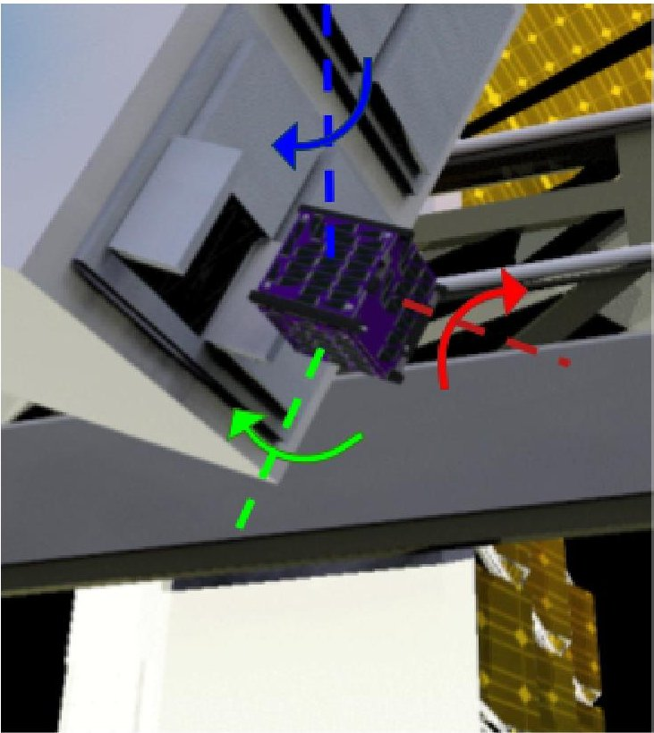


<div align="center">

Figure 24: Cubesat detumble after

</div>

deployer ejection

*Image courtesy of Josh Umansky Castro*

After the momentum is dissipated, spin stabilization should be established. Spinning the cubesat about its maximum principal axis gives it stability against any kind of interference. In addition, it guarantees the lightsail the same stabilization after it is

<!-- PDF_PAGE: 53 -->

ejected. An everyday example of spin stabilization is how stability of a frisbee is achieved by spinning it as it is thrown. The frisbee is able to maintain stability around its maximum principle access in spite of wind disturbances or other interferences.

Requirement 2.0 requires that the final spin be 1 rad/s around the Z axis, with a tolerance of 10%. Having this spin condition for both the cubesat and the lightsail will guarantee stability. Consequently, this will allow for a more reliable connection between the transceivers on the satellite ground station. Another benefit is that the constant rotation will offer active cooling for the cubesat. This helps ensure that no one side stays pointed at the sun for too long. Figure 25 shows how spin stabilization will be established for both the cubesat and the lightsail.


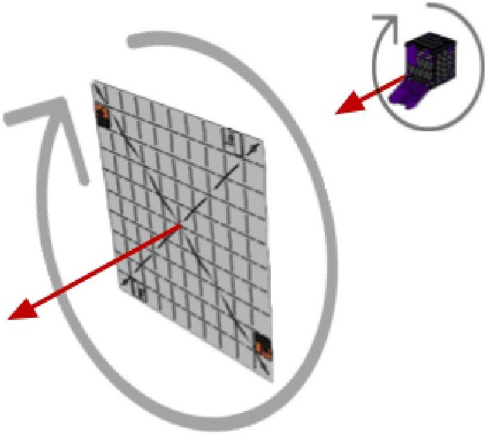


<div align="center">

Figure 25: Cubesat and lightsail spin stabilization *Image courtesy of Josh Umansky Castro*

</div>

Finally, the last necessary component of the ACS is to point the satellite. Requirement 3.0 in Table 6 ensures that the system will orient it's Z axis tangent to the Earth's surface. This ensures a high radio signal strength to the ground station while affirming that the lightsail is ejected perpendicular to Earth's gravitational field. In order

<!-- PDF_PAGE: 54 -->

to do this, both the positive and negative Z faces of the cubesat must be space pointing.

Figure 26 below shows how the cubesat would point.


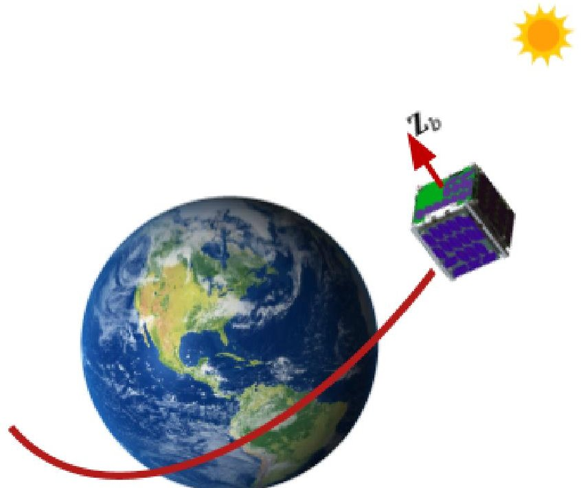


<div align="center">

Figure 26: Cubesat archives pointing *Image courtesy of Josh Umansky Castro*

</div>

## Cubesat ACS Actuators

For modern satellites, the most common ACS systems rely on ion propulsion, reaction wheels, or thrusters. However, given these requirements and the size of our cubesat, magnetic torque coils became the option of choice. This is because they are small in size, inexpensive, very easy to control, and relatively low energy.

In simple terms, magnetic torque coils are just electromagnets. The torque coils on the cubesat are made in house. A thin copper wire is wrapped five hundred times around an mu metal ferromagnetic core. The core is an inch long and three millimeters in diameter. It works as an amplifier. When the electromagnet is on, the polarized dipoles of the ferromagnetic electrons align. Unlike a permanent magnet, because the

<!-- PDF_PAGE: 55 -->

core is made out of a softer metal, it does not stay magnetized and almost instantly dissipates it's alignment after the coil is turned off. The core is added as a gain-of-sorts to the magnetic coil. Adding this core increases the magnetic field strength by around 15 times. Please see Image 4 below:


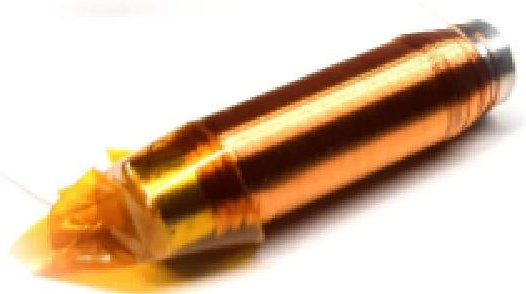


<div align="center">

Image 4: Torque coils made in house

</div>

The magnitude of magnetization of the torque coils is determined by the ACS controller. The controller runs on the Teensy 3.5 flight computer. The flight computer uses an inertial measurement unit (IMU) to measure the real time rotational velocity. From this input, the controller assigns a pulse width modulation (PWM) value to the coil. Since the flight computer runs on low power, an H bridge is needed. The H bridge powers the torque coils proportional to the PWM value sent by the flight computer. This lets the magnetic coils operate at the desired strength.

Other than the coils themselves, all of the other components are inexpensive commercial off the shelf (COTS) parts that are readily available online. They are not space rated, instead just hobbyist microcontrollers, electronics and sensors. However, similar products have been tested in space with very reliable results. All in all, the system including the flight computer can be put together for under fifty dollars. This is incredibly inexpensive compared to the ACS systems of other similar satellites.

<!-- PDF_PAGE: 56 -->

## Attitude control

Passive and active measures were taken when designing the cubesat ACS system. Both the shape of the satellite, and controller gains were configured to attempt to minimize power consumption. Tradeoffs included satellite stability and controller robustness. These three factors were optimized such that the ACS system met the system level requirements.

## Passive techniques

Since the power aboard the cubesat is limited, the attitude control system in the cubesat incorporated passive techniques. The cubesat used passive ACS by manipulating the mass distribution. This served two purposes, both to balance the cubesat on each of its axes to avoid tipping or wobble, and to bias the z axis as the maximum principal axis (requirement 2.0 in Table 6). Lead weights were installed in a square-like fashion in the XY plane. They were placed in the lightsail compartment, across from the electronics. This was done to balance the cubesat weight along the Z axis. Steel weights were also added pointing in the Z axis direction. They straddle the perimeter of the cubesat, running up and down the inside of each of the side facing panels. Having both of the lead and steel weights on the outside of the cubesat, forces the principal moment of the inertia axis to align to the geometric Z axis. See Figure 27 for clarification on mass placement

<!-- PDF_PAGE: 57 -->


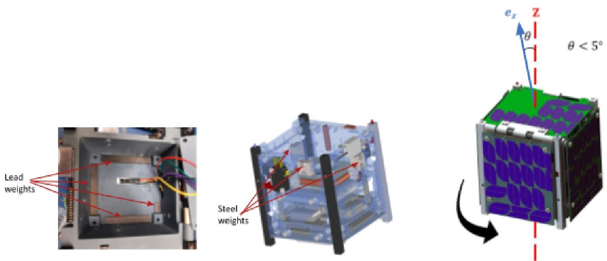


<div align="center">

Figure 27: Passive ACS techniques used in Alpha Photo credit Josh Umaksky-Castro

</div>

## Active techniques

The cubesat uses a controller algorithm as an active measure to optimize the ACS system. The controller algorithm uses two controllers to handle spin stabilization and axis alignment respectively.

## Kane Damper

The first controller used in the ACS system is a Kane Damper. The Kane Damper is a controller modeled after a rigid body under the influence of a frictional damper. Specifically, the algorithm mimics a hypothetical state in which the spacecraft has an internal spherical cavity. Inside this cavity, a slightly smaller spherical mass exists with a viscous fluid surrounding it. The cubesat is damped due to the theoretical difference in angular velocities between the spacecraft and damper. See Figure 28 for clarification

<!-- PDF_PAGE: 58 -->


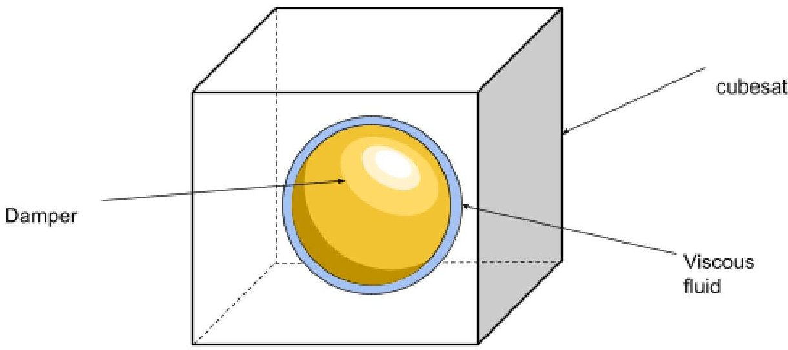


<div align="center">

Figure 28: Kane Damper Model

</div>

This circumstance allows for two tunable coefficients; the moment of inertia of the internal sphere, $ I_{\mathrm{d}} $ , and the damping constant of the viscous fluid, c. Since the internal mass is modeled as a sphere, the moment of inertia can be simplified as a coefficient multiplied by the identity matrix. Tuning the Kane Damper can therefore be reduced to adjusting two scalar values. A surface plot can be created to choose a set of values that best optimize the stability and convergence of the controller.

## PD controller

The second part of the ACS system is the pointing. This system is tuned on using a toggle switch in Simulink that activates once stability is reached by the damper. Pointing is achieved through a proportional derivative (PD) controller. A PD controller is a feedback controller that adjusts its system outputs based on the difference, error, between the desired value and the real time value. The PD controller does both by 1) a proportional correlation of the error and 2) a derivative correlation to the error history. Figure 29 below shows a diagram of the feedback process.

<!-- PDF_PAGE: 59 -->


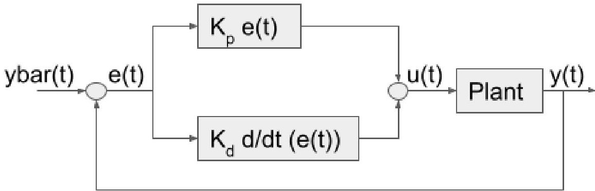


<div align="center">

Figure 29: PD feedback model

</div>

The proportional control is measured with every iteration of the feedback loop. The reference value is noted as "ybar" in figure 29 above. The real time value is noted by "y". The error, "e", is determined as the difference between the reference and feedback values. The proportional control is tuned by the gain constant $ K_{p} $ . This is done to increase the output torque proportional to the observed error.

The derivative control is measured by the slope of the tangent taken at the last two or more iterations of the feedback loop. This is done to avoid overshooting the reference value. It can also provide a small degree of disturbance rejection. The derivative control is tuned by the gain constant $ K_{\mathrm{d}} $ .

Proportional Integral Derivative (PID) controllers are widely known and commonly used in many industries. Adding the integral component helps increase the disturbance rejection and guarantees zero steady state error. However, adversely, it will also drastically increase computational cost and runtime of the controller. The requirement to establish communication allows for a steady state error margin that the PD controller may incur.

The requirement for our settling time is to reach steady state within 8 hours. Simulations suggested that settling time would not be a limiting factor. Therefore, robustness of the system was a larger priority. This meant guaranteeing lower

<!-- PDF_PAGE: 60 -->

computational rigor for our flight computer. Since this flight computer controls the entire satellite, it was decided to keep computation at a minimum to decrease risk.

## Validating PD control method

To verify that the PD controller was the most effective controller in fulfilling our requirements, our system was compared against the industry standard controllers. This was done as an effort of the class Astronautical Optimization taught by Dr. Timothy Sands at Cornell University. For the final control paper, six alternative controllers were tested and compared on the basis of controller quadratic cost, computational time, rise time, and rigidity (see full paper in the Appendix). Each of these values were determined based on the controller's ability to move from quiescent initial conditions, to a unitless position of one. The results were then compared to that of a PD controller. The results showed the following table. See Table 7.

(Table 7)

<table border="1"><tr><td></td><td>Quadratic Cost</td><td>End Point Error-Theta</td><td>Standard deviation-Theta</td><td>Rise time</td></tr><tr><td>PD controller</td><td>1.309573</td><td>9.28393e-02</td><td>4.857353e-02</td><td>8.57e-01</td></tr><tr><td>P+V Controller</td><td>55.709082</td><td>8.239661e-03</td><td>1.061509e-02</td><td>3.90e-01</td></tr><tr><td>P+V Double Integrator</td><td>2.544054</td><td>1.216665e-01</td><td>1.044603e-02</td><td>N/A</td></tr><tr><td>Double Integrator gain tuning</td><td>6.579885</td><td>1.087292e-01</td><td>1.085613e-02</td><td>7.80e-01</td></tr><tr><td>2DOF feed forward</td><td>6.147382</td><td>2.911532e-02</td><td>1.115621e-02</td><td>8.00e-01</td></tr></table>

<!-- PDF_PAGE: 61 -->

<table border="1"><tr><td>P+V Control Law Inversion</td><td>6.127791</td><td>2.929454e-02</td><td>1.106685e-02</td><td>8.00e-01</td></tr><tr><td>Open loop guidance(DQC)</td><td>6.181200</td><td>5.775071e-03</td><td>5.761962e-02</td><td>8.00e-01</td></tr><tr><td>RTOC</td><td>6.169038</td><td>1.865604e-05</td><td>2.710996e-03</td><td>8.10e-01</td></tr></table>

A general optimal controller is undefinable, since controllers have trade-offs. Therefore, optimality can only be found for a specific system based on the system needs (Dr. Timothy Sands, Cornell University). For the cubesat, low quadratic cost was optimized. Quadratic cost is a measure of acceleration over the time interval, and therefore it correlates to power usage. Requirement 4.0 in Table 6 states that the power must be under 0.75 watts. This requirement was found to be the limiting factor of the control system, since the rise time requirement (requirement 3.0) was easily met by all of the controllers. As can be seen in Table 7, the PD controller has the smallest quadratic cost.

As an additional verification of the robustness of the PD controller, the rise time was recorded as a function of the timestep. This was done to fulfill requirement 5.0 in Table 6 theoretically. Since the Teensy microcontroller runs both the ACS and the flight code, this was checked such that the computational burden could be decreased for the ACS. It was found that the timestep had very minimal effects on the rise time. The flight computer could therefore run at a slower timestep if needed. See Table 8 below.

<!-- PDF_PAGE: 62 -->

<div align="center">

(Table 8)

</div>

<table border="1"><tr><td>Timestep(s)</td><td>Rise time(s)</td></tr><tr><td>0.1</td><td>8.67e-01</td></tr><tr><td>0.01</td><td>8.29e-01</td></tr><tr><td>0.001</td><td>8.20e-01</td></tr></table>

The PD controller was validated as the best option for our ACS system, due to the optimal quadratic cost, and the robustness of the rise time with respect to varying timesteps.

## Traceability, Verification and Validation

The controller software

For Alpha, the ACS software is modeled in Simulink with the parameters defined in a MATLAB script. The Simulink model consists of a controller that is able to toggle between the Kane Damper and the PD controller when appropriate. A plant was added such that the system dynamics could be simulated. The end goal was to add the final tuned controller to the Arduino flight code as a“.h” library file.

The original code was developed by Davide Carabellese for his masters thesis. (see in references). However, to fulfill the system requirements for the cubesat ACS, traceability was necessary. This started with labeling every flow with the appropriate variable. Furthermore, at every interaction point, the correlating equation was referenced. This made it possible for the control algorithm to easily be verified by

<!-- PDF_PAGE: 63 -->

outside experts. Each step could be tied back to a fundamental equation, checking for accuracy in the algorithm.

After traceability was achieved, the controller was verified functionally. This was done using a Verification Cross Reference Matrix (VCRM). The VCRM pointed out the changes that were necessary in the code. Some of the values that were updated included the initial spin conditions, projected orbital inclination, orbital height, the mass of the cubest, the number of coils in the magnetorquer, and the cross sectional area of the magnetic torquer. These variables were redefined in the MATLAB script accordingly.

The controller was verified holistically by running a simulation with a plant model of the dynamics. When running the simulation, it was evident a certain parameter caused the controller to approach the stable steady state values much too fast. See Figure 30 below for the initial results of the simulation.


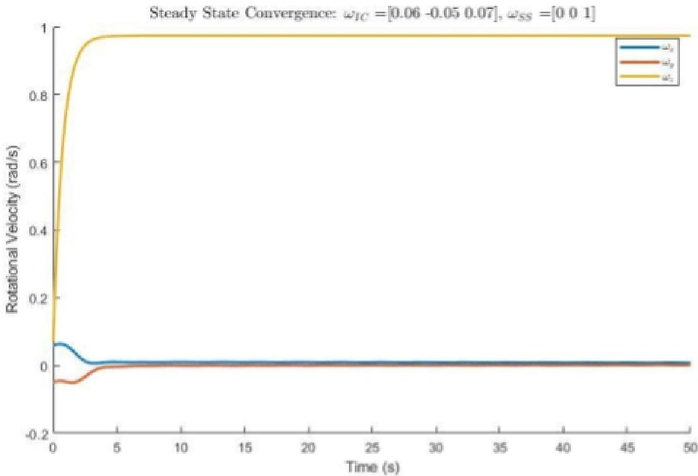


<div align="center">

Figure 30: Unrealistic convergence of Kane controller

</div>

<!-- PDF_PAGE: 64 -->

After viewing the results of this simulation, validation tests were conducted for the cubesats ACS parameters. The first attempt was to update the principal moment of inertias. This was done because the values approximated by SOLIDWORKS did not include many of the finer components, making its prediction too low.

Experimentally calculating the moment of inertia of the chipsat

Using Newton's second law of Rotation, the angular acceleration can be determined by solving for alpha using the net torque applied by the magnetic coils and the moment of inertia of the cubesat. Therefore, in order to stabilize the cubesat dynamically, the moment of inertia must be known accurately. See Equation 5 below.

$$
\Sigma \tau = I \alpha
$$

(Equation 5)

The moment of inertia was initially calculated using the SOLIDWORKS model. However, this model did not include many of the wires and other components that were difficult to draw. In order to verify the values found and determine their accuracy, a more accurate calculation was needed.

Instead, the moment of inertia was calculated experimentally by analyzing the pendulum motion of the cubesat rotating around its axes. This required setting up a bifilar pendulum. The pendulum was assembled by suspending the cubesat from two fishing lines at a distance h from the suspension point to the pivot point. The two fishing lines were separated across the cubesat diagonal at a distance D. This distance was kept constant (the fishing lines hung vertically) . Figure 31 below shows the setup of the experiment.

<!-- PDF_PAGE: 65 -->


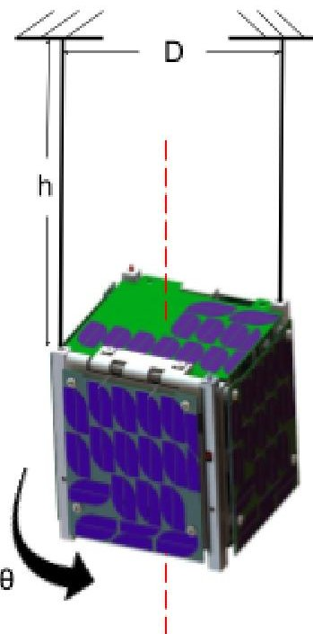


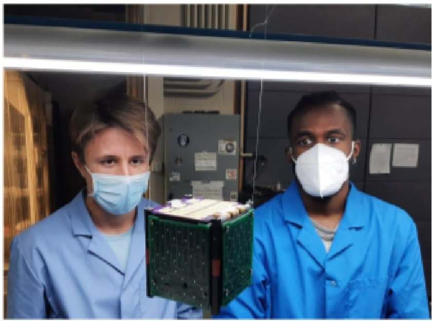


<div align="center">

Figure 31: Moment of inertia testing setup

</div>

After completing the setup shown in Figure 31, an initial rotational displacement was applied to the cubesat. The period of the oscillations was calculated. To minimize human error, the period of three continuous oscillations was recorded and then adjusted (divided by 3). For further accuracy, this evaluation was done five times and averaged again. A final period was found.

The cubesat was rotated to spin around both of the remaining axes and the experiment was re-done. The periods were found around the remaining two axes

The equation for the period of a Bifilar Pendulum is written below in Equation 6.

$$
T = \frac {4 \pi}{D} \cdot \sqrt {\frac {h I}{m g}}
$$

Solving for the moment of inertia, Equation 7 is derived:

$$
I = \frac {m g D ^ {2} T ^ {2}}{1 6 \pi^ {2} h}
$$

<!-- PDF_PAGE: 66 -->

The mass of the cubesat, the separation distance, and the length of the bifilar pendulum are known. Therefore the moment of inertia was calculated in each of the principal directions, using the periods recorded.

The inertia matrix was evaluated using the principal moment of inertias found. Since the maximum principal moment of the inertia axis was aligned within 5 deg of the z axis, the off-diagonal elements were considered insignificant and set to zero.

The resultant inertia matrix can be seen below in Equation 8. The inertias are in units of $ \mathrm{g^{*}m m^{2}}. $

$$
\left[ \begin{array}{c c c} 2 1 0 9 7 5 9. 4 5 & 0 & 0 \\ 0 & 1 9 8 3 9 0 6. 1 7 & 0 \\ 0 & 0 & 2 3 0 8 2 8 1. 5 0 \end{array} \right]
$$

The SolidWORKS predicted values can be seen below. See the values in Equation 9.

$$
\left[ \begin{array}{c c c} 2 0 5 0 0 6 8. 1 2 & - 1 6 8 2. 7 4 & - 1 9 0 1. 2 6 \\ - 1 6 8 2. 7 4 & 1 6 5 2 9 7 6. 5 3 & 8 1 1 1 9. 5 3 \\ - 1 9 0 1. 2 6 & 8 1 1 1 9. 5 3 & 2 1 9 3 3 9 5. 1 4 \end{array} \right]
$$

Comparing these values to the Solidworks predictions, the calculated values seem highly accurate. The principal axis moments dominate the behavior of the

<!-- PDF_PAGE: 67 -->

cubesat, and are similar in magnitude. All of the off-diagonal entries are smaller in magnitude by an order of 20-100 times. This makes it safe to consider these values negligible.

The calculated principal moment values are all proportionally higher than the SolidWORKS ones. This makes sense because of the wires and other features that the SolidWorks model does not take into account. The experimentally derived values were consistently larger.

Although the experimental values did show to be 5-20% larger, the difference was not substantial enough to be the sole reason for the high rise time observation.

Consequently, the next verification was done to check the amplification factor of the mu metal rod in the magnetic torque coils.

Calculating the amplification factor of the Mu-metal core

To know the magnetic strength of the torque coils accurately, the amplification factor of the mu metal rod was necessary. This had been approximated before based on values found online, however, an experimental value had never been found for our system. To find the amplification factor of the torque coils on the cubesat, the magnetic dipole needed to be determined. This was measured with the IMU magnetometer. The equation used to calculate the magnetic dipole of the coil is shown below. It was originally derived by Dr. Lee (see references). See Equation 10.

$$
M _ {d i p o l e} = \frac {4 \pi}{\mu_ {0}} \left[ \frac {\frac {R _ {x}}{L} - \frac {1}{2}}{\left(R _ {x} ^ {2} - R _ {x} L + \frac {L ^ {2}}{4}\right) ^ {3 / 2}} - \frac {\frac {R _ {x}}{L} + \frac {1}{2}}{\left(R _ {x} ^ {2} - R _ {x} L + \frac {L ^ {2}}{4}\right) ^ {3 / 2}} \right] ^ {- 1} \cdot B
$$

<!-- PDF_PAGE: 68 -->

Here Rx represents the distance from the coil to the magnetometer and L represents the length of the coil. The magnetic field, B, is measured in units of Teslas. Having the magnetic dipole of the magnetorquer, the amplification factor was able to be determined using the applied current (I), the number of coils (N), and the cross sectional area (A). See Equation 11:

$$
A F = \frac {M _ {d i p o l e}}{N I A}
$$

A code was written in Arduino to turn on and off the magnet coils. Both the radius of the coil and length of it were recorded. The length of the coil from the IMU was also measured. A magnetic field of 55 uT was found. This translated to a magnetic dipole of 0.0619 amps - $ m^{2} $ . The amplification factor was calculated to be ~13.5 to 14 times.

The amplification factor found experimentally was significantly smaller than the one predicted by Davide Carabellese. The amplification factor measured at around a tenth of the previous expectation.

## ACS verification conclusion

After verifying and validating the controller code, the following results were produced. This was done with initial angular velocities of 0.06, -0.05, and 0.07 for x, y, and z respectively. See Figure 32 below.

<!-- PDF_PAGE: 69 -->


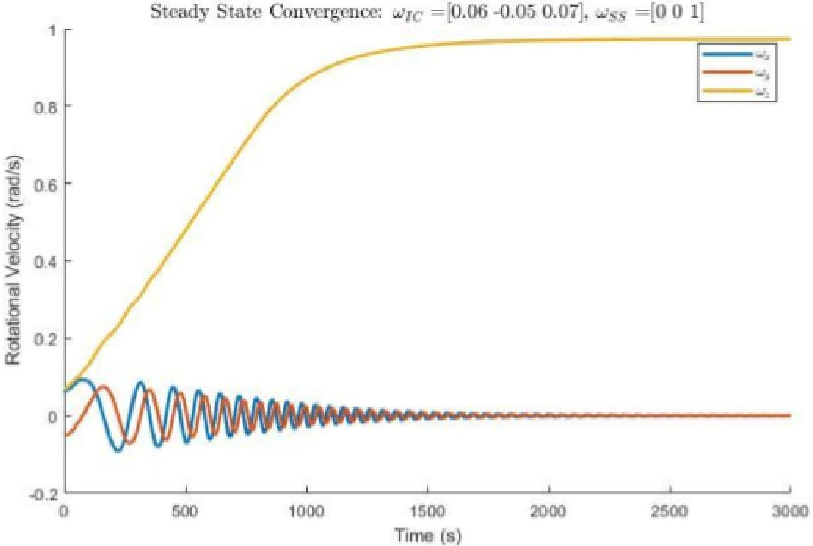


<div align="center">

Figure 32: True convergence of Kane controller

</div>

This model was verified mathematically using Euler's coupled equations of motion. Since both the X and Y axis rotational motion are set to reach zero, when evaluating their effects on the Z axis rotational motion, they can be neglected. Solving this simplified equation, an asymptotic exponential increase function is derived. The X and Y velocities, however, are very dependent on each other. Evaluating the general solution to these coupled equations will reveal sinusoidal behavior. As predicted, this is what is seen in Figure 32.

As can be seen, the convergence time is more reasonable. The controller is predicted to take 25 -35 min to stabilize the cubesat. The oscillations also are theoretically predicted because of the damped nature of the system. Observing Figure 31, the system seems to be nearly critically damped. This solution meets requirements 1.0 and 2.0, since the system is successfully tumbled and spin stabilized.

<!-- PDF_PAGE: 70 -->

The measures discussed above, advanced the TRL of the control system from a 2-3 to a 6. The advancements in TRL were accomplished through adding traceability of the model to the respective requirements, verifying the constants, and going through a robust validation of the parameters. The controller was matured to work as intended for the cubesat ACS. Further technological maturation could be done by checking the controller experimentally in an air bearing environment, and ultimately launching a cubesat into low earth orbit (LEO) to test the rotational kinematics.

## The Hardware

Once the ACS code was ready, the hardware could be tested. This was done to make sure that all of the components could handle the outputs from the controller, and to verify that the pant model works in actuality as predicted by theory.

## Tested software on Teensy flight computer

Verification testing was done for all of the hardware used in the ACS system. The first component tested was the microcontroller. For Alpha, a Teensy 3.5 microcontroller is used. This controller runs all of the flight software for the cubesat. This component was hardware tested to experimentally test compliance with requirement 5.0 in Table 6.

To test the Teensy, the ACS controller algorithm was uploaded as a library to the Teensy flight software. Using the plant model in the Arduino code, the script was run. Controller runtime, computational speed and accuracy were recorded and plotted. These plots could be compared to the simulations carried out in MATLAB/ Simulink. No major differences were observed.

<!-- PDF_PAGE: 71 -->

Several timesteps were tried. It was found that the Teensy refresh at 0.01s. This is a conservative estimate given that Teensy was also running the plant simulation (which will not be the case when deployed). An endurance test was performed where the Teensy would run until the plant returned stable values. This was done three times back to back. The Teensy was verified to be able to run the ACS control algorithm.

## Magnet Coil Endurance tests

The next components tested where the magnet coils. This testing had two facets; making sure the hardware could handle very periodic and fast PWM shifts, and making sure the system could be active for long periods of time. For each of these tests, The Teensy was connected to the H bridge which was connected to one torque coil. The IMU was not used and the PWM values were chosen both periodically and at random instead. See Figure 33 for the electrical diagram of the setup.


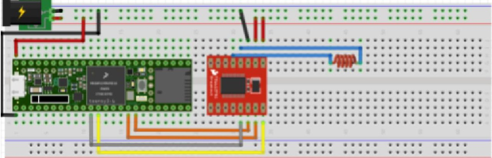


<div align="center">

Figure 33: Wire diagram of the ACS endurance testing

</div>

Longevity test

For the longevity test, the system was evaluated on its ability to run for a long period of time. After the cubesat is deployed from the ISS, the ACS system may have to be running continuously for several hours to detumble and reach its desired spin. To

<!-- PDF_PAGE: 72 -->

verify the dependability of the ACS subcomponents, specifically the H bridge and the coil, a longevity test was run for two days. In this test, the PWM values were periodically incremented from 0 to 255 for both polarities of the coil. Each PWM value for each current direction was run for ten microseconds. The coil therefore would switch its polarity about every 2.5 seconds. This was verified with a gyroscopic compass. Figure 34 below shows the verification of the working coil using the gyrocompass.


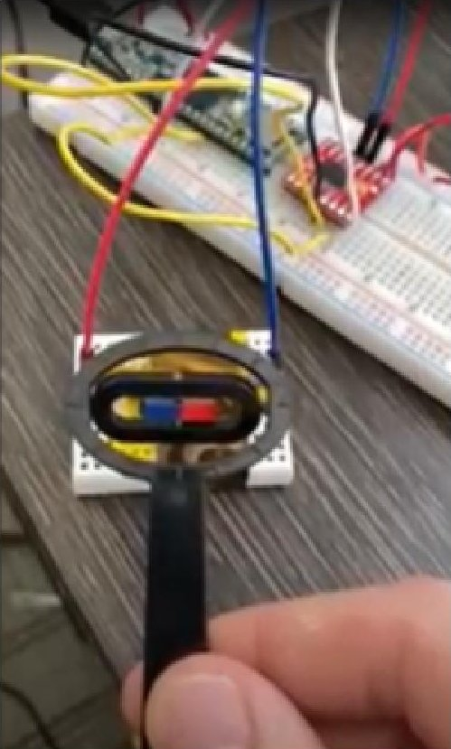


<div align="center">

Figure 34: The gyrocompass measuring the magnetic field of the torque coil

</div>

The loop was on continuously for the duration of the two days. Throughout the two days the magnetic field was tested using the gyrocompass. The system stayed active and accurate for the entire duration. For test procedures on this experiment please refer to the Appendix.

<!-- PDF_PAGE: 73 -->

Fluctuation test

In the fluctuation test, the ACS system was evaluated on its ability to react precisely to large and fast changes in the PWM value. Because of the oscillating torque values output by the Kane damper, the controller may at times attempt to drastically change the power while detumbling. It has been measured that the flight computer has a characteristic reaction time of approximately 3 milliseconds. Therefore, a program was written to randomly choose a PWM value and current direction every 3 milliseconds. The magnetic field was then tested with the gyrocompass. As a preliminary test it appeared to change at an interval on the order of a few milliseconds. (further testing was done later using the IMU).

In addition longevity was once again tested. This was done in case the fluctuation over time would degrade any of the hardware. Every few hours the magnetic fields were measured. There was no apparent change in the magnetic field strength and the system functioned similarly after two days. For test procedures on this experiment please refer to the Appendix.

## Tuning the system

## Kane damper tuning

To produce optimal results for the ACS, the Kane Damper was tuned. This was initially done by guess-and-check to get the approximate range of convergence of the cubesat system. These initial values were also used as a starting point for the search algorithm discussed later on.

<!-- PDF_PAGE: 74 -->

After stable $ I_{\mathrm{d}} $ and c values had been chosen, the controller went though robustness testing by altering the initial kinematic conditions. The controller was proven to be robust at varying initial conditions. Finally, a MATLAB algorithm was written to fine-tune the Kane Damper.

The Kane damper was tuned using two iterative "for" loops. The "for" loops iterated the scalar moment of inertia, $ I_{d} $ , and the damping constant, c, of the damper. Since both of these values are directly proportional to the angular velocity, the assumption was made that the surface plot would be both smooth and continuous. The Kane tuner optimized computational time by using a very broad search. Instead of solving for a precise array of damping constants and moments of inertia, the code would find a region with the fastest convergence time. For example, the parameters could be set up to find 25 values, by incrementing each variable (Id and c) by 5. A minimum rise time of the controller would be found for the granular search. The surrounding region would be zoomed in on and further searched. This would avoid wasting computational time solving for precise solutions that are clearly not in the optimal region.

This kind of optimization technique is only possible because the surface plot is known to be smooth and continuous based on linearity. This can be seen in Davide Davide Carabellese's thesis (see references) See Figure 35.

<!-- PDF_PAGE: 75 -->


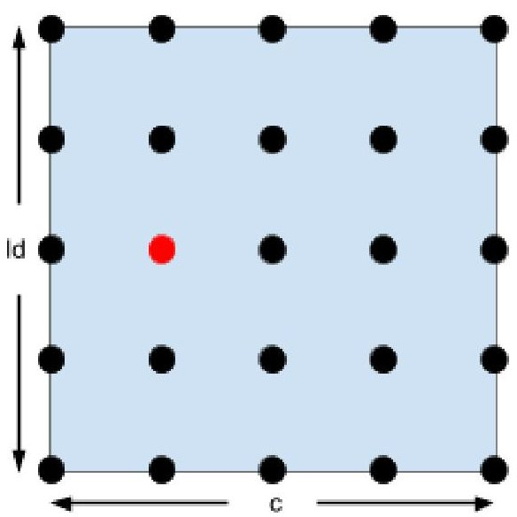


<div align="center">

Figure 35: Granular searching algorithm

</div>

Figure 35 shows the 25 solutions as dots, the optimal being in red. Now, a zoom can be applied to search more granularly in the selected region. The search region is applied to the area located closest to the red dot. Because of the correlation of both $ I_{d} $ and c to the angular velocity, this answer is guaranteed to live in this region. In other words the max and min are determined to be plus or minus half a deviation from the optimal solution. The new search region is shown below in Figure 36.


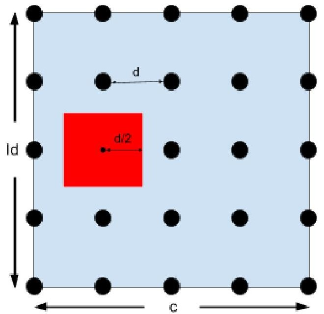


<div align="center">

Figure 36: Zoomed in search region.

</div>

<!-- PDF_PAGE: 76 -->

The zoom continues until the desired level of precision is found. However, if the optimal solution is found on the perimeter of the search region, the problem becomes more complex. See Figure 37.


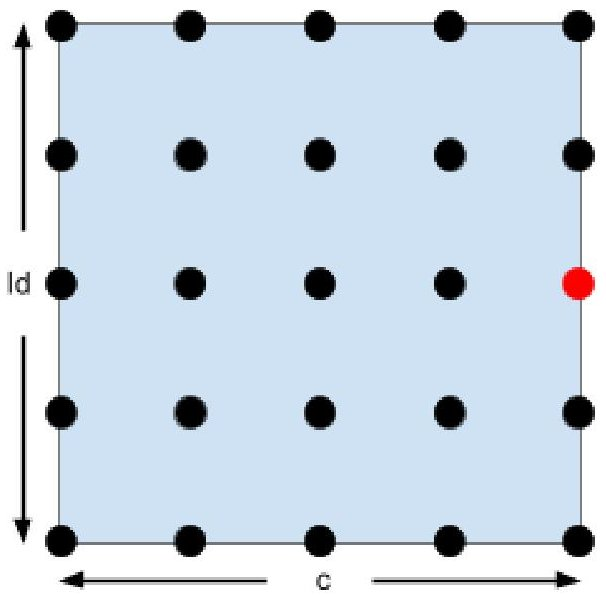


<div align="center">

Figure 37: Optimal solution found on the border

</div>

This means that the solution may lie right on the border, or it lies outside of the search region. The MATLAB script will execute a popup window for the operator to decide. Either the program can continue to search along the borderline, or it can autonomously expand it's search region. If autonomously expanded, the search region will grow by the same interval as initially defined. However, it will still keep a half unit into the old region in case the operator is wrong and the solution lies close to the border. See Figure 38.

<!-- PDF_PAGE: 77 -->


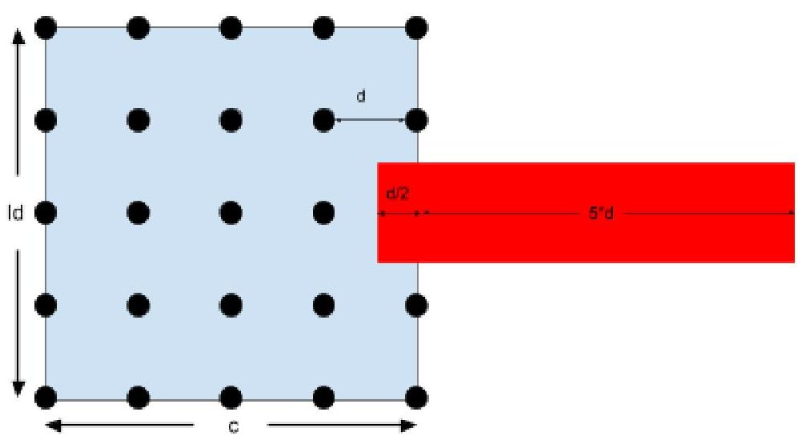


<div align="center">

Figure 38: Borderline search region with autonomous search region expansion

</div>

<div align="center">

Since no zoom was achieved, the zoom factor will not be incremented by one.

</div>

The other option may be chosen if the operator is constrained to expand the search region or if they are confident that the optimal solution lies within the original definition. This would keep the same search area, and continue to zoom in along the border. See Figure 39.


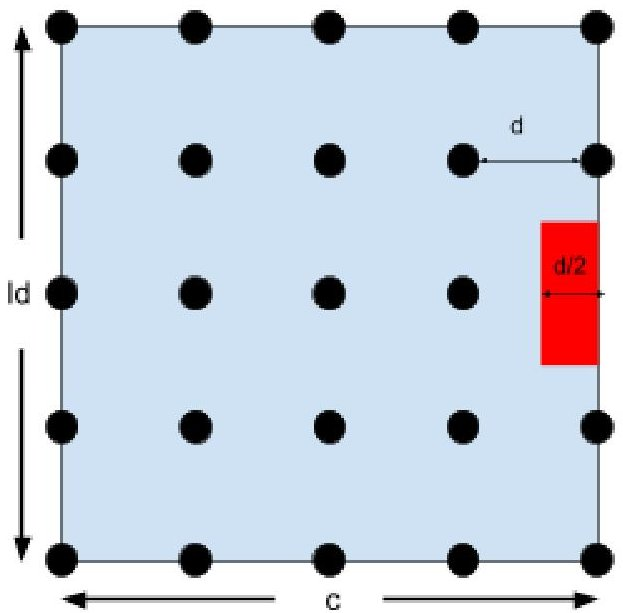


<div align="center">

Figure 39: Borderline search region without expansion

</div>

In this case, the zoom will continue along the border.

The optimal result was determined by finding the index at which each of the three angular velocities (X, Y and Z) converged. The index of the largest settling time of the X,

<!-- PDF_PAGE: 78 -->

Y, and Z angular velocities was recorded. This was because the ACS would be considered converged once all of the desired angular velocities had been reached. The index of total settling time was compared as the algorithm incremented $ I_{d} $ and c. Once a lower index was found it would replace the previous one and record the respective $ I_{d} $ and c values. Below, Figure 40 shows pseudocode that depicts this logic.

```end

if max([index(1),index(2),index(3)])<num

    num=max([index(1),index(2),index(3)]);

    bestc=c;

    bestId=Id;

end

```

<div align="center">

Figure 40: pseudocode to find optimal Id and c

</div>

Optimality of the tuner was based on the settling time of the system at the given conditions. The settling time was found by indexing the time at which convergence was achieved. Convergence was found by averaging the past n values, and ensuring that they fall into a m% convergence region of the desired angular velocities. In addition, to validate the solution in the long term, the endpoint value was checked to make sure it still resided in the convergence region. For the tuner, a n value of 5 and an m value of 20 were chosen. See Figure 41 below.

<!-- PDF_PAGE: 79 -->


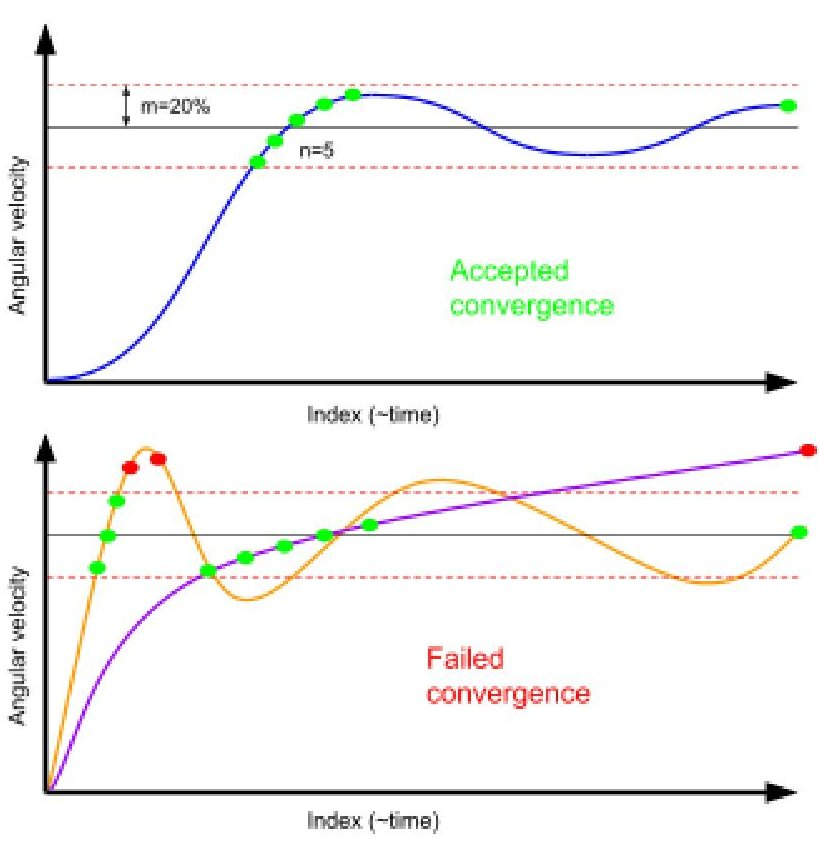


<div align="center">

Figure 41: Convergence criteria. N number of points within an m% region of convergence and the endpoint must lie in the region of convergence. (n=5 and m=10)

</div>

The Matlab code was run on a zoom level of 3. With this MATLAB optimization code, the optimal values for $ I_{d} $ and c were recorded in Table 9 below.

<div align="center">

(Table 9)

</div>

<table border="1"><tr><td>Id</td><td>c</td></tr><tr><td>0.07</td><td>0.0025</td></tr></table>

With these values, the controller was able to reach its convergence within 21 minutes. This convergence time meets requirement 2.1.

<!-- PDF_PAGE: 80 -->

## Tuning the IMU

Since the IMU is used to measure earth's magnetic field, it is important that the measurement is not tainted by the magnetic fields output by the cubesat itself. In order to accurately measure the earth's magnetic field, the IMU must be calibrated to subtract out the influence of the cubesat dipoles. There are two kinds of magnetic offsets produced by the cubesat; hard iron offsets and soft iron offsets. The hard offsets are the magnetic fields produced by the electronics onboard. This is a relatively constant value that can simply be subtracted from the IMU reading. The soft iron offsets, however, are more complex because they change as a function of the controller. The offsets themselves are caused by the magnetic fields emitted by the magnetic torquers.

To illustrate the effects of these better, the hard iron offsets are a displacement vector that displaces the three dimensional readings linearly. On the other hand, the soft iron offsets are like a three by three transformation matrix that distorts the vector space.

<div align="center">

See Figure 42 below.

</div>


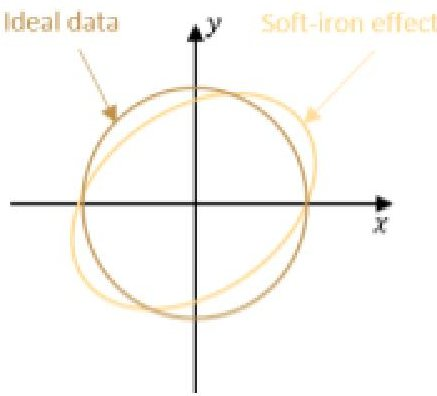


Skew matrix


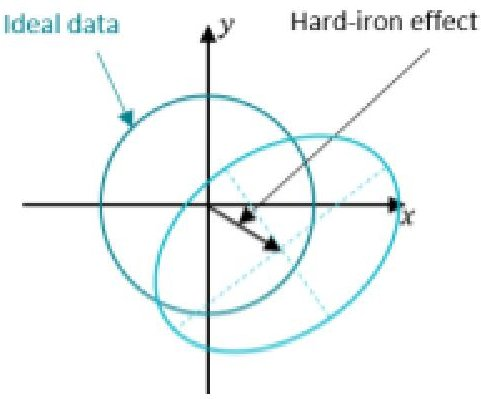


Displacement vector

<div align="center">

Figure 42: Effects of hard iron and soft iron offsets

</div>

<!-- PDF_PAGE: 81 -->

Additionally, the temperature of the cubesat had relatively large effects on the magnetometer readings. These effects would also need to be accounted for in our model.

## Soft iron offsets

The soft iron offsets are the offsets that taint the IMU readings due to the magnetic fields produced by the magnetic torque coils. This value is constantly fluctuating since each of the three torque coils will affect the magnetometer reading independently. As the controller adjusts the PWM gains in each of the three coils, the offsets caused by the magnetic fields of the torque coils must be continuously calculated. These values are then subtracted from the IMU magnetometer reading in real time.

However, it was found that PWM was not the only factor that affected the magnetic field though the coils. Experimentation and systems verification determined that the magnetic offsets change as the battery is draining, due to lowered voltage. Therefore, a model was generated that would return soft iron offset values based on the PWM input to the X, Y, and Z coils, and the current battery voltage.

## PWM Offsets

In order to find the PWM offsets, experimental data was collected for the change in magnetic field measured by the magnetometer in the X, Y, and Z directions, for all three coils. Each coil produces a three dimensional offset vector due to the fact that naturally there is a displacement vector between the IMU reference frame and that of

<!-- PDF_PAGE: 82 -->

the. This resulted in 9 different offset values that if superimposed would return an overall three dimensional offset vector.

The flight code was uploaded to the cubesat with a command to turn the magnet coils on for one second. Magnetometer readings were taken at a 0.0015 second interval. Every ten readings were averaged and printed out to the serial monitor. Using a serial monitor to .txt file converter called PuTTY, the data was stored and later copied into an Excel sheet. An indicator was also printed out in order to clearly note the interval of which the coil was on for. Once imported into Excel, these measurements could then be averaged once again, both before and after the indicators. The averages while the coil is on in the X, Y and Z directions could be compared to the same respective averages while the coil is off. The resultant vector represents a three dimensional offset for the coil tested.

During experimentation, one coil was turned on at a time, starting with the X coil. The PWM value was incremented by factors of five, starting at 255 though -255. The offsets were measured as a three dimensional vector; a function of the input PWM level. After building a matrix with offsets over the PWM range, the raw data was read into MATLAB. A script was written to assist an operator in determining the order of the best fit polynomial. The line of best fit was then plotted on top of the raw data. In order to evaluate the level of goodness of fit, a root mean squared error (RMS) was calculated and displayed in the legend. The highest marginal return was found in the second and third degree polyfit models. See Figure 42 a) for a three degree polyfit below.

<!-- PDF_PAGE: 83 -->


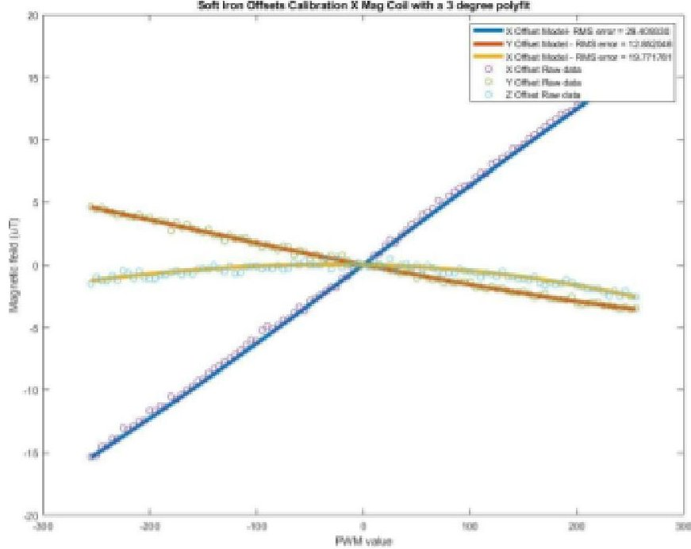


<div align="center">

Figure 43 a: X coil 3 degree polyfit IMU offsets

</div>

Analogously, the same procedure was used to increment the PWM values in the Y and the Z magnet coils. Similar graphs were produced. See Figure 43 b) and c) below.


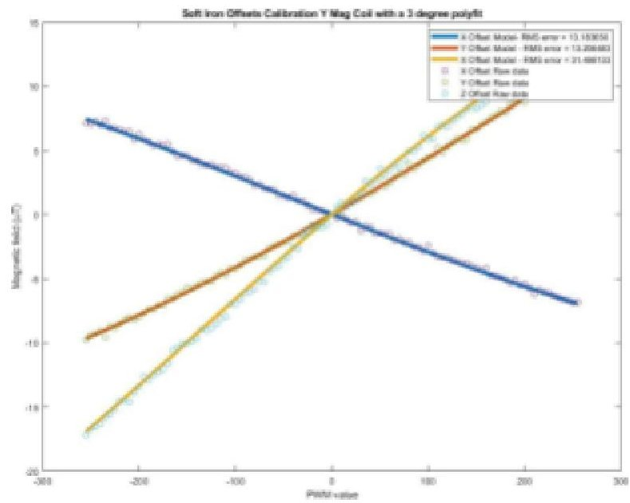


<div align="center">

Figure 43 b: Y coil 3 degree polyfit IMU offsets

</div>


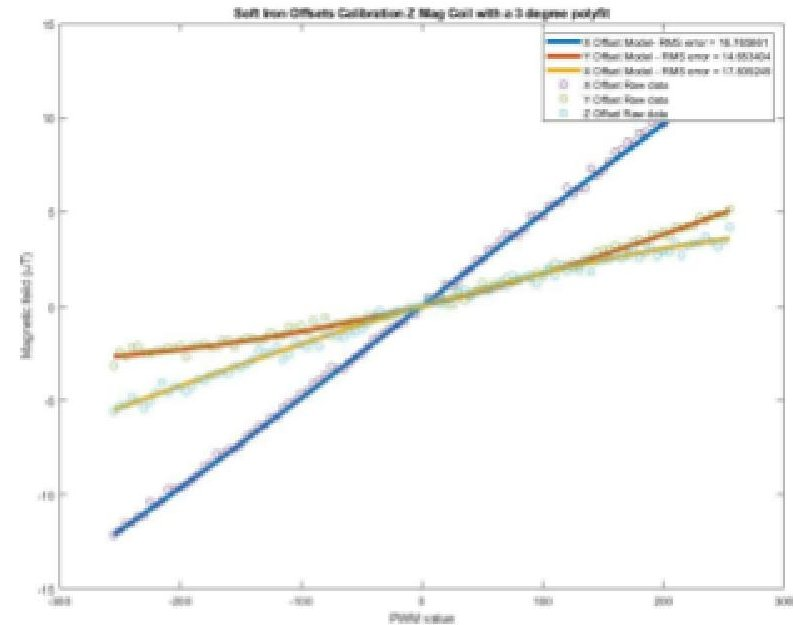


<div align="center">

Figure 43 c: Z coil 3 degree polyfit IMU offsets

</div>

<!-- PDF_PAGE: 84 -->

The nine polyfits seen above represent the effects of each of the three individual magnet coils along each of the three coordinate axes. By adding the effects of all three magnet coils, these equations could be superimposed into just three; total X offset, total Y offset, and total Z offset. Each of these three final equations would be in terms of all three PWM value inputs into each of the magnetic coils.

In order to correctly adjust the curves found above, the cubesat battery voltage was measured. This would provide a reference to which the voltage correction could be compared to. All of the PWM tests were done at full battery with the cubesat charging (4.2V).

## Battery Voltage Offset correction

It was observed that as the battery drains, the decreasing battery voltage of the cubesat causes the soft iron offsets to also decrease. Over the lifespan of the battery the voltage could change from 4.2 to 3.7 volts. If the battery drains below 3.7, the ACS is automatically turned off to preserve power, so voltages lower than this were not considered.

This change in voltage did not have a significant effect on the magnetic field produced. In fact, the differences ranged from 1-2.5 times the resolution error of the IMU magnetometer. Initially a linear subtraction was considered because it was quick and easy. However, knowing that the PWM model was not linear, this seemed overly simplistic. Even though the extra precision was not necessary, correction coefficient was calculated instead.

Data was recorded experimentally by connecting the cubesat to a variable power supply and incrementing the voltage from 4.2 to 3.7 volts by a factor of 0.1 volts. This

<!-- PDF_PAGE: 85 -->

was done for each of the three coils and the changes in offsets were calculated along all three coordinate axes measured by the IMU. The PWM value of each respective coil was set to 255. A total of nine experiments were conducted.

The change in the offsets from the 4.2 to the 3.7 was recorded on average for all 9 situations. This value was then normalized. The normalization was done to find the proportion of change of the offsets relative to full battery conditions. Since the experiments were carried out at a PWM value of 255, normalizing against the 4.2 volt 255 PWM value would return the percentage of change in the offsets at 3.7 volts. In other words, this value represents the proportional difference of the magnetic offsets between full battery and 3.7 volts. A linear gradient was programmed such that any input voltage could be used, and the change in offsets would be corrected appropriately. Subtracting one from this answer would reveal the factor by which the polyfit would need to flatten. See Equation 12 below.

$$
C _ {c o r r e l a t i o n} = 1 - \frac {o f f s e t (P W M (2 5 5) , 4 . 2 V) - o f f s e t (P W M (2 5 5) , b a t t V o l t s)}{o f f s e t (P W M (2 5 5) , 4 . 2 V)}
$$

In this equation, the "offset" function returns the magnetic field offsets at the conditions listed in the parenthesis. The variable battVolts represents the instantaneous battery voltage. Using Equation 12, all nine correlation coefficients were found. The resulting coefficients were multiplied by each of the respective nine polyfits derived by the PWM values (discussed in previous section).

This method proved both accurate experimentally and theoretically. If the battery is full, the correlation coefficient will stay at 1 and nothing changes. As the battery drains, the coefficient will be weighted according to the difference of the offsets calculated experimentally. If a battery voltage of zero was possible, each of the polyfits

<!-- PDF_PAGE: 86 -->

would flatline as expected. This approach is therefore much more reliable and robust than a simple linear subtraction.

To verify the soft iron solution, offsets were predicted using the model with random PWM inputs. The IMU offsets were consistent with the predictions. Therefore, this model met requirement 6.1 in Table 6.

## Hard Iron offsets

Hard iron offsets are the effects that the onboard cubesat electronics have on the magnetometer readings. These are static magnetic fields that are present whenever the satellite is turned on. In order to calculate the hard iron offsets, a procedure written by Adafruit was followed. A detailed procedure can be found in the references.

In order to calculate the hard iron offsets, the IMU had to be turned on. This was done using a sample Arduino script from the Adafruit sensor library. Running this script activated both the gyroscope and the accelerometer. This allowed the IMU to know how it itself was being displaced. Additionally, the magnetometer was turned on.

Having these sensors active, the resultant values could be read by a third party software. The software used was called "Motion Sensor Calibration Tool". Downloading this tool allowed for the hard iron offsets to be calibrated by twisting and turning the cubesat around the IMU. Datapoints were recorded as the cubesat was rotated. A trajectory path was traced out with each rotation. Once enough of the surface area had been traced out, offset values were revealed. Figure 44 below shows a snapshot of the process.

<!-- PDF_PAGE: 87 -->


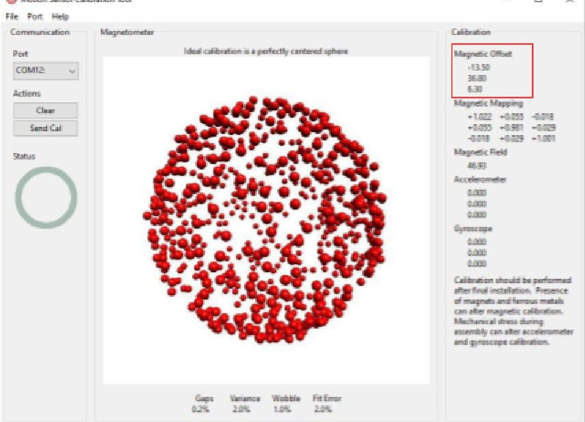


<div align="center">

Figure 44: Motion Sensor Calibration Tool shows hard iron offsets

</div>

As can be seen in Figure 44, a good contour outlining the rotational field of the IMU is shown. The hard iron magnetic offsets are displayed in the upper right hand corner.

This experiment was conducted 5 different times and the values were averaged. The results of each trial can be seen in Table 10 below.

<div align="center">

(Table 10)

</div>

<table border="1"><tr><td>Trial</td><td>X Offset</td><td>Y Offset</td><td>Z offset</td></tr><tr><td>1</td><td>-14.80</td><td>35.81</td><td>7.13</td></tr><tr><td>2</td><td>-13.10</td><td>36.68</td><td>7.04</td></tr><tr><td>3</td><td>-13.50</td><td>36.80</td><td>6.30</td></tr><tr><td>4</td><td>-13.70</td><td>34.78</td><td>7.46</td></tr><tr><td>5</td><td>-13.15</td><td>36.22</td><td>6.71</td></tr><tr><td>avg</td><td>-13.65</td><td>36.058</td><td>6.928</td></tr></table>

<!-- PDF_PAGE: 88 -->

Table 10 shows very consistent and precise readings from the Motion Sensor Calibration Tool. These values proved compliance with requirement 6.0 in Table 6.

These values were included with the soft iron offsets to get the total iron offsets.

## Temperature Offset

The final correction factor that was considered was the temperature of the cubesat. This factor was unintentionally discovered while doing experimental testing. It was found that the offset reading of the IMU increases as the temperature of the cubesat decreases. This was predicted to be due to lowered resistance in the IMU.

Experimental data was collected in an appropriate temperature range that the cubesat might experience in LEO. It was found through a case study that cubesats in LEO often range temperatures of -5 degrees Fahrenheit in Earth's shadow, up to 130 degrees Fahrenheit when in direct illumination by the sun. Ambient conditions tend to fluctuate much more. However, because of the spin of the satellite, residual heat, and waste heat produced by the electronics, the temperature is more stable. In order to test for hysteresis, the experiment was split into two different parts.

In the first experiment, the cubesat started at room temperature, 73 degrees Fahrenheit. It was packaged in an ESD safe bag and moved into a cooler with dry ice to observe cooling effects. The temperature and magnetic field was recorded. Similar to the PWM experiment, the temperature and magnetometer values were averaged over ten values. However, data was only printed to the serial monitor every ten seconds. This was done to avoid overaccumulation of data (because these tests took one hour to

<!-- PDF_PAGE: 89 -->

reach the desired temperatures). The magnetic field strength was measured until a temperature of -18 degrees Fahrenheit was reached.

The next test was done starting in the dry ice, and moving the cubesat under heat lamps. These heat lamps were meant to simulate solar radiation. The cubesat was placed on an ESD bench and allowed to heat from -18 deg to 134 deg Farenheit. Once again, the magnetic field was recorded throughout this process. This was done to have a continual data stream from the low to high temperature range. In previous experiments splitting the heating and cooling had been attempted. This proved inaccurate due to variations in the positioning of the IMU with respect to Earth's magnetic field and possible changes of the ambient temperature . Also, appending the data was difficult because of complications associated with aligning the offsets at these different reference conditions.

To evaluate the offsets, the magnetic field at ambient temperature was subtracted from both of these data sets. The sets were compared to each other in order to check for hysteresis error. Please see Figure 45 below.

<!-- PDF_PAGE: 90 -->


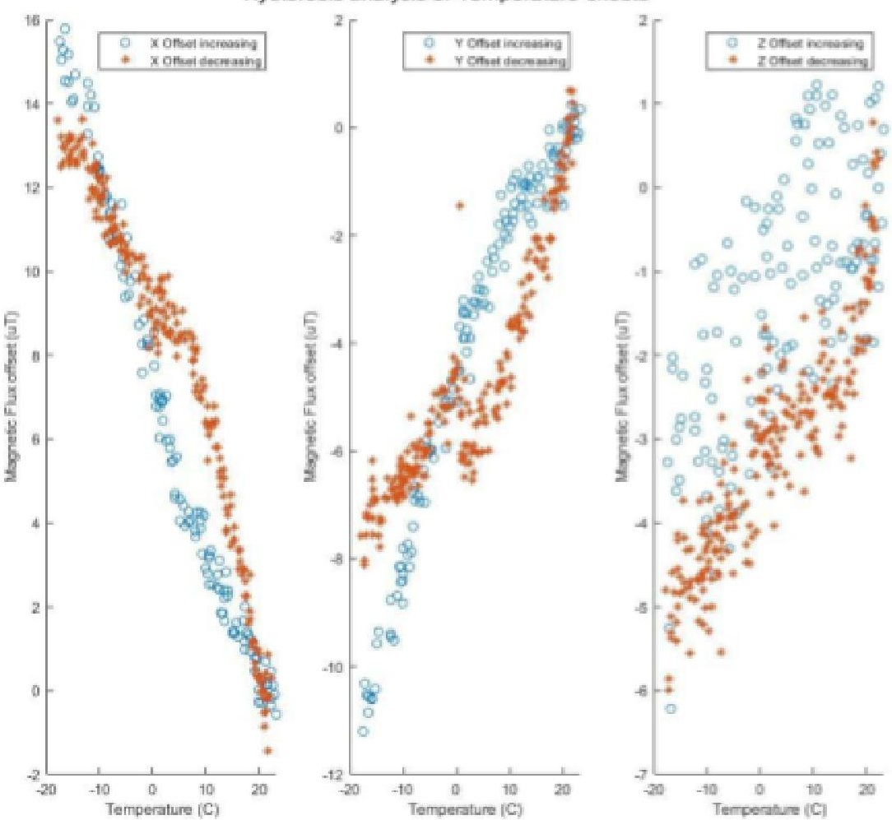


<div align="center">

Figure 45: Negligible hysteresis error in temperature offset

</div>

After analyzing this data, the error was found to be negligible as compared to the resolution of the IMU. The increasing data set was used. This was done because this data set spanned the entire desired range from -18 deg Fahrenheit to 134 deg Fahrenheit. A polyfit was matched to this dataset. An appropriate degree of fit was determined by incrementally increasing the fit order and observing the marginal decreasing returns with respect to the RMS error. A third degree polynomial was found most effective. Please see Figure 46 below.

<!-- PDF_PAGE: 91 -->


<div align="center">

Figure 46: Temperature offset 3rd degree polyfit

</div>

The temperature model was verified similarly to the soft iron model. Through experimentation, the values found closely matched the simulated ones. This showed that the temperature model met requirement 6.2 in Table 6.

The equations of the polyfits shown in Figure 46 above could be used with the soft and hard iron offsets to get the final offsets of the IMU magnetometer.

## Conclusion

In conclusion of the work performed for the Alpha mission, a systems perspective was able to advance the TRL of the chipsat RF system and the ACS system. This was accomplished by noting the requirements of the respective systems, and going through rigorous verification and validation tests. These tests pointed out if the system would run as requirements intended. If not, MBSE tools could be applied to identify flaws in the system. Corrective action was taken

<!-- PDF_PAGE: 92 -->

to come up with new methods, remodel old ones, tune sensors, or simply reevaluate through experimentation.

<!-- PDF_PAGE: 93 -->

## Works Cited

## References

Ada, Lady. "Adafruit Sensorlab - Magnetometer Calibration." Adafruit Learning System, https://learn.adafruit.com/adafruit-sensorlab-magnetometer-calibration?view=all.

Adams, Van Hunter, and Dr. Mason Peck. THEORY AND APPLICATIONS OF GRAM-SCALE SPACECRAFT. Cornell University, May 2020 https://vanhunteradams.com/Papers/Thesis.pdf.

Adams, Van Hunter. "GFSK Demodulator on Raspberry Pi." PiGFSK https://vanhunteradams.com/Monarch/PiGFSK.html.

Amin, John, and Dr. E. Glenn Lightsey. The Design, Assembly, and Testing of Magnetorquers for a 1U CubeSat Mission. Georgia Institute of Technology, https://www.ssdl.gatech.edu/sites/default/files/ssdl-files/papers/mastersProjects/A minJ-8900.pdf.

Carabellese, Davide, and Dr. Mason Peck. Design of ACS Controller for a Spinning CubeSat. Cornell University, July 2018.

Debris, Stephen. "RTOS-MCU." TI, https://www.ti.com/tool/TI-RTOS-MCU.

"Easylink API Reference." EasyLink API Reference - SimpleLink $ ^{\mathrm {T M}} $ CC13x0 SDK Proprietary RF User's Guide 2.60.0 Documentation, https://software-dl.ti.com/simplelink/esd/simplelink_cc13x0_sdk/3.20.00.23/export s/docs/proprietary-rf/proprietary-rf-users-guide/easylink/easylink-api-reference.html.

Habeck, Joseph, and Peter Seiler. Moment of Inertia Estimation Using a Bifilar Pendulum. University of Minnesota, https://conservancy.umn.edu/bitstream/handle/11299/213305/UROP%20report.pdf?sequence=1.

Lee, J., et al. "On Determining Dipole Moments of a Magnetic Torquer Rod Experiments and Discussions." Canadian Aeronautics and Space Journal, vol. 48, no. 1, 1 Mar. 2002, pp. 61-67., doi:10.5589/q02-014.

Manchester, Zach, and Dr. Mason Peck. CENTIMETER-SCALE SPACECRAFT: DESIGN, FABRICATION, AND DEPLOYMENT. Cornell University, Aug. 2015 http://zacmanchester.github.io/docs/Zac_Manchester_PhD_Dissertation.pdf.

<!-- PDF_PAGE: 94 -->

McCluny, George. "About RTL-SDR." Rtl, 10 Feb. 2022 https://www.rtl-sdr.com/about-rtl-sdr/.

MOBUS, GEORGE E. Principles of Systems Science. SPRINGER-VERLAG NEW YORK, 2016.

"Quick Start Guide." Rtl, 11 Mar. 2022, https://www.rtl-sdr.com/rtl-sdr-quick-start-guide/.

Samurkashian, Armen, and Dr. Mason Peck. Alpha Cub eSat Project. Cornell University 21 May 2018.

Schrum, Jacob, director. Error Detection and Correction 3: Forward Error Correction. Southwestern University, 7 June 2016 https://www.youtube.com/watch?v=0CLTy231Hsw. Accessed 17 Mar. 2022.

Wertz, James Richard, et al. Space Mission Engineering: The New Smad. Microcosm Press, 2011.

<!-- PDF_PAGE: 95 -->

## Appendix

Cubesat Flight Assembly

See paper

MBSE Chipsat Modeling

MBSE Portfolio

See paper

Chipsat MBSE Lifecycle

See paper

Controller Optimality Verification

See paper

Endurance Test Procedures

Endurance Test

See paper

Longevity test

See paper