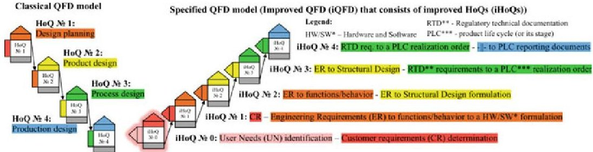
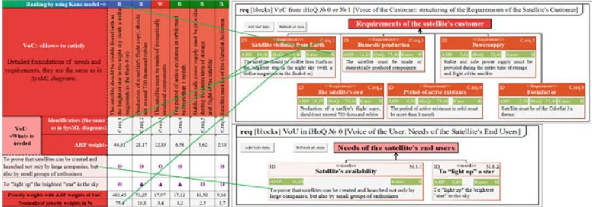
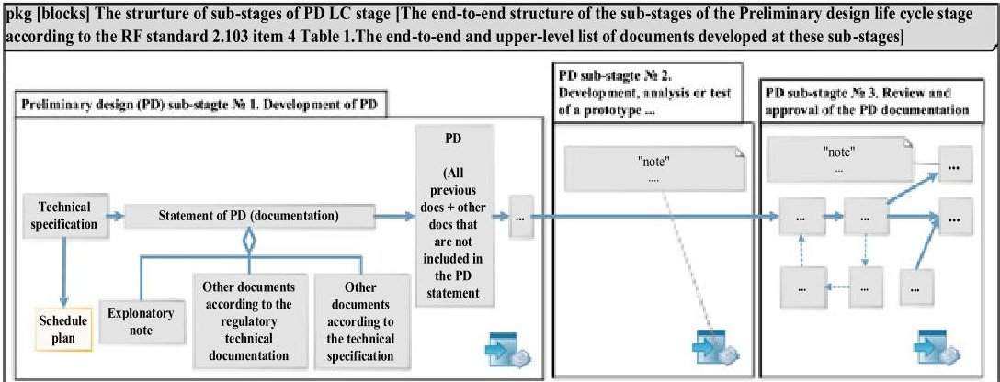

<!-- PDF_PAGE: 1 -->

# Systems Engineering Approaches and Tools for Redesigning the Higher Technical Education System

Denis Shpotya ID and Alexey Romanov ID

Abstract Nowadays, in software, electronics and automotive industries, it takes 1.5-2 years for a new product to appear, although it takes 3 or even more years to develop new space instruments. The update of higher education system standards is even more conservative. It takes 10 or more years. Because of this, graduates come into the industry with outdated knowledge. Thus, the problem is to synchronize the processes of updating technologies that ensure the creation of innovative products with educational programs. It can be solved by changing the paradigm of products creation based on the synthesis of deep and interdisciplinary educational, scientific, innovative and production activities with the model-based systems engineering software and methodological tools.

The existing model-based systems engineering (MBSE) Software (SW) tools based on the Systems Modelling Language (SysML) are complex and expensive. This chapter raises the question, "Is it possible to make use of MBSE SW and methodological tools available to a wide audience of users?" To answer this question, the following MBSE approaches and tools were researched: Quality Function Deployment (QFD), House of Quality (HoQ), and SysML. Consequently, five methodological tools were developed for application during space instruments design and development life cycle stages. Tools are based on SysML, QFD, HoQ improvements and synthesis, and expressed in theoretical and practical algorithms.

The theoretical algorithm determines "What" (input and output data) and "How" (by using which systems engineering (including MBSE) tools are methodically analysed at the certain space instruments life cycle stage. The practical algorithm automates the development of SysML diagrams by using data structured in HoQ models and widely available SW. It reduces the time to develop and update SysML requirements diagrams from several days to some minutes and enables implementation of SysML SW by many users. Altogether, the obtained results constitute the software and methodological toolkit (SMT) called "improved Quality Function Deployment for improved House of Quality".

<!-- PDF_PAGE: 2 -->

To disseminate the obtained results, educational materials were created and validated during lectures on systems engineering. Lectures were supplemented with seminars and practicum. Practicum was focused on the design and development (D&D) of nanosatellites in the MBSE paradigm as the single project. The results showed that the developed SMT makes it possible to implement the life cycle of the cyber-physical system in the MBSE paradigm in a cost-effective way and a short time—in 6 months, students developed, conducted synthesis and flight tests of CubeSat-format satellite prototype and prepared the project documentation. In addition, students were motivated to study science, technology, engineering and math disciplines, MBSE tools, and become transdisciplinary specialists.

In addition, developed SysML requirements models were applied to examine the "Preliminary Design" product life cycle (PLC) stage of different space projects. Such application allowed quick assessment of project results, identifying non-compliance with requirements, conducting beforehand all necessary corrections and generating correct new product documentation. Taking into account the mentioned advantages of the obtained MBSE SMT, it can be concluded that its usage improves the quality and accuracy of current projects and speeds up the planning process of future analogue projects by up to 60%. Consequently, projects (their life cycle stages) can be realized faster by 5-10%.

These results allow to recommend for all interested in the innovative D&D of systems to initiate:

- formation of educational programs based on the project approach and MBSE paradigm;

- preparation of MBSE materials for online and offline teaching of students and teachers;

- development of domestic widely available software for the development of integrated SysML models with HoQ models that assures synchronization with CAE/CAD/CAM systems;

- support these recommendations for the implementation of the above-mentioned research results at educational organizations of different levels.

The future research is focused on the application of the developed MBSE methodological toolkit during design and development with numerical modelling and operation of several CubeSat satellites.

Keywords Systems engineering · MBSE · Paradigm · Methodological toolkit · SysML · QFD · HoQ

## 1 Introduction

MBSE modelling languages and approaches such as SysML, QFD, HoQ are critical during the D&D of hardware (HW) and SW devices. SysML is designed to increase the management efficiency of information about system requirements, functions,

<!-- PDF_PAGE: 3 -->

physical characteristics. SysML supports specification, design, verification and validation. SysML was proclaimed as a basis for development of digital twins, machine learning and artificial intelligence. QFD approach provides a framework for translating input data (e.g. customer requirements (CR)) into prioritized output data (e.g. engineering requirements (ER)); HoQ—is the graphical language and the method of QFD. QFD and HoQ application reduces: (1) the risk of incorrect interpretations of CR; (2) the D&D costs of HW/SW by 60%; (3) the number of technological changes by 30-50%; (4) and warranty claims by 20-60% (Wolniak 2018).

But the research and development of modelling languages go on for decades, and their introduction gets into conflict with their drawbacks and psychological inertia of people to work as they got used to. As the result, MBSE artefacts are not recognized officially and developers are not interested to develop besides the official document its non-official SysML or HoQ model "copy".

This reality preserves decision makers from an understanding of MBSE technologies benefits, from investments in their research and development, education of the corresponding MBSE and IT specialists. The second point is crucial for the further MBSE (SysML, QFD, HoQ) scientific improvements and development of the enabling SW. Therefore, unless a higher technical education system of the RF will not be redesigned with the focus on the single project approach implemented in the new systems design and development paradigm based on the synthesis of scientific, innovative, production activities with MBSE software and methodological tools, the industrial digitalization will mostly continue: to reproduce inefficient D&D document-based approach based on the separate product life cycle stages, and to introduce technologies of the "yesterday"—non integrated and separately used CAE/CAD/CAM IT systems.

Augmentation of the current document-based approach with MBSE SMT that can be used by a wide audience of users from academia and industry will open to decision and policy makers short- and long-term benefits of the MBSE paradigm and make them support the corresponding redesign of the higher technical education system. To create conditions for such augmentation, at this point it is required to illuminate or compensate barriers that prevent potential users from using SysML, QFD and HoQ.

For this main purpose, the research goal was set to develop the MBSE SMT based on SysML, QFD and HoQ so that a wide audience of potential users from academia and industry can effectively apply during D&D stages. To achieve this goal, the following tasks were set: (1) identification of SysML, QFD, HoQ drawbacks; (2) development, verification and validation (V&V) of solutions that overcome drawbacks.

The remaining parts of this chapter are the following: identification of drawbacks of SysML, QFD, HoQ and SW tools for their usage, research findings, summary and conclusions.

<!-- PDF_PAGE: 4 -->

Table 1 The SysML drawbacks (shortlist) that prevent its application by a wide audience of users. Source Romanov and Shpotya (2020)

<table border="1"><tr><td>$N^{\circ}$</td><td>Statement of the drawback</td><td>SysML</td><td>SW</td></tr><tr><td>1</td><td>SysML requirements diagrams (model) development and its update require hours or weeks, and SW tools that support SysML are very expensive</td><td>√</td><td>√</td></tr><tr><td>2</td><td>SysML diagrams are not effective to track all relationships of requirements</td><td>√</td><td></td></tr><tr><td>3</td><td>In the RF there are no teaching materials on SysML and its implementation</td><td>√</td><td></td></tr></table>

## 2 Identification of Drawbacks of SysML, QFD, HoQ and Software Tools for Their Usage

The surveys (Tower 2013; Cloutier and Bone 2015) of more than 400 respondents showed the increase in the number of companies that practise MBSE. The most frequently used MBSE SW tools were: MS Visio (57%), Sparx Enterprise Architect (44%), IBM-Rhapsody (24%). MS Visio allows the creation of customized graphical shapes. MS Visio (Professional version) does not possess SysML libraries, but it has Unified Modelling Language (UML) libraries (SysML is based on UML). MS Visio Professional cost approximately 8 times less than the cheapest SysML SW tool from Dassault Systems, IBM, Siemens PLM (price analysis was done in 2020). Universities of the RF that have partnerships with Microsoft grant MS Visio licenses for free to their employees and students. In this way, MS Visio corresponded to the requirement of wide availability and was selected as the primary SW tool for the methodological tasks of this research. The following drawbacks related to SysML were identified (see Table 1).

Our research showed that MS Excel can be a QFD (HoQ) SW tool that is available to a wide audience of potential users and consequently the following drawbacks related to QFD, HoQ and MS Excel that prevent their wide application during D&D were identified (Table 2) (Romanov and Shpotya 2020).

According to J. Koski analysis of QFD and HoQ modifications, UML diagrams transmit information more efficiently than HoQ models (Koski 2003). The leading QFD experts Stansfield and Mazur posted online that they would like to unite model-based design with QFD (Stansfield and Mazur 2016). Correspondingly, two assumptions that must be investigated were made: (1) SysML requirements diagrams compensate the drawback $ \mathbb{N}^{0} $ 4 from Table 2; (2) HoQ (its improved version) model compensates the drawback $ \mathbb{N}^{0} $ 2 from Table 1.

## 3 Research Findings

Sections 3.1-3.5 reflect research developments and their V&V (Romanov and Shpotya 2020).

<!-- PDF_PAGE: 5 -->

Table 2 The QFD, HoQ and MS Excel drawbacks (shortlist). Source Romanov and Shpotya (2020)

<table border="1"><tr><td>$N^{\circ}$</td><td>Statement of the drawback</td><td>QFD</td><td>HoQ</td><td>SW</td></tr><tr><td>1</td><td>The QFD model is not oriented on the D&amp;D of space instruments according to the SysML approach and requirements of regulatory and technical documents</td><td>√</td><td></td><td></td></tr><tr><td>2</td><td>QFD model stages (HoQ) do not generate input and output data, and at the same time, they cannot be implemented without them</td><td>√</td><td>√</td><td></td></tr><tr><td>3</td><td>The HoQ method does not consider correlations of output parameters (e.g. technical requirements) when prioritizing them</td><td></td><td>√</td><td></td></tr><tr><td>4</td><td>The limited number of parameters (20-25) can be effectively analysed and managed in the HoQ model (often there are more)</td><td></td><td>√</td><td></td></tr><tr><td>5</td><td>There are no HoQ model templates in the MS Excel and the existing templates from “qfdonline.com” allow to build 4 HoQ models with a given set of fields, and it is not suitable for D&amp;D of space instruments</td><td></td><td></td><td>√</td></tr></table>

## 3.1 Improvement and Development of the HoQ Method and Templates, Specification of the QFD Model

To quantitatively consider expert estimates of output parameters correlations during their prioritization in the HoQ model, the classical HoQ prioritization algorithm was synthesized with the ranking weights of output parameters obtained with the analytical hierarchy process (AHP) method.

To realize space instruments D&D as a single project according to the QFD and SysML approaches, user needs and RTD requirements the classical QFD framework model was specified in terms of the number of stages and their purpose. The specification was called "improved QFD" (iQFD). 5 new iQFD model stages were obtained. Figure 1 represents the specified iQFD model in comparison with the classical QFD model. Transitions between iQFD model stages were expressed in mathematical terms:

$$
i Q F D = i Q F D \left(\overrightarrow {U N _ {p}}; \overrightarrow {i H o Q C R _ {m}}; \overrightarrow {i H o Q F R _ {n}}; \overrightarrow {i H o Q D R _ {k}}; \overrightarrow {i H o Q L P _ {l}}; \overrightarrow {i H o Q L C _ {t}}\right),
$$

where iQFD—is a complex function that depends on the quantitative ranking of user needs $ \overrightarrow{U N_{p}} $ , quantitative prioritization by the new iHoQ algorithm of output parameters: CR $ \left( \overrightarrow{i H o Q C R_{m}} \right) $ , engineering requirements to functions $ \left( \overrightarrow{i H o Q F R_{n}} \right) $ and to structures of HW/SW $ \left( \overrightarrow{i H o Q D R_{k}} \right) $ , RTD requirements to a project or a product life cycle (its' stage) realization order $ \left( \overrightarrow{i H o Q L P_{l}} \right) $ , RTD requirements to documents that must be developed during project or a PLC (its' stage) $ \overrightarrow{i H o Q L C_{t}} $ .

<!-- PDF_PAGE: 6 -->

Fig.1 Simplified conceptual illustration of the QFD and iQFD models (developed by the authors)

To overcome the drawback $ \mathbb{N}^{0} $ 5 from Table 2, 5 iHoQ model templates were developed in MS Excel. They allow to save up to 20% of time efforts spent on D&D of new iHoQ models (expert estimation).

## 3.2 Development of Algorithms for the Generation of the Input and Output Data of iQFD Model Stages

To unify UN, CR and ER generation, systems engineering and MBSE tools were analysed. Consequently, a unified algorithm for generating these types of data was created. It was called "improved Quality Function Deployment for improved House of Quality" and was divided into 5 parts: (1) Input; (2) Output; (3) Correction upon feedback; (4) SW tools; (5) Data generation in accordance to the iQFD model by using systems engineering and MBSE tools that were divided into 3 groups: A) Data acquisition: context diagram, interview, survey, brainstorming; B) Qualitative analysis: verbal analysis of system requirements, work and product breakdown structures, SysML models, SWOT analysis, $ N^{2} $ diagram, Kano model; C) Quantitative analysis: AHP method for ranking, iHoQ method for prioritization.

Afterwards, the unified algorithm was specified for its application at 5 iQFD model stages. Each specification included (1) the formalized physical meaning of the iQFD stage; (2) the proposed iHoQ model structure; (3) the framework for implementing SE and MBSE tools at the selected iQFD stage.

## 3.3 Creating a Method of Automated SysML Requirements Diagram Development and Its Update

Analysis of MS Visio functionality showed that it allows the creation of graphical shapes based on the data from external text document (e.g. an official document with requirements in the table form in MS Excel). By considering this functionality, there were developed 4 algorithms of actions that describe how: (1) to develop a database of requirements that can be synchronized with SysML shapes in MS Visio, (2) to develop libraries of SysML shapes, (3) to automatically develop and (4) update SysML requirements diagram. Consequently, these algorithms were united into a

<!-- PDF_PAGE: 7 -->

single method. Method's verification and validation showed that by using it a person can develop and fill in with data (with absolute compliance with data source) 300 new SysML requirements shapes in some minutes. By the classical manual approach such tasks may require days or weeks and there is a very high risk that the final result will not completely comply with the initial data source.

## 3.4 Synthesis of the Research Developments into a Single MBSE SMT and Their V&V

Research developments were V&V during the analysis of requirements of different design aspects of the CubeSat "Mayak". Mainly, specified algorithms that reflect iQFD model stages and combines in themselves proposed iHoQ and SysML methods helped to obtain and model: 2 UN, 6 CR (Fig. 2), 22 ER to functional parameters and 27 ER to HW and SW of the CubeSat "Mayak", and also RTD requirements. The iHoQ algorithm allowed to obtain different ranking orders and to increase the contrast of output parameters prioritization weights by two and more times compared to the results obtained by the HoQ algorithm. The last iHoQ benefit allows identifying critical requirements.

An additional V&V of the developed SysML RTD requirements diagrams (model) was conducted. First of all, the top-level SysML package diagram was developed. This diagram reflects the end-to-end structure of the "Preliminary Design" (PD) PLC stage, its sub-stages and the list of top-level documents that must be developed at these sub-stages according to the open RF standards (see Fig. 3).

Further, this top-level diagram was decomposed into SysML requirements diagrams that describe RTD requirements to documents that top-level documents include in themselves. These diagrams were applied to inspect whether the results of the "PD" stage of several space instrument projects comply with RTD requirements or not. Their application made it possible to complete inspections in 2 hours instead

Fig. 2 The synthesis of the iHoQ $ \mathrm{N o} $ 0 models with the SysML requirements (UN and CR) diagrams Source Romanov and Shpotya (2020)

<!-- PDF_PAGE: 8 -->

Fig.3 The illustration of the top-level diagram of the SysML RTD requirements model Source developed by the authors based on the open RF standards GOST 2.103 and 2.119

of days or weeks and to identify 5-10 results' non-compliances. Usually, when in the due date of project results submission to a customer non-compliances are found it means that the developer of a space instrument fails to submit a project, and he is obliged to pay a serious financial compensation to a customer. Consideration of the fact that the application of SysML requirements diagrams helps to identify noncompliances and to decrease the labour costs during SysML requirements diagrams development means that such MBSE (SysML) tool, approach of its practical realization and application save developers' financial resources and speed up D&D. Also, their application during the project's planning decreases the planning time of PLC stages of new analogue products by approximately 60%.

Finally, both assumptions were investigated and confirmed by the synthesis in MS Excel of the iHoQ model with the SysML requirements diagrams into a single workspace (see Fig. 3).

## 3.5 Research Developments Verification and Validation During the Educational Process

To promote the proposed MBSE software and methodological toolkit educational materials were developed. They were used for teaching how to D&D nanosatellites and technical devices in the MBSE paradigm as a single project. The teaching showed that even after one day, students understand the proposed MBSE SMT and how to start using it in their daily work (Shpotya and Romanov 2019).

<!-- PDF_PAGE: 9 -->

## 4 Summary and Conclusions

The opportunity of a wide audience of users from the education system and industry to augment the design and development processes implemented in the current document-based paradigm with the MBSE software and methodological tools will lead the way for the formation of the government request to redesign the higher technical education system with the focus on the MBSE application, research and developments. This in its turn will allow achieving official recognition and dominance of the MBSE paradigm over the document-based paradigm. But today in the RF and other countries the available software based on MBSE tools (especially SysML) are expensive and complex. That is why this research was focused on the development of the MBSE software and methodological toolkit available to a wide audience of users.

As the result of this research were identified widespread SW tools for SysML (MS Visio Professional), and QFD (HoQ) (MS Excel) usage, their drawbacks, and developed, V&V new solutions. Specifically:

1. The iHoQ algorithm was created. It allows obtaining different ranking orders and higher contrast of output parameters prioritization weights if compared with the classical HoQ algorithm.

2. The iQFD model was proposed. It allows design and development of space instruments and systems according to UN, SysML approach and requirements of regulatory and technical documentation.

3. The method for automated SysML requirements diagrams development and update of data in them was created by using widely available software tools MS Visio and Excel. V&V of the method proved that it reduces the labour costs for these processes from several days to hours and minutes.

Validation of the developed SysML requirements models proved that their usage reduces labour costs: a) for the inspection of project results' compliance with the RTD requirements from several days to several hours, b) for the planning of PLC stages of analogue products by up to 60%. Also, their application maximizes compliance of project results with RTD requirements by 10%.

4. The unified algorithm for generating input and output data for the specified QFD model stages was developed. The algorithm is based on the synthesis of systems engineering (including MBSE) approaches and tools (SysML, QFD and HoQ) with MS Visio and Excel SW tools. iHoQ model templates were developed in MS Excel.

5. The single MBSE software and methodological toolkit was created. It was implemented in MS Excel. It is based on the iHoQ model and SysML diagrams synthesis as the single working area. SMT's validation proved its effectiveness in data communication from the iHoQ model by using SysML requirements diagrams and tracking all relationships of requirements by using the iHoQ model.

6. Educational and methodological materials for teaching the developed MBSE SMT were created. Their application allowed in the short period (6 months)

<!-- PDF_PAGE: 10 -->

to complete a project: develop, conduct synthesis and flight tests of the nanosatellite prototype, and prepare the project documentation.

Successful V&V of the research results allow to conclude that the obtained MBSE SMT: (1) improves D&D quality of new products; (2) speeds up the implementation of the D&D of analogue products by 5-10%; (3) allows to overcome (compensate) the identified SysML, QFD, HoQ drawbacks; (4) can be applied during D&D of technical devices by a wide audience of users from industry and education.

Its wide dissemination and application will form the ground for the soonest necessity to redesign the higher technical education system that in its turn will accelerate and enable a smooth transition from the systems' design and development in the document-based to the model-based systems engineering paradigm. Therefore, it contains the scientific, technical and economic feasibility for its widespread integration in the agenda of higher technical educational organizations with the purpose of further transfer in space and other industries.

These results and conclusions allow recommending for all interested in the innovative D&D to:

- create educational programs based on the project approach and MBSE paradigm;

- create MBSE teaching materials for online and offline education of students and teachers;

- develop domestic widely available software for the development of integrated SysML with HoQ models that can be synchronized with domain-specific models of CAE/CAD/CAM systems;

- application of this research results at educational organizations of different levels.

## References

Cloutier R, Bone M (2015) MBSE survey. INCOSE IW, OMG

Koski J (2003) Quality function deployment in requirements engineering: a review and case studies (MBA thesis). Helsinki University of Technology, Helsinki

Romanov AA, Shpotya DA (2020) Overcoming the disadvantages of the software and methodological tools of model-based systems engineering used in the design of systems. Izvestia Samara Sci Cent Rus Acad Sci 22(6):92-103

Shpotya DA, Romanov AA (2019) End-to-end design and development life cycle of the CubeSat satellite in the paradigm of model-oriented systems engineering. In: The first all-Russian conference on space education "The Road to Space", space research institute of the Russian academy of sciences, pp 414-417

Stansfield K, Mazur G (2016) Deploying quality in systems. Design with ISO 16355 for QFD. In: INCOSE UK annual systems engineering conference 2016-Academic Research Showcase, INCOSE UK. Accessed 2021 https://incoseuk.org/Documents/Events/ASEC2016/Posters/INCOSE_Poster_2016_-_Impact_ISO_16355_on_SE_vs_2.00_Kim_Stansfield_Glenn_Mazur.pdf

Tower J (2013) Model based systems engineering-the state of the nation. In: INCOSE UK, annual systems engineering conference (ASEC), UK-Oxfordshire

Wolniak R (2018) The use of QFD method advantages and limitation. Prod Eng Arch 18(18):14-17