<!-- PDF_PAGE: 1 -->

ORIGINAL PAPER

# An automated system analysis and design tool for spacecrafts

Manfred Ehresmann $ ^{1} $ $ ^{1} $ · Georg Herdrich $ ^{1} $ · Stefanos Fasoulas $ ^{1} $

Received: 24 December 2020 / Revised: 6 July 2021 / Accepted: 8 July 2021 / Published online: 7 August 2021 The Author(s) 2021, corrected publication 2021

## Abstract

In this paper, a generic full-system estimation software tool is introduced and applied to a data set of actual flight missions to derive a heuristic for system composition for mass and power ratios of considered sub-systems. The capability of evolutionary algorithms to analyse and effectively design spacecraft (sub-)systems is shown. After deriving top-level estimates for each spacecraft sub-system based on heuristic heritage data, a detailed component-based system analysis follows. Various degrees of freedom exist for a hardware-based sub-system design; these are to be resolved via an evolutionary algorithm to determine an optimal system configuration. A propulsion system implementation for a small satellite test case will serve as a reference example of the implemented algorithm application. The propulsion system includes thruster, power processing unit, tank, propellant and general power supply system masses and power consumptions. Relevant performance parameters such as desired thrust, effective exhaust velocity, utilised propellant, and the propulsion type are considered as degrees of freedom. An evolutionary algorithm is applied to the propulsion system scaling model to demonstrate that such evolutionary algorithms are capable of bypassing complex multidimensional design optimisation problems. An evolutionary algorithm is an algorithm that uses a heuristic to change input parameters and a defined selection criterion (e.g., mass fraction of the system) on an optimisation function to refine solutions successively. With sufficient generations and, thereby, iterations of design points, local optima are determined. Using mitigation methods and a sufficient number of seed points, a global optimal system configurations can be found.

Keywords Electric propulsion . Systems engineering . Evolutionary algorithms . IRAS

## 1 Review on the applicability of optimisation algorithms

In this section, a general introduction to meta-heuristic algorithms and specifically genetic or evolutionary algorithms, as well as their application, is given.

Optimisation problems are inherent to any field of science and engineering as optimality is directly connected to a high efficiency and effectiveness of a process, design or operation.

## 1.1 Gradient-based algorithms

Conventional often applied optimisation algorithms include root determination via Newton's method [1] and minimum search via gradient descent [2] or coordinate descent [3]. These methods are highly effective if the function to be optimised is differentiable and will determine a global optimum if the function is convex. A function is convex when the magnitude of the 2nd derivate (the curvature) does not change over the co-domain of the function and is fully defined. For example, the linear x, quadratic $ x^{2} $ and exponential $ e^{x} $ functions are convex.

If a function is non-convex, only local optima can be derived by a gradient-based algorithm. If a function has discontinuities, poles or singularities, a derivative can no longer be derived, and the algorithm is non-applicable.

For many real-world cases, a representative system function is of high complexity, often non-convex, has discontinuities, and may have singularities. Thus, gradient-based optimisation algorithms are only of limited applicability.

<!-- PDF_PAGE: 2 -->

## 1.2 Meta-heuristic algorithms

For complex problems, meta-heuristic optimisation algorithms offer the ability to find viable solutions by starting with a crude initial heuristic, which is subsequently refined to find a near-optimal solution to a complex problem.

A typical example for meta-heuristic algorithms is available in the form of the travelling salesman problem (TSP) [4], where a salesman has to visit n cities once and needs to determine an optimal (shortest) route, see Fig. 1. The direct approach of considering all possible combinations of cities to visit grows with factorial time O(n!)-already for ten cities, 3.6 million paths exist, which need to be evaluated for total length.

## 1.2.1 Nature-inspired algorithms

Heuristic algorithms offer to solve the TSP in $ O(n^{2}) $ [4, 5], where nature-inspired ant colony search performs best and evolutionary algorithms show the second-best performance for most cases [5]. When considering the ant colony optimisation (ACO) method, a given number of ants a are randomly distributed at the cities n, and each ant will travel to a nearby city, with an attached probability weight corresponding to the distance. Thus, the nearby city is more likely to be approached than a nearby one. After an initial random tour completion, each travelled path will be evaluated and scored. Optimal paths will receive a higher score and, therefore, higher weight, corresponding to the pheromone trail ants deposit and communicate. Another tour is then performed now with active pheromone trails, allowing for local optimisation of the trail, as pheromone laden paths are more likely than before, but shorter and more optimal paths can still be achieved by random deviations. Although ACO will provide local optimal solutions, it is shown that it will reliably

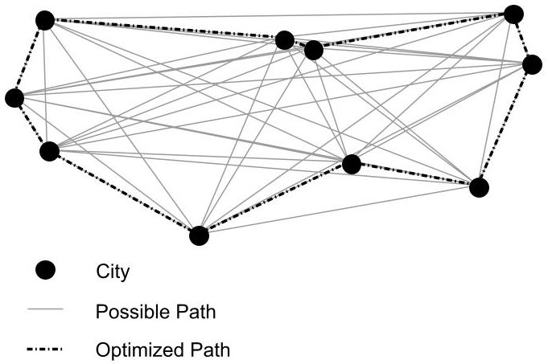

Fig.1 Illustration of a travelling salesman problem for ten cities (black dots), with possible paths represented as grey lines. The optimal path with the shortest length of a single visit to each city is indicated by a black dashed line

produce solutions with an error of 0.16-3.56% of an exact solution depending on the specific problem.

ACO can be applied to real-world aerospace problems, as seen in [6]. Here, economic flight trajectories are derived via ACO. In a two-stage process, the three-dimensional flight path is initially optimised, including current weather conditions. In a second stage, a fourth dimension for most economic Mach numbers that fit flight time constraints is applied. A trajectory optimised by an ACO trajectory was shown to be 6.8% more economical than the geodesic reference trajectory [6].

Other notable algorithms that belong to the category of swarm algorithms [7] are bee colony [8], cuckoo search [9], particle swarm [10] and the firefly algorithm [11-13]. Differences in information exchange and subsequent processing distinguish each nature-inspired approach.

## 1.2.2 Global optimum determination

Gradient-based algorithms, as well as nature-inspired algorithms, belonging to the class of local search and optimisation, both have the problem that for non-convex problems, a global optimum cannot be reliably determined.

The simulated annealing method [14] provides a great example of overcoming this obstacle and increasing the likelihood of an optimiser to determine a globally optimal solution.

The method is physics-based on a system with energy states $ E_{i} $ that can be described by a Boltzmann distribution [15], where the Boltzmann factor $ e^{\frac{E_{i}}{k_{\mathrm{b}} T}} $ describes the probability $ P(E_{i}) $ of an observed energy state

$$
P \left(E _ {i}\right) \propto e ^ {- \frac {E _ {i}}{k _ {\mathrm {b}} T}},
$$

where $ k_{\mathrm{b}} $ is the Boltzmann constant and T is the temperature of the observed system.

The respective probability density function is defined as follows:

$$
\mathrm {P D F} (x) = \sqrt {\frac {2}{\pi}} \frac {x ^ {2}}{\left(\frac {k _ {\mathrm {b}} T}{2}\right) ^ {\frac {3}{2}}} e ^ {- \frac {x ^ {2}}{k _ {\mathrm {b}} T}}.
$$

The method is called simulated annealing; as in the beginning, a high temperature $ T $ is set, which slowly reduces, i.e., annealing, reducing the possible probability range.

Another illustrative explanation is, initially in a "hot" state of the system, the thermal noise (i.e., variance in jump range) is considerable and allows for easy jumping over ridges and valleys, while in a "cool" state, the thermal noise has reduced so far that only small increments of changes are stochastically permitted, as illustrated in Fig. 2. Thus, the end state of the simulated annealing method behaves like

<!-- PDF_PAGE: 3 -->

a hill-climbing algorithm [16]. Practical application challenges exist in setting an appropriate starting temperature $ T $ and cooling schedule $ \mathrm{d} T / \mathrm{d} t $

The simulated annealing method for optimisation problems has found wide application for aerospace problems: constellation design problems [17, 18], general trajectory optimisation [19], low thrust trajectories for electric propulsion systems [20] and CubeSat configuration [21].

## 1.2.3 Genetic algorithms

The last but not least category of algorithms to be introduced as a foundation for the work of this paper are genetic algorithms (GA). GAs were first described by John Holland in 1975 [22] and the foundations further refined by Ingo Rechenberg [23] and Hans-Peter Schwefel [24].

A genetic algorithm processes the information describing a data point on a fitness landscape in the form of a genome. Similar to nature, a genome can be changed by random mutation of individual genes, randomised crossover between different genomes or chromosomes (i.e., data points) and subsequent non-random selection by a fitness function [22] see Fig. 3.

In its initial inception, the canonical GAs consider only a binary genome. Here, individual genes are binary and are permitted to only mutate between states of 0 and 1 [25]. A chromosome contains a fixed and finite length of genes. In

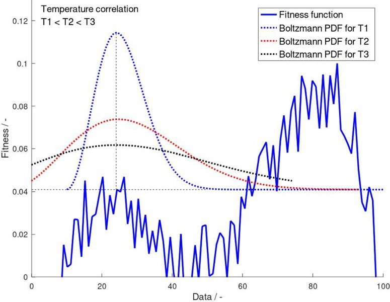

Fig.2 Illustration of escaping local maxima with a simulated annealing algorithm. The blue line represents a fitness function of a dataset. A local maximum point has been selected and three Boltzmann probability density functions (Eq. 2) have been plotted for varying temperatures $ T_{1}<T_{2}<T_{3} $ . It is shown that the hottest temperature $ T_{3} $ (dotted black line) has a non-negligible probability to jump over the valley to the mountain with the global maxima, while the chance of the cooler $ T_{2} $ (dotted red line) is already lower to achieve this. The probability density function with the lowest temperature $ T_{1} $ (dotted blue line) cannot jump over the valley and will only able to optimise for other local minima in the direct vicinity

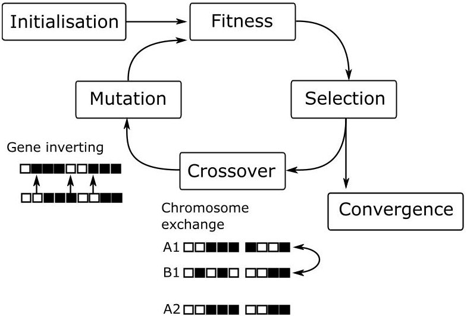

Canononical GA

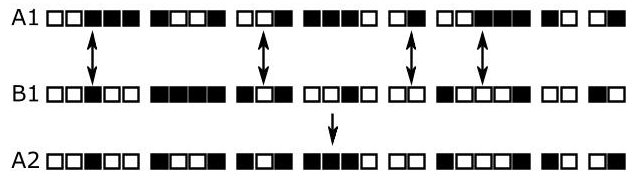

Messy GA

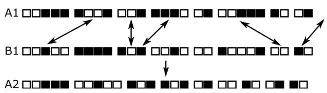

Fig.3 Basic genetic algorithm scheme. An individual fitness value is assigned starting from a population initialisation, and an initial selection takes place. An iteration loop starts with a population that is assigned a fitness level. After this, genetic crossover by chromosome exchange takes place, and subsequently, individual genes are mutated. A new fitness value is assigned, allowing for fitter solutions to be selected. At the selection stage, convergence may be determined, allowing for terminating the algorithm

general, the longer a chromosome is, the better the resolution of the problem function at hand, but will require more computation time as the number of possible permutations increases rapidly (see Fig. 4).

A fixed finite length chromosome requirement is needed to implement successful crossover, as here, a random point of the chromosome binary string is selected. A swap of the strings before and after this point will complete the crossover. A mutation is applied gene-wise, meaning that individual genes are simply inverted for a binary representation. Selection utilises a fitness or loss function, that assigns the new data point an objective value. Selection for the next generation can occur via a hard cut-off of the best data points or can be realised via stochastic methods, where a high fitness score corresponds to a high chance of passing to the next generation [22, 25].

An extension of this principle was introduced by [26, 27], where "messy" GAs with variable length genomes have been

<!-- PDF_PAGE: 4 -->

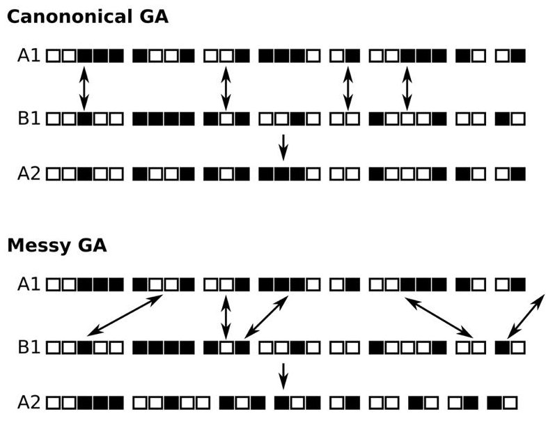

Fig.4 Illustration of the difference of chromosome handling between canonical GAs (top) and messy GAs (bottom). In canonical GAs, only fixed finite length replacements of chromosomes are permitted. Messy GAs allow for general chromosome mixing and concatenation

introduced. Here, well-tested short genome strings generate new genomes of variable lengths, which are then fitness optimised identically to a canonical GA. The application of a messy GA is more similar to the actual process in nature, as a canonical GA would only consider the replacement and mutation of single base pairs like cytosine (C), guanine (G), adenine (A), and thymine (T) [28], which might be caused by cosmic radiation events. While a "messy" GA considers short-length proven strings, in the next abstraction layer in DNA, three nucleotides of the CGAT group forms a codon. This codon represents a single amino acid [29] and higher amino acid groups' changes—on this and the level above allow for faster evolution in nature. This process is observed, for example, by bacterial conjugation allowing for fast adaption of immune responses to an external thread [30].

It was first proven by [26] that messy GAs are able to converge to a globally optimal solution, where a canonical GA achieved only 25% of substrings of the problem in the correct order.

Due to their versatility and general applicability, genetic algorithms have found wide application.

One popular application for GAs can be found in the field of control: where control law identification [31, 32], non-linear control law identification without priors of mechatronic systems [33], generic filter design [32] and self-tuning of control parameters of swarms [34] were achieved.

GA swarm design and swarm behaviour [35] leads to the second very productive field with relevance for aerospace applications: trajectories [6, 36]. Generic flight trajectory optimisation capability [37], including multiobjective optimisation and Pareto front determination [38], was shown.

Space flight trajectory problems include solving hypersonic re-entry trajectories with GAs [39, 40], low thrust trajectories achieved with electric propulsion systems [20, 41], weak stability boundary transfers [40], interplanetary trajectories [42] and brachistochrone calculation [39].

The simulated annealing references [17, 18], given in Sect. 1.2.2 for constellation design, also consider GAs. In [17], it is concluded that GAs yield more optimal solutions than simulated annealing" due to the non-linearity of the problem".

The non-linearity of the constellation design problem is further enhanced in [43], where a heterogeneous setup and rideshare options are considered, making launcher and satellite additional variables. It has been shown that a GA-optimised constellation design is able to fulfil the capabilities of a traditional "small Walker constellation at greatly reduced costs".

GAs have further been applied to designing specific components, such as control laws [44] and requirement estimation [13] of attitude control systems. Here, it is clearly stated that the evolutionary algorithm approach is faster and more flexible than traditional approaches.

Other GA applications of specific spacecraft components have been power sub-system design [45], geometry optimisation of a retroreflector [46] and structural optimisation of a sandwich plate [47].

A very illustrative example of the effectiveness of an evolutionary algorithms (EA) applicability of very complex design problems is given in the form of the evolved antenna [48]. The difference between an EA and a GA is a similar loop as given in Fig. 3, but data are not organised in a genome form, but heuristic changes and fitness function evaluation remain.

In [48], it is clearly stated that EAs are capable of replacing "time and labour intensive tasks" and allows to determine "novel antenna designs that are more effective than would otherwise be developed", see an example of an evolved antenna in Fig. 5.

The first approaches of full spacecraft system modelling canonical GAs were made in 1998 [49]. The automated approach allowed for achieving 'optimality' rather than 'feasibility', considering cost functions and schedule constraints. [49] concluded the GA approach as promising in terms of cost and quality of design.

Recent work on EA application for CubeSat and small spacecraft design is found in the 2017 paper [50]. Initially, it focused on CubeSat power supply system design and was found to produce vast improvements over human-guided "engineering judgement and point design".

This work was extended to the evolutionary design of a complete spacecraft in [51]. The spacecraft design problem is analysed here in the form of the Knapsack problem

<!-- PDF_PAGE: 5 -->

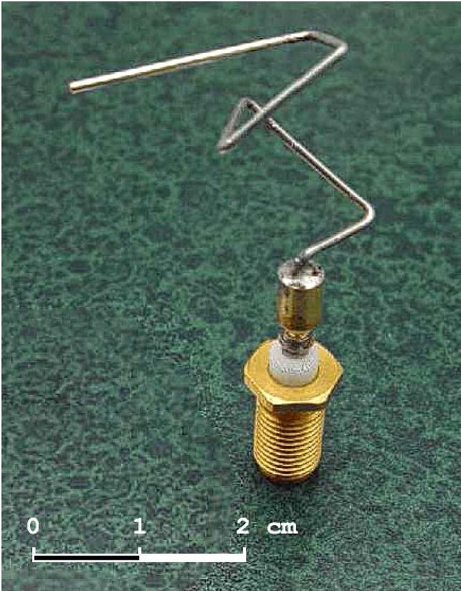

Fig.5 NASA public domain picture of the St 5 X-band antenna, launched on a microsatellite as part of the Space Technology (ST5) mission in 2005 [48]. The evolved antenna meets the mission specification of a required, nearly uniform gain for a spinning satellite. NASA public domain picture of the St 5 X-band antenna, launched on a microsatellite as part of the Space Technology (ST5) mission in 2005 [48]. The evolved antenna meets the mission specification of a required, nearly uniform gain for a spinning satellite

$$
K P = \left\{ \begin{array}{l l} \max \sum_ {i = 1} ^ {n} x _ {i} v _ {i} & \text {m a x i m i s e t o t a l v a l u e}, \\ \sum_ {i = 1} ^ {n} x _ {i} w _ {i} \leq W & \text {w h i l e k e e p w i t h i n} \\ & \text {c a p a c i t y} W, \\ x _ {i} \in \{0, 1 \} \forall i 1,.., n & \text {t o e i t h e r i n - o r e x c l u d e} \\ & \text {i t e m i o f s e t n}. \end{array} \right.
$$

The Knapsack problem considers the optimal—value-maximising—filling of a limited container, a Knapsack. Each item $ x_{i} $ has an assigned value $ v_{i} $ and has a resource cost $ w_{i} $ (e.g., volume) to fit into the Knapsack volume W.

This approach can be directly applied to an engineering design problem, when requirements and potential components are given. In a real-world spacecraft design problem, a Knapsack capacity is multidimensional, e.g., maximum budgets on cost, mass, volume, power, data or other performance parameters, while each component is multidimensional in terms of individual resource costs. It is further required to extend case 3 of Eq. 3 to allow for multiple objects to be selected, as stacking of components, e.g., thruster clustering, is standard practice.

In [51], a CubeSat design from commercial of the shelf components with a set of mission requirements was successfully applied.

## 1.3 Overview of other spacecraft design platforms, tools and methods

The scope of the ESDC tool is the complete (preliminary) design of a spacecraft. Several relevant tools and platforms with roughly similar scope exist and are briefly introduced here. Platforms and tools vary significantly in terms of design scope and depth, specific mission focus, availability and costs.

## 1.3.1 Concurrent engineering facilities

Several space agencies and corporations maintain concurrent engineering facilities (CEF), where the complex interwoven spacecraft design process is focused into a single facility, with dedicated work stations suited for the respective multidisciplinary experts. It is expected that this approach optimises individual design cycles [52].

NASA Goddard, for example, upholds such facilities with the Integrated Design Center (IDC) [53] and the Integrated Mission Design Center (IMDC) [54]. Other US-based CEFs are operated by the Aerospace Corporation with the Concept Design Center (CDC) [55], in cooperation with the University of Utah [56] as well as formerly the Concurrent Engineering Research Center (CERC) by West Virginia University [57] and the Spacecraft Design Center by the Naval Postgraduate School [58].

The Concurrent Design Facility (CDF) is the equivalent of ESA, utilised for various spacecraft concept studies [59]. The facility is frequently opened to the public and available for student concurrent engineering workshops within the ESA Academy education programme [60].

An equivalent German CEF is maintained by the German Aerospace Center, Bremen (DLR) and is a "design laboratory for the System Analysis Space Segment department at the DLR Institute of Space Systems" [52]. The CEF is used for spacecraft feasibility and early design phases; further details on operation, use and equipment are described in [61].

## 1.3.2 Available tools

A general list of 'useful' software is collected and updated by NASA space mission design tools are available here [62] and design and integration tools here [63]. Individual evaluation of these design tools is beyond the scope of this work. The codebase is in part directly available as open source [64], while the remainder may be available upon request for selected persons [65].

<!-- PDF_PAGE: 6 -->

The well-established General Mission Analysis Tool (GMAT) [66] is an open-source tool [67] for trajectory optimisation. Thus, a predefined spacecraft has to be applied as input for consideration in further mission optimisation. A commercial pendant to GMAT is the System Tool Kit (STK) by AGI-ANSYS [68], with similar scope [69] and requiring a preset spacecraft definition. It comes with better usability but considerable license fees.

Several tools exists at NASA that consider a trade-space analysis for spacecrafts.

One example is [70], where the design and layout of the Aft Bay Subsystem of the Orion crew module were successfully implemented with Thinkmap SDK [71]. The study concluded that significant time and effort reduction could be achieved via automation of layouts that fulfil given requirements, subsequent human evaluation is still required.

NASA currently explores a much broader scope for generic spacecraft design with the Trade-space Analysis Tool for Constellations (TAT-C) development [72-74]. The tool scope considers single or multiple small satellites up to flagship sizes, where multiple mission objectives have to be met, and overall performance and cost optimisation is performed. TAT-C aims for an open-access solution [75, 76] without dependencies to commercial license restrictions such as STK [68]. Spacecraft cost estimation is achieved using cost estimating relationships from accepted public sources [73]. Automation for closing design feedback loops is the scope of future work in TAT-C [74]. Recent extensions of TAT-C considered improved value functions for Earth Observation satellites [77].

Similar to Aerospace corporations activities via CEF operations, a system engineering tool has been developed [78]. This tool allows to design small satellites for scientific missions. It was later extended to a model-based design tool [79].

It is built upon the Generic Modeling Environment (GME) infrastructure, "a configurable toolkit for creating domain-specific modeling and program synthesis environments". This tools allows for the design of small satellites for scientific missions; the tool was later extended to a model-based design tool [80].

ESA activities in support of its CDF [59] include the development of robust and automated space system design methods [81], where uncertainty analysis of given parameters (i.e., thruster specifications) is considered to achieve a reliable worst-case analysis of a given spacecraft in its early design phase.

A notable large-scale project of ESA is the "Virtual Spacecraft Design" methodology and framework [82]. This project aims to establish data coherence and consistency at the system and sub-system level through a

standardised framework to allow a smooth exchange of system key parameters.

The Virtual Satellite (VirSat) software [83] operated in the German Aerospace Center CEF provides a similar unified model and framework for spacecraft design. It is available as open source [84] and frequently updated and extended. The VirSat approach was first described in 2008 [85], where the definition of a system design model in compliance with ESA and ECSS standards [86] and a respective central system component repository for reuse in simulations was set as objectives. The scope was later extended for full spacecraft life-cycle engineering [87]. DLR actively uses VirSat to develop the generic small satellite technology demonstrator mission S2TEP [88, 89], a modular, scalable satellite bus to be flown every 2-3 years individually adapting to given mission and instrument requirements. Additional features of VirSat include data and power interface modelling [90]; Fault Detection, Isolation and Recovery (FDIR) functionalities [91] and 3D visualisation and virtual reality support [92].

A popular commercial tool for digital spacecraft design management is Valispace [93], which allows creating digital design loops, where experts are notified of changing relevant parameters for their system to make iterations accordingly. This software has been utilised at various academic projects of the Institute of Space Systems.

Both Virtual Satellite and Valispace are considered suitable candidates for spacecraft system management for the digital concurrent engineering platform; see Sect. 1.4.1.

To conclude this overview, three more sources of comparability are provided, although the respective code and, therefore, a tool have not been located.

1. The Intelligent Spacecraft Configuration Agent (ICSA) determines via rule-based approaches and heuristic estimates suitable spacecraft configurations while considering spacecraft mass, power and volume budgets and subsequently selects a cost-effective launcher [94].

2. The System Engineering Design Tool (SEDT) is a top-down design methodology based on a database of over 200 satellites launched between 1990 and 2004, from which trend equations are derived to comply with mass and power budgets and perform conceptual (sub)system design as well yield a cost estimate [95].

3. FADSat is a conceptual system engineering tool specialised for geostationary platform design with high time performance and accuracy requirements. A heuristic is applied for an initial estimate and subsequently a parametric model-based approach. The tool uses a database of 462 geostationary satellites for deriving these design laws and heuristics [96].

<!-- PDF_PAGE: 7 -->

## 1.3.3 Context to this work

In this section, the relevance of the previously introduced algorithms and methods to this work is given.

The ant colony and swarm optimisation demonstrate that for complex non-convex, non-linear problems, multiple starting points (i.e. ants or population seed points) are necessary to achieve a high likelihood of reaching a global optimum.

The chances of reaching a global optimum are further enhanced, for example, using methods applied by simulated annealing. In this process, initially extensive jump distances on the fitness landscape enable the bridging of gaps, ridges and local minima, while successively smaller jump distances enable the further search for local optima. The application of this principle is found in Eq. 29 as the parameter b.

The general principle of a GA shown in Fig. 3 is applied in the software tool of this work, while, currently, no crossover scenarios are considered in the current state of the software tool. Once all sub-systems are implemented, each sub-system data can be considered a chromosome, where crossover operations would be trivial.

As the implemented GA has no canonical genome of Booleans, the principles of 'messy' GAs are relevant. Specific sub-system solutions can vary in design degrees of freedom and thus the fixed-length condition for canonical GAs cannot be fulfilled. Furthermore, internal self-consistency is of critical importance, thus individually self-consistent elements should be considered in the terms of DNA codons. These are individually coding elements of the DNA.

Previous work of similar scope of full spacecraft design [50, 51] considers the model of the Knapsack problem, where a spacecraft (i.e., the Knapsack) is optimally filled with commercial of the shelf components.

For the algorithm discussed in this paper, this refers to the third stage of spacecraft design: specific part selection. However, while the approach is being generalised to initial prediction and estimation of spacecraft sub-systems, optimisation of sub-system interrelations and finally finding and fitting specific components to the determined optimal sub-systems.

## 1.4 Wider project context

The Integrated Research Platform for Affordable Satellites (IRAS) [97-100] is an ongoing project of the German Aerospace Center (DLR) in collaboration with the Institute of Space Systems of the University of Stuttgart (IRS). The project aim is the overall cost reduction of the satellite design and production process by considering commercial of the shelf products currently utilised in the automotive industry, accelerating and improving the development process through the novel (additive) manufacturing processes and methods

as well as the creation of a digital concurrent engineering platform (DCEP).

## 1.4.1 Digital concurrent engineering platform

The DCEP is a platform that will incorporate multiple software tools on an integrated systems, mission and constellation design, as well as cost estimation tools [98, 100].

It will allow remote access to the provided toolset, and the integrated communication capability of individual software tools allows for an accelerated design process as a multitude of engineering problems solutions can be streamlined. At the same time, partners/providers of the DCEP keep their respective authority over their proprietary tools, while only output results are transmitted to the DCEP and its users. The presented work is part of the contribution of the Institute of Space Systems (IRS), University of Stuttgart, to the DCEP [98-100].

The development of the Evolutionary System Design Converger (ESDC) tool [101] is in the spirit of IRAS in general and the DCEP in particular as designing a spacecraft is a process that often consumes significant time and financial resources in terms of work hours [44, 50, 51]. Conventionally, human-developed concepts are explored by manually applying mathematical models of systems and sub-systems to determine suitable solutions.

The manual design does not necessarily lead to the most efficient and effective spacecraft design, see for comparison the evolved antenna [48], or evolutionary designed structural components [47]. An engineer is often advised to produce simple solutions with concepts that have a well-established heritage. With this approach, innovation is mainly achieved through incremental changes to previous designs of questionable optimality, with each increment of design iteration consuming a significant amount of time and the final result always linked to the initial heritage. The human element can become an issue as personnel might get fatigued by too many design iteration loops, or designers might become subjectively attached to a developed solution losing their objectivity [18, 44, 47, 50, 51].

Furthermore, the development speed is directly limited by the effectiveness of the humans involved and the respective (semi-automatic) tools available. Significant computing power is available today to aid the design process qualitatively and quantitatively and shorten the overall development. This work explores whether an automated design approach by evolutionary algorithms produces viable solutions for a spacecraft design in a quick and ideally, innovative way and is able to yield an optimal design, as was already shown in similar work [18,43,51]. Full-system optimisation is by nature multidimensional. For example, each sub-system has optimisable parameters which are, respectively, mass, volume, power consumption, and heat

<!-- PDF_PAGE: 8 -->

generation budget, and is thus part of the optimisation or loss function. For each sub-system, additional design degrees of freedom exist. For the exemplary propulsion system, these are the types of propulsion technology, the appropriate propellant, the achievable thrust, and the resulting effective exhaust velocity. Hence, the total parameter space is very large and an exhaustive search through all possible system configurations is time-consuming due to a large number of possible system configuration permutations [4,5,22]. The problem can still be solved, when utilising evolutionary algorithms, as these are capable of solving non-convex, non-differential able problems with high dimensionality [22-24, 26]. A tool that applies such an algorithm is the Evolutionary System Design Converger (ESDC), written in GNU octave [102] to allow free open-access software utilisation. As a result, it is possible to circumvent MATLAB $ ^{\circled{2}} $ 's licensing restrictions for educational use [103].

The ESDC algorithm generates initially a first guess of data points (i.e., system configurations) based on (incomplete) input data. The calculated system configuration is then rated concerning the given requirements. Suitable configurations/data points are selected for the next iterative generation. The new generation is iteratively mutated by varying permitted degrees of freedom in the configuration and rerating the newly generated solutions for further selection. This process of mutation and selection is repeated until convergence is achieved, i.e., no incremental improvements are found. An illustration of the evolutionary process is given in Fig. 3. This method can successively optimise a system to find multiple optimal points in the multidimensional space of possible solutions.

Here, this principle is applied for the design optimisation of the electric propulsion system. The tool allows scaling several propulsion system technologies, with respect to generated thrust and effective exhaust velocity, and varying propellants and peripherals, while considering physical limitations derived from a database.

An essential reference for this work is the arcjet thruster database [104] available to the Institute of Space Systems of the University of Stuttgart.

## 2 Full-system estimation

The ESDC aims to derive an optimal and realistic full-system design solution, while only limited and incomplete data for the spacecraft are known.

A three-stage solver architecture has been implemented to achieve the goal of full-system modelling, see Fig. 6. Each stage adds additional data and estimations to the spacecraft model.

When referring back to the Knapsack problem [51], see Eq. 3, the first stage is concerned with a rough preliminary

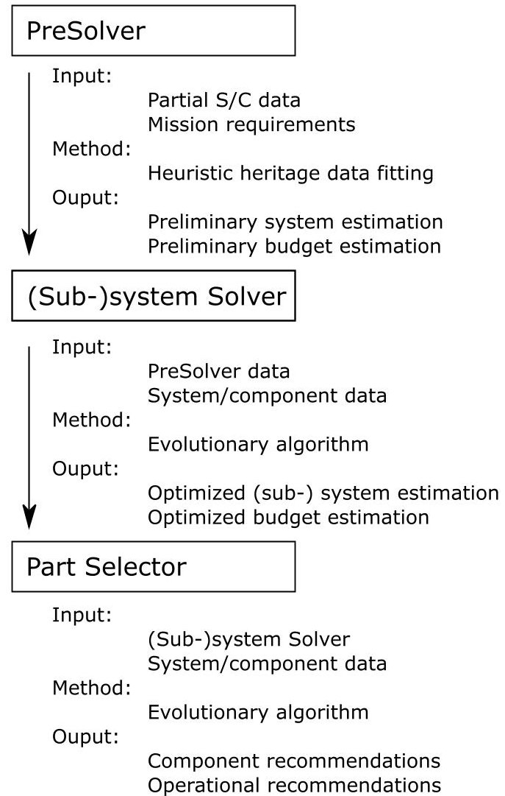

Fig.6 Overview of the solver architecture from the ESDC tool with three solver stages: initial system preliminary estimation, direct system solving, and concluding part selection

estimation of the capacity W of individual Knapsacks, i.e., sub-systems parameters, making up the spacecraft. The Knapsack capacity dimension is here 2 as only mass, and power and power estimates are derived. For this initial estimation, no physics-based correlations between (sub-) systems are utilised. Instead, heuristic-based scaling laws based on spacecraft heritage are applied to solve initial correlations. Mission requirements are only considered here to assign an orbit type to the spacecraft. The resulting total mass and power budgets, as well as the respective power and mass estimates for all sub-systems of the spacecraft, then preliminarily define each Knapsack capacity [51].

In the second stage, the initial system guesses are considered as a baseline for a refined system design. Here, actual system dependencies are applied, shown in the ontology utilised for the ESDC given in Fig. 16. Additional dimensions are introduced here in the form of data and heat budgets to be considered, resulting in additional Knapsack capacity dimensions $ W_{i} $ for the entire system. Adaption of these capacities is performed during iterations and additionally allows for localized optimisation of each system. Existing degrees of freedom, e.g., the considered technology and corresponding

<!-- PDF_PAGE: 9 -->

operating parameters, are solved with an evolutionary algorithm. Where applicable, scaling laws from a component database are derived. The defined mission requirements are now considered for the individual system design. The result is now refined to obtain self-consistent Knapsack capacities (i.e., subsystem definitions and requirements) for an optimal spacecraft configuration.

In the third stage, an evolutionary algorithm is utilised to fulfil the sub-system requirements optimally. Here, the results are specific component selections and the operational parameters to achieve an optimal performing spacecraft and design.

## 2.1 PreSolver: least-square fitting

The dataset to be analysed is rather scattered in nature, as the spacecraft and their hardware vary significantly due to their specific use case and design points [105]. Therefore, it is sensible to apply a least-squares fitting algorithm [106, 107] to derive a suitable estimation correlation. The influence of extreme outliers can thus be reduced, and data close to the fitting line will be emphasised [107].

The summed square of residuals S is defined by

$$
R = \sum_ {i = 1} ^ {n} \left(y _ {i} - P _ {j} \left(x _ {i}\right)\right) ^ {2},
$$

where the squared difference between the data points $ y_{i} $ and the results of the fit polynomial $ P_{j}(x_{i}) $ is calculated. The residuals S needs to be minimised.

The fit polynomial $ P_{j}(x_{i}) $ to be fitted for up to degree $ j=3 $ is defined as

$$
P _ {j} \left(x _ {i}\right) = \left\{ \begin{array}{l l} \beta_ {0} + \beta_ {1} x _ {i} & \mathrm {l i n e a r}, \\ \beta_ {0} + \beta_ {1} x _ {i} + \beta_ {2} x _ {i} ^ {2} & \mathrm {q u a d r a t i c}, \\ \beta_ {0} + \beta_ {1} x _ {i} + \beta_ {2} x _ {i} ^ {2} + \beta_ {3} x _ {i} ^ {3} & \mathrm {c u b i c}. \end{array} \right.
$$

The newly introduced degrees of freedom of the polynomial $ \beta_{i} $ , have to be resolved for the minimum condition of S. As this is a multivariable calculus optimisation problem, the derivative for each $ \beta_{i} $ has to be calculated

$$
\frac {\delta R}{\delta \beta_ {i}} = 0 \forall i = \{1,.., j \}.
$$

The solution for Eq. 6 when $ j=1 $ is as follows:

$$
\frac {\delta R}{\delta \beta_ {0}} = 0: \sum_ {i = 1} ^ {n} x _ {i} \left(y _ {i} - \left(\beta_ {1} x _ {i} + \beta_ {0}\right)\right) = 0,
$$

$$
\frac {\delta R}{\delta \beta_ {1}} = 0: \sum_ {i = 1} ^ {n} \left(y _ {i} - \left(\beta_ {1} x _ {i} + \beta_ {0}\right)\right) = 0.
$$

This system of equations can be solved for each $ \beta_{i} $ , which yields the resulting fit function

$$
y _ {f} = \sum_ {i = 0} ^ {n} \beta_ {i} x ^ {i}.
$$

The challenge for the present spacecraft design problem is to determine an optimal fitting function to the data set. For application in GNU octave, the polyfit function may be used to determine an optimal fit [108]. A first-order polynomial is an approximately equivalent estimation to the possible linear interpolation given in Sect. 2.2.2, although some offset and variance in inclination may occur. In addition, some correlations are likely to be of higher order (e.g., quadratic or cubic). However, applying a polynomial with an excessively high order will predictably lead to an overfitting of the limited dataset. As a result, numerical oscillations and highly inaccurate scaling would occur. Thus, a method with the lowest possible interpolation order at acceptable accuracy is required.

## 2.1.1 Identification method of normed residuals

For determining the quality of a polynomial fit, the normed residuals $ \overline{R} $ can be evaluated [108], which are defined as follows:

$$
\bar {R} = \sqrt {\sum_ {i = 1} ^ {n} \left(y _ {f} - y _ {i}\right) ^ {2}}.
$$

When attempting to apply a polynomial fit, additional outputs of the generated fit are available, allowing for trading these fits. The normed residuals $ \bar{r}_{i} $ indicate the quality of the fit. The lower $ \bar{r}_{i} $ is, the better is the fit of the interpolation function to the data set. A fit function that crosses all data points would have a $ \bar{r}_{i} $ of zero.

Now, the normed residuals of the linear $ \bar{r}_{1} $ , quadratic $ \bar{r}_{2} $ and cubic $ \bar{r}_{3} $ fit attempts are normed again by $ \bar{r}_{1} $

$$
\bar {\bar {r}} _ {i} = \frac {\bar {r} _ {i}}{\bar {r} _ {1}}.
$$

By definition, $ \bar{r}_{1} $ is always unity. While $ \bar{r}_{2} $ and $ \bar{r}_{3} $ will be lower than 1. Now, a threshold T is introduced that allows to test, whether the higher order fits are of significant improvement

$$
\left(\bar {\bar {r}} _ {i}\right) < 0. 9 5 = T.
$$

If the minimum of the residuals is lower than T, a higher order polynomial will be considered. If not, the linear fit will be considered to be sufficient.

<!-- PDF_PAGE: 10 -->

When considering higher order polynomials, Eq. 10 is reapplied with $ \bar{r}_{2} $ and $ \bar{r}_{3} $ , respectively. If their interpolation qualities do not exceed the threshold function of Eq. 11, they are considered as sufficient fits.

Particular care is required with cubic polynomials, as numerical oscillations can occur here already due to the small data set. As a first attempt to eliminate these oscillations, cubic fits are being excluded as valid if the fit function exceeds the boundaries of the data set on either side. In this case, a first-order polynomial is applied.

## 2.1.2 Validation of fit identification

Real-world hardware parameter data are assumed to follow scaling laws, but this comes with a substantial addition of noise deviating from idealized hardware. Multiple technical reasons exist for non-ideal components: material availability and costs, available production technology or simply realising a trade-off design in specific parameters in complex components or systems. Thus, real-world data will be "noisy" while following scaling laws. The degree of the underlying scaling law has to be derived, albeit a potentially significant signal-to-noise ratio.

To validate the fit identification algorithm polynomials with uniformly distributed $ \mathcal{U} $ , randomised coefficients [109], see $ \beta_{i} $ in Eq. 5, are generated using

$$
\beta_ {i} = \mathcal {U} \{- 0. 2, 0. 2 \}.
$$

With the randomised coefficients of Eq.12 and the domain of the function defined here as $ x \rightarrow y $ : $ \{-5,5\} $ , the reference function y can be calculated.

Now, noise $ N_{\mathrm{max}} $ needs to be added to the reference function for meaningful evaluation of the algorithm. The noise $ N_{\mathrm{max}} $ is here adapted to the span of values $ y_{i} $ of the generated data set and defined as

$$
N _ {\max } = 5 \left(\max \left(y _ {i}\right) - \min \left(y _ {i}\right)\right).
$$

A uniform distribution $ \mathcal{U} $ of the noise calculated in Eq.13 is then added to y to obtain the noisy function $ y_{N} $

$$
y _ {N} = y _ {i} + \mathcal {U} \left\{- N _ {\max }, N _ {\max } \right\} / 1 0.
$$

By considering the constant factors 5 and 10 in Eqs. 13 and 14, respectively, the magnitude of the noise is equal to the range of $ y_{i} $ , as shown in the graphical examples of the fit identification algorithm in Figs. 7, 8, 9, and 10.

Since the resulting fit function matches the reference function very closely in the plots, this demonstrates the algorithm's applicability even for the given noisy scatter data. The assumed threshold parameter assumption of $ T=0.95 $ (Eq.11) can be confirmed as productive. However, misclassification between very similar randomised noise functions of second and third order were observed. Figures 7,8, and 9

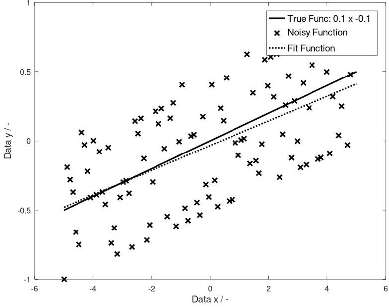

Fig.7 Example of successful linear fit (dotted) to noisy data $ ( x ) $ of a linear reference function (line) with the fit identification algorithm using normed residuals

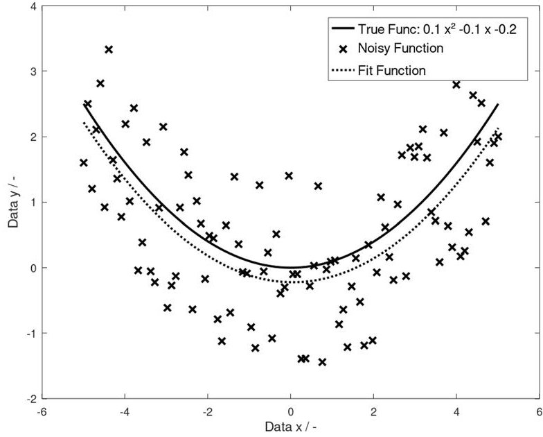

Fig.8 Example of successful quadratic fit (dotted) to noisy data (x) of a quadratic reference function with the fit identification algorithm using normed residuals

have matching identified fit functions to the reference function, while Fig. 10 shows a mismatching example, where the cubic function is drowned in noise and a linear fit function is applied.

The least-squares fit algorithm is sufficient to derive scaling laws of reasonable accuracy by the scattered data sets, while the relevance of automatic consideration of higher order polynomials is shown.

As the given Figs. 7 8,9, and 10 might have been cherrypicked for their favourable appearance of algorithm performance, a more extensive automated validation test has been performed.

<!-- PDF_PAGE: 11 -->

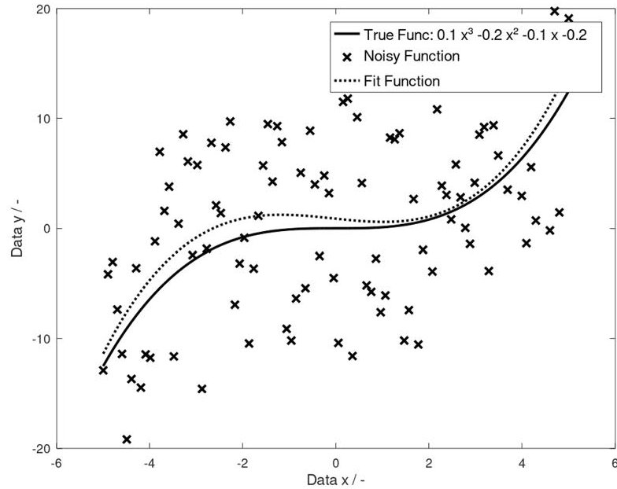

Fig.9 Example of successful cubic fit (dotted) to noisy data $ ( x ) $ of a cubic reference function (line) with the fit identification algorithm using normed residuals

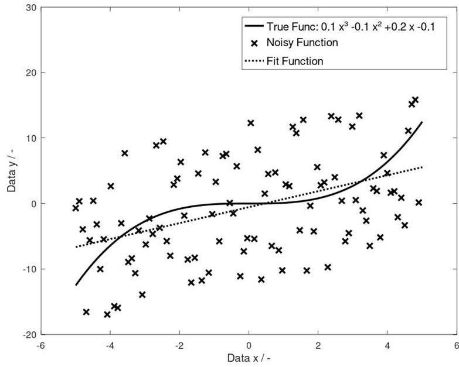

Fig.10 Example of unsuccessful linear fit (dotted) to noisy data (crosses) of a cubic reference function (line) with the fit identification algorithm using normed residuals. Although the polynomial degree of the identified fit is incorrect, the linear fit is still reasonable for the given noisy data

For each case of polynomial reference function (linear, quadratic and cubic), 10,000 randomised polynomials (Eq.12) with individual randomised noise (Eqs.13 and 14) are generated. These data are then subjected to the fit identification algorithm described in Eqs. 4-11. The resulting identifications are then counted individually. The results are presented in Table 1. For the given noise level, the linear and quadratic fit identifications achieve a success rate of more than 99% , while the cubic function achieves merely 30% success. The cubic function is particularly susceptible to the applied noise level, as an additional test with halved

Table1 Results of 10,000 test runs per input function case (linear, quadratic, cubic) with subsequent noise adding and concluding fit identification

<table border="1"><tr><td>Input</td><td>Lin.</td><td>Quad.</td><td>Cubic</td><td>Cubic*</td></tr><tr><td>Fit</td><td></td><td></td><td></td><td></td></tr><tr><td>Lin.</td><td>9919</td><td>0</td><td>6400</td><td>436</td></tr><tr><td>Quad.</td><td>63</td><td>9978</td><td>596</td><td>39</td></tr><tr><td>Cube</td><td>18</td><td>22</td><td>3004</td><td>9525</td></tr><tr><td>Success/%</td><td>99.2</td><td>99.8</td><td>30.4</td><td>95.25</td></tr><tr><td>$\cdot \frac{1}{2}N_{\max}$</td><td></td><td></td><td></td><td></td></tr></table>

Linear and quadratic fits are identified for over 99 % of cases correctly. Cubic fit identification is more prone to the level of added noise. Halving the noise level from the default noise $ N_{\mathrm{max}} $ defined in Eq. 13 allows for 95 % correct cubic function identification

noise already leads to 95% correct identification. However, this result does not necessarily mean that the algorithm is erroneous; taking the noise indicated in Fig. 10 into account, misclassification by applying a linear fit is still a reasonable fit.

## 2.2 Application to spacecraft data

The previously introduced fit algorithm is now applied to generate the initialisation of a suitable spacecraft. For this individual system, masses and power consumptions of space missions with flight heritage are utilised [105].

The current ESDC implementation permits a high degree of input flexibility for an under-constrained spacecraft:

Any input for known system masses $ m_{i} $ , total mass $ m_{\mathrm{tot}} $ system power demands $ P_{i} $ or total power $ P_{\mathrm{tot}} $ is sufficient. Thus, defining the set of possible input parameters for mass as

$$
m _ {\mathrm {i n p u t s}}: \{m _ {\mathrm {t o t}}, \{m _ {i} \} \subseteq m _ {\mathrm {t o t}} \}
$$

and for power demand as

$$
P _ {\mathrm {i n p u t s}}: \{P _ {\mathrm {t o t}}, \{P _ {i} \} \subseteq P _ {\mathrm {t o t}} \}.
$$

For definition of the available masses $ m_{i} $ and powers $ p_{o} $ , refer to Tables 2 and 3.

The implemented logic for the correlation of parameters is given in Fig. 11. Four different cases of known parameters are handled separately:

First, the most straightforward case with a known total spacecraft mass $ m_{\mathrm{tot}} $ is considered. A safety mass margin of $ m_{\mathrm{Margin}}=30\% $ is deducted, and the remaining mass is distributed according to the calculated fraction for similar missions. If some of the sub-system masses $ m_{\mathrm{i}} $ are known, these masses will be considered here. In the case of mass overuse, the margin mass will be automatically reduced to achieve

<!-- PDF_PAGE: 12 -->

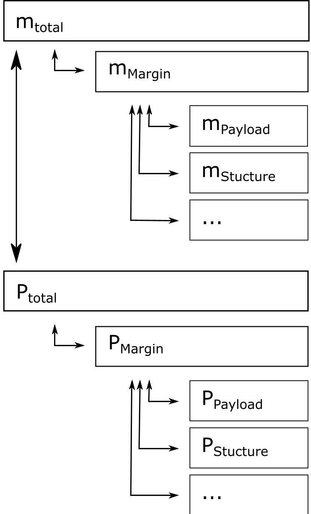

Fig.11 Implemented parameter correlation logic of the ESDC for preliminary full-system estimation. Each arrow presents a correlation of mass-mass, mass-power, or power-power parameters

Table 2 Averaged mass by sub-system as a fraction of dry mass for 4 mission types of a medium-sized spacecraft [105] p. 422 and p. 948

<table border="1"><tr><td>Sub-system</td><td>No prop /-</td><td>LEO Prop /-</td><td>HEO /-</td><td>Probe /-</td></tr><tr><td>PL</td><td>0.41</td><td>0.31</td><td>0.32</td><td>0.15</td></tr><tr><td>Struct.</td><td>0.20</td><td>0.27</td><td>0.24</td><td>0.25</td></tr><tr><td>TC</td><td>0.02</td><td>0.02</td><td>0.04</td><td>0.06</td></tr><tr><td>Power</td><td>0.19</td><td>0.21</td><td>0.17</td><td>0.21</td></tr><tr><td>TTC</td><td>0.02</td><td>0.02</td><td>0.04</td><td>0.07</td></tr><tr><td>OBC</td><td>0.05</td><td>0.05</td><td>0.03</td><td>0.04</td></tr><tr><td>ADC</td><td>0.08</td><td>0.06</td><td>0.06</td><td>0.06</td></tr><tr><td>Propul.</td><td>0.00</td><td>0.03</td><td>0.07</td><td>0.13</td></tr><tr><td>Misc.</td><td>0.03</td><td>0.03</td><td>0.03</td><td>0.03</td></tr><tr><td>Total</td><td>1.00</td><td>1.00</td><td>1.00</td><td>1.00</td></tr><tr><td>Propel.</td><td>0.00</td><td>0.27</td><td>0.72</td><td>1.10</td></tr><tr><td>Mass/kg</td><td>1497</td><td>2344</td><td>1258</td><td>886</td></tr></table>

Table 3 Average power by sub-system as a fraction of total power for 4 mission types of a medium-sized spacecraft [105] p. 424

<table border="1"><tr><td>Sub-system</td><td>No prop/-</td><td>LEO Prop/-</td><td>HEO/-</td><td>Probe/-</td></tr><tr><td>PL</td><td>0.43</td><td>0.46</td><td>0.35</td><td>0.22</td></tr><tr><td>Struct.</td><td>0.20</td><td>0.01</td><td>0.0</td><td>0.01</td></tr><tr><td>TC</td><td>0.05</td><td>0.10</td><td>0.14</td><td>0.15</td></tr><tr><td>Power</td><td>0.10</td><td>0.09</td><td>0.07</td><td>0.10</td></tr><tr><td>TTC</td><td>0.11</td><td>0.12</td><td>0.16</td><td>0.18</td></tr><tr><td>OBC</td><td>0.13</td><td>0.12</td><td>0.10</td><td>0.11</td></tr><tr><td>ADC</td><td>0.18</td><td>0.10</td><td>0.16</td><td>0.12</td></tr><tr><td>Propul.</td><td>0.0</td><td>0.00</td><td>0.02</td><td>0.11</td></tr><tr><td>Pow/W</td><td>299</td><td>794</td><td>691</td><td>749</td></tr></table>

self-consistency. If the available margin mass becomes negative, the design is unachievable.

Next, the correlation between total mass $ m_{\mathrm{tot}} $ and total available power $ P_{\mathrm{tot}} $ is applied. This total power is then assigned to each sub-system $ P_{\mathrm{i}} $ in the same way as mass is distributed. In the case of a known sub-system power demands, these will be considered here. If the total sum of the sub-system powers exceeds the estimated total power, a correction loop will occur to achieve self-consistency. This can lead to an increase in the mass of the power system $ m_{\mathrm{power}} $ . If the total sum of sub-system powers does not exceed the total power estimate $ P_{\mathrm{tot}} $ , the difference is considered an available margin $ P_{\mathrm{Margin}} $

Second, a particular sub-system might be designed with only a known system mass. In this case, an inverse correlation must be solved. An estimation of the total system mass, including an additional margin, can be generated. Once the total system mass is known, the estimation of the total system can be achieved as previously.

Third, a more academic case is given when only a system total power $ P_{\mathrm{tot}} $ is known. Here, the inverse correlation of the total power $ P_{\mathrm{tot}} $ to the total mass $ m_{\mathrm{tot}} $ is first resolved, resulting in a typical mass $ m_{\mathrm{tot}} $ for a mission with the given power demand $ P_{\mathrm{tot}} $ . The remaining system estimate is derived as before.

Fourth is likely to be an academic case with known specific sub-system power demands $ P_{\mathrm{i}} $ . Here, an inverse correlation must first be made to estimate the typical total power $ P_{\mathrm{tot}} $ . Then, an inverse correlation for an estimate on total mass $ m_{\mathrm{tot}} $ is required. From here, the remaining system is estimated as previously. This case is likely to require iteration loops to achieve self-consistency in power and mass estimates, handled internally.

Any possible permutation of known mass or power parameters can be solved to a full-system estimate with this implemented logic, including also multiple and mixed cases of system powers $ P_{\mathrm{i}} $ and masses $ m_{\mathrm{i}}. $

<!-- PDF_PAGE: 13 -->

## 2.2.1 Zero-order correlation estimation

The New SMAD [105] provides a valuable first approach for an overall system estimation, as here averaged values for mass and power fractions of an averaged medium-sized spacecraft is given. Four distinctions are made with respect to the spacecraft orbit position: No propulsion, Low Earth Orbit with Propulsion, High Earth Orbit with Propulsion and Planetary Probes.

Table 2 gives averages masses for these four mission cases. The spacecraft sub-systems are the following: PL for payload; Struct. for Structure and Mechanisms; TC for Thermal Control; TTC for Telemetry; Tracking and Control; OBC for onboard computing; ADC for Attitude Determination and Control; Propul. for the dry mass of the propulsion system; Misc. for various other components and Propel. for the propellant mass. The same systems are used for the average power consumptions of each system given in Table 3.

It is evident that the distinctions for the four mission cases are meaningful; for example, the difference between payload fractions is significant, while the absolute values for average mass and power does support this claim further.

However, it is further clear that not all LEO spacecraft with propulsion will have a mass at around $ m_{\mathrm{LEO,ref}}=2.3 $ tons and will have available electrical power of approximately $ P_{\mathrm{LEO,ref}}=800 $ W.

Thus, it would be possible to apply linear scaling to derive better adapted parameters, respectively. To give an example for applying linear scaling, we assume a dry mass of $ m_{\mathrm{LEO,i}}=1 $ ton and a available power of $ P_{\mathrm{LEO,i}}=300 $ W. This would yield the results shown in Table 4.

While these results are certainly a reasonable starting point for analysis, they are likely to provide unrealistic estimates the more the case study mass $ m_{i} $ and power $ P_{i} $ deviates from the reference satellite parameters $ m_{\mathrm{ref}} $ and $ P_{\mathrm{ref}} $ . A CubeSat has different mass distributions [110, 111] than a small satellite, which differs from a multi-ton communication satellite.

Thus, it is reasonable to attempt a better scaling of each fraction parameter by attempting to derive scaling laws from the available data.

## 2.2.2 First-order correlation estimation

Incidentally, [105] provides in p. 949-p. 954 explicit data, from which Tables 2 and 3 were derived. The list contains 54 spacecraft, with each sub-system's respective masses and power given sorted for each mission type. The list is partially incomplete, as some data were likely not available to the authors.

The applied algorithm implemented in the ESDC for deriving scaling laws to correlate different given system parameters based on these heritage data will be explained.

Table 4 Average mass and power example for a propelled LEO spacecraft dry mass, based on scaling of Tables 2 and 3

<table border="1"><tr><td>Sub-system system</td><td>m/kg</td><td>P/W</td></tr><tr><td>Payload</td><td>310</td><td>138</td></tr><tr><td>Structure and mechanism</td><td>270</td><td>3</td></tr><tr><td>Thermal control</td><td>20</td><td>30</td></tr><tr><td>Power</td><td>21</td><td>27</td></tr><tr><td>Telemetry, tracking&amp;control</td><td>20</td><td>36</td></tr><tr><td>Onboard computer</td><td>50</td><td>36</td></tr><tr><td>Attitude Det. and control</td><td>60</td><td>30</td></tr><tr><td>Propulsion</td><td>30</td><td>0</td></tr><tr><td>Miscellaneous</td><td>30</td><td>-</td></tr><tr><td>Total</td><td>1000</td><td>300</td></tr><tr><td>Propellant</td><td>0.00</td><td>-</td></tr></table>

The complete data set of all available satellite parameters has been implemented into an XML database, which can be easily adapted and extended manually as well as automatically. This approach is relevant for future improvements on system prediction accuracy and allows users to add their proprietary data.

## Data set

A data set D from the data sets $ x_{i} $ and $ y_{i} $ to be correlated

$$
D := \{\{x _ {i} \}; \{y _ {i} \} \} \forall i = \{1,.., n \},
$$

Where for the current implemented case, the set of x-values are the sets of masses $ m_{\mathrm{total}} $ and $ m_{\mathrm{payload}} $ as well as powers $ P_{\mathrm{total}} $ and $ P_{\mathrm{payload}} $

$$
x _ {i} := \left\{m _ {\mathrm {t o t a l}}; m _ {\mathrm {p a y l o a d}}; P _ {\mathrm {t o t a l}}; P _ {\mathrm {p a y l o a d}} \right\}.
$$

These are currently the most relevant input parameters for full-system derivation. A further extension to other system parameters is possible in a trivial way.

The set for y values $ y_{i} $ includes all numeric values of masses and powers given for all satellite cases, leading to an excessive number of available correlations to be generated. As the algorithm performs sufficiently fast and is only executed when the underlying spacecraft system database is changed, this is currently not in need of optimisation. The internal data handling is implemented, so that in case of (partially) incomplete data, an automatic exclusion is applied to the specific correlation point.

Subsequently, the method was applied to the spacecraft data set to derive the respective correlations automatically. An example is given in Figs. 12, 13, 14 and 15 demonstrating the capability of this interpolation method.

## Data Output and Utilisation

As each of these correlations consists of a database lookup, read, search, sort and correlation step, it would be a computational disadvantage to performing these operations again

<!-- PDF_PAGE: 14 -->

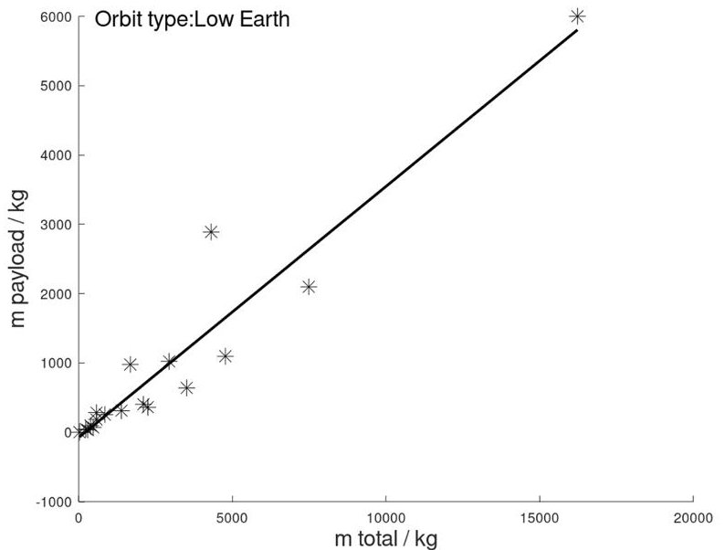

Fig.12 Data set of LEO satellites and derived optimal fit of a linear function for the correlation of total mass (x-axis)to payload mass (y-axis)

Fig.13 Data set of HEO satellites and derived optimal fit of a linear function for the correlation of total power (x-axis) to the fraction of ACS power to total power (y-axis)

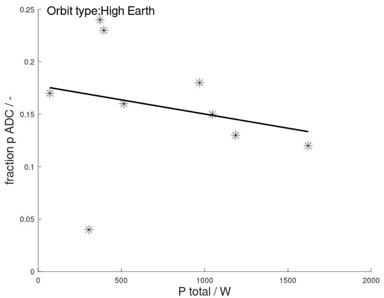

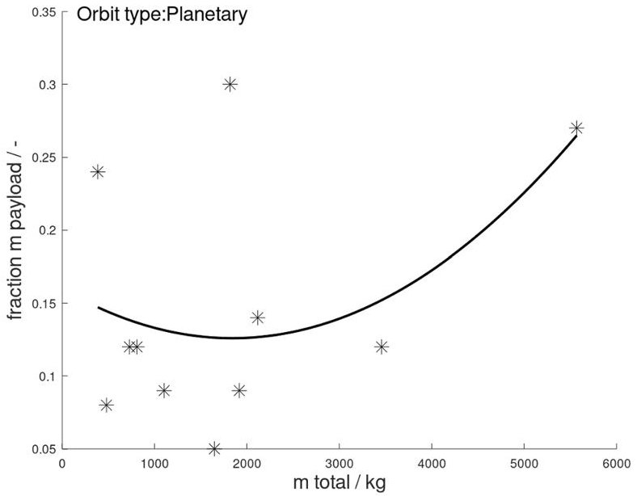

during runtime every time a correlation is required. Thus look-up tables are created that store the polynomial data for fast direct access.

New correlations are only evaluated if changes to the underlying database are detected, requiring a single evaluation loop.

The same method for scaling law derivation be applied to spacecraft system parameters and specific components of a sub-system of the same type.

It has to be further noted that this is a fully bijective modelling definition, meaning that if a user or automated tool supplies a single data point with an orbit classification, all other system estimations can be produced. For example, a communication system mass or power would be sufficient to derive

Fig.14 Data set of planetary probes satellites and derived optimal fit of a quadratic function for the correlation of total mass (x-axis) to the fraction payload mass to total mass (y-axis)

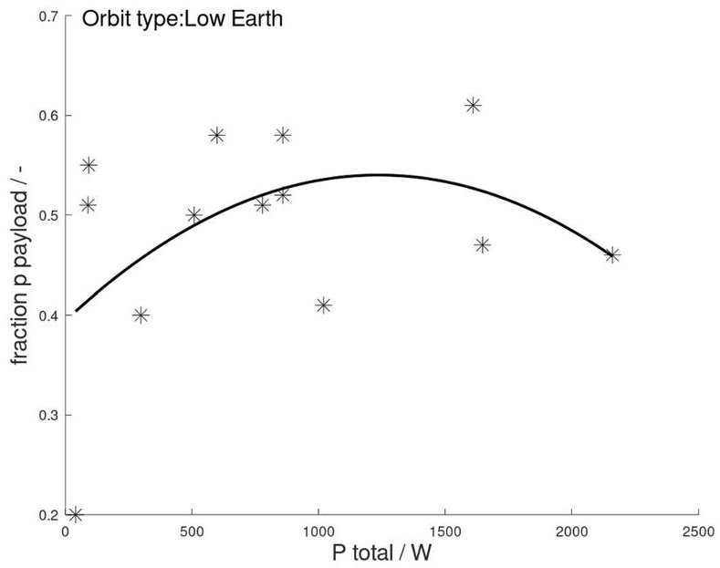

Fig.15 Data set of LEO satellites and derived optimal fit of a quadratic function for the correlation of total power (x-axis) to the payload power fraction (y-axis)

total system mass and power estimations, as well as all other system estimations subsequently. This model, therefore, allows for flexible input handling and enhances general usability. For a given data set, the results are deterministic and are not prone to statistical errors.

## 3 Spacecraft model and ontology

After establishing the top-level system estimations in Sect. 2, it is further necessary to develop a model for the actual correlations of the systems of a spacecraft for subsequent refinement of the design.

<!-- PDF_PAGE: 15 -->

For this, an ontology was created, shown in Fig. 16 based on the previously estimated systems: Payload; Propulsion; Structure; Onboard Computer; Power Supply; Attitude Determination and Control; Telemetry; Tracking and Control and Thermal Control. Convergence for the mass, power and heat budgets is required.

To permit design convergence, mass and power estimates require an additional margin term. Without a margin, the design is likely to diverge. If a first-order mass estimate was too low, the total mass would increase. Subsequently, all fractional mass and power estimates (see Tables 2 and 3) would likewise result in an increased mass, leading to a runaway of increasing total sums of mass and power, making convergence impossible.

Thus, initially, a margin of 30% of the total mass is applied. Underestimated systems can utilise this margin for their added demands, while overestimated systems will add to the margin.

It is possible to use the margin terms as optimisation parameters, as a maximised margin that allows engineers either to be more flexible in polishing the final design or in reducing the overall mass and power consumption of the spacecraft, leading to a reduction in overall costs. Automated margin handling is a planned feature for the ESDC.

The system relations given in Fig. 16 are indicated in terms of their contribution to the budgets for mass (black), power (blue), heat (red), and data (green) budgets, while additional dependencies of orbit parameters are shown. In contrast to a classical ontology, connections between entities have no arrows assigned, as in most cases, design loops will lead to correlations in both directions.

In the following, each system and if needed the differentiation into sub-systems will be explained.

First, the payload is modelled as a complete generic component with contributions to the mass and heat budget, while consuming power and producing data. Additional dependence on on-orbit parameters may be present. Exceptional systems that are not included in other systems can be considered as payload systems (e.g., crew, life-support, etc.).

Second, the propulsion system is one of the main system drivers illustrated by the propulsion and propellant mass fractions given in Table 2. The system contributes to the mass by its components, including propellant. It is the only system that has a dedicated mass loss through its propellant consumption. In the case of an electric propulsion system, the power consumption and heat generation are significant. Data are generated for monitoring the system health and performance. This system has a strong relation to orbit parameters as velocity increment $ \Delta v $ , thrust F and effective exhaust

ESDC Design Scope and System Relations

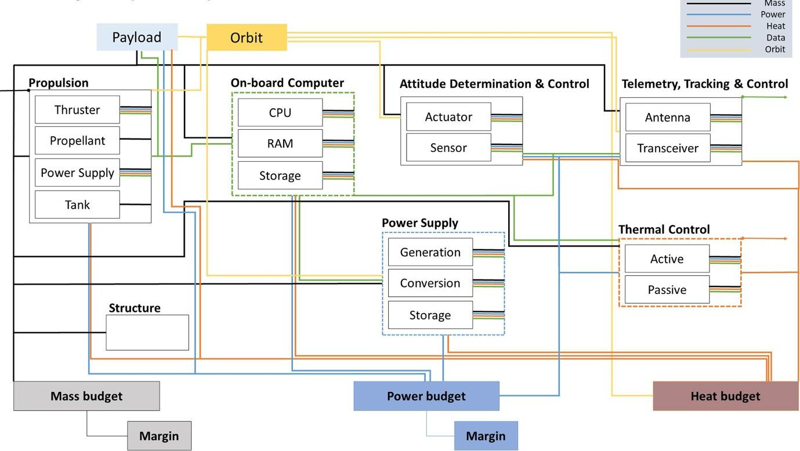

Fig.16 Spacecraft system and sub-system ontology developed for use in the ESDC. The systems are payload, propulsion, OBC, ADC, TTC, structure, power and TC, each with respective sub-systems. Black lines are contributions to the mass budget. Blue lines are contributions to the power budget. Orange lines are heats relevant for the thermal budget. Green lines represent data flows. In contrast to a clas-

sical ontology, connections between entities have no arrows assigned, as in most cases, design loops will lead to correlations in both directions. Yellow lines provide systems with a strong correlation to orbit parameters. Individual contributions of sub-systems are marked with the same coloured lines

<!-- PDF_PAGE: 16 -->

velocity $ c_{\mathrm{e}} $ are mission capability drivers. The propulsion system is differentiated into thrusters, a unit for power processing or conditioning, propellant and the respective tank.

Third, the spacecraft structure is a simple system model, as the bus provides structural integrity for the spacecraft and has a mass budget contribution.

Fourth, the onboard computer will be the main processor and storage of the onboard generated data. In addition, it will monitor the status and control sub-systems, store and process payload data and execute commands from the ground station. The system consumes power and generates excess heat while contributing to the mass budget. The amount of simultaneous data streams drives the CPU selection, whereas the size of the required programs mainly drives the RAM requirements. Data storage size is mainly driven by the difference between incoming data streams and outgoing TTC data streams.

Fifth, the attitude determination and control system are required to correct the spacecraft during the operation of payloads, contact ground stations, and optimising the angle of relevant surfaces to the sun. The system consists of actuators (e.g., reaction wheels, magnetorquers) and sensors (e.g., sun sensors, star sensors), contributing to mass, power, data and heat budgets.

Sixth, the power system is required for the continued operation of the spacecraft. It will have to generate the power demand given by the power budget. In all conventional cases, energy is generated using solar radiation, converted to electrical energy by generators. This energy is then converted to a useable voltage for the spacecraft and is then stored in onboard batteries. Losses during each power processing step lead to the generation of heat. The size of the generator and batteries are orbit dependent, as the irradiance per areas and shadow periods, will vary. All components add mass to the system. Monitoring of health via voltages and power consumption via currents and inferring from their capacities is critical for mission success.

Seventh, the telemetry, tracking and control system is the spacecraft interface to a ground station on Earth. The communication system requires two sub-systems, the transceiver to transmit and receive data, and an antenna that provides the relevant gain for achieving sufficient bandwidth. These components add to the mass, power and heat budget, while it can be viewed as a data sink. The system is strongly dependent on the orbit, as this defines the contact times to the ground station. The shorter the ground station contact time, the shorter the time for data transmission and the higher the desired bandwidth. Data processing for tracking and control is shared in this model with the onboard computing unit. Proper antenna pointing drives the demands for the ACS.

has to be radiated into space to avoid overheating. The actual spacecraft orbit is relevant as the respective solar irradiance and shadow phases significantly impact the total heat budget. The system is differentiated into active (e.g., heat pumps) and passive elements (e.g., insulation and radiators), while only the former leads to an increase in the power budget. The system contributes to the mass budget and for thermal monitoring to the data budget.

Eight, as last but not least, is the thermal control system tasked with controlling for acceptable temperatures on the spacecraft. The excess heat of the cumulative heat budget

The scope of the ESDC development is the full implementation of all discussed sub-systems and their respective interactions to achieve an automated detailed full-system design. To complement this top-down approach, bottom-up realism is attempted by aggregating a database of actual space flight components with their respective relevant parameters for scaling law derivation similar to the method shown in Sect. 2.2.2.

## 4 Sub-system scaling model example

In the following, an example for the propulsion system modelling is given for the case of an electric arcjet-based propelled phase [112] of the reference satellite described in Sect. 4.1. This early ESDC EP system model was initially presented at the Space Propulsion Conference 2018 in Seville, Spain [113]. It serves as a demonstrator of semiautomated design, where scaling laws have been manually defined for each relevant component case, which was already based on actual hardware data. Trade-off possibilities for different propulsion system operation parameters are demonstrated to determine an optimal system mass fraction of the EP system (i.e., minimal) and compared from exhaustive analytics to the performance of an evolutionary algorithm, which shows the expected performance to determine optimality. In Sect. 5.6, updates to new features and functionality of the ESDC tool are given.

## 4.1 System baseline

A nominal IRAS satellite has a mass of $ m_{0}=1 5 0 \mathrm{k g} $ and an operational orbit altitude of $ h=8 0 0 \mathrm{k m} $ above ground with an inclination of $ i\approx 8 9^{\circ} $ [114].

Two transfer orbit concepts are compared as a baseline trade-off.

For concept A, a circular orbit at height $ h_{\mathrm{A}}=7 5 9 \mathrm{k m} $ and inclination $ i_{\mathrm{A}}=8 7. 2 4^{\circ} $ is considered, which results in requiring a velocity increment of $ \Delta v_{\mathrm{A}}=6 8 5. 9 7 \frac{\mathrm{m}}{\mathrm{s}} $ [114].

For concept B, an elliptical circular orbit with a perigee height of $ h_{\mathrm{peri,B}}=4 0 0 \mathrm{k m} $ and apogee height $ h_{\mathrm{peri,B}}=8 0 0 \mathrm{k m} $ with an ideal initial inclination of $ i_{\mathrm{B}}=8 9^{\circ} $ is considered. This results in a velocity increment requirement of $ \Delta v_{\mathrm{B}}=5 2 6. 2 5 \frac{\mathrm{m}}{\mathrm{s}} $ [114].

<!-- PDF_PAGE: 17 -->

## 4.2 Electric propulsion system

The arcjet system concept is simplistic as in the current baseline, only self-pressurizing propellants are considered. These are ammonia (NH3) and helium (He). A concept schematic is given in Fig. 17.

Ammonia can be considered a system with uniform operating pressure until end of life (EOL) is reached, as it is stored in the liquid phase and vaporizes and therefore selfpressurizes constantly. At the end of life, the remaining gaseous ammonia experiences a blowdown effect.

In contrast, helium is stored in a highly pressurized gaseous form, where blowdown occurs over the entire operational lifespan, reducing the efficiency of the propulsion system.

In both cases, the propellant is stored in a separate containment tank, intended to flow through a pyro valve and dual-seat valve. A filter in between will catch occurring debris after triggering the pyro valve. In the case of NH3, an additional gas generator is required to ensure that the propellant is present completely in gaseous form. For this,

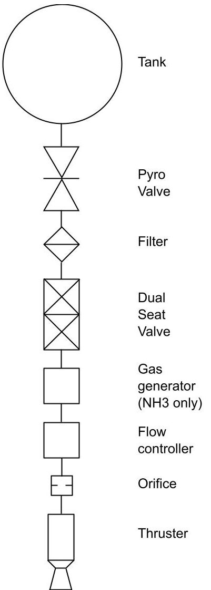

Fig.17 Generic flow schematic of the electric propulsion system model for NH3 and He propellants

a flow controller combined with an orifice is utilised to adjust the supplied pressure to the desired operating pressure of the utilised arcjet thruster.

As arcjet thruster, the Very Low Power ArcjetVELARC [115] with supplied power of $ P_{1}=1 5 0 $ to $ P_{2}=3 0 0 $ W is taken as the current baseline. To further explore the parameter space of potential systems with power supply up to several kilowatts are considered.

The scaling of the electric propulsion system pivots around a total mass budget estimation $ m_{\mathrm{EP}} $ of the individual component given in Eq. 19. In its current form, thruster mass $ m_{\mathrm{Thruster}} $ , mass of power processing unit $ m_{\mathrm{PPU}} $ , propellant mass $ m_{\mathrm{Prop.}} $ , tank mass $ m_{\mathrm{Tank}} $ , photovoltaic mass $ m_{\mathrm{PV}} $ , and structural mass $ m_{\mathrm{Struct}} $ are considered. Thus, the following equation yields the mass budget:

$$
\begin{array}{l} m _ {\mathrm {E P}} = m _ {\mathrm {T h r u s t e r}} + m _ {\mathrm {P P U}} + m _ {\mathrm {P r o p .}} + \\ + m _ {\mathrm {T a n k}} + m _ {\mathrm {P V}} + m _ {\mathrm {S t r u c t}}. \\ \end{array}
$$

To be able to automatically select an advantageous system over another objective criterion is required. Subjective ratings like trade-off matrices should be avoided. Thus, the electric propulsion system mass fraction $ \mu_{\mathrm{EP}} $ is introduced, which is obtained by dividing the system mass $ m_{\mathrm{EP}} $ by the total satellite mass $ m_{0} $

$$
\mu_ {\mathrm {E P}} = \frac {m _ {\mathrm {E P}}}{m _ {0}}.
$$

The logical decomposition of the electric propulsion system mass is illustrated in Fig. 18. As an input parameter, the mission required total impulse $ I_{\mathrm{tot}} $ can be seen as a constant, while other parameters like thrust F, effective exhaust velocity $ c_{e} $ , and propellant type are degrees of freedom for optimisation.

By this, the jet power $ P_{\mathrm{jet}} $ becomes defined, which defines the mass of the respective arcjet thruster. When considering the thrust efficiency $ \eta_{\mathrm{Thruster}} $ , the required output power $ P_{\mathrm{PPU,out}} $ of the power processing unit (PPU) can be calculated to scale the mass of the PPU $ m_{\mathrm{PPU}} $ . By considering the PPU efficiency $ \eta_{PPU} $ , the required input power for the PPU $ P_{\mathrm{PPU,in}} $ defines the output power of the photovoltaic system $ P_{\mathrm{PPU,out}} $ , which mass $ m_{\mathrm{PV}} $ scales with the area-specific input power of solar irradiation $ E_{0} $

Propellant mass $ m_{\mathrm{prop}} $ on the other hand is mainly dependent on the required total impulse $ I_{\mathrm{tot}} $ and considered effective exhaust velocity $ c_{e} $ . With the density of the considered propellant $ \rho_{\mathrm{prop}} $ and the resulting propellant volume, the tank mass $ m_{\mathrm{tank}} $ can be defined.

<!-- PDF_PAGE: 18 -->

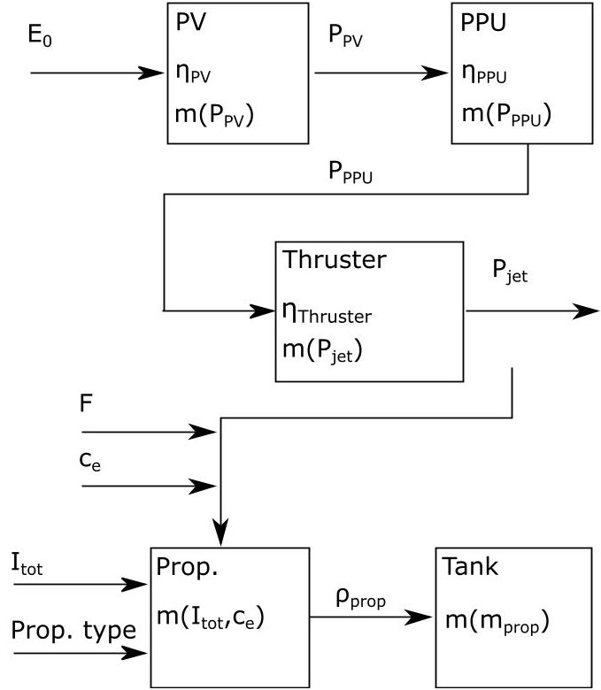

Fig.18 Parameter inputs and dependencies of implemented electric propulsion system model

## 4.3 Scaling of components

In this subsection, the preliminary scaling laws applied to the individual components are detailed. The potential of varying degrees for refinement of scaling resolution exists in each category.

Furthermore, this modular approach can be utilised for the more generic extension of the software application, as additional case distinctions or specialized performance parameters can be introduced on any level.

## 4.3.1 Thruster

To scale the mass of the arcjet thruster $ m_{\mathrm{Thruster}} $ , a dependency with the jet power $ P_{\mathrm{jet}} $ is required.

The jet power $ P_{\mathrm{jet}} $ is defined as

$$
P _ {\mathrm {j e t}} = \frac {1}{2} \dot {m} c _ {\mathrm {e}} ^ {2};
$$

with the efficiency of the thruster

$$
\eta_ {\mathrm {T h r u s t e r}} = \frac {P _ {\mathrm {j e t}}}{P _ {\mathrm {P P U , o u t}}},
$$

the arcjet thruster input power $ P_{\mathrm{Thruster,in}} $ serves as the basis for scaling. For NH3, the efficiency $ \eta_{\mathrm{Thruster,NH3}} $ is within the range of 28.3 and 29.3% . Helium achieves much higher efficiencies due to the absence of dissociation and other losses. Thus, $ \eta_{\mathrm{Thruster,NH3}} $ reaches between 67.8 and 69.3% . With the aid of the arcjet database available to the IRS [104], a linear

interpolated mass estimation for four power classes has been obtained

$$
m (P) = \left\{ \begin{array}{l l} 0. 3 0 \mathrm {k g} & | \leq 0. 3 \mathrm {k W}, \\ 0. 2 0 \mathrm {k g} + 3. 3 3 \times 1 0 ^ {- 3} \frac {\mathrm {k g}}{\mathrm {W}} \times P & | (0. 3; 1. 5) \mathrm {k W}, \\ 0. 4 9 \mathrm {k g} + 1. 4 \times 1 0 ^ {- 4} \frac {\mathrm {k g}}{\mathrm {W}} \times P & | (1. 5; 1 0) \mathrm {k W}, \\ 0. 0 2 \mathrm {k g} + 1. 8 \times 1 0 ^ {- 4} \frac {\mathrm {k g}}{\mathrm {W}} \times P & | P \geq 1 0 \mathrm {k W}. \end{array} \right.
$$

It is assumed that for a power demand of less than 300 W, at least the mass of the VELARC thruster of 0.3 kg is taken as a conservative assumption. For power consumption between 300 and 1500 W, the mass of VELARC and the ATOS/ ARTUS [104] thrusters is linearly interpolated, where the endpoints of the defined domain are the exact masses of the respective thrusters. For up to 10 kW, the MARC [104] thruster is used as a reference, while the HIPARC [104] thruster serves as a reference for the domain up to 100 kW.

## 4.3.2 PPU

The power processing unit conditions the supplied power to the specific current and voltage rating required to operate the arcjet. It is conservatively assumed to have an efficiency of $ \eta_{\mathrm{PPU}}=92\% $ [116, 117]. While the mass of the PPU $ m_{\mathrm{PPU}} $ scales linearly as follows:

$$
m _ {\mathrm {P P U}} (P) = 1. 0 1 1 \mathrm {k g} + 2. 4 6 5 \times 1 0 ^ {- 3} \frac {\mathrm {k g}}{\mathrm {W}} \times P,
$$

where the empirical constant for the y-intercept and the slope has been obtained by linear regression of public data of arcjet PPUs [116, 117]. In future work, the mass of an attached thermal management system to cope with the PPUs heat losses will be considered additionally.

## 4.3.3 Power generation

Photovoltaic elements generate electric power. As the IRAS constellation [98-100] considers a medium Earth orbit, the solar constant of $ E_{0}=1 3 6 1 \frac{\mathrm{W}}{\mathrm{m}} $ is taken as constant power input for the solar cells. Commercially available triple junction Germanium substrate cells offer an efficiency of at least $ \eta_{\mathrm{P V}}=29\% $ [118].

A simple scaling law has been extracted from publicly available data [118] as follows:

$$
m _ {\mathrm {S o l a r a r r a y}} (P) = 1. 5 6 \times 1 0 ^ {- 2} \frac {\mathrm {k g}}{\mathrm {W}} \times P.
$$

A minor error is introduced as $ P \rightarrow 0 $ W; the mass of the power generation system also converges to zero. This error

<!-- PDF_PAGE: 19 -->

can be neglected as low electric power input produces highly ineffective electric propulsion systems.

## 4.3.4 Propellant

The required propellant mass $ m_{\mathrm{prop}} $ is obtained through rearranging the definition for total impulse $ I_{\mathrm{tot}} $ , which is a mission-specific constant and utilising the effective exhaust velocity $ c_{e} $

$$
m _ {\mathrm {p r o p}} = \frac {I _ {\mathrm {t o t}}}{c _ {\mathrm {e}}},
$$

where $ c_{e} $ is a function of the jet power of the arcjet $ P_{\mathrm{jet}} $ , when the mass flow $ \dot{m} $ of Eq. 21 is given.

The mass flow is obtained by

$$
\dot {m} = \frac {F _ {\mathrm {T h r u s t e r}}}{c _ {\mathrm {e}}}.
$$

## 4.3.5 Tank

To scale the tank mass currently, only spherical tanks are assumed, while available public data on tank mass, volume and operational pressure of Orbital ATK [119] are utilised.

As scaling law, the following equation has been derived:

$$
m _ {\mathrm {T a n k}} = m _ {0} + a \times \left(\frac {m _ {\mathrm {p r o p}}}{\rho_ {\mathrm {p r o p}}}\right) ^ {\frac {3}{2}}.
$$

The exponent of $ \frac{3}{2} $ comes from the fact that an area, which scales with a power of $ m^{2} $ , is set into relation with a volume, which scales with a power of $ m^{3}. $

The following data are implemented for each propellant type.

Helium is stored in fully gaseous form at 300 bar operational pressure: $ m_{0,\mathrm{He}}=2.77\mathrm{kg} $ , the scaling factor $ a_{\mathrm{He}}=250.8\mathrm{m}^{2 / 3}\mathrm{kg},\rho_{\mathrm{He,300\ bar}}=43.14\frac{\mathrm{kg}}{\mathrm{m}^{3}}. $

Ammonia is stored in liquid form. Thus, the following data are used: $ m_{0,\mathrm{NH3}}=1.45\mathrm{kg}, $ $ a_{\mathrm{NH3}}=282.0\mathrm{m}^{\frac{2}{3}}\mathrm{kg}, $ $ \rho_{\mathrm{NH3},l}=681.9\frac{\mathrm{kg}}{\mathrm{m}^{3}} $ . An additional level of scaling resolution can be achieved by implementing a full table of available tanks with their respective volumes and directly integrating operational pressures to obtain individually scaled propellant densities for specific tanks.

## 4.3.6 Structure

The structural mass $ m_{\mathrm{struct}} $ does not necessarily scale with the previous factors that rely on some form of electric power scaling, as thrust and mass flows are comparatively

small and structural loads are mainly given by the launcher. Thus, a constant structural mass is considered, which is for helium-based concepts assumed as $ m_{\mathrm{struct, He}}=0.49 \mathrm{~kg} $ and for ammonia-based concepts $ m_{\mathrm{struct, NH3}}=0.95 \mathrm{~kg} $ . The structural mass of a helium-based system is lower, since no gas generator is required.

## 4.4 Concept comparison

The electric propulsion system scaling model is applied to compare the different orbital concepts A and B, with utilising the propellants NH3 and He. Furthermore, a variation of $ c_{e} $ is considered to analyse whether an increase or decrease would benefit the mass fraction $ \mu_{\mathrm{EP}} $

Scaling of the arcjet system with constant thrust $ F_{\mathrm{Thruster}} $ is given in Fig. 19, where a theoretical effective exhaust velocity of up to $ 30 \mathrm{~km} / \mathrm{s} 30 \frac{\mathrm{km}}{\mathrm{s}} $ is considered.

The graph of Fig. 19 demonstrates that in both orbit transfer cases, the ammonia-based concepts are superior in terms of $ \mu_{\mathrm{EP}} $ as 20-25% is achieved. Compared to a helium-based system for current designs—marked as red cross—mass fractions of 50 and, respectively, 70% of the total system mass are required.

Furthermore, it can be obtained that the break-even point for a helium-based arcjet system for this configuration and the orbit transfer of concept B requires at least a $ c_{\mathrm{e}} $ of $ 1 5 \frac{\mathrm{k m}}{\mathrm{s}}. $

Additionally, all current designs do profit from an increase of $ c_{\mathrm{e}} $ , while helium-based systems can experience a significant performance increase, the benefit for ammoniabased systems is comparatively low. For the convenience of analysis, a black dashed line has been added to mark a 10% area around the theoretical achievable optimum. It is

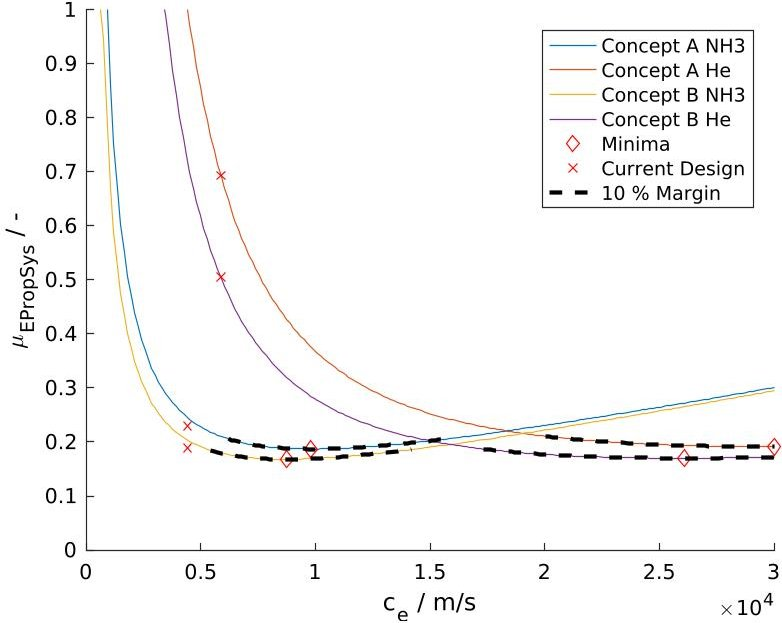

Fig.19 Mass fraction comparison of concept A and B orbital transfers for NH3- and He-based arcjet systems for variations of effective exhaust velocity

<!-- PDF_PAGE: 20 -->

important to emphasize that the domain around the minima is rather flat. Thus, no significant increase or decrease in $ c_{\mathrm{e}} $ will significantly change the achievable $ \mu_{\mathrm{E P}} $ .

For both ammonia-based concepts, the systems are already in the vicinity of this domain.

## 4.5 System component analysis

The implemented scaling model can furthermore be utilised to analyse the scaling of the individual components. In Figs. 20, 21,22m and 23, the electric propulsion system mass fraction $ \mu_{\mathrm{EP}} $ is normed to 1 and the components of the constituting sub-systems depicted as a fraction thereof. For the convenience of the reader, a black vertical line is given to indicate the actual minimum of each system configuration, as the information of the overall minimum cannot be read from the graphs.

Figures 20 and 22 show a similar trend as both consider the same propellant ammonia. The contributing masses, when approaching the theoretical optimum is a decreasing propellant mass and an increasing solar panel mass, as the required power increases proportionally with the square of $ c_{\mathrm{e}} $ (see Eq. 21). The relative tank mass does slightly decrease, while the PPU mass becomes increasingly relevant. Thruster and structural mass do not significantly impact the system as their combined contribution is approximately less than 5%.

When analysing the trends of the helium-based systems in Figs. 21 and 23, another pattern becomes evident. For a large fraction of the total $ c_{\mathrm{e}} $ domain, the mass of the propellant tank is a significant contribution, while the solar panel mass becomes relevant for very large $ c_{\mathrm{e}} $ .

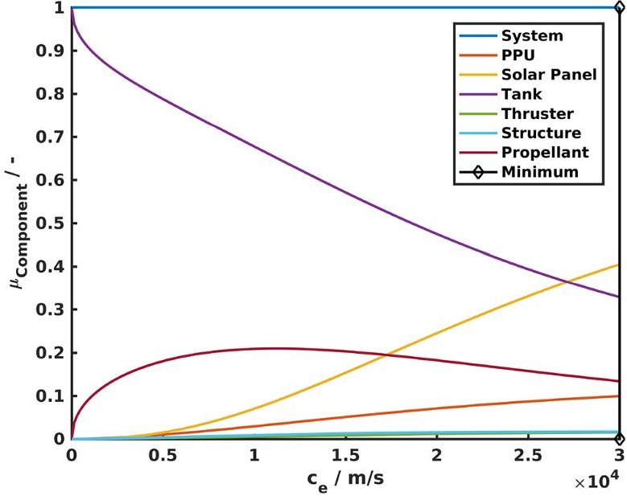

Fig.21 Mass fraction of individual components of the electric pulsion system based on He for constant thrust and variation of $ c_{\mathrm{e}} $ orbit transfer concept A

The propellant mass of helium has a moderate influence due to the fact that it can achieve high efficiency when utilised in an arcjet, but this advantage is for most applications negated by a required large tank mass.

Structural and thruster masses are similarly small as in the ammonia-based concepts. The difference between orbital transfer concept A and B is significant as the theoretical optimum lies at $ c_{\mathrm{e}}=30 \frac{\mathrm{km}}{\mathrm{s}} $ , while for concept B, "only" $ c_{\mathrm{e}}=26 \frac{\mathrm{km}}{\mathrm{s}} $ is required, making the system sensitive to changes in required total impulse $ I_{\mathrm{tot}}. $

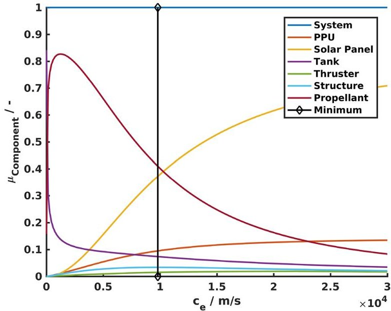

Fig.20 Mass fraction of individual components of the electric propulsion system based on NH3 for constant thrust and variation of $ c_{\mathrm{e}} $ for orbit transfer concept A. Theoretical optimum at approx. 10 km/s is indicated

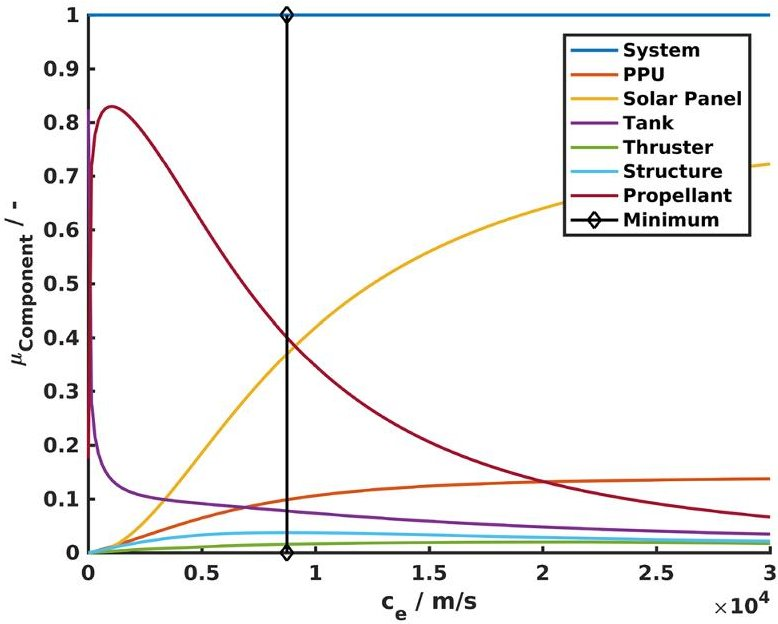

Fig.22 Mass fraction of individual components of the electric propulsion system based on NH3 for constant thrust and variation of $ c_{\mathrm{e}} $ for orbit transfer concept B. Theoretical optimum at approx. 8 km/s is indicated

<!-- PDF_PAGE: 21 -->

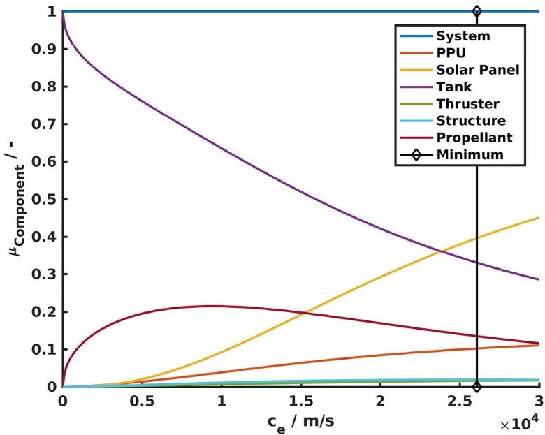

Fig.23 Mass fraction of individual components of the electric propulsion system based on He for constant thrust and variation of $ c_{\mathrm{e}} $ for orbit transfer concept B

## 5 Evolutionary algorithm

Up until this point, the thrust $ F_{\mathrm{Thruster}} $ of the arcjet has been neglected as a degree of freedom. For the permitted thrust domain, a minimum of $ F_{\mathrm{Thruster},\mathrm{min}}=0.01 \mathrm{~N} $ and a maximum of $ F_{\mathrm{Thruster},\mathrm{min}}=0.1 \mathrm{~N} $ are chosen. Thus, the optimisation problem presents itself as 4 dimensional, with the parameters $ c_{\mathrm{e}}, $ F, propellant type and transfer orbit concept. The fifth dimension is the resulting mass fraction $ \mu_{\mathrm{EP}} $ when the input parameters mentioned above are defined.

A simple evolutionary algorithm with a mutation and selection mechanism has been developed to solve this multidimensional optimisation problem.

## 5.1 Fitness landscape

A fitness landscape is a representation of the available hyperspace of traversable design solutions. Design points will traverse this landscape as they are changed and try to optimise their configuration.

To be able to visualize and verify the performance of the evolutionary algorithm, a full fitness landscape is first calculated and plotted in Fig. 24. This figure already illustrates that although a simple scaling model is applied, the determination of optimal solutions is already non-trivial, as a complex 3D intersection exists between individual conceptual hyperplanes.

A minimal fitness landscape can be generated for better understanding when the current minimum hyperplane is A minimal fitness landscape can be generated for better understanding when the current minimum hyperplane is consistently taken to produce a unified mesh. The resulting unified minimal hyperplane is given in Fig. 25.

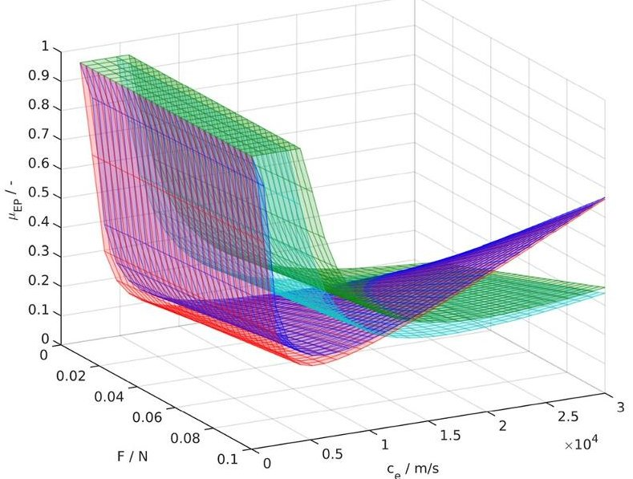

Fig.24 Full five-dimensional fitness landscape. Blue plane-concept A ammonia. Green plane-concept A helium. Red plane-concept B ammonia. Light blue plane-concept B helium

When colouring the resulting plane for propellant ammonia in green and helium in purple, one can obtain a clear demarcation line, where each respective propellant concept system offers a beneficial-i.e., lower-electric propulsion system mass fraction $ \mu_{\mathrm{E P}} $ . It is shown that for arcjets that are capable to produce less than $ c_{\mathrm{e}}=1 0 \frac{\mathrm{k m}}{\mathrm{s}} $ , ammonia is the advantageous propellant. For very high $ c_{\mathrm{e}} $ and high thrust applications, heliumbased arcjet systems can be considered favourable.

## 5.2 Mutator

A mutation is required to improve a given design point with an evolutionary mechanism incrementally. A mutation is

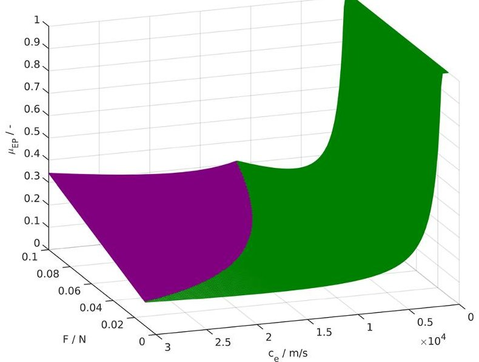

Fig.25 Minimal fitness landscape of scaled EP system for variation of $ c_{\mathrm{e}} $ and F. Green area—Ammonia systems. Purple area—Helium systems

<!-- PDF_PAGE: 22 -->

here defined as a random variation of defined parameters. In this case, specific exhaust velocity and $ c_{\mathrm{e}} $ the thrust F, as well as the propellant type, are mutated.

For the first two parameters that are of numerical type, the following equation has been developed:

$$
x _ {2} = x _ {1} + (- 1) ^ {a} \times b \times c \times d,
$$

with the random integer a of either one or two, which randomly determines whether x is increased or decreased.

The variable b is a random integer that decides the maximum increment a mutation can achieve.

Currently, it is arbitrarily set to b=100. The individual step size can be anything from 1 to a100-fold of a permitted minimal increment. This parameter allows realising similar behaviour, as shown in Fig.2, and the Boltzmann probability density given in Eq. 2 by permitting varying of mutation or jump ranges to overcome local minima. Large b allows for jumping over larger minima areas. Adaptive behaviour will be implemented in an upcoming ESDC version.

The parameter c determines the maximum span of allowed parameters, which is in the case of $ c_{c_{\mathrm{e}}}=3 0, 0 0 0 \frac{\mathrm{m}}{\mathrm{s}} $ and for thrust $ c_{F}=0. 0 9 \mathrm{N}. $

The parameter d is an arbitrary constant to reduce the span of c and reduce the mutation step size to a practical level. It is currently set for the effective exhaust velocity $ d_{c_{\mathrm{e}}}=10^{-4} $ and for thrust $ d_{\mathrm{F}}=10^{-3}. $

A reset to the respective boundary value is implemented in the case of mutations that occur beyond the permitted parameter space. As a result, the statistical probability of a population member reaching a boundary is increased.

A categorical mutator is required in the case of propellant type mutation or more complex implementations technology types (e.g., arcjet vs grid ion thruster vs cold gas thruster). A categorical mutator can be as simple as picking a random integer from the number of available options.

It has to be noted that significant potential for improvement exists by further developing the permitted mutation principle, as the arbitrary nature of the constants b and d should be avoided as subjective human influence is introduced by it. Furthermore, it is not necessarily required that these parameters are constant, as reiteration after a certain generation number, convergence quality or with respect to a localized area solution can be developed and implemented, described in the section on simulated annealing.

## 5.3 Selector

Evolutionary optimisation is lead by random mutation followed by targeted selection. It is critical to remove the human element from this process. Thus, the objective criteria of $ \mu_{\mathrm{EP}} $ has been determined to be useful for selection.

In the current form, a simple selection of improved points in the following form is implemented to determine successively improving parameter sets $ \overline{S} $:

$$
\bar {S} _ {\mathrm {n e w}} = \left\{ \begin{array}{l l} \bar {S} _ {\mathrm {m u t a t e}} | \mu_ {\mathrm {E P}, 1} \leq \mu_ {\mathrm {E P}, 2}, \\ \bar {S} _ {\mathrm {o l d}} | \mu_ {\mathrm {E P}, 2} > \mu_ {\mathrm {E P}, 2}. \end{array} \right.
$$

It is critical to note that the $ \leq $ sign in the first line of Eq. 30 should be favoured compared to > as equal solutions with changing input parameters are more likely to find new optima than static design points serendipitously.

For the point of suitable selection mechanism, a great potential for variation exists. For example, complete generations with low development performance can be selected for termination to reduce the overall computing power. To achieve the reduction, the global performance span of the current generation of design points and a certain fraction on the lower performing end is successively cut off. Alternative selectors might consider the current speed of improvement—i.e., evolution rate—of individual lineages.

## 5.4 Application

This simple evolutionary algorithm is now applied to the arcjet scaling model. As initial starting points or seeds, an equally spaced grid of three points within the $ c_{\mathrm{e}} $ domain, as well as the F domain, is utilised. This initial set is doubled by considering both propellant types for all of these initial seed points. Thus, generation 0 of solutions consist of 18 individual seed points.

The results of 10,100, and 1000 successive generations of evolution are visible in Figs. 26,27 and 28, where multiple interesting effects can be observed. First, the "squiggly' behaviour of a single lineage in Figs. 27 and 28 is exactly the expected behaviour by a random input parameter mutation. Furthermore, the consistent movement "downhill", most notable in Fig. 28, demonstrates that the selection mechanism works as intended. Overall, a minimisation in thrust for minimisation of the mass fraction can be expected. Expected ranges of $ c_{\mathrm{e}} $ like shown in Fig. 19 are equally confirmed when initial seed points are in the vicinity before thrust optimisation effects become dominant.

For half of the initial seed point population, an initial vertical "drop" of a starting point on the minimum plane can be seen after ten generations in Fig. 26. This is explained by a mutation of propellant type input to a more optimal solution.

Another interesting effect can be observed in Fig. 27 and more notably in Fig. 28, where lineages switch from the helium domain to the ammonia domain. When considering the propellant type demarcation hill shown in Fig. 25, this can be counter-intuitive. For an evolutionary algorithm of infinitesimal improvement increments, this hill should not

<!-- PDF_PAGE: 23 -->

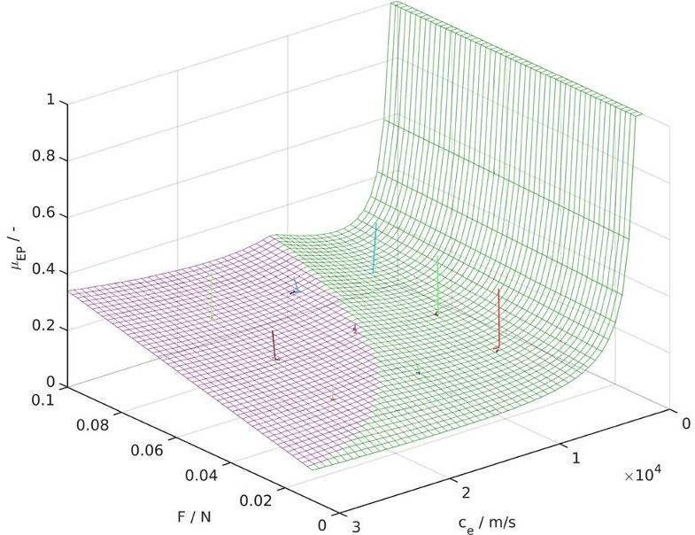

Fig.26 Application of evolutionary algorithm with 18 equally spaced seed points over 10 generations. A quick drop from initial seed points to the minimal plane is visible

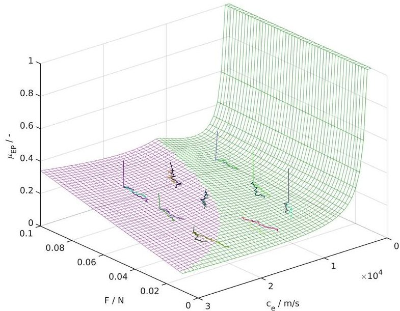

Fig.27 Application of evolutionary algorithm with 18 equally spaced seed points over 100 generations. Consistent convergence from initial seed points to optimal $ c_{e} $ and F convergence is visible

be passable, as "moving uphill" would require intermediate less optimal solutions.

It is evident that the algorithm is still capable of optimising the electric propulsion system beyond this obstacle. The capability is given by the fact that the step size is finite and not infinitesimal (see Eq. 29 and parameter b). A sufficiently large mutation range is thus recommended to allow for navigation in complex optimisation spaces.

The explicit result of this analysis is that an electric propulsion system mass fraction of $ \mu_{\mathrm{E P}}=0. 0 9 5 5 $ can be achieved for an ammonia-based arcjet thruster with a thrust of F=0.01 N and an effective exhaust velocity of $ c_{\mathrm{e}}=1 7 3 6 4 \frac{m}{s} $ . It needs to be admitted that this $ c_{\mathrm{e}} $

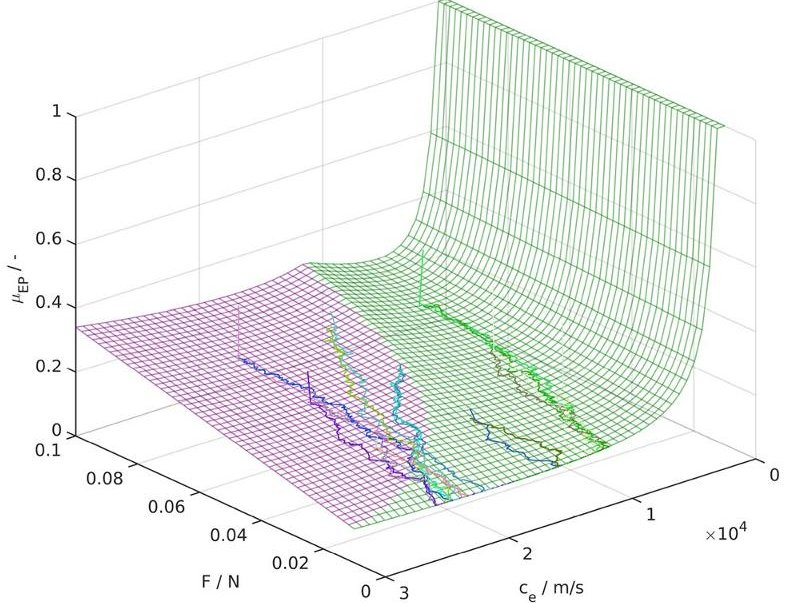

Fig.28 Application of evolutionary algorithm with 18 equally spaced seed points over 1000 generations. Consistent convergence from the centre of the parameter space to a minimum thrust configuration is visible

is unrealistically high for the current state-of-the-art systems, but it indicates that a larger $ c_{\mathrm{e}} $ is favourable for an arcjet-based system. Constraining the permitted $ c_{\mathrm{e}} $ domain to realistic values allows generating another optimal and more realistic solution. The ATOS thruster of the IRS with an effective exhaust velocity of $ c_{\mathrm{e}}=6 2 0 0 \frac{m}{s} $ is used as a realistic reference [120], which will produce the solution for ammonia, orbit transfer concept B, and a thrust of $ F=0.1 $ N and electric propulsion system mass fraction of $ \mu_{\mathrm{E P}}=0.1 3 8 0. $

## 5.5 Additional validation and analysis

For additional validation, another propulsion technology was added to the database. Here, radiofrequency thrusters (RIT) produced by ArianeGroup [121] have been added to the component database. The RIT thruster family varies in available thrust from 50 $ \mu $ N to 215 mN, with a specific impulse of $ I_{\mathrm{sp}}=1900 $ s up to $ I_{\mathrm{sp}}=3500 $ s, while power demand starts at less than 50W and can rise up to 5300 W. The available propellant is Xenon; the respective density has to be considered for tank design. Thruster and PPU masses are given and are overall larger than respective arcjet thruster and PPU masses.

It is expected that the RIT higher $ I_{\mathrm{sp}} $ leads to propellant mass savings, which has to offset the increased thruster and PPU mass to be a beneficial design.

For the next test, 1000 population members have been initialized for the two previous cases, A and B. A large population size will slow down the simulation, but allows for further assessment of the implemented algorithm.

<!-- PDF_PAGE: 24 -->

In Fig. 29, the convergence behaviour of the EA can be observed, while a minimum of 10 generations is required to achieve convergence at 16 generations, almost half of all lineages have already converged. As shown in Fig. 29, the subsequent convergence behaves asymptomatic. As a result, all lines converge completely at 51 generations. It can be deduced that faster simulation speeds can be achieved if the simulation is terminated before all lines converge. Reducing the number of converged linages offers linear improvement in simulation speed.

For case A, the newly introduced grid ion thruster is now the favourable system, correctly identified by 290 of the 1000 population members of this case. In fact, the result is acceptable, since even a single globally optimal lineage would be sufficient to achieve global optimality. This further shows that for the given convergence condition of 10 unsuccessful mutations, only 29 % find the global optimum. An increase of the convergence number is possible, shifting the curve shown in Fig. 29 to the right, increasing computation time linearly while increasing the chance for a global optimum determination.

The ideal system configuration now considers the RIT 10 EVO while being operated at a maximum $ I_{\mathrm{sp}}=3 2 0 0 $ s with supplied electrical power of 187 W and generating 5 mN thrust, which is in agreement with the given data sheet [121]. The next best solution is, as previously identified, an ammonia-based arcjet.

For case B, the mass saving by higher $ I_{\mathrm{sp}} $ does not exceed the added hardware mass, and an ammonia-based arcjet system is still favourable.

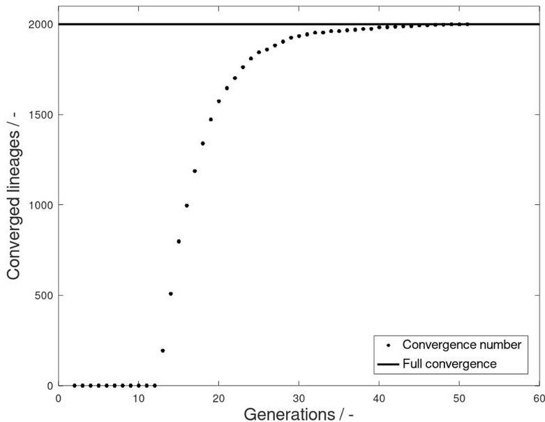

Fig.29 Convergence behaviour of 1000 lineages for two distinct cases over subsequent iterations. Convergence is determined hereafter 10 unsuccessful mutations. More than half of all lineages converge after 20 generations, while full convergence of all lineages is achieved after 51 generations

## 5.6 Updates in modelling and automation

The capabilities of the ESDC tool have seen significant improvements beyond the simple modelling of various arcjet propulsion system design and evaluation.

The tool can now handle an arbitrary number of electric propulsion system technologies [98,100], which means that, for example, it is automatically detected, when a grid ion thruster system is added to the extendable database, which automatically is associated with respective power supply units.

New degrees of freedoms in designs can be manually added to a definition file, which automatically is included in the evolutionary algorithm. Updates to the database are detected automatically, and respective scaling law updates are performed. Correlations for system components are now performed the same way as described in Sect. 2. Numerical limits for mutation ranges are automatically derived from database values (e.g., propellant and thruster dependent min. and max. $ c_{e} $ ).

Automatic output handling in Figure and Video format was added [100].

A full-system design evaluation is pending, as all specific sub-systems models have to be implemented and tested first.

## 6 Conclusion

A generic full-system estimation model was discussed. The model is based on heuristics of flight heritage spacecraft database with automated scaling law derivation to enable the first-order estimations of all relevant spacecraft data, with little initial knowledge on the designed mission. The tool is already in prototype use in the IRAS Digital Concurrent Engineering platform as an expert tool for mission and system design problems.

Additionally, a generic model for scaling an electric propulsion system at the example of an arcjet-based system has been developed. The model relies on scaling laws that hinge on data and performance parameters from available hardware. The scaling model aids in deciding for performance parameters like desired thrust, effective exhaust velocity and propellant type. Furthermore, the scaling model can be used to analyse the component-wise contribution of each subsystem mass to the total electric propulsion system mass and indicate where further developments are useful for an effective decrease in the total mass or respective mass fraction.

A simple evolutionary algorithm has been developed to navigate the multidimensional space for determining successively optimal solutions for sub-system configurations, which two examples have demonstrated.

<!-- PDF_PAGE: 25 -->

## 7 Outlook

With the upcoming full implementation of all sub-system correlations and filling of the respective component database, a detailed system design and mission analysis will be possible with the aid of evolutionary algorithms.

Acknowledgements This work is funded by the state ministry of Baden-Wurttemberg for Wirtschaft, Arbeit und Wohnungsbau with the grant numbers: 3-4332.62-DLR/49 (IRAS), 3-4332.62-DLR/56 (IRAS II) and 3-433.62-DLR/59 (IRAS III). Furthermore, the helpful review and feedback by two anonymous reviewers that improved and strengthened this paper is greatly acknowledged.

Funding Open Access funding enabled and organized by Projekt DEAL.

Open Access This article is licensed under a Creative Commons Attribution 4.0 International License, which permits use, sharing, adaptation, distribution and reproduction in any medium or format, as long as you give appropriate credit to the original author(s) and the source, provide a link to the Creative Commons licence, and indicate if changes were made. The images or other third party material in this article are included in the article's Creative Commons licence, unless indicated otherwise in a credit line to the material. If material is not included in the article's Creative Commons licence and your intended use is not permitted by statutory regulation or exceeds the permitted use, you will need to obtain permission directly from the copyright holder. To view a copy of this licence, visit http://creativecommons.org/licenses/by/4.0/.

## References

1. Newton, I.: Philosophiae naturalis principia mathematica, Londini, Jussu Societatis Regiæ ac Typis Josephi Streater. Prostat apud plures Bibliopolas. Anno 1687, (1687). https://plato.stanford.edu/entries/newton-principia/. Accessed July 2021

2. Cauchy, A.: Methode generale pour la resolution des systemes d-equations simultanees. C. R. Acad. Sci. Paris 25, 536-538 (1847)

3. Belegundu, Ashok D., and Tirupathi R. Chandrupatla. Optimization Concepts and Applications in Engineering. 2nd ed. Cambridge: Cambridge University Press, 2011. https://doi.org/10.1017/CBO9780511975905.

4. Rego, C., Gamboa, D., Glover, F., Osterman, C.: Traveling salesman problem heuristics: leading methods, implementations and latest advances. Eur. J. Oper. Res. 211(3), 427-441 (2011)

5. Dorigo, M., Gambardella, L.M.: Ant colonies for the travelling salesman problem. BioSystems 43, 73-81 (1997). https://doi.org/ 10.1016/S0303-2647(97)01708-5

6. Murrieta-Mendoza, A., Hamy, A., Botez, R.M.: Four- and three-dimensional aircraft reference trajectory optimization inspired by ant colony optimization. J Aerosp Inf Syst (2017). https://doi.org/ 10.2514/1.I010540

7. Alam, S., Dobbie, G., Koh, Y.S., Riddle, P., Rehman, S.U.: Research on particle swarm optimization based clustering: a systematic review of literature and techniques. Swarm Evol. Comput. 17, 1-13 (2014). https://doi.org/10.1016/j.swevo.2014.02.001

8. Rajasekhara, A., Lynn, N., Dasc, S., Suganthan, P.N.: Computing with the collective intelligence of honey bees-a survey. Swarm

Evol. Comput. 32, 25-48 (2017). https://doi.org/10.1016/j.swevo.2016.06.001

9. Shehab, M., Khader, A.T., Al-Betar, M.A.: A survey on applications and variants of the cuckoo search algorithm, Appl. Soft Comput, 61, 1041-1059, (2017). https://doi.org/10.1016/j.asoc. 2017.02.034, https://www.sciencedirect.com/science/article/pii/ S1568494617301278(ISSN 1568-4946). Accessed July 2021

10. Wang, D., Tan, D., Liu, L.: Particle swarm optimization algorithm: an overview. Soft Comput. 22, 387-408 (2018). https:// doi.org/10.1007/s00500-016-2474-6

11. Yang, X.S., Zhao, Y.X.: Chapter 3—Firefly algorithm and flower pollination algorithm, pp. 35-48, Nature-Inspired Computation and Swarm Intelligence, Academic Press,(2020). https://doi.org/ 10.1016/B978-0-12-819714-1.00012-9

12. Jati, G.K., Manurung, R., Suyanto.: Discrete firefly algorithm for traveling salesman problem: a new movement scheme, pp. 295-312, Swarm Intelligence and Bio-Inspired Computation, Elsevier, (2013), https://doi.org/10.1016/B978-0-12-405163-8. 00013-2

13. Cooper, M.A., Smeresky, B.: An Overview of Evolutionary Algorithms toward Spacecraft Attitude Control. Intech Open Adv. Spacecr. Attitude Control (2020). https://doi.org/10.5772/intechopen.89637

14. Kirkpatrick, S., Gelatt, C.D., Vecchi, M.P.: Optimization by simulated annealing. Science, 220(4598). 671-680, (1983). https:// doi.org/10.1126/science.220.4598.671 (ISSN 0036-8075)

15. Boltzmann, L.: Weitere Studien über das Wärmegleichgewicht unter Gasmolekülen. In: Kinetische Theorie II. WTB Wissenschaftliche Taschenbücher, vol. 67, Vieweg+Teubner Verlag, Wiesbaden, (1970), https://doi.org/10.1007/978-3-322-84986-1_3

16. Goldfeld, S.M., Quandt, R.E., Trotter HF: Maximization by Quadratic Hill-Climbing. Econometrica 34(3), 541-551 (1966). https://doi.org/10.2307/1909768

17. Paek, S.W., Kim, S., de Weck, O.: Optimization of reconfigurable satellite constellations using simulated annealing and genetic algorithm. Sensors (Basel) 19(4), 765 (2019). https://doi.org/ 10.3390/s19040765, https://www.ncbi.nlm.nih.gov/pmc/articles/PMC6413106/

18. Meziane-Tani, I., Metris, G., Lion, G., Deschamps, A., Bendimerad, F.T., Bekhti, M.: Optimization of small satellite constellation design for continuous mutual regional coverage with multi-objective genetic algorithm. Int. J. Comput. Intell. Syst. 9(4), 627-637 (2016). https://doi.org/10.1080/18756891.2016.1204112, https:// www.atlantis-press.com/journals/ijcis/25868715. Accessed July 2021

19. Betts, J.T.: Survey of Numerical Methods for Trajectory Optimization. J. Guid. Control Dyn. 21(2), 193 (1998). https://doi.org/ 10.2514/2.4231

20. Lee, S., von Ailmen, P., Fink, W., Petropoulos, A.F., Terrile, R.J.: Design and optimization of low-thrust orbit transfers. In: 2005 IEEE Aerospace Conference, pp. 855-869, (2005). https://doi.org/10.1109/AERO.2005.1559377. Accessed July 2021

21. Kalita, H., Thangavelautham, J.: Automated design of CubeSats using evolutionary algorithm for trade space selection. Aerospace 2020, 7(10), 142, (2020). https://doi.org/10.3390/aerospace7100142, https://www.mdpi.com/2226-4310/7/10/142.htm. Accessed July 2021

22. Holland, J.H.: Adaptation in Natural and Artificial Systems, 2nd edn. University of Michigan Press, Ann Arbor, (1975) (1992)

23. Rechenberg, I.: Evolutionsstrategie: Optimierung technischer Systeme nach Prinzipien der biologischen Evolution. Ph.D. thesis, TU Berlin, (1971). https://doi.org/10.1002/fedr.19750860506

24. Schwefel, H.P.: Numerische Optimierung von Computer-Modellen mittels der Evolutionsstrategie, volume 26 of ISR. Birkhaeuser, BaseL (1977)

<!-- PDF_PAGE: 26 -->

25. Sudhoff, S.D.: Lecture 2: canonical genetic algorithms. https:// engineering.purdue.edu/~sudhoff/ee630/, online; (2007). Accessed 1 Jul 2021

26. Goldberg, D., Korb, B., Deb, K.: Messy genetic algorithms: motivation, analysis, and first results. Complex Syst. 3(5), 493-530 (1989)

27. van Veldhuizen, D.A., Lamont, G.B.: Multiobjective optimization with messy genetic algorithms. In: Bryant, B.R. , Carroll, J.H. , Damiani, E., Haddad, H., Oppenheim, D. (eds.) SAC (1), pp. 470-476, ACM, (2000). http://dblp.uni-trier.de/db/conf/sac/sac2000-1.html#VeldhuizenL00. Accessed July 2021 (ISBN 1-58113-240-9)

28. Saenger, W.: Principles of Nucleic Acid Structure. Advanced Texts in Chemistry. Springer, Berlin Heidelberg (1988)

29. Yanofsky, C.: Establishing the triplet nature of the genetic code. Cell, 128(5). 815-818, (2007). https://doi.org/10.1016/j.cell. 2007.02.029, https://www.sciencedirect.com/science/article/pii/ S009286740700253X (ISSN 0092-8674)

30. Baron, S.: Medical Microbiology, 4th edn. University of Texas Medical Branch at Galveston, Galveston (1996)

31. Whorton, M.S.: Closed-loop system identification with genetic algorithms. J. Aerosp. Comput. Inf. Commun., 5(6), 161-173, (2008). http://dblp.uni-trier.de/db/journals/jacic/jacic5.html# Whorton08. Accessed July 2021

32. Gotmare, A., Bhattacharjee, S.S., Patidar, R., George, N.V.: Swarm and evolutionary computing algorithms for system identification and filter design: a comprehensive review. Swarm Evol. Comput., 32, 68-84, (2017). https://doi.org/10.1016/j.swevo. 2016.06.007, https://www.sciencedirect.com/science/article/pii/ S2210650216300682 (ISSN 2210-6502). Accessed July 2021

33. Iwasaki, M., Miwa, M., Matsui, N.: GA-based evolutionary identification algorithm for unknown structured mechatronic systems. IEEE Trans. Ind. Electron., 52(1), 300-305, (2005). http://dblp.uni-trier.de/db/journals/tie/tie52.html#IwasakiMM05. Accessed July 2021

34. Ghiglino, P., Forshaw, J.L., Lappas, V.J.: Online evolutionary swarm algorithm for self-tuning unmanned flight control laws. J. Guid. Control Dyn. 38(4), 772-782 (2015). https://doi.org/10.2514/1.G000376

35. Yokoyama, N., Suzuki, S.: Modified genetic algorithm for constrained trajectory optimization. J. Guid. Control Dyn. 28(1), 139-144 (2005). https://doi.org/10.2514/1.3042

36. Betts, J.T.: Survey of numerical methods for trajectory optimization. J. Guid. Control Dyn. 21(2), 193-207 (1998). https://doi.org/10.2514/2.4231

37. Mondoloni, S.: A genetic algorithm for determining optimal flight trajectories. A98-37169, AIAA-98-4476, Guidance, Navigation, and Control Conference and Exhibit, https://doi.org/10.2514/6.1998-4476. Accessed July 2021

38. Chai, R., Savvaris, A., Tsourdos, A., Xia, Y., Chai, S.: Solving multiobjective constrained trajectory optimization problem by an extended evolutionary algorithm. IEEE Trans. Cybern. 50(4), 1630-1643 (2020). https://doi.org/10.1109/TCYB.2018.2881190

39. Yokoyama, N., Suzuki, S.: Trajectory optimization via modified genetic algorithm. Session: GNC-22: Flight Control and Optimization. AIAA 2003-5493. AIAA Guidance, Navigation, and Control Conference and Exhibit (2012). https://doi.org/10. 2514/6.2003-5493

40. Biesbroek, R.: Study of genetic algorithm settings for trajectory optimisation, 10.2514/6.IAC-03-A.P.30, 54th International Astronautical Congress. (2012) https://doi.org/10.2514/6.IAC-03-A.P.30

41. Wuerl, A., Crain, T., Braden, E.: Genetic algorithm and calculus of variations-based trajectory optimization technique. J. Spacecr. Rockets 40(6), 882-888 (2003). https://doi.org/10.2514/2.7053

42. Cage, P., Kroo, I., Braun, R.: Interplanetary trajectory optimization using a genetic algorithm. Astrodynamics Conference, (2012) https://doi.org/10.2514/6.1994-3773

43. Wagner, K.M., Black, J.T.: Genetic-algorithm-based design for rideshare and heterogeneous constellations. J. Spacecr. Rockets 57(5), 1021-1032 (2020). https://doi.org/10.2514/1.A34527

44. Silva, P.R., Silva Abreu, I., Almeida Forte, P., Costa do Amaral, H.M.: Genetic algorithms for satellite launcher attitude controller design. Intel. Artif. 22(63), 150-161, (2019). https://doi.org/10. 4114/intartif.vol22iss63, https://journal.iberamia.org/index.php/ intartif/article/view/267 (pp 150-161). Accessed July 2021

45. Kordon, M., Klimeck, G., Hanks, D., Hua, H.: Evolutionary computing for spacecraft power subsystem design search and optimization. In: 2004 IEEE Aerospace Conference Proceedings (IEEE Cat. No.04TH8720), volume 6, pp. 4004-4014 Vol.6, (2004). https://doi.org/10.1109/AERO.2004.1368219

46. Minato, A., Sugimoto, N.: Design of a four-element, hollow-cube corner retroreflector for satellites by use of a genetic algorithm. Appl. Opt. 37(3), 438-442 (1998). https://doi.org/10.1364/AO. 37.000438

47. Boudjemai, A., Bouanane, M.H., Merad, L., Mohammed, A.M.S.: Small satellite structural optimisation using genetic algorithm approach. In: 2007 3rd International Conference on Recent Advances in Space Technologies, pp. 398-406, (2007). https://doi.org/10.1109/RAST.2007.4284021

48. Hornby, G.S., Globus, A., Linden, D.S.D.L.J.: Automated antenna design with evolutionary algorithms. Space 2006 (2006). https://doi.org/10.2514/6.2006-7242, https://ti.arc.nasa.gov/m/pub-archive/1244h/1244. Accessed July 2021

49. Mosher, T.: Spacecraft design using a genetic algorithm optimization approach. In: 1998 IEEE Aerospace Conference Proceedings (Cat. No.98TH8339), volume 3, pp. 123-134 vol. 3, (1998). https://doi.org/10.1109/AERO.1998.685783

50. Kalita, H., Thangavelautham, J.: Automated design of CubeSats and small spacecrafts. CoRR, arXiv:1701.01742 [corr/abs], (2017). http://dblp.uni-trier.de/db/journals/corr/corr1701.html# KalitaT17. Accessed July 2021

51. Kalita, H., Thangavelautham, J.: Automated design of cubesats using evolutionary algorithm for trade space selection. Aerospace. 7(10), 2226-4310 (2020). https://doi.org/10.3390/aerospace7100142 (ISSN 2226-4310)

52. of Space Systems DLR Bremen, I.: Concurrent Engineering Facility (CEF), (2021). https://www.dlr.de/content/en/researchfacilities/concurrent-engineering-facility-cef.html. Accessed July 2021

53. Integrated Design Center: (2021). https://idc.nasa.gov/idc/index. php. Accessed July 2021

54. Karpati, G., Martin, J., Steiner, M., Reinhardt, K.: The Integrated Mission Design Center (IMDC) At NASA Goddard Space Flight Center. (2002). https://ntrs.nasa.gov/api/citations/20030025769/downloads/20030025769.pdf. Accessed July 2021

55. Concept Design Center: (2021). https://aerospace.org/video/ concept-design-center. Accessed July 2021

56. Eames, B., McInnes, A., Crace, J., Graham, J.: A model-based design tool for systems-level spacecraft design. (2021). https:// core.ac.uk/download/pdf/32552259.pdf. Accessed July 2021

57. Concurrent Engineering Research Center (CERC), West Virginia University: Concurrent Engineering Research Center (CERC), West Virginia University. https://books.google.de/books?id= 5HvXjwEACAAJ. Accessed July 2021

58. Abreu, M.N.: Conceptual design tools for the NPS spacecraft design center. (2001). https://calhoun.nps.edu/handle/10945/ 2136. Accessed July 2021

59. CDF Secretary, E.S.: Concurrent design facility. (2021). https:// www.esa.int/Enabling_Support/Space_Engineering_Technology/ Concurrent_Design_Facility. Accessed July 2021

<!-- PDF_PAGE: 27 -->

60. Academy, E.: New opportunity to participate in ESA Academy's concurrent engineering workshop. (2021). https://www.esa.int/Education/ESA_Academy/New_opportunity_to_participate_in ESA_Academy_s_concurrent_engineering_workshop. Accessed July 2021

61. Of Space Systems DLR Bremen, I.: Concurrent engineering facility (CEF). (2021). https://www.dlr.de/irs/en/desktopdefault.aspx/tabid-11079/#gallery/29540. Accessed July 2021

62. Kovo, Y.: Space mission design tools. (2017). https://www.nasa.gov/smallsat-institute/space-mission-design-tools/. Accessed July 2021

63. NASA Software Catalog-design and integration tools: (2021). https://software.nasa.gov/design_and_integration_tools. Accessed July 2021

64. NASA Software Catalog—IMCE Ontological Modeling Framework: (2021). https://software.nasa.gov/software/NPO-49756-1. Accessed July 2021

65. NASA Software—Low Fidelity Space Systems Analysis Tools Solar Cell/Fuel Cell/Battery Sizing Tool: (2021). https://software.nasa.gov/software/LAR-18740-1. Accessed July 2021

66. General Mission Analysis Tool (GMAT)—GSFC Open Source Software: (2021). https://opensource.gsfc.nasa.gov/projects/ GMAT/index.php. Accessed July 2021

67. GMAT General Mission Analysis Tool—Code Repository: (2021). https://sourceforge.net/projects/gmat/. Accessed July 2021

68. (2021). https://www.agi.com/missions/space-operations-missions . Accessed July 2021

69. (2021). https://help.agi.com/stk/11.0.1/Content/training/SeeDC. htm. Accessed July 2021

70. Glidden, G.L.: Proof of Concept Study of Trade Space Configuration Tool for Spacecraft Design, Internship Final Report, 20100042383, JSC-CN-22482. (2013). https://ntrs.nasa.gov/citations/20100042383. Accessed July 2021

71. Thinkmap SDK: (2021). http://www.thinkmap.com/think mapsdk.jsp. Accessed July 2021

72. Le Moigne, J., Dabney, P., de Weck, O., Foreman, V., Grogan, P., Holland, M., Hughes, S., Nag, S.: TAT-C: a Trade-space analysis tool for constellations. (2018). https://ntrs.nasa.gov/api/citations/20180007288/downloads/20180007288.pdf. Accessed July 2021

73. Le Moigne, J., Dabney, P., de Weck, O., Foreman, V., Grogan, P., Holland, M., Hughes, S., Nag, S.: Printed bywww.postersession.comTrade-space Analysis Tool for Constellations (TATC). (2016). https://ntrs.nasa.gov/api/citations/20160014656/downloads/20160014656.pdf. Accessed July 2021

74. Grogan, P.T., Dabney, P., de Weck, O., Foreman, V., Hache, S., Holland, M., Hughes, S., Le Moigne, J., Nag, S., Siddiqi, A.: Printed bywww.postersession.comTrade-space Analysis Tool for Constellations (TAT-C), A IST-14-0053. (2017). https://ntrs.nasa.gov/api/citations/20160014656/downloads/ 20160014656.pdf. Accessed July 2021

75. Trade-space Analysis Tool for Designing Constellations (TATC) Government Release: (2021). https://esto.nasa.gov/tat-cgovernment-release/. Accessed July 2021

76. Trade-space Analysis Tool for designing Constellations (TATC)—Version 2.0. (2021). https://software.nasa.gov/software/GSC-18399-1. Accessed July 2021

77. Magliarditi, E.: Tradespace analysis for earth observation constellations: a value driven approach. https://dspace.mit.edu/ handle/1721.1/129133. Accessed July 2021

78. McInnes, A., Harps, D., Lang, J., Swenson, C.: A systems engineering tool for small satellite design. (2001). https://www semanticscholar.org/paper/A-Systems-Engineering-Tool-for Small-Satellite-McInnes-Harps/5528cab95fa6732fc3444bf52 f21be1162ebfcb1. Accessed July 2021

79. Eames, B., McInnes, A., Crace, J., Graham, J.: A model-based design tool for systems-level spacecraft design. (2006). https:// www.semanticscholar.org/paper/A-Model-Based-Design-Toolfor-Systems-Level-Design-Eames-McInnes/2fb5742b9fbc7a1 cdaf6f0295c75f05e0787bda4. Accessed July 2021

80. (2021). https://www.isis.vanderbilt.edu/projects/GME. Accessed July 2021

81. Fuchs, M., Girimonte, D., Izzo, D., Neumaier, A.: Robust and Automated Space System Design, pp. 251-271, Springer London, London, (2008). https://doi.org/10.1007/978-1-84800-261-6_12. www.esa.int/gsp/ACT/doc/AI/pub/ACT-RPR-AI-2008-RobustAndAutomatedSpaceSystemDesign.pdf (ISBN 978-1-84800-261-6). Accessed July 2021

82. The Virtual Spacecraft Design: (2021). https://www.vsd-project.org/. Accessed July 2021

83. Virtual Satellite—The future of model based systems engineering for space missions. (2021). https://www.dlr.de/sc/en/desktopdefault.aspx/tabid-5135/8645_read-8374/. Accessed July 2021

84. Virtual Satellite—Code Repository. https://github.com/virtualsatellite. Accessed July 2021

85. Schumann, H., Berres, A., Maibaum, O., Röhnsch, A.: DLR's virtual satellite approach. (2001). https://elib.dlr.de/56030/1/ SESP_2008_Schumann_VirtualSatellite.pdf. Accessed July 2021

86. (2021). https://ecss.nl/. Accessed July 2021

87. Fischer, P.M., Lüdtke, D., Lange, C., Roshani, F.C., Dannemann, F., Gerndt, A.: Implementing model-based system engineering for the whole lifecycle of a spacecraft. CEAS Sp. J. 9(3), 351-365 (2017). https://doi.org/10.1007/s12567-017-0166-4, https://elib.dlr.de/113973/1/20170908_CEAS_Space_DLRK2016_MBSE_S2tep_v3_ELIB.pdf. Accessed July 2021

88. Institute of Space Systems—S2TEP: https://www.dlr.de/irs/en/desktopdefault.aspx/tabid-12525/21846_read-49985/. Accessed July 2021

89. Dannemann, F., Jetzschmann, M.: Technology-driven design of a scalable small satellite platform. In: 4S Symposium, 4S Symposium. (2016). https://elib.dlr.de/104988/. Accessed July 2021

90. Fischer, P.M., Lange, C., Maiwald, V., Müller, S., Kovalov, A., Häseker, J.S., Gärtner, T., Gerndt, A.: Spacecraft interface management in concurrent engineering sessions. In: Luo, Y. (ed.). International Conference on Cooperative Design, Visualization and Engineering (CDVE), volume 11792 of Lecture Notes in Computer Science, pp. 54-63, Springer, (2019). https://elib.dlr.de/130164/. Accessed July 2021

91. Müller, S., Gerndt, A.: Towards a conceptual data model for fault detection, isolation and recovery in virtual satellite. In: SECESA 2018, (2018). https://elib.dlr.de/122061/. Accessed July 2021

92. Liu, Y., Deshmukh, M., Wulkop, J.C., Fischer, P.M., Gerndt, A.: Real-time immersive visualization for satellite configuration and version comparison. In: Workshop on Simulation and EGSE for European Space Programmes (SESP 2017), (2017). https://elib. dlr.de/112016/. Accessed July 2021

93. (2021). https://www.valispace.com/. Accessed July 2021

94. Das, S.J., Selva, D., Golkar, A.: An intelligent spacecraft configuration tool for mission architecture space exploration. AIAA SPACE 2015 Conference and Exposition, AIAA 2015-4439 (2015), https://doi.org/10.2514/6.2015-4439

95. Chang, Y.K., Hwang, K.L., Kang, S.J.: SEDT (System Engineering Design Tool) development and its application to small satellite conceptual design, Acta Astronaut., 61(7). 676-690, (2007). https://doi.org/10.1016/j.actaastro.2007.01.067, https:// www.sciencedirect.com/science/article/pii/S0094576507001099 (ISSN 0094-5765)

<!-- PDF_PAGE: 28 -->

96. Mirshams, M., Zabihian, E.: FADSat: A system engineering tool for the conceptual design of geostationary Earth orbit satellites platform. Proc. Inst. Mech. Eng. Part G J. Aerosp. Eng. 233(6) 2152-2169 (2019). https://doi.org/10.1177/0954410018773634

97. Stäbler, T., Echsel, M., Ehresmann, M., Fugmann, M., Galla, D., Gottschalk, N., Hümbert, S., Lengowski, M., Marigo, G., Müller, I., Sakraker, I., Skalden, J., Springer, P., Stindl, T. Fasoulas, S., Klinkner, S., Voggenreiter, H.: integrated research platform for affordable satellites, IAC-19,D1,3,5,x54007. In: 70th International Astronautical Congress, (2019).

98. Ehresmann, M., Fugmann, M., Skalden, J., Galla, D., Montag, C., Herdrich, G., Fasoulas, S., Klinkner, S., Stäbler, T.: IRAS: progress in development of the digital concurrent engineering platform, software tools and innovative technologies, IAC19,B4,IP,12,x50318. In: 70th International Astronautical Congress, (2019).

99. Fugmann, M., Ehresmann, M., Skalden, J., Herdrich, G., Fasoulas, S., Klinkner, S., Heck, M., Stindl, T., Stäbler, T.: IRAS DCEP: automated and distributed satellite and constellation design constellation design tool interface. In: 33rd Annual Conference on Small Satellites, (2019). https://doi.org/10.13140/RG.2.2.17789.92643

100. Ehresmann, M., Skalden, J., Fugmann, M., Harmansa, N., Fasoulas, S., Klinkner, S., Stäbler, T., Hümbert, S., Hümbert, S., Refle, O.: IRAS: low-cost constellation satellite design, electric propulsion and concurrent engineering. IAC-18,B4,6A,12,x44499 In: 70th International Astronautical Congress, (2018).

101. Ehresmann, M.: aerospaceresearch/ESDC. (2018). https://github. com/aerospaceresearch/ESDC. Accessed July 2021

102. (2021). https://www.gnu.org/software/octave/index. Accessed July 2021

103. (2021). https://www.mathworks.com/products/matlab.html. Accessed July 2021

104. University of Stuttgart (2017). Institute of Space Systems Electronic Arcjet Database for Low, Medium and High Power Arcjets, Institute of Space Systems, available upon request.

105. Wertz, J.R., Everett, D.F., Puschell, J.J.: Space Mission Engineering: The New SMAD, vol. 28. Microcosm Press, Cleveland, p. 1881883159 (2011) (ISBN)

106. Bjoerck, A.: Numerical Methods for Least Squares Problems, SIAM. Linkoping University, Linkoping, Sweden(1996)

107. Recktenwald, G.: Least squares fitting of data to a curve. Department of Mechanical Engineering, Portland State University, USA. (2021)

108. GNU Octave, D.: Function reference: polyfit. (2021). https:// octave.sourceforge.io/octave/function/polyfit.html. Accessed July 2021

109. GNU Octave, D.: Function reference: randi. (2021). https:// octave.sourceforge.io/octave/function/randi.html. Accessed July 2021

110. CubeSat: the need for more power to realise telecommunications http://www.energystorage-cdt.ac.uk/outputs/cohort-2/Bugryniec+mini+project+report.pdf. Accessed July 2021

111. Byrne, J.M.: Resource-constrained avionics design for CubeSats. Master thesis, Massachusetts Institute of Technology, Department of Aeronautics and Astronautics .(2016) http://hdl.handle.net/1721.1/105559. Accessed July 2021

112. Skalden, J., Ehresmann, M., Herdrich, G., Fasoulas: Development progress of an adaptable deorbit system for satellite constellations, IAC-19,B4,IP,12,x50318. In:36th International Electric Propulsion Conference, (2019).

113. Ehresmann, M., Skalden, J., Herdrich, G., Fasoulas, S.: Automated system analysis and design for electric propulsion systems. In: Space Propulsion Conference, Seville, Spain, (2018). https:// www.researchgate.net/publication/325196437_Automated_System_Analysis_and_Design_for_Electric_Propulsion_Systems. Accessed July 2021

114. Skalden, J., Ehresmann, M., Herdrich, G.: System Component Design of an Electric Propulsion System. IRAS Report D3(2), 2 (2018)

115. Wollenhaupt, B., Hammer, A., Herdrich, G., Fasoulas, S., Roeser, H.P.: Very Low Power Arcjet (VELARC) for small satellite missions. In: 32nd International Electric Propulsion Conference, Wiesbaden, Germany, (2011). http://erps.spacegrant.org/uploads/images/images/iepc_articledownload_1988-2007/2011index/ IEPC-2011-257.pdf. Accessed July 2021

116. Dropmann, M., Ehresmann, M., Le, Q.H., Pagan, A.S., Romano, F., Montag, C., Herdrich, G.: Final report Cleansat Building Block 28, IRS-16-P07, (2017)

117. (2015). https://www.esa.int/Safety_Security/Clean_Space/ CleanSat_new_satellite_technologies_for_cleaner_low_orbits. Accessed July 2021

118. dhv technology. Solar panels for aerospace application. (2018). http://dhvtechnology.com/wp-content/uploads/2017/07/Datasheet-Julio-v1-front-back.pdf. Accessed July 2021

119. orbital atk. Diaphragm tanks data sheets. (2018). https://www. orbitalatk.com/commerce/Data_Sheet_Index_Diaphragm-VOL. aspx. Accessed April 2018

120. Wollenhaupt, B., Quand, H.L., Herdrich, G.: Overview of thermal arcjet thruster development. Aircr. Eng. Aerosp. Technol., 90(2), 280-301, (2018). https://www.orbitalatk.com/commerce/ Data_Sheet_Index_Diaphragm-VOL.aspx

121. ArianeSpace. Electric ion space propulsion systems and thrusters. (2021). https://www.space-propulsion.com/spacecraft-propulsion/propulsion-systems/electric-propulsion/index.html. Accessed July 2021

Publisher's Note Springer Nature remains neutral with regard to jurisdictional claims in published maps and institutional affiliations.

