<!-- PDF_PAGE: 1 -->

# Architecting an MBSE Black Box System Model for the Physical Layer of a Visible Light Inter-Satellite Communication System

Awele I. Anyanhun, Senior Member, IEEE, David N. Amanor, Senior Member, IEEE, and William W. Edmonson, Senior Member, IEEE

Fast and reliable high-speed Inter-Satellite Communication (ISC) between small satellites is dependent on the Physical Layer design of the onboard communication system. However, as with non-legacy systems, the lack of architecture and design information pertaining to the development of the Physical Layer of an LED-based Visible Light Communication (VLC) system for ISC poses significant challenges to architecting the communication system. Addressing these challenges requires a holistic approach to the specification of the system design. To this end, we explore the use of Model-Based Systems Engineering (MBSE) principles in mitigating the design complexity of the Physical Layer architecture for the VLC system. Design concerns and gaps are addressed by developing an executable black box system model that specifies the conceptual architecture of the system, and a parametric model that analyzes multiple system configurations based on generated values for the Signal-to-Noise Ratio and Bit Error Rate parameters. We utilize the structural, behavioral, and parametric semantics of SysML to define, specify, visualize and analyze the various system design configurations. The resulting Physical Layer black box system specification is verified through model execution.

Index Terms—MBSE, Black Box Model, System Architecture, Inter-Satellite Communication, SysML, Physical Layer, Visible Light Communication, VLC, CubeSat.

## I. INTRODUCTION

THE advent of Small-Satellite Systems (SmSS) as a proactive alternative to conventional large satellite systems has brought about a significant increase in space exploration. This group of satellites have become very attractive as a standard means for carrying out earth observation missions in the Lower Earth Orbit (LEO) and for technology demonstration missions at a significantly reduced cost [1]. To harness the most out of this group of satellites however, the effects of various limiting constraints such as small form factor (size) and low power requirements have to be mitigated. In particular, the limited capabilities of the onboard communication system remains the greatest obstacle to the optimal utilization of these class of satellites. Therefore, extending the communication capabilities of these satellites highlights a critical need. Radhakrishnan et al. in [2] report on deploying a large number of SmallSats as a wireless sensor network as a means of overcoming some of these limitations. Consequently, a viable solution to the onboard communication needs would be one which does not impinge on the already stringent Size, Mass, Power and cost (SMaP-c) constraints.

LED-based Visible Light Technology for space communications represents an attractive alternative to RF-based communications for a variety of reasons. Specifically, characteristics which make it attractive include its ability to provide reliable high-speed Inter-Satellite Communication (ISC) as well as mitigate the apparent capability limitations of SmallSat communication systems. However, development of an LED-based Visible Light Communication (VLC) system design for ISC is by no means a trivial task. Amanor et al. in [3,13,24] have researched extensively into the development of the Physical Layer EE architecture for a communication system based on visible light. The physical layer represents the lowest layer of

the Open System Interconnection (OSI) reference model [4]. The OSI model serves as a reference for understanding how communication occurs between communicating systems in a network. The Physical layer design outlines the physical characteristics that allow for communication, and is responsible for the actual transmission and reception between communicating systems.

The lack of legacy information associated with the Physical Layer system design for an LED-based VLC system for satellite communication necessitates the application of Systems Engineering (SE) principles and best practices towards specifying the architecture of the physical layer design. For instance, a SE best practice involves the development of a black box model specification. The black box modeling approach is a common abstraction modeling technique which situates the System-of-Interest (Physical Layer) within its operational environment and makes its features visible from the perspective of external system actors while hiding internal details of the design. In addition, the black box model design is specified based on the input-output behavior of the System-of-Interest which eventually leads to the description of the overall system behavior and corresponding requirements. Hence it represents an important tool for describing a complex system [17]. Similarly, as a framework of processes, methods and tools, Model-Based Systems Engineering (MBSE) provides a rigorous means for capturing requirements and specifying architecture through the use of models [5,6]. It aids in the identification of potential design gaps and errors early in the design process, helps harness system complexity, reduce risks, and communicate design information at varying levels of abstraction [7-10].

In view of the significant benefits of an SE approach to system development, this research work examines the application of black box systems modeling to architecting the physical layer of an LED-based VLC system for inter satellite communication. Specifically, we explore the utility of an MBSE approach towards capturing the stakeholder require-

<!-- PDF_PAGE: 2 -->

ments for the physical layer through modeling of the black box operational behavior, external interfaces and system context with the intent to provide a more holistic understanding of the system's emergent behavior and performance as a means to verify and validate the requirements. The rest of the paper is organized as follows: a brief background on relevant concepts is presented in Section II. In Section III, the black box system model is described and developed. The system Signal-to- Noise Ratio (SNR) and Bit Error Rate (BER) performance is analyzed in Section IV. In Section V, we state our conclusions and topics for future research.

## II. BACKGROUND AND RELATED WORK

## A. LED-based Visible Light Communication

LED-based visible light communication for space applications offers great potential for utilization in a variety of missions in low earth orbit (LEO) and beyond. Anticipated benefits range from the utility, durability and reliability of LED(s) to the considerable optical bandwidth available within the visible light band, as well as the potential for realization of high-speed inter-satellite links (ISLs). Several research publications exist on the subject of visible light communication for satellite systems [3,11-13].

However, the single biggest challenge to space-based VLC is the radiation from the sun [13]. Background power generated by the sun has the propensity to seriously degrade the performance of a VLC system operating in space if not properly mitigated. This presupposes that a viable background noise mitigation strategy is crucial to achieving an optimal VLC system for ISC. Amanor et al. [3,13] have researched extensively into the feasibility of LED-based visible light links for ISC in future multi-satellite space missions and have reported a mitigation strategy based on the use of frequency bands with LED peak wavelengths centered on a Fraunhofer line for transmission of visible light signals. Based on their assertion, transmitting visible light signals on wavelengths centered on certain Fraunhofer line wavelengths which originate from the suns surface can ensure there will be minimal interference from the sun at the receiver. Figure 1 depicts the solar spectrum with some of the major Fraunhofer lines. D corresponds to two lines (i.e., D1 and D2) from sodium at 589.592 and 588.995 nm respectively. The corresponding bandwidth for D1 in nm and GHz are 0.0564 and 48.7 respectively, while D2 has a bandwidth of 65.0 GHz.

Although there is an increase in current research efforts geared towards investigating the feasibility of VLC for ISC, to the best of the authors' knowledge, there are no known research efforts reported in literature that currently address the system architecture of the VLC system Physical Layer from an MBSE perspective. For this reason, an MBSE approach and best practices present as the necessary solution that provides the rigor required for the development of the Physical Layer of the VLC system based on the work reported by Amanor et al in [3]. Related research works that examine the use of MBSE methodologies and solutions for visible light ISC are reported by Anyanhun et al. in [14-16].

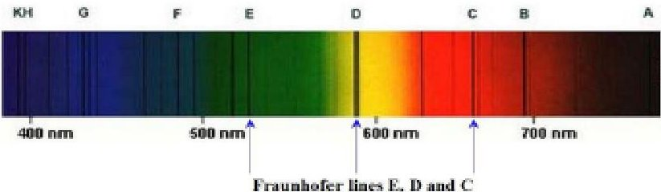

Fig. 1: Solar Spectrum with Fraunhofer Lines

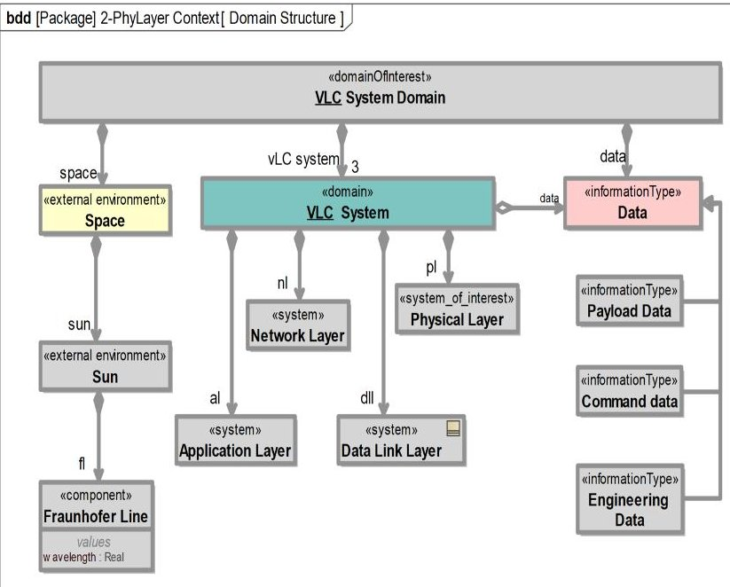

Fig. 2: Visible light LED-based Inter-Satellite Communication Domain

## B. Visible Light Communication System Domain

A key aspect of the VLC system domain for ISC is depicted in Fig. 2. The domain view captures the VLC system, its domain data high level structure and its operational environment. In order to better manage system complexity during the system conceptual design phase, the VLC system is delineated into abstraction levels based on the modular layered approach of the Open System Interconnection (OSI) reference model framework [4]. Hence, the VLC system for ISC is viewed as being composed of the communication-oriented layers (Physical, Datalink and Network layer subsystems), as well as the Application layer subsystem of the OSI model. Implementing this design decision allows for the separation of concerns by enabling the creation of models to address specific aspects of the system design based on the required viewpoint. Likewise, the space environment constitutes an external entity within the VLC system domain and is composed of the sun and its characteristics. The sun's characteristics constitute the biggest challenge to space-based VLC, and must be mitigated in order to deliver a viable VLC system.

## III. PHYSICAL LAYER BLACK BOX DESCRIPTION

The notion that creating black box descriptions does not serve a critical purpose when specifying a system's architecture is a commonly held misconception that lends to its underutilization as a vital tool during system design and analysis. Contrary to this misconception however, is the fact that black box descriptions provide an excellent way to communicate

<!-- PDF_PAGE: 3 -->

a system concept. In MBSE, black box modeling is an abstraction modeling technique in which a systems features are made visible from the viewpoint of an external system/actor. The black box model defines the system at an abstract level with a focus on defining the input to- and output from the system as well as the system interfaces while abstracting how the given inputs are transformed to outputs. The process of abstracting out the "how" during black box system model creation, enables this concept to be used at the highest level to represent a given system, as well as at the lowest level to represent the smallest component contained in the system [17]. The following activities outlined in this section culminate in the system being specified as a black box in terms of its system functions, interfaces, performance and physical properties [18,19].

## A. VLC Physical Layer System

The Physical Layer (PL) of the VLC system is the subsystem (layer) responsible for establishing the connection between the communication system and the transmission medium (free space). It defines both the electrical and physical specifications required for optical relay of data and command between communicating SmallSats in a Multi-Orbit Disaggregated System (MODS) deployed in space. It follows then, that the black box specification to be developed defines the PL externally observable behavior and physical characteristics with respect to the use cases currently being analyzed. To specify the PL architecture as a black box, we begin by defining the system context and the interfaces between the PL System and all other entities specified within the system context. Next, use cases for the PL System are identified and their operational scenarios developed. Finally, a configuration view of the system context elements is specified along with PL System measures of effectiveness. The use case and operational scenarios views constitute the black box behavior specification while the black box structural description is defined by specifying the system context and boundaries. Consequently, the behavioral and structural descriptions form the PL black box specification.

## B. Physical Layer System Context Viewpoint

A systems approach to system design begins by first identifying the system context or domain within which the System of-Interest (SOI) will operate. This approach places emphasis on the operating environment, and on how the SOI fits into the larger ecosystem with the aim of determining its relationship with its environment and the external systems it interacts with. Therefore, as reported by Weilkiens in [20] it suffices to state that the system context description creates a virtual wrapper around the PL System and its external actors. Fig. 3 portrays the system context viewpoint of the PL System. As shown, there are five external system actors which interact with the PL System, and with which the system shares a common interface within this given context. The actors include the Visible Light Channel through which the optical signal is transmitted, the C&DH system which is responsible for sending commands to the PL System, the Data Link Layer system which is the layer

directly above the Physical Layer in the OSI communication reference model and which performs services for the PL, the communicating SmallSat which sends and receives optical signals, and lastly, the environmental effects from the Sun. Specifying the system context view is one of the most crucial steps in creating the PL System black box model because it focuses attention on the external system factors that should be considered when developing the requirements and operations concept for the PL System.

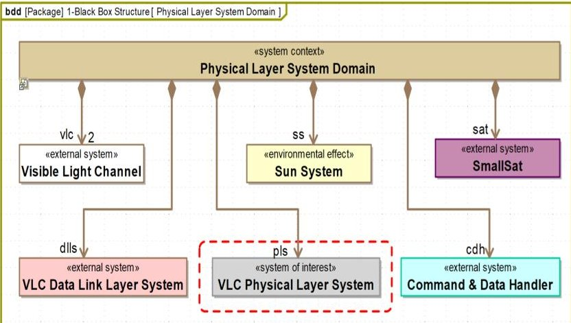

Fig. 3: Physical Layer System Context View

## C. Physical Layer System External Interface View

To define the boundary of the PL System (SOI), the various interactions between the SOI and the external system actors need to be identified and defined. These interactions represent the interfaces of the PL System, and the dependencies that exist between it and other systems. Ensuring compatibility between the PL System and already identified external system actors can only be achieved if all interfaces are identified and controlled at the black box level of system description. As reported by Wheatcraft in [21], interfaces present an inherent risk during system design because they represent a system over which we have no control. It follows, that failure to identify and define external interfaces appropriately could lead to significant problems which would result in a failed product. Therefore, to avoid and mitigate risks, as well as expose potential problem areas early, the interfaces between the PL System and external systems are identified and defined as highlighted in Fig. 4. Applying a top-down approach as recommended in [21], the external interfaces of the PL System are identified by investigating the interactions between the PL System and the external system actors captured in the system context diagram shown in Fig. 3. Firstly, The external interfaces are modeled using UML Provided and Required Interfaces. For example, the provided interface Command IF, specifies the operations provided by the PL System and which are required by the C&DH System to make a function call to the PL System requesting it to either begin transmission or reception of a data signal. Other interfaces provided by the PL System are the PL_Channel IF and PL_IF interfaces. These interfaces define characteristics of the PL System that are required by the VL Channel and Data link Layer systems to effectively interact with the PL System. Also specified are

<!-- PDF_PAGE: 4 -->

the provided interfaces of each external system. An example includes the Solar IF interface which captures characteristics of the sun that directly impact the PL System. Consequently, the process of identifying and defining provided and required interfaces as portrayed, guide the formulation of correct and comprehensive external interface requirements for the PL System.

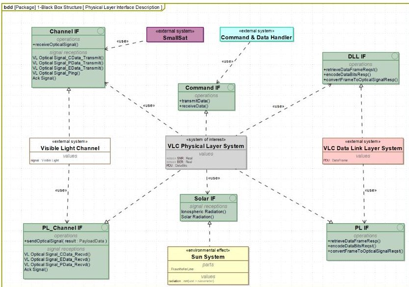

Fig. 4: Physical Layer System External Interface View

## D. Physical Layer Use Cases View

PL System Use Cases portray the operational usage of the PL System from the perspective of primary external system actors. Identified use cases can be said to represent clusters of the PL architecture requirements as well as its capabilities. Specifying use cases enable us build the architecture in slices thereby raising the level of comprehension of the PL System in a strategic step-by-step manner. In order to identify and specify the system use cases, the required capabilities of the PL System are first determined by identifying the external system actors of the SOI. Once identified, their required usages of the system are then classified as use cases. Consequently, as shown in Fig. 5, identified PL System actors include two primary actors: Command and Data handling system (C&DH) and the receiving or transmitting satellite, while secondary actors include the Data Link Layer System, the Sun, and Fee Space/Outer-Space (transmission medium). Similarly, identified use cases are UC1-Transmit Optical Signal and UC2-Receive Optical Signal. The Mitigate Background Noise Use Case is an identified capability that is crucial to the system being able to realize UC2, while the Provide Full Duplex Data Relay UC portrays the combined behavior of the Transmit and Receive Optical Signal UCs. Associated with each use case is a Use Case Description outlining the use case purpose, summary, invariants, as well as pre-and postconditions. An example of the use case description for the Mitigate Background Noise use case is illustrated in Table I. Subsequently, identified use cases are elaborated by specifying operational scenarios using sequence and activity diagrams as shown next.

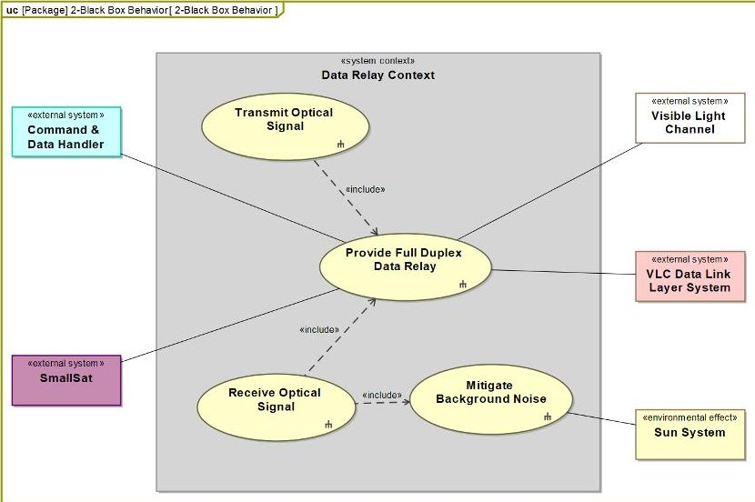

Fig. 5: Data Relay Use Case Diagram View

## TABLE I: Mitigate Background Noise Use Case Description

<table border="1"><tr><td colspan="2">MITIGATE BACKGROUND NOISE USE CASE DESCRIPTION</td></tr><tr><td>Name</td><td>Mitigate Background Noise Effect</td></tr><tr><td>Purpose</td><td>This use case provides the capability to mitigate the effects of background noise from the sun on the transmitted and received visible light signal.</td></tr><tr><td>Summary</td><td>Data transmitted via an ISL is received as an optical signal at the lowest of the communication-oriented layers (Physical layer) where it is transformed to an electrical signal.</td></tr><tr><td>Pre-Condition</td><td>The wavelengths of the light emitting diodes are within the range of the sun&#x27;s Fraunhofer lines.</td></tr><tr><td>Post-Condition</td><td>The signal-to-noise (SNR) ratio at the receiver is not less than 20 dB.</td></tr><tr><td>Invariants</td><td>The link distance between communicating satellites is within the specified range at all times.A constant Line-of-Sight configuration is maintained between communicating satellites.</td></tr></table>

## E. PL Operational Scenarios Viewpoint

Black box use case operational scenarios are developed to specify, define, and capture the interaction between the PL System and external system actors in terms of provided inputs and processed outputs. Scenarios captured at the black box level specify the externally observable behavior of the PL and its physical characteristics, it also provides the basis for generating comprehensive systems requirements. However, these scenarios do not specify how the PL System achieves this observable behavior. Typically, a minimum of one operational scenario is required to specify a use case although a best practice usually entails specifying at least two operational scenarios per use case capturing both the nominal ("sunny day") and off-nominal ("rainy day") behavior of the system as it performs the use case. This latter approach is preferable because it leads to a more comprehensive set of requirements. Nominal operational scenarios for the Transmit Optical Signal, Receive Optical Signal and Mitigate Background Noise use cases are illustrated using sequence diagrams while the nominal behavior for the Provide Full duplex Relay use case is captured using an activity diagram.

<!-- PDF_PAGE: 5 -->

## 1) Transmit Optical Signal Nominal Scenario View

The nominal operational scenario for the Transmit Optical Signal use case is depicted in Fig. 6. The PL System along with each participant external system actor is represented in the scenario-based use case analysis by a lifeline. The scenario begins with the SOI receiving a function call from the C&DH to transmit data as depicted by the transmitData message shown in the diagram. This function call prompts the PL to perform some internal black box function as captured by the reflexive message establishConnection. On completion of the establishConnection internal process, a hail signal depicted as VL Optical Signal_Ping is sent by the PL through the Visible Light Channel to the receiving SmallSat. A return Signal- VL Optical Signal_Ping_Resp indicates the readiness of the SmallSat to receive data, signifying that the PL System can commence transmission. The next message in the sequence represents a function call by the Data Link layer to begin conversion of data frames to the required optical signal, to achieve the conversion, a series of black box reflexive messages indicates functions being performed by the PL in preparation for transmission. Following a successful conversion/encoding process of the payloadData into a visible light optical signal - VL Optical Signal_PData_Transmit, the PL System begins transmission. The receipt of an acknowledgment from the receiving SmallSat indicates a successful transmit scenario. Consequently, after a predefined time duration, the PL System ends the connection as shown by the deactivateConnection message. The scenario concludes when a reply message - transmissionComplete is sent to the C&DH to indicate a successful data transmission scenario. To reiterate, the main purpose of specifying black box operational scenarios is mainly to ensure that all provided inputs, processed outputs, and functional interfaces between the PL and external systems actors are identified in order to adequately capture requirements. As a result, emphasis on any internal functionality is out of scope during this level of system description.

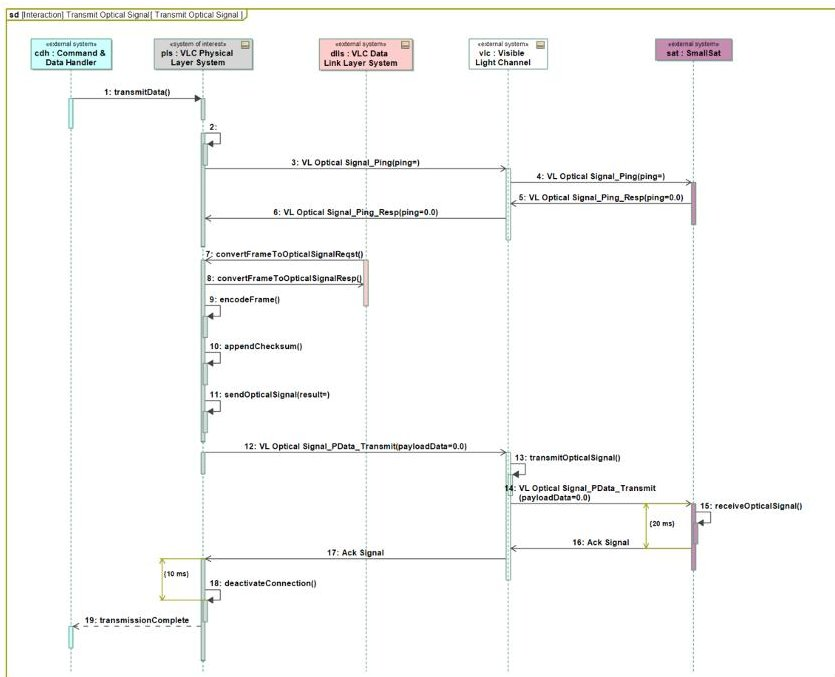

Fig. 6: Transmit Optical Signal Use Case Scenario View

## 2) Mitigate Background Noise Scenario View

The viability of an LED-based VLC System for ISC is dependent on the ability of the PL System to mitigate the effects of background noise from the sun on the received signal. Hence, the Mitigate Background Noise black box scenario is created to help evaluate the impact from the sun and space environment on the PL System as well as the VL Optical Signal in order to ensure appropriate requirements are specified. As shown in Fig. 7, the PL System performs the function of mitigating noise from the sun due to solar radiation as it receives the VL optical signal. The Loop combined fragment indicates that as long as the guard evaluates to true - [whileIncomingSignal==true] the PL System must provide the needed functionality of mitigating the effects of solar noise on the incoming VL Optical signal. It follows then that a detailed parametric analysis of the reflexive message mitigateBackgroundNoise functionality must be performed to specify correct requirements.

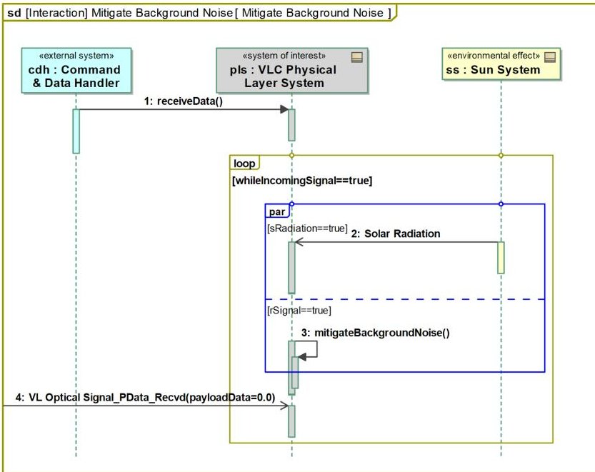

Fig. 7: Mitigate Background Noise Use Case Scenario View

## 3) Receive Optical Signal Nominal Scenario View

The nominal use case scenario depicted in Fig. 8 illustrates the interactions and sequence of message flow between the PL System and external system actors (lifelines) during a Receive Optical Signal Use Case Scenario. The detection of an incoming hail signal - VL Optical Signal_Ping initiates this scenario as shown in the diagram. Immediately following the detection of the hail signal, a function call is made to the PL System to commence reception of the incoming signal. This function call causes the PL System to send a response to the hailing SmallSat, informing it of its readiness to commence reception of its payload. The Mitigate Background Noise Scenario represented as an Interaction Use, highlights the specific behavior performed by the PL System as its works to mitigate the effects of background noise from the Sun on the received signal. Subsequently, the received optical signal is processed and retrieved by the Data Link Layer system following which the PL System sends an acknowledgement signal - Ack Signal, acknowledging that it has received all transmitted data. The scenario terminates once the deactivateConnection reflexive

<!-- PDF_PAGE: 6 -->

message is processed by the PL System, and a reply message -dataReceptionComplete is received by the C&DH system.

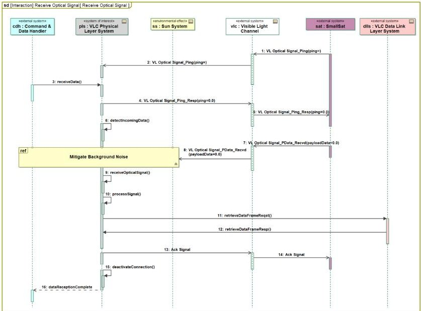

Fig. 8: Receive Optical Signal Use Case Scenario View

## 4) Provide Full Duplex Data Relay Behavior View

The System Behavior depicted in Fig. 9 captures the behavior of the PL System at the black box level as it performs the use case - Provide Full Duplex Data Relay. This use case behavior is derived from a combination of all operational scenarios used in specifying both the Transmit and Receive VL Optical Signal use cases (however the behavior portrayed in the diagram illustrates only two scenarios). To avoid creating very complex scenarios, multiple nominal, alt-nominal and off-nominal operational scenarios will need to be created. As more operational scenarios illustrating expected capability of the system are captured, they are added to the black box behavior diagram until the behavior adequately captures stakeholder concerns, and from which requirements can be properly specified. It follows then, that the combination of all possible operational scenarios conveys a holistic view of the PL System black box behavior.

## F. PL System Context Configuration View

The configuration view portrayed in Fig. 10 shows the configuration of the PL System use case model. This view highlights the structural layout, together with defined interfaces. The structural elements are populated with their required functionality based on the information captured in the black box scenarios and black box activity diagram. In addition, it also illustrates the type of interfaces (service-based and flow-based), and the phenomena exchanged through the interfaces. For instance, the interface between the PL System and Datalink Layer system is modeled as a service-based interface, inferring that the data link layer makes requests to the PL System and vice versa while the interface between the sun and the PL System is modeled as a flow-based interface to indicate the effect of solar radiation phenomena on the PL System. The nature of the requests and flows are captured in Fig. 4.

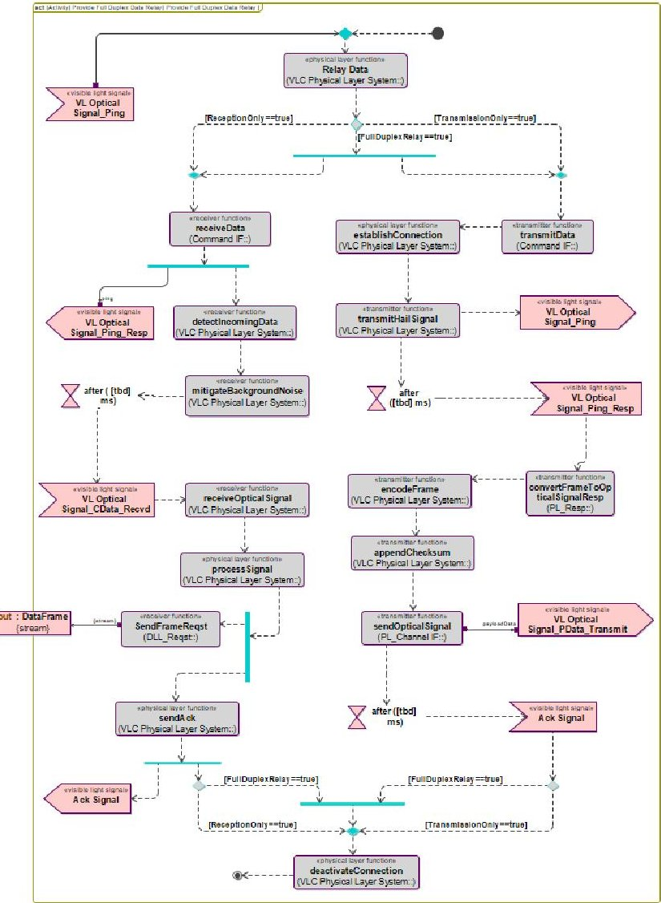

Fig. 9: Provide Full Duplex Relay Use Case Behavior View

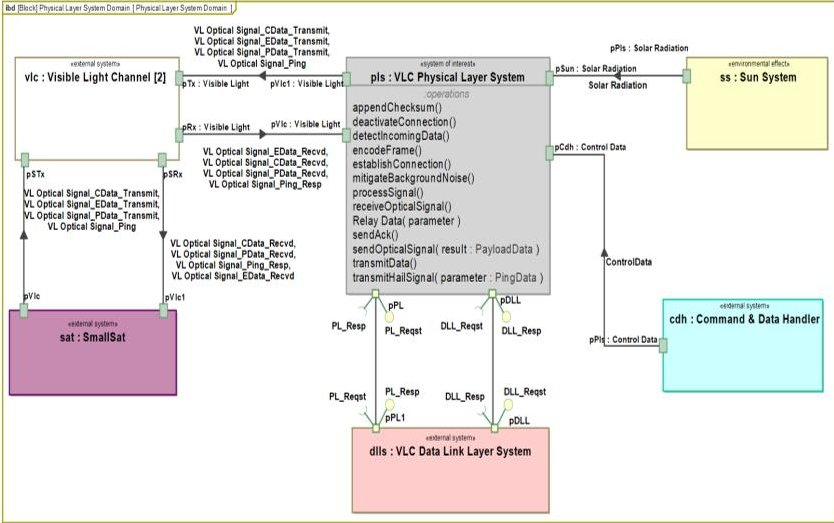

Fig. 10: PL System Context Configuration View

## G. PL System State-based behavior

The next step performed during the PL System black box analysis is the description of the system-level state-based behavior derived from the Transmit Optical Signal and Receive Optical Signal use case scenarios respectively, and illustrated using a state machine diagram. Specifically, the state machine diagram portrayed in Fig. 11 represents the state machine for the PL System Context block; It visualizes the PL System states and modes, and their changes as response to external stimuli [22], also specified are the states and modes of external

<!-- PDF_PAGE: 7 -->

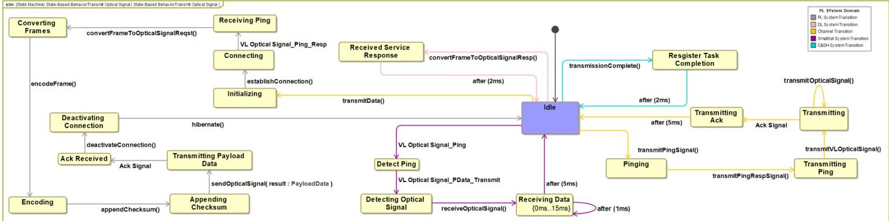

Fig. 11: PL System Context State-Based Behavior View

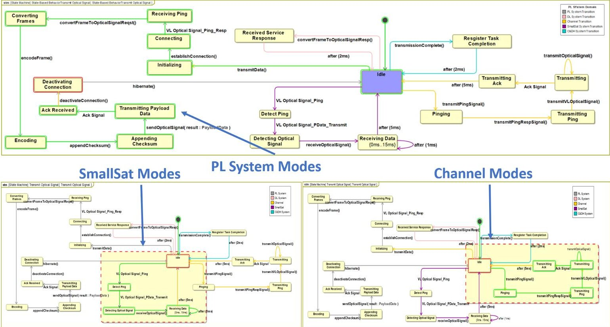

Fig. 12: PL System Context State-Based Simulation

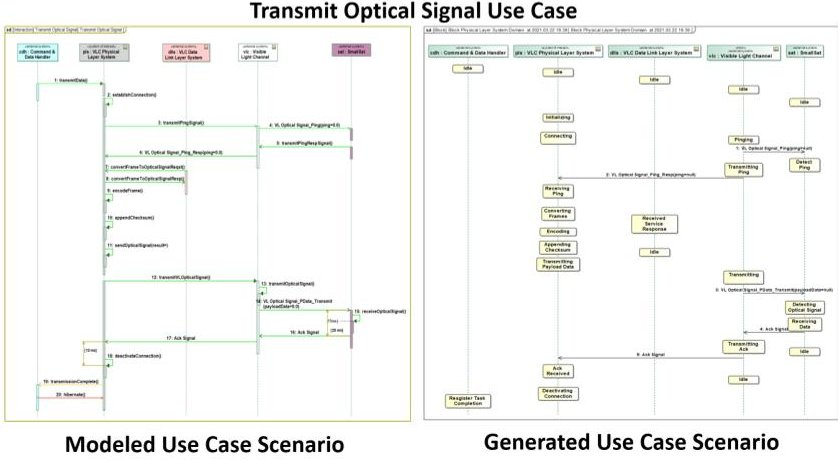

Fig. 13: Modeled and Generated "Transmit Optical Signal" Use Case Scenario

systems. Following the completion of the state-based behavior description, verification and validation of the black box model is performed through model execution via simulation. Shown in Fig. 12 is the execution of the PL System Context State-

based behavior with the Transmit Optical Signal used as stimuli for the model execution. The use case model is validated if the use case scenario generated via model execution is equivalent to the modeled scenario. Fig. 13 highlights the modeled transmit optical signal scenario and the generated scenario for the transmit optical signal use case.

## H. The Black Box System Model Specification

The black box system model for the PL System is built of verified and validated functions representing the underlying functional requirements. As more PL System use cases are identified (e.g. rainy day scenarios), their black box use case scenarios are developed, with the activity diagram shown in Fig. 9 being incrementally extended with information from the newly specified scenarios. Similarly, the black box state machine portrayed in Fig. 11 is also incrementally extended (from newly derived scenarios) to capture the complete PL System state-based behavior. Subsequently, the complete black box system model is then validated through model execution. Consequently, the above outlined process employed in the

<!-- PDF_PAGE: 8 -->

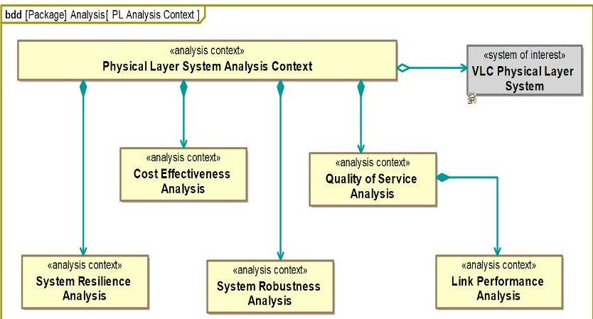

Fig. 14: Physical Layer System Analysis Context

development of the PL System black box specification demonstrates that the checks and balances enforced by applying MBSE principles to the black box system specification ensure the resulting system design is devoid of errors which are often difficult to detect until late in the system design life cycle.

## IV. PHYSICAL LAYER PERFORMANCE ANALYSIS CONTEXT

To verify the system design in terms of its ability to satisfy system performance requirements, a system analysis context is defined for which the underlying objective is to ensure the system performance requirements are satisfied by the design. Model elements needed to support analysis of the system performance are defined in the Physical Layer Analysis Context shown in Fig. 14. Each analysis block specified in the Analysis Context represents a specific system analysis to be performed. However, cost effectiveness, system resilience and system robustness analysis are outside the scope of this current work. Analysis objectives include characterizing and predicting the transceiver performance in terms of the Signalto-Noise Ratio (SNR) and Bit Error Rate (BER) as well as verifying specific parts of the system design through analysis. The primary capability required of the PL System is the ability to relay data between SmallSats in a Multi-Orbit Disaggregated System (MODS) via visible light technology. Therefore, we evaluate the utility of LED-based optical data signals in a space environment.

The Link Performance Analysis block shown in Fig. 15 represents the analysis context for the ISC link being evaluated. Design parameters belong to the subsystems of the visible light PL system, space environment, and channel. SysML parametric elements provide a means to specify the interdependencies between values of system properties and provides the bridge between the system model and the analysis model [23]. For instance, parametric diagrams are used to facilitate integration between the PL System model design and analytical models developed in [24] by linking the equation parameters outlined in Table II to the properties of the PL System and external systems. Cameo Simulation Toolkit from Dassault Systemes enables the execution of parametric models due to its ability to integrate with analysis tools such as MATLAB.

bdd [Package] 4-Analysis Model[ Link Performance Analysis ]

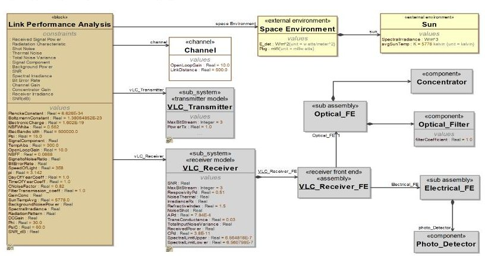

Fig. 15: Link Performance Analysis Context

## TABLE II: Performance Parameters

<table border="1"><tr><td>Parameter</td><td>Value</td></tr><tr><td>Semi angle at Half Power，$\Phi_{\frac{1}{2}}$</td><td>30°</td></tr><tr><td>LED Peak Wavelength，$\lambda_{peak}$</td><td>656.2802 nm</td></tr><tr><td>Concentrator FoV Semi-angle，$\psi_{c}$</td><td>35°-60°</td></tr><tr><td>Filter Transmission Coefficient，$T_{\circ}$</td><td>1.0</td></tr><tr><td>Incidence Angle，$\varphi$</td><td>30°</td></tr><tr><td>Irradiance Angle，$\psi$</td><td>15°</td></tr><tr><td>Detector Responsivity，$\gamma$</td><td>0.51</td></tr><tr><td>Refractive Index of Lens，n</td><td>1.5</td></tr><tr><td>Radius of Concentrator，R</td><td>2.0cm</td></tr><tr><td>Detector Active Area，$A_{pd}$</td><td>7.84cm2</td></tr><tr><td>Desired Electrical Bandwidth，B</td><td>0.5MHz-1MHz</td></tr><tr><td>Optical Filter Bandwidth，$\Delta\lambda$</td><td>0.4020nm</td></tr><tr><td>Optical Filter Lower Limit，$\lambda_{a}$</td><td>655.0798nm</td></tr><tr><td>Optical Filter Upper Limit，$\lambda_{b}$</td><td>656.4818nm</td></tr><tr><td>Open Loop Voltage Gain，G</td><td>10</td></tr><tr><td>FET Transconductance，gm</td><td>30ms</td></tr><tr><td>FET Channel Noise factor，$\Gamma$</td><td>0.82</td></tr><tr><td>Capacitance of Photodetector，$\eta$</td><td>38pF/cm2</td></tr><tr><td>Link Distance，d</td><td>0.5km-1km</td></tr><tr><td>Noise Bandwidth Factor for White Noise，$I_{2}$</td><td>0.562</td></tr><tr><td>Noise Bandwidth Factor for $f^{2}$ Noise，$I_{3}$</td><td>0.0868</td></tr><tr><td>Boltzmann Constant，k</td><td>$1.38\times10^{-23}J/K$</td></tr><tr><td>Absolute Temperature，$T_{A}$</td><td>300K</td></tr></table>

## A. Signal-to-Noise Ratio and Bit Error Rate Analysis Profile

The Link Performance Analysis is specified based on the analytical model developed by Amanor et al in [13]. Analytical equations from the analytical model in [13] are specified as constraint properties in our parametric model, and used to analyze critical system characteristics specified in the system model to ascertain whether the system design satisfies system requirements. The corresponding SNR and BER for the ISC link are computed by executing the parametric diagram shown in Fig. 16. Each analytical equation necessary for evaluating the SNR performance is specified using the MATLAB programming language, and then analyzed using the inbuilt parametric solver which is integrated with MATLAB. Some of the analytical equations which were defined as constraint properties in the model and analyzed via model execution include:

1) Received Optical Power Constraint Property [13] - Evaluates the received optical power at the receiver as a function of the transmitter power and DC Gain.

$$
P _ {R _ {x}} = H (0) * P _ {T _ {x}}
$$

<!-- PDF_PAGE: 9 -->

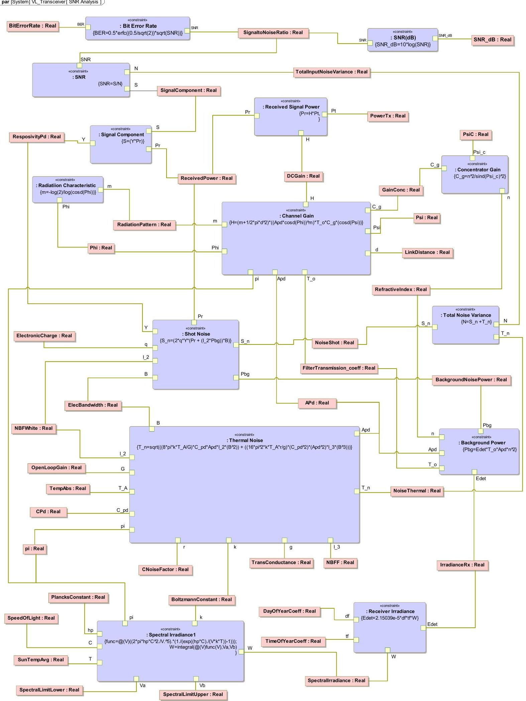

Fig. 16: Signal-to-Noise Ratio (SNR) and Bit Error Rate (BER) Analysis Parametric Diagram

<!-- PDF_PAGE: 10 -->

<table border="1"><tr><td>#</td><td>Name</td><td>PsiC:Real</td><td>ElecBandwidth:Real</td><td>LinkDistance:Real</td><td>PowerTx:Real</td><td>ReceivedPower:Real</td><td>SNR_dB:Real</td><td>BitErrorRate:Real</td></tr><tr><td>1</td><td>vl_transceiver</td><td>35</td><td>500000</td><td>500</td><td>2</td><td>2.8072E-9</td><td>53.7929</td><td>8.9773E-14</td></tr><tr><td>2</td><td>vl_transceiver1</td><td>35</td><td>1000000</td><td>1000</td><td>2</td><td>1.1229E-8</td><td>60.7242</td><td>1.0805E-25</td></tr><tr><td>3</td><td>vl_transceiver2</td><td>35</td><td>500000</td><td>500</td><td>1</td><td>1.4036E-9</td><td>46.8614</td><td>9.618E-8</td></tr><tr><td>4</td><td>vl_transceiver3</td><td>45</td><td>500000</td><td>500</td><td>1</td><td>9.2352E-10</td><td>42.6756</td><td>1.2034E-5</td></tr><tr><td>5</td><td>vl_transceiver5</td><td>45</td><td>1000000</td><td>1000</td><td>1</td><td>3.6941E-9</td><td>49.6069</td><td>1.1668E-9</td></tr><tr><td>6</td><td>vl_transceiver6</td><td>60</td><td>1000000</td><td>500</td><td>2</td><td>1.2314E-9</td><td>38.6209</td><td>0.0003</td></tr><tr><td>7</td><td>vl_transceiver7</td><td>60</td><td>500000</td><td>500</td><td>1</td><td>6.1568E-10</td><td>38.6209</td><td>0.0003</td></tr></table>

Fig. 17: System Configuration Trade Study

2) Channel Gain Constraint Property [13] - Evaluates the channel gain.

$$
H (0) = \frac {(m + 1)}{2 \pi d ^ {2}} A _ {p d} (\cos \varphi) ^ {m} T _ {o} (\psi) g (\psi) \cos (\psi)
$$

3) Spectral Irradiance Constraint Property [13] - Evaluates the spectral irradiance of the sun as a function of wavelength and temperature

$$
W (\lambda T,) = \frac {2 \pi h _ {p} c ^ {2}}{\lambda^ {5} \left(e \frac {h _ {p} c}{\lambda k T} - 1\right)}
$$

4) Irradiance at Receiver Constraint Property [13] - Evaluates the irradiance felt at the receiver's optical filter

$$
E _ {d e t} \approx 2. 1 5 0 3 9 \times 1 0 ^ {- 5} d _ {f} t _ {f} \int_ {\lambda_ {a}} ^ {\lambda_ {b}} W (\lambda , T) d \lambda
$$

5) Background Noise Power Constraint Property [13] Evaluates the noise power detected at the optical receiver

$$
P _ {b g} = E _ {d e t} T _ {o} A _ {p d} n ^ {2}
$$

6) Thermal Noise Constraint Property [13] - Evaluates thermal noise in the receiver

$$
\sigma_ {t h e r m a l} ^ {2} = \frac {8 \pi k T _ {A}}{G} \eta A _ {p d} I _ {2} B ^ {2} + \frac {1 6 \pi^ {2} k T _ {A} \Gamma}{g _ {m}} \eta^ {2} A _ {p d} ^ {2} I _ {3} B ^ {3}
$$

7) Shot Noise Constraint Property [13] - Evaluates shot noise at the receiver

$$
\sigma_ {s h o t} ^ {2} = 2 q \gamma \left(P _ {R X} + I _ {2} P _ {b g}\right) B
$$

8) Total Input Noise Variance Constraint property [13] - Evaluates the sum of both shot and thermal noise variances

$$
N = \sigma_ {s h o t} ^ {2} + \sigma_ {t h e r m a l} ^ {2}
$$

9) Signal-to-Noise Ratio Constraint Property [13] - Evaluates the performance of the receiver

$$
S N R = \frac {\left(\gamma P _ {R _ {x}}\right) ^ {2}}{\sigma_ {s h o t} ^ {2} + \sigma_ {t h e r m a l} ^ {2}}
$$

10) Bit Error Rate Constraint Property [13] - Evaluates the quality of the visible light signal

$$
B E R = 0. 5 * E r f c \left(0. 5 \sqrt {2} * \sqrt {S N R}\right)
$$

## B. System Analysis and Evaluation

Models play a vital role when performing trade-off analysis and evaluating alternative architectures during the specification of a system model as reported by Karban et al. in [25,26]. We employed the use of Instance Specification Tables and system configuration trade study analysis to analyze and evaluate the link performance of the PL System design. Instance Specification Tables enable the management of multiple system configurations in a spreadsheet-like form in which each row represents a specific instance of the PL System ISC link at runtime. Various system configurations which were specified and analyzed are portrayed in the Instance Specification Table shown in Fig. 17. Parameter values for concentrator FOV semi-angle (PsiC), electrical bandwidth, link distance and transmitter power were varied and used to generate and evaluate various design alternatives. The approach utilized enabled the analysis of multiple system configurations based on predefined tradeoff criteria with the intent to eliminate poor design alternatives, while ensuring the preferred alternative meets stakeholders' objectives. Several SNR and BER values were generated as shown, giving system designers a view of multiple outcomes of the system's performance and output characteristics based on the different configurations. This will enable them choose an optimal solution that will achieve the intended goal. For all configurations analyzed, it was noted that the SNR and BER values satisfied the specified requirements.

## V. CONCLUSION

Presented in this research work is an executable black box system model of the Physical Layer System of an LED-based VLC System for Intersatellite Communication (ISC). Specifically, the model represents the black box specification for the Perform Full Duplex Data Relay use case and consists of a high level abstraction of the structure, behavior, and system parametrics. We specify the emergent properties of the PL System by modeling its black box operational behavior and performance characteristics. Execution of the system model via simulation is performed and the results analyzed. The developed black box model provides crucial information required to specify the PL System external interfaces, required inputs and provided outputs and requirements. Key system characteristics were also analyzed by evaluating an analytical model of the system's performance properties using the modeling tool's inbuilt parametric solver interfaced with MATLAB. It was observed that the black box method of system design

<!-- PDF_PAGE: 11 -->

allowed for easy modification of system properties as well as evaluation of change impact analysis.

The benefits of the MBSE approach is reflected in the advantages derived from specifying the PL System in this manner which include: (1) Providing an excellent way to communicate the PL system concept, (2) Improved design consistency and precision, (3) model-based analysis activities, and (4) Change impact management. Future work includes development of the white box system model and consequently, the physical architecture views of the PL System which involves allocating logical system components to hardware and software components, as well as performing higher fidelity engineering analysis to ensure the system design satisfies stakeholder expectations.

## REFERENCES

[1] S. C. Spangelo, D. Kaslow, C. Delp, B. Cole, L. Anderson, E. Fosse, B. S. Gilbert, L. Hartman, T. Kahn, and J. Cutler, "Applying model based systems engineering (mbse) to a standard cubesat," in 2012 IEEE Aerospace Conference. IEEE, 2012, pp. 1-20.

[2] R. Radhakrishnan, W. W. Edmonson, F. Afghah, R. M. RodriguezOsorio, F. Pinto, and S. C. Burleigh, "Survey of inter-satellite communication for small satellite systems: Physical layer to network layer view," IEEE Communications Surveys & Tutorials, vol. 18, no. 4, pp. 2442-2473, 2016.

[3] D. N. Amanor, W. W. Edmonson, and F. Afghah, "Intersatellite communication system based on visible light," IEEE Transactions on Aerospace and Electronic Systems, vol. 54, no. 6, pp. 2888-2899, 2018.

[4] H. Zimmermann, "Osi reference model-the iso model of architecture for open systems interconnection," IEEE Transactions on communications, vol. 28, no. 4, pp. 425-432, 1980.

[5] Z. Shaofan, T. Jian, J.-M. Gauthier, and R. Faudou, "A formal approach using sysml for capturing functional requirements in avionics domain," Chinese Journal of Aeronautics, vol. 32, no. 12, pp. 2717-2726, 2019.

[6] A. Salado and P. Wach, "Constructing true model-based requirements in sysml," Systems, vol. 7, no. 2, p. 19, 2019.

[7] J. Holt and S. Perry, SysML for systems engineering, 2nd Edition: A model-based approach. IET, 2014, vol. 10, chapter 11.

[8] B. P. Douglass, Agile systems engineering. Morgan Kaufmann, 2015.

[9] R. L. Flood and E. R. Carson, Dealing with complexity: an introduction to the theory and application of systems science. Springer Science & Business Media, 2013.

[10] D. Kaslow, P. T. Cahill, and B. Ayres, "Development and application of the cubesat system reference model," in 2020 IEEE Aerospace Conference. IEEE, 2020, pp. 1-15.

[11] L. Wood, W. Ivancic, and K.-P. Dörpelkus, "Using light-emitting diodes for intersatellite links," in 2010 IEEE Aerospace Conference. IEEE, 2010, pp. 1-6.

[12] A. Nakajima, N. Sako, M. Kamemura, Y. Wakayama, A. Fukuzawa, H. Sugiyama, and N. Okada, "Shindaisat: a visible light communication experimental micro-satellite," in Proceedings of the International Conference on Space Optical Systems and Applications, 2012, pp. 12-1.

[13] D. Amanor, W. Edmonson, and A. Anyanhun, "Visible light communication system for inter-satellite communication of small satellites," in 4S Small Satellite Systems and Services Symposium, 2016.

[14] A. Anyanhun and W. Edmonson, "Inter-satellite communication mbse design framework for small satellites," in 2017 Annual IEEE International Systems Conference (SysCon). IEEE, 2017, pp. 1-7.

[15] A. I. Anyanhun, "Model-based (mbse) system architecture development for a hybrid inter-satellite communication system," Ph.D. dissertation, North Carolina Agricultural and Technical State University, 2018.

[16] A. I. Anyanhun, A. Anzagira, and W. W. Edmonson, "Intersatellite communication: An mbse operational concept for a multiorbit disaggregated system," IEEE Journal on Miniaturization for Air and Space Systems, vol. 1, no. 1, pp. 56-65, 2020.

[17] M. Green, J. Sweeney, and J. Stracener, "The application of black box theory to system development," Systems Engineering in DC Proceedings, SEDC, 2014.

[18] S. Friedenthal, A. Moore, and R. Steiner, A practical guide to SysML: the systems modeling language. Morgan Kaufmann, 2014.

[19] L. Delligatti, SysML distilled: A brief guide to the systems modeling language. Addison-Wesley, 2013.

[20] T. Weilkiens, SYSMOD-The Systems Modeling Toolbox-Pragmatic MBSE with SysML. Lulu. com, 2016.

[21] L. S. Wheatcraft, "9.2. 2 everything you wanted to know about interfaces, but were afraid to ask," in INCOSE International Symposium, vol. 20, no. 1. Wiley Online Library, 2010, pp. 1132-1149.

[22] H.-P. Hoffmann, "Sysml-based systems engineering using a model-driven development approach," White Paper, Telelogic, 2008.

[23] O. Specification, "Omg system modeling language (omg sysmltm) specification," 2006.

[24] D. Amanor, W. Edmonson, and F. Afghah, "Link performance improvement via design variables optimization in led-based vlc system for intersatellite communication," in International Conference on Wireless for Space and Extreme Environments, 2017 IEEE. IEEE, 2017.

[25] R. Karban, N. Jankevičius, and M. Elaasar, "Esem: Automated systems analysis using executable sysml modeling patterns," in INCOSE International Symposium, vol. 26, no. 1. Wiley Online Library, 2016, pp. 1-24.

[26] R. Karban, F. G. Dekens, S. Herzig, M. Elaasar, and N. Jankevičius, "Creating system engineering products with executable models in a model-based engineering environment," in Modeling, Systems Engineering, and Project Management for Astronomy VI, vol. 9911. International Society for Optics and Photonics, 2016, p. 99110B.