<!-- PDF_PAGE: 1 -->

## Bi-modal solar thermal propulsion and power system Modelling and optimisation for the next-generation of small satellites

Leverone, F.K.

## DOI

10. 4233/uuid:faf85ca4-9020-469f-a79f-f1c7d6719337

Publication date

2021

Document Version

Final published version

## Citation (APA)

Leverone, F. K. (2021). Bi-modal solar thermal propulsion and power system: Modelling and optimisation for the next-generation of small satellites. [Dissertation (TU Delft), Delft University of Technology]. https://doi.org/10.4233/uuid:faf85ca4-9020-469f-a79f-f1c7d6719337

## Important note

To cite this publication, please use the final published version (if applicable). Please check the document version above.

## Copyright

Other than for strictly personal use, it is not permitted to download, forward or distribute the text or part of it, without the consent of the author(s) and/or copyright holder(s), unless the work is under an open content license such as Creative Commons.

## Takedown policy

Please contact us and provide details if you believe this document breaches copyrights. We will remove access to the work immediately and investigate your claim.

<!-- PDF_PAGE: 2 -->

# BI-MODAL SOLAR THERMAL PROPULSION AND POWER SYSTEM

Modelling and Optimisation for the Next-Generation of Small Satellites

Fiona Kay Leverone

<!-- PDF_PAGE: 3 -->

# BI-MODAL SOLAR THERMAL PROPULSION AND POWER SYSTEM

MODELLING AND OPTIMISATION FOR THE NEXT-GENERATION OF SMALL SATELLITES

<!-- PDF_PAGE: 4 -->

<!-- PDF_PAGE: 5 -->

# BI-MODAL SOLAR THERMAL PROPULSION AND POWER SYSTEM

MODELLING AND OPTIMISATION FOR THE NEXT-GENERATION OF SMALL SATELLITES

## Dissertation

for the purpose of obtaining the degree of doctor at Delft University of Technology by the authority of the Rector Magnificus Prof.dr.ir. T.H.J.J. van der Hagen chair of the Board for Doctorates to be defended publicly on Thursday 15 July 2021 at 15:00 o'clock

by

## Fiona Kay LEVERONE

Master of Science in Mechanical Engineering University of KwaZulu-Natal, South Africa born in Geneva, Switzerland.

<!-- PDF_PAGE: 6 -->

This dissertation has been approved by the promotors:

promotor: Prof. dr. E.K.A. Gill

copromotor: Dr. A. Cervone

copromotor: Dr. ir. M. Pini

Composition of the doctoral committee:

Rector Magnificus, chairperson

Prof.dr. E.K.A. Gill, Delft University of Technology, promotor

Dr. A. Cervone, Delft University of Technology, copromotor

Dr.ir. M. Pini, Delft University of Technology, copromotor

Independent members:

<table border="1"><tr><td>Prof.dr.ir B.J. Boersma,</td><td>Delft University of Technology</td></tr><tr><td>Prof.dr.ing. S. Kenjereš,</td><td>Delft University of Technology</td></tr><tr><td>Prof.dr. D. Sànchez,</td><td>University of Seville, Spain</td></tr><tr><td>Dr. M. Gilpin,</td><td>University of Southern California, USA</td></tr></table>

Keywords: Solar thermal propulsion, Micro-Organic Rankine Cycle, Small satellites, Latent heat

Printed by: Ipskamp Printing, Enschede on 100% recycled paper

Cover by: Tamlynn Camilleri

Credit: The cover and bookmark were designed using resources from Freepik.com

Copyright © 2021 by Fiona Leverone ISBN 978-94-6421-408-6

All rights reserved. No part of this thesis may be reproduced, stored in a retrieval system or transmitted in any form or by any means without permission from the author or, when appropriate, from the publishers of the publications. An electronic version of this dissertation is available at http://repository.tudelft.nl/.

<!-- PDF_PAGE: 7 -->

To my late Grand-pere, Prof. L.W. Baker for sharing the joy of fixing things and the discipline to never give up.

<!-- PDF_PAGE: 8 -->

<!-- PDF_PAGE: 9 -->

## CONTENTS

Summary xi

Samenvatting xiii

1 Introduction 1

1.1 Background and Motivation 2

1.2 Propulsion and Power for Small Satellites 3

1.2.1 Propulsion Systems 3

1.2.2 Electrical Energy Conversion Systems 9

1.3 Research Questions and Methodology 14

1.4 Thesis Outline 15

2 Cost-effective Propulsion Systems for Small Satellites 19

2.1 Introduction 20

2.2 Propulsion Technology Options. 20

2.2.1 Stored Gas Propulsion Systems 20

2.2.2 Chemical Propulsion Systems 21

2.2.3 Electric Propulsion Systems 22

2.2.4 Propellantless Propulsion Systems 24

2.2.5 Advanced Propulsion Systems 24

2.3 Solar Thermal Propulsion System Architecture 28

2.4 Low-cost Mission Analysis 30

2.4.1 Scenario Description. 30

2.4.2 Total Cost Indicator 32

2.5 Results 38

2.6 Summary 45

3 Solar Energy Harvesting using a Micro-ORC System 47

3.1 Introduction 48

3.2 System Description 48

3.3 Model Description 51

3.3.1 Optical System 51

3.3.2 Receiver/TES System. 54

3.3.3 ORC System 54

3.4 Model Validation 57

3.5 Design Methodology 59

3.6 Critical Heat Flux Analysis 59

3.6.1 Analysis Set-up. 59

3.6.2 Results 60

<!-- PDF_PAGE: 10 -->

3.7 System Optimisation 63

3.7.1 Optimisation Set-up 63

3.7.2 System Optimisation Results 68

3.8 Turbine Performance Estimation 74

3.8.1 Empirical Loss Models 74

3.8.2 Sensitivity Analysis on Turbine Efficiency 76

3.9 Summary 77

# 4 Design of a Bi-modal Propulsion and Power System 79

4.1 System Requirements 80

4.2 Design Strategy 82

4.2.1 Propellant Selection 84

4.2.2 Feed System 84

4.2.3 Nozzle Design 86

4.3 Design Optimisation 86

4.3.1 Optimisation Set-up 86

4.3.2 Optimisation Results 90

4.4 Sensitivity Analysis 93

4.4.1 Investigation on the Influence of Design Parameters 93

4.4.2 Investigation on the Influence of Design Choices 95

4.4.3 Uncertainty Analysis 97

4.5 Baseline System Design 99

4.6 Summary 103

# 5 Characterisation of Bi-Modal Propulsion and Power Systems 105

5.1 Introduction 106

5.2 Model Development 106

5.2.1 Model Approach 106

5.2.2 Thermophysical Properties 107

5.2.3 Component Models 107

5.3 Model Validation and Verification 116

5.3.1 Receiver Model Validation and Verification 116

5.3.2 Propulsion and Power Model Validation 119

5.4 Conjugate and PCM Heat Transfer Simulation 121

5.4.1 Receiver/TES System Analysis 121

5.4.2 Power System Investigations 129

5.4.3 Propulsion System Investigations 135

5.4.4 Preliminary Integrated Design 143

5.5 Design Elements of the Micro-turbine 149

5.5.1 Structural Analysis 149

5.5.2 Turbine Performance 150

5.6 Summary 151

# 6 Conclusion and Recommendations 153

6.1 Main Findings and Conclusions 154

6.2 Key Contributions of Thesis 158

6.3 Future Perspectives and Research Areas 160

<!-- PDF_PAGE: 11 -->

References 163

A Propulsion Technology Data 187

B Associated Mission Cost Criteria Definition 189

B.1 Equal Weighting Factor 189

B.2 Weighting Factor Sensitivity Analysis 192

C ORC Survey 195

C.1 Working Fluid Data 195

C.2 Micro-generators 195

C.3 Micro-pumps 195

C.4 Penalty Definition. 195

D Empirical Heat Transfer Correlations 199

E Inflow Radial Turbine Theory 203

F Combined Radiation and Convection Heat Transfer Coefficient 207

F.1 Radiation Model 207

F.1.1 Saturated Two-phase Boiling. 207

F.1.2 IAFB Regime 207

F.1.3 DFFB Regime 208

F.2 Effect of Droplet Size on Propellant Heat Transfer. 209

G Earth Escape Trajectory Analysis 211

G.1 Trajectory Definitions and Assumptions 211

G.2 Trajectory Results 213

Acknowledgements 215

List of Publications 217

Curriculum Vitae 219

<!-- PDF_PAGE: 12 -->

<!-- PDF_PAGE: 13 -->

Exploring and utilising space to benefit humankind is undeniably a costly venture where the higher the mass of the satellite, the higher the cost to launch. However, the rewards of space-related achievements are indisputable. These achievements range from increasing our understanding of the universe using satellites, such as the Hubble Space Telescope, to improving the predictive ability of weather, climate, and natural disaster phenomena with the help of Earth observation satellites.

One way the aerospace industry is tackling reducing the costs associated with space-related activities is to reduce the mass of satellites. On January 24, 2021, this paradigm shift towards using smaller satellites was publicised by the record-breaking launch of 143 small satellites on-board a single launcher. However, the challenge is to ensure the capabilities of these satellites meet or exceed the current and future demands of space missions.

Key capabilities of a small satellite, which are generally defined as satellites with a total mass of 500 kg or less, include electrical power generation and manoeuvring abilities. Manoeuvring abilities are a necessity to provide features such as orbit transfer, attitude control, collision avoidance and de-orbiting. Without electrical power, a satellite becomes non-functional and becomes space debris. The integration of the propulsion and power functions aboard a small satellite is arguably one of the best routes to optimise their efficiency and mass. However, the bi-modal operation needs to be significant to trade against conventional systems. Therefore, the aim of this thesis is to examine the possibility of improving the propulsion and electrical power capabilities of small satellites by sharing on-board resources. Specifically, the idea of a solar thermal bi-modal propulsion and power system is explored to enable the co-generation of thrust and electricity to manoeuvre the satellite and power on-board components.

The research work documented in this dissertation addresses the challenges associated with the development and characterisation of a solar thermal bi-modal propulsion and power system. Three general questions are answered, namely

1. What bounds the proposed bi-modal solar thermal power and propulsion system for small satellite applications?

2. What gain in performance parameters such as efficiency are achievable when improving the bi-modal system and what gain is required for beneficial application?

3. How can we accurately model and characterise the bi-modal system?

The bi-modal system under investigation comprises a solar thermal propulsion (STP) system and a micro-Organic Rankine Cycle (micro-ORC) turbogenerator. STP is a propulsion technology that uses mirrors or lenses to concentrate solar radiation onto a propellant. This added energy heats the propellant, and the hot gas is expanded through a nozzle to generate thrust. An ORC turbogenerator is a thermal engine capable of convert-

<!-- PDF_PAGE: 14 -->

ing thermal energy into electrical power by means of an organic fluid flowing through a closed-loop based on the classical Rankine thermodynamic cycle.

Before tackling the challenges of the integrated design, it is important to understand the benefits and downside of the selected propulsion and power subsystems compared to the state-of-the-art (SOA) technology. This comparison emphasises the performance of available systems and identifies potential gaps that can be exploited.

A quantitative cost comparison in terms of a total cost indicator is performed to determine cost-effective propulsion solutions for various mission scenarios. This novel comparison of STP systems promotes the use of water as the propellant for missions requiring orbit transfers with an ideal velocity change on the order of 800 to 2500 m/s.

An investigation into possible organic fluids that result in smaller components for the electrical power subsystem was performed in order to meet the satellite size restrictions. A total of 75 fluids were screened, and the top candidates were analysed based on reducing the total volume of the ORC system. The innovation of this investigation is the inclusion of the sizing of the turbine and heat exchangers while analysing the thermodynamic cycle of micro-ORC on-board a small satellite. Toluene has been identified as a promising working fluid candidate resulting in a power generation stowed system volume fraction of 18% for a 215 kg Low Earth Orbit satellite. A major challenge with developing micro-ORC systems is the extremely fast rotating and small turbines needed. Based on calculations performed with a meanline model, the turbine efficiency was found to be 57% for a design electrical power output of 200 W.

Integrating the above propulsion and power subsystems is a complex process. An original design is proposed that couples an STP system directly with a micro-ORC system via a high-temperature thermal receiver that acts as an energy storage system. This single receiver configuration is proposed to reduce the number of components and heat transfer loops. A novel design methodology developed in this research enabled the identification of 13 key design parameters to describe the mass and size of the bi-modal solar thermal system.

A single-objective optimisation shows that the bi-modal system is most suitable onboard small satellites with a gross mass above 300 kg for a Geostationary Transfer Orbit to Lunar Orbit Insertion (LOI) mission. The propellant required to achieve the orbit transfer accounts for 44% of the total system mass. Furthermore, the enthalpy method is used to describe the dynamic behaviour of a Silicon latent heat energy storage system. Results show that the insulation thermal conductivity has the largest effect, up to 17%, on the receiver's maximum achievable steady-state temperature.

The performance of the preliminary design of the bi-modal system is compared to the performance of the SMART-1 satellite to showcase the benefits and drawbacks of this proposed system. It has been found that the combined system enhances the energy density by a factor of 5.7 but at the expense of decreasing the power density by a factor of 2.4. In summary, it was found that a solar thermal bi-modal propulsion and power system is feasible on-board a small satellite. However, a substantial gain in power density is needed to outweigh the cost and risk associated with deploying a novel architecture. Additional hurdles to implement these systems successfully are the development of inflatable concentrators with high optical efficiency and high-temperature phase change material containers that are leak-free and compatible with Silicon or Boron.

<!-- PDF_PAGE: 15 -->

# SAMENVATTING

Het exploreren en uitbuiten van de ruimte ten voordele van de mensheid is zonder meer een dure onderneming waarbij de lanceerprijs toeneemt naarmate de massa van de satelliet groter wordt. En toch staan de baten van ruimtevaart-gerelateerde prestaties buiten kijf. Deze prestaties variëren van het vergroten van onze kennis van het heelal met behulp van satellieten als de Hubble Space Telescope, tot het verbeteren van het voorspellend vermogen van weer-, klimaat-, en natuurramp-verschijnselen met behulp van aardeobservatiesatellieten.

Één manier waarop de ruimtevaartindustrie de kosten van ruimte-gerelateerde activiteiten probeert terug te dringen is het reduceren van de massa van satellieten. Op 24 januari 2021 is deze paradigmaverschuiving naar kleinere satellieten aangetoond met de baanbrekende lancering van 143 kleine satellieten aan boord van één enkel lanceervoertuig. De uitdaging is echter om ervoor te zorgen dat de prestaties van deze satellieten ten minste aan de huidige en toekomstige eisen van ruimtemissies kan voldoen.

Kernprestaties van kleine satellieten, die over het algemeen gedefinieerd zijn als satellieten met een totale massa van niet meer dan 500 kg, zijn onder andere het genereren van elektrisch vermogen en de mogelijkheid om te manoeuvreren. Het manoeuvreren is nodig om kenmerken als baanoverdracht, standregeling, uitwijkmanoeuvres, en deorbit mogelijk te maken. Zonder elektrisch vermogen kan een satelliet niet functioneren en wordt ruimtepuin. Een geintegreerde voorstuwing en elektrische vermogen systeem op een kleine satelliet is misschien wel een van de beste manieren om hun efficiëntie en massa te optimaliseren. Het doel van dit proefschrift is dus om te onderzoeken of de voortstuwings- en elektrisch vermogens-kenmerken van kleine satellieten verbeterd kunnen worden door de bronnen aan boord te delen.

Het onderzoek dat in dit proefschrift gedocumenteerd staat richt zich op de problemen van het ontwikkelen en karakteriseren van een zonthermisch bi-modal voortstuwings- en elektrisch vermogenssysteem. Drie overkoepelende vragen worden beantwoord, namelijk:

1. Welke kenmerken beperken het voorgestelde bi-modal zonthermisch voortstuwings- en elektrisch vermogenssystem voor kleine satelliet toepassingen?

2. Welke verbetering in prestatieparameters zoals efficiëntie zijn haalbaar als het bimodal systeem verbeterd wordt en welke winst is nodig voor een gunstige toepassing?

3. Hoe kunnen we het bi-modal systeem nauwkeurig modelleren en karakteriseren?

Het bi-modal systeem dat onderzocht is bestaat uit een zonthermisch voorstuwingsysteem (ZTV) en een micro-organisch rankinecyclus (micro-ORC) turbogenerator. ZTV is een voorstuwingstechnologie die gebruik maakt van spiegels of lenzen om zonnestraling op een drijfgas te concentreren. De drijfgas wordt dus verdampt en de verwarmde

<!-- PDF_PAGE: 16 -->

gassen expanderen door een straalpijp om stuwkracht te genereren. Een ORC turbogenerator is een thermische motor die thermische energie in elektrisch vermogen om kan zetten door middel van een organische vloeistof die door een gesloten kringloop vloeit op basis van het klassieke thermodynamische rankinecyclus.

Voordat de uitdagingen van een geintegreerd ontwerp aangepakt wordt is het van belang om de voor- en nadelen van de geselecteerde voortstuwings- en elektrisch vermogen-subsystemen ten opzichte van de state-of-the-art technologie te begrijpen. Deze vergelijking legt de focus op de prestatie van beschikbare systemen en identificeert mogelijke verschillen die uitgebuit kunnen worden.

Een kwantitatieve kostenvergelijking is uitgevoerd, op basis van een totale kost indicator, om kostenefficiënte voortstuwingsoplossingen voor verscheidene missiescenario's te bepalen. Deze innovatieve vergelijking van ZTV systemen stelt het gebruik van water voor als drijfgas voor missies waarbij baanoverdracht met een 'ideal' snelheidsverandering van ordegrootte 800-2,500 m/s.

Een onderzoek naar mogelijke organische vloeistoffen is uitgevoerd dat kleinere componenten voor het elektrische vermogenssystem zou opleveren om aan de beperkingen van de satellietgrootte te voldoen. In totaal zijn 75 vloeistoffen bestudeerd en de beste kandidaten zijn geanalyseerd om de totale volume van het ORC-systeem te reduceren. Uniek in dit onderzoek is het meenemen van de groottebepaling van de turbine en warmtewisselaars terwijl het thermodynamische cyclus van een micro-ORC aan boord van een kleine satelliet geanalyseerd is. Tolueen is geidentificeerd als een veelbelovende drijfvloeistof die vermogen genereert in termen van opgeslagen systeemvolumeratio van 18% voor een 'Low Earth Orbit' satelliet van 215 kg. Één grote uitdaging in het kader van de ontwikkeling van micro-ORC systemen is de zeer snel roterende, kleine turbines die nodig zijn. De turbineefficiëntie, gebaseerd op berekeningen met een 'meanline' model, is 57% geweest voor een ontwerp elektrisch vermogensrendement van 200 W.

Het integreren van de voorgenoemde voortstuwings- en elektrisch vermogen-subsystemen is een complex proces. Een uniek ontwerp is voorgesteld dat een ZTV systeem direct koppelt aan een micro-ORC systeem door middel van een hoog temperatuur thermisch ontvanger die dient als een vermogensopslagsysteem. Deze enkel-ontvanger opstelling is voorgesteld om het aantal componenten en warmteoverdrachtskringlopen te reduceren. Een innovatieve ontwerp methodologie, ontwikkeld gedurende dit onderzoekproject, leidde tot de identificatie van 13 kern ontwerpparameters om de massa en grootte van het bi-modal zonthermisch systeem te beschrijven.

Een enkel-parameter optimalisatie laat zien dat het bi-modal systeem het meest geschikt is aan boord van kleine satellieten met een bruto massa groter dan 300 kg voor een overdrachtsmissie van een geostationaire baan naar een maancentrische baan. De benodigde drijfgas om deze overdracht haalbaar te maken is 44% van de totale systeemmassa. Bovendien gebruikt het ontwerp silicium als latente warmte vermogensopslagsysteem, waarbij de enthalpie methode gebruikt is om het dynamisch gedrag te beschrijven. De resultaten laten zien dat thermische geleidbaarheid van het isolatiemateriaal de grootste invloed heeft, tot wel 17%, op de maximum haalbare steady-state temperatuur van de ontvanger.

De prestatie van het voorlopige ontwerp van het bi-modal system wordt vergeleken met die van de SMART-1 satelliet om de voor- en nadelen van dit voorgestelde systeem

<!-- PDF_PAGE: 17 -->

aan te tonen. Vastgesteld is dat het gecombineerde systeem de energiedichtheid met een factor 5.7 vergroot, maar de vermogensdichtheid neemt daarentegen af met een factor 2.4. Samenvattend: vastgesteld is dat een zonthermisch bi-modal voortstuwings- en elektrisch vermogenssystem aan boord van een kleine satelliet haalbaar is. Desalniettemin moeten nog enkele uitdagingen uit het veld geruimd worden om deze systemen succesvol te implementeren, bijvoorbeeld het ontwikkelen van opblaasbare concentratoren met een hoge optische efficiëntie alsook hoog temperatuur containers voor faseovergangsmateriaal die vrij zijn van lekkages en die compatibel zijn met silicium of borium.

<!-- PDF_PAGE: 18 -->

<!-- PDF_PAGE: 19 -->

A Area

b Blade height

$ B i_{e} $ Effective Biot number

C Constant, Total cost

c Specific heat capacity

$ c^{\prime}_{f,c} $ Modified friction coefficient

$ c_{f,c} $ Friction coefficient

$ C_{p} $ Heat capacity

D Diameter

e Specific energy

F Objective function, Thrust

g Gravitational acceleration on Earth at sea level

H Enthalpy

h Specific enthalpy, Heat transfer coefficient, Height

$ I_{sp} $ Specific impulse

$ K(\infty) $ Fully developed Hagenbach factor

k Wall roughness, Thermal conductivity

L Latent heat of the PCM, Length

$ \bar{L} $ Fibre mass per length

$ l_{c} $ Characteristic length

M Mach number

m Mass

$ \dot{m} $ Mass flow rate

N Number of

Nu Nusselt number

P Penalty parameter

p Pressure

Pr Prandtl number

$ \dot{\varQ} $ Thermal power

R Gas constant, Thermal resistnace

r Radius

$ r_{c} $ Radius of curvature

Re Reynolds number

S Entropy

T Temperature

t Time, thickness

TCI Total cost indicator

tc Tip clearance

<!-- PDF_PAGE: 20 -->

<table border="1"><tr><td>u</td><td>Circumferential velocity, Fluid velocity</td></tr><tr><td>ueq</td><td>Equivalent jet velocity</td></tr><tr><td>ue</td><td>Exhaust velocity</td></tr><tr><td>v</td><td>Absolute velocity</td></tr><tr><td>$\dot{W}_{net}$</td><td>Net power output</td></tr><tr><td>W</td><td>Eulerian work</td></tr><tr><td>w</td><td>Relative velocity, Specific work, Weighting factor</td></tr><tr><td>x</td><td>Optimisation input design variable</td></tr><tr><td>$x^{*}$</td><td>Dimensionless axial coordinate for the thermal entrance region</td></tr><tr><td>$x^{+}$</td><td>Dimensionless axial coordinate for the hydrodynamic entrance region</td></tr><tr><td>Z</td><td>Number of blades</td></tr></table>

## Greek Symbols

$ \beta $ Rectangular duct aspect ratio

$ \Delta V $ Velocity increment

$ \eta $ Efficiency

$ \Gamma $ Vandenkerckhove function

$ \gamma $ Specific heat ratio

$ \mu $ Design objective

$ \Omega $ Penalty term

$ \phi $ Axial flow coefficient

$ \rho $ Density

$ \sigma_{y} $ Yield strength

$ \sigma $ Molecular complexity

$ \varepsilon $ Emissivity

## Subscripts

0 Stator inlet position

1 Stator outlet position

2 Rotor inlet position

3 Rotor outlet position

app Apparent

cr Critical

ee Exit

fin Regenerator fins

fric Skin friction

hb Hub

inc Incidence

ins Insulation

is Isentropic

m Mean, Meridional direction

N Stator

p Pump, Propellant

R Rotor

r Reduced

rec Receiver

sat Saturated

<!-- PDF_PAGE: 21 -->

sc Spacecraft

sf Secondary flow

sh Shroud

sv Saturated vapour

sys System

t Turbine

tc Tip clearance

TS Total-to-static

TT Total-to-total

u Circumferential direction

wf Working fluid

<!-- PDF_PAGE: 22 -->

<!-- PDF_PAGE: 23 -->

# INTRODUCTION

Whereas most other modern composers are engaged in manufacturing cocktails of every hue and description, I offer the public pure cold water.

Jean Sibelius, Finnish composer

Small satellites are receiving increased recognition in the space domain due to their reduced associated launch costs and shorter lead time when compared to larger satellites. However, this advantage is often at the expense of mission capabilities, such as available electrical power and propulsion. A possible alternative to extend the capabilities of small satellites is to shift from the conventional solar photovoltaic and battery configuration to a micro-organic Rankine cycle (ORC) system that harnesses energy from a high-temperature solar thermal propulsion (STP) receiver to co-generate electrical and propulsive power. The aim of this thesis is to advance the research and answer key scientific challenges associated to the design of this novel bi-modal solar thermal system in order to increase satellite capabilities. Bi-modal systems could be promising for future small satellite missions that require more demanding power and propulsion requirements where systems share resources to meet the volume and mass restrictions. This chapter introduces the state-of-the-art of electrical power and propulsion systems for small satellites and identifies the need for highly integrated efficient subsystems. The motivation and objectives for researching the feasibility of the proposed bi-modal system are provided along with the methodology used and contributions to the field. Lastly, the outline of the remaining chapters is provided to inform the reader of the structure of this dissertation.

<!-- PDF_PAGE: 24 -->

## 1.1. BACKGROUND AND MOTIVATION

In recent years, there has been an increase in the satellite industry of the use of small satellites $ ^{1} $ and small satellite constellations for applications such as Earth observation, telecommunication, and space exploration (Fouquet and Sweeting, 1997; Murthy, Kiran and Shearn, Michael and Smiley, Byron D and Chau, Alexandra H and Levine, Josh and Robinson, 2014; da Silva Curiel et al., 2005; Tyc et al., 2005; Bermyn and Dorn, 2008). This trend aids in reducing mission costs and lead time associated with space missions. Figure 1.1 shows the number of small satellites and large satellites that have been launched between 1990 and 2017.

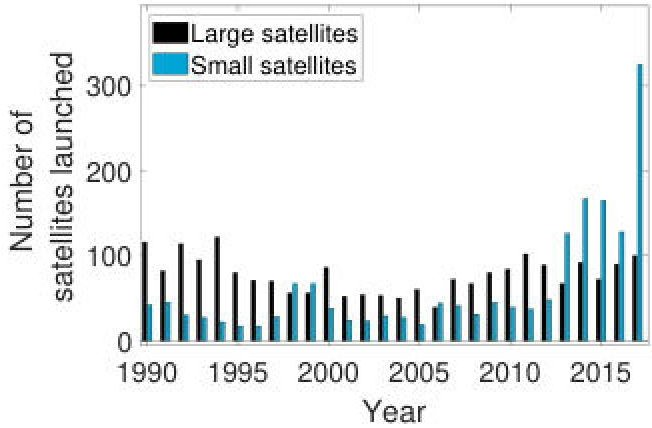

Figure 1.1: Number of satellite launches from 1990 to 2017 adapted from Sweeting (2018).

Small satellites can be divided into sub-categories based on their wet mass (i.e. including propellant mass). In this work, four sub-categories are used and are defined in Table 1.1. The significant increase in small satellite launches from 2013 corresponds to the increase in nano-satellites launches (Sweeting, 2018).

Table 1.1: Classification of small satellites in terms of wet mass.

<table border="1"><tr><td>Category</td><td>Mass Range[kg]</td></tr><tr><td>Pico-satellite</td><td>&lt;1</td></tr><tr><td>Nano-satellite</td><td>1-10</td></tr><tr><td>Micro-satellite</td><td>10-100</td></tr><tr><td>Mini-satellite</td><td>100-500</td></tr></table>

Intrinsically, as satellite mass decreases the satellites become limited in capability especially in terms of electrical power and propulsion, due to the imposed volume and mass constraints. This, of course, is an unfavourable limitation for current and future mission design (Rossi, 2002; Mueller et al., 2010; Agasid et al., 2015; Lemmer, 2017; Leomanni et al., 2017; Silva et al., 2018), such as interplanetary exploration missions. Electrical power systems are responsible for ensuring the satellite bus operates and performs its mission objective with its on-board payload. Design challenges, that are a result of lim-

<!-- PDF_PAGE: 25 -->

iting the maximum available on-board electrical power, include reducing the payload choices that are compatible with the available power, reducing the number of subsystems that can operate simultaneously and reducing the energy storage potential.

Propulsion systems can perform a number of functions such as orbit manoeuvring, station-keeping, orbit transfer, deorbit manoeuvres and attitude control, which are required for specific mission objectives. Small satellites are also often secondary payloads on launch vehicles and may, therefore, be deployed into a non-optimal orbit thus increasing the desire for on-board propulsion. The aforementioned functions highlight the crucial need for high-performing propulsion systems on-board small satellites.

For small satellites to be more competitive with respect to larger ones, the next generation of small satellites require more efficient propulsion and power systems that are capable of meeting stringent mass and volume constraints. There are a number of possibilities to tackle this problem. In this thesis, the focus is on investigating the feasibility of coupling a propulsion system to the essential on-board power generation system, specifically coupling a micro-organic Rankine cycle with a solar thermal propulsion system.

## 1.2. PROPULSION AND POWER FOR SMALL SATELLITES

A broad overview of propulsion and electrical power systems suitable for small satellites is provided in this section. Key performance indicators are needed to identify the technological gap to increase mission flexibility. In this thesis, nuclear systems such as nuclear reactor power sources (Patel, 2004) and nuclear thermal propulsion systems Gabrielli and Herdrich, 2015) are neglected due to the safety, associated high costs, and political concerns around this technology.

## 1.2.1. PROPULSION SYSTEMS

Conventional satellite propulsion systems are either based on stored gas, chemical, electric, or propellantless energy sources. The works of Rossi (2002), Mueller et al. (2010), Tummala and Dutta (2017b), Lemmer (2017), Leomanni et al. (2017), Levchenko et al. (2018), Krejci and Lozano (2018), and Silva et al. (2018) review propulsion systems applicable to small satellites. An overview of performance characteristics and applications of the different propulsion systems applicable to small satellites are provided in Table 1.2 (Rossi, 2002; Mueller et al., 2010; Agasid et al., 2015; Silva et al., 2018; Agasid et al., 2015; Scharfe and Ketsdever, 2009; Mueller, 1997). Each propulsion technology offers particular advantages and disadvantages, such that no technology candidate is optimal for all applications. Instead, a best-suited propulsion system exists for the desired application where the degree of suitability depends entirely on the requirements it has to meet.

## SPACE PROPULSION THEORY

The two parameters of major interest when examining the performance of space propulsion technologies are thrust, F, and specific impulse, $ I_{sp} $ . For propulsion technologies that rely on the thermodynamic expansion of a gas through a nozzle, ideal rocket theory is often used to derive the equations necessary to determine the performance. STP is one of the propulsion systems that follows this principle. However, not all propulsion

<!-- PDF_PAGE: 26 -->

Table 1.2: Overview of propulsion systems for small satellites (Rossi, 2002; Mueller et al., 2010; Agasid et al., 2015; Silva et al., 2018; Agasid et al., 2015; Scharfe and Ketsdever, 2009; Mueller, 1997).

<table border="1"><tr><td>Propulsion technology</td><td>Common propellants</td><td>Thrust</td><td>Specific impulse[s]</td><td>Power*[W]</td><td>TRL**</td><td>Application examples</td></tr><tr><td>Stored gas
Cold gas</td><td>Nitrogen, Butane, Argon, Sulphur Hexafluoride, R134a</td><td>0.01mN-3N</td><td>30-75</td><td>&lt;30(open valve)&lt;3(holding)</td><td>9</td><td>Attitude control and formation flying</td></tr><tr><td>Chemical
Monopropellant</td><td>Hydrazine</td><td>0.5-4N</td><td>150-250</td><td>15</td><td>6-9</td><td>Orbit insertion, transfer, and maintenance
Orbit transfer and attitude control</td></tr><tr><td>Bipropellant</td><td>Monomethylhydrazine+Nitrogen Tetroxide</td><td>1μN-45N</td><td>100-320</td><td>10</td><td>3-9</td><td>Orbit transfer and attitude control</td></tr><tr><td>Solid</td><td>Hydroxyl-terminated polybutadiene+Aluminium+Ammonium Perchlorate
MEMS</td><td>4mN**-258N
4mN-3.2N</td><td>30**-280
30-100</td><td>N/A
0-0.75</td><td>3**-8
3-4</td><td>Orbit transfer and de-orbit</td></tr><tr><td>Electric
Resistojet</td><td>Water, Xenon, Iodine</td><td>5-450mN</td><td>50-250</td><td>15-300</td><td>4-8</td><td>Orbit maintenance and transfer</td></tr><tr><td>Hall effect thrusters</td><td>Xenon, Iodine</td><td>10-50mN</td><td>1000-2000</td><td>175-200</td><td>4-8</td><td>Orbit maintenance and transfer(interplanetary)</td></tr><tr><td>Ion engines</td><td>Xenon, Iodine</td><td>1-10mN</td><td>1000-3500</td><td>10-60</td><td>4-8</td><td>Station keeping and orbit transfer(interplanetary)</td></tr><tr><td>Electrospray</td><td>Ionic liquids</td><td>5-120μN</td><td>474-5930</td><td>1-15</td><td>3**-6</td><td>Precision pointing and attitude control</td></tr><tr><td>Pulsed plasma and vacuum arc thrusters</td><td>Polytetrafluoroethylene,Titanium</td><td>1-1300μN</td><td>500-3000</td><td>1-15</td><td>5-8</td><td>Station keeping and attitude control</td></tr><tr><td>Propellantless
Solar sails</td><td>None</td><td>0.25-0.6mN</td><td>N/A</td><td>N/A</td><td>6-7</td><td>Orbit transfer and deep space</td></tr></table>

* Only low-power electrical systems considered, neglecting > 300 W due to on-board power limitations.

** TRL stands for technology readiness level. Low values correspond to Micro Electro-Mechanical Systems (MEMS).

<!-- PDF_PAGE: 27 -->

systems operate based on this working principle such as some electric propulsion systems (e.g. electrostatic and electromagnetic systems) as well as propellantless systems (e.g. solar sails).

The thrust generated by the gas expanding through the nozzle is defined by Equation 1.1 which is made up of the momentum (first term) and pressure thrust (second term)

$$
F = \dot {m} u _ {e} + \left(p _ {e} - p _ {a}\right) A _ {e},
$$

where $ m $ is the mass flow rate, $ u_{e} $ is the exhaust velocity, and $ A_{e} $ is the exit area of the nozzle. The nozzle exit and ambient pressure are defined as $ p_{e} $ and $ p_{a} $ respectively. The thrust equation can be simplified to Equation 1.3 by introducing the equivalent jet velocity term $ u_{eq} $ defined as

$$
u _ {e q} = u _ {e} + \frac {\left(p _ {e} - p _ {a}\right) A _ {e}}{\dot {m}},
$$

$$
F = \dot {m} u _ {e q}.
$$

The specific impulse $ I_{sp} $ is often used as a key figure of merit as it can be used to determine the propellant consumption efficiency. In other words, it is the total impulse (thrust integrated over the burn time) per unit weight of consumed propellant

$$
I _ {s p} = \frac {\int_ {0} ^ {t} F d t}{g \int_ {0} ^ {t} \dot {m} d t},
$$

where g is the gravitational acceleration on Earth at sea level $ ^{2} $ . When the equivalent jet velocity is constant over the burn time, Equation 1.4 can be simplified as follows

$$
I _ {s p} = \frac {u _ {e q}}{g}.
$$

The ideal rocket theory is based on several assumptions such as the propellant is treated as a perfect and calorically ideal gas with a homogeneous and constant chemical composition, the flow is one-dimensional, steady, and isentropic, and the boundary layer and friction effects and propellant velocity inside the chamber are negligible. It should be noted here, that these assumptions are not always applicable. For example, reducing the size of the thruster to small scales means friction effects may no longer be negligible. However, regarding common liquid propulsion systems, Sutton and Biblarz (2016) states the actual performance only varies up to 6% from the ideal value. Based on the above assumptions and the mass, momentum and energy conservation law Equation 1.6 to 1.11 are derived.

$$
\dot {m} = \frac {p _ {c} A _ {t}}{\sqrt {R _ {g} T _ {c}}} \Gamma ,
$$

where $ p_{c}, A_{t}, R_{g} $ and $ T_{c} $ are the chamber pressure, throat area of the nozzle, specific gas constant and chamber temperature respectively. The Vandenkerckhove function $ \Gamma $ is a function of the specific heat ratio $ \gamma $ , and is defined as

<!-- PDF_PAGE: 28 -->

$$
\Gamma = \sqrt {\gamma \left(\frac {\gamma + 1}{2}\right) ^ {\frac {1 + \gamma}{1 - \gamma}}}.
$$

Equations 1.8 to 1.11 are used to calculate the velocity, Mach number $ M_{e} $ , pressure, and temperature at the exit of the nozzle

$$
u _ {e} = M _ {e} \sqrt {\gamma R _ {g} T _ {e}},
$$

$$
\frac {A _ {e}}{A _ {t}} = \frac {\Gamma}{\sqrt {\frac {2 \gamma}{\gamma - 1} \left(\frac {p _ {e}}{p _ {c}}\right) ^ {2 / \gamma} \left[ 1 - \left(\frac {p _ {e}}{p _ {c}}\right) ^ {(\gamma - 1) / \gamma} \right]}},
$$

$$
p _ {e} = p _ {c} \left(1 + \frac {\gamma - 1}{2} M _ {e} ^ {2}\right) ^ {- \frac {\gamma}{\gamma - 1}},
$$

$$
T _ {e} = T _ {c} \left(1 + \frac {\gamma - 1}{2} M _ {e} ^ {2}\right) ^ {- 1}.
$$

Equations 1.1 to 1.11 are a simplified set of equations that can be used to estimate the performance of a thruster based on operating conditions and nozzle geometry.

## PROPULSION SYSTEM COMPARISON

The disadvantage of chemical propulsion systems is that they offer worse performance in terms of specific impulse values, as shown in Figure 1.2. A lower specific impulse value means the system requires more propellant to perform a particular function, increasing the total volume and mass of the satellite. Stored gas propulsion systems suffer from even lower specific impulse values, as shown in Table 1.2. Electric propulsion systems can have high specific impulse values but provide a relatively low thrust and therefore, on the contrary, low acceleration. This relatively low thrust is due to their thrust to power ratio, meaning that to achieve higher thrust levels they would require an excessive amount of power when compared to the size of the target spacecraft. Electric thrusters are thus required to conduct non-impulsive manoeuvres, whereby the thruster operates continuously, and the satellite performs a number of spiral trajectories to reach the final destination. These trajectories increase the total transfer time of the manoeuvre. Electric propulsion can be very useful for applications that require very small impulse bit such as accurate formation flying or attitude control. Small satellites have limited available power. Thus, the high power demand of most electric thrusters is undesirable. Propellantless technologies, although beneficial since they do not have to carry propellant on-board, also produce low thrust levels. Chemical propulsion systems have significantly shorter transfer times due to higher thrust. These high thrust level propulsion systems are able to perform near-impulse manoeuvres (such as Hohmann manoeuvres). Figure 1.2 indicates the gap in technology between these common propulsion systems. Kennedy (2004); Scharfe and Ketsdever (2009); Gilpin (2015); Sutton and Biblarz (2016) suggests that solar thermal propulsion systems may fill this gap in producing a highthrust and high specific impulse propulsion system.

<!-- PDF_PAGE: 29 -->

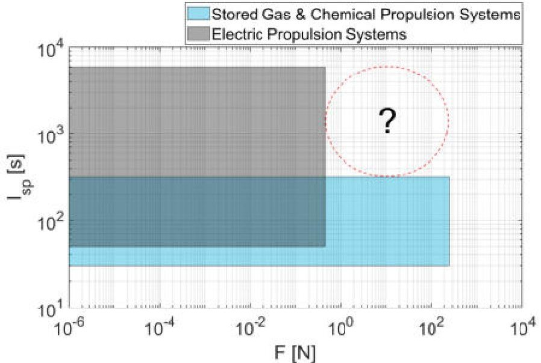

Figure 1.2: Graphical representation of the lower and upper bound of performance values of chemical and electrical propulsion systems provided in Table 1.2, which highlights the gap in technology.

Solar thermal propulsion (STP) is a propulsion technology that uses concentrating devices, such as mirrors or lenses, which focus the sunlight onto the propellant or heat exchanger, often referred to as a receiver. Figure 1.3 shows artist renditions of two Air Force Research Laboratory (AFRL) STP concepts, the Integrated Solar Upper Stage (ISUS) and the Solar Orbit Transfer Vehicle (SOTV).

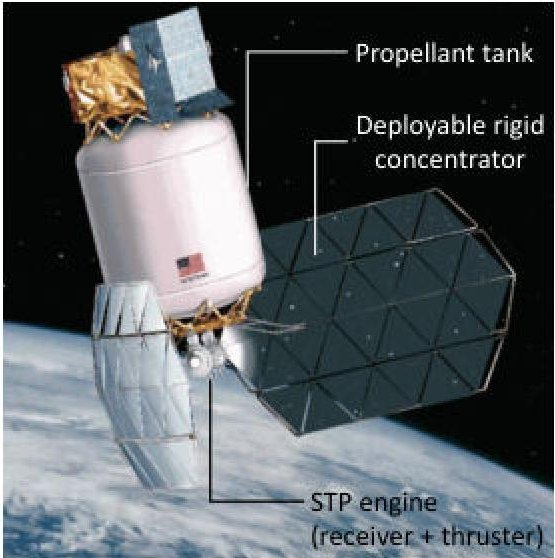

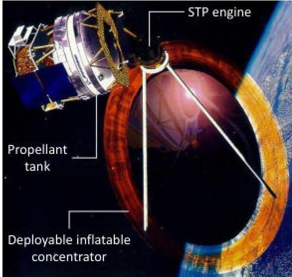

(a)

(b)

Figure 1.3: Conceptual renditions of (a) the Integrated Solar Upper Stage (Frye and Kudija, 1998) and (b) the Solar Orbit Transfer Vehicle with inflatable concentrators (Wade, 2019).

<!-- PDF_PAGE: 30 -->

Figure 1.4a illustrates an STP concept using fibre optic cables to transmit the concentrated solar energy from the concentrator to the receiver. The solar thermal energy is used to heat the propellant to $ 2 5 0 0 \mathrm{K}^{3} $ . This temperature is comparable to the combustion chamber temperature of a bi-propellant propulsion system. Therefore, a further increase in temperature, or the use of a propellant with lower molecular weight, or both is needed to provide significant improvement in specific impulse. A benefit of using STP is that it relies on an external source of energy and not the on-board power. The receiver can also act as a thermal energy storage (TES) system based on either sensible or latent heat materials. This thermal energy can be stored or used to heat up the propellant for thrust generation. Coupling this receiver to a thermal-to-electric conversion (TEC) system to generate electricity could be imperative to producing highly efficient integrated systems for the next generation of satellites. This integration allows subsystems to share on-board components, as shown in Figure 1.4b, using the STP system's wasted energy to co-generate electrical power and possibly use the additional waste heat for on-board thermal control while adhering to the strict mass and volume budgets of small satellites. An in-depth review on the history and performance of existing STP concepts and experimental results is provided in Chapter 2.

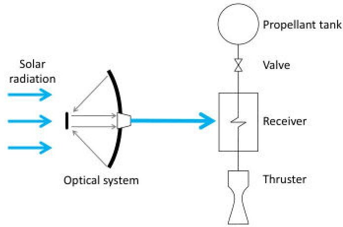

(a)

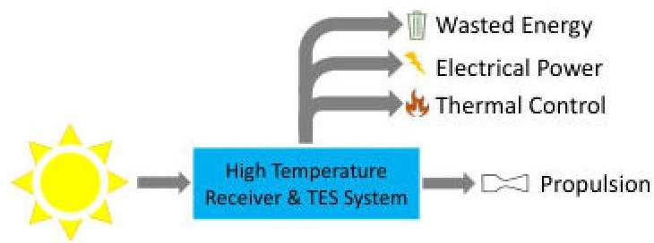

(b)

Figure 1.4: System schematics: (a) schematic of a solar thermal propulsion system and (b) schematic of the integrated solar thermal concept.

<!-- PDF_PAGE: 31 -->

## 1.2.2. ELECTRICAL ENERGY CONVERSION SYSTEMS

Important criteria for space power generation systems are that they must have low mass and high reliability to reduce the associated launch cost and be able to operate in harsh environments without maintenance. NASA has suggested that future interplanetary missions will need satellites with larger electrical power output per mass ratios, referred to as power density, between 150 and 250 W/kg (Surampudi et al., 2017b). Energy storage capabilities, i.e. specific energy, are also required to be improved to more than 250 Wh/kg (Surampudi et al., 2017a). This surpasses current performance of conventional satellite power systems $ ^{4} $ , which employ photovoltaic technologies and Lithium-polymer and ion batteries, as presented in Table 1.3, and call for alternative power systems to be investigated.

Table 1.3: Current and future electrical power generation and storage requirements (Agasid et al., 2015; Surampudi et al., 2017a,b; Antonio et al., 2019; Montgomery et al., 2019).

<table border="1"><tr><td></td><td>Power density[W/kg]</td><td>Specific energy[Wh/kg]</td></tr><tr><td>Current technology performance</td><td>20-100</td><td>150-250</td></tr><tr><td>Future NASA mission requirements</td><td>150-250</td><td>100-500</td></tr></table>

## THERMAL-TO-ELECTRIC CONVERSION SYSTEMS

This section focuses on thermal-to-electric conversion (TEC) systems that are compatible with STP systems. TEC systems are grouped as either static systems, such as photovoltaic (PV), thermionic, and thermophotovoltaic (TPV) systems, or dynamic systems such as Brayton, Stirling, and Rankine cycle systems as illustrated in Figure 1.5. The main difference between these two classifications is that static systems involve no moving parts whereas dynamic systems use kinetic mechanisms such as turbines or pistons to generate electricity.

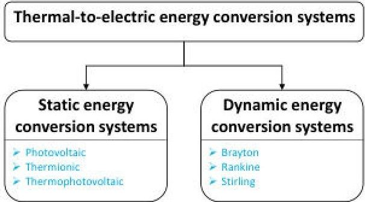

Figure 1.5: Classification of thermal-to-electric power conversion systems.

<!-- PDF_PAGE: 32 -->

Previously, STP systems $ ^{5} $ have have mainly been coupled with thermionic (Zubrin et al., 1992; Laug et al., 1995a,b; Malloy et al., 1995; Frye, 1997; Kudija and Frye, 1998; Kassler et al., 2000) or TPV (Gilpin, 2015) power conversion systems. The thermionic conversion process operates by transferring electrons from a hot emitter through a vacuum to a cooler collector to generate electricity. However, Hyder (2000),Demuth (2003) and Gilpin et al. (2011a) show that these systems are more suitable for larger power levels (10 to more than $ 1 0 0 \mathrm{k W_{e}} $ ). Thermophotovoltaic conversion systems consist of photovoltaic cells that convert infrared radiation from a hot thermal emitter into electricity. Disadvantages of photovoltaic cells are that they are vulnerable to degradation in the space environment (Teofilo et al., 2008; Datas and Marti, 2017) and have low power to mass ratios (Hyder, 2000; Gilpin et al., 2011a). Although, it is expected that substantial improvement in the power density ratio from the current 15 W/kg is possible, as was the case with conventional photovoltaic systems (Hyder, 2000; Kessler, 2001).

An alternative to theses static systems is the use of dynamic power conversion systems that have the potential to offer improved solar-to-electric efficiency that may lead to higher specific power (Angelino et al., 1991; Hyder, 2000). Higher specific power results in a lower overall mass of the power system which could reduce the associated launch cost. In addition dynamic systems can also have longer life expectancy in harsh radiation environments compared to static systems (Hyder, 2000).

Dynamic systems that either use solar or nuclear energy as the source have been investigated in a number of studies for space applications since the 1960's (Klann, 1970; Mason, 1999; Dahr, 1999; Lior, 2011; Glaser, 1968, 1992; Criswell and Thompson, 1996; Brown, 1996; Woodcock, 1977; Tarlecki et al., 2007; Zidansek et al., 2011; Wu et al., 2003; of Solar Dynamic Power System Branch, 1993). The Brayton, Rankine, and Stirling cycle are of most interest for space applications and have been highlighted as possible alternatives to solar PV systems. There is also a recent interest $ ^{6} $ to increase the TRL of low power (0.5 to 500 $ W_{\mathrm{e}} $ ) Brayton, Rankine, and Stirling cycles to between 4 and 5 for space applications using nuclear energy as the source. The benefit of using dynamic systems in space can come from using the low ambient environment (3 K) as a heat sink to produce electrical power at higher efficiency than terrestrial applications. However, to date none of these dynamic systems have flown in space.

The most mature technology is the Brayton cycle and was identified as the most viable dynamic power generation system to power the International Space Station. For example, the Brayton Rotating Units (BRU) that were designed to produce $ 1 0 \mathrm{k W_{e}} $ of electrical power have been tested (Hyder, 2000). The outcome of the Space Freedom Project was a sub-scale prototype $ (2 \mathrm{k W_{e}}) $ that was tested for more than 800 hours under simulated environmental conditions for a typical low Earth Orbit (Shaltens and Mason, 1999).

Previous Rankine cycle development for space application has focused on using nuclear energy as the source and for power levels between 3 to 50 kW $ \mathrm{e} $ such as those developed during the SNAP program (Hyder, 2000). Initially, liquid metals were selected as the working fluid. For similar turbine inlet temperatures (TIT), Rankine cycles using liquid

<!-- PDF_PAGE: 33 -->

metals which have high heat transfer coefficient can have a radiator that needs almost ten times less specific area than a Brayton cycle (Mackay,1959). The advantage of using a Rankine cycle is the better efficiency due to a smaller backwork ratio $ ^{7} $ versus a Brayton cycle which is a gas-only cycle (Criswell and Thompson,1996). This higher efficiency means that smaller and therefore, lower mass radiator can be used. However, Rankine cycles introduce two-phase flow issues due to the zero-gravity environment. Another concern is fluid compatibility as some fluids may be corrosive and cause erosion in the expander. The working fluid selection is also an important design consideration as it affects the thermal efficiency and mass and volume of the system. Stirling engines are not considered as they generally have lower efficiencies than Rankine cycles at the expense of larger radiators (Toro and Lior,2017).

Organic Rankine cycles (ORCs) have also been proposed for space applications. The concept of using ORC systems for power generation in space dates back to the 1960s, where ORC systems were proposed to power the International Space Station with power capacities ranging from 1 to 50 kW $ \mathrm{e} $ （Angelino et al.,1991; Schubert,2012; Mlurray and Gervais,1969). Angelino and Invernizzi (1993) discuss the benefits of using an ORC for space applications. ORC systems have potentially higher overall conversion efficiency and slower degradation in the space environment over traditional PV systems. Higher conversion efficiencies are beneficial to small satellites in LEO missions as it decreases the surface area required. The lower maximum cycle temperatures of ORC over Brayton cycles decreases the constraint on optical efficiency and pointing requirements; it also increases the number of energy storage materials that are compatible with the temperature range. Design challenges include reliability, operating life, transient inertial effects during start-up and shut-down, leakages, two-phase flow under microgravity, and lack of space heritage (Angelino et al.,1991). Toluene and diphenyl were two working fluids considered for a 1 and 30 kW $ \mathrm{e} $ power capacity system (Angelino and Invernizzi,1993). A complete system was developed based on toluene. Angelino et al. (1991) analyzed methyl-substituted benzenes and demonstrated that for a power capacity of between 5 and 30 kW $ \mathrm{e} $ , trimethylbenzene provided the highest overall efficiency while reducing the rotational speed and increasing the size of the turbine with a moderate maximum pressure. The system was designed to operate with a maximum and minimum cycle temperature of $ 360^{\circ} \mathrm{C} $ and $ 60^{\circ} \mathrm{C} $ respectively. After which, Angelino et al. (1991) analyzed the use of cyclic methylsiloxanes (D4 and D5). Results indicate that cyclic siloxanes are relatively stable at high temperatures of $ 400^{\circ} \mathrm{C} $

At low power levels (less than 1 kW $ \mathrm{e} $ ) micro-Rankine cycles $ ^{8} $ can also have better thermal efficiency (Hyder, 2000) and higher power density compared to Brayton cycles (Muller and Fréchette, 2002). The lower performance of micro-Brayton cycles is due to the poor cycle efficiency as a result of miniaturising the system which allows high heat conduction from the turbine to the compressor. Therefore, micro-ORC systems could result in designs that are smaller in volume and mass, which are critical design criteria for small satellites.

<!-- PDF_PAGE: 34 -->

ORC systems provide lower turbine rotational speeds, larger turbine designs, and lower freezing temperatures compared to conventional Rankine cycles (Angelino and Invernizzi, 1993; Angelino et al., 1991; Colonna et al., 2015), and the organic fluid can also act as lubricant. These advantages decrease the system maintenance of ORC systems to once per year for terrestrial applications (Lecompte et al., 2015). It could be plausible to extend the operational time to a few years to meet the operational life-span of a small spacecraft which range from as short as one year up to 15 years. Another benefit of a micro-ORC system is its higher resistance to degradation compared to photovoltaic systems (Angelino et al., 1991; Schubert, 2012). In terrestrial applications, the minimum ORC pressure has to be greater than atmospheric pressure to avoid air leakage into the system. This is not a concern in this design due to vacuum ambient conditions.

Micro-ORCs also have numerous drawbacks such as a lack of space heritage, which increases the risk of the system, and they have lower reliability due to moving parts compared to static power systems. Additional disadvantages are the fast rotational speeds of the turbine (up to 1000000 rpm), potential transient inertial effects during start-up and shut-down, leakages, cooling of components, micro-gravity operation of two-phase flow, and large radiator surface areas (Angelino and Invernizzi, 1993; Harinck et al., 2010; Uusitalo et al., 2014). The ultra-fast rotational speed is arguably a source of failure of the bi-modal system and future work on micro-turbine design is required, especially pertaining to the thermal management due to the high surface to volume ratio of the turbine and the speed of the bearings. Though, current experimental work on high-speed radial compressor designs, with rotational speeds greater than 200000 rpm (Schiffmann and Favrat, 2009; Schiffmann, 2015), could benefit small radial turbine designs due to shared technical solutions that can be adopted by both these turbomachines. In terms of torque, the small size and low mass of the turbine combined with the ultra-fast rotational speed results in low torque values of approximately 2 mNm. These values are below values of typical small satellite reaction wheels (10-210 mNm) (Newspace, 2020).

Research on micro-ORC systems, from a few Watts to 2kW, has focused on solar thermal and waste energy power generation in portable electronic devices, miniature robotics, automotive industry, and remote off-grid applications (Fréchette et al., 2004; Roudy and Frechette, 2005; Orosz, 2009; Liamini et al., 2010). However, little is known on the topic of micro-ORC systems, especially for small satellite applications, and investigations have often neglected the sizing of the components such as the turbine and heat exchangers (Schubert, 2012). Therefore, the dynamic power conversion system under investigation is the micro-organic Rankine Cycle (ORC) system to address this gap. The following section provides the working principle of an ORC system and fundamental equations.

## ORGANIC RANKINE CYCLE THEORY

ORC turbogenerators are thermal engines capable of converting thermal energy into electrical power by means of an organic fluid evolving in a closed-loop based on the classical Rankine thermodynamic cycle. The organic working fluid undergoes a phase change to drive a turbine and generate electricity (Baldasso et al., 2020; Wang et al., 2019; Freeman et al., 2017). The main components of an ORC system are the evaporator, turbine, condenser, and pump as illustrated in Figure 1.6a. A regenerator can also be included in an ORC system to improve the efficiency and reduce the heat transfer surface

<!-- PDF_PAGE: 35 -->

area of the evaporator and condenser at the expense of increased complexity and mass as well as reduced reliability.

The numbers in Figure 1.6a correspond to the various states the working fluid experiences during the cycle process also indicated in the temperature-entropy diagram (Figure 1.6b). The pump compresses the working fluid to a saturated liquid (State 5), the hot vapour from the turbine (State 2) heats up the cold fluid (State 5) inside the regenerator. Next, the working fluid is vaporised in the evaporator and can be heated to temperatures above its saturation temperature, this process is defined as superheating. This hot vapour (State 1) is then expanded in an expander, in this case shown as a turbine, to generate electricity using a generator. The working fluid exits the turbine as a vapour (State 2) due to slope of the saturation curve of organic fluids (Figure 1.6b). Lastly, the working fluid is condensed to a liquid inside the condenser (State 4).

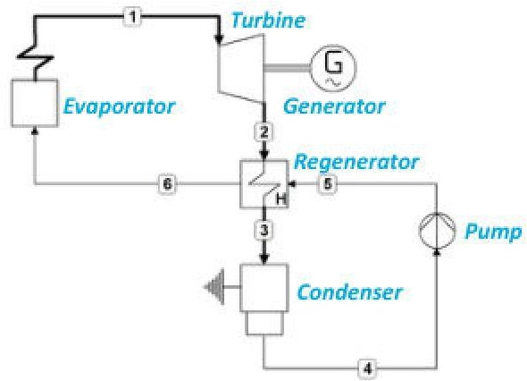

(a)

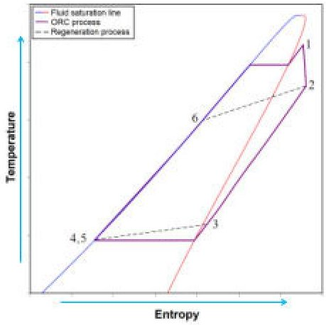

(b)

Figure 1.6: An example of an ORC system with regeneration for space applications. (a) Process flow diagram with a condenser that radiates to space and a boiler that receives concentrated solar radiation. (b) Temperature-entropy diagram of the thermodynamic process of the shown process flow diagram.

Two key performance parameters for ORC systems are the net power output, $ \dot{W}_{\mathrm{net}} $ and thermal energy of the cycle, $ \eta_{th} $ . The net power output is defined as the difference between the specific turbine, $ w_{t} $ and pump work, $ w_{p} $ multiplied by the mass flow rate of the working fluid $ \dot{m} $ . The thermal efficiency is defined as the ratio of the net power output to the heat input into the evaporator $ \dot{Q}_{\mathrm{in}} $ .

$$
\dot {W} _ {\mathrm {n e t}} = \dot {m} \left(w _ {t} - w _ {p}\right)
$$

$$
\eta_ {t h} = \frac {\dot {W} _ {\mathrm {n e t}}}{\dot {Q} _ {\mathrm {i n}}}
$$

The specific work of the turbine and pump are based on the specific enthalpies of the states illustrated in Figure 1.6a as followed:

$$
w _ {t} = h _ {1} - h _ {2}
$$

$$
w _ {p} = h _ {5} - h _ {4}.
$$

<!-- PDF_PAGE: 36 -->

## 1.3. RESEARCH QUESTIONS AND METHODOLOGY

The main objective of this work is to advance the research in the field of bi-modal solar thermal propulsion systems that could be used to improve the power and propulsion capabilities of the next generation of small satellites. Specifically, tackling the scientific and engineering difficulties of coupling an STP system with a micro-ORC system seeing that both these systems have low maturity, with technology readiness level between 2-4. Research questions (RQ) have been formulated to achieve this main objective. These RQs and corresponding methodologies are discussed in this section.

## RQ 1: WHAT BOUNDS THE PROPOSED BI-MODAL SOLAR THERMAL POWER AND PROPULSION SYSTEM FOR SMALL SATELLITE APPLICATIONS?

To tackle this research question the two systems (STP and ORC) were individually investigated in Chapter 2 and 3 respectively. A review on the state-of-the-art propulsion systems applicable to small satellites is performed to aid in answering this question by identifying the current status of STP systems. The propulsion systems are then qualitatively compared to each other for various mission cases with respect to cost in order to determine the most promising applications of STP systems. This comparison is performed using the methodology defined by Sellers (1996) which is extended in this thesis to include STP systems. The investigation also examines varying the criteria weights given by Sellers (1996) to highlight the sensitivity of the criteria. The selection of the propellant is based on the volume and mass constraints imposed by small satellites.

As previously mentioned, there is a lack of knowledge regarding the topic of micro-ORC systems. Thus this thesis contributes to the body of knowledge of micro-ORC systems for small satellite applications. The answer to this RQ therefore provides insight into the most promising working fluids that are suitable for the volume and mass constraints imposed on the system. Chapter 3 presents the methodology used to determine the best working fluid on-board a small satellite. A pre-screening was performed on 75 organic working fluids to identify potential candidates. From this and the work of Angelino and Invernizzi (1993), 6 working fluids were selected and analysed in-depth with respect to reducing the volume of the micro-ORC system while incorporating the thermodynamic cycle and the sizing of the turbine and heat exchangers.

Furthermore, future technologies and features that can be developed are investigated in order to enhance STP and micro-ORC systems while also discussing their limitations and drawbacks. The proposed bi-modal solar thermal system is a novel system and thus limited literature exists on the systems integrated performance behaviour and key relationships. The second research question has been proposed to tackling this research gap.

## RQ 2: WHAT GAIN IN PERFORMANCE PARAMETERS SUCH AS EFFICIENCY ARE ACHIEVABLE WHEN IMPROVING THE BI-MODAL SYSTEM AND WHAT GAIN IS REQUIRED FOR BENEFICIAL APPLICATION?

A single-objective genetic algorithm is developed in Chapter 4 to aid in answering this question. The optimisation explores a large design space with an objective function to minimise the bi-modal system's wet system mass while meeting the thermal energy storage requirement. The proposed system is compared against an existing spacecraft in

<!-- PDF_PAGE: 37 -->

Chapter 5 based on the available figure of merits such as specific energy and thrust-to-mass ratio to identify its feasibility in the commercial market. Improvements in performance, such as thrust and electrical power, are investigated to describe better componentlevel designs. The thermal efficiency of the micro-turbine in the ORC system at the proposed power levels (on the order of a few hundred Watts) is limited. Therefore, the smallscale loss models suitable for 30 mm rotor diameters proposed by Suhrmann et al. (2010) were extended down to 7 mm diameters (turbine rotor diameter of this work) to give a preliminary value of the expected efficiency.

However, to answer RQ 2, an accurate system description and model is required to determine what is needed to make the proposed bi-modal system a viable technology. This formulated the last research question.

## RQ 3: HOW CAN WE ACCURATELY MODEL AND CHARACTERISE THE BI-MODAL SYSTEM?

To answer this question a design methodology for the novel bi-modal system is developed and Chapter 4 discusses the 13 design parameters that can be used to describe the system. An analytical model is developed that describes the performance of the bi-modal system such as thrust and electrical power output as well as size of the components based on theoretical models and empirical equations. Validation and verification of the analytical models is conducted to ensure the model accuracy and function are adequate. Critical components are identified and then further analysed to enhance the understanding of the bi-modal system.

An important aspect of the system is the ultra-high temperature of the receiver and its effect on the flow regime of the fluids used in the system which has been neglected in previous studies. The methodology given by Shah (2017) and Kim and Mudawar (2013b) are used to determine the critical heat flux of the working fluid and propellant. The effect of various flow regimes as well as radiation on the heat transfer coefficient of the fluids is evaluated.

Additionally, a sensitivity analysis is conducted to identify the effect of the design parameters. An analysis of variance (ANOVA) is also performed to determine the percentage contribution of uncertain constant parameters used in the analytical model. A sensitivity analysis was also performed on spiral and straight channel configurations to determine the better configuration for the working fluid and propellant channels.

In order to characterise the bi-modal system, the dynamic behaviour of the thermal receiver is required (Chapter 5 ). The enthalpy method is used to describe the dynamic behaviour of the TES system which is based on latent heat storage.

The answer to this research question contributes to the field by establishing a design approach for the proposed bi-modal system along with guidelines for future development of bi-modal solar thermal propulsion systems.

## 1.4. THESIS OUTLINE

The thesis consists of six chapters, beginning with an introductory chapter (i.e. this chapter) followed by four core chapters and the concluding chapter. All four core chapters are used to answer the research questions defined above. The visual outline of this thesis and linked publications are provided in Figure 1.7. Chapter 2 focuses on the propulsion aspect of the integrated system. In this chapter, solar thermal propulsion

<!-- PDF_PAGE: 38 -->

(STP) systems are extensively reviewed after which an investigation into the suitable applications of STP systems for low-cost small satellite missions is conducted. Chapter 3 provides detailed aspect on the electrical power generation and investigates the feasibility of using the waste heat of the STP system to generate electricity. More specifically, the operation, modelling, and working fluid selection of a micro-ORC system is examined. The novel integrated solar thermal system is described in Chapter 4 highlighting the key design parameters and suitable satellite size category. The optimisation provides an initial framework in the selection of an optimal integrated solar thermal design for the proposed lunar mission. An analysis of variance has also been conducted to identify which system parameters, such as optical efficiency and turbine efficiency, have the most influential effect on the system. In Chapter 5 the receiver is inspected to reveal the phase change material (PCM) transient behaviour. This chapter, describes the key relationship between the PCM and the convective flow of the propellant and working fluid. In addition, the bi-modal system is compared to an existing mission in terms of figure of merits such as power density, specific energy, and thrust to mass ratio. This is performed to showcase the bi-modal systems's benefits and pitfalls in relation to current systems. Lastly, Chapter 6 summaries and highlights the contributions of this research and identifies potential areas of future work with regard to the bi-modal solar thermal propulsion system.

<!-- PDF_PAGE: 39 -->

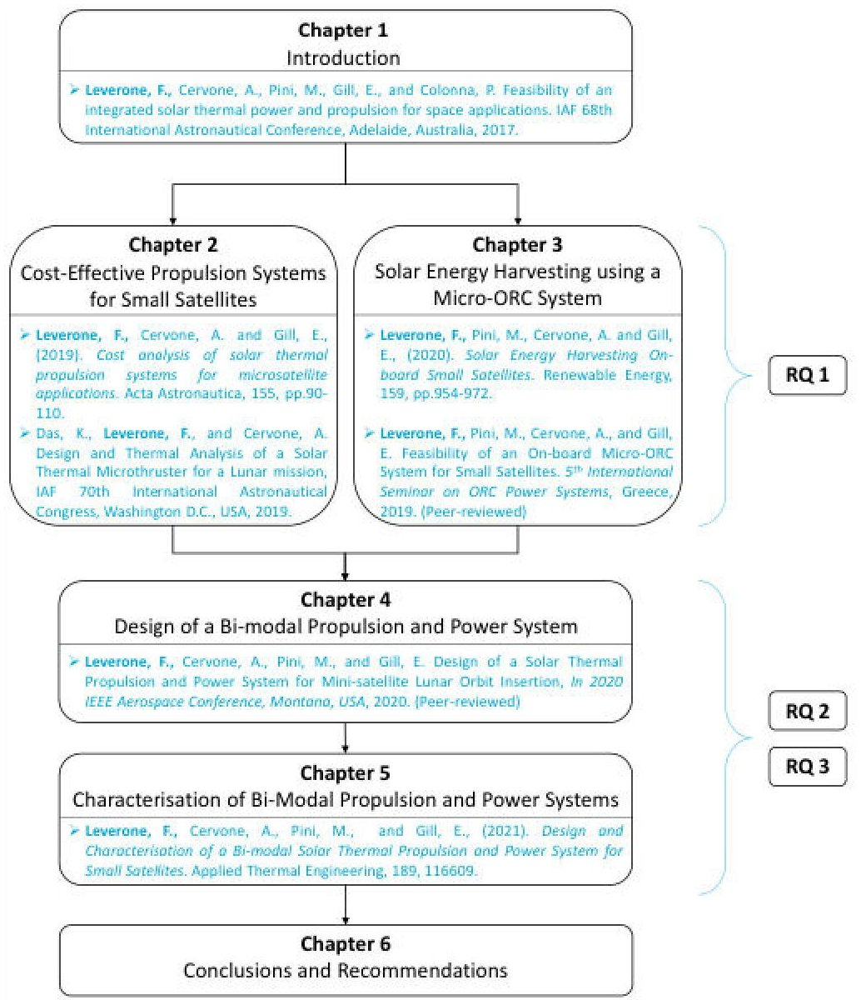

Figure 1.7: Outline of the thesis showing the main chapters that contribute to answering the research questions (RQ) and the associated publications.

<!-- PDF_PAGE: 40 -->

<!-- PDF_PAGE: 41 -->

# COST-EFFECTIVE PROPULSION SYSTEMS FOR SMALL SATELLITES

Never interrupt someone doing something you said couldn't be done.

Amelia Earhart, American aviator

Small satellites provide low-cost platforms for space missions. However, this lower cost comes at the expense of a reduction in performance of key sub-systems, such as the propulsion system, due to the small volume and mass restrictions available on-board. For this reason, small, low-mass, high-performing and affordable propulsion systems are necessary, but there is limited research available on the comparison of propulsion technologies with regards to cost. Motivated by the above challenges the objective of this chapter is to provide a comparison of propulsion technologies that are compatible with small satellites with respect to cost. To this end, different propulsion systems are investigated for four satellite scenarios, a satellite that needs to perform a small on-orbit manoeuvre, two station-keeping satellites in Low Earth Orbit, and a satellite that requires an orbit transfer to lunar orbit from Geostationary Transfer Orbit. Each system is evaluated in terms of a total cost indicator which incorporates nine variables such as propellant mass, safety, and hardware cost, that affect the total cost of a propulsion system. This indicator is used to quantitatively compare the propulsion systems to identify cost-effective solutions as a function of the various mission scenarios. An important finding of this research is the classification of propulsion systems in terms of thrust, specific impulse, cost, and application.

<!-- PDF_PAGE: 42 -->

## 2.1. INTRODUCTION

This chapter provides an extensive review of current state-of-the-art propulsion technology systems that are applicable to small satellites. As mentioned in the previous chapter, solar thermal propulsion (STP) represents a promising alternative to conventional propulsion systems for small satellites by providing high thrust and high specific impulse (Kennedy, 2004; Scharfe and Ketsdever, 2009). Motivated by this and the limited analysis of STP systems for small satellites, this chapter focuses on the review of STP systems and identifies possible low-cost applications relative to existing technologies. While many studies have focused on performance characterisation of propulsion systems, little is known on the cost aspect of propulsion systems for small satellites, particularly STP systems.

Each propulsion technology applicable to small satellites is evaluated, based on a total cost indicator identified by Sellers et al. (1998) for four scenarios. The total cost indicator is a function of nine criteria that are involved in selecting a propulsion system throughout all the mission phases from design to operations. These criteria are the propellant mass, propellant volume, electrical power requirement, transfer time, safety logistics, integration, risk, and hardware cost.

The ideal velocity change, or more commonly the $ \Delta V $ budget, for small satellite missions that require propulsion manoeuvres can range from a few m/s to many km/s (Wertz et al., 2011) and determined from the mission requirements. Therefore, four scenarios were examined to determine where STP could be the most beneficial in terms of reducing cost. These scenarios include a mini-spacecraft $ ^{1} $ performing a small orbit correction, two mini-spacecraft in Low Earth Orbit (LEO) that need to perform station-keeping for 3 years and a mini-spacecraft that transfers from Geostationary Transfer Orbit (GTO) to lunar orbit. From this analysis, a quantitative comparison is presented to identify feasible applications of STP systems.

## 2.2. PROPULSION TECHNOLOGY OPTIONS

This section begins by discussing the current state-of-the-art propulsion systems that are suitable for small satellites, as defined in Chapter 1, such as chemical, electric, and propellantless propulsion systems. After which an extensive review of STP systems is provided.

## 2.2.1. STORED GAS PROPULSION SYSTEMS

Cold gas propulsion systems operate by expanding a cold gas through a nozzle to generate thrust. Advantages include simplicity and low operating power (Agasid et al., 2018) (up to $ 1 5 \mathrm{~W}^{2} $ ). However, they offer inferior specific impulse and efficiency when compared to other propulsion systems (Sutton and Biblarz, 2016). Liquefied propellants, such as Butane, are often used for small satellite propulsion systems as they offer improved storage density compared to traditional cold gas propellants such as Nitrogen and Helium. Propellants with better safety characteristics are desirable for small satel-

<!-- PDF_PAGE: 43 -->

lite propulsion as they are generally secondary payloads that need to be affordable with low risk. Often secondary payloads are also limited in terms of the total allowable energy stored at launch. The National Fire Protection Association (NFPA) 704 rating system (NFPA, 2010) provides a numerical measure between 0 and 4 (with the larger values indicting an increase in the severity of the hazard) to identify the fluids safety level in terms of health, flammability, and chemical reactivity.

Butane has a NFPA 704 health hazard rating of 1 which means that skin and eye irritation are symptoms that are caused by personal that come into contact with it. This is higher in toxicity compared to Nitrogen, a typical cold gas propellant which is inert and a NFPA 704 health rating of 0. Butane also is highly flammable with a maximum NFPA 704 fire rating of 4. Cold gas systems are volume-constrained which limits their application on-board small satellites to attitude control or other low velocity increment $ (\Delta V) $ applications (Ranjan et al., 2017). However, the propellant can also be stored in solidified form to improve the storage density, such as the cool gas generators used for example on-board the Delfi-n3Xt satellite for orbit control which used Nitrogen as the propellant (Sandau et al., 2010).

## 2.2.2. CHEMICAL PROPULSION SYSTEMS

Chemical propulsion systems operate by the propellant, stored as a liquid or solid, undergoing a chemical decomposition or reaction that results in hot gases that are expanded through a nozzle to generate thrust. These propulsion systems are limited by the energy of the propellant as the amount of energy released during the reaction is constrained by the energy per unit mass of the propellant. The small volume and mass available on-board a small satellite thus restricts the use of this system. In general, chemical propulsion systems have significantly shorter transfer times over electric propulsion systems due to higher thrust achievable. The higher thrust allows for near-impulsive manoeuvres to be used, such that approximate Hohmann transfers can be performed. Current state-of-the-art chemical propulsion systems for small satellites include monopropellants, bipropellants, and solid propellant propulsion systems.

Liquid Hydrazine is a common monopropellant. However, the potential European ban of hydrazine by 2021 $ ^{3} $ has promoted research into green propellants, such as Hydroxylammonium Nitrate (Amrousse et al., 2017; Goza, 2017) and Ammonium Perchlorate (Gohardani et al., 2014). Monopropellant systems catalytically decompose their propellants and generate thrust by expelling the superheated gas through a nozzle. These systems offer higher specific impulses and density impulses over cold gas systems. Additionally, green propellants have lower freezing temperatures versus its toxic counterpart hydrazine. Disadvantages can include leakage, the need for a pressurant system, high decomposition temperatures of the order of $ 1 8 0 0 \mathrm {^ \circ C} $ , increased complexity from the addition of moving parts and the propellants can be corrosive and hazardous in the case of hydrazine. Typical applications include orbit transfers, station keeping, and attitude control (ArianeGroup, 2017).

<!-- PDF_PAGE: 44 -->

Bipropellant systems inject a separate liquid oxidiser and liquid fuel into a single combustion chamber that then undergo a hypergolic chemical reaction to produce hot gases that are expelled through a nozzle to generate thrust. The need for an ignition system is therefore mitigated if hypergolic propellants are selected, and the system can be operated in a pulsed operation mode. Higher specific impulses are achievable with bipropellant propulsion systems due to a more stable chemical reaction over monopropellants (Sforza, 2017a,b). Bipropellant systems have been used for orbit manoeuvring applications, and low thrust (5 to 22 N) bipropellant systems have been proposed for attitude control of larger satellites (Ketsdever and Micci, 2000).

Solid propulsion systems combine a solid oxidiser and fuel into a single propellant cartridge that is ignited to produce hot combustion exhaust gases which are then expelled through a nozzle. These systems are the most compact and offer minimal complexity as there are no moving parts. However, due to the high susceptibility of the propellant cartridge to detonate, handling and safety are a concern. A common propellant combination is Hydroxyl-terminated Polybutadiene (HTPB) mixed with Aluminium and Ammonium Perchlorate. Disadvantages include the lack of restart capability, short burn times and high accelerations which limits application potential as the increase in operational complexity for multiple burn applications (multiple stages required) and lack in control during the burn outweighs the volumetric advantage. Applications include orbit transfer such as orbit raising, insertion or de-orbiting (Agasid et al., 2015).

## 2.2.3. ELECTRIC PROPULSION SYSTEMS

Electric propulsion can be divided into electrothermal (resistojets and arcjets), electromagnetic (pulsed plasma thrusters), and electrostatic (ion engines, Hall effect thrusters, and electrospray engines) propulsion systems. Electrothermal systems heat up a propellant and then expand the hot gas through a nozzle. Resistojets use electrical heaters while arcjets use an electric arc generated by applying an electric potential to a cathode and anode to directly heat the propellant flow. Electrostatic and electromagnetic thrusters both ionise a propellant to form a plasma which is then accelerated by either a static electric or electromagnetic field.

Satellite power systems occupy approximately 10% to 25% of the total wet mass of a satellite (Wertz et al., 2011; Kugelberg et al., 2004; Fish et al., 2014; Ekpo, 2019) which limits the available on-board power. Electric propulsion systems are therefore powerlimited, the exception being resistojets and arcjets which are temperature-limited based on current high-melting materials. Although, arcjets are able to obtain higher temperatures than resistojets as the electric discharge can directly heat the propellant to much higher temperatures than the walls (Sutton and Biblarz, 2016). High specific impulse and low thrust values, for example, 2100 s and 1.15 mN as in the case of the Busek's BIT3 ion engine (Busek, 2017) are feasible with electrostatic or electromagnetic propulsion systems compared to chemical propulsion systems and electrothermal propulsion systems. The low thrust results in lower accelerations and thus electric propulsion systems require to conduct non-impulsive manoeuvres, whereby the thruster operates continuously, and the satellite performs a low-thrust trajectory to reach its final destination. These trajectories increase the total transfer time and $ \Delta V $

<!-- PDF_PAGE: 45 -->

Small satellites have limited available power, which limits the thrust and specific impulse obtainable, as showcased in Table 2.1 where the performance versus input power is presented.

Table 2.1: Range of RF ion thrusters from Busek Co. Inc. (Busek, 2017).

<table border="1"><tr><td>Model</td><td>BIT-1</td><td>BIT-3</td><td>BIT-7</td></tr><tr><td>Input power</td><td>28W</td><td>75W</td><td>460W</td></tr><tr><td>Thrust</td><td>185μN</td><td>1.15mN</td><td>11.0mN</td></tr><tr><td>Specific impulse</td><td>1600s</td><td>2100s</td><td>3300s</td></tr></table>

A Pulsed Plasma Thruster (PPT) operates by ablating a solid propellant, generally Teflon, using an electric arc between the anode and cathode. The plasma is accelerated by Lorentz forces that are generated from the electric arc and electromagnetic field. These thrusters offer good reliability and simplicity and operate with inert and non-toxic propellants over a broad range of power inputs. However, PPTs may suffer from high voltage and electromagnetic interference. PPTs have much lower thrust-to-power ratio than Hall effect thrusters making them more useful for attitude control purposes (Sforza, 2017b), station keeping of GEO satellites (Myers et al., 1995), and orbit control of CubeSats (Ciaralli et al., 2016) applications. This system operates with very short pulses and thus prevents temperature being the limiting factor.

An ion thruster is an example of an electrostatic thruster that works on the principle of propellant ionisation to form a plasma and accelerates the ions using an electrostatic grid to generate thrust. Miniaturisation studies have resulted in a decrease in thrust efficiency when reducing the ionisation chamber size (Mueller et al., 2010). Ion thrusters have been used for station keeping of GEO communication satellites as well as for interplanetary missions such as on-board the DAWN spacecraft (Rayman and Mase, 2014).

Hall effect thrusters rely on trapping electrons in a magnetic field to ionise the propellant to create a plasma. The plasma is then accelerated using an electric field. The systems have high power consumption of the order of a few hundred Watts which can exceed a small satellites available power budget, due to the difficulty in miniaturising components such as the neutraliser (Agasid et al., 2015). Hall effect thrusters have been used for station keeping (Sforza, 2017b). ESA's SMART-1 mission (Kugelberg et al., 2004) used the PPS-1350 G Hall effect engine for a GTO (Geostationary Transfer Orbit) to lunar transfer mission. Difficulties of electromagnetic propulsion systems on-board small satellites include electromagnetic interference, power budget, attitude control, and thermal control of the Xenon tanks. Hall effect thrusters have shown better reliability than ion engines although the amount is decreasing with technology improvement and since 2005 electric propulsion has demonstrated better reliability than chemical propulsion systems (Saleh et al., 2017).

Electrospray thrusters are also an electrostatic propulsion system that relies on an electric field generated between the electrode and emitter tip to ionise the propellant. These systems produce low thrust levels (micro-Newton level) and are suitable for CubeSat form factors, and can provide precise attitude control and station-keeping (Mueller, 1997).

<!-- PDF_PAGE: 46 -->

## 2.2.4. PROPELLANTLESS PROPULSION SYSTEMS

Propellantless propulsion systems, such as solar sails, offer a unique solution as the system relies on photons from the sun reflecting off a large low-mass highly reflective structure, which resembles a sail on a ship, to propel the satellite. Solar sails provide a safe, reliable, and simple propulsion method for small satellites. An example of a solar sail is JAXA's "IKAROS", which was used on-board a 307 kg spacecraft to provide the spacecraft with 1.12 mN of thrust for deep space applications. The IKAROS sail had a mass of 16 kg and a span of 20 m (Tsuda et al., 2011). The low thrust of solar sails results in longer transfer times similar to electric propulsion systems. Solar sails have also been designed for de-orbit and orbit transfer applications (Fu et al., 2016). Technical challenges include packaging, deployment, and pointing of the sails and large sails increases the risk of collision with space debris.

## 2.2.5. ADVANCED PROPULSION SYSTEMS

Possible alternative propulsion concepts that have received less attention include nuclear thermal (Gabrielli and Herdrich, 2015) and solar thermal (Ehricke, 1959) propulsion systems. Nuclear systems are neglected in this thesis due to the safety and political concerns around this technology. Solar thermal propulsion (STP) uses solar radiation to heat a propellant to high temperatures to increase the specific impulse and has been identified as a possible propulsion system for micro-satellites (Scharfe and Ketsdever, 2009; Kennedy, 2004).

Solar thermal propulsion (STP) is a propulsion mechanism that uses concentrating devices, such as mirrors or lenses, which focus the sunlight onto the propellant or heat exchanger, often referred to as a receiver. Figure 1.4a illustrates the STP concept with the use of fibre optic cables that transmit the concentrated solar energy from the concentrator to the receiver. The solar thermal energy is used to increase the propellant temperature up to 2500 K. These systems are temperature-limited based on current high-melting materials. The receiver can also act as an energy storage system based on either sensible or latent heat materials. A benefit of using STP as a spacecraft propulsion system is that it relies on an external source of energy and not the on-board power.

Research on STP has been conducted for more than 60 years (Ehricke, 1959). Yet no flight testing has been achieved. An overview of milestones and programmes associated with solar thermal technology since the advent of the technology in 1956 is provided in Table 2.2. Key technical issues for large-scale STP systems include vehicle integration, plume interaction, concentrator pointing and solar tracking as well as plumbing concerns (Selph, 1981). The first propellant selected for STP systems is Hydrogen. However, Hydrogen introduces additionally problems related to long-term storage due to boil-off issues and large storage volumes required. The designs shifted towards smaller satellites in the 2000s, and the use of fibre optics, thermal energy storage and bi-modal systems (integrated propulsion and power system) renewed the interest in STP (Kennedy, 2004; Kennedy et al., 2004; Kennedy and Palmer, 2002; Henshall and Palmer, 2006; Henshall, 2006b; Kennedy and Palmer, 2003). Fibre optic cables allow for the concentrator and thruster to be decoupled from each other which relaxes the tracking and pointing requirements. The use of thermal energy storage also relaxes the tracking and pointing requirements and allows the system to operate in eclipse periods which extends the vari-

<!-- PDF_PAGE: 47 -->

ety of feasible mission profiles. Solar bi-modal systems, which utilise the thermal energy for both electrical energy and propulsion purposes, could showcase STP as an advantageous propulsion system to low-cost small satellites. This improvement is promising as it may result in the elimination of monetarily expensive solar panels on-board as well as a reduction in battery capacity required.

Current challenges of STP systems include the need for efficient, low-mass and small concentrators with good optical efficiency, controllability and deployment capability. Issues related to the receiver material include insufficient sealing and lifetime of thermal cycling and, in the case of latent heat materials, phase change and liquid containment issues (Gilpin, 2015). Datas et al. (2016, 2018) shows the use of Silicon alloys instead of pure Silicon as a possible solution to overcome these receiver material issues. Low-mass insulation materials are necessary to minimise heat distribution to on-board sensitive components. Further investigation into developing efficient large-core fibre optic cables is also needed (Kennedy, 2004). Another disadvantage is the lack of flight heritage of STP systems.

Figure 2.1 provides a graphical representation of Technology Readiness Level (TRL) $ ^{4} $ time-line of STP according to Table 2.2. Developments have been based on the end dates of programs/projects. This figure highlights the progress of STP as either single or bi-modal systems and the shift of focus to small satellites. A gain in development (higher TRL) can be seen in Figure 2.1 when STP systems are coupled to a power system. This gain is due to the previously built infrastructure and STP test facilities as well as the potential advantage of increasing payload mass and reducing operational and launch costs (Laug et al., 1995b). Two key advancements regarding inflatable technology are also shown in this figure, the successful deployment of an inflatable antenna in space and the deployment of a 4 x 6 m inflatable concentrator under space conditions that resulted in a TRL 6.

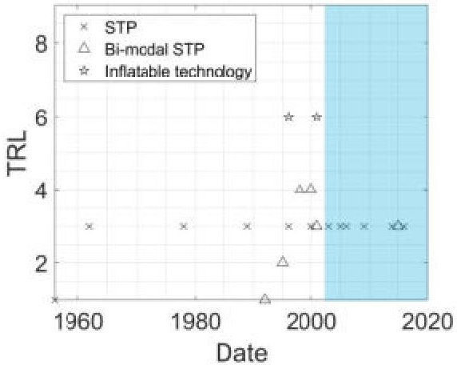

Figure 2.1: Chronological Technology Readiness Level (TRL) of STP systems. The shaded section on the right side of the figure indicates the focus shift to small satellites, micro-satellites in particular.

<!-- PDF_PAGE: 48 -->

Table 2.2: History of Solar Thermal Propulsion

<table border="1"><tr><td>Ref.</td><td>Years</td><td>Program or Institution</td><td>Description</td></tr><tr><td>[Ehricke,1959]</td><td>1956</td><td></td><td>First STP concept based on two 40m diameter inflatable sphere concentrators.</td></tr><tr><td>[Selph,1981]</td><td>1962</td><td>EOS&amp;AFRPL</td><td>First successful test of an STP engine. The small-scale molybdenum STE was tested up to 2300K and used Hydrogen as the propellant. First electro-formed lightweight mirrored concentrator(1.5m in diameter). Feasibility demonstration of STP compared to electric and chemical propulsion for a LEO to GEO mission. Research terminated due to funding and vehicle integration, plume interaction, pointing and tracking as well as plumbing concerns.</td></tr><tr><td>[Ethieridge,1979]</td><td>1978</td><td>Space Systems Group of Rockwell International&amp;AFRPL</td><td>STP research started again due to the commencement of the Space Shuttle program that brought with it an increase in space-related activities and funding and the technical issues noted above were deemed not to be“show-stoppers”as they had not yet been addressed.Off-axis parabolic concentrators and a central receiver cavity design were proposed to simplify the system design.Additional LEO to GEO analytical studies to compare STP to conventional propulsion systems based on the projected performance of future technology.</td></tr><tr><td>[Shopi,1983]</td><td>1980-1989</td><td>AFRPL&amp;Rocketdyne</td><td>Receiver concept generation and comparison (Windowless heat exchanger cavity, windowed heat exchanger cavity, windowed particulate concept, windowed vortex flow concept, windowed rotating beel, and aerowindow concept).The results lead to the development of a quartz windowed heat exchanger cavity prototype that was tested in 1984.Development and construction of solar thermal test facilities(solar furnace and thrust stand), prototypes and experiments.AFRPL declared STP feasible in 1989.</td></tr><tr><td>[Zubrin et al.,1992]</td><td>1992</td><td>IPAPS</td><td>A bi-modal nuclear concept that integrated a thermionic reactor and Hydrogen propulsion system was proposed, which was the foundation for the development of a bi-modal STP system.</td></tr><tr><td>[Frye,1997;Kudija and Frye,1998]</td><td>1994-1998</td><td>ISUS</td><td>A bi-modal design concept used to transfer a satellite from LEO to MEO,GEO or HEO. First sensible heat thermal energy storage STE(solar thermal engine) prototype.The receiver was rhenium coated graphite, and a rigid faceted concentrator was used to reduce cost and risk.</td></tr><tr><td>[Mulloy et al.,1995]</td><td>1995</td><td>Patent:5,459,996</td><td>A bi-modal solar thermal concept was patented, based on a thermal energy converter,a thermionic converter,and STP system.</td></tr><tr><td>[Laug et al.,1995a,b]</td><td>1995</td><td>Babcock&amp;Wilcox</td><td>Research into extending the capabilities of low-cost launch vehicles by the inclusion of a large thrust STP upper stage bi-model concept.</td></tr><tr><td>[Stewart and Martin,1995]</td><td>1995</td><td>University of Alabama</td><td>A dual fuel,Ammonia and Hydrogen STP system for LEO to GEO transfer was proposed.</td></tr><tr><td>[Freeland et al.,1997]</td><td>1996</td><td>L&#x27;Garde Inflatable Antenna Experiment</td><td>The successful deployment of a 14m inflatable antenna in space.This technology is beneficial for inflatable concentrators.</td></tr><tr><td>[Adams,1996]</td><td>1996</td><td>STUS</td><td>NASA and the Air Force proposed the STUS design to deliver a 424kg payload from LEO to GEO using an STE,two inflatable concentrators.A hydrogen tank volume of approximately 10m3 was required for this concept.</td></tr><tr><td>[Tinker,1998;Tucker and Salvall,2002]</td><td>1996-2000</td><td>SSE</td><td>NASA proposed a STE with the use of a secondary concentrator and porous bed heat exchanger.</td></tr><tr><td>[Shimizu and Naito,2001;Shimizu et al.,1996;Sahara et al.,2003,2001]</td><td>1997-2001</td><td>ISUS</td><td>Work on a single crystal molybdenum and tungsten thruster combined with a thermionic converter for power generation using a small concentrator of 1.6m diameter with a focal length of 0.65m was conducted.Additionally,tests on a stainless steel opposed cavity(two cavities back to back) up to temperatures of 1400K were also performed.</td></tr><tr><td>[Kassler et al.,2000]</td><td>1998-2000s</td><td>SOTV</td><td>A bi-modal (thermionic converter and STE) design was investigated.The main aim of the program was to develop the technology required for a space-flight bi-modal system.</td></tr><tr><td>[Wassom et al.,2001]</td><td>2001</td><td>IHPRPT</td><td>The SOTV-SE was designed to achieve a minimum average specific impulse of 717s,at least a1*plane change and4900km apogee increase,to operate for at least 30 days for 310 cycles and produce a minimum delta-V of900m/s.</td></tr><tr><td>[Kennedy,2004;Kennedy et al.,2004;Kennedy and Palmer,2002;Henshall and Palmer,2006;Henshall,2006b;Kennedy and Palmer,2003]</td><td>2000-2006</td><td>SSC</td><td>Research on STP for microsatellites(10 to 100kg)commenced.A proof-of-concept for a 20kg satellite,using a rigid concentrator and off-the-shelf components was developed.Ground testing of a spiral channel and packed bed receiver configurations were performed,and results showed receiver leakage and cracking issues.A novel idea to couple fibre optic cables to an STP was proposed to decouple the pointing requirement of the concentrator and thruster.</td></tr><tr><td>[Shimizu et al.,1998;Sahara et al.,2003;Sahara and Shimizu,2003]</td><td>1998-2003</td><td>IAXA</td><td>A de-orbit STP concept for a 50kg satellite,μ-LabSat,with lightweight,thin film concentrators made out of polyamide an polyester that have an areal density of180g/m2was demonstrated.</td></tr><tr><td>[Nakamura et al.,2004]</td><td>2004-2005</td><td>PSI,Boeing,AFRL</td><td>Experimental testing of a fibre optic cable coupled to a1N STP system up to200Wup to1400K using Hydrogen and ammonia was conducted.</td></tr><tr><td>[Colorna et al.,2006]</td><td>2006</td><td>Dipartimento di Chimica,Italy</td><td>A preliminary investigation was conducted into the dissociation of Ammonia in a supersonic solar thruster.Results indicate that for temperatures above3000K the Hydrogen dissociation influences the model and the vibrational kinetics become significant.For temperatures less than2500K the internal kinetics of the flow is negligible.</td></tr><tr><td>[Dwaki et al.,2009]</td><td>2009</td><td>Hokkaido University</td><td>Numerical and experimental analysis of a steel solar thermal thruster using water as the propellant for piggyback satellites to provide attitude control and deorbit capabilities.</td></tr><tr><td>[Scharle and Ketsdever,2009]</td><td>2009</td><td>AFRL</td><td>A review was conducted that showed STP systems as a promising candidate for a high performing100kg satellite inspection mission.</td></tr><tr><td>[Calpin,2015;Gilpin et al.,2011n,2012,2011b]</td><td>2011-2015</td><td>University of Southern California</td><td>A latent heat thermal energy storage bi-modal system(STP+thermophotovoltaic)was proposed. Good material candidates were either boron(far-term solution)or silicon(near-term solution).</td></tr><tr><td>[Xing et al.,2014b,a,c]</td><td>2014</td><td>National University of Defense Technology,China</td><td>Numerical simulation and modelling on an STP system that uses a platelet heat exchanger were conducted.The degree of dissociation of Ammonia up to temperatures of2600K was investigated.The results showed a30s and40s increase in specific impulse at2400K and2600K.</td></tr><tr><td>[Bahade et al.,2016]</td><td>2016</td><td>Arizona State University</td><td>STP concept proposed for interplanetary travel(LEO to Phobos,a Martian moon,and back again)of small satellites and CabeSats using water as the propellant.The use of carbon nanoparticle-coated surfaces was investigated(including laboratory demonstrations)and shown to achieve absorption efficiencies of99%.The concept also was designed with proton reflecting mirrors.</td></tr></table>

<!-- PDF_PAGE: 49 -->

The available STP concept performance characteristics and experimental results that were found during the STP review are summarised in Table 2.3. Hydrogen and Ammonia were the most common propellant choices that provide high and moderate specific impulse values, with maximum values corresponding to 860 and 400 s respectively. The propellant temperatures were found to be between 1000 K and 2500 K.

Table 2.3: Review of existing STP concepts and experimental $ ^{*} $ results.

<table border="1"><tr><td>Ref.</td><td>Institution Program (Satellite mass)</td><td>Temperature Range(K)</td><td>Thrust Range(N)</td><td>Specific Impulse Range(s)</td><td>Pressure Range(bos)</td><td>Mass Flow Rate Range(g/s)</td><td>Propellant</td><td>Comment</td></tr><tr><td>(Elnicke,1958)(Selph,1961)</td><td>Elnicke(1439kg)</td><td>1000</td><td>356</td><td>450</td><td>15</td><td>N/A</td><td>Hydrogen</td><td>39m diameter spherical concentrator1.5m panebelle concentrator</td></tr><tr><td>(Shopf,1965)</td><td>AFRPL&amp;EOS</td><td>2300</td><td>N/A</td><td>700</td><td>N/A</td><td>N/A</td><td>Hydrogen</td><td>Off-ass concentrator design,28.1 expansion ratio,65 hours of on-sun testing.Parmace operated at a lower than expected solar input that resulted in the lower performance of the receiver.</td></tr><tr><td></td><td></td><td>1810</td><td>N/A</td><td>650</td><td>N/A</td><td>N/A</td><td>Hydrogen</td><td></td></tr><tr><td>(Adams,1996)</td><td>STUS(454kg payload mass only)</td><td>N/A</td><td>8.9</td><td>860</td><td>2</td><td>N/A</td><td>Hydrogen</td><td>LEO-GEO(10 days).Two 5x7m inflatable concentrators.Pegasus XL.LV.100W power generation.LED-HEBD(25.7 days)</td></tr><tr><td>(Fry,1967)</td><td>ISUS(207kg)</td><td>2200</td><td>10</td><td>784</td><td>2-2.5</td><td>N/A</td><td>Hydrogen</td><td>SSIF Taurus.150W power generation.LEO-HEBD(21.7 days)</td></tr><tr><td></td><td>ISUS(454kg)</td><td>2200</td><td>20</td><td>794</td><td>2-2.5</td><td>N/A</td><td>Hydrogen</td><td>LEO-GEO.Themionic converter</td></tr><tr><td>(Parch and Frye,1969)</td><td>SOTV</td><td>&lt;2100</td><td>7.4</td><td>740</td><td>N/A</td><td>N/A</td><td>Ammonia</td><td>50 to 73W power generation&amp; inflatable concentrator</td></tr><tr><td>(Tucker and Salval,2002)</td><td>SSE</td><td>1982-2478</td><td>2.5</td><td>200-210800-800</td><td>4.1 bar</td><td>2.5-7.6</td><td>Nitrogen</td><td>Engine mass 9kg</td></tr><tr><td></td><td></td><td>&lt;1783</td><td>3.1-7.6</td><td></td><td>2.8-6.6</td><td>N/A</td><td>HydrogenNitrogenTested:Nitrogen&amp;Helium.DesignHydrogen</td><td></td></tr><tr><td>(Sahura et al.,2003;Shannon and Naita,2001)</td><td>NAL</td><td>1850</td><td>0.1-2</td><td>800(H2)</td><td>2-4</td><td>1-10SLM</td><td>HydrogenNitrogenTested:Nitrogen&amp;Helium.DesignHydrogen</td><td>Single crystal molybdenum thruster(1.6m diameter,0.85m focal length)</td></tr><tr><td>(Sahura and Shannon,2003;Sahanson et al.,2004)</td><td>ASTBG(AXA(NAL,50kg)</td><td>1500</td><td>N/A</td><td>200</td><td>N/A</td><td>N/A</td><td>Water</td><td>De-orbit(800km or GTO) Single crystal molybdenum receiver with W-CVD coating</td></tr><tr><td>(Kennedy and Palmer,2002)</td><td>SSC(160kg)</td><td>2501</td><td>0.15</td><td>355</td><td>N/A</td><td>N/A</td><td>Ammonia</td><td>GTO-GEO(12.1kg system mass).</td></tr><tr><td></td><td></td><td>2408</td><td>3</td><td>359</td><td>N/A</td><td>N/A</td><td>Ammonia</td><td>GTO-Near Escape(18.9kg system mass).Experimental LED(4.6kg system mass).</td></tr><tr><td>(Kennedy et al.,2004)</td><td>SNC</td><td>1957</td><td>1</td><td>325</td><td>N/A</td><td>N/A</td><td>Ammonia(also testedN2,H2)</td><td>Particle bed&amp; spiral channel flow receiver.</td></tr><tr><td>(Henshall and Palmer,2005;Henshall,2005)(Nakamura et al.,2005)</td><td>SSTL</td><td>1400</td><td>0.02-0.058</td><td>240-280</td><td>N/A</td><td>N/A</td><td>Ammonia</td><td>UK-DMC(8 bar storage)</td></tr><tr><td>(Leasen and Zandbergen,2008)(Waikai et al.,2008)</td><td>PSI&amp;Rocketdyne(150kg)</td><td>2500</td><td>1</td><td>785</td><td>N/A</td><td>N/A</td><td>Hydrogen</td><td>LED(400km,28.5&quot;inclination)-GEO</td></tr><tr><td>(Leasen and Zandbergen,2008)(Waikai et al.,2008)</td><td>TU Delft</td><td>445-494</td><td>0.03-0.1</td><td>N/A</td><td>2-2.5</td><td>0.877-0.167</td><td>Nitrogen</td><td>Copper receiver,channel flow</td></tr><tr><td>(Salpin,2015)</td><td>Holkade UniversityUniversity of Southern California</td><td>1088</td><td>0.0166</td><td>280</td><td>N/A</td><td>N/A</td><td>Water</td><td>200nm aluminium mirrorPhase change material,100W power generationthermoplasmosevate</td></tr></table>

NIA represents the information most available.

* Experimental data is highlighted in bold text.

A performance comparison in terms of specific impulse and thrust of the propellantbased propulsion systems is presented in Figure 2.2. STP system performance data is found in Table 2.3 and for all other propulsion system performance data refer to Table A.1 in Appendix A. Figure 2.2 assists with characterising the small satellite propulsion technologies based on their thrust and specific impulse levels as defined by Table 2.4.

Table 2.4: Classification of propulsion technologies in terms of performance characteristics

<table border="1"><tr><td rowspan="2">Quadrant</td><td colspan="2">Performance boundary</td><td rowspan="2">Propulsion Technologies</td><td rowspan="2">Recommended application</td></tr><tr><td>Thrust [N]</td><td>Specific Impulse [s]</td></tr><tr><td>I</td><td>Low</td><td>High</td><td>Electrospray, PPT, Ion and HET</td><td>Slow orbit transfers (such as interplanetary) and high precision pointing</td></tr><tr><td>II</td><td>Low</td><td>Low</td><td>Cold gas, Resistojet and MEMS solid propellant</td><td>Small orbit correction manoeuvres and attitude control</td></tr><tr><td>III</td><td>High</td><td>Low</td><td>Cold gas, Resistojet and MEMS solid propellant</td><td>Small orbit correction manoeuvres (such as orbit insertion, de-orbit or collision avoidance)</td></tr><tr><td>IV</td><td>High</td><td>High</td><td>Monopropellant, bipropellant, solid propellant and STP</td><td>Fast orbit transfers when good stability is not a requirement (for example space debris removal)</td></tr></table>

Quadrant I contains the high performing low thrust electrostatic and electromagnetic propulsion systems that are limited to low thrust trajectories or precision manoeuvres. Their high specific impulse values make them suitable for interplanetary missions. Cold gas and electrothermal (resistojets) propulsion systems occupy both quadrant II and III due to their low specific impulse and flexibility of thrust levels. This

<!-- PDF_PAGE: 50 -->

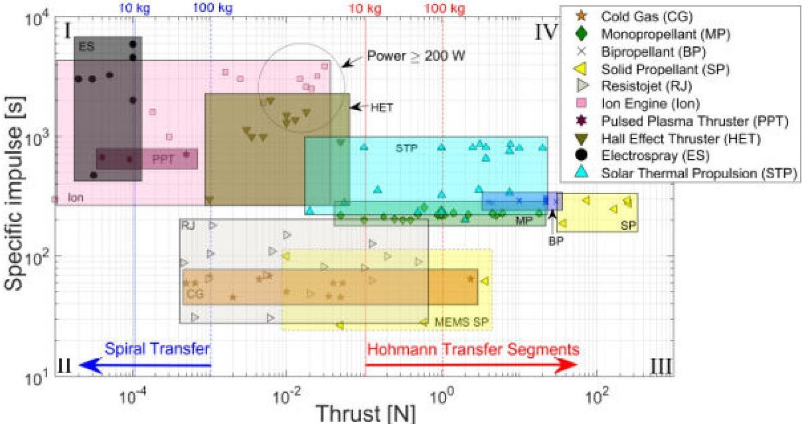

Figure 2.2: Classification of available propulsion systems applicable to small satellites based on specific impulse and thrust. Power levels for the electric thrusters are below 200 W except for those circled. The upper limit (blue dashed lines) of low thrust trajectories is shown for a spacecraft with a mass of 10 and 100 kg. The lower limit (red dashed lines) of Hohmann transfer segment trajectories is also shown for a 10 and 100 kg spacecraft. (Refer to Table 2.3 and Table A.1 for thruster data represented by markers for each propulsion type).

makes these systems desirable for attitude control and small orbit correction manoeuvres. The MEMS solid propellant prototypes are characterised independently due to their low specific impulse and are located in quadrant III. These MEMS propulsion systems are suitable for small orbit correction manoeuvres. Quadrant IV features the majority of the chemical propulsion technologies as well as STP systems. Fast transfers that use Hohmann transfer segments can be performed with these systems. The upper and lower limit of low thrust and Hohmann transfer trajectories respectively for a spacecraft with a mass of 10 and 100 kg spacecraft is also shown in Figure 2.2. STP offers a unique thrust and specific impulse range that is not currently obtainable with current alternative propulsion technologies. It can be stated that further optimisation or combination of propulsion systems could extend the capabilities to areas not covered in Figure 2.2.

## 2.3. SOLAR THERMAL PROPULSION SYSTEM ARCHITECTURE

The results from the in-depth review of STP provide the performance characteristics required to develop an STP system that can be used in the comparative cost analysis. The system architecture and associated assumptions and performance characteristics of the STP system that will be used in the cost analysis are discussed in this section.

Experimental results for small-scale STP systems presented in Table 2.3 indicate an acceptable design thrust and a chamber pressure of an STP system is 1 N and 2 bar respectively. This thrust value is on par with the state-of-the-art monopropellant systems presented in Chapter 2.2.2. An STP system can operate with a propellant temperature of

<!-- PDF_PAGE: 51 -->

2500 K as it is feasible with existing materials, such as Graphite and Rhenium, although the current maximum temperature of the experimental results in Table 2.3 is between 2000 and 2300 K. The dissociation of the propellant was neglected for this preliminary investigation into STP applications.

In order to select a propellant, an investigation was conducted on various propellants based on their specific impulse and velocity increment per propellant volume versus the power required to heat the propellant. The investigation assumes a 100 kg spacecraft to perform a lunar insertion manoeuvre starting from Geostationary Transfer Orbit (GTO). The velocity increment for this analysis is taken as 1600 m/s (Sheehy, 2016). The ideal velocity change, $ \Delta V $ , which represents the performance capabilities of the propulsion system relative to a specific spacecraft is a function of the propellant mass, $ m_{p} $ , and the initial spacecraft mass, $ m_{sc} $ , and is defined as

$$
\Delta V = g I _ {s p} \frac {m _ {p}}{m _ {s c}}.
$$

The propellant mass can be calculated from

$$
m _ {p} = m _ {s c} \left(1 - e ^ {\left(- \frac {\Delta V}{T _ {s p} g}\right)}\right).
$$

The power, $ \dot{Q} $ , required to heat up the propellant is defined as

$$
\dot {Q} = \dot {m} \left(H _ {f} - H _ {i}\right)
$$

where, $ H_{i} $ and $ H_{f} $ is the initial and final enthalpy of propellant and $ m $ is the propellant mass flow rate. By reducing the power required to heat the propellant the size of the concentrator may be reduced.

Common propellants that have been proposed for STP systems include Ammonia, Hydrazine, Hydrogen, and water. Often Helium or Nitrogen are used during testing phases due to their benign nature. Hydrazine was excluded as a propellant candidate due to safety concerns and the potential ban that may be imposed in the future.

Figure 2.3a illustrates the specific impulse, $ I_{sp} $ , (Equation 1.4, assuming constant thrust and mass flow rate) versus the power, $ \dot{Q} $ , required to heat various STP propellants to a final temperature of 1000 K to 2500 K. Hydrogen is shown to be an excellent choice due to its high specific impulse values. However, Figure 2.3b shows Hydrogen does not meet the minimum velocity increment per propellant volume to achieve a mass fraction of less than $ 50\% $ for a 100 kg satellite $ ^{6} $ for a $ \Delta V $ requirement of $ 1600\mathrm{m / s^{7}} $ due to its poor storage density. Hydrogen also suffers from boil-off and therefore is not suitable for long-term storage on-board small-satellites.

Suitable propellant candidates for small satellite missions are Ammonia and water as proposed by the work of Kennedy (2004); Kennedy et al. (2004). Ammonia's selfpressurising capability is advantageous as it eliminates the use of a pressurant system. It also offers higher performance over other propellants that can be stored as a liquid

<!-- PDF_PAGE: 52 -->

at ambient temperature and pressure lower than 10 bar such as Butane (Guerrieri et al., 2017). However, Ammonia is toxic (NFPA 704 health rating of 3) and may not be a suitable candidate if the mission requires a safe and green propellant. On the other hand, water offers an approximate 20% benefit in velocity increment per volume of water compared to Ammonia (Figure 2.3b) for only a 10% loss in specific impulse for the proposed lunar mission. Challenges with using water as a propellant include potential freezing, thruster corrosion, two-phase flow and the requirement of a pressurant system. Based on the above results, two STP systems will be evaluated in the next sections, one using Ammonia and the other water as the propellant.

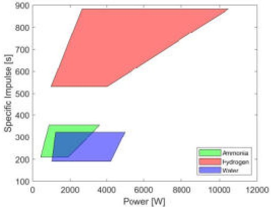

(a)

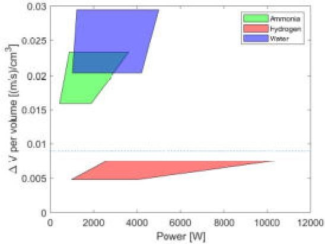

(b)

Figure 2.3: Graphs showing (a) specific impulse and (b) velocity increment per propellant volume versus thermal power required from concentrator to achieve a $ \Delta V $ of 1600 m/s for a 100 kg spacecraft. The thermal power is determined based off a final propellant temperature of 1000 K to 2500 K, a design thrust of 0.5 mN to 2 N, an expansion ratio of 100 and a chamber pressure of 2 bar. Specific heat ratio calculated as a function of the average propellant temperature. The dotted line in (b) indicates the minimum $ \Delta V $ per propellant volume to achieve 1600 m/s with a mass fraction of 50%, assuming the propellant is stored as a liquid at 1 MPa.

## 2.4. LOW-COST MISSION ANALYSIS

## 2.4.1. SCENARIO DESCRIPTION

As mentioned in Section 2.1 four scenarios are analysed to identify which propulsion technology provides a more cost-effective solution as a function of the required $ \Delta V $ . Table 2.5 provides these scenario and the $ \Delta V $ required. Additional system constraints that are used to eliminate propulsion technologies for each scenario are listed as follows:

1. Power required shall not exceed 200 W

2. Transfer time required shall not exceed 1 year

3. Propellant volume shall not exceed 30% of the total volume of the satellite

4. Propellant mass shall not exceed 50% of the gross mass. (The propellant mass fraction was increased to 0.52 for the lunar mission to allow for the inclusion of monopropellant systems).

<!-- PDF_PAGE: 53 -->

Table 2.5: Sample propulsion manoeuvre $ \Delta V $ requirements for a 120 kg satellite assuming a 0.71 x 0.6 x 0.6 m volume envelope.

<table border="1"><tr><td>Scenarios</td><td>ΔV|km/s|*</td><td>Comment</td></tr><tr><td>1) Small on-orbit manoeuvre</td><td>0.02</td><td>Values obtained from Wertz et al. (2011)</td></tr><tr><td>2) LEO station-keeping for 3 years(Customer driven satellite)</td><td>0.2</td><td>Values obtained from Wertz et al. (2011)</td></tr><tr><td>3) LEO station-keeping for 3 years(University driven satellite)</td><td>0.2</td><td>Values obtained from Wertz et al. (2011)A delta-V of 1600m/s can be derived using patched conic techniques(Sheehy,2016)to deliver a spacecraft with a mass of130kg from GTO to a lunar orbit</td></tr><tr><td>4) GTO to lunar orbit transfer manoeuvre</td><td>1.6</td><td></td></tr></table>

* For simplicity the $ \Delta V $ was kept constant for all propulsion technology systems and did not incorporate the penalties incurred by low-thrust systems which result in a spiral transfer trajectory. The consequence of this assumption leads to a lower propellant mass and volume of the electric propulsion systems compared to reality.

A mini-satellite configuration that fits within the dimensional envelope of the Ariane 5 Structure for auxiliary payloads (0.6 x 0.6 x 0.71 m) was used in the investigation with a mass constraint of 120 kg. Based on this satellite configuration it is assumed that the peak power available is 200 W (Tatry and Claire, 2004), which is based off the Myriade peak power requirement, a platform of similar sizing. This assumption is favourable to high power electric propulsion systems as not all the power budget would be available to a single subsystem. An orbit transfer time of one year is imposed for the lunar mission case, based off the SMART-1 mission $ ^{8} $ . The propulsion mass fraction relative to the initial spacecraft mass for Delta class planetary missions are between 50 and 60% (Myers et al., 1994). Therefore, as an upper limit a constraint of 50% has been set for the propellant mass fraction. A propellant volume constraint of 30% relative to the spacecraft total volume is also set to ensure high storage density.

The $ \Delta V $ budget for each scenario is assumed to be a specific value, as presented in Table 2.5, and is independent on the selected propulsion technology used. This simplification results in a lower $ \Delta V $ budget than reality for low-thrust electric propulsion systems due to additional losses as a result of their spiral transfer trajectory. The largest deviation from reality would occur for the scenario with the highest $ \Delta V $ budget, i.e the GTO to lunar orbit transfer manoeuvre. Therefore, to ensure this assumption is acceptable, the Hall propulsion technology system was evaluated assuming a more realistic $ \Delta V $ budget of 3.2 km/s. This value is for a low-thrust Earth-escape trajectory using a lunar flyby (Papais et al., 2020). It was found that this assumption led to a 9.9% and 2.2% reduction in the propellant mass and volume fraction respectively. This only reduces the total cost indicator, described by Equation 2.4 in Section 2.4.2, by 1.2% and thus the assumption is considered to be reasonable. However, the reader should be aware of this improvement when comparing electric propulsion systems with similar total cost indicator values to that of chemical propulsion technologies such as STP for high $ \Delta V $ missions.

Table 2.6 presents the propulsion technologies identified in Section 2.2 and their applicability to each mission scenario based on the constraints provided in Table 2.5. Only propellant-based propulsion systems were investigated. Therefore solar sails are not included. Electrospray thrusters were also neglected due to their applicability being more favourable to accurate attitude control because of their low thrust levels (order of a few micro-Newton) compared to the other state-of-the-art propulsion systems. This analysis focused on high thrust solid propellant propulsion systems that have flight heritage and neglected MEMS solid propellant systems. Although it would be interesting

<!-- PDF_PAGE: 54 -->

to further extend this investigation to include other propulsion systems such as hybrid propulsion systems and water resistojet systems, this work aims to compare STP systems with current mature propulsion systems. Therefore a low TRL (<5) was used as a "cutoff criterion" to eliminate options that require the same or longer development process compared to STP systems. In other words, the only low TRL (<5) propulsion systems analysed in this study were the STP systems.

Table 2.6: Feasibility matrix of mapping mission applications to propulsion technologies

<table border="1"><tr><td>Propulsion system</td><td>Small on-orbit manoeuvre</td><td>LEO station-keeping for 3 years</td><td>GTO to lunar transfer manoeuvre</td><td>Reason for exclusion(X)</td></tr><tr><td>Cold Gas</td><td>√</td><td>X</td><td>X</td><td>Does not meet the volumetric requirement. For GTO to lunar mission the cold gas system also does not meet the mass requirement.</td></tr><tr><td>Monopropellant</td><td>√</td><td>√</td><td>√</td><td></td></tr><tr><td>Bipropellant</td><td>√</td><td>√</td><td>√</td><td></td></tr><tr><td>Solid (not MEMS)</td><td>X</td><td>X</td><td>√</td><td>Operational constraint of the system and the high thrust level of the STAR 4G thruster(258N).</td></tr><tr><td>Restojet</td><td>√</td><td>√</td><td>X</td><td>Does not meet the mass constraint.</td></tr><tr><td>Ion Engine</td><td>√</td><td>√</td><td>X</td><td>Does not meet the time constraint.</td></tr><tr><td>Pulsed Plasma</td><td>√</td><td>√</td><td>X</td><td>Does not meet the time constraint.</td></tr><tr><td>Hall Thruster</td><td>√</td><td>√</td><td>√</td><td></td></tr><tr><td>STP Concept</td><td>√</td><td>√</td><td>√</td><td></td></tr></table>

## 2.4.2. TOTAL COST INDICATOR

Sellers et al. (1998) proposed a useful indicator, TCI, that can be used to compare propulsion systems in terms of the total cost of the propulsion system, where high values represent high-cost systems, and low values represent low-cost systems. This indicator evaluates the total cost of various propulsion technologies and includes costs incurred during all phases of the mission.

$$
\mathrm {T C I} _ {i, j} = \left(\frac {C _ {i , j}}{\max [ C (:, j) ]}\right) 1 0 0,
$$

Sellers et al. (1998) proposed a nine-dimensional cost model to determine the total cost of a propulsion system (Equation 2.5). The nine cost dimensions are defined in Table 2.7. Each cost dimension, x, is scaled to a value between 0 and 100, where again high values represent high-cost, and low values represent low-cost. The total cost, C, is a function of costs associated with performance, hardware, and mission operation,

$$
C _ {i, j} = \sum_ {k = 1} ^ {9} w _ {j, k} x _ {i, j, k}
$$

where i represents the specific propulsion technology, i = [1,...,14] (see Table 2.8 for propulsion system numbering) and j is the scenario being investigated j = [1,2,3,4] (as provided in Table 2.9). The weighting factor w applied to each scaled cost dimension is defined in Table 2.9 and Figure 2.4 shows the matrix representation of the nine cost dimensions as a function of propulsion technology and scenario. The next sections discuss the cost criteria and weighting factor in more detail.

<!-- PDF_PAGE: 55 -->

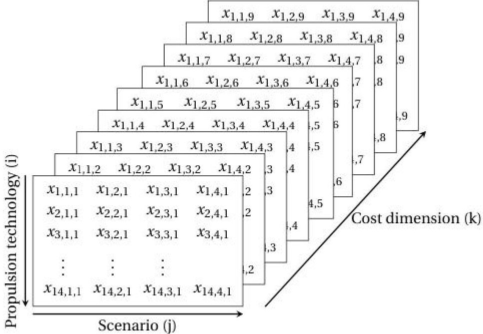

Figure 2.4: Matrix representation of the cost dimensions used to determine the total cost of a propulsion system for a specific scenario.

Table 2.7: Cost criteria proposed by Sellers et al. (1998) and functions used to assist in determining its relative value

<table border="1"><tr><td>Cost Dimension Group</td><td>Cost Dimension</td><td>Dependency</td><td>Function to calculate value</td></tr><tr><td rowspan="5">Performance cost</td><td>$x_{i,j,1}$: Propellant mass</td><td>Mission requirements &amp; propulsion technology</td><td>Propellant mass $m_{p}$ is calculated as a function of $\Delta V$, specific impulse $I_{sp}$ and the mass of the spacecraft $m_{w_{cr}}$.
$x_{i,j,1} = \left(\frac{(m_{p})_{i,j}}{\max \left[w_{p}(-,j)\right]}\right)100,m_{p} = m_{alc}\left(1-e^{\left[\frac{\Delta V}{2}t_{p}\right]}\right)$</td></tr><tr><td>$x_{i,j,2}$: Propellant volume</td><td>Mission requirements &amp; propulsion technology</td><td>Propellant volume $v_{p}$ is calculated as a function of propellant mass and density $p_{p}$.
$x_{i,j,2} = \left(\frac{(v_{p})_{i,j}}{\max \left[v_{p}(-,j)\right]}\right)100,v_{p} = \frac{m_{p}}{v_{p}}$</td></tr><tr><td>$x_{i,j,3}$: Thrust time</td><td>Mission requirements &amp; propulsion technology</td><td>Thrust time $t_{f}$ is calculated as a function of the thrust $F$, $\Delta V$ and specific impulse.
$x_{i,j,3} = \left(\frac{(t_{f})_{i,j}}{\max \left[t_{f}(-,j)\right]}\right)100,t_{f} = \frac{\Delta V}{m_{wc}\left(1+3V_{r}+3V_{f}\right)}$ where $V_{r} = \frac{\Delta V}{ngt_{p}}$</td></tr><tr><td>$x_{i,j,4}$: Power required</td><td>Propulsion technology</td><td>Electrical power required $Q_{el}$ is given in Table 2.8. For non-electric propulsion systems data is obtained from literature. For electric propulsion systems, the value was calculated as a function of the thrust level, specific impulse, and thruster efficiency, $Q_{el} = Q_{el}(q_{el},F,I_{xp})$
$x_{i,j,4} = \left(\frac{(Q_{el})_{i,j}}{\max \left[Q_{el}(-,j)\right]}\right)100,Q_{el}$ is given in Table 2.8</td></tr><tr><td>Hardware cost</td><td>System price</td><td>Propulsion technology + Number of propellant tanks</td><td>Estimated from literature or quotations if available plus $1000 per propellant tank (assuming each tank is spherical and can hold 0.5 (small $\Delta V$ mission), 5 (medium $\Delta V$ mission), and 10 litres (large $\Delta V$ mission) of propellant)^{n}$.
$x_{i,j,5} = \left(\frac{(Price)_{i,j}}{\max \left[Price(-,j)\right]}\right)100,Price = hardware price, given in Table 2.8, plus the total tank cost as described above.</td></tr><tr><td rowspan="4">Associated mission cost^{†}$</td><td>$x_{i,j,6}$: Safety cost</td><td>Propulsion technology</td><td>A qualitative Pugh matrix comparison was performed, Table Table B.4, based on propellants health, flammability and reactivity rating (based on the NFPA 704 standard).</td></tr><tr><td>$x_{i,j,7}$: Logistic cost</td><td>Propulsion technology</td><td>A qualitative Pugh matrix comparison was performed, Table Table B.5, based on the NFPA 704 rating, storage pressure and availability.</td></tr><tr><td>$x_{i,j,8}$: Integration cost</td><td>Propulsion technology</td><td>A qualitative Pugh matrix comparison was performed, Table Table B.3, based on thrust level (effect on attitude control), thermal control system, the effect on payload and failure potential during integration.</td></tr><tr><td>$x_{i,j,9}$: Technical risk cost</td><td>Propulsion technology</td><td>A qualitative Pugh matrix comparison was performed, Table Table B.2, based on TRL, flight heritage, and the number of components.</td></tr></table>

* The value is based on the assumption that a single propane tank is approximately of the order of 1% and that two tanks would be two times more costly.

1 Table 9.1 provides the scaled cost dimension related to mission costs that is used in Equation 2.5. These costs are independent of the scenario.

<!-- PDF_PAGE: 56 -->

Table 2.8: System data used in propulsion technology comparison analysis

<table border="1"><tr><td>i</td><td>Propulsion system</td><td>Propellant</td><td>Thrust [N]</td><td>Specific Impulse [s]</td><td>Power [W]</td><td>TRL</td><td>Estimated Hardware Price†[x $1000]</td><td>Ref.</td></tr><tr><td>1</td><td>Cold gas</td><td>Nitrogen</td><td>0.12</td><td>65</td><td>1.5</td><td>9</td><td>45</td><td>(Moog,2017b)</td></tr><tr><td>2</td><td>Monopropellant</td><td>Hydrazine</td><td>1</td><td>227.5</td><td>18</td><td>9</td><td>249</td><td>(Moog,2013)</td></tr><tr><td>3</td><td>Monopropellant</td><td>LMP-103S</td><td>1</td><td>235</td><td>8</td><td>8</td><td>233</td><td>(Moog,2013)</td></tr><tr><td>4</td><td>Monopropellant</td><td>AF-M315</td><td>1</td><td>235</td><td>12</td><td>6</td><td>233</td><td>(Spores et al.,2013)</td></tr><tr><td>5</td><td>Bipropellant</td><td>MMH/NTO</td><td>22</td><td>294</td><td>10</td><td>9</td><td>300</td><td>(Moog,2017a)</td></tr><tr><td>6</td><td>Solid</td><td>Star 4G:HTPB+AP</td><td>258</td><td>276</td><td>0</td><td>6</td><td>710</td><td>(Grumman,2008)</td></tr><tr><td>7</td><td>Resistojet</td><td>Ammonia</td><td>0.01</td><td>150</td><td>15</td><td>5</td><td>100</td><td>(Busek,2013)</td></tr><tr><td>8</td><td>Resistojet</td><td>SSTL:Butane</td><td>0.5</td><td>80</td><td>15</td><td>9</td><td>100</td><td>(SSTL,2014)</td></tr><tr><td>9</td><td>Ion Engine</td><td>BIT-1:Xenon</td><td>0.00115</td><td>1600</td><td>28</td><td>5</td><td>150</td><td>(Busek,2017)</td></tr><tr><td>10</td><td>Ion Engine</td><td>BIT-3:Xenon</td><td>0.000185</td><td>2100</td><td>86</td><td>5</td><td>150</td><td>(Busek,2017)</td></tr><tr><td>11</td><td>Pulsed Plasma</td><td>PPTCUP:PTFE</td><td>0.00004</td><td>655</td><td>2</td><td>6</td><td>200</td><td>(Busek,2016b)</td></tr><tr><td>12</td><td>Hall thruster</td><td>BHT-200:Xenon</td><td>0.013</td><td>1375</td><td>200</td><td>8</td><td>125</td><td>(Busek,2016a)</td></tr><tr><td>13</td><td>STP concept</td><td>Ammonia</td><td>1</td><td>355*</td><td>1.5</td><td>3</td><td>250</td><td></td></tr><tr><td>14</td><td>STP concept</td><td>Water</td><td>1</td><td>322*</td><td>1.5</td><td>3</td><td>250</td><td></td></tr></table>

* Temperature at 2500 K ignoring dissociation effects

$ \mathbb{P} $ Estimated hardware prices obtained from Sellers et al. (1908) and Sheehy (2016).

Table 2.9: Weighting factors for the considered mission scenarios as defined by Sellers et al. (1998)

<table border="1"><tr><td rowspan="2">Weighting Factor* $w_{j,k}$</td><td rowspan="2">Small on-orbit manoeuvre (j=1)</td><td colspan="2">LEO station-keeping for 3 years</td><td>GTO - lunar Mission (j=4)</td></tr><tr><td>Traditional approach (j=2)</td><td>Non-Traditional approach (j=3)</td><td></td></tr><tr><td>8 (most important)</td><td>System Price</td><td>Propellant mass</td><td>System Price</td><td>Transfer time</td></tr><tr><td>7</td><td>Integration cost</td><td>Propellant volume</td><td>Integration cost</td><td>System Price</td></tr><tr><td>6</td><td>Logistic cost</td><td>Technical risk</td><td>Safety cost</td><td>Safety cost</td></tr><tr><td>5</td><td>Safety cost</td><td>Integration cost</td><td>Logistic cost</td><td>Logistic cost</td></tr><tr><td>4</td><td>Power required</td><td>Logistic cost</td><td>Technical risk</td><td>Integration cost</td></tr><tr><td>3</td><td>Propellant volume</td><td>Safety cost</td><td>Propellant mass</td><td>Technical risk</td></tr><tr><td>2</td><td>Technical risk</td><td>System Price</td><td>Propellant volume</td><td>Propellant volume</td></tr><tr><td>1</td><td>Propellant mass</td><td>Power required</td><td>Power required</td><td>Propellant mass</td></tr><tr><td>0 (least important)</td><td>Transfer time</td><td>Transfer time</td><td>Transfer time</td><td>Power required</td></tr></table>

* Sellers et al. (1998) proposed a simple linear weighting scale, with 0 being the least important and 8 the most important criteria, is applied in this analysis.

<!-- PDF_PAGE: 57 -->

## COST DIMENSION

Traditional cost reduction approaches for satellites focused on only minimising the mass of the system. However, Dean and Unal (1992) highlights that this approach may lead to more expensive results as a result of increased costs associated with the increase in system complexity required in order to obtain systems with high mass efficiency. The works of Fad and Summers (1988) and Noble and Tanchoco (1990) emphasize the need to include both financial and functional justification throughout the design process to produce a final design with a high-performance relative to a good cost-efficiency. This approach forms the basis of Sellers et al. (1998) nine cost dimensions which are based on cost drivers related to all phases of a mission. A brief overview of the nine cost dimensions is provided in this section for completeness $ ^{9} $ . Table 2.7 indicates the nine cost criteria and their associated dependency on either the mission requirements, the propulsion technology or both.

As mentioned above, mass is an important aspect of determining the cost of a propulsion system for a small satellite but not the only determining factor. Obviously, the system price (cost to develop/purchase/manufacture the propulsion system) is also important to determine the overall cost involved. However, if only the system price is considered, the overall costs may be expensive due to the recurring operational or logistical costs. Therefore, the total cost of the propulsion system is a complex variable.

System price estimation is a challenging task for low TRL systems such as STP systems. For this study, the hardware price of the STP system was based on the green monopropellant systems as the propellants used for the STP systems (water and Ammonia $ ^{10} $ ）are significantly less hazardous than hydrazine. It is assumed that the STP systems have similar components (tank, thruster, and plumbing) as the green monopropellant systems which are commercially available plus the addition of low-cost solar concentrators. An example of an affordable mirror choice could be aluminium for rigid designs or thin polymide films coated with silver using spray casting techniques $ ^{11} $ for inflatable concentrators (Clayton and Gierow, 1992). However, mirror costs can increase when improving the level of precision. The final hardware price of the STP system was estimated to be $ 250k. It should be stated that this assumption does not include the development cost required to get STP to a mature level. Note that there is still a large amount of development required for STP systems, which will significantly increase its total cost. Therefore by neglecting the development cost in this analysis, it is assumed that STP represents a mission-enabling technology (high thrust and high specific impulse) where repeated missions are possible. A sensitivity analysis of the STP hardware price is provided in the results section to provide more insight. The system price of each propulsion technology is the estimated hardware price stated in Table 2.8 plus $ 1000 per propellant tank required to achieve the mission $ \Delta V $ . This method is also proposed by Sellers (1996).

Regarding performance costs, the volume is also critical on small satellites. Also, the total time to complete the thrusting needed to achieve the required $ \Delta V $ is a concern because the spacecraft lifetime is limited to the total dose of ionising radiation it can han-

<!-- PDF_PAGE: 58 -->

dle that occurs in certain orbits (for example: through the Van Allen belts). Therefore, low-thrust propulsion systems can result in extra exposure time. Lastly, electrical power should also be included as this additional cost is significant for electric propulsion systems (Chemical propulsion systems have an advantage). All the performance costs can be calculated based on the mission and scenario and $ \Delta V $ budget. The method of obtaining values for the performance costs is also presented in Table 2.7. The performance costs are calculated using equations that are functions of the mission requirements and the propulsion technology as proposed by Sellers (1996).

The total cost of the propulsion system also involves mission costs (expenses related to facilities and personal) that are dependant on the propulsion technology selected such as safety, logistics, technical risk and integration costs. When developing, integrating, and testing satellites, personal safety is important, which attributes to the total cost. These costs include personal protective equipment and infrastructure, such as propellant leak detectors and safety values or temperature control systems to ensure safe propellant storage inside tanks. Costs associated with logistics include propellant availability and the transportation and handling of the propellant at the launch site and internal facilities. Integration cost relates to costs connected to placing and operating the propulsion system on-board the satellite. For example, these costs include the effect the propulsion system has on the attitude control, the thermal control, the operation of payload and the probability of failure. The last dimension in the cost paradigm is the technical risk cost. For example, although new technology may seem promising the inherent risk to the mission due to low TRL has to be compared with space-qualified systems which are safer, this is essential for small satellite missions as they are often secondary payloads. The number of components is also part of the risk costs, by reducing the number of components of the propulsion system, the simpler the design, and the lower the cost.

Sellers (1996) states that associated mission costs are based on qualitative and subjective engineering judgement that he based on his own experience. To reduce the subjective nature in determining the associated mission cost criteria values, this work proposes the use of using Pugh Matrix tools with values obtained from literature or calculated where possible. This provides a standardised qualitative comparisons. The scaled associated mission cost criteria provided in Table B.1 were derived using the Pugh Matrix tool (Table B.2 to B.5). The Pugh matrices received a scoring between +2 (cost-effective) and -2 (expensive) based on the key provided in Table B.6. For this analysis, each criteria in the Pugh Matrix was given equal weighting. To improve the confidence level of this method, a sensitivity analysis was conducted on the weightings and is provided in Appendix B. The results confirm that for the purpose of comparison for this study the use of using equal weighting is deemed acceptable.

## WEIGHTING FACTOR

The mission scenario dictates the importance of each cost dimension and thus each scenario results in a unique weighting scale defined by the mission planner. In this case, the weighting scale provided by Sellers et al. (1998) (0 to 8) was used and presented in Table 2.9. First the weighting factors attributed to the LEO station-keeping scenario is discussed, followed by the on-orbit manoeuvre and finally the GTO to lunar orbit transfer scenario. Refer to Sellers et al. (1998) for a detailed description of the weighting factors.

<!-- PDF_PAGE: 59 -->

For the LEO station-keeping scenario, two design approaches are evaluated to determine the weighting factor of each cost dimension. The traditional design approach (or customer-driven approach) gives propellant mass and volume priority with a weighting factor of 8 and 7, respectively. Other cost dimensions that affect the performance of the mission, such as technical risk and integration, are the next important dimensions and receive a weighting factor of 6 and 5, respectively. This is because traditional design approaches are funded by a customer who benefits from a high performing satellite to obtain good quality services for example obtaining high resolution images of the Earth surface. The other cost dimensions such as logistics $ ( w_{2,7}=4) $ , safety $ ( w_{2,6}=3) $ and system price $ ( w_{2,5}=2) $ receiver lower weights as the mission planner chooses to trade-off the cost of these dimensions over propellant mass and volume, which increases the mass and volume available for the payload. Whereas the non-traditional approach, for example in the case of a university driven project, performance is more likely to be sacrificed over aspects such as reducing the system price $ ( w_{3,5}=8) $ , and costs related to integration $ ( w_{3,8}=7) $ (such as payload operation and attitude control), safety $ ( w_{3,6}=6) $ and logistics $ ( w_{3,7}=5) $ . Additionally, these missions can incorporate higher risk, and thus the technical risk dimension are less of a concern, $ w_{3,9}=4 $ , compared to the traditional design approach. For station-keeping manoeuvre the thrust time is not essential and therefore receives the least importance weighting, $ w_{2,3}=w_{3,3}=0 $

The small on-orbit manoeuvre scenario allows for a trade-off in performance costs such as propellant volume （ $ w_{1,2}=1 $ ）, propellant mass （ $ w_{1,1}=3 $ ）, technical risk （ $ w_{1,9}=2 $ ）and thrusting time （ $ w_{1,3}=0 $ ）over reducing the system price （ $ w_{1,5}=8 $ ）, integration （ $ w_{1,8}=7 $ ）, logistics （ $ w_{1,7}=6 $ ）and safety （ $ w_{1,6}=8 $ ）. The reason for this is due to the very low $ \Delta V $ requirement (20 m/s) and thus low variation in propellant mass and volume over the total spacecraft mass and volume for the various propulsion systems.

For the large orbit transfer scenario to lunar orbit the satellite's residence time in the Van Allen belt is proportional to the amount of radiation exposed to the satellite. This increase in exposure results in thicker shielding and therefore higher total satellite mass and cost to protect sensitive components (Dyer et al., 1995). In some cases, higher radiation resistant components are also needed which could increase the cost significantly. For the lunar scenario, the transfer time criterion receives the highest weight scale, an 8, to reduce the time spent in the Van Allen belt (Sellers et al., 1998). Often payloads do not operate during the orbit transfer. Therefore, a spacecraft that reaches the final target faster is more beneficial to the customer. Power can be described as the least important criteria assuming the payload only requires to function after the orbit transfer. Thus, all the spacecraft power is available for the propulsion system during this time. As small satellites are often secondary payloads on a launcher, higher preference is given to safety and logistics to increase the flexibility and compatibility with various launch service providers over performance, as not all launch facilities/launch vehicles can handle dangerous propellants.

To minimise the subjective nature of the using Sellers' weighting factors, given in Table 2.9, a sensitivity analysis was conducted to analyse all possible permutations of the weighting factors. This was done to statistically analyse the total cost indicator of the various propulsion technologies to assist with identifying cost-effective systems.

<!-- PDF_PAGE: 60 -->

## FUTURE STP SYSTEMS

In addition to the above propulsion systems, future water and Ammonia STP systems were analysed. These future STP systems are defined as matured flight tested systems to those provided in Table 2.8. The future STP systems are assumed to be mature with a TRL of 9 and have been flight tested; this would be the case if there is a definitive need for STP systems. This increase in maturity reduces the cost associated to the technical risk criterion (referring to Table B.1 and B.6, the future STP systems receive a '+2' for both TRL and flight heritage while the simplicity of the system remains unchanged). The technical risk cost given in Table B.1 reduces from 100 to 40 for the future STP systems. In this analysis, the performance cost is linked to the propellant mass and volume, the transfer time and the electrical power required to operate the system which are related to specific impulse, thrust and electrical power. These performance parameters are assumed to remain unchanged for a more conservative approach although if higher receiver temperatures are attainable which may be possible in more mature STP systems, the specific impulse value can increase. The reader should bear in mind that by the time these future STP systems could exist, improvement in the other propulsion systems would be possible. However, all the other propulsion systems received a +2 for flight heritage. Therefore, the most the conventional systems could improve in this regard is 2 for systems that have a 0 for TRL.

## 2.5. RESULTS

In this chapter, the various propulsion technologies $ ^{12} $ were compared to each other in terms of the dimensionless total cost indicator presented in Section 2.4. The results for the four scenarios are shown in Figure 2.5 in ascending order of cost, low-cost systems are on the left and high-cost systems on the right.

PPTs offer a low-cost solution that fit the small on-orbit mission requirements, due to its low electrical power demand of 2W to produce a relatively high specific impulse of 655 s and because of the ease of handling, transporting and storing of the solid PTFE propellant. Although cold gas systems offer the worst propellant mass and volume fractions due to their low specific impulse of 65 s and low density of Nitrogen $ 2 0 0 \mathrm{k g / m^{3}} $ , the system achieves a low total cost indicator. This low value is due to the cold gas systems having the lowest hardware price and complexity resulting in the lowest costs associated with price, risk, safety, and integration. The system operates at a high pressure of 200 bar which increases the logistics costs compared to the solid propellant of the PPT system. The use of solar thermal propulsion leads to one of the least cost-effective technologies for small on-orbit manoeuvres due to the relatively high assumed hardware cost and integration costs, due to the inclusion of the concentrator. Cold gas propulsion systems are the most common technology currently used for small on-orbit manoeuvres and are shown to be one of the most cost-effective options $ ^{13} $ .

<!-- PDF_PAGE: 61 -->

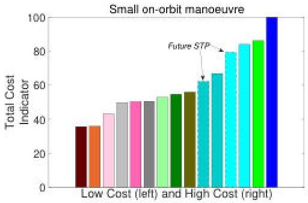

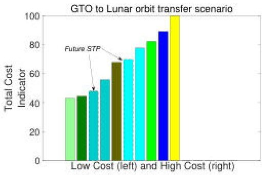

(a)

(b)

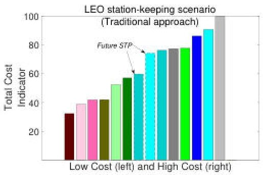

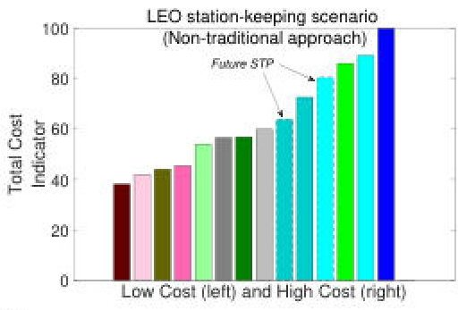

(c)

(d)

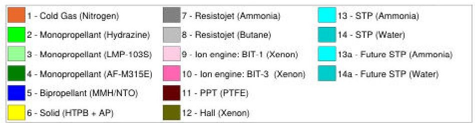

Figure 2.5: Total cost indicator comparison for various propulsion technology for the four scenarios: (a) small on-orbit manoeuvre, (b) a GTO to lunar orbit transfer scenario, (c) a LEO station-keeping scenario following a traditional approach and (d) a LEO station-keeping scenario following a non-traditional approach. The total cost indicator is based on the weighting factors presented in Table 2.9.

<!-- PDF_PAGE: 62 -->

Low powered electric propulsion systems are cost-effective solutions to both the LEO station-keeping scenarios (both the traditional and non-traditional approach), as presented in Figure 2.5c and 2.5d. However, the Butane resistojet shows that a potential 40% reduction in the total cost indicator can be achieved if a trade-off in performance is acceptable. In other words, Butane resistojets are more cost-effective solutions when mass and volume budgets can be increased. Green monopropellant options are the most cost-effective chemical propulsion system. Once again, the STP systems are expensive options for both design approaches. Table 2.10 shows the propellant mass fraction for all the propulsion systems applicable for the GTO to lunar mission. Based on Table 2.10 and Figure 2.5b, the water-STP system is the most cost-effective solution when propellant mass fractions less than 40% are required for GTO to lunar orbit transfer missions. This propellant mass fraction provides a 10 to 13% improvement over green monopropellant systems, which translates into a 430 to 540 m/s gain in $ \Delta V $ . The benefit of using water over Ammonia regarding the total cost indicator is due to the inert, non-toxic, abundant availability, higher density impulse, and low cost of water at the expense of a minor propellant mass penalty. The Hall effect thruster offers the fourth lowest total cost indicator. A significant disadvantage of this thruster is the long transfer time of approximately one year.

Table 2.10: Propellant mass fractions for propulsion systems applicable for the GTO to lunar orbit mission

<table border="1"><tr><td>Propulsion System</td><td>Propellant mass fraction[%]</td></tr><tr><td>3-Monopropellant(Hydrazine)</td><td>51.2</td></tr><tr><td>4-Monopropellant(LMP-103S)</td><td>50.0</td></tr><tr><td>5-Monopropellant(AF-M315E)</td><td>50.0</td></tr><tr><td>6-Bipropellant(MMH/NTO)</td><td>42.6</td></tr><tr><td>7-Solid(Star4G)</td><td>44.6</td></tr><tr><td>12-Hall(Xenon)BHT-200*</td><td>11.2</td></tr><tr><td>13-STP(Ammonia)</td><td>36.8</td></tr><tr><td>14-STP(Water)</td><td>39.7</td></tr></table>

* Propellant mass fraction calculated assuming 1600 m/s and did not

incorporate the penalties incurred by low-thrust systems.

Figure 2.5 also includes future STP systems and shows the total cost indicator for STP can be reduced between 4.6 and 16.4 depending on the scenario by improving the maturity of the system. This analysis identifies that STP systems are therefore the most cost-effective solutions for mini-satellites being limited in electrical power that require large velocity increment missions with short transfer times.

A sensitivity analysis was conducted to reduce the uncertainty obtained from estimating the STP hardware price by assuming mature technology. This analysis investigates the effect of increasing the STP hardware cost. Figure 2.6 illustrates that the STP system using water is beneficial over an existing Hall thruster for the GTO to lunar mission if the estimated hardware price is less than $531,000 when a short transfer time is critical. If a propellant mass fraction above 50% is tolerable for the desired mission, then a combination of decreasing STP hardware price, increasing maturity and reducing risk is required for STP systems to match or surpass the green monopropellant technologies in terms of the total cost indicator. This conclusion further highlights the importance of the mission requirements on the adoption of STP technology.

<!-- PDF_PAGE: 63 -->

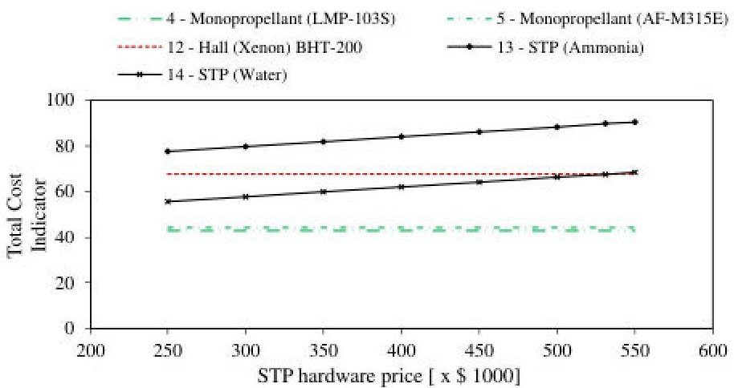

Figure 2.6: Total cost indicator comparison versus STP hardware price for a GTO to lunar orbit transfer mission using the weighting factors presented in Table 2.9.

The above mission scenarios were also analysed based on all possible permutations of the criteria weightings to statistically analyse the total cost indicator of the propulsion systems (Figure 2.7). The results, looking at the mean values, also show that STP are the most cost-effective solution for applications requiring large velocity increments, as in the case of the GTO to lunar orbit transfer mission, when a propellant mass fraction of less than 50% is desired. This is also true if short transfer times and low power demands are essential criteria that must be met. There are incidents where the water STP system results in high-cost, for example the total cost indicator reaches values above 80. This variation highlights the importance of including weighting factors. However, the incidents above 80 are above the 75th percentile meaning that 75% of the possible weighting permutations fall below 80. Therefore, for most mission cost drivers the water-based STP is cost-effective. When comparing the statistical average of the various propulsion systems for the GTO to lunar orbit transfer mission, Figure 2.7c, it is seen the Hall effect thruster has a lower mean than the STP-water design. This is due to the significant propellant mass and volume, technical risk, integration and hardware price saving. However, the future STP-water design has a lower mean than the Hall thruster showcasing that by improving the maturity and reducing the risk of the STP system can outweigh the higher propellant mass and volume as well as integration concerns. The additional velocity increment penalty required to compensate for a low-thrust transfer was not included in this analysis which would result in additional mass, volume, and transfer time, of the low-thrust propulsion systems. The increase in these performance-related cost would result in a higher total cost indicator.

The STP concept provides thrust levels of the order of Newtons which can significantly reduce the transfer time compared to the milli-Newton thrust level of the Hall effect thruster. The advantage of the shorter transfer time for this mission is the spacecraft operates less in the high radiation Van Allen belt region. Reducing the time in this area reduces the radiation protection required by the components, therefore, reducing cost. For example, the SMART-1 mission, which uses a 367 kg satellite that used the PPS 1350 G Hall thruster (Kugelberg et al., 2004) for a GTO to lunar orbit transfer, suffered

<!-- PDF_PAGE: 64 -->

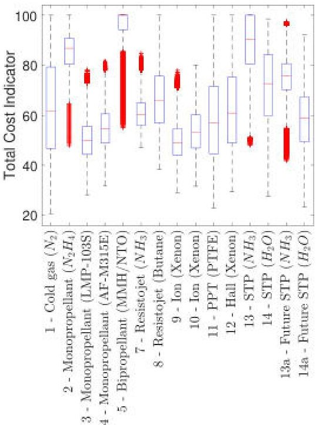

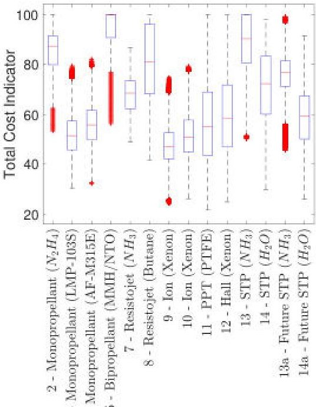

(a)

(b)

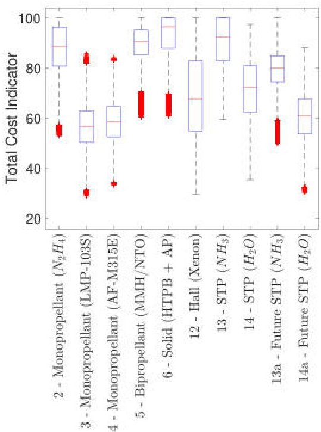

(C)

Figure 2.7: Box plots of the total cost indicator comparison for various propulsion technologies and missions (a) the small on-orbit mission, (b) LEO station keeping mission, and (c) the lunar mission. The box plots represent the statistical results of all the possible permutations of the weighted cost dimensions (362,880 permutations run for each system in the different scenarios). The central red line in the box represents the mean, the upper and bottom edges of the box the 75th and 25th percentile and the whiskers indicate 1.5 times the interquartile region. The outliers are indicated in red on the outside of the whiskers.

<!-- PDF_PAGE: 65 -->

from a 12.6% degradation in solar cell efficiency. This loss in efficiency was due to the high-radiation space environment. UV radiation and atomic oxygen resistant films and coatings have been investigated for solar concentrators to minimise degradation (Grossman and Williams, 1990). The STP total cost indicator could be reduced by reducing the associated risk involved with this technology. This improvement could be achieved by conducting STP initiatives and programs to develop experimental testing and flight models.

Finally, all the mean values obtained from the statistical analysis are shown in Figure 2.8. For the GTO to lunar orbit transfer mission, the future STP-water system's mean provides the lowest total cost indicator if the mission requires a mass propellant fraction less than 50% which therefore excludes monopropellant systems. The future STP-water system's mean also appears in the lowest grouping of total cost indicator for lower velocity increments illustrating the potential benefit of increasing the maturity of these systems for additional applications. Table 2.11 presents this classification of the affordable propulsion system technologies with the recommended application according to their performance characteristics as per Table 2.4.

The results highlight the importance that STP systems are advantageous to missions requiring fast transfer times coupled to high velocity increments, of the order of a few kilometres per second, to reduce the residence time of a satellite in harsh environments, such as the Van Allen belt. If a fast transfer time is not required, the mission planner can select available electric propulsion systems. Therefore, these niche applications such as interplanetary mini-spacecraft missions could gain from using this novel technology. Another application that would benefit from using an STP system that may have similar requirements is a space debris removal mission, to de-orbit dead satellites due to its $ \Delta V $ improvement (430 to 540 m/s) over monopropellants. For example, an STP system can be used to provide orbit transfer capability to a LEO satellite that rendezvous with inactive satellites and transfers them to a VLEO to ensure rapid descent and reduce potential collisions with active satellites. This mission scenario is interesting due to the increase in space debris regulations to ensure sustainability. Similarly, an STP system could be used to provide a spacecraft with the capability of providing other spacecraft with fast in-orbit refuelling and/or inspection (inspector application). The benefit of using an STP system over a green monopropellant propulsion system is the 10 to 13% improvement in propellant mass fraction. This gain can be translated into more available payload mass (i.e. better refuelling capacity) or more propellant stored on-board (i.e. more satellites could be de-orbited from the increased velocity increment).

<!-- PDF_PAGE: 66 -->

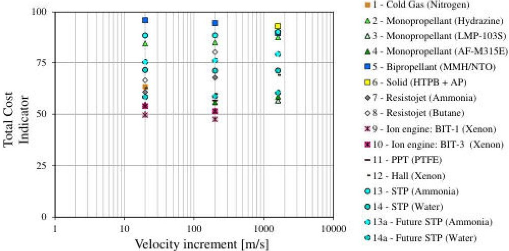

Figure 2.8: Mean total cost indicator values from statistical results from Figure 2.7 versus velocity increment range.

Table 2.11: Classification of propulsion technologies in terms of velocity increment and cost

<table border="1"><tr><td>Velocity increment range</td><td>Quadrant (refer to Table 2.4)</td><td>Low-cost propulsion technologies</td><td>Recommended applications</td></tr><tr><td rowspan="4">Low(of the order of a few m/s)</td><td>I</td><td>HET, PPT and Ion engines</td><td>Missions with high precision pointing requirements
Attitude control(benefit from thrust flexibility and simplicity)
Fast, small orbit insertion manoeuvre or orbit maintenance(applicability dependant on stability requirements)</td></tr><tr><td>II&amp;III</td><td>Cold gas and Resistojet</td><td></td></tr><tr><td>IV</td><td>Green monopropellant</td><td></td></tr><tr><td>I</td><td>HET, PPT and Ion engines</td><td>Missions with high precision pointing requirements
Orbit maintenance(applicability dependant on stability requirements)</td></tr><tr><td rowspan="2">Moderate(of the order of a few hundreds of m/s)</td><td>IV</td><td>Green monopropellant</td><td></td></tr><tr><td>I</td><td>HET</td><td>Slow interplanetary missions</td></tr><tr><td rowspan="2">High(of the order of km/s)</td><td>IV</td><td>Green monopropellant and water-based STP</td><td>Fast orbit transfer such as space debris removal</td></tr><tr><td>I</td><td>HET</td><td></td></tr></table>

<!-- PDF_PAGE: 67 -->

## 2.6. SUMMARY

Propulsion technologies applicable to small satellites were identified and quantitatively compared to each other to determine low-cost systems for four scenarios based on the total cost indicator. This method can be extended to other emerging propulsion systems and mission concepts. The chapter supports the classification of small satellite propulsion technologies in terms of specific impulse, thrust, application and transfer trajectory based on flown and prototype data. Table 2.11 identified four quadrants to group propulsion systems together and provided recommended applications.

The key findings of this chapter are as follows:

1. An extensive review of STP systems with available performance characteristics including experimental results is provided.

2. The method presented provides a reference and baseline for future small satellite trade-off studies.

3. STP systems are profitable over current mature propulsion technologies for orbit transfer missions that require large velocity increments coupled to a short transfer requirement. Mission requirements that could lead to the decision of selecting an STP system are:

(a) Electrical power requirements less than 50 W

(b) Velocity increment requirements on the range of 800 m/s to 2500 m/s

(c) Propellant mass fractions less than 50%

(d) Transfer time of the order of days.

Additionally, the results show that the water-based STP system performs better than the Ammonia-based STP system, in terms of the cost indicator, for the four proposed scenarios. In addition, the following applications may be considered for STP systems such as lunar missions that require an orbit transfer from GTO to lunar orbit insertion, a LEO inspector or a space debris removal mission that require velocity increments of the order of km/s and fast transfer time requirements (an order of magnitude less than competing electric propulsion systems). The fast transfer time requirement could be desirable for satellites passing through high radiation areas such as the Van Allen Belt, where cost saving on shielding is possible. This study promotes the research on an STP system to increase the TRL. Results show a reduction in the total cost indicator by a factor of 1.1 to 1.2, depending on the propellant and mission due to lower costs associated with the technical risk currently associated with the concept. In this case, lower total cost indicator represent lower cost systems which are more attractive.

<!-- PDF_PAGE: 68 -->

<!-- PDF_PAGE: 69 -->

# SOLAR ENERGY HARVESTING USING A MICRO-ORC SYSTEM

There are painters who transform the sun to a yellow spot but there are others who with the help of their art and their intelligence transform a yellow spot into sun

Pablo Picasso, Spanish painter

This chapter presents the system layout and model of the integrated micro-ORC system, for various working fluids such as Toluene (C7H8), Hexamethyldisiloxane (MM), and Octamethylcyclotetrasiloxane (D4). The specific objectives are: i) to determine the effect of the critical heat flux during boiling of the working fluid, ii) to select the best working fluid based on an optimisation that concurrently incorporates the design of the thermodynamic cycle and the sizing of the turbine and heat exchangers, and iii) to provide insight into the effect of the turbine efficiency on the proposed system.

<!-- PDF_PAGE: 70 -->

## 3.1. INTRODUCTION

This chapter turns to the electrical power generation system, in this case a micro-Organic Rankine Cycle (ORC) system. Research on micro-ORC systems, from a few Watts to 2 kW, has focused on solar thermal and waste energy power generation in portable electronic devices, miniature robotics, automotive industry, and remote off-grid applications (Fréchette et al., 2004; Roudy and Frechette, 2005; Orosz, 2009; Liamini et al., 2010). However, little is known on the topic of micro-ORC systems, especially for small satellite applications, and investigations have often neglected the sizing of the components such as the turbine and heat exchangers (Schubert, 2012). Therefore, an investigation into the feasibility of generating power by harvesting energy from a solar thermal propulsion (STP) receiver on-board a small satellite is required. The satellite is assumed to be in Low Earth Orbit (LEO) at an altitude of 700 km above the Earth, to simulate a mission with low daylight to eclipse ratio. This chapter focuses on a micro-ORC system that meets the manufacturing and operational constraints, such as ensuring the turbine's smallest dimension can be machined with current technology, while still conforming to the performance and volume requirements. The feasibility study is conducted by using a system design methodology comprising a thermodynamic analysis of the micro-ORC system with no pressure drops, where then the heat exchangers are sized and the micro-ORC is re-analysed with the calculated pressure drops. The design approach is combined to a genetic algorithm for the optimal exploration of the design space to minimise the total system volume while meeting the thermal energy storage capacity requirement. Lastly, a one-dimensional meanline $ ^{1} $ code is used to determine the turbine efficiency of the best design obtained from the optimisation results.

## 3.2. SYSTEM DESCRIPTION

A schematic of the proposed system is shown in Figure 3.1. The power generation system can be split up into three major parts: 1) the optical system, 2) the high-temperature receiver which also acts as a thermal energy storage (TES) system, and 3) the ORC system. The ORC system is directly coupled with the STP receiver to reduce the number of components by avoiding additional heat transfer loops. This coupling choice aims at achieving a simpler and more efficient design. In the following paragraphs the design layout and choices of the proposed micro-ORC system is discussed. The propulsion system is not analysed in this chapter.

The optical system consists of a primary mirror, a flat plate secondary mirror and fibre optic cables, as shown in Figure 3.2. A parabolic dish was chosen, as the primary concentrator, which concentrates solar radiation onto the secondary mirror, because it can achieve higher concentration ratios than both spherical mirrors and Fresnel lenses or mirrors, which suffer from spherical or chromatic aberration (Kreider, 1979). A nonconcentrating flat plate secondary mirror was included as it reduces the length of the optical fibre cables required between the concentrator and the receiver, therefore making the design more compact and simplifies the placement of the fibre optic cables (Henshall, 2006a). A flat plate mirror is also simpler and easier to manufacture over improving the performance compared to concentrating secondary mirrors. The optical fibre

<!-- PDF_PAGE: 71 -->

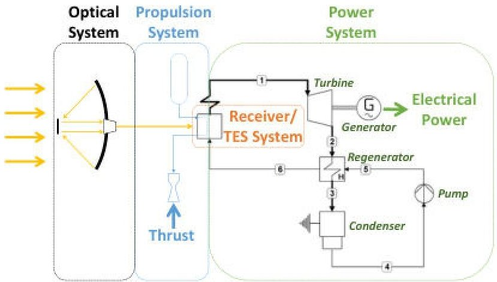

Figure 3.1: Schematic of a micro-ORC system coupled to an STP system for electrical power generation onboard a small satellite.

bundle is made up of a number of individual cables. The diameter of the bundle can be determined based on the number of rings as defined by Figure 3.2. The core represents the central optical fibre cable. Fibre optic cables have been included in the design instead of directly focusing solar radiation onto the receiver to reduce the pointing accuracy required and decouple the concentrator and receiver position. This decoupling also is beneficial for the propulsion system, whereby there is more flexibility with the position of the thruster for manoeuvring and the position of the concentrators for solar tracking. Additionally, they provide the system with the potential to reduce the overall mass by replacing a single large mirror with multiple smaller ones (Henshall, 2006a). Disadvantages of the selected optical configuration include decreased end-to-end power efficiency, increased complexity and storage integration challenges.

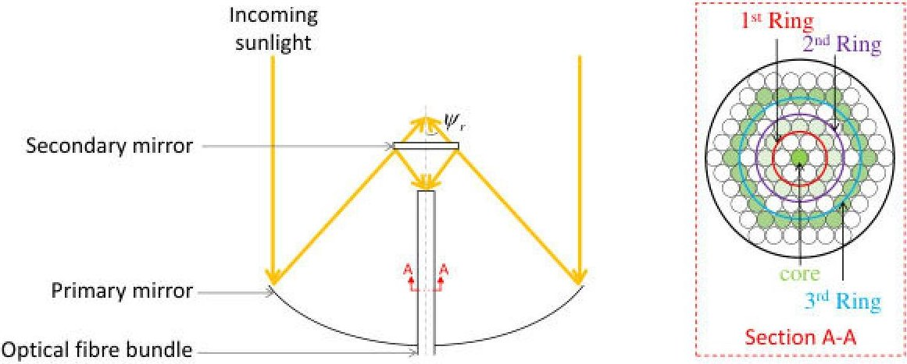

Figure 3.2: Schematic view of the optical system, showing the primary and secondary mirror, as well as a cross-sectional view of the optical fibre bundle.

<!-- PDF_PAGE: 72 -->

The solar radiation collected by the receiver superheats $ ^{2} $ the working fluid that is passed through the working fluid tubing coiled inside the insulation of the receiver, illustrated in Figure 3.3a. This acts as the evaporator of the micro-ORC system. Near- and far-term high-temperature materials that are suitable to function as receivers for STP applications are Silicon and Boron respectively (Gilpin, 2015). Silicon has been selected as the receiver material and heat source for this work since it is cheaper, more abundant, and a more mature (near-term) material compared to Boron $ ^{3} $ . The receiver is assumed to be cylindrical and is made up of a Silicon phase change material (PCM), a Graphite container $ ^{4} $ , and uses Carbon bonded Carbon fibre (CBCF) as the insulation material. The receiver also includes a Rhenium coating for oxidation protection. The aperture diameter of the receiver is designed to accommodate all the optical fibre bundles entering the receiver, which are part of the optical system. By using a PCM the receiver is able to act as a latent heat energy storage system (Gilpin, 2015). An advantage of using a high-temperature latent heat TES system is relatively constant operating temperatures; the system operates between the solidus and liquidus temperature of the material during the phase change process, in the case of Silicon the temperature difference is 2 K (Datas et al., 2018). High specific energy (200-500 Wh/kg) and high energy density (500 1000 kWh/m $ ^{3} $ ）(Datas et al., 2016) are also advantages of Silicon latent heat TES system, which are attractive qualities for ORC systems and small satellites. For high-temperature TES systems, the capital cost is relatively small, 3-60 $ /kWh $ and the discharge losses are approximately 0.05 to 1% (Chen et al., 2009; Luo et al., 2015). The downfall to TES systems is the low cycle efficency $ ^{5} $ on the order of 30-60% (Chen et al., 2009).

The thermal energy stored is crucial to ensure continuous electrical power generation during eclipse periods, therefore not limiting the operations of the small satellite during orbit. Challenges include thermal stresses, radiation losses, and containment of the phase change material. The inclusion of a heat transfer loop between the high-temperature receiver and working fluid was discarded. This was because it would decrease the system efficiency due to the addition of another pump, as well as increase the complexity and therefore reduce the system's reliability. This work, therefore, investigates the possibility of directly embedding the working fluid tubing inside the receiver's insulation, such that the maximum temperature exposed to the working fluid tubing is 20 K less than the thermal stability limit of the fluid. Chapter 5 provides an in-depth heat transfer analysis between the PCM, insulation, and the working fluid and shows that sufficient heat flux can be achieved with this configuration. A 20 K temperature drop is assumed to account for uncertainty in the steady-state modelling, to ensure the design obtained from the optimisation is feasible and does not exceed the decomposition limit of the fluid. Experimental testing of the working fluid for various temperatures below thermal decomposition (for example 5,10,15,and 20 K) over the lifetime of the power generation (in the order of years) should be investigated in the future to strengthen the

<!-- PDF_PAGE: 73 -->

selection of the upper allowable temperature limit. The effect of increasing this temperature drop is investigated in Chapter 5. Steady-state calculations are performed assuming the PCM is at its melting temperature. The corresponding radial position of the tubing is positioned at the location where the insulation temperature is equal to 20 K below the thermal stability limit.

The condenser radiates heat to space to condense the working fluid. It is made up of several circular channels, a honeycomb support structure, and two thin flat sheets of aluminium on the top and bottom, referred to as fins, as shown in Figure 3.3b. A regenerator as depicted in Figure 3.3c is included before the condenser to improve the efficiency of the ORC system. It also reduces the heat transfer surface area of the receiver and condenser at the expense of increased complexity and mass as well as reduced reliability. The regenerator is assumed to be a cross-flow plate-fin heat exchanger (HX) with rectangular channels, due to it being a compact and low-mass design and able to operate at high temperatures. The hot vapour exiting the turbine enters the cross-flow plate-fin HX on the hot side and the cold liquid fluid from the pump enters on the cold side, which is perpendicular to the hot flow. A radial inflow turbine is coupled to a generator to provide on-board electrical power. The selection of this turbine was mainly due to its high power density, comparatively higher efficiency for low power output capacity, and compactness, which are critical aspects for small satellite subsystems.

## 3.3. MODEL DESCRIPTION

In this section, the modelling of the system is described, and the sizing method of each component shown in Figure 3.1 is discussed. This provides insight into the volume and mass distribution of the system, which is important for satellite design and to determine feasibility.

## 3.3.1. OPTICAL SYSTEM

A critical design aspect of the optical system is the volume required to store the system on-board the satellite during launch, referred to as the stowed volume. Determining the stowed volume of the optical system is difficult without a full design of the concentrating and deployment system. Three concentrator designs are considered in this study: i) a rigid-fixed concentrator, ii) a rigid-deployable concentrator and iii) an inflatable-deployable concentrator design. The total volume of a rigid-fixed design is taken as the volume of a cylinder with the diameter equal to the primary concentrator and the height equal to the distance between the primary dish and secondary mirror plus the thickness of the secondary mirror. The stowed volume of the optical system is assumed to be a percentage of the total volume of the rigid-fixed design assuming the same primary dish diameter. Table 3.1 provides the stowed volume fraction and areal density of each concentrator type.

<!-- PDF_PAGE: 74 -->

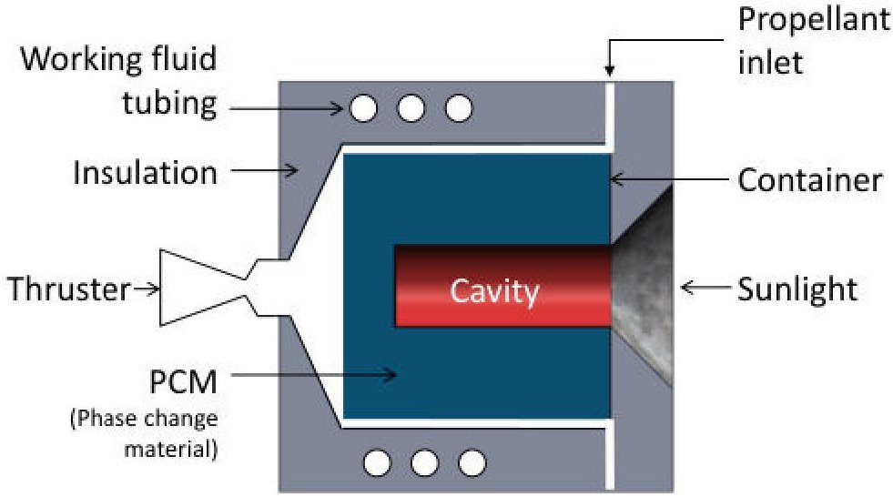

(a)

(b)

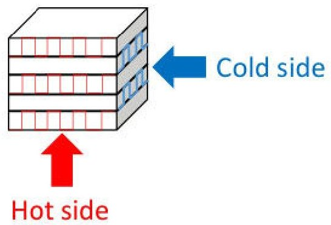

(c)

Figure 3.3: Schematic representation of the micro-ORC heat exchangers: (a) the receiver, (b) the condenser, and (c) the regenerator.

<!-- PDF_PAGE: 75 -->

Table 3.1: Stowed volume fraction and areal densities of various concentrator types. The areal densities refer only to the primary and secondary concentrators unless otherwise stated and the stowed volume of the optical system is related to the volume of a fixed rigid design type.

<table border="1"><tr><td>Concentrator type</td><td>Stowed volume fraction [%]</td><td>Areal density [kg/m2]</td><td>Reference</td><td>Comment</td></tr><tr><td>Inflatable</td><td>0.8-1</td><td>0.18-1</td><td>[Henshall,2006a; Pearson Jr et al.,1999; Sahara and Shimza,2004; Olla,2009]</td><td>Support structure areal density is unknown for inflatable technologies. Pressurised system mass and volume excluded*</td></tr><tr><td>Deployable rigid</td><td>25</td><td>1.5-3.6</td><td>(Shalsens and Mason,1996; Prye and Kudja,1998; Gilpin,2015)</td><td>Upper bound includes support and tracking mechanisms</td></tr><tr><td>Fixed rigid</td><td>100</td><td>10-21.2</td><td>(Kensedy,2004)</td><td>Lower bound is a low-mass solution such as carbon-fibre reinforced polymers versus an aluminium design</td></tr></table>

* This is a reasonable assumption if the propulsion pressurant system can be used to inflate.

An inflatable design was selected for the design and used in the optimisation to achieve the optical system with the lowest mass and volume. The concentrator and support areal densities were assumed to be 1 and $ 1. 5 \mathrm{~ k g} / \mathrm{m}^{2} $ respectively (Henshall, 2006a; Gilpin, 2015), and the stowed volume fraction was taken as 1%. However, to determine the effect of concentrator design type, in terms of areal density and stowed volume fraction, on the micro-ORC system, a one-at-a-time sensitivity analysis is presented in Section 3.7.2.

The total input power of the optical system (Mendoza Castellanos et al., 2017), $ \dot{Q}_{i n} $ can be calculated using,

$$
\dot {Q} _ {i n} = \eta_ {o p} S N _ {o p} A _ {1} \left(1 - b _ {f}\right) \mathrm {B P F} \cos \theta
$$

where, S is the solar constant, defined as $ 1 3 6 6 \mathrm{W} / \mathrm{m}^{2} $ at 1 astronomical unit (Wertz et al., 2011) neglecting the Earth's eccentricity, although in this case a conservative value of $ 1 3 5 0 \mathrm{W} / \mathrm{m}^{2} $ is used $ ^{6} $ . $ A_{1} $ is the area of the primary concentrator, and $ b_{f} $ is the shadow factor defined as the ratio of the area of the primary concentrator shadowed by the secondary concentrator. The optical efficiency, $ \eta_{o p} $ , is equal to the combined efficiency of the primary and secondary concentrator and fibres. Concentrator efficiency include reflectivity of the mirrors (90%) and intercept factors (96%), and the fibre efficiency include transmission (90%) and Fresnel efficiency (96.5%) (Nakamura et al., 2004). The bundle packaging factor, BPF, takes into account the packaging efficiency and depends on the cross-sectional area of the fibre, $ A_{f} $ , and bundle, $ A_{b} $ , defined as $ \mathrm{B P F}=N_{f} A_{f} / A_{b} $ . Lastly, $ \theta $ is the solar incidence angle, defined as the angle between the incoming sun's ray and a line normal to the concentrator. For the purpose of this study, the incidence angle is taken as $ 0^{\circ} $ $ ^{7} $ .

<!-- PDF_PAGE: 76 -->

## 3.3.2. RECEIVER/TES SYSTEM

The PCM is assumed to act as a lumped-capacity thermal mass with no temperature distribution; this is only valid for low Biot numbers $ \left(< < 1\right)^{8} $ (Kennedy, 2004). Therefore this results in a preliminary analysis that requires future in-depth analysis to more accurately determine the coupled convective heat transfer between the PCM, insulation, and the working fluid which is discussed in Chapter 5. The insulation experiences a significant temperature drop between the inner (clost to PCM) and outer (to the environment) layer on the order of 1300 K. Therefore, a one-dimensional steady-state radial analysis using a temperature-dependent thermal conductivity and shell thickness method (Bergman et al., 2011) is used to determine the radiation losses through the insulation of the receiver as well as the position of the working fluid tubing (Figure 3.3a). The radiation loss through the aperture and the absorption losses of the receiver are also included.

From the conservation of energy, an estimated discharge time $ t_{dis} $ can be computed during an eclipse as long as the design input power from the concentrator exceeds the power required for the ORC system and losses,

$$
t _ {d i s} = \frac {M _ {p c m} L}{\dot {Q} _ {o} + \dot {Q} _ {l o s s}},
$$

where $ M_{pcm} $ is the mass of the PCM, L is the specific latent heat of fusion (or change in enthalpy) of the PCM (units: J/kg), $ \dot{Q}_{o} $ is the thermal power required for the ORC system, and $ \dot{Q}_{loss} $ account for the radiation and absorption losses. Furthermore, analytical and experimental investigations into the thermal cycling and expansion of the PCM and long exposure between the PCM and its container are required. The expansion of Silicon during freezing was not considered in this study. However, it has been found that by ensuring a void of 20% inside the container, the container damage due to the expansion can be mitigated (Gilpin, 2015). In this case, the PCM is assumed to fill the container completely, and investigations into including a void and its effect of the design is discussed in Chapter 5. The volume and mass of the receiver are found based on its described geometry depicted in Figure 3.3a, assuming that the length of the inner cavity of the receiver is 80% of the total length of the phase change material.

## 3.3.3. ORC SYSTEM

Figure 3.4 shows the flowchart of the design method implemented in determining the ORC sizing. First, a steady-state thermodynamic analysis of the ORC system has been carried out using an in-house Matlab code based on the work of Bahamonde et al. (2017), assuming no pressure drops through the heat exchangers (HXs). Fluid thermophysical properties are determined by integrating the code with the software library Fluidprop (Colonna and der Stelt, 2004). If the constraints $ ^{9} $ are met, then the HXs are sized and pressure loss calculated as presented in Figure 3.4.

<!-- PDF_PAGE: 77 -->

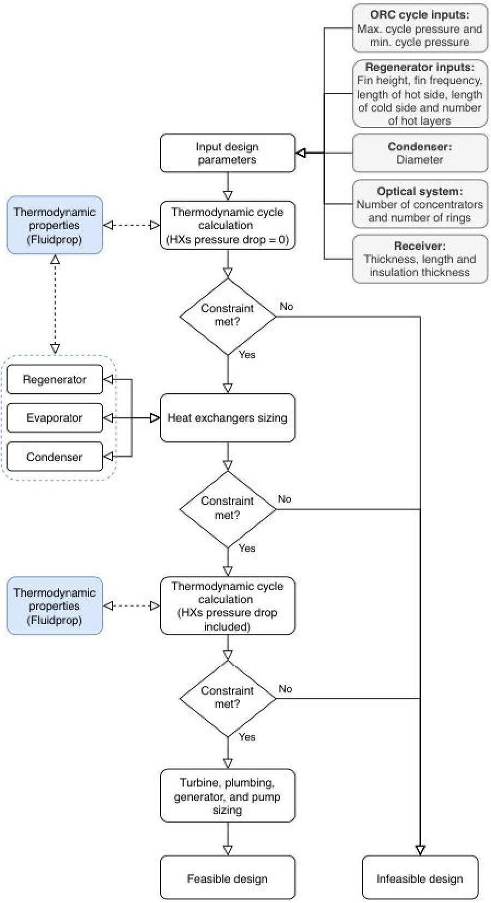

Figure 3.4: Flowchart illustrating the implementation of the design of the micro-ORC system. Dashed lines represent the coupling of the Matlab code with Fluidprop to determine the thermophysical properties of the working fluid. Constraints are defined in Table 3.8 in Section 3.7.

<!-- PDF_PAGE: 78 -->

Thereafter, if the results are within the constraints, an updated thermodynamic analysis is conducted incorporating the HX pressure losses. The constraints that result in an infeasible design are described in Section 3.7. Each HX has been discretised to evaluate the one-dimensional local heat transfer coefficient and pressure drop in the single-phase and two-phase flow regions using the models and methods described in Table 3.2. The mass and volume of the HXs are found based on the geometries described in Figure 3.3. Thin-walled pressure vessel and plate fin thickness (Taylor, 1987) calculations are performed to ensure structural integrity of the HXs. A safety factor of 2 and 4 (Mulville, 1996) is used for the aluminium condenser channel and graphite evaporator tubing based on the yield stress and maximum expected pressure. The minimum condenser channel is set to 1 mm due to machinability and deployability concerns. The regenerator is assumed to be manufactured out of Inconel 617 with its temperature dependant allowable yield stress provided by (Southall et al., 2008).

Table 3.2: Models and methods implemented to determine the heat transfer coefficient and pressure drop in the heat exchangers.

<table border="1"><tr><td>Component</td><td>Flow type</td><td>Method/Model</td><td>Reference</td></tr><tr><td>Regenerator</td><td>Single-phase$\cdot$</td><td>The plate-fin rating model and $\varepsilon$-NTU method are used with frictional factors and Nusselt numbers provided in Table 3.3 for rectangular channels.</td><td>[Shah, Ramesh K and Sekulic, 2003]</td></tr><tr><td rowspan="3">Evaporator</td><td>Single phase$\cdot$</td><td>Frictional factors and Nusselt numbers used are provided in Table 3.3 for circular channels.</td><td></td></tr><tr><td>Two-phase$\dagger\dagger$ (saturated)</td><td>Universal method used to predict saturated flow boiling heat transfer coefficient and two-phase frictional pressure drop for mini-channels.</td><td>[Kim and Mudawar, 2013b,c,d]</td></tr><tr><td>IAFB and DFFB</td><td>Empirical correlations</td><td>[Hewitt et al., 2013; Breen and Westwater, 1962]</td></tr><tr><td rowspan="2">Condenser</td><td>Single phase$\cdot$</td><td>Frictional factors and Nusselt numbers used are provided in Table 3.3 for circular channels.</td><td></td></tr><tr><td>Two-phase$\dagger\dagger$ (saturated)</td><td>Universal method used to predict saturated flow condensing heat transfer coefficient and two-phase frictional pressure drop for mini-channels.</td><td>[Kim and Mudawar, 2013a, 2012]</td></tr></table>

$ ^{*} $ Only the frictional effects are considered for single phase flow pressure drop calculations.

$ ^{\dagger} $Accelerational pressure drop is negative for condensing flow and positive for positive for boiling flow.

$ ^{1} $Gravitational pressure drop is neglected in two-phase flow due to operation in micro-gravity.

In the evaporator, the high operating wall temperatures could result in low/highquality critical heat flux (CHF) regimes. The CHF quality is determined using the method proposed by Shah (2017). If the CHF quality is low, boiling is split into Inverted Annular Flow Boiling (IAFB) and Dispersed Flow Film Boiling (DFFB) regimes. Dryout at high qualities will result in DFFB being present after saturated boiling flow. Both of these flow types, can considerably reduce the heat transfer coefficient and thus increase the evaporator tubing length required for sufficient heat transfer.

The radial inflow turbine geometry was analysed based on a meanline model similar to that proposed in Bahamonde et al. (2017). It is assumed that the change in kinetic energy is negligible between the turbine inlet and outlet, that the flow in the stator is isentropic, and the deviation angle at both stator and rotor exit is null. It is assumed the changes generated by these effects can be neglected for simplicity of the model. A conservative value has been taken for the mass and volume of the turbine by assuming it is a solid disk with a diameter equivalent to the stator and the length equal to the axial length of the turbine. The turbine is assumed to be manufactured out of titanium due to manufacturability and high operating temperatures.

<!-- PDF_PAGE: 79 -->

Table 3.3: Fanning friction factor f and Nusselt number Nu correlations used in the heat exchangers. Variables are provided in the Nomenclature at the end of this chapter.

<table border="1"><tr><td>Equations</td><td>Reference</td></tr><tr><td>Laminar developing flow: Rectangular channel$\cdot$</td><td></td></tr><tr><td>$f_{app}=\frac{1}{\mathrm{Re}}\left[3.44\left(x^{+}\right)^{-0.5}+\frac{K(\infty)/\left(4x^{+}\right)+f\mathrm{Re}-3.44\left(x^{+}\right)^{-0.5}}{1+C\left(x^{+}\right)^{-2}}\right]$ (Shah and London,2014)</td><td></td></tr><tr><td>$\mathrm{Nu}=\left[0.277-0.152e^{\left(-38.6x^{*}\right)}\right]^{-1}$ (Kakaç et al.,1987)</td><td></td></tr><tr><td>Laminar fully developed flow: Rectangular channel</td><td></td></tr><tr><td>$f=\frac{24}{\mathrm{Re}}\left(1-1.35553\beta+1.9437\beta^{2}-1.7012\beta^{3}+0.9564\beta^{4}-0.2537\beta^{5}\right)$ (Shah and London,2014;Kakaç et al.,1987)</td><td></td></tr><tr><td>$\mathrm{Nu}=8.235\left(1-2.0421\beta+3.0853\beta^{2}-2.4765\beta^{3}+1.0578\beta^{4}-0.1861\beta^{5}\right)$ (Marco and Han,1955;Shah and London,2014)</td><td></td></tr><tr><td>Laminar developing flow: Circular channel</td><td></td></tr><tr><td>$f=\frac{16}{\mathrm{Re}}$ (Bergman et al.,2011)</td><td></td></tr><tr><td>$\mathrm{Nu}=4.364$ (Bergman et al.,2011)</td><td></td></tr><tr><td>Turbulent fully developed flow: Rectangular channel$\dagger$</td><td></td></tr><tr><td>$f=\frac{1}{4}\frac{1}{\left(0.790\ln(\mathrm{Re})-1.64\right)^{2}}$ (Petukhov et al.,1970)</td><td></td></tr><tr><td>Turbulent fully developed flow: Circular channel</td><td></td></tr><tr><td>$f=\frac{0.079}{\mathrm{Re}^{0.25}},2000\leq\mathrm{Re}<20000,f=\frac{0.046}{\mathrm{Re}^{0.2}},\mathrm{Re}\geq20000$ (Kim and Mudawar,2012,2013c)</td><td></td></tr><tr><td>$\mathrm{Nu}=\frac{f}{2}\frac{\left(\mathrm{Re}-1000\right)\mathrm{Pr}}{1+12.7\left(\sqrt{\frac{f}{2}}\left(\mathrm{Pr}^{\frac{2}{3}}-1\right)\right)}$ (Gnielinski,1975)</td><td></td></tr></table>

$ ^{*} $ Constants $ K(\infty), f\mathrm{Re}, $ and $ C $ in the apparent friction factor $ (f_{app}) $ can be found in Kakaç et al. [1987]

$ ^{\dagger} $The Gnielinski equation (Gnielinski, 1975) can be used to determine the Nusselt number for rectangular ducts

as it gives an error $ \leq 9\% $ for rectangular ducts with all four sides heated (Kakaç et al., 1987).

The remaining components of the system that require sizing are the pump, generator, and plumbing. The plumbing consists of circular tubing connecting the ORC components to each other. Each section of tubing has a length equivalent to three times the largest characteristic length of the component it provides an outlet for. The tubing material is assumed to be titanium and aluminium for vapour and liquid flows respectively, such that the tubing can withstand the high temperatures and is compatible with the working fluids analysed such as Toluene. Wall thickness is determined based on hoop stresses assuming a safety factor of 3 on the operating pressure (Mulville, 1996). A survey was conducted on available micro-pumps and generators suitable for a 200 W micro- ORC systems (Appendix C). The result of the micro-pump study shows that the volume of the micro-pump remained similar for different differential pressure. Therefore, for simplicity, the pump volume and mass are set equal to the maximum values found from the survey rounded up to $ 0. 0 0 1 \mathrm{~ m}^{3} $ and $ 1. 5 \mathrm{~ k g} $ respectively to be conservative. However, the mass and volume of the generator were found to be linearly dependant on the electrical power output based in the generator survey in Appendix C. Therefore, linear relationships were derived to relate the mass $ (M_{g}=a\dot{W}_{net}+b) $ and volume $ (V_{g}=c\dot{W}_{net}+d) $ of the generator to the net power output $ \dot{W}_{net} $ , where the coefficients a, b, c, and d are defined as $ 1. 8 \mathrm{~ k g / k W}, $ $ 2. 7 1 8 \mathrm{~ k g}, $ $ 2 \times 1 0^{-6} \mathrm{~ m}^{3} / \mathrm{W}, $ and $ 7 \times 1 0^{-5} \mathrm{~ m}^{3}. $

## 3.4. MODEL VALIDATION

Table 3.4 presents the model validation results to ensure the size and performance of the micro-ORC system is acceptable. Most components are validated with given data in terms of mass which can be equated to volume based on geometry and density. All component validations fall within the acceptable threshold of 5%, except for the volume of the optical system and the overall heat transfer and conductance of the regenerator.

<!-- PDF_PAGE: 80 -->

Table 3.4: Model validation results. The relative percentage difference is determined with respect to the reference value.

<table border="1"><tr><td>System</td><td>Parameter</td><td>Unit</td><td>Reference Value</td><td>Reference</td><td>This Study</td><td>Difference [%]</td></tr><tr><td rowspan="4">Receiver</td><td>PCM Mass</td><td>[kg]</td><td>66.8</td><td>Gilpin(2015)</td><td>67.3</td><td>0.7</td></tr><tr><td>Container Mass</td><td>[kg]</td><td>9.4</td><td>Gilpin(2015)</td><td>9.3</td><td>1.1</td></tr><tr><td>Coating Mass</td><td>[kg]</td><td>52.6</td><td>Gilpin(2015)</td><td>52.4</td><td>0.4</td></tr><tr><td>Total Mass</td><td>[kg]</td><td>128.8</td><td>Gilpin(2015)</td><td>129.0</td><td>0.2</td></tr><tr><td rowspan="3">Optical</td><td>Focal Length</td><td>[mm]</td><td>33.7</td><td>Kennedy(2004)</td><td>33.8</td><td>0.3</td></tr><tr><td>Mass</td><td>[kg]</td><td>15.0</td><td>Kennedy(2004)</td><td>14.8</td><td>1.3</td></tr><tr><td>Rigid Volume</td><td>[m3]</td><td>0.05</td><td>Olla(2009)</td><td>0.059</td><td>18</td></tr><tr><td rowspan="9">Regenerator</td><td>Overall Heat Transfer</td><td>[kW]</td><td>277.20</td><td>ASPEN EDR</td><td>249.61</td><td>10</td></tr><tr><td>UA Value</td><td>[kW/K]</td><td>7.90</td><td>ASPEN EDR</td><td>7.12</td><td>10</td></tr><tr><td>Temperature-Hot Side</td><td>[K]</td><td>457.58</td><td>ASPEN EDR</td><td>459.57</td><td>0.4</td></tr><tr><td>Temperature-Cold Side</td><td>[K]</td><td>436.25</td><td>ASPEN EDR</td><td>434.96</td><td>0.3</td></tr><tr><td>Pressure-Hot Side</td><td>[bar]</td><td>4.945</td><td>ASPEN EDR</td><td>4.802</td><td>2.9</td></tr><tr><td>Pressure-Cold Side</td><td>[bar]</td><td>4.999</td><td>ASPEN EDR</td><td>4.997</td><td>0.04</td></tr><tr><td>Empty Mass</td><td>[kg]</td><td>106.1</td><td>ASPEN EDR</td><td>100.6</td><td>5.2</td></tr><tr><td>Operating Mass</td><td>[kg]</td><td>165.5</td><td>ASPEN EDR</td><td>159.3</td><td>3.7</td></tr><tr><td rowspan="2">Condenser</td><td>Average Area</td><td>[m2]</td><td>5.24</td><td>Gilmore(2002)</td><td>5.16</td><td>1.5</td></tr><tr><td>Average Mass</td><td>[kg]</td><td>3.76</td><td>Gilmore(2002)</td><td>3.67</td><td>2.4</td></tr></table>

The rigid volume of the concentrator was found to have a large deviation of 18% with respect to the reference value due to the lack of data on the design of the 0.5 m dish from Olla (2009) as well as the assumption that this study assumes that the rigid volume of the optical system is equivalent to a cylinder. This deviation is assumed acceptable for this analysis as it provides a more conservative approach taken in this work, especially as the pressurisation system required to inflate the optical system is not modelled. The regenerator model was validated against the commercially available ASPEN Exchanger Design and Rating (Aspen Technology, 2015) software. Both the hot and cold side of the regenerator were assumed to use Toluene as the working fluid, 5 bar pressure, 10 kg/s mass flow rate, 20 layers, and a fin height of 8.9 mm. The hot and cold side temperatures were $ 2 0 0^{\circ} \mathrm{C} $ and $ 1 5 0^{\circ} \mathrm{C} $ respectively. The hot side length, fin thickness, and fin frequency were 0.418 m, 0.2 mm and 787 fins/m, whereas the cold side was 0.485 m, 0.41 mm and 236 fins/m. A maximum percentage error of 10% for the overall heat transfer and conductance (UA value) was found. Higher tolerance for these values is acceptable with deviations as high as 30% experienced in literature.

Table 3.5 provides the sample size, the mean absolute error (MAE) and the percentage of results predicted within 30% $ \theta $ ）and 50% $ \zeta $ ）of the experimental results. The predicted results are obtained using the correlation derived by Kim and Mudawar (2013d) and Kim and Mudawar (2012) for saturated boiling and condensing frictional pressure drop respectively, and the experimental data points are from Grauso et al. (2013) for boiling flow and Bashar et al. (2018) for condensing flow. For the saturated two-phase flow heat transfer coefficient, predicted values are obtained using Kim and Mudawar (2013c) and Kim and Mudawar (2013a) for boiling and condensing flow, respectively. Experimental data are provided by Greco (2010) for boiling flow and Yan et al. (1999) for condensing flow. Based on the results, the use of the saturated boiling and condensing

<!-- PDF_PAGE: 81 -->

heat transfer correlations is deemed adequate as the predicted results fall mostly within 30% of the experimental. The frictional pressure gradient has a larger deviation. However, mostly the large discrepancies occur at low values (less than 5 kPa/m) and therefore deem adequate for this analysis.

Table 3.5: Saturated boiling and condensing flow heat transfer coefficient and frictional pressure gradient verification.

<table border="1"><tr><td></td><td colspan="2">Saturated Boiling</td><td colspan="2">Saturated Condensation</td></tr><tr><td></td><td>Heat transfer coefficient</td><td>Frictional pressure gradient</td><td>Heat transfer coefficient</td><td>Frictional pressure gradient</td></tr><tr><td>Sample size</td><td>9</td><td>645</td><td>45</td><td>36</td></tr><tr><td>MAE [%]</td><td>11.37</td><td>24.56</td><td>17.35</td><td>23.84</td></tr><tr><td>$\theta$ [%]</td><td>100.00</td><td>82.02</td><td>91.11</td><td>69.44</td></tr><tr><td>$\zeta$ [%]</td><td>100.00</td><td>92.25</td><td>100.00</td><td>88.89</td></tr></table>

## 3.5. DESIGN METHODOLOGY

The remaining sections of this chapter are on the feasibility of micro-ORCs for space applications. An optimisation using a genetic algorithm to minimise the micro-ORC system volume is described in this section. Before the system is analysed and sized, it is necessary to ensure that suitable heat transfer correlations are used. A concern for the proposed system is the possibility of the working fluid in the evaporator to operate in the IAFB and DFFB regimes, as mentioned in Section 3.3.3. Therefore, an investigation into the boiling flow regime of the evaporator is warranted due to the high operating temperatures expected in the receiver. Finally, a set of suitable turbine loss models are discussed and validated so that the turbine performance of the optimal design can be estimated. Figure 3.5 provides a flowchart summarising the three main investigations conducted in this work.

Figure 3.5: Flowchart showing the three main investigations covered in this chapter and their interdependency.

## 3.6. CRITICAL HEAT FLUX ANALYSIS

## 3.6.1. ANALYSIS SET-UP

To the author's knowledge, no ORC optimisation study has included the effects of boiling flow in the Inverted Annular Flow Boiling (IAFB) and Dispersed Flow Film Boiling (DFFB) regimes. Generally, ORC systems are adopted for low-temperature heat sources (150 $ ^{\circ} $ C (Zhang et al., 2016)) and therefore investigations into the above regimes is not necessary. A number of IAFB and DFFB empirical correlations provided in (Hewitt et al., 2013; Breen and Westwater, 1962) are analysed to determine the most suitable correlations for this study.

<!-- PDF_PAGE: 82 -->

This analysis includes comparing the empirical correlations with experimental data based on using R134a (Nakla et al., 2011) and water (Nguyen and Moon, 2015; Becker et al., 1983). A local sensitivity analysis, using the one-at-a-time (OAT) technique was also conducted on the two-phase boiling heat transfer coefficient to minimise this uncertainty, due to a lack of experimental validation of the correlations and working fluid considered in this study. This sensitivity analysis was conducted on various operating pressures (1, 10, and 20 bar), tube diameters (1, 2, 3, and 6 mm), surface wall temperatures (500, 550, and 650 K) and mass flow rates (1, 5, and 10 g/s), that are expected to occur during the optimisation study, with the baseline parameters underlined. The working fluid was taken as Toluene and the maximum (bulk) temperature was constrained to 10 K above its saturation temperature. The effect of various heat transfer coefficients on the system was also investigated by assuming constant heat transfer coefficient values in the system model. The results are provided in Section 3.6.2. The selected IAFB and DFFB empirical correlations were then used in the evaporator model in the optimisation study (Section 3.7) to determine the heat transfer coefficient if these flow regimes were experienced.

## 3.6.2. RESULTS

Table 3.6 provides the existing IAFB and DFFB correlations used in the CHF analysis and their corresponding index number $ ^{10} $ . The table also provides the results of the empirical correlations compared with experimental data, to identify which empirical correlations are the most suitable. The results indicate that the correlations that perform the closest with the experimental data in terms of mean absolute error (MAE), $ \theta $ , and $ \zeta $ are the models proposed by Breen and Westwater (Index 3), and Bromley based on either using the vapour (Index 1) or vapour film temperature (Index 2) for the IAFB regime. The closest performing DFFB correlations are the Bishop (Index 9), Tong (Index 13), and Slaughterbeck (Index 14) correlations.

The Bishop (Index 9) DFFB correlation was selected for use in the optimisation study because it is the best performing correlation against the experimental data, illustrated in Table 3.6. Although, the Breen and Westwater (Index 3) correlation provides the most comparable values with the experimental data, the Bromley (Index 2) correlation was selected for use in the optimisation study. Figure 3.6a indicates that for the operating conditions expected in this optimisation study the Bromley (Index 2) and Breen and Westwater (Index 3) correlations provide similar heat transfer coefficients, thus making it acceptable to select the Bromley (Index 2) correlation. By using the Bromley correlation the dependency of the film boiling heat transfer coefficient on the surface tension is reduced, which was uncertain for D5, D6 and MDM siloxanes under investigation. It was found that the diameter has the most significant influence on the DFFB heat transfer coefficient and that most IAFB correlations are not affected by the mass flow rate, as shown in Figure 3.6. During this sensitivity analysis, the radiation heat transfer coefficient accounted for a maximum of 6% of the total heat transfer coefficient for both the Bromley and the Bishop correlations, assuming a wall and liquid emissivity of 0.95 and 0.6 respectively.

<!-- PDF_PAGE: 83 -->

Table 3.6: Indexing of IAFB and DFFB correlations analysed and assessment of correlations against experimental tests. Correlations are defined in Hewitt et al. (2013) and Breen and Westwater (1962).

<table border="1"><tr><td>No.</td><td>Empirical Correlations</td><td>MAE[%]</td><td>$\theta$[%]</td><td>$\zeta$[%]</td></tr><tr><td colspan="5">IAFB:Sample size325</td></tr><tr><td>1</td><td>Bromley using $T_{\nu}$ (1952,1953)</td><td>29.77</td><td>46</td><td>97</td></tr><tr><td>2</td><td>Bromley using $T_{\nu f}$ (1952,1953)</td><td>28.17</td><td>59</td><td>99</td></tr><tr><td>3</td><td>Breen and Westwater(1962)</td><td>22.37</td><td>70</td><td>100</td></tr><tr><td>4</td><td>Berenson(1961)</td><td>45.08</td><td>15</td><td>59</td></tr><tr><td>5</td><td>Wallis and Coiller(1980)</td><td>&gt;100</td><td>0</td><td>0</td></tr><tr><td>6</td><td>Bailey(1972)</td><td>28.10</td><td>70</td><td>85</td></tr><tr><td>7</td><td>Andersen(1976)</td><td>&gt;100</td><td>0</td><td>0</td></tr><tr><td>8</td><td>Ellion(1954)</td><td>71.87</td><td>2</td><td>4</td></tr><tr><td>9</td><td>Collier(1980)</td><td>77.00</td><td>2</td><td>4</td></tr><tr><td>10</td><td>Siviour and Ede(1970)</td><td>40.42</td><td>23</td><td>70</td></tr><tr><td colspan="5">DFFB:Sample size25</td></tr><tr><td>1</td><td>Polomik,1(1961)</td><td>&gt;100</td><td>0</td><td>8</td></tr><tr><td>2</td><td>Polomik,2(1961)</td><td>33.05</td><td>48</td><td>72</td></tr><tr><td>3</td><td>Polomik,3(1961)</td><td>31.65</td><td>48</td><td>76</td></tr><tr><td>4</td><td>Polomik,1(1967)</td><td>32.67</td><td>52</td><td>68</td></tr><tr><td>5</td><td>Polomik,2(1967)</td><td>60.73</td><td>24</td><td>44</td></tr><tr><td>6</td><td>Collier(1962)</td><td>99.85</td><td>0</td><td>0</td></tr><tr><td>7</td><td>Bishop,1(1965)</td><td>46.09</td><td>40</td><td>52</td></tr><tr><td>8</td><td>Bishop,2(1965)</td><td>29.45</td><td>52</td><td>72</td></tr><tr><td>9</td><td>Bishop,3(1965)</td><td>19.15</td><td>80</td><td>100</td></tr><tr><td>10</td><td>Lee(1970)</td><td>99.79</td><td>0</td><td>0</td></tr><tr><td>11</td><td>Miropolskiy(1963)</td><td>87.40</td><td>4</td><td>20</td></tr><tr><td>12</td><td>Brevi(1969)</td><td>100.00</td><td>0</td><td>0</td></tr><tr><td>13</td><td>Tong(1965)</td><td>26.91</td><td>52</td><td>96</td></tr><tr><td>14</td><td>Slaughterbeck(1973)</td><td>22.57</td><td>60</td><td>100</td></tr><tr><td>15</td><td>Groeneveld(1969)</td><td>92.42</td><td>4</td><td>16</td></tr><tr><td>16</td><td>Mattson(1974)</td><td>99.17</td><td>0</td><td>0</td></tr></table>

<!-- PDF_PAGE: 84 -->

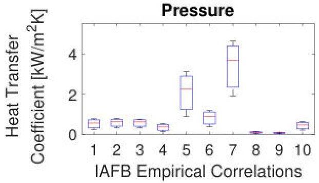

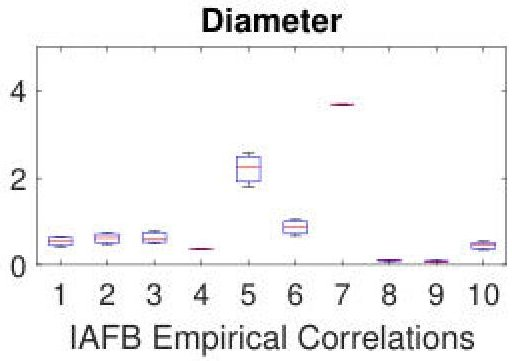

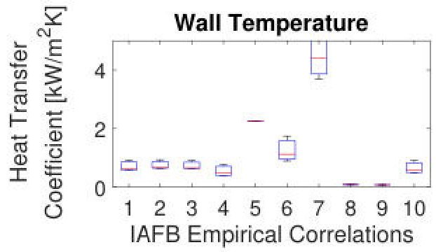

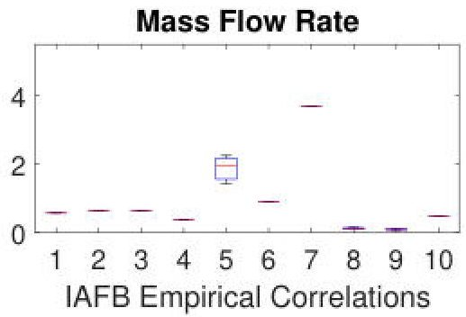

(a)

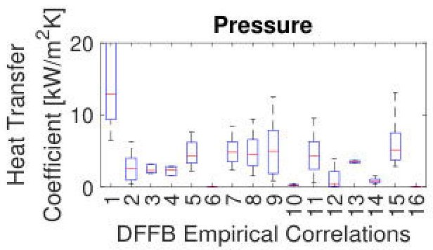

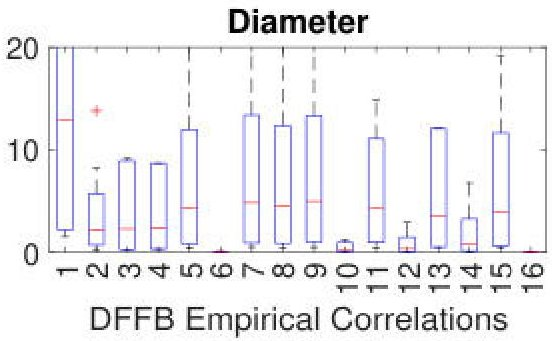

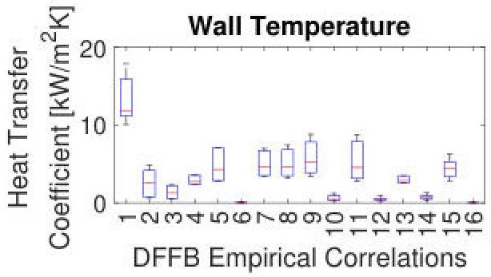

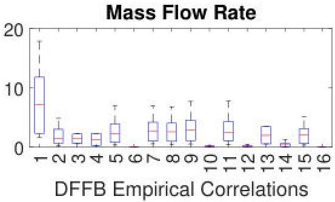

(b)

Figure 3.6: Sensitivity analysis results presented as a boxplot for the (a) IAFB and (b) DFFB regime. The numbers of the correlation given in the x-axis correspond to the correlations given in Table 3.6.

<!-- PDF_PAGE: 85 -->

The results in Table 3.7, showing the effect of various heat transfer coefficients on the ORC system, indicate as expected an increase in evaporator length and volume with decreasing heat transfer coefficient. However, the ORC volume and thermal efficiency are not significantly affected. Therefore the use of the selected IAFB and DFFB correlations in the optimisation is assumed to be satisfactory for the purposes of determining a preliminary design of the proposed system. The small effect on the ORC volume is also due to the other ORC system components, such as the concentrator, condenser and regenerator, remaining the same for this analysis. Note that for very small heat transfer coefficients $ \left( \leq1 0 0 \mathrm{~W / m^{2} K} \right) $ an evaporator tube length of more than 7 m is required which will exceed the geometric constraint $ ^{11} $ of the PCM and insulation configuration.

Table 3.7: The effect of a constant heat transfer coefficient on the proposed bimodal system.

<table border="1"><tr><td>Heat Transfer Coefficient [W/m2K]</td><td>Tube Length[m]</td><td>Evaporator Volume(x10-6)[m3]</td><td>ORC Volume[m3]</td><td>ORC Thermal Efficiency[%]</td></tr><tr><td>100</td><td>7.056</td><td>67.90</td><td>0.0783</td><td>12.71</td></tr><tr><td>500</td><td>1.752</td><td>16.90</td><td>0.0781</td><td>12.74</td></tr><tr><td>1000</td><td>1.086</td><td>10.40</td><td>0.0780</td><td>12.75</td></tr><tr><td>5000</td><td>0.553</td><td>5.32</td><td>0.0780</td><td>12.75</td></tr><tr><td>10000</td><td>0.486</td><td>4.67</td><td>0.0780</td><td>12.75</td></tr><tr><td>50000</td><td>0.432</td><td>4.16</td><td>0.0780</td><td>12.75</td></tr></table>

## 3.7. SYSTEM OPTIMISATION

## 3.7.1. OPTIMISATION SET-UP

An investigation into the feasibility of a micro-ORC system in terms of volume has been conducted. Reducing the volume and mass are both crucial for small satellite subsystems. However, these variables are proportional to each other and therefore only one variable needs to be considered in the optimisation. System volume was selected as a more appropriate optimisation variable due to the physical concerns regarding integration inside the launch vehicle, especially of large components such as the concentrators. Only superheated configurations with regeneration are analysed, as illustrated in Figure 3.1. The analysis is performed using a single-objective genetic algorithm (GA) implemented in MATLAB (Simon, 2009) based on the system architecture shown in Figure 3.1 and parameters given in Table 3.8. The optimisation process is shown in Figure 3.7. Genetic algorithms are common methods used in ORC optimisation studies (Ghaebi et al., 2019) due to their robustness, however at the expense of higher computational time when compared to other methods such as the direct search and variable metric method.

<!-- PDF_PAGE: 86 -->

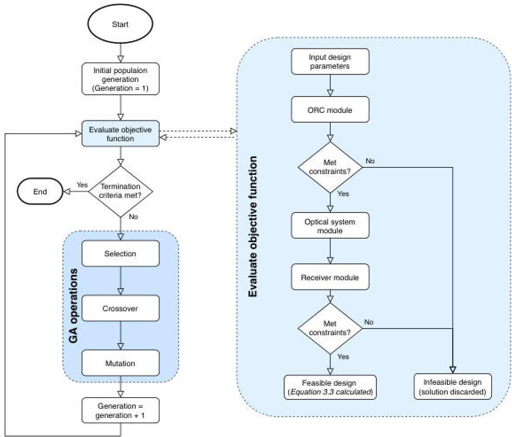

Figure 3.7: Flowchart illustrating the optimisation process. Section 3.3 discusses the component modules used to evaluate the objective function. Constraints that have to be met to result in a feasible solution and passed through the iteration process are provided in Table 3.8. Table 3.8 also provides the fixed parameters used in the optimisation.

<!-- PDF_PAGE: 87 -->

Table 3.8: Optimisation constraints that need to be met to obtain a feasible and system model parameters. Refer to nomenclature at the end of this chapter for variable definitions.

<table border="1"><tr><td colspan="2">Constraints</td><td></td><td colspan="3">Model parameters</td></tr><tr><td>Rotor blade height:</td><td>b&gt;0.2mm</td><td>$\cdot$</td><td>Stator inlet to outlet radius ratio:</td><td>$\frac{r_{0}}{r_{1}}=1.3$</td><td>$\dagger$</td></tr><tr><td>Regenerator thickness to height ratio:</td><td>$\frac{x_{5}}{x_{4}}<1$</td><td>$\cdot$</td><td>Stator outlet to rotor inlet radius ratio:</td><td>$\frac{r_{1}}{r_{2}}=1.02$</td><td>$\dagger$</td></tr><tr><td>Regenerator thickness:</td><td>$x_{5}\geq\frac{p}{n_{fin}\sigma_{fin}}$</td><td>$\cdot$</td><td>Rotor shroud outlet to inlet radius:</td><td>$\frac{r_{s,3}}{r_{2}}=0.7$</td><td>$\dagger$</td></tr><tr><td>Receiver length to evaporator length:</td><td>$\frac{L_{rec}}{L_{ev}} \geq1$</td><td>$\cdot$</td><td>Rotor outlet hub to shroud radius ratio:</td><td>$\frac{r_{h,3}}{r_{s,3}}=0.4$</td><td>$\dagger$</td></tr><tr><td>Discharge time:</td><td>$t_{dis}\geq t_{eclipse}$</td><td>$\dagger$</td><td>Absolute flow angle, rotor inlet:</td><td>$\alpha_{2}=80^{\circ}$</td><td>$\dagger$</td></tr><tr><td>Min. to max. cycle pressure ratio:</td><td>$\frac{x_{3}}{x_{2}}<1$</td><td>$\dagger$</td><td>Relative flow angle, rotor exit:</td><td>$\beta_{3}=60^{\circ}$</td><td>$\dagger$</td></tr><tr><td>Relative rotor Mach Number:</td><td>$M_{2,rl}<0.85$</td><td>$\dagger$</td><td>Axial flow coefficient:</td><td>$\phi=0.3$</td><td>$\dagger$</td></tr><tr><td>Relative flow velocity ratio:</td><td>$\frac{w_{3}}{w_{2}}>1.5$</td><td>$\dagger$</td><td>Spacecraft volume and mass:</td><td>$V_{sc}=0.3976\text{m}^{3},M_{sc}=215\text{kg}$</td><td>$\ddagger$</td></tr><tr><td>Regenerator pinch point temperature:</td><td>$\Delta T_{pp,rg} \geq20$</td><td>$\dagger$</td><td>Eclipse time:</td><td>$t_{eclipse}=35.29\text{minutes}$</td><td>$\ddagger$</td></tr><tr><td>Max. evaporator wall temperature</td><td>$T_{wall}=T_{stability}-20$</td><td>$\dagger$</td><td>Isentropic efficiencies:</td><td>$\eta_{t}=65\%,\eta_{p}=50\%,\eta_{g}=100\%$</td><td>$\dagger$</td></tr><tr><td rowspan="5">Max. working fluid temperature</td><td rowspan="5">$T_{wf}=T_{sat}+10$</td><td rowspan="5">$\dagger$</td><td>Solar flux and Sun half-angle:</td><td>$S=1350\text{W/m}^{2},\theta=0.266^{\circ}$</td><td>$\ddagger$</td></tr><tr><td>Optical fibre efficiency:</td><td>$\eta_{f}=83.8\%$</td><td>$\cdot$</td></tr><tr><td>Fibre mass per length:</td><td>$\bar{L}=9.95\text{g/m}$</td><td>$\cdot$</td></tr><tr><td>Shadow factor:</td><td>$b_{f}=0.02$</td><td>$\cdot$</td></tr><tr><td>Electrical power output:</td><td>$\dot{Q}=200W$</td><td>$\ddagger$</td></tr></table>

<!-- PDF_PAGE: 88 -->

For this analysis, the optimisation minimises the objective function, F(x), defined as

$$
F (x) = \left\{\mu_ {1} (x) \right\} ^ {2} + \left\{\Omega \right\} ^ {2}
$$

where $ \mu_{1} $ is the system volume fraction $ \left( \mu_{1}=V_{sys} / V_{sc} \right) $ and $ \Omega $ is the penalty term. Table 3.9 defines the 14 design variables, x, used and their corresponding upper and lower limits. The justification for the ranges selected are provided in the next subsection of this chapter.

Table 3.9: Optimisation design variables and corresponding design range.

<table border="1"><tr><td></td><td>Design Parameter</td><td>Unit</td><td>Range</td></tr><tr><td>$x_{1}$</td><td>Maximum cycle pressure</td><td>bar</td><td>1-0.95$p_{cr}$</td></tr><tr><td>$x_{2}$</td><td>Minimum cycle pressure</td><td>bar</td><td>0.1-5</td></tr><tr><td>$x_{3}$</td><td>Regenerator fin height</td><td>mm</td><td>0.2-8</td></tr><tr><td>$x_{4}$</td><td>Regenerator fin thickness</td><td>mm</td><td>0.1-1</td></tr><tr><td>$x_{5}$</td><td>Regenerator fin frequency</td><td>fin/m</td><td>100-1000</td></tr><tr><td>$x_{6}$</td><td>Regenerator length of hot side</td><td>mm</td><td>1-100</td></tr><tr><td>$x_{7}$</td><td>Regenerator length of cold side</td><td>mm</td><td>1-100</td></tr><tr><td>$x_{8}$</td><td>Number of hot layers</td><td></td><td>2-200</td></tr><tr><td>$x_{9}$</td><td>Condenser diameter</td><td>mm</td><td>0.2-6</td></tr><tr><td>$x_{10}$</td><td>Number of concentrators</td><td></td><td>2-20</td></tr><tr><td>$x_{11}$</td><td>Number of rings (fibre bundle)</td><td></td><td>2-10</td></tr><tr><td>$x_{12}$</td><td>Receiver thickness</td><td>mm</td><td>1-100</td></tr><tr><td>$x_{13}$</td><td>Receiver length</td><td>mm</td><td>1-100</td></tr><tr><td>$x_{14}$</td><td>Receiver insulation thickness</td><td>mm</td><td>1-500</td></tr></table>

The total volume of the ORC system, $ V_{sys} $ , is the summation of the volume of the evaporator, regenerator, condenser, pump, plumbing, and turbine. An additional 20% margin has been included to account for miscellaneous components such as support structures, interfaces, and control hardware. The total volume of the satellite is denoted by $ V_{sc} $ and is determined based on the allowable payload volume inside the standard Evolved Expendable Launch Vehicles (EELV) Secondary Payload Adapter (ESPA). The micro-ORC system is constrained to produce 200 W of electrical power output.

The parabolic penalty method has been used to increase the search domain by relaxing specific system constraints into a penalty term and reduce the risk of non-convex solutions by squaring each term in the objective function (Messac, 2015). The penalty term is defined as the summation of penalty parameters, $ P_{i} $

$$
\Omega = \sum_ {i = 1} ^ {1 8} P _ {i} (x)
$$

where $ P_{i}=\chi /\chi_{\mathrm{max}} $ if $ \chi >\chi_{max} $ or $ P_{i}=\chi_{\mathrm{min}} /\chi $ if $ \chi <\chi_{\mathrm{min}} $ . The parameter $ \chi $ represents the system constraint that has been relaxed such that the solution is not discarded during the iteration process of the optimisation. In this case, a penalty is given if the fluid velocity in the HXs (regenerator, evaporator, and condenser) falls outside the limits for liquid $ (0.5\leq u_{f}\leq 5) $ , vapour $ (1\leq u_{v}\leq \min \left[ 60175\rho_{v}^{-0.43}\right] ) $ , and two-phase

<!-- PDF_PAGE: 89 -->

(1 $ \leq u_{tp} \leq 1 8 3 \rho_{m}^{-0. 5} $ ) flow (Caputo et al., 2011). Penalties are also given if the mass velocity, Reynolds number (liquid-only, superficial liquid, and superficial vapour), and reduced pressure falls outside the range of validity of the two-phase flow correlations used in the condenser (Kim and Mudawar, 2013a) and evaporator (Kim and Mudawar, 2013b) models. $ \chi_{\mathrm{min}} $ and $ \chi_{\mathrm{max}} $ represent the upper and lower feasible bounds of these parameters and are provided in Table C.5 in Appendix C.

The optimisation population size was set to 140, and the termination criterion was set as either a convergence criterion of $ 1 0^{-1 0} $ or a maximum number of generations of 1000. These values were selected as a compromise between computational speed and accuracy. An initial mutation rate of 0.02 and a crossover probability of 0.7 were used.

## RANGE OF DESIGN PARAMETERS

The upper value of the maximum pressure was set to 5% less than the critical pressure of the working fluid and the lower value was set to 1 bar, to explore a broad design space. In terrestrial applications, the minimum cycle pressure of the working fluid has to be greater than atmospheric pressure to avoid air leakage into the system. This is not a concern in this design due to vacuum ambient conditions. However, the reverse effect, working fluid leakage out of the system, can be harmful to space applications as the leakage could cause disturbances to the satellite's attitude or damage on-board components such as sensitive optical surfaces. Therefore, the position of the ORC tubing on-board the satellite needs to be considered, and leakages needed to be mitigated. The lower limit of the minimum cycle pressure was restricted to 0.1 bar to ensure the condenser pressure losses could be overcome. Fin geometry ranges are limited to common values used in plate-fin heat exchanger designs (Shah, Ramesh K and Sekulic, 2003). The length of hot and cold sides of the regenerator was constrained for spacial constraints and to minimise the aspect ratios for structural concerns. A minimum of two hot layers was set because the hot channels form the outer part of the regenerator, as shown in Figure 3.3c. Further improvement in the regenerator design could be achieved by placing the cold layers on the outer part of the regenerator to minimise heat loss and extend the length of the hot and cold sides. The diameter of the condenser was limited to the validity range of the condensing heat transfer correlations (Kim and Mudawar, 2013a, 2012). The minimum number of concentrators was set as two for redundancy. The lower bound of the number of fibre rings, as described by Figure 3.2, was set to two because one ring does not meet the power input requirement. A wide range of receiver geometries was also evaluated to meet the thermal energy storage requirement, to ensure continuous power generation during eclipse periods. The insulation range ensures the working fluid does not exceed its thermal stability limit. It is expected that the MM and MDM scenarios will therefore require larger insulation thickness to meet the thermal stability constraint. For a specific satellite mission, the temperature of the outer layer of the insulation can be constrained to the required spacecraft environment for better thermal control, however, this is not considered in this chapter.

## WORKING FLUID SELECTION

A database of organic working fluids was generated based on fluids identified by Bao and Zhao (2013). The fluids are listed in Appendix C. The most common method used

<!-- PDF_PAGE: 90 -->

for working fluid selection is the screening method (Quoilin, 2011). To minimise conducting simulations that lead to infeasible solutions for small satellite applications, a pre-screening process of the fluids in the database was conducted which eliminates a number of working fluids.

Critical temperatures, $ T_{cr} $ below 500 K were discarded as high maximum cycle temperatures are desired to increase the operating temperature of the receiver for improved propulsion performance of the bi-modal system. Another advantage to selecting working fluids with higher critical temperatures is that they have higher molecular complexity values. Molecular complexity (Invernizzi, 2013) defines the slope of the saturation curve in the T-s plane and is a function of the molecular structure. It increases with number and mass of atoms that form the molecule and is proportional to the critical temperature. By selecting fluids with higher molecular complexity, a lower enthalpy drop is required. The turbine geometry, therefore, increases as it is proportional to the size parameter which is inversely proportional to the enthalpy drop across the turbine. The turbine rotational speed is proportional to the enthalpy drop and thus decreases with increasing molecular complexity. Higher molecular complexity also ensures dry expansion, which is beneficial in extending the life of the turbine. A common design concern with terrestrial ORC applications is air leakage into the system; space applications operate in vacuum conditions mitigating this concern. The proposed system therefore does not have a limitation on minimum condensation pressure. However, the maximum critical pressure was limited to 50 bar to reduce the plumbing/pipe thickness. Safety is also an important consideration when selecting the working fluid. Non-hazardous working fluids reduce costs with regards to handling, transportation, and storage and associated launch risk during launch vehicle integration. Fluids were restricted to be stable under the considered operating conditions, and thus the concern of safety is a compromise between flammability and health risk. Flammability is less of concern in space due to the absence of oxygen reducing the risk of a fire. However, the flammability of the fluid increases handling costs and launch risks.

The working fluids were evaluated based on each of their corresponding National Fire Protection Act (NFPA) safety diamond and were restricted to health rating less than 4 to minimise the integration risks of the small satellite with the primary payload. The working fluids that passed the pre-screening conditions are highlighted in bold in Table C.1 in Appendix C. Out of these fluids, the optimisation was run for Toluene, MM, MDM, D4, D5, and D6, based on the pre-screening as well as the work of Angelino and Invernizzi (1993), to identify the most suitable working fluid for small satellite applications as well as minimise computational time.

## 3.7.2. SYSTEM OPTIMISATION RESULTS

Table 3.10 shows the design input parameters for the optimal solutions of all the working fluid scenarios that can meet the discharge time required to operate continuously during the eclipse period. The corresponding temperature-entropy （T-s) diagram of the six optimal working fluid scenarios is shown in Figure 3.8. This figure shows that for all fluids considered, there is dry expansion across the turbine $ ^{12} $ . Therefore, no condensation occurs in the turbine flow passages which is beneficial for longevity of the turbomachine.

<!-- PDF_PAGE: 91 -->

The results illustrate that the length of the cold side of the regenerator reaches the upper bound of the given range. Extending the upper limit of the cold side length, results in an increase in regenerator geometry and thermal efficiency of the system by 1 to 2%. If the design requires a higher discharge time then a larger receiver is needed. At discharge time requirements of more than three times that specified in this optimisation, a larger optical system is also needed to meet the energy input required to obtain the thermal storage capacity.

Table 3.10: Optimal design parameters for each working fluid.

<table border="1"><tr><td></td><td>$p_{max}$ [bar]</td><td>$p_{min}$ [bar]</td><td>$h_{fin}$ [mm]</td><td>$t_{fin}$ [mm]</td><td>$f$ [fins/m]</td><td>$L_{hot}$ [mm]</td><td>$L_{cold}$ [mm]</td><td>$N_{hot}$ [-]</td><td>$D_{cd}$ [mm]</td><td>$N_{c}$ [-]</td><td>$N_{rings}$ [-]</td><td>$t_{rec}$ [mm]</td><td>$L_{rec}$ [mm]</td><td>$t_{ins}$ [mm]</td></tr><tr><td>Toluene</td><td>24.65</td><td>2.67</td><td>0.79</td><td>0.72</td><td>111</td><td>8</td><td>100</td><td>16</td><td>0.21</td><td>11</td><td>3</td><td>22</td><td>210</td><td>44</td></tr><tr><td>MM</td><td>11.63</td><td>1.856</td><td>0.29</td><td>0.18</td><td>154</td><td>26</td><td>99</td><td>11</td><td>0.22</td><td>14</td><td>3</td><td>23</td><td>230</td><td>62</td></tr><tr><td>MDM</td><td>7.48</td><td>1.031</td><td>2.23</td><td>0.99</td><td>932</td><td>5</td><td>98</td><td>79</td><td>0.27</td><td>13</td><td>3</td><td>23</td><td>220</td><td>62</td></tr><tr><td>D4</td><td>7.91</td><td>1.102</td><td>1.71</td><td>0.73</td><td>863</td><td>14</td><td>99</td><td>8</td><td>0.24</td><td>18</td><td>3</td><td>40</td><td>140</td><td>86</td></tr><tr><td>D5</td><td>7.02</td><td>1.156</td><td>5.35</td><td>0.97</td><td>972</td><td>16</td><td>100</td><td>13</td><td>1.48</td><td>18</td><td>3</td><td>24</td><td>270</td><td>38</td></tr><tr><td>D6</td><td>5.76</td><td>0.997</td><td>4.88</td><td>0.96</td><td>970</td><td>18</td><td>100</td><td>14</td><td>1.01</td><td>8</td><td>5</td><td>29</td><td>220</td><td>36</td></tr></table>

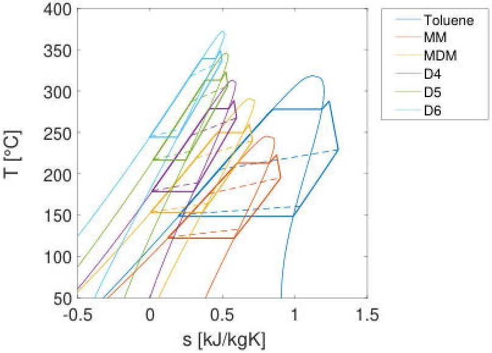

Figure 3.8: T-s diagram of the optimal working fluid scenarios assuming zero pressure drop across the heat exchangers.

The volume and mass of all the components for the various working fluids are provided in Figure 3.9. The critical component of the system is the concentrator as it has the largest stowed volume and mass. For the Toluene case the concentrator occupies 11.5% and 13.25% of the total allowable spacecraft volume and mass respectively.

Inflatable concentrators are necessary for the feasibility of micro-ORC systems as deployable rigid concentrators significantly exceed the spacecraft volume for the input power requirement, as depicted in Figure 3.10a. For example, the concentrator stowed volume fraction increases from 11.5% to 57.5% when changing the concentrator storage volume from 1% to 5%. Additionally, changing the design from inflatable to rigid the concentrator mass fraction increases from 13.25% to 31.04%. Figure 3.10b illustrates

<!-- PDF_PAGE: 92 -->

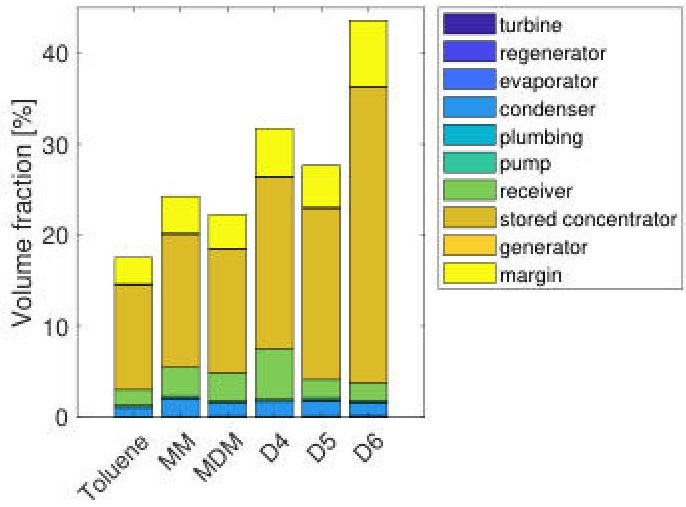

(a)

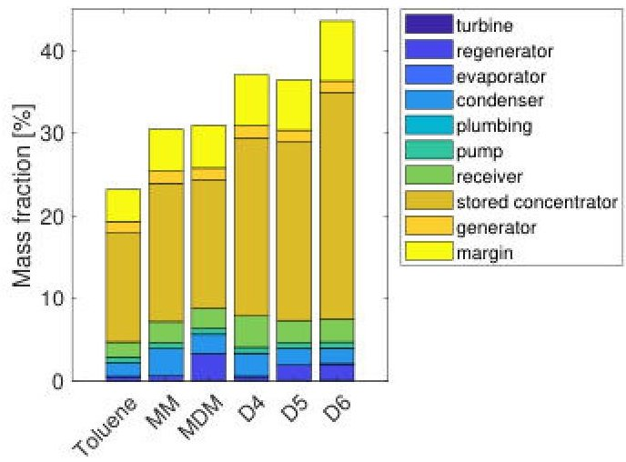

(b)

Figure 3.9: Optimal solution results showing the (a) volume and (b) mass fraction of all the system components relative to the total volume and mass of the satellite.

<!-- PDF_PAGE: 93 -->

the mass saving potential of inflatable designs, although this sensitivity analysis does not include the mass of the pressurisation system needed to inflate the optical system. However, deployment and the dynamic behaviour of inflatable systems is a concern and should be investigated as part of future work. Redell et al. (2005) discusses various options to make inflatable structures rigid after deployment. For example, UV-hardened resins, cold-rigidisation of a Kevlar/thermoplastic-elastomer, and work-hardening of an aluminium/plastic laminate are possible methods proposed to harden or rigidise inflatable systems. By rigidising the inflatable structures the amount of pressurant needed throughout the life-cycle is reduced and can improve the stiffness of the inflatable structures. Therefore, improving the dynamic response during solar tracking.

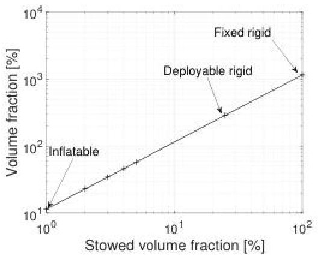

(a)

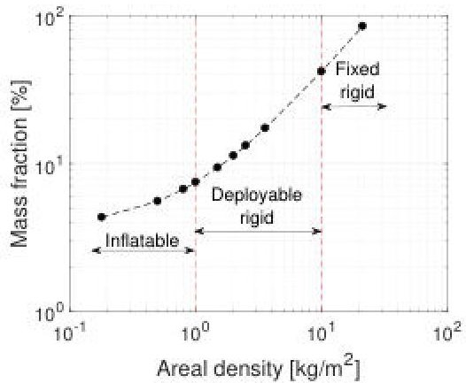

(b)

Figure 3.10: Optical system (a) volume fraction and (b) mass fraction (including optical fibre bundle) relative to the total volume and mass of the satellite. Table 3.1 provides the stowed volume fraction and areal density inputs for each concentrator type.

The receiver and condenser are the next largest components. These components, together with the generator, make up the heaviest components of the system. Toluene is shown to be the optimal working fluid for reducing the size of the system for a specific energy storage capacity and requires a stowed volume fraction of 18%. This is due to its higher thermal efficiency. However, this advantage is at the expense of faster rotor rotational speeds and smaller rotor blade heights, refer to Table 3.11. These high speeds, together with the high operating temperature and long lifetime required, eliminate the use of standard ball bearings (Dessornes et al., 2014). Alternative existing high-speed bearings include hydrodynamic, hydrostatic, foil, and magnetic bearings. In the field of micro-gas turbines, foil and hydrostatic (specifically hydroinertia) gas bearings have been identified as possible candidates (Isomura et al., 2006).

Molecular complexity $ \sigma $ (Invernizzi, 2013) defines the slope of the saturation curve in the temperature-entropy (T-s) plane and is a function of the molecular structure. It increases with number and mass of atoms that form the molecule. All fluids analysed in the optimisation have high molecular complexity and result in dry expansion, which is beneficial in extending the life of the turbine. Figure 3.11 illustrates the relationship between molecular complexity and rotor blade height and rotational speed. Fluids with relatively

<!-- PDF_PAGE: 94 -->

higher molecular complexity require lower enthalpy drops. The size parameter of the turbine is inversely proportional to the enthalpy drop across the turbine and therefore turbine geometry increases with molecular complexity. Rotational speed is proportional to the enthalpy drop and therefore decreases with increasing molecular complexity (Hall and Dixon, 2013;Leverone et al., 2017). The thermal efficiency reduces with increasing complexity as the optimal solutions resulted in a decrease in pressure ratio. This is a result of lower critical pressure which reduces the design space, as the upper limit of the maximum cycle pressure is constrained to $ 0.9 5 p_{c r} $ . Figure 3.11 also shows the potential inverse relationship between shared power density and molecular complexity. This is due to the decrease in thermal efficiency and thus decrease in electrical power output with increasing fluid molecular complexity. Toluene and linear siloxanes with relatively lower molecular complexity have higher shared power densities which is more advantageous for small satellites, with blade heights larger than the manufacturing limit. Fluids with lower molecular complexities would result in rotor geometries that are not feasible at the power level and operating temperature considered in this study.

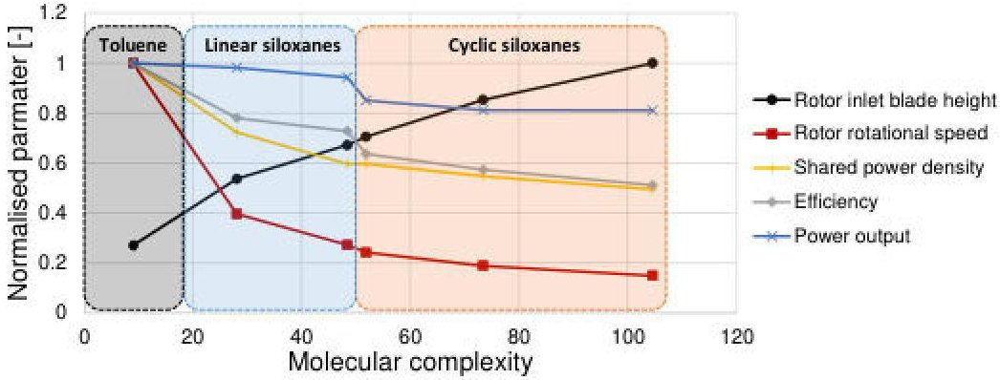

Figure 3.11: Normalised output parameters with respect to the maximum values versus molecular complexity, $ \sigma=T_{cr}/R(\partial S /\partial T)_{s v,T_{r}=0.7} $ of the six working fluids optimised in this paper.

A linear relationship can be derived from the optimal solutions system volume and mass with respect to molecular complexity, as shown in Figure 3.12. This simple linear model could act as a working fluid selection tool during preliminary design phases for future micro-ORC designs on-board small satellites. The linear trends have an R-squared fit of 0.90 and 0.81 for the system mass and volume respectively. This relationship is mainly due to the decrease of thermal efficiency, which increases the power input required for the same design constraints. The increase in power input needed means that a larger optical system is required which has the most significant effect on the proposed system (Figure 3.9). For the application considered in this study, fluids with high molecular complexity are required to meet the manufacturing limit of micro-turbines. However, out of the working fluids considered in this study, fluids with relatively lower molecular complexity are desired to maximise thermal efficiency and therefore minimise the system mass and volume.

Table 3.11 illustrates that the system using the Toluene working fluid has a total specific power of 3.6 W/kg, which does not compete with solar photovoltaic systems. For

<!-- PDF_PAGE: 95 -->

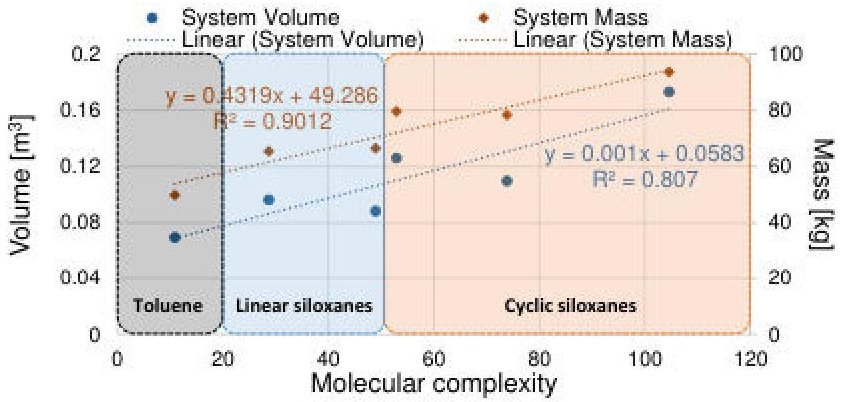

Figure 3.12: Linear trends of the proposed system volume and mass with respect to the working fluid molecular complexity, $ \sigma=T_{cr}/R(\partial S /\partial T)_{sv,T_{r}=0.7} $ of the six working fluids optimised in this paper.

example, the SMART-1 mission has an end of life specific density of 24 W/kg (mass includes the solar panels, the Power Control and Distribution Unit and Battery Management Electronics systems). When coupling the micro-ORC system to an STP system the shared specific power is improved to 10.3 W/kg assuming that the mass of the concentrator and receiver are part of the propulsion system (shared specific power excludes the receiver and concentrator mass but includes the margin). Despite the low specific power, the advantage to this system comes with the high-temperature thermal energy storage as it provides around 500 Wh/kg of specific energy that would be beneficial in future missions. By using Boron instead of Silicon, as the PCM, the specific energy could be increased up to 1280 Wh/kg. More efficient and lightweight concentrators, condensers, regenerators, and generators could increase the power density of the system. However, it is unlikely to surpass the current power density trend of conventional PV panels and batteries.

Table 3.11: Results of the optimal solutions of the optimisation study.

<table border="1"><tr><td></td><td>Rotor blade height [mm]</td><td>Rotor rotational speed [krpm]</td><td>Thermal efficiency [%]</td><td>Total specific power [W/kg]</td><td>Shared specific power [W/kg]</td></tr><tr><td>Toluene</td><td>0.27</td><td>772</td><td>12.62</td><td>3.62</td><td>10.29</td></tr><tr><td>MM</td><td>0.53</td><td>306</td><td>9.86</td><td>2.70</td><td>7.45</td></tr><tr><td>MDM</td><td>0.66</td><td>210</td><td>9.19</td><td>2.56</td><td>6.14</td></tr><tr><td>D4</td><td>0.69</td><td>187</td><td>8.03</td><td>1.93</td><td>6.14</td></tr><tr><td>D5</td><td>0.84</td><td>146</td><td>7.24</td><td>1.87</td><td>5.63</td></tr><tr><td>D6</td><td>0.98</td><td>115</td><td>6.46</td><td>1.56</td><td>5.10</td></tr></table>

Designing micro-turbines is a challenging task due to supersonic flow in the stator, fast rotational speeds and small blade heights. One of the largest unknown parameters is the turbine efficiency of small-scale turbines that utilise organic working fluids. The next section investigates the preliminary total-to-static efficiency of the micro-turbine design using Toluene as a working fluid. Only the Toluene design is evaluated because

<!-- PDF_PAGE: 96 -->

it is the most suitable working fluid for small satellites due to its low system volume and mass. It also has the smallest turbine size and therefore is the most interesting design to investigate regarding total-to-static efficiency.

## 3.8. TURBINE PERFORMANCE ESTIMATION

## 3.8.1. EMPIRICAL LOSS MODELS

The turbine efficiency decreases with size. The major reason for this decrease is because the relative aerodynamic losses increase for smaller designs, such as the relative clearance between the blade and shroud gets larger which increases the losses. Generally, during the preliminary design phase, turbine losses are determined using loss model correlations. However, these empirical loss correlations have been developed for large-scale turbines using non-organic fluids and their accuracy for the problem at hand is debatable. There is a lack of experimental testing of micro-radial inflow turbines (microRIT), which are necessary to characterise and quantify the associated turbine losses.

To determine an estimation of the losses and provide more realistic preliminary results, this work extends the research conducted by Suhrmann et al. (2010) and uses a set of loss models that were found to be acceptable for small-scale applications (with rotor diameters of 30 mm). These loss models show satisfactory agreement within 5% of the total-to-static efficiency compared with CFD results and 14% compared to experimental data (Suhrmann et al., 2010). In this case, maximising the total-to-static efficiency is of interest. Hall and Dixon (2013) defines the total-to-static $ \left( \eta_{TS}\right) $ and total-to-total $ \left( \eta_{TT}\right) $ efficiency as

$$
\eta_ {T S} = \left[ \frac {1}{\eta_ {T T}} + \frac {0 . 5 v _ {3} ^ {2}}{\Delta W _ {i s}} \right] ^ {- 1},
$$

$$
\eta_ {T T} = 1 - \zeta_ {R} \frac {w _ {3} ^ {2}}{2 \Delta W _ {i s}} - \zeta_ {N} \frac {v _ {2} ^ {2}}{2 \Delta W _ {i s}} \left(\frac {T _ {3}}{T _ {2}}\right),
$$

where $ \nu $ is the absolute velocity, $ w $ is the relative velocity and $ T $ is the static temperature. The subscripts 2 and 3 refer to the rotor inlet and outlet section $ ^{13} $ . $ \Delta W_{is} $ is the Eulerian work $ ^{14} $ obtained from the isentropic calculation performed in STODOLA (Pini and Vander Stelt, 2019). The enthalpy loss coefficient of the stator, $ \zeta_{N} $ , was computed by resorting to the Glassman model complemented by a first-principle loss model for the mixing losses (De Servi et al., 2019). The rotor loss coefficient $ \zeta_{R} $ , can be calculated using Equation 3.7 and is a sum of the following loses: tip clearance, $ \Delta h_{tc} $ , secondary flow, $ \Delta h_{sf} $ skin friction, $ \Delta h_{fric} $ , and incidence losses, $ \Delta h_{inc} $

$$
\zeta_ {R} = \frac {h _ {3} - h _ {3 , i s}}{0 . 5 w _ {3} ^ {2}} = \frac {\sum \Delta h _ {l o s s}}{0 . 5 w _ {3} ^ {2}} = \frac {\Delta h _ {t c} + \Delta h _ {s f} + \Delta h _ {f r i c} + \Delta h _ {i n c}}{0 . 5 w _ {3} ^ {2}}.
$$

A large concern with small scale turbomachinery is the tip-leakage loss due the relatively high tip gap to blade span ratio resulting from manufacturing and safety constraints. Here, the associated tip-leakage enthalpy loss is calculated according to Equation 3.8 (Rodgers, 1987),

<!-- PDF_PAGE: 97 -->

$$
\Delta h _ {t c} = 0. 4 \frac {t c}{b _ {2}} v _ {2, u} ^ {2}.
$$

where tc is the tip clearance and $ b_{2} $ is the rotor inlet blade height. Equation 3.9 (Alshammari, 2018; Rodgers, 1987; Ventura et al., 2012) determines the losses inside the blade passage as a combination of secondary flow losses $ (\Delta h_{sf}) $ and skin friction losses $ (\Delta h_{fric}) $

$$
\Delta h _ {p} = \Delta h _ {f r i c} + \Delta h _ {s f} = 0. 5 \left(c _ {f, c} ^ {\prime} \frac {L _ {h y d}}{D _ {h y d}} \bar {w} ^ {2} + \frac {r _ {2} v _ {2} ^ {2}}{r _ {c} Z}\right),
$$

where, $ L_{hyd} $ is the hydraulic length, $ D_{hyd} $ is the hydraulic diameter, $ r_{c} $ is the radius of curvature, $ r_{2} $ is the radius to the rotor inlet and Z is the number of rotor blades.

The average velocity $ \bar{w} $ is defined as $ \bar{w}=0. 5 \left[ w_{2}+0. 5 \left(w_{3,sh}+w_{3,hb}\right) \right] $ (Coppage and Dallenbach, 1956), the modified friction coefficient, $ c_{f,c}^{\prime} $ is determined by the correlation proposed by Musgrave (1979) shown in Equation 3.10 to account for the effects of curvature in the turbine. The friction coefficient, $ c_{f,c} $ is determined using Equation 3.11 (Rohlik, 1968) and the Fanning friction factor $ f $ is calculated as $ f=1 6 / \mathrm {R e}_{a v} $ if laminar flow and the Colebrook-White correlation if turbulent flow, (Colebrook et al., 1939)

$$
c _ {f, c} ^ {\prime} = c _ {f, c} \left[ \operatorname {R e} \left(\frac {r _ {2}}{r _ {c}}\right) ^ {2} \right] ^ {0. 0 5},
$$

$$
c _ {f, c} = f \left[ 1 + 0. 0 7 5 \mathrm {R e} ^ {0. 2 5} \sqrt {D _ {h y d} / \left(2 r _ {c}\right)} \right].
$$

The incidence losses can be determined using Equation 3.12 (Whitfield and Wallace, 1973) and the losses caused by the rotor outlet kinetic energy referred to as the exit losses is given by Equation 3.13 (Suhrmann et al., 2010),

$$
\Delta h _ {i n c} = 0. 5 w _ {2, w} ^ {2}
$$

$$
\Delta h _ {e e} = 0. 5 v _ {3} ^ {2}.
$$

The predictive capability of the loss model for small-scale applications was verified by a test case example $ ^{15} $ . The turbine design used as the test case is the ORCHID mini turbine (De Servi et al., 2019) that uses MM as the working fluid; additional inputs are given in Table 3.12. Results are compared with the Baines model (Baines, 1998) using the STODOLA software (Pini and Van der Stelt, 2019). For simplicity, the average velocity in Equation 3.9 is taken as the average of the inlet and outlet of the rotor. The results of the verification analysis performed on the ORCHID turbine are shown in Table 3.13. The total-to-static efficiency using the empirical loss models defined in this study is found to be within 3% of the model described by Baines and 6.5% of the CFD results. The implemented model is shown to provide a conservative value of the total-to-static efficiency.

Table 3.12 provides the input values used to determine the turbine efficiency of a micro-turbine design. The turbine efficiency is varied from 45 to 65% in a OAT sensitivity analysis to determine the impact of turbine efficiency on the system feasibility.

<!-- PDF_PAGE: 98 -->

Table 3.12: ORCHID mini-turbine test case input parameters

<table border="1"><tr><td>Parameter</td><td>ORCHID Test Case</td><td>Micro-turbine design</td></tr><tr><td>Working fluid</td><td>MM</td><td>Toluene</td></tr><tr><td>Mass flow rate[kg/s]</td><td>0.132</td><td>0.00405</td></tr><tr><td>Total inlet temperature[℃]</td><td>300.00</td><td>287.99</td></tr><tr><td>Total inlet pressure[bar]</td><td>18.10</td><td>24.58</td></tr><tr><td>Static exit pressure[bar]</td><td>0.443</td><td>3.211</td></tr><tr><td>Rotational speed[krm]</td><td>98.00</td><td>771.62</td></tr><tr><td>Inlet blade height[mm]</td><td>2</td><td>0.266</td></tr><tr><td>Tip clearance[mm]</td><td>0.1</td><td>0.075</td></tr><tr><td>Inlet blade height to diameter ratio</td><td>0.02874</td><td>0.03830</td></tr><tr><td>Reaction degree</td><td>0.37</td><td>0.4</td></tr><tr><td>In/out stator diameter ratio</td><td>1.3</td><td>1.3</td></tr><tr><td>In/out clearance diameter ratio</td><td>1.04</td><td>1.03</td></tr><tr><td>In/out mean rotor diameter ratio</td><td>1.79</td><td>2.0</td></tr></table>

Table 3.13: Verification of the total-to-static efficiency of the implemented loss model of the ORCHID turbine.

<table border="1"><tr><td></td><td>CFD(De Servi et al.,2019)</td><td>Baines(Baines,1998)</td><td>Present model</td></tr><tr><td>$\eta_{TS}[\%]$</td><td>84.00</td><td>81.06</td><td>78.84</td></tr><tr><td>Difference[%]</td><td>6.34</td><td>2.78</td><td>-</td></tr></table>

## 3.8.2. SENSITIVITY ANALYSIS ON TURBINE EFFICIENCY

For the micro-turbine design a total-to-static efficiency of 57.4% was found assuming a surface roughness of 0.05 mm (Suhrmann et al., 2010) and a tip clearance of 75 $ \mu $ m (Isomura et al., 2006). The fluid was found to operate in the turbulent region with the Reynolds number equal to $ 1.753\times10^{5} $ and $ 1.346\times10^{5} $ for the stator and rotor respectively. This is because the high vapour density and low viscosity of Toluene alleviate the effects of the small blade height.

The turbine efficiency used in the optimisation was assumed to be 65% (Table 3.8). This value is higher than the calculated value in this section. Therefore, a sensitivity analysis with respect to turbine efficiency was performed to determine the impact of this parameter on the system. Reducing the turbine efficiency, from 65% to 45%, decreases the thermal efficiency of the system by 30.3% and therefore, the electrical power output by 5.16% with respect to reference value (65% turbine efficiency). This, in turn, reduces the shared power density by 18.6% as shown in Figure 3.13. The micro-ORC system mass and volume fraction with respect to the satellite mass and volume is 24.6% and 18.4% for the 45% turbine efficiency case and 23.2% and 17.5% for the 65% case. Therefore, these turbine efficiencies are feasible if a system mass and volume fraction of less than 25% and 20% respectively are acceptable, however, this depends on the satellite mission. Additionally, in small-scale turbine designs, heat loss increases with reducing size (Isomura et al., 2006), which would significantly affect the efficiency of the turbine. Heat loss has not been accounted for in this study. However, it is advised that it should be considered in future work along with investigating the possibility of using thermal control from the high-temperature receiver.

<!-- PDF_PAGE: 99 -->

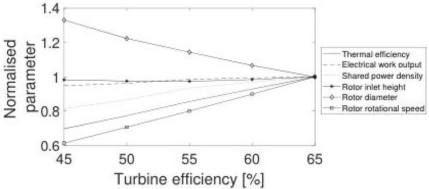

Figure 3.13: Normalised turbine output parameter, refer to legend, versus turbine efficiency. The parameters are normalised with respect to the results obtained for the 65% turbine efficiency simulation and therefore correspond to 1 for a turbine efficiency of 65%.

## 3.9. SUMMARY

The chapter focused on the feasibility of micro-ORC systems for power generation onboard small satellites that use waste energy from a solar thermal propulsion system. An optimisation was performed on six working fluids, accounting for system design, satellite, and fluid constraints. From the results, it has been found that Toluene is the optimal fluid in terms of minimising the volume for a given discharge time. However, the turbine rotor has a small blade height (0.27 mm) and ultra-fast rotational speed (772 krpm), which makes the attainment of high turbine efficiency challenging. Low turbine efficiencies are expected for micro-turbines mainly due to the large tip clearance of 75 $ \mu $ m, with a total-to-static efficiency of 57.4% obtained for the optimal Toluene solution. The optical system is the largest and highest mass component of the system, promoting the use of inflatable technology.

It was found that the critical heat flux is necessary to determine the flow regime inside the evaporator when high-temperature phase change materials are used to predict the heat transfer coefficient. For example, based on a sensitivity analysis, if the flow were to enter the IAFB regime, the heat transfer would be on the order of $ 6 5 0 \mathrm{~ W / m^{2} K} $ and if in the DFFB regime, the heat transfer would be on the order of $ 5 0 0 0 \mathrm{~ W / m^{2} K} $ . By changing the heat transfer coefficient by an order of magnitude from 500 to $ 5 0 0 0 \mathrm{~ W / m^{2} K} $ , the relative difference of the maximum length of the evaporator significantly decreases by 104% with respect to the average. Therefore, accurate values of the heat transfer coefficient are important in determining the length and thus, the volume of the evaporator. However, the heat transfer coefficient of the evaporator has a negligible effect, less than 0.4%, on the complete system volume. Various post CHF empirical equations were evaluated, and the Breen and Westwater and the Bishop correlations were found to provide the closest results to experimental data and mid-range results during the sensitivity analysis. However, the Bromley correlation was adopted instead of the Breen and Westwater because both correlations provide similar heat transfer coefficients under the expected operating conditions but the Bromley correlation reduces the dependency of film boiling heat transfer coefficient on the surface tension.

Recommended future work is to conduct experimental testing and in-depth modelling of the evaporator-receiver coupling to predict the heat transfer better and char-

<!-- PDF_PAGE: 100 -->

acterise the off-design and transient effects of the system. Investigation into the performance of micro-turbines is also recommended. The results indicate that micro-ORC systems are feasible on-board small satellites in terms of size and energy storage, and are attractive to missions requiring high specific energies. However, they have low shared specific powers on the order of 10W/kg when coupled to a solar thermal propulsion system. The proposed micro-ORC system would therefore result in a heavier electrical power system for small satellites compared to current state-of-the-art power systems. Therefore, the main advantage of this configuration is the gain in energy storage due to the use of a high-temperature latent heat energy storage system. As mentioned earlier in this thesis, coatings can be applied to solar concentrators to provide a higher resistance to degradation in high-radiation space environments compared to solar cells. Therefore, this power conversion system is more beneficial for missions that involve high-radiation environments.

<!-- PDF_PAGE: 101 -->

# DESIGN OF A BI-MODAL PROPULSION AND POWER SYSTEM

Everything was so new the whole idea of going into space was new and daring. There were no textbooks, so we had to write them.

Katherine Johnson, American mathematician

This chapter investigates the integrated design of a bi-modal propulsion and power system for large $ \Delta V $ manoeuvres as proposed in Chapter 2. A comprehensive model is developed that combines analytical and empirical relations obtained from literature to model key parameters of the bi-modal propulsion and power system. This system is optimised to minimise the total wet system mass fraction for various mini-satellite configurations. Several sensitivity analyses are performed to determine the effect design parameters and choices have on the mass of the system. An analysis of variance has also been conducted to identify which system parameters have the most influential effect on the system.

<!-- PDF_PAGE: 102 -->

## 4.1. SYSTEM REQUIREMENTS

Chapter 2 found that STP systems could be useful for future low-cost small satellite missions that have high $ \Delta V $ requirements on the order of a few km/s. For example, a small spacecraft that is able to perform an orbit transfer from geostationary transfer orbit (GTO) to a low altitude lunar orbit, such as a 100 km polar lunar orbit, is an attractive possible mission. Once the spacecraft reaches the lunar orbit, it can perform science tasks such as observe meteoroid impacts on the far-side of the moon or detect the form and distribution of water/ice in sunlight and shadow regions. The recent increase in scientific interest in lunar satellite and habitat missions, (Cipriano et al., 2018; Heilbronn et al., 2015; Ruess et al., 2006) also promotes this type of mission in the future. Kennedy et al. (2004) also shows that near-Earth escape missions (starting from an initial GTO) are also good candidate mission for STP systems. The purpose of these type of missions is to study an asteroid that is relatively close to Earth and poses a threat $ ^{1} $ . Examples, of asteroids that fall under this classification are provided by the Harvard Smithsonian Centre for Astrophysics $ ^{2} $ and include asteroids approaching Earth up until the year 2178.

Both of these example missions assume that the spacecraft is launched as a piggyback payload into a GTO, such as that provided by the Ariane 5 launch vehicle defined in Table 4.1. The choice of selecting GTO as the initial orbit is due to the relatively higher frequency of launches ( $ \geq $ five per year) versus launches for higher orbits ( $ \approx $ once per year).

Table 4.1: Initial orbital parameters for GTO using an Ariane 5 launch vehicle

<table border="1"><tr><td>Initial orbit parameters</td><td>Value</td></tr><tr><td>Altitude of perigee</td><td>250km</td></tr><tr><td>Altitude of apogee</td><td>35786km</td></tr><tr><td>Inclination</td><td>6°</td></tr><tr><td>Argument of perigee</td><td>178°</td></tr></table>

As mentioned in Chapter 2, one of the main advantages of an STP system over electric propulsion systems, which are commonly used for large orbit transfers, is the faster transfer time. This faster transfer time reduces the amount of exposure of radiation on the spacecraft from the Van Allen belt when transferring from GTO to a Lunar Orbit Insertion (LOI) or near-Escape missions. To keep this analysis general the $ \Delta V $ is based off literature. The $ \Delta V $ obtained from literature are based off vehicles of similar gross mass using chemical propulsion systems to ensure the assumed $ \Delta V $ is reasonable.

Table 4.2 provides the total $ \Delta V $ for a number of exemplary (flown and proposed) lunar capture and near-escape missions mostly using the Ariane 5 launch vehicle. This

<!-- PDF_PAGE: 103 -->

table shows that the $ \Delta V $ ranges between 1450 and 2100 m/s for satellites using chemical propulsion systems. Lunar perturbations become significant at apogees higher than 200000 km as they can lead to changes in orbital parameters such as the semi-major axis that result in an Earth re-entry or lunar gravity assist which could result in failure of the mission. Kennedy et al. (2004) provides in-depth trajectories including perturbation effects (such as Earth and lunar oblateness) of a 100 kg spacecraft using an STP system that relies on sensible heating for both a lunar and near-Escape mission. These trajectories are expensive in terms of $ \Delta V $ due to the use of phasing orbits to overcome the effects of lunar perturbations. Table 4.2 also provides the $ \Delta V $ breakdown of a lunar capture mission. After Earth departure, a mid-course correction $ \Delta V $ of 50 to 100 m/s is required to direct the spacecraft to the Moon. To insert a spacecraft into a low near circular lunar orbit of 100 km altitude with an inclination between 30 and $ 150^{\circ} $ to the Moon's equator a $ \Delta V $ of approximately 810 to 850 m/s is needed (Jason et al., 2001; Biesbroek and Janin, 2000; Uphoff, 1993). A minimum $ \Delta V $ of 100 m/s is also required for lunar maintenance operations due to the lack of certainty of the gravity field for low lunar orbits with high inclination values (Uphoff, 1993). No level of confidence is provided by Jason et al. (2001) and Uphoff (1993) for the stochastic $ ^{4} $ manoeuvres: the mid-course correction and the lunar orbit maintenance. Therefore, the minimum $ \Delta V $ requirement (STP-01) used in the design process is set to 1600 m/s and forms the lower bound to achieve theses missions. This $ \Delta V $ requirement results in a minimum mass fraction of 40% assuming a specific impulse of $ 300 \mathrm{s}^{5}. $

Table 4.2: Examples of high $ \Delta V $ missions starting at GTO using chemical propulsion systems.

<table border="1"><tr><td>Mission</td><td>Final orbit</td><td>Spacecraft mass [kg]</td><td>Total $\Delta V$ [m/s]</td><td>Comment</td><td>Reference</td></tr><tr><td>Moon Orbiting Observatory(MORO)</td><td>100 to 200km circular polar orbit</td><td>1207</td><td>$1580^{\dagger}$</td><td>ESA medium-size scientific mission(Unsuccessful candidate)</td><td>Biesbroek and Janin(2000)</td></tr><tr><td>Lunar European Demonstration Approach(LEDA)</td><td>Land on lunar surface</td><td>3347</td><td>1730</td><td>Increase in $\Delta V$ due to phase difference between GTO and lunar orbit</td><td>Biesbroek and Janin(2000)</td></tr><tr><td>Lunar Academic and Research Satellite(LunarSat)</td><td></td><td>100</td><td>1450</td><td>$\Delta V$ restricted by 40% budget therefore study based on Weak Stability Boundary transfers</td><td>Biesbroek and Janin(2000)</td></tr><tr><td>MoonShine</td><td></td><td>400</td><td>$1700^{\dagger}$</td><td>Proposed mini-satellite demonstration using bi-propellant propulsion system</td><td>Jason et al.(2001)</td></tr><tr><td>Lunar capture</td><td>2212x13222km, near-polar</td><td>100</td><td>2103</td><td>Proposed micro-satellite STP demonstrator</td><td>Kennedy et al.(2004)</td></tr><tr><td>Near-escape to 2000UKII</td><td>closest approach3659km</td><td>100</td><td>1696</td><td>Proposed micro-satellite STP demonstrator</td><td>Kennedy et al.(2004)</td></tr><tr><td>Near-escape to 4179Toutatis</td><td>closest approach3995km</td><td>100</td><td>1770</td><td>Proposed micro-satellite STP demonstrator</td><td>Kennedy et al.(2004)</td></tr></table>

$ ^{1} $ Earth departure 720 m/s, mid-course correction 50 m/s, lunar capture 810 m/s.

$ ^{2} $ Earth departure 690 m/s, mid-course correction 100 m/s, lunar capture 810 m/s, orbit maintenance (1 Year) 100 m/s.

The next system requirements applicable to the propulsion side of the bi-modal system are the maximum thrust and burn time. These values are taken as target values due to the unknown spacecraft center of mass and moments of inertia. Therefore, in the fi-

<!-- PDF_PAGE: 104 -->

nal design of the system these values may differ to limit disturbance torques and loading conditions of the inflatable concentrators.

The thrust-to-mass ratio is restricted to the targets defined in Kennedy et al. (2004) to 0.05 to 0.22 N/kg. These values correspond with thrust ranges of tested STP systems defined in Chapter 2. However, thrust-to-mass ratios less than 0.3 N/kg result in high $ \Delta V $ penalty (Larson et al., 1995), often referred to as gravity loss $ ^{6} $ that cannot be neglected. Therefore, the equations of motion need to be numerically integrated over the finite burn time. This analysis is provided in Appendix G, and investigates various thrust and burn time combinations. From this analysis, a thrust-to-mass ratio and burn time of 0.05 N/kg (STP-02) and 750 s (STP-03) were selected for the design process. Note that shorter burn times are also desirable to reduce the duration the high-temperature propellant is exposed to the nozzle.

To assist with determining the best thrust and burn time combination a requirement on the maximum total transfer time to achieve Earth escape/departure is set to a maximum of 90 days (STP-04). The rationale is to ensure the STP system achieves faster transfer times than electric propulsion systems to be competitive. For example, the SMART-1 mission took three months to complete its escape phase.

Typical combined wet propulsion and electrical power mass fractions for small satellite Delta class planetary missions are between 60 and 75% (Myers et al., 1994). Smart-1 was able to achieve a combined wet mass of 54% due to the high specific impulse electric propulsion system on-board. For this investigation, a slightly higher upper limit, of an additional 5% to an upper limit of 80%, is set as the system requirement, SYS-01, due to the low TRL associated with STP and ORC systems for space applications. The low TRL requires higher safety factors and conservative values to be used.

Both the propellant and working fluid selection are constrained to fluids that correspond to a Fire Protection Association (NPFA) 704 health rating of less than 4 (STP-05 and POW-01) to minimise the integration risks of a small satellite with the primary payload on-board the launch vehicle. Flammability is less of concern in space due to the absence of oxygen reducing the risk of a fire. However, the flammability of the fluid increases handling costs and launch risks. Lastly, POW-02 requirement ensure that the bi-modal system is defined such that thermal energy storage system provides sufficient energy to generate electrical power during eclipse periods.

A summary of the system requirements for the bi-modal thermal system are listed in Table 4.3.

## 4.2. DESIGN STRATEGY

Figure 4.1 shows a simplified overview of the design process to calculate the mass of the major components of an integrated solar thermal system that combines an STP and ORC system for propulsion and power generation. Chapter 3 provides the design guidelines and associated challenges of the optical system, receiver, and ORC system. Based on a pre-screening analysis conducted on 79 potential organic working fluids in Appendix C and a working fluid optimisation in Chapter 3, Toluene is selected as the working fluid.

<!-- PDF_PAGE: 105 -->

Table 4.3: Summary of the key system requirements

<table border="1"><tr><td>ID</td><td>Requirement</td><td>Rationale</td></tr><tr><td>STP-01</td><td>The propulsion system shall provide a minimum $\Delta V$ of 1600m/s.</td><td>Based on exemplary missions to complete lunar capture of near-Earth escape missions</td></tr><tr><td>STP-02</td><td>The propulsion system shall have a maximum thrust-to-mass ratio of 0.84N/kg.</td><td>The value is constrained to minimise the disturbance torque assuming a commercial reaction wheel and maximum thrust misalignment of 5mm(AppendixG)和 reduce the loading conditions on the inflatable concentrators during orbit transfer.This value is based off the works of Kennedy et al.(2004).This is not a strict requirement and may change with the detailed layout of the spacecraft(e.g.known center of mass and moment of inertia).</td></tr><tr><td>STP-03</td><td>The propulsion system shall have a maximum thrusting time of 1200s per orbital manoeuvre.</td><td>The value is constrained to reduce the time of exposure of the high-temperature propellant to the nozzle as well as limit the disturbance angular momentum.This value is based off the works of Kennedy et al.(2004)and is not a strict requirement.It may change with the detailed layout of the spacecraft.</td></tr><tr><td>STP-04</td><td>The total time for the Earth escape/departure phase shall be less than 90 days.</td><td>To compete with the lower range of electric propulsion systems such as the SMART-1 mission that took three months to complete the Earth escape phase.In addition,this aids to minimise the radiation exposure to the spacecraft.</td></tr><tr><td>STP-05</td><td>The propulsion system shall use a propellant with a Fire Protection Association(NPFA)704 health,flammability,and reactivity rating of less than4.</td><td>To minimise the transport,handling,and integration risks of a small satellite with the primary payload on-board the launch vehicle.</td></tr><tr><td>SYS-01</td><td>The total wet mass of the bi-modal system shall be no more than80% of the spacecraft mass.</td><td>Due to the low TRL the acceptable total wet mass is allowed to be greater than typical values of60 to75%</td></tr><tr><td>POW-01</td><td>The electrical power system shall use a working fluid with a Fire Protection Association(NPFA)704 health,flammability,and reactivity rating of less than4.</td><td>To minimise the transport,handling,and integration risks of a small satellite with the primary payload on-board the launch vehicle.</td></tr><tr><td>POW-02</td><td>The electrical power system shall be able to operate continuously.</td><td>To ensure the spacecraft can operate during eclipse periods.</td></tr></table>

<!-- PDF_PAGE: 106 -->

Toluene meets the POW-01 requirement and is the optimal fluid in terms of system volume minimisation. The choice of using latent heat thermal energy storage, as described in Chapter 3, is adopted to meet the requirement POW-02 and ensure the system can operate during eclipse periods. This section, therefore, focuses on the addition of the propulsion system. The bi-modal system is evaluated for the system requirements described in Section 4.1 and has been limited to mini-satellites.

The propulsion system is made up of the propellant, propellant tank, the feed system, and the nozzle. The mass of the propulsion system components and propellant are computed with commonly used equations in preliminary design phase (Larson et al., 1995) and therefore deemed suitable for this analysis.

## 4.2.1. PROPELLANT SELECTION

As mentioned in Chapter 2 water is a good candidate for STP systems and it meets the STP-05 requirement. Therefore, water is selected as the propellant.

The specific impulse, $ I_{sp} $ , (Equation 1.4) and the propellant mass, $ m_{p} $ , (Equation 2.2) are determined from the mission requirements, $ \Delta V $ , and spacecraft mass, $ m_{s/c} $ , and the nozzle correction factor, $ \lambda $ , expansion ratio, $ c $ , chamber pressure, $ P_{ch} $ , and the temperature of the propellant (taken as $ T_{melt} $ ). The nozzle expansion ratio, chamber pressure and propellant temperature are design inputs and are free to vary within a specified range. For simplicity of manufacture, a short $ ^{7} $ conical nozzle is assumed with a nozzle correction factor of 96% (Sutton and Biblarz, 2016).

## 4.2.2. FEED SYSTEM

The feed system consists of the propellant tanks, pressurisation system, flow lines and valves. Design choices for the tanks include the selection of the material (composite wrapped, aluminium alloys or titanium), the shape of the tank (cylindrical with hemispherical endcaps or spherical) and the number of tanks. These choices affect the mass and packaging volume of the system. The fluid inside the tanks is assumed to undergo isentropic expansions due to the relative long burn per manoeuvre. Using water requires a pressurant system to be included in the design. In this case, a regulated pressure-fed system is selected as the pressurisation system ensures constant operating pressure and therefore thrust, assuming a constant propellant temperature. All the tanks are assumed to be manufactured out of Titanium alloy, Ti-6Al-4V (Welsch et al., 1993). A single spherical-shaped pressurant and propellant tank is assumed. To account for pressure losses in the system such as orifices, regulators, and bends and to prevent backflow, the propellant tank final pressure is assumed to be twice the chamber pressure. The maximum expected operating pressure (MEOP) is assumed to be 15% more than the design pressure, and the burst pressure is 1.5 times the MEOP. To determine the thickness, t, of the tanks (Equation 4.1) a safety factor, SF, of 2.4 is used. The safety factor is a product of a 1.2 safety factor over the yield strength, $ \sigma_{y} $ , and a 2.0 safety factor to account for higher loads and vibration expected during launch (Huang and Huzel, 1992). The thickness of the tank wall, t, is

<!-- PDF_PAGE: 107 -->

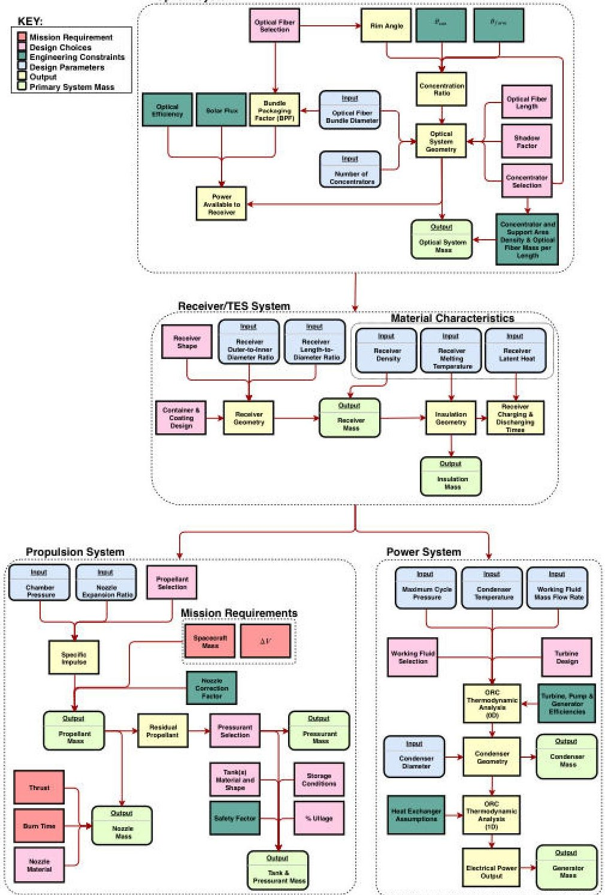

Figure 4.1: Simplified flowchart of the integrated solar thermal system design process adopted in this thesis. Section 4.2 provides the detailed information of each step and the relevant equations.

<!-- PDF_PAGE: 108 -->

$$
t = \frac {(S F) p r}{(C) \sigma_ {y}}
$$

where C is the shape constant and is equal to 1 if the tank is cylindrical and 2 if spherical, p is the burst pressure and r is the inner radius of the tank. A minimum wall thickness of 0.5 mm is assumed (Sato et al., 2007) due to manufacturing capabilities. For this analysis, the mass of the flow lines and valves are not included and assumed to be part of the margin.

## 4.2.3. NOZZLE DESIGN

A simplified nozzle design was used to calculate the mass of the nozzle in relation to increasing expansion ratio to give a first estimate of the nozzle mass. Therefore, it is noted that a more in-depth design considering mission loads such as vibration and the high gas temperature is needed in the next phase of the design. For this design, the divergence angle and convergence angle are assumed to be $ 1 5^{\circ} $ and $ 6 0^{\circ} $ (Sutton and Biblarz, 2016). The outer diameter, length, and mass of the nozzle are functions of the chamber pressure, burn time and expansion ratio.

## 4.3.1. OPTIMISATION SET-UP

## 4.3. DESIGN OPTIMISATION

The objective of this section is to optimise the bi-modal system to determine if a more competitive design over conventional systems is possible. In this case, the inputs are the $ \Delta V $ required for the mission and the mass of the spacecraft. The initial orbit parameters (Table 4.1) are also used as inputs to determine the initial sunlight to eclipse periods, as this is the worst-case ratio when both the propulsion and power systems require thermal energy from the receiver. The goal is to minimise the overall wet mass fraction, $ \beta $ , defined as the mass of the bi-modal system, $ m_{sys} $ , over the total spacecraft mass, $ m_{s/c} $ , as shown in Equation 4.2,

$$
\beta = \frac {m _ {s y s}}{m _ {s / c}}.
$$

The performance of the system is also improved when minimising the system mass fraction. This improvement occurs because the optimisation reduces the propellant mass, which occurs for higher specific impulses, and the concentrator mass, which occurs for higher thermal efficiency of the ORC system. The wet system mass is made up of the mass of the optical system, the receiver, the insulation, the propellant, the propellant tank, pressurant, and pressurant tank, the nozzle, and the condenser. A 20% margin on the wet system mass (ESTEC, 2012; Hu et al., 2018) is included to account for any unknowns and additional components such as the regenerator and propellant management device. The system is designed to include a 2% residual of propellant to account for unused propellant and a 10% ullage volume in the tank. The amount of time required to fully charge and discharge the PCM which acts as the TES system, assuming steady-state input and output power operation, is constrained to a maximum of 536 minutes and 104 minutes respectively based on daylight and eclipse periods of a GTO (Wertz et al., 2011). This restriction is to ensure the system operates during eclipse periods at the initial orbit.

<!-- PDF_PAGE: 109 -->

The optimisation problem is solved using a single-objective genetic algorithm (GA) using the code presented in Simon (2008). Figure 4.2 illustrates the optimisation process. GAs are commonly used in ORC and heat exchanger optimisation studies due to their robustness. However, they require higher computational time (Ponce-Ortega et al., 2009; Caputo et al., 2008). The objective function, $ F (x) $ , consists of the overall wet mass fraction and a penalty term, $ \Omega $

$$
\underbrace {F (x)} _ {\min } = \beta + \Omega .
$$

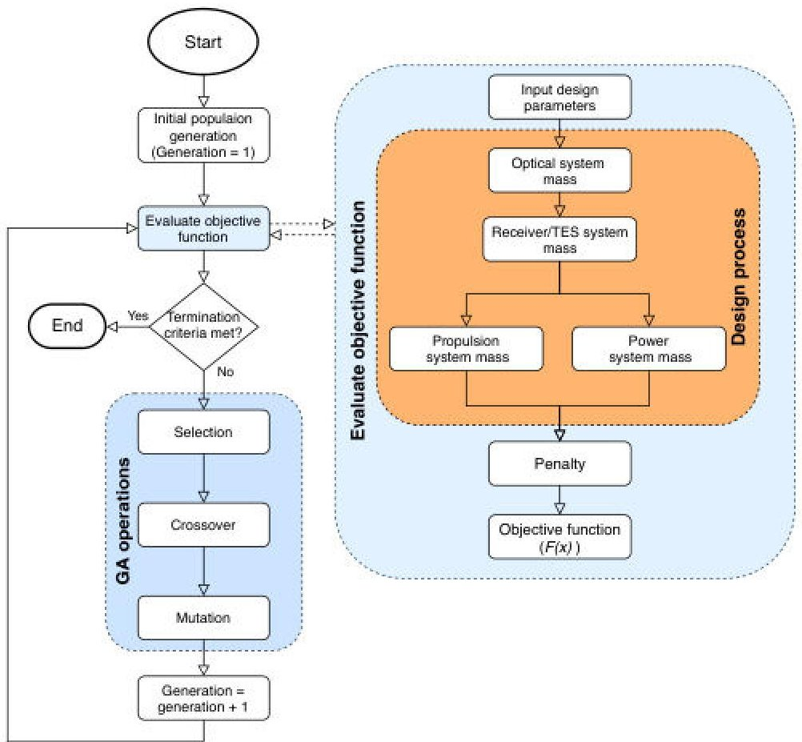

Figure 4.2: Flowchart illustrating the optimisation process used to minimise the bi-modal system mass.

A penalty is calculated if the fluid velocity in the condenser is outside the boundary for liquid, gas, or two-phase flow (Caputo et al., 2011). This is performed using the same method as Chapter 3, where the penalty is normalised with the maximum/minimum allowable value (Appendix C). This keeps the maximum penalty within the order of magnitude of the final solution of the first term such that the penalty goes to zero during the optimisation process. To ensure the entire design space is investigated the population size and the maximum number of generations is set to 130 and 400. The termination criteria are set as either a convergence criterion of $ 1 0^{-1 0} $ or the maximum number of generations. An initial mutation rate of 0.02 and a crossover probability of 0.7 are also used. Five spacecraft scenarios were investigated with a gross mass of 100, 200, 300,

<!-- PDF_PAGE: 110 -->

400, and 500 kg respectively with a minimum electrical power requirement of 1 W/kg of spacecraft mass (i.e. the minimum electrical power for the 100 kg spacecraft is 100 W). The chromosome structure is made up of thirteen design parameters, indicated in Figure 4.1, that describe the bi-modal system and mass of the major components.

A total of thirteen design variables have been identified to analyse the design of the proposed integrated solar thermal system and determine the mass of the major components of the system.

1. Number of concentrators: The number of concentrators, $ N_{conc} $ effects both the energy input of the system and the mass of the concentrators. Increasing the number of concentrators requires more optical fibre bundles and thus effects the inner diameter of the receiver and therefore increases the radiation losses due to an increase in receiver surface area. The minimum number of concentrators is required to ensure adequate power into the system so that the thermal energy storage can discharge over the entire eclipse period.

2. Optical fibre bundle diameter: The diameter of the bundle, $ D_{b} $ , is made up of the maximum number of fibre optic cables to fit within a circle. Each optical fibre is assumed to be 1.3 mm, with a numerical aperture of 0.66 (Henshall, 2006a). Due to the circular shape of the fibres the total area of the bundle is not useful and this is accounted for by defining the bundle packaging factor. Although, Liang et al. (1998) discusses the possibility of polishing the fibre tips to obtain a bundle packaging factor close to 1. The diameter of the concentrator is constrained by the numerical aperture, NA, of the optical fibre and the diameter of the bundle, Equation 4.4. Increasing the bundle diameter therefore increases the mass of the concentrator, receiver and insulation. A minimum TES charge time is possible as a compromise between the decrease in charging time due to the increase in input power and the increase in charging time due to the increase of the receiver mass. The numerical aperture is defined as

$$
N A = n _ {e} \sin \psi_ {a}
$$

where $ n_{e} $ is the external refractive index and $ \psi_{a} $ is the acceptance angle of the optical fibre cable. The rim angle of the concentrator is constrained to equal the acceptance angle to minimise fibre transmission losses.

3. Receiver outer-to-inner-diameter ratio: To design the receiver an outer-to-inner-diameter ratio, $ D_{o}/D_{i} $ , is assumed as a design parameter. This has a direct effect on the mass of the receiver and insulation as well as the energy storage charging and discharging time of the system.

4. Receiver length-to-diameter ratio: The length-to-diameter ratio of the receiver, L/D, also effects the shape of the receiver and therefore the mass and storage capability of the receiver.

5. Receiver melting temperature: The melting temperature, $ T_{melt} $ of the PCM significantly effects the propellant temperature and thus specific impulse. It also results in higher radiation losses which increases the insulation thickness. A minimum mass exists as a compromise between the reduction in propellant mass and

<!-- PDF_PAGE: 111 -->

therefore lighter feed system (tank, and pressurant system) and nozzle against the increase in insulation mass. The position of the ORC channel is also affected by the PCM temperature. Increasing the melting temperature of the receiver, in other words increasing the final propellant temperature increases the power required to vaporise the propellant therefore increasing the charging and decreasing the discharging time respectively.

6. Receiver density: To evaluate a number of different materials the density of the PCM, $ \rho $ is provided as an input. The density directly affects the mass and therefore charging and discharging times of the TES.

7. Receiver latent heat: Another characteristic of the PCM is the latent heat, L. The latent heat has no direct effect on the mass of the system but it is directly proportional to the charging and discharge time.

8. Thruster expansion ratio: By increasing the nozzle expansion ratio, $ c $ , the specific impulse can be improved, which reduces the mass of propellant and feed system (tank and pressurant). However, the increase in expansion ratio is at the expense of an increase in more mass, therefore, an optimal minimum mass exists. Longer nozzles also result in larger losses, although in this optimisation investigation the nozzle losses were kept constant. Therefore a balance also exists between better expansion ratios and larger losses. Investigation into the effect of varying the nozzle correction factor is provided in Section 4.4.3.

9. Chamber pressure: High chamber pressures, $ P_{c} $ effect the structural sizing by requiring thicker walls for the tubing as well as the tanks and other upstream components which require to be at a higher pressure. Larger wall thickness results in an increase of the overall mass. However, the benefit of higher chamber pressures is the reduction in nozzle mass as the throat area is inversely proportional to the chamber pressure. An optimal minimum mass exists between the increase in feed system mass and decrease in nozzle mass.

10. ORC maximum cycle pressure: The maximum cycle pressure, $ P_{max} $ , effects the structural sizing of the turbine but also the rotational speed and rotor blade height of the system which influence the feasibility of the system with current bearing technology and manufacturing limitations. It should be noted that with current manufacturing limitations, the minimum acceptable rotor blade height is 0.2 mm (Leverone et al., 2019). The increase in maximum cycle pressure improves the thermal efficiency of the system and thus the electrical power output. This increases the mass of the generator due to the derived linear relationship provided in Chapter 3. The condenser mass also increases as the temperature entering the condenser is higher for larger cycle pressures. Therefore the area of the condenser has to increase to accommodate the higher enthalpy change. Higher cycle pressures will also increase the tubing mass of the ORC system. However, this has not been considered as the plumbing was found to be <0.002% for 200 W and therefore is negligible. The increase in electrical power output results in the charge time increasing and the discharge time decreasing.

<!-- PDF_PAGE: 112 -->

11. ORC mass flow rate: The working fluid mass flow rate, $ \dot{m} $ directly effects the net electrical power output of the ORC system and therefore the mass of the generator. The condenser mass also increases for larger mass flow rates due to the larger condensation power required.

12. Condenser temperature: Increasing the temperature of the condenser, $ T_{cd} $ reduces the thermal efficiency of the ORC system and therefore reduces the charge time and increases the discharge time of the TES system. However, higher condenser temperature values result in a larger temperature difference between the external temperature of the condenser and the space environment temperature. The temperature difference effects the amount of radiation that can be expelled from the system and therefore the size of the condenser.

13. Condenser diameter: The diameter of the condenser, $ D_{cd} $ , effects the mass flux inside the flow channels of the condenser. This directly affects the pressure drop of system and therefore the mass of the condenser. Due to the discrete nature of the number of channels of condenser (constrained to be the maximum number of channels based on velocity boundary guidelines of single and two-phase flow in pipes (Caputo et al., 2011)) variations in the diameter result in discrete changes in the mass, electrical power output, charge time, and discharge time.

The design choices regarding the fibre optic cable (diameter and NA), tank configuration (number and shape), pressurant system and desired maximum outer insulation temperature were constrained to limit the number of design parameters. The influence of these choices on the design are investigated in Section 4.4.2.

## 4.3.2. OPTIMISATION RESULTS

Figure 4.3 provides the final optimisation solutions of the wet mass fraction for each investigated spacecraft. The corresponding design parameters are given in Table 4.4. The results show that there is a small variation (6%) in wet mass fraction with respect to satellite gross mass. For a spacecraft mass of 300 kg or less, the system requirement SYS-01 is not met.

Table 4.4: Final optimised design parameters for each mini-satellite scenario.

<table border="1"><tr><td>S/C mass</td><td>Db[mm]</td><td>Da/Di</td><td>L/D</td><td>e</td><td>Pc[bar]</td><td>Tmelt[K]</td><td>ρ[kg/m3]</td><td>L[kJ/kg]</td><td>m[g/s]</td><td>Pmax[bar]</td><td>Tcd[K]</td><td>Dcd[mm]</td><td>Nconc</td></tr><tr><td>100</td><td>3</td><td>3.76</td><td>1.87</td><td>226</td><td>4.89</td><td>1550</td><td>2946</td><td>4839</td><td>1.14</td><td>31.78</td><td>115</td><td>0.20</td><td>19</td></tr><tr><td>200</td><td>5</td><td>2.80</td><td>2.77</td><td>193</td><td>4.76</td><td>1501</td><td>2768</td><td>4970</td><td>2.95</td><td>33.9</td><td>142</td><td>0.22</td><td>16</td></tr><tr><td>300</td><td>7</td><td>3.30</td><td>1.94</td><td>172</td><td>4.21</td><td>1851</td><td>2462</td><td>4744</td><td>5.05</td><td>21.04</td><td>144</td><td>0.62</td><td>12</td></tr><tr><td>400</td><td>7</td><td>3.64</td><td>1.68</td><td>221</td><td>4.57</td><td>1849</td><td>1844</td><td>4938</td><td>5.63</td><td>31.15</td><td>139</td><td>0.52</td><td>14</td></tr><tr><td>500(baseline)</td><td>14</td><td>3.38</td><td>0.97</td><td>166</td><td>4.37</td><td>1964</td><td>2785</td><td>4617</td><td>6.78</td><td>26.69</td><td>129</td><td>0.368</td><td>5</td></tr></table>

The spacecraft within a mass range of 400-500 kg are more suited for large $ \Delta V $ requirement as they meet SYS-01 and have a mass fraction closer to 75% which could compete with conventional systems (Myers et al., 1994). Using tanks that are composed of a combination of titanium and composite materials could further reduce the system mass

<!-- PDF_PAGE: 113 -->

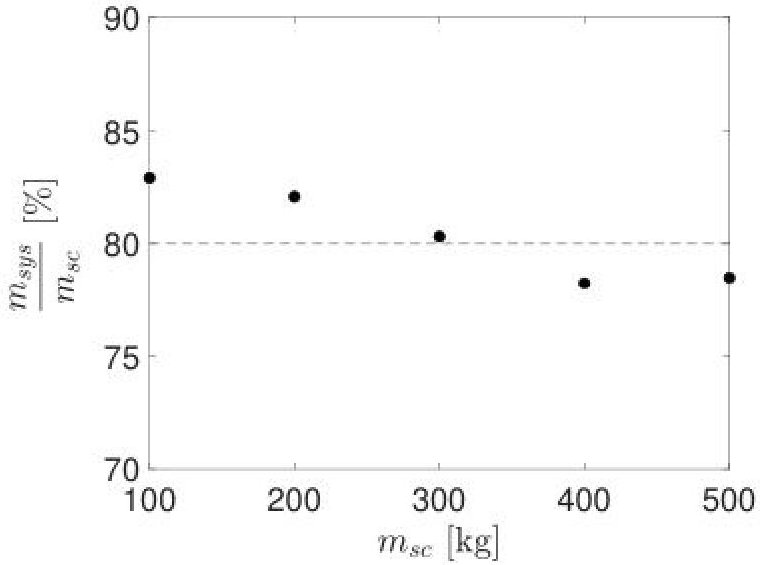

Figure 4.3: Final optimal solution of the wet mass fraction of the propulsion and power system for various spacecraft gross mass. The dashed line represents the upper limit of wet mass fraction as per requirement SYS-01.

fraction, to values close to 75% , to make it more competitive. The larger designs also result in fewer concentrators and therefore could reduce complexity by employing simpler deployment and tracking systems. The use of a constant total-to-static turbine efficiency for all the five mini-satellites results in the mass fraction being higher than reality for the smaller power capacity designs. This provides more confidence on the suitability of the proposed bi-modal design concept for the higher power capacity designs. Moreover, Table 4.5 indicates that for satellites less than 300 kg the rotor blade height is below the minimum acceptable limit of 0.2 mm that is possible with current manufacturing limitations (Leverone et al., 2019). The results also show that the higher mass satellites exhibit slower rotational speeds and better shared specific power which are more beneficial in terms of technical feasibility.

Table 4.5: Micro-turbine and ORC results of the optimal solutions.

<table border="1"><tr><td>S/C Mass[kg]</td><td>Rotor blade height[mm]</td><td>Rotor diameter[mm]</td><td>Rotational speed[rpm]</td><td>Thermal efficiency[%]</td><td>Electrical power output[W]</td><td>Shared specific power$ ^{a}$[W/kg]</td></tr><tr><td>100</td><td>0.11</td><td>4.2</td><td>1368607</td><td>20.47</td><td>102.6</td><td>8.9</td></tr><tr><td>200</td><td>0.19</td><td>5.0</td><td>1017712</td><td>17.82</td><td>206.4</td><td>10.5</td></tr><tr><td>300</td><td>0.33</td><td>6.8</td><td>691614</td><td>15.55</td><td>309.2</td><td>11.1</td></tr><tr><td>400</td><td>0.27</td><td>7.2</td><td>712156</td><td>17.84</td><td>401.0</td><td>11.5</td></tr><tr><td>500</td><td>0.32</td><td>8.8</td><td>594608</td><td>18.30</td><td>518.6</td><td>11.9</td></tr></table>

* Shared specific power is defined as output electrical power over the mass of the ORC components only. Mass of the ORC components is equal to the sum of the condenser, generator and half of the margin mass. Other half allocated to the propulsion system.

The PCM design parameters results in Table 4.4 show a melting temperature, density, and latent heat range of 1500 to 2000 K, 1800 to 3000 kg/m $ ^{3} $ , and 4600 to 5000 kJ/kg respectively. Silicon and Boron are existing PCM that best fit these ranges. However, Silicon does not meet the desired latent heat and Boron slightly exceeds the melting tempera-

<!-- PDF_PAGE: 114 -->

ture range (Table 4.6). These materials meet the future planned interplanetary specific energy target of greater than 250 Wh/kg. Table 4.6 highlights that Silicon is more appropriate than Boron based on a trade-off of material properties, availability, and cost and will be used as the selected PCM in the next chapter $ ^{8} $ .

Table 4.6: Comparison of PCM candidates (Gilpin, 2015; Lemmon et al., 2013; Kennedy, 2004; MatWeb, 2002; Datas et al., 2018; Zeneli et al., 2019).

<table border="1"><tr><td>PCM</td><td>Melting temperature</td><td>Latent heat</td><td>Specific energy</td><td>Thermal conductivity</td><td>Abundance</td><td>Cost</td></tr><tr><td>Silicon</td><td>1410℃(Orange)</td><td>1800kJ/kg(Orange)</td><td>496Wh/kg(Green)</td><td>25-56W/mK(Green)</td><td>High(Green)</td><td>$1.7/kg(Green)</td></tr><tr><td>Boron</td><td>2076℃(Green)</td><td>4650kJ/kg(Green)</td><td>1278Wh/kg(Blue)</td><td>&lt;30W/mK(Orange)</td><td>Rare(Red)</td><td>$5/g(Red)</td></tr><tr><td colspan="7">Blue:Exceeds requirements,Green:Meets requirements,Orange:Correctable deficiencies,Red:Unacceptable</td></tr></table>

The mass distribution of the optimal solutions of the five mini-satellite scenarios illustrated in Figure 4.4, shows the propellant mass accounts for between 44% and 50% of the total mass. The normalised propellant mass is dependent on the melting temperature of the optimal solution. Therefore, the 200 kg solution shows the highest value as it has the lowest melting temperature. The concentrator and insulation are the next highest mass components contributing up to 8% of the total mass. The tank system (including pressurant gas), condenser, nozzle, and receiver account for approximately 3.3%, 1.7%, 1.7% and 1.3% of the total mass regardless of the spacecraft size. The generator normalised mass decreases with increasing spacecraft size due to the empirical equation used. The largest generator mass fraction of 2.9% occurs for the 100 kg design. Taking into consideration the generator, condenser and half the margin mass the estimated shared specific power is between 9 and 12 W/kg (Table 4.5).

Figure 4.4: Normalised mass of all the major components for the five scenarios.

<!-- PDF_PAGE: 115 -->

## 4.4. SENSITIVITY ANALYSIS

Sensitivity analyses on the design parameters, design choices, and constant parameters were conducted using the design process sub-functions (Figure 4.2) to identify the influence of the variables on the integrated solar thermal design.

## 4.4.1. INVESTIGATION ON THE INFLUENCE OF DESIGN PARAMETERS

From the optimisation investigation, the 500 kg spacecraft solution has been taken as the baseline design for this sensitivity analysis. All the design parameters were evaluated between $ \pm 30\% $ from the baseline values. Note that the number of concentrators parameter was constrained to integer values only (this corresponds to $ \pm 40 $ $ \pm 20 $ from the baseline value). These design parameters are the inputs to the design process sub-functions. They are varied using a one-at-a-time method to evaluate their corresponding effect on the wet mass of the system.

## DESIGN PARAMETER RESULTS

The diameter of the bundle and the number of concentrators (optical parameters) as well as the receiver outer-to-inner diameter have the most influence on the mass fraction with a change from the baseline value of up to 17.6% , 8% , and 7.3% respectively. However, the number of concentrators is constrained to integer values and therefore was evaluated up to $ \pm 40\% $ change from the baseline case.

Figure 4.5 shows that for all the design parameters the change in system mass fraction can be expressed linearly within a 95% confidence within the sensitivity range ( $ \pm 30\% $ ） However, certain parameters follow a quadratic trend which is necessary if larger changes in the design parameter were to occur. The results capture the quadratic trend of increasing the diameter of the bundle which is coupled to increasing the diameter of the primary concentrator and the aperture of the receiver. The mass of optical system is directly proportional to the diameter squared of the primary concentrator and due to the selection of a cylindrical receiver. The mass of the receiver and insulation are also proportional to the square of the inner and outer diameter of the receiver. However, decreasing the bundle diameter by 20% or more results in insufficient energy storage and therefore requirement POW-02 is not met.

The results show increasing the number of concentrators can be seen as linear even though it effects various subsystems. For example, increasing the number of concentrators linearly increases the mass of the optical system $ ( m\propto N_{conc} ) $ but also increases the number of fibre bundles entering the aperture of the receiver. This increases the inner and outer diameter of the receiver $ ( m\propto d^{2} ) $ . However, the packaging efficiency (or density of bundles that can fit inside the aperture $ ^{9} $ ) varies which effects how much the diameter changes. The melting temperature of the PCM results in an optimal minimal point as a compromise between the increase in insulation mass and the decrease in propellant, tank, pressurant, and nozzle mass. It follows a non-linear trend because the propellant mass decreases non-linearly with an increase in specific impulse (Equation 2.1) and the specific impulse increases with temperature (refer to Figure G.2, Appendix G).

<!-- PDF_PAGE: 116 -->

Figure 4.5: Linear fit of the variation of the design parameters with 95% confidence bounds.

In addition, the mass of the insulation is a function of increasing its thickness to minimise the heat loss through radiation $ ( q\propto T^{4} ) $ to the environment. The absolute relative difference with respect to the baseline is 6.3%.

The condenser temperature has the next largest influence with an absolute relative difference of -4.4% with respect to the baseline. When increasing the condenser temperature a non-linear reduction in mass fraction is seen due to the increase in temperature difference between the condenser and environment which increases the rate of radiative heat transfer rate to the environment. This together with the smaller temperature difference between the inlet and outlet of the working fluid of the condenser result in a smaller condenser surface area and therefore mass. However, increasing the condenser temperature by 10% or more results in an electrical power output of less than $ 5 0 0 \mathrm{W}^{1 0}. $

When increasing the length-to-diameter ratio of the receiver it effects the total mass of the receiver (including insulation) which is linearly proportional to bi-modal wet system mass. This linear trend is shown in Figure 4.5 where the maximum relative difference is 2% with respect to the baseline.

The chamber pressure also follows a quadratic trend due to the increase in thickness of the propellant tank which is related the diameter （ $ m\propto d^{2} $ ). Although, the relative difference is only 1%. The mass fraction is linearly proportional to the mass flow rate of the ORC system and receiver density with a relative difference of 0.7 and 0.4% respectively. This is expected due to the linear dependency of the mass of the generator on the net power output which is proportional to the mass flow rate and the mass of the receiver on its density. However, if the mass flow rate reduces by 10% or more the electrical power output is less than 467 W. The expansion ratio affects the nozzle exit and throat areas as

<!-- PDF_PAGE: 117 -->

well as the specific impulse and thus results in a non-linear variation. From this compromise an an optimal point exists due to the increase in nozzle mass and decrease in propellant mass. Nevertheless, the system mass fraction is not significantly influenced as the relative difference is 0.3%. The remaining design parameters have less than 0.1% effect on the system mass fraction. Although, the maximum ORC pressure does not have a significant influence on the mass in the current configuration, it should be noted that its influence increases when adding the tubing. In addition, for maximum pressures reduced by 20% or greater the electrical power output is less than 500 W. It also has a significant impact (relative difference 24%) in the rotor inlet blade height of the turbine and up to 8.7% influence on the rotational speed.

## 4.4.2. INVESTIGATION ON THE INFLUENCE OF DESIGN CHOICES

A second sensitivity analysis was performed on the baseline design to evaluate the effect of certain design choices on the overall wet mass fraction. Here, the focus is on design choices such as the number of tanks and thrusters as well as the shape of the propellant tank and the desired outer temperature of the insulation layer. The design choices were not included as design parameters in the optimisation study to reduce the number of parameters as well as increase the computation time. Most of these design choices are dependant on the spacecraft configuration and layout and would depend on the specific payload on-board. As this chapter provides a more generic design approach these parameters were left out of the optimisation as they were determined as choices dependant on the specific spacecraft and mission requirements as well as available optical fibres. The boundary defined for these parameters are based on packaging arrangements of the propellant tank, the thrust vectoring capability of the spacecraft, and the requirements of the internal temperature of the spacecraft. The optical fibre diameter and the optical fibre NA, which relates to the primary concentrator's rim angle, are also analysed. The boundary for these parameters are based on commercially available optical fibres $ ( 0. 1 \leqslant D_{f} \leqslant2 $ mm and $ 0. 1 \leqslant\mathrm{N A} \leqslant0. 6 6 ). $ Table 4.7 provides the various design choice parameters investigated.

Table 4.7: Design choice sensitivity analysis input parameters. Values used in the optimisation analysis are underlined.

<table border="1"><tr><td></td><td></td><td colspan="9">Parameter values for Figure 4.6</td></tr><tr><td></td><td></td><td>a</td><td>b</td><td>c</td><td>d</td><td>e</td><td>f</td><td>g</td><td>h</td><td>i</td><td>j</td></tr><tr><td>Fibre diameter, $D_f$</td><td>[mm]</td><td>0.1</td><td>0.4</td><td>0.7</td><td>1</td><td>1.3</td><td>1.5</td><td>1.7</td><td>1.9</td><td></td><td></td></tr><tr><td>Rim angle, $\psi_{rim}$ (NA)</td><td>[°]</td><td>26.10(0.44)</td><td>30.00(0.5)</td><td>32.01(0.53)</td><td>34.75(0.57)</td><td>41.30(0.66)</td><td>45.00</td><td></td><td></td><td></td><td></td></tr><tr><td>Insulation temperature, $T_{ins}$</td><td>[K]</td><td>350</td><td>400</td><td>450</td><td>500</td><td>550</td><td>600</td><td></td><td></td><td></td><td></td></tr><tr><td># thrusters, $N_{thruster}$</td><td>[-]</td><td>1</td><td>2</td><td>3</td><td>4</td><td>5</td><td></td><td></td><td></td><td></td><td></td></tr><tr><td># tanks, $N_{tank}$</td><td>[-]</td><td>1</td><td>2</td><td>3</td><td>4</td><td>5</td><td></td><td></td><td></td><td></td><td></td></tr><tr><td>Tank L/D ratio, $(L/D)_{tank}$</td><td>[-]</td><td>1</td><td>2</td><td>3</td><td>4</td><td>5</td><td>6</td><td>7</td><td>8</td><td>9</td><td>10</td></tr><tr><td>Ullage</td><td>[%]</td><td>5</td><td>10</td><td>15</td><td></td><td></td><td></td><td></td><td></td><td></td><td></td></tr><tr><td>Pressurant</td><td>[-]</td><td>$\underline{N_{2}}$</td><td>He</td><td></td><td></td><td></td><td></td><td></td><td></td><td></td><td></td></tr></table>

## DESIGN CHOICE RESULTS

Modifying the design from using a spherical propellant tank to a cylindrical tank with a length-to-diameter ratio of 2 results in the largest increase in overall wet mass fraction (12.8%) as illustrated in Figure 4.6. If a single cylindrical tank is used the tank L/D ratio would need to be greater than 16 in order to meet the wet system mass requirement

<!-- PDF_PAGE: 118 -->

(SYS-01). This non-linear inverse relationship is due to the mass of the propellant tank being proportional to the tank diameter squared. However, this is at the cost of large lengths (>4 m) that could exceed the spacecraft storage length. To compensate this, the number of tanks could increase but at the cost of an increase in tank and additional feed system mass as well as complexity.

Figure 4.6: Sensitivity results of the design choices.

The results in Figure 4.6 show that the parameters with the next largest effect on the overall wet mass fraction are the fibre diameter and the desired insulation temperature. The variation of fibre diameter from the baseline value is 11.9% . An increase in system mass fraction of 1.6 is obtained if $ D_{f} $ is changed to 0.1 mm. The system mass fraction corresponding to $ D_{f}=0.1 $ mm is not shown in Figure 4.6 as it exceeds 1. When increasing the fibre diameter, the mass of the bundle reduces as the number of fibres reduce $ ^{11} $ which decreases the mass of the optical system. The fibre mass per length was adjusted such that it increased for increasing diameters based off a reference diameter.

Increasing the desired insulation temperature up to 600 K results in a relative reduction of 7.6% with respect to the baseline value. This non-linear decrease is due to the quadratic relation of insulation thickness on the reduction in surface area and temperature difference between the outer insulation temperature and the environment.

The rim angle can also significantly affect the overall mass fraction. The rim angle is determined based on the numerical aperture (NA) of commercially available optical fibres. The rim angle is directly proportional to the primary diameter of the concentrator and therefore the available input power. As mentioned previously the mass of the optical system is proportional to the diameter of the concentrator squared. At low values, the concentrator energy input to the receiver is less than the energy required by the propulsion and power system. The results show that a minimum NA of 0.57 is needed to

<!-- PDF_PAGE: 119 -->

achieve the required input power.

Lastly, by increasing the number of thrusters the total nozzle mass reduces (by 1.7%) due to the decrease of the throat and exit diameter caused by the decrease in thrust per thruster. Increasing the number of thrusters is also beneficial for propulsion redundancy and can assist with correcting for misalignment errors by controlling the mass flow rate of each valve.

Based on the results of this sensitivity analysis the following general recommendations can be drawn.

- Fibre optic cables with smaller NA, down to 0.54, can be tolerated to reduce the mass fraction while meeting the energy in requirement. The reduction in mass fraction is a result of the NA corresponding to smaller acceptance angles and therefore reducing the primary concentrator's rim angle.

- Larger fibre optical cable diameters are desirable to reduce the mass of the optical system. However, larger diameters compromise on the allowable bend radius (e.g. $ r_{bend}\approx 150r_{core} $ , dependant on supplier) which limits optical integration onboard the satellite. Based on the given requirements a minimum fibre diameter of 1 mm should be used.

- A good material choice of fibre optic cable for this system is fused silica $ ^{12} $ . This choice is due to a compromise between being able to withstand high temperatures up to $ 1000^{\circ} \mathrm{C} $ $ ^{13} $ , having high radiation resilience $ ^{14} $ , available NA (e.g. 0.5-0.66), and low attenuation over solar spectrum (low Hydroxl ion).

- Increasing the number of thrusters would require individual receivers to make use of controllability. Valves cannot be subjected to the high temperatures aft of the receiver to control mass flow rate for each thruster.

- Low-mass insulation are critical to reduce the mass of the bi-modal system. However, some flexibility in the operational outer surface temperature of the insulation is possible as a combination of the satellite critical systems and/or placement of the receiver as well as the requirements on TES (e.g. eclipse periods).

- Changing the pressurant from Nitrogen to Helium reduces the system mass fraction for this configuration by 0.7%.

## 4.4.3. UNCERTAINTY ANALYSIS

Lastly, an analysis of variance (ANOVA) was performed to assess the influence of the uncertain parameters in the system model to identify critical parameters. The outputs analysed are the overall wet mass fraction, the electrical power, and the charging and

<!-- PDF_PAGE: 120 -->

discharging time of thermal energy storage system. The percentage contribution or variable importance, which indicates the influence magnitude of a parameter on the outputs, is defined as the sum of squares of each factor divided by the total sum of squares. Parameters under investigation include the optical, turbine, pump, and generator efficiency. The nozzle correction factor, condenser pinch point temperature, and the radiating space environment temperature that the condenser is exposed too are also evaluated. The maximum and minimum range of all these variables are given in Table 4.8 and discussed in the following paragraph.

Table 4.8: Uniform distribution of parameters for the uncertainty sensitivity analysis.

<table border="1"><tr><td>Parameter</td><td>Range</td><td>Baseline</td><td>Comment on baseline value</td></tr><tr><td>Optical efficiency [%]</td><td>[55-85]</td><td>62.6</td><td>Value determined in Chapter 3.</td></tr><tr><td>Turbine efficiency [%]</td><td>[50-80]</td><td>65</td><td></td></tr><tr><td>Pump efficiency [%]</td><td>[30-60]</td><td>50</td><td></td></tr><tr><td>Generator efficiency [%]</td><td>[80-95]</td><td>95</td><td></td></tr><tr><td>Condenser pinch point temperature [K]</td><td>[10-30]</td><td>20</td><td></td></tr><tr><td>Condenser environment temperature [K]</td><td>[4-300]</td><td>186</td><td>Gilmore(2002)</td></tr><tr><td>Nozzle correction factor [%]</td><td>[96-99]</td><td>98</td><td>Sutton and Biblarz(2016)</td></tr></table>

Predicted optical efficiency ranges for current and space-based deigns are provided by Nakamura et al. (2004). Literature, although focused on larger Rankine systems, provides an estimation for the expected turbine, pump, and generator efficiency range (Angelino et al., 1991; Wang et al., 2013). Condenser pinch point temperature range is assumed to be between 10 and 30 to cover a large range of operation conditions. Deepspace temperature is taken as 4 K and is the lower limit of the environmental temperature the condenser radiates too, however depending on the position of the satellite, the condenser may be exposed to higher temperatures due to sunlight, planetary infrared, and albedo effects. An upper limit of 300 K is based on assuming the condenser radiates to the satellite surface which is equivalent to 300 K at 1 AU from the Sun. The nozzle correction factor range is based on reducing the nozzle losses from the current conicalshape nozzle by using a bell-shape nozzle which can achieve correction factors up to 99% (Sutton and Biblarz, 2016).

## PERCENTAGE CONTRIBUTION OF UNCERTAIN PARAMETERS

The three constant parameters that influence the overall wet mass fraction of the system the most are the condenser pinch point temperature, the nozzle correction factor, and the environmental temperature exposed to the condenser. Figure 4.7 indicates that these parameters can affect the response up to approximately 20%. The condenser pinch point temperature, which is taken as the difference between the saturated temperature and the wall temperature of the condenser, has the largest influence. Higher condenser pinch point values reduce the wall temperature of the condenser and therefore increase the required area and thus mass of the condenser. Experimental testing of the thruster can be conducted to evaluate the nozzle losses and to minimise the losses which will result

<!-- PDF_PAGE: 121 -->

Figure 4.7: Percentage contribution of the uncertain parameters for the integrated solar thermal model.

in high-performing low mass nozzles. A more detailed condenser model that evaluates the condenser in the space environment and accounts for albedo effect and the position of the condenser versus the Sun and Earth would be able to predict more accurate results on the temperature of the condenser and space environmental temperature per orbit to determine a more accurate range.

The isentropic efficiency of the turbine has the largest effect of almost 75% on the output electrical power, $ \dot{W}_{net} $ indicated in Figure 4.7. This identifies the need to more accurately predict the losses of micro-turbines. Currently, existing loss models and experimental testing are limited to larger-scale designs and often do not include organic fluids. Future work will need to evaluate the turbine efficiency of a micro-turbine using available large-scale models to determine possible ranges to improve confidence level. Then, attempts to improve the confidence level by improving the existing loss models to account for small-scale application will be investigated. Experimental testing is also necessary to verify predictions.

Regarding the charging time of the TES system, the optical efficiency contributes to the largest variation of up to 90%. The optical efficiency is directly proportional to the input power of the concentrator which is inversely proportional to the charge time. The discharge time is inversely proportional to the output power of the system which includes the electrical power output, Equation 3.2. Therefore, the turbine efficiency and pump efficiency are the main variables that contribute to the variation. The contribution from the turbine is largest due to the larger boundary of efficiency evaluated due to the higher uncertainty of this variable.

## 4.5. BASELINE SYSTEM DESIGN

Before concluding this chapter, the baseline design is summarised in Table 4.9 together with its main features. The key features include five primary inflatable concentrators with a diameter of 1.49 m. Each primary concentrator is coupled with a flat plate sec-

<!-- PDF_PAGE: 122 -->

ondary concentrator (0.21 m diameter) to heat the high-temperature receiver. The receiver aperture is 37.8 mm in diameter to accommodate receiving the five fibre optic bundles (14 mm diameter per bundle). A spherical tank with a radius 389 mm is needed to hold 223 kg of propellant (water), including a 2% residual and a 10% ullage volume.

Table 4.9: Summary of the baseline design characteristics

<table border="1"><tr><td>Parameter</td><td>Value</td><td>Parameter</td><td>Value</td></tr><tr><td>Optical system</td><td></td><td></td><td></td></tr><tr><td>Number of optical systems</td><td>5</td><td>Optical efficiency</td><td>62.6%</td></tr><tr><td>Primary concentrator diameter</td><td>1.49m</td><td>Secondary concentrator diameter</td><td>0.21m</td></tr><tr><td>Optical fibre bundle diameter</td><td>14mm</td><td>Optical fibre NA</td><td>0.66</td></tr><tr><td>Reciver/TES system</td><td></td><td></td><td></td></tr><tr><td>Receiver aperture</td><td>37.8mm</td><td>Receiver melting temperature</td><td>1964K</td></tr><tr><td>Receiver outer-to-inner diameter</td><td>3.38</td><td>Receiver length to outer diameter</td><td>0.97</td></tr><tr><td>ORC system</td><td></td><td></td><td></td></tr><tr><td>Number of condenser channels</td><td>36</td><td>Condenser diameter</td><td>0.8mm</td></tr><tr><td>Condenser temperature</td><td>129K</td><td></td><td></td></tr><tr><td>Propulsion system</td><td></td><td></td><td></td></tr><tr><td>Propellant tank shape</td><td>Spherical</td><td>Number of propellant tanks</td><td>1</td></tr><tr><td>Propellant tank radius</td><td>389mm</td><td>Propellant tank ullage</td><td>10%</td></tr><tr><td>Propellant mass</td><td>223kg</td><td>Pressurant</td><td>Nitrogen</td></tr><tr><td>Chamber pressure</td><td>4.37bar</td><td>Nozzle expansion ratio</td><td>166</td></tr><tr><td>Overall performance</td><td></td><td></td><td></td></tr><tr><td>Thrust</td><td>25N</td><td>Electrical power output</td><td>518.6W</td></tr><tr><td>ORC thermal efficiency</td><td>18.3%</td><td>Shared specific power</td><td>11.9W/kg</td></tr></table>

When the high-temperature PCM receiver has been selected. The number of design parameters can be reduced by three as the PCM density, latent heat and melting temperature are known (assuming the propellant chamber temperature is equal to the melting temperature). In addition, the expansion ratio can be changed to a design choice based on available thruster configurations instead of a design parameter due to its insensitivity on the wet system less than 0.3% (Figure 4.5). It was found that by increasing the expansion ratio by 30% the specific impulse only improves by 1.4%. Although, the maximum ORC pressure was found to be insignificant (<0.1%) on the system mass fraction, it remains as a design parameter. This is due to its influence on the electrical power output (for low maximum cycle pressures, less than or equal to 20% the electrical power output was found to be less than the desired 500 W), the rotor blade height (24%) and the rotational speed (8.7%) of the turbine. The updated design method is given in Figure 4.8. The radial inflow blade height is also added as constraint.

The optimal design resulted in a condenser design with 166 channels with a diameter of 0.368 mm necessary to radiate 2.5 kW of thermal energy to space at steady-state conditions. This results in a condenser with a width and length of 44 m and 0.09 m and thus an excessively large aspect ratio (aspect ratio higher than 480). Although, the volume

<!-- PDF_PAGE: 123 -->

of the condenser is 0.9% of the total spacecraft mass (assuming the spacecraft volume is $ 1 \mathrm{~m}^{3} $), therefore a deployable condenser design could possible be integrated inside the mini-spacecraft. A dynamic structural analysis is required to determine the smallest condenser aspect ratio that can withstand deployment and the forces imposed during orbit transfer manoeuvres. Other disadvantages of having a large condenser include the increase risk of Micrometeoroid and Orbital Debris (MMOD) penetration, the increase in complexity of system integration, and structural concerns. Therefore, for future optimisations, it is essential to add aspect ratio constraints for the condenser as shown in Figure 4.8.

Lower aspect ratio designs are possible however at the cost of a substantial increase in mass. For example, the 2.5 kW can be obtained with commercially available deployable radiators by Swales Aerospace. The design has two radiators which can each radiate 1.25 kW of thermal power and have a width and length of 1.27 m and 3.18 m respectively (Gilmore, 2002). However, the condenser mass fraction increases to 9% , which is five times more the current configuration. This increase in mass results in the overall system mass fraction of the bi-modal system exceeding the SYS-01 requirement （ $ \beta=87.6\% $ ）.

Adding the aspect ratio as a constraint to the design approach (Figure 4.8) aids in finding more suitable configurations. For example, if the maximum aspect ratio is constrained to less than 125 a new layout that uses 36 channels with a diameter of 0.8 mm is proposed. This new condenser design is 4.3 kg more than the optimal solution and results in an overall bi-modal system mass fraction of 79.5% and a 4.6% relative pressure drop across the condenser. The volume mass fraction also increases to 1.2% and the electrical power output is 518 W. Future work can include investigating alternative passive and active thermal systems such as coatings, thermal straps, heat pipes and additional heat loops. It is noted that the design of the condenser is based on an ideal regenerator output conditions. Although the regenerator is a small contribution to the final spacecraft mass it effects the input conditions and therefore the design of the evaporator and condenser as well as the cycle performances (Refer to Section 5.4.4). Therefore, the regenerator design inputs are also included to the updated proposed design approach in Figure 4.8.

Some additional areas of research are required before this bi-modal system can be adopted. For example, a test program is needed to verify the performance of the design in terms of propulsion and power, as well as investigate flow instabilities. Investigation into determining the optimal escape trajectory is necessary to potentially reduce the $ \Delta V $ budget for a mission and determine with the best thrust and burn time sequences to overcome the significant perturbations such as the Moon's gravitational effect. In addition, future work will need to focus on the systems control capabilities such as concentrator pointing and tracking and thrust control as well as turbine placement to determine the optimal position to assist the on-board Attitude Determination and Control System (ADCS). Investigating the solar radiation pressure effect on the attitude control of the final spacecraft design including the concentrator mirror surfaces is also important in determining the ADCS requirements. Another challenging aspect of the design is the manufacturing of the micro-turbine. Improvements in surface roughness and reducing the tip clearance of the radial inflow turbine at micrometre level is necessary to improve the turbine efficiency and therefore system efficiency of the bi-modal system.

<!-- PDF_PAGE: 124 -->

Figure 4.8: Updated design approach of the bi-modal solar thermal propulsion and power system. The receiver/TES system and power system modules have been modified and highlighted in yellow. The update includes the detail design of the condenser and regenerator components and is based on a selected TES material.

<!-- PDF_PAGE: 125 -->

## 4.6. SUMMARY

This chapter focuses on a novel design of a bi-modal system that can co-generate electricity and propulsion for small satellites. A comprehensive, innovative design approach for the proposed system was established. The approach is suitable to assist with future design evaluations of this system and can be easily extended to other missions and applications. A single-objective optimisation was performed using a genetic algorithm to minimise the overall wet system mass fraction to determine the feasibility of the system on-board small satellites. Additional investigations were conducted to identify key parameters required to ensure the system is modelled sufficiently accurate. The design uses water as the propellant and Toluene as the working fluid.

## The following conclusions and innovations can be drawn:

1. The optimisation results illustrate that for the GTO to lunar transfer mission, the integrated solar thermal system meets the system requirements for satellites that have a gross mass of more than 300 kg. For more reliable data, the complexity of the mass estimation models for the concentrator, water tank blowdown, and insulation design can be increased. The propellant mass accounts for 44 to 50% of the total mass fraction for the mini-satellite scenarios investigated. The concentrator and insulation contribute up to 8% and 7% of the total mass, respectively. Attractive features of the bi-modal system are high specific energy, fast transfer times, higher resistance to degradation, and a propulsion system with lower power consumption compared conventional systems and potentially lower cost. A disadvantage of the system is the low specific power of around 12 W/kg; an order of magnitude lower than the future interplanetary target values. However, it is of the order of magnitude of the SMART-1 mini-satellite (24 W/kg). This demonstrates the above advantages could compensate for satellites that require a $ \Delta V $ budget of a few km/s.

2. The condenser is a critical component that requires a more detailed design to reduce the mass of the component while adhering to aspect ratio constraints. The high mass of the condenser when the aspect ratio is constrained highlights the need of including a regenerator in the ORC. By adding a regenerator to the Rankine cycle the amount of energy that the condenser radiates to space is reduced and therefore the mass and volume of the condenser is reduced.

3. Silicon was found to be the most suitable near-term PCM as it exceeds the specific energies (>250 Wh/kg) required for future planned interplanetary missions.

4. Optical parameters have the largest influence on the overall system mass fraction of up to 17.6%. The outer-to-inner receiver diameter ratio has more effect than the length-to-diameter ratio. An optimal minimum mass exists for the PCM melting temperature design variable as there is a compromise between the increase in insulation mass and the reduction in propellant, pressurant, and tank mass. Additional design considerations are that unless the packaging of a spherical tank can be accommodated a tank length-to-diameter of more than 16 (assuming a single tank design) is required to meet the wet mass requirement (SYS-01). The desired

<!-- PDF_PAGE: 126 -->

outer temperature of the insulation has a significant effect of up to 7.6% on the overall mass fraction. Optical fibres with high rim angle are required to ensure adequate input power is received. The selection of the fibre diameter needs to ensure a high bundle packaging factor depending on the diameter of the bundle required to minimise the overall mass.

5. The isentropic efficiency and optical efficiency are the constant parameters that most significantly affect the electrical power output and charging and discharging times.

The above conclusions provide key design guidelines for high-temperature bi-modal systems that integrate STP and ORC systems. The next chapter is devoted to the dynamic behaviour of the system, specifically the interactions between the fluids and the receiver.

<!-- PDF_PAGE: 127 -->

# CHARACTERISATION OF BI-MODAL PROPULSION AND POWER SYSTEMS

If you want to be a true professional, do something outside yourself.

Ruth Bader Ginsburg, Former Associate Justice of the Supreme Court of the United States

This chapter provides a detailed analysis of the bi-modal solar thermal system's behaviour focusing on energy storage, propulsion, and electrical power capabilities. Conjugate heat transfer between the high-temperature receiver and the fluids, such as the working fluid and propellant, is analysed to characterise the system's dynamic performance and identify the viability of the proposed coupling of the power and propulsion system. The design elements of the micro-turbine are also discussed.

<!-- PDF_PAGE: 128 -->

## 5.1. INTRODUCTION

Chapter 4 concludes with a proposed baseline configuration of the integrated solar thermal system. In this chapter, the transient behaviour of the baseline configuration is evaluated. This evaluation allows for an improved understanding of the actual system operation and key design considerations crucial for ensuring the system's reliability. The system is also compared in terms of specific power, energy density, transfer time, and mass fraction against the SMART-1 satellite's corresponding subsystems. In closure, the impact on the final micro-turbine design is evaluated in terms of structural and performance aspects.

Transient analysis of the system is critical to determine the feasibility of operation on-board a spacecraft. This high importance is due to the time required to heat the receiver to temperatures above the desired turbine inlet temperature before the ORC system can commence generating electrical power as opposed to PV systems $ ^{1} $ .

## 5.2. MODEL DEVELOPMENT

The receiver transient model developed is detailed in this section with Figure 5.1 depicting the receiver's dependency to the other components. The detailed explanation of the layout and process flow of the system is discussed in the previous chapter (Section 4.2), and is thus not described here for conciseness.

Figure 5.1: Simplified flowchart of the transient integrated solar thermal system design process.

## 5.2.1. MODEL APPROACH

The overarching dynamic thermal behaviour of the bi-modal system is governed by an unbalance of the thermal power transferred among the receiver, concentrators, fluids, and environment. Therefore, a non-linear thermal dynamic model based on first principles of the receiver/TES system was developed to gain a better understanding of the operation of the bi-modal solar thermal propulsion and power system compared with the steady-state analysis in the previous chapters. The receiver model is coupled to a transient propulsion model and a quasi-static model of the ORC evaporator. The justification for limiting the ORC to a quasi-static model of the evaporator is to reduce the computational resources required while proving that the evaporator is not heat flux lim-

<!-- PDF_PAGE: 129 -->

ited. In addition, a transient model of the ORC did not fall within the time frame of the project and would need to be performed in a follow-up project.

In general, zero-dimensional or one-dimensional component models were sufficient in providing the level of detail required for accurate prediction of the performance of the system. This accuracy is based on the previous chapters' validations and the transient ORC modelling work of Trapp (2014). Models were executed using MATLAB/Simulink for ease of integration with previously developed models in earlier chapters.

## 5.2.2. THERMOPHYSICAL PROPERTIES

The thermophysical properties, such as density, specific heat, viscosity and thermal conductivity, of the working fluid and propellant are calculated from empirical formulas as a function of temperature and pressure obtained from the RefProp software $ ^{23} $ to reduce the computational time. This was done due to lessons learned from the previous steady state analysis, where functions accessing the in-house thermophysical properties calculation software were the most computationally expensive. The variation in thermophysical properties such as the specific heat of water was less than 1% over the operating conditions.

## 5.2.3. COMPONENT MODELS

This section documents the component models developed to determine the bi-modal solar thermal propulsion and power system's transient performance.

## OPTICAL SYSTEM MODEL

The thermal input power to the receiver from the optical system is defined by Equation 3.1 in Chapter 4. In this section, the variation of the incidence angle is taken into account. This is done by assuming the concentrator is controlled by a stepper motor that enabled a change in angle of $ 0. 1 6^{\circ} / s $ (Chong and Wong, 2010). Faster degree changes are possible, up to $ 8 6^{\circ} / s $ for rigid concentrators. However, from a structural perspective to minimise deformation of the support structures and optical surfaces, slower speeds are desired. In reality, a linear change in the pointing angle is difficult as the motor experiences non-linear effects due to the inertial load of the motor and signal delay. It is assumed that for this investigation, which is to determine from a fundamental point of view the feasibility of the system, this assumption is suitable. Future work can include complex control, pointing and tracking the optical system such as Henshall and Palmer (2015) and determine the optical quality with respect to the inflatable structures' deformation. For eclipse periods, no input thermal power is assumed. The reduction in solar flux caused by the Earth's penumbra $ ^{4} $ is not considered as it was found to be less than 0.04% of the total orbit period.

## RECEIVER/TES SYSTEM MODEL

A transient model of the high-temperature receiver is developed below. The enthalpy method introduced by Prakash et al. (1987) is commonly used to investigate the phase

<!-- PDF_PAGE: 130 -->

change behaviour of the material (Alvi et al., 2020). The phase change material (PCM) model is divided into three regions: a solid, a liquid, and a mushy zone (containing both liquid and solid phases). Therefore, the method depends on the liquid fraction, f, which denotes the ratio of liquid to the total mass of the domain. The solid and liquid regions are defined as f=0 and f=1, respectively, and the mushy zone is 0 < f < 1. The conservation of the total specific energy, e, for the system reads

$$
\frac {d e}{d t} = \dot {e} _ {i n} - \dot {e} _ {o u t}.
$$

The total specific energy is a function of the sensible and latent heat,

$$
e = \left(e _ {s, r e f} + \int_ {T _ {r e f}} ^ {T} c d T\right) + f L
$$

where c is the specific heat capacity, $ T_{ref} $ is the reference temperature, T is the current temperature, $ e_{s,ref} $ is the reference sensible specific energy at the reference temperature, and L is the latent heat of fusion.

The mathematical representation of the receiver is based on the following assumptions:

1. Only radiative losses between the receiver and the external environment are considered.

2. The volume variation during the phase change process is ignored.

3. The effects of natural convention and Marangoni convection within the PCM is negligible.

4. The PCM thermophysical properties are different for the liquid and solid phases (Table 5.1).

5. In the mushy zone the PCM thermophysical properties are assumed to vary linearly with respect to the liquid mass fraction.

6. The PCM is assumed to behave ideally such that property degradation and supercooling effects are not accounted.

7. Heat conduction in the longitudinal direction is negligible.

However, in real systems, some of the above assumptions do not hold. Nevertheless, the following motivations are provided to highlight the accuracy of the assumptions and their limitations.

Assumption 1 is valid because the system operates under vacuum conditions. However, to compare numerical results against experimental test data performed on Earth outside of a vacuum chamber, the effects of convection will need to be accounted for.

Based on molten Silicon experiments Assumption 2 does not hold as Silicon has been found to expand during the solidification process. The PCM container should only be filled up to 80% of the container's volume to avoid expansion damage (Gilpin, 2015). Therefore, Section 5.4.2 examines the effect of neglecting this assumption on the system.

<!-- PDF_PAGE: 131 -->

Table 5.1: Solid and liquid thermophysical properties of Silicon.

<table border="1"><tr><td>Thermophysical property</td><td>Units</td><td>Value</td><td>Reference</td></tr><tr><td>Solid density</td><td>kg/m3</td><td>2520</td><td>(Datas et al.,2016,2018)</td></tr><tr><td>Liquid density</td><td>kg/m3</td><td>2520</td><td>(Datas et al.,2016,2018)</td></tr><tr><td>Solid specific heat</td><td>J/kgK</td><td>Shomate equation $ ^{\dagger} $</td><td>(NIST,2018)</td></tr><tr><td>Liquid specific heat</td><td>J/kgK</td><td>1040</td><td>(Datas et al.,2016,2018;Zeneli et al.,2019)</td></tr><tr><td>Solid thermal conductivity</td><td>W/mK</td><td>Polynomial function $ ^{\ddagger} $</td><td>(MatWeb,2002)</td></tr><tr><td>Liquid thermal conductivity</td><td>W/mK</td><td>56</td><td>(Valencia and Quested,2008)</td></tr><tr><td>Solidus temperature</td><td>K</td><td>1684</td><td>(Datas et al.,2018;Zeneli et al.,2019)</td></tr><tr><td>Liquidus temperature</td><td>K</td><td>1686</td><td>(Datas et al.,2018;Zeneli et al.,2019)</td></tr><tr><td>Latent heat</td><td>kJ/kg</td><td>1800</td><td>(Datas et al.,2016,2018;Zeneli et al.,2019)</td></tr></table>

$ ^{\dagger} $ where the Shomate coefficients are A = 22.81719, B = 3.89951, C = -0.082885, D = 0.042111,

and $ \mathrm{E}=-0. 3 5 4 0 6 3 $ , for 298 $ K\leq T\leq 1 6 8 4 $ K

$ ^{\ddagger} k_{pcm,s}(T)=1. 0 8 0 7 \times 1 0^{-1 0} T^{4}-5. 2 4 5 8 \times 1 0^{-7} T^{3}+9. 5 5 6 2 \times 1 0^{-4} T^{2}-8. 0 1 4 7 \times 1 0^{-1} T+2 9 5. 7 4 $

for 373 K $ \leq $ T $ \leq $ 1684 K

The work of Datas et al. (2016) states that Assumption 3 is plausible if the liquid Silicon has a small temperature gradient because the corresponding density change is minimal. Besides, by modelling the natural convection within the PCM, the heat transfer would be improved. Therefore, this assumption represents a more conservative heat transfer estimation for the PCM (Veeraragavan et al., 2014). Xiaohong et al. (2011) states that for PCM under microgravity conditions, natural convection disappears and Marangoni convection, caused by surface tension, become apparent in the presence of a void in the cavity. However, Marangoni convection is an order of magnitude smaller than natural convection. Therefore Assumption 3 remains acceptable.

Constant liquid PCM thermophysical properties are assumed as relatively invariant during the expected operational temperature range of the receiver (Assumption 4). It is also assumed that the receiver will operate close to the melting temperature during nominal operation by varying the incidence angle between the Sun and the concentrator dish. The solid thermophysical properties are temperature-dependent and defined in Table 5.1.

The small difference between the solidus and liquidus temperature of Silicon (2 K) has resulted in previous models to assume constant melting temperature during the mushy zone (Datas et al., 2016). However, in real systems, the difference exists. Therefore this work adopts a linear variation of temperature with respect to the liquid fraction in the mushy region as proposed by Zeneli et al. (2019) (Assumption 5).

The PCM does not account for degradation and supercooling effects, indicated by Assumption 6, due to the limited data on this subject. Experimental testing on thermal cycling behaviour is recommended to gain insight into the effect of this assumption.

Assumption 7 is only valid for short characteristic lengths (Zivkovic and Fujii, 2001; Kennedy, 2004) that result in Biot numbers significantly less than one. The effective Biot number, $ Bi_{e} $ (Equation 5.3 $ ^{6} $ ) indicates the significance of internal conduction within the receiver material relative to radiative cooling (Blanchard, 1994).

<!-- PDF_PAGE: 132 -->

$$
B i _ {e} = \frac {\varepsilon \sigma \left(T _ {b} ^ {2} + T _ {a} ^ {2}\right) \left(T _ {b} + T _ {a}\right) l _ {c}}{k}
$$

where $ \varepsilon $ is the material's emissivity, $ l_{c} $ is the characteristic length, and k is the materials thermal conductivity. The temperature of the body, $ T_{b} $ , is taken as the melting temperature of the PCM, and $ T_{a} $ is the ambient temperature.

Table 5.2 illustrates that the effective Biot number for the baseline design in Chapter 4 (500 kg optimal solution) using Silicon is between 0.13 and 0.36. This falls outside the model validity, which is Biot numbers less than 0.1 (Blanchard, 1994). However, modelling the PCM as a lumped-capacity node instead of using finite difference conduction models results in an overestimation of the surface temperature of the PCM which will result in higher radiation heat transfer to its surroundings and therefore have a lower peak body temperature (Kennedy, 2004). Thus, for the initial characterisation of the PCM of the bi-modal system to determine the system's feasibility, neglecting the longitudinal temperature variation is acceptable $ ^{7} $ . However, caution is noted on future designs to include a finite-difference model in the longitudinal direction.

Table 5.2: Biot numbers for the 200 kg and 500 kg (baseline) optimal receiver designs provided in Table 4.4.

<table border="1"><tr><td>Receiver Design(Characteristic length)</td><td>200kg case(0.220m)</td><td>500kg case(0.129m)</td></tr><tr><td>Silicon(k=20W/mK)*</td><td>0.62</td><td>0.36</td></tr><tr><td>Silicon(k=56W/mK)**</td><td>0.22</td><td>0.13</td></tr></table>

* Solid at melting temperature

** Liquid at melting temperature

Ambient temperature taken as 300 K to obtain worst-case values.

The emissivity of molten Silicon is 0.17 (Rulison and Rhim, 1995; Zhou et al., 2003)

The PCM size of the baseline design has a characteristic thickness smaller than its length. Therefore the lumped-capacity model can also be assumed for the radial direction of the PCM. However, three models with increasing refinement in the radial direction were considered to gain insight into the assumption's suitability. The three models are developed with increasing variable thermal resistance and variable heat capacity (RC). They are categorised as follows: 1) a first-order (2R1C), 2) a second-order (4R2C), and 3) a third-order (6R3C) model $ ^{8} $ , as depicted in Figure 5.2b. The higher-order is based on the increase in nodes in the radial direction. The thermal resistance and heat capacity is determined based on the physical properties as a function of temperature. The cylindrical PCM is sub-divided into sub-cylinders that consists of one heat capacity and two resistances. Thermal conductivity, k, of each thermal resistor is a function of temperature corresponding to the node left of the resistor in Figure 5.2b. This premise means the thermal resistance of the model is higher than if the right node temperature or the average temperature between the nodes were used. Therefore, providing a more conservative value due to the higher reference temperature and therefore, larger thermal

<!-- PDF_PAGE: 133 -->

conductivity for the resistor. The two coefficients, $ \alpha $ and $ \beta $ describe the radial placement of the heat capacity and resistance, as shown in Figure 5.2b. The coefficient $ \alpha_{i} $ is defined as the ratio of the heat capacity at the i-th node to the total heat capacity. The ratio of the resistance at node i over the total resistance is denoted as $ \beta_{i} $

The differential heat balance equations of the PCM are defined as Equation 5.4 to 5.7 according to the first and second law of thermodynamics for a generic first-order （ j=1) second-order （ j=2) and third-order （ j=3) model. Figure 5.3 presents the flowchart of the transient process to determine the heat transfer and temperature of each node.

$$
C _ {p, 1 (j = 1)} \frac {d T _ {p , 1} (t)}{d t} = \frac {T _ {c , 1} (t) - T _ {p , 1} (t)}{R _ {c 1 , o u t} + R _ {p , 1}} - \frac {T _ {p , 1} (t) - T _ {c , 2} (t)}{R _ {p , 2} + R _ {c 2 , i n}}, \mathrm {o r}
$$

$$
C _ {p, 1 (j = 2 = 3)} \frac {d T _ {p , 1} (t)}{d t} = \frac {T _ {c , 1} (t) - T _ {p , 1} (t)}{R _ {c 1 , o u t} + R _ {p , 1}} - \frac {T _ {p , 1} (t) - T _ {p , 2} (t)}{R _ {p , 2} + R _ {p , 3}}
$$

$$
C _ {p, 2 (j = 2, 3)} \frac {d T _ {p , 2} (t)}{d t} = \frac {T _ {p , 1} (t) - T _ {p , 2} (t)}{R _ {p , 2} + R _ {p , 3}} - \frac {T _ {p , 2} (t) - (j - 2) T _ {p , 3} (t) - (3 - j) T _ {c , 2} (t)}{R _ {p , 4} + (j - 2) R _ {p , 5} + (3 - j) R _ {c 2 , i n}}
$$

$$
C _ {p, 3 (j = 3)} \frac {d T _ {p , 3} (t)}{d t} = \frac {T _ {p , 2} (t) - T _ {p , 3} (t)}{R _ {p , 4} + R _ {p , 5}} - \frac {T _ {p , 3} (t) - T _ {c , 2} (t)}{R _ {p , 6} + R _ {c 2 , i n}}
$$

where T is the temperature of the specified node according to Figure 5.2b, R is the thermal resistance and, C is the heat capacity, defined as a function of its coinciding temperature,

$$
C _ {p, i} = \alpha_ {i} C _ {t o t} \left(T _ {i}\right)
$$

$$
C _ {t o t} \left(T _ {i}\right) = \frac {1}{4} \pi \left(d _ {p, o u t} ^ {2} - d _ {p, i n} ^ {2}\right) L _ {p} \rho_ {p} c \left(T _ {i}\right)
$$

where i=1,2,3 and corresponds to the node of interest, $ d_{p,in} $ and $ d_{p,out} $ are the inner and outer diameter of the PCM, and $ L_{p},\rho_{p} $ , and c are the latent heat, density and specific heat of the PCM respectively.

$$
R _ {p, (2 i - 1)} = \alpha_ {i} \beta_ {i} R _ {t o t} \left(T _ {i}\right)
$$

$$
R _ {p, (2 i)} = \alpha_ {i} \left(1 - \beta_ {i}\right) R _ {t o t} \left(T _ {i}\right)
$$

$$
R _ {t o t} \left(T _ {i}\right) = \frac {1}{2 \pi k _ {p} \left(T _ {i}\right) L _ {p}} \ln \frac {d _ {p , o u t}}{d _ {p , i n}}.
$$

The insulation model has a large radial temperature distribution from the inner surface near the PCM and outer surface which radiates to the environment. Therefore, a third-order model was used for the insulation to capture the change in temperature dependent properties, such as thermal conductivity. Additionally, higher degree in refinement is necessary to determine the placement of the working fluid. The differential heat balance equations for the insulation sub-cylinders can similarly be defined by replacing the thermal resistance $ R_{c1,out}, $ $ R_{p} $ , and $ R_{c2,in} $ with $ R_{c2,out}, $ $ R_{ins} $ , and $ R_{rad} $ and changing the temperature nodes from $ T_{c1,out}, $ $ T_{p} $ , and $ R_{c2,in} $ to $ T_{c2}, $ $ T_{ins} $ , and $ T_{space} $ respectively.

<!-- PDF_PAGE: 134 -->

Figure 5.2: (a) Cross-sectional view of receiver. (b) Thermal nodal network of the receiver.

<!-- PDF_PAGE: 135 -->

Figure 5.3: Flowchart of the transient process for evaluating the container, PCM, and insulation temperatures of the receiver for a specified simulation time $ t_{max}. $

## LIMITATIONS OF RECEIVER/TES SYSTEM MODEL

The purpose of this section is to reiterate the limitations of using the receiver system model described in the previous section. The Biot numbers of the Silicon designs fall slightly above the validity range of assuming a lumped-capacity model in the longitudinal direction. Also, the insulation layer exceeds a Biot number of 0.1. Therefore a two-dimensional model is also highly recommended in future work. A two-dimension model could also capture the asymmetrical freezing of Silicon due to non-adiabatic container walls (Gilpin, 2015; Datas and Marti, 2017). The error due to the lumped-capacity in the longitudinal direction will result in higher than expected surface temperatures and more radiation loss to the environment which lowers the maximum body temperature. However, as the bi-modal system is designed to operate during the phase change temperatures of Silicon, the STP and ORC performance in this region is not affected as this temperature is known. However, the rate of charging and discharging the TES system is affected and will heat up or cool down at a faster rate due to the higher surface temperatures.

<!-- PDF_PAGE: 136 -->

## PROPULSION MODEL

The dynamic behaviour of the solar thermal propulsion system (Figure 5.4) is governed by two factors: the thermal power transmitted from the receiver to the propellant that affects the temperature of the propellant, and an unbalance of mass flow rates of the tank valve and nozzle which contributes to a change in pressure inside the thrust chamber.

Figure 5.4: STP system showing the pressurant and propellant tank along with valves, receiver, and thruster. The mass flow rate, $ \dot{m}_{1} $ is the liquid mass flow rate, $ \dot{m}_{noz} $ is the nozzle mass flow rate and $ \dot{Q}_{in} $ is the thermal power into the receiver from the optical system.

The same one-dimension finite difference method used for the working fluid, Chapter 3, is used to determine the propellant's exit pressure and temperature and provides the initial conditions for the accumulator control volume. The accumulator is modelled as a zero-dimension model with a constant control volume $ \frac{dV_{c}}{dt}=0 $ to compensate for the change in pressure within the receiver based on the conservation equations. The gas is assumed to be ideal, and there is no heat transfer to the environment $ \frac{dQ_{c}}{dt}=0 $ . The constant temperature assumption is suitable at this stage in the analysis because the accumulator's sides are exposed to either the hot container wall or insulation layer. Therefore, reducing heat loss to the environment. The conservation of mass for this control volume is defined as

$$
\frac {d m _ {c}}{d t} = \dot {m} _ {1} - \dot {m} _ {n o z}
$$

where $ \dot{m}_{1} $ and $ \dot{m}_{noz} $ are the valve and nozzle mass flow rates, respectively and $ m_{c} $ is the mass of propellant inside the chamber.

Based on the first law of thermodynamics (Equation 5.14) and the differential form of the enthalpy equation (Equation 5.15) as well as the ideal gas equation the time derivative of the pressure, $ p_{c} $ inside the accumulator is computed from Equation 5.16. The initial mass and pressure of the chamber are set to 0 kg and 0 Pa respectively.

$$
\frac {d U _ {c}}{d t} = \frac {d Q _ {c}}{d t} + \frac {d W _ {c}}{d t} + h _ {c} \frac {d m _ {c}}{d t}
$$

$$
\frac {d H _ {c}}{d t} = \frac {d U _ {c}}{d t} + V _ {c} \frac {d p _ {c}}{d t} + p _ {c} \frac {d V _ {c}}{d t}
$$

$$
\frac {d p _ {c}}{d t} = \frac {\gamma R _ {g} T _ {c}}{V _ {c}} \frac {d m _ {c}}{d t} + \frac {p _ {c}}{\gamma - 1} \frac {d \gamma}{d t}
$$

where $ U_{c} $ is the internal energy of the chamber, $ Q_{c} $ represents the thermal heat exchange between the chamber and the environment, $ W_{c} $ is the work done by the system

<!-- PDF_PAGE: 137 -->

$ \frac{dW_{c}}{dt}=0 $ and $ h_{c} $ is the specific enthalpy of the chamber. The volume of the chamber is defined as $ V_{c} $ $ R_{g} $ is the gas constant of the propellant, $ T_{c} $ is the temperature of the chamber and $ \gamma $ is the specific heat of the propellant.

The equilibrium model, Equation 5.17, is the simplest model for predicting mass flow rate through a value and only requires saturation properties,

$$
\dot {m} _ {1} = C _ {d} A _ {v} \sqrt {2 \rho \left(p _ {t} - \Delta p _ {v} - p _ {c}\right)}
$$

where $ C_{d} $ is the discharge coefficient assumed to be 0.8 (Sutton and Biblarz, 2016), $ A_{v} $ is the area of the valve, $ \rho $ is the density of the propellant, and $ p_{t} $ is the pressure of the propellant tank. The pressure drop across the valve $ \Delta p_{v} $ is taken as 0.15 bar $ ^{9} $

This model assumes only liquid water is expelled from the propellant tank. This is justified if the propellant tank includes a propellant management device $ ^{10} $ to keep the liquid propellant separate from the gaseous pressurant. The downside of using this model is that it does not capture the valve's initial transient behaviour and frequently over-predicts the pressure. However, a ramp function has been included to simulate the response time based on existing systems, where the maximum open/close response time ranges between 10-15 msec for 1 to 40 N monopropellant systems $ ^{11} $ . The system assumes no backflow through the valve (i.e. mass flow rate is equal to zero if thrust chamber pressure exceeds the tank pressure.) As previously mentioned, a nitrogen pressure fed system is used.

To model the thruster mass flow rate, from which the thrust and specific impulse are computed, the conditions of ideal rocket theory are assumed,

$$
\dot {m} _ {n o z} = \frac {A _ {t} p _ {c}}{\sqrt {T _ {c} R _ {g}}} \sqrt {\gamma \left(\frac {2}{\gamma + 1}\right) ^ {\frac {\gamma + 1}{\gamma - 1}}}
$$

where $ A_{t} $ is the throat area. These assumptions do not hold in real systems, but the deviation in the propulsion system's performance is small $ ^{12} $ . Deviations from the ideal rocket theory are expected with the following assumptions:

1. Adiabatic flow: The nozzle will also be heated from the solar thermal receiver and transfer heat from the nozzle to the gas. In general, regarding conventional propulsion systems, the total energy lost to the environment is less than 1% (Sutton and Biblarz, 2016). However, this is not the case for very small chambers as decreasing the chamber size results in larger surface-area-to-volume ratios and higher heat loss. In order to verify this assumption, a computational fluid dynamics (CFD) analysis is required, which is out of the scope of this thesis.

<!-- PDF_PAGE: 138 -->

2. Uniform distribution: The gas velocity, pressure, temperature, and density are not uniform across any section normal to the nozzle axis due to friction and boundary layer effects. Pearson et al. (1996) numerically showed that the boundary layer effects could reduce the specific impulse by 200 to 300 s for low thrust (4 to 8 N) STP thrusters using liquid Hydrogen (25 to 35% reduction in $ I_{sp} $ ). This high reduction in performance is mainly attributed to the downstream throat angle (on the diverging section of the nozzle) as it affects the rate of expansion. Therefore, reducing this angle slows down the rate of expansion and the specific impulse loss is improved by approximately 130 s. However, when decreasing the downstream throat angle, there is an increase in losses associated with flow divergence (flow deviates from being parallel with respect to the nozzle axis) as lower angles result in a more conical nozzle shape where divergence losses become more prominent. The work of Pearson et al. (1996) is approximate due to the use of an uncoupled boundary layer solver. Therefore a CFD analysis would be useful in determining the magnitude of the change in performance more accurately. Future work should also include determining a discharge coefficient that could be applied to the mass flow rate to account for this loss based on experimental results. The nozzle exit Reynolds number is approximately 2300, which is at the transitional point (assuming 2 bar and 1685 K stagnation conditions). Future work could include experimental work to potentially determine a discharge coefficient for a specific design.

## POWER SYSTEM MODEL

The transient model of the entire micro-ORC system is out of the scope of this work. Instead, the focus is to determine the feasibility of embedding the working fluid tubing directly into the receiver insulation. Therefore, the existing evaporator finite-difference model of a spiral channel is used to provide conditions for the steady-state ORC model in Chapter 3 to determine the resultant performance of the designed micro-ORC.

## 5.3. MODEL VALIDATION AND VERIFICATION

The verification and validation of the simulation models used in this Chapter are required to determine if the model can meet its intended purpose and is accurate. Verification ensures the model assumptions have been correctly implemented, and validation helps check the model's accuracy with respect to the real system behaviour. The dynamic receiver and propulsion models have been validated against test cases found in literature. The three receiver models described in Section 5.2.3 have been verified with respect to the validated model.

## 5.3.1. RECEIVER MODEL VALIDATION AND VERIFICATION

The developed first-order PCM model is validated against experimental data and a two dimensional numerical model for a low-temperature melting case (Zivkovic and Fujii 2001) and a high-temperature solidification case (Elgafy et al., 2004). The first-order PCM model is validated as it is the simplest and has the largest deviation in results compared with the real system. The higher-order models are verified against the validated model to ensure the higher-order models have been implemented correctly. For

<!-- PDF_PAGE: 139 -->

these validation cases, convection heat transfer was included. The results of the two cases are shown in Figure 5.5a and 5.5b. Figure 5.5c shows the 2RC1 model has a maximum percentage error of 19% and 12% against the experimental data and numerical results, respectively, for the melting case study. There is a difference of 3% and 4% against the experimental data and numerical results for the solidification case (Figure 5.5d). The results illustrate that the 2RC1 model can adequately capture the heating and cooling dynamics of a PCM. Note that a constant temperature during the PCM's melting/solidification for the validation simulation was assumed for the 2RC1 model.

t [minutes]

(a) Low temperature melting case study

(b) High temperature solidification case study

(c) Percentage error for the melting case.

(d) Percentage error for the solidification case.

Figure 5.5: Validation results of the PCM against experimental data (exp) and a 2-dimensional numerical model (num) (Zivkovic and Fujii, 2001; Elgafy et al., 2004)

Each of the three models (2R1C, 4R2C, and 6R3C) were run using the 500 kg optimal solution receiver geometry to determine the effect of varying the number of nodes distributed radially in the PCM. Table 5.3 provides the maximum absolute relative percentage temperature difference with respect to the average temperature obtained for various nodes over one orbit for each model. Higher-order models have smaller percentage differences, although, the most considerable maximum absolute relative percentage

<!-- PDF_PAGE: 140 -->

difference $ ^{13} $ is 9.77% when comparing the 2R1C with the 6R3C model. The time step for the 6R3C model had to be reduced to 0.002 s to prevent instabilities, which resulted in a significant increase in the simulation runtime. Therefore, as a trade-off between computational resources and accuracy in describing the phase change composition inside the receiver, the 4R2C model is used for the following investigations. For precise determination of the solid-to-liquid interface during the phase change process a finer discretisation in the radial as well as in the longitudinal direction is needed; however, this is out of the scope for this thesis.

Table 5.3: Maximum absolute relative temperature percentage differences with respect to the average of the three simplified thermal resistance and heat capacity models.

<table border="1"><tr><td></td><td colspan="3">RDmax(Tc,1)[%]</td><td colspan="3">RDmax(Tp,mid)[%]</td><td colspan="3">RDmax(Tc,2)[%]</td><td>Time step[s]</td><td>Simulation time[hours:min:sec]</td></tr><tr><td></td><td>6R3C</td><td>4R2C</td><td>2R1C</td><td>6R3C</td><td>4R2C</td><td>2R1C</td><td>6R3C</td><td>4R2C</td><td>2R1C</td><td></td><td></td></tr><tr><td>6R3C</td><td>-</td><td>2.85</td><td>9.77</td><td>-</td><td>2.47</td><td>4.67</td><td>-</td><td>2.31</td><td>3.96</td><td>0.0002</td><td>04:36:48</td></tr><tr><td>4R2C</td><td>2.85</td><td>-</td><td>6.76</td><td>2.47</td><td>-</td><td>3.21</td><td>2.31</td><td>-</td><td>3.90</td><td>0.001</td><td>21:40</td></tr><tr><td>2R1C</td><td>9.77</td><td>6.76</td><td>-</td><td>4.67</td><td>3.21</td><td>-</td><td>3.96</td><td>3.90</td><td>-</td><td>0.01</td><td>03:59</td></tr></table>

$ T_{p,mid} $ is the node between $ T_{p,1} $ and $ T_{p,2}. $

When increasing the radial distribution (i.e. comparing the 2R1C with 6R3C model), the PCM temperature increases at a slower rate. For example, the relative difference of $ T_{p,mid} $ is approximately 1% slower during the initial heating phase of the receiver, during the first 17 minutes, and then reaches the maximum relative difference of 4.67%. The maximum relative difference occurs during the phase change process because the 6R3C model is able to capture the radial variation of temperature (solid-to-liquid interface) at the three discrete points. Whereas for the 2R1C model, the temperature of PCM is described by a lumped-capacity model. The 6R3C model results in a 0.09% increase in the relative difference of the maximum temperature for the midpoint of the PCM compared to the 2R1C model. This is as expected as the lumped-capacity model results in the surface temperature of the material to be higher (i.e. no temperature variation throughout material) and therefore more heat transfer is lost to the environment. The increase in heat transfer to the environment results in the maximum temperature of the PCM of the lumped-capacity model (2R1C) to be less than the higher-order model (6R3C).

Table 5.4 and Figure 5.6 show the effect on the maximum absolute relative temperature differences with varying time steps for the 4R2C and 2R1C model, respectively.

Table 5.4: Maximum absolute relative temperature percentage differences with respect to the average for the 4R2C model using a smaller time step.

<table border="1"><tr><td>4R2C model comparison</td><td>RDmax(Tc,1)</td><td>RDmax(Tp,1)</td><td>RDmax(Tp,2)</td><td>RDmax(Tc,2)</td><td>Comment on simulation time</td></tr><tr><td>Δt=0.001s versus Δt=0.01s</td><td>6.72</td><td>0.22</td><td>0.24</td><td>0.24</td><td>3.9 times faster</td></tr></table>

<!-- PDF_PAGE: 141 -->

Figure 5.6: Maximum absolute temperature differences between the 6R3C model (fixed $ \Delta t=0.0002 $ s) and the 2R1C model with varying time step $ (\Delta t) $ with respect to the average.

## 5.3.2. PROPULSION AND POWER MODEL VALIDATION

The one-dimensional boiling channel module used for the heating of the propellant or working fluid is validated against an analytical case study provided in the work of Henshall (2006a). Table 5.5 provides an overview of the input parameters. The analytical code used in the case study has been validated against experiment results in the work of Kennedy (2004). Figure 5.7a shows the maximum percentage difference of the receiver temperature is +2.6% and Figure 5.7b shows a +7.4% maximum difference in propellant temperature inside the channel compared to the reference value. However, the deviation of the propellant temperature at the end of the channel is only -0.5%. Discrepancies are arguably due to differences in thermophysical properties (for example, the case study does not provide the receiver's thermal conductivity) and the difference in determining the heat transfer coefficient over the length of the channel.

(a)

(b)

Figure 5.7: Relative percentage difference of the model used in this study and the case study (Henshall, 2006a) comparing the (a) receiver temperature and (b) propellant temperature.

<!-- PDF_PAGE: 142 -->

Table 5.5: Propellant heating input parameters obtained from (Henshall, 2006a; Kennedy, 2004)

<table border="1"><tr><td>Component</td><td>Design input</td><td>Value</td></tr><tr><td rowspan="4">Thruster</td><td>Thrust</td><td>20mN</td></tr><tr><td>Isp</td><td>240-300s</td></tr><tr><td>Throat diameter</td><td>1mm</td></tr><tr><td>Exit diameter</td><td>10mm</td></tr><tr><td rowspan="4">Optical</td><td>Number of concentrators</td><td>6</td></tr><tr><td>Diameter of concentrator</td><td>105mm</td></tr><tr><td>Concentrator efficiency</td><td>90%</td></tr><tr><td>Optical fibre efficiency</td><td>80%</td></tr><tr><td rowspan="2">Insulation</td><td>Material</td><td>Graphite insulation</td></tr><tr><td>Thickness</td><td>30mm</td></tr><tr><td rowspan="6">Receiver</td><td>Material</td><td>Molybdenum</td></tr><tr><td>Inner diameter</td><td>10mm</td></tr><tr><td>Outer diameter</td><td>15mm</td></tr><tr><td>Length</td><td>20mm</td></tr><tr><td>Propellant</td><td>Ammonia</td></tr><tr><td>Channel length</td><td>4cm</td></tr><tr><td>Propellant feed system</td><td>Regulated/Blowdown</td><td>Blowdown</td></tr></table>

<!-- PDF_PAGE: 143 -->

For the thruster model, the specific impulse and thrust values matched the theoretical results provided in Leenders and Zandbergen (2008) for an STP thruster. The thrust values were found to be 20% higher than the experimental data. The discrepancies in thrust value are most likely caused by friction losses in the nozzle and thrust misalignment.

## 5.4. CONJUGATE AND PCM HEAT TRANSFER SIMULATION

The conjugate heat transfer between the conduction through the PCM and insulation coupled with the convection heat transfer to the propellant and working fluid is analysed in this section. Various heat transfer studies were performed to determine the effect the receiver material properties, initial conditions, and geometry have on the system and assess the feasibility of embedding the working fluid tubing inside the insulation of the high-temperature receiver. An overview of these studies is provided in Figure 5.8. The 4R2C PCM model with a timestep of 0.01 s is used for these simulations.

Figure 5.8: An overview of the PCM and conjugate heat transfer investigations conducted in this sub-chapter.

## 5.4.1. RECEIVER/TES SYSTEM ANALYSIS

## MATERIAL THERMAL ANALYSIS AND RECEIVER ON-BOARD PLACEMENT INVESTIGATION

In this investigation, the importance of the container, PCM, and insulation thermophysical parameters, as well as the environmental boundary condition, are analysed (Table 5.6). To that extent, 13 cases are defined, and each case is compared with the baseline to determine the effects each variable has on the temperature.

Case 1 to 3 examines the variation of the container's specific heat and thermal conductivity at room temperature and elevated temperatures. Comparing the baseline with Case 4 and 5 allows one to assess the effect of using temperature-dependent specific

<!-- PDF_PAGE: 144 -->

Table 5.6: Summary of design parameters for the material properties (Case 1 to 12) and the receiver placement (Case 13) investigations.

<table border="1"><tr><td>Case</td><td>$c_{cont}$ [J/kgK]</td><td>$k_{cont}$ [W/mK]</td><td>$c_{pcm}$ [J/kgK]</td><td>$k_{pcm}$ [W/mK]</td><td>$c_{ins}$ [J/kgK]</td><td>$k_{ins}$ [W/mK]</td><td>$T_{ext}$ [K]</td></tr><tr><td>Baseline</td><td>1150</td><td>52</td><td>$f(T)$</td><td>$f(T)$</td><td>2000</td><td>0.33</td><td>300</td></tr><tr><td>1</td><td>793</td><td>52</td><td>$f(T)$</td><td>$f(T)$</td><td>2000</td><td>0.33</td><td>300</td></tr><tr><td>2</td><td>1150</td><td>20</td><td>$f(T)$</td><td>$f(T)$</td><td>2000</td><td>0.33</td><td>300</td></tr><tr><td>3</td><td>793</td><td>20</td><td>$f(T)$</td><td>$f(T)$</td><td>2000</td><td>0.33</td><td>300</td></tr><tr><td>4</td><td>1150</td><td>52</td><td>$c_{l}=c_{s}=1040$</td><td>$f(T)$</td><td>2000</td><td>0.33</td><td>300</td></tr><tr><td>5</td><td>1150</td><td>52</td><td>$f(T)$</td><td>$k_{s}=20,k_{l}=60$</td><td>2000</td><td>0.33</td><td>300</td></tr><tr><td>6</td><td>1150</td><td>52</td><td>$f(T)$</td><td>$f(T)$</td><td>1</td><td>0.33</td><td>300</td></tr><tr><td>7</td><td>1150</td><td>52</td><td>$f(T)$</td><td>$f(T)$</td><td>100</td><td>0.33</td><td>300</td></tr><tr><td>8</td><td>1150</td><td>52</td><td>$f(T)$</td><td>$f(T)$</td><td>1000</td><td>0.33</td><td>300</td></tr><tr><td>9</td><td>1150</td><td>52</td><td>$f(T)$</td><td>$f(T)$</td><td>2000</td><td>0.25</td><td>300</td></tr><tr><td>10</td><td>1150</td><td>52</td><td>$f(T)$</td><td>$f(T)$</td><td>2000</td><td>0.69</td><td>300</td></tr><tr><td>11</td><td>1150</td><td>52</td><td>$f(T)$</td><td>$f(T)$</td><td>2000</td><td>CBCF18-2000^{†}$: $f(T)$ (higher $k$)</td><td>300</td></tr><tr><td>12</td><td>1150</td><td>52</td><td>$f(T)$</td><td>$f(T)$</td><td>2000</td><td>CBCF15-2000^{‡}$: $f(T)$ (lower $k$)</td><td>300</td></tr><tr><td>13</td><td>1150</td><td>52</td><td>$f(T)$</td><td>$f(T)$</td><td>2000</td><td>0.33</td><td>3</td></tr></table>

$$
^ {\ddagger} k _ {i n s} (T) = - 4. 8 8 \times 1 0 ^ {- 1 4} T ^ {4} + 3. 2 5 5 \times 1 0 ^ {- 1 0} T ^ {3} - 4. 9 2 \times 1 0 ^ {- 7} T ^ {2} + 5. 2 2 9 \times 1 0 ^ {- 4} T + 0. 1
$$

(Mersen,2020)

$$
{} ^ {\ddagger} k _ {i n s} (T) = 1. 1 3 9 \times 1 0 ^ {- 1 3} T ^ {4} - 5. 0 7 8 \times 1 0 ^ {- 1 0} T ^ {3} + 1. 0 1 3 \times 1 0 ^ {- 6} T ^ {2} - 6. 0 6 3 \times 1 0 ^ {- 4} T + 0. 2 3
$$

(Mersen,2020)

heat and thermal conductivity versus constant values for the solid and liquid states of the PCM respectively, as proposed by Datas et al. (2016, 2018). The insulation is a critical aspect of the high-temperature receiver and ensures mitigation of thermal losses. This reduction in loss allows for high performance of the propulsion system and constant operating conditions for the power system. The key insulation parameters investigated are the heat capacity and the thermal conductivity, Case 6 to 12. The motivation for selecting a specific heat capacity of 1 J/kgK for the insulation is to represent a low thermal mass model (approach a zero thermal mass model) to highlight the importance of this parameter which is often not provided in accessible material datasheets. A zero specific heat capacity cannot be implemented as the insulation temperature becomes undefined. Lastly, the external temperature is analysed in Case 13 to determine the effect receiver placement has on the receiver. For example, the baseline assumes the receiver is placed inside the spacecraft (environment temperature is approximately 300 K), and Case 13 assumes it is placed outside the spacecraft (environment temperature is 3 K).

Each case is analysed over one orbit (GTO, with an orbital period of 640 minutes) with the eclipse period commencing at 536 minutes into the orbit (Perryman et al., 1997). There is no thermal power draw for the ORC and propulsion systems (for the baseline and all the cases) to isolate the effects of the material properties and environment temperatures on the charging and discharging of the TES system. Although this does not represent the bi-modal system's nominal behaviour, it shows the maximum heating the receiver can experience. The operation of the ORC and propulsion system are analysed in the next sections.

<!-- PDF_PAGE: 145 -->

## INFLUENCE OF MATERIAL THERMAL PROPERTIES AND POSITIONING OF RECEIVER ONBOARD THE SPACECRAFT

Figure 5.9 shows the temperature of the PCM and insulation nodes for the baseline case (receiver inside spacecraft) and Case 13 (receiver is external to the spacecraft structure). Table 5.7 compares the time needed for the PCM to reach the mushy zone (i.e. when the node temperature reaches 1684 K), and the time it takes to complete the phase change (i.e. when the node temperature exceeds 1686 K). For Case 13, the PCM takes significantly longer to reach the phase change process with a maximum relative difference of 26%. This increase in time is due to the lower initial conditions of the container, PCM, and insulation. The placement of the receiver affects the heating and cooling behaviour of the PCM, but has a minimal effect, < 0.05% , on the maximum steady-state temperature obtained by the container and PCM (Table 5.8). For the outer insulation layer, the maximum relative percentage difference of the steady-state temperature is only 2.2% lower than the baseline value. These cooler temperatures result from more radiation heat transfer to the environment for Case 13 due to the reduction in ambient temperature (300 K to 3 K). The small change in the maximum relative percentage difference steady-state temperature of the container, PCM and insulation are due to the lower order of magnitude of the radiation loss (1.9 kW) in comparison to the input thermal power (7.1 kW). Therefore, to summarise, the environment boundary conditions significantly influence the start-up heating profile of the PCM.

Figure 5.9: Simulation temperature profile results of the Baseline case and Case 13 versus time for one orbit at GTO.

The results in Table 5.9 indicate that varying the specific heat and thermal conductivity of the container has a minimal effect on the temperature profiles. By reducing either the specific heat (Case 1 and 3) or the thermal conductivity (Case 2 and 3), the container wall heats up and cools down at a faster rate. This faster rate is due to less energy required to increase or decrease the container by 1 K due to the lower specific heat value. In the case of lower thermal conductivity, the faster rate results from less thermal power required to heat or cool the container by 1 K as the geometry remains constant. The vari-

<!-- PDF_PAGE: 146 -->

Table 5.7: Maximum relative percentage difference relative to the baseline case of the time at which the phase change (PC) commences and ends.

<table border="1"><tr><td rowspan="2">Case</td><td colspan="2">Node P,1</td><td colspan="2">Node P,2</td></tr><tr><td>$t_{\mathrm{start,PC}}$</td><td>$t_{\mathrm{end,PC}}$</td><td>$t_{\mathrm{start,PC}}$</td><td>$t_{\mathrm{end,PC}}$</td></tr><tr><td>Baseline [min]</td><td>16.8</td><td>32.2</td><td>33.0</td><td>46.2</td></tr><tr><td colspan="5">Percentage difference [%] relative to Baseline</td></tr><tr><td>1</td><td>-0.22</td><td>-0.12</td><td>-0.12</td><td>-0.09</td></tr><tr><td>2</td><td>-0.09</td><td>-0.05</td><td>-0.05</td><td>-0.03</td></tr><tr><td>3</td><td>-0.31</td><td>-0.17</td><td>-0.17</td><td>-0.12</td></tr><tr><td>4</td><td>10.4</td><td>5.2</td><td>5.1</td><td>3.6</td></tr><tr><td>5</td><td>-0.80</td><td>-0.09</td><td>-0.18</td><td>-0.18</td></tr><tr><td>6</td><td>-21.9</td><td>-22.9</td><td>-23.4</td><td>-20.3</td></tr><tr><td>7</td><td>-19.4</td><td>-21.2</td><td>-21.8</td><td>-19.1</td></tr><tr><td>8</td><td>-6.8</td><td>-8.9</td><td>-9.2</td><td>-8.9</td></tr><tr><td>9</td><td>-5.6</td><td>-5.2</td><td>-5.2</td><td>-4.6</td></tr><tr><td>10</td><td>20.4</td><td>18.0</td><td>18.4</td><td>17.1</td></tr><tr><td>11</td><td>2.0</td><td>4.2</td><td>4.4</td><td>4.4</td></tr><tr><td>12</td><td>-8.1</td><td>-3.5</td><td>-3.6</td><td>-3.0</td></tr><tr><td>13</td><td>25.8</td><td>16.2</td><td>16.1</td><td>12.7</td></tr></table>

Table 5.8: Maximum steady-state temperature relative percentage difference with respect to the baseline case, $ R D_{\mathrm{max}, s s} ( T ). $

<table border="1"><tr><td>Case</td><td>$T_{c,1}$</td><td>$T_{p,1}$</td><td>$T_{p,2}$</td><td>$T_{c,2}$</td><td>$T_{ins,outer}$</td></tr><tr><td>Baseline[K]</td><td>3150</td><td>3137</td><td>3111</td><td>3098</td><td>550</td></tr><tr><td colspan="6">Percentage difference[%] relative to Baseline</td></tr><tr><td>1</td><td>&lt;1e-3</td><td>&lt;1e-3</td><td>&lt;1e-3</td><td>&lt;1e-3</td><td>&lt;1e-3</td></tr><tr><td>2</td><td>&lt;1e-3</td><td>-0.01</td><td>-0.01</td><td>-0.04</td><td>-0.02</td></tr><tr><td>3</td><td>&lt;1e-3</td><td>-0.01</td><td>-0.01</td><td>-0.04</td><td>-0.02</td></tr><tr><td>4</td><td>&lt;1e-3</td><td>&lt;1e-3</td><td>&lt;1e-3</td><td>&lt;1e-3</td><td>&lt;1e-3</td></tr><tr><td>5</td><td>-0.01</td><td>0.02</td><td>0.07</td><td>0.10</td><td>0.03</td></tr><tr><td>6</td><td>&lt;1e-3</td><td>&lt;1e-3</td><td>&lt;1e-3</td><td>&lt;1e-3</td><td>&lt;1e-3</td></tr><tr><td>7</td><td>&lt;1e-3</td><td>&lt;1e-3</td><td>&lt;1e-3</td><td>&lt;1e-3</td><td>&lt;1e-3</td></tr><tr><td>8</td><td>&lt;1e-3</td><td>&lt;1e-3</td><td>&lt;1e-3</td><td>&lt;1e-3</td><td>&lt;1e-3</td></tr><tr><td>9</td><td>1.91</td><td>2.01</td><td>2.20</td><td>2.30</td><td>-5.24</td></tr><tr><td>10</td><td>-8.2</td><td>-8.5</td><td>-9.2</td><td>-9.6</td><td>14.4</td></tr><tr><td>11</td><td>-10.1</td><td>-10.6</td><td>-11.4</td><td>-11.9</td><td>16.7</td></tr><tr><td>12</td><td>-8.1</td><td>-8.5</td><td>-9.2</td><td>-9.5</td><td>14.3</td></tr><tr><td>13</td><td>-0.04</td><td>-0.04</td><td>-0.04</td><td>-0.05</td><td>-2.18</td></tr></table>

$$
R D _ {\max , s s} (T) _ {\text {c a s e} x} = \frac {\max (T) _ {\text {c a s e} x} - \max (T) _ {\text {b a s e l i n e}}}{0 . 5 \left[ \max (T) _ {\text {c a s e} x} + \max (T) _ {\text {b a s e l i n e}} \right]} 1 0 0 \text {w h e r e} x = [ 1, \dots , 1 3 ]
$$

<!-- PDF_PAGE: 147 -->

ation of the maximum steady-state temperatures (Table 5.8) of the container, PCM, and outer insulation layer for Case 1 to 3 compared to the Baseline case is less than 0.05% Results show that the relative time difference for all container simulations is a maximum of -0.31% deviation from the baseline value (Table 5.7). The negative relative difference means that by reducing the container's specific heat and thermal conductivity, the PCM melts at a faster rate. This is a result of less energy required to heat up the container and therefore increasing the conductive heat transfer to the PCM.

Therefore, based on the minimal effect these thermophysical properties have on the temperature profile, constant specific heat and thermal conductivity for the container can be used in the transient model if the temperature dependant properties are unavailable. Datas et al. (2016),Datas et al. (2018) and Zeneli et al. (2019) limit the container walls to adiabatic as a technique to mitigate the asymmetrical freezing found by Gilpin (2015), instead of reducing the fill factor. These studies also use constant specific heat capacity for Silicon. However, these studies are limited to the phase change process only.

Table 5.9: Maximum relative temperature percentage difference relative to the baseline case over one orbit. Temperature values correspond with those defined in Figure 5.2b.

<table border="1"><tr><td>Case</td><td>$T_{c,1}$</td><td>$T_{p,1}$</td><td>$T_{p,mid}$</td><td>$T_{p,2}$</td><td>$T_{c,2}$</td><td>$T_{ins,1}$</td><td>$T_{ins,2}$</td><td>$T_{ins,3}$</td><td>$T_{ins,4}$</td></tr><tr><td>1</td><td>-3.37</td><td>0.29</td><td>1.08</td><td>0.32</td><td>0.32</td><td>0.12</td><td>0.07</td><td>0.05</td><td>0.02</td></tr><tr><td>2</td><td>2.47</td><td>0.13</td><td>0.99</td><td>0.11</td><td>-0.09</td><td>-0.16</td><td>-0.12</td><td>-0.08</td><td>-0.04</td></tr><tr><td>3</td><td>-3.06</td><td>0.42</td><td>1.15</td><td>0.42</td><td>0.35</td><td>-0.11</td><td>-0.08</td><td>-0.05</td><td>-0.03</td></tr><tr><td>4</td><td>-11.1</td><td>-11.0</td><td>-10.7</td><td>-10.5</td><td>-10.2</td><td>-7.1</td><td>-4.1</td><td>-2.2</td><td>-1.26</td></tr><tr><td>5</td><td>32.8</td><td>9.8</td><td>1.51</td><td>-9.8</td><td>-10.9</td><td>-4.04</td><td>-1.62</td><td>-0.72</td><td>-0.44</td></tr><tr><td>6</td><td>32.6</td><td>33.8</td><td>35.5</td><td>37.8</td><td>38.0</td><td>98.6</td><td>161.4</td><td>105.4</td><td>48.6</td></tr><tr><td>7</td><td>30.3</td><td>31.4</td><td>33.0</td><td>35.1</td><td>35.3</td><td>84.7</td><td>143.4</td><td>98.3</td><td>45.6</td></tr><tr><td>8</td><td>13.9</td><td>14.4</td><td>15.3</td><td>16.7</td><td>29.3</td><td>24.7</td><td>39.5</td><td>33.1</td><td>17.0</td></tr><tr><td>9</td><td>7.4</td><td>7.7</td><td>8.2</td><td>9.4</td><td>29.0</td><td>6.9</td><td>-11.1</td><td>-11.4</td><td>-8.5</td></tr><tr><td>10</td><td>-18.5</td><td>-19.0</td><td>-19.8</td><td>-20.8</td><td>-20.8</td><td>-18.1</td><td>29.1</td><td>34.5</td><td>27.2</td></tr><tr><td>11</td><td>-10.8</td><td>-11.0</td><td>-11.2</td><td>-11.5</td><td>-11.9</td><td>10.3</td><td>29.8</td><td>42.6</td><td>18.8</td></tr><tr><td>12</td><td>-8.6</td><td>-8.8</td><td>-9.0</td><td>-9.2</td><td>-9.5</td><td>-17.4</td><td>36.8</td><td>57.7</td><td>-16.8</td></tr></table>

$$
R D _ {\max } (T) _ {\mathrm {c a s e} x} = \max \left(\frac {T (t) _ {\mathrm {c a s e} x} - T (t) _ {\mathrm {b a s e l i n e}}}{0 . 5 [ T (t) _ {\mathrm {c a s e} x} + T (t) _ {\mathrm {b a s e l i n e}} ]} 1 0 0\right) \mathrm {w h e r e} x = [ 1, \dots , 1 2 ]
$$

By changing the solid PCM specific heat to a constant value (Case 4), the heating time of the first PCM node, $ T_{p,1} $ , is increased by 10%. This increase is because Case 4 represents the upper limit of the temperature-dependent specific heat capacity (711 and 1040 J/kgK over 298 to 1684 K) and thus more energy is required to heat the PCM per degree Kelvin than the baseline case. The most considerable relative percentage difference in temperature between Case 4 and the baseline case is -12% with the container and PCM temperatures being the most affected. The reduction in temperature is also caused by the higher specific heat capacity of the PCM over the 298 to 1684 K temperature range, increasing the energy required to heat the PCM per degree Kelvin. This considerable variation strengthens the need to include temperature-dependent specific heat values. However, there is almost no effect on the maximum steady-state temperature as steady-state conditions occur when the change in energy storage of the receiver is zero. This shows that although the specific heat capacity of the PCM material does not affect the steady-state conditions, it affects the receiver's heating profile and energy

<!-- PDF_PAGE: 148 -->

storage capability.

The effect of using a constant solid and liquid thermal conductivity (Case 5) for the PCM is less than 0.1% on the relative difference in maximum steady-state temperature and less than 1% on the relative time difference to reach and complete the phase change. The small difference is a result of the same change in the magnitude of the liquid and solid thermal conductivity. Constant liquid and solid thermal conductivity values are used in current molten Silicon latent heat studies (Datas et al., 2016, 2018; Zeneli et al., 2019). The small deviation in temperatures for the three models discussed in Section 5.3.1 could also be a result of this finding.

Table 5.9 highlights the large variation in temperature profiles when changing the specific heat capacity of the insulation (Case 6 to 8). For Case 6, the specific heat capacity of the insulation is reduced to 1 J/kgK to significantly reduce the thermal mass and represent a model where the specific heat capacity is not considered (a zero specific heat capacity cannot be defined as explained earlier). The thermal energy required to increase the insulation by 1 K is three orders of magnitudes less than the baseline case. This reduction in thermal energy results in the significant (> 30%) increase in the maximum deviation in temperature of all the nodes over one orbit provided in Table 5.9, especially inside the insulation material (e.g $ R D_{\mathrm{m a x}} \left( T_{i n s,2} \right)_{c a s e 1 0}=1 6 1 \% $ ). Decreasing the insulation specific heat results in faster heat transfer to the insulation and reduces the time taken to reach the phase change transition temperatures. A percentage difference of more than 20% (Table 5.7) is achieved in terms of the time taken to reach the melting temperature from the start of the simulation when comparing the baseline with Case 6 $ (c=1 \mathrm{~J / k g K}) $ . The results show a non-linear response of the maximum relative temperature percentage difference and PCM charging times with respect to the heat capacity of insulation. This non-linear relationship is because of the exponential relationship of the radiative heat loss with the insulation temperature. However, the specific heat capacity of the insulation has a negligible effect of $ < 0.001 \% $ on the maximum steady-state temperature (Table 5.8) reached by all cases. The change in insulation specific heat capacity does not affect the steady-state radiation heat loss or absorption loss as the steady-state temperatures remain the same, but it affects the time taken to reach these steady-state conditions. Therefore, the insulation's thermal mass does not need to be accounted for preliminary steady-state design calculations.

Case 9 and 10 as well as the baseline case have a constant insulation thermal conductivity. The results show that for higher thermal conductivity values (i.e comparing Case 10 with the baseline or the baseline with Case 9) the time to reach the phase change temperatures (Table 5.7) is slower. This slower rate is due to the increase in conductive heat transfer into the insulation layer. Increasing the insulation's thermal conductivity means that less thermal energy is required to increase the temperature of the insulation nodes (as shown by the positive values for Case 10 in Table 5.9 for $ R D_{\max}\left(T_{ins,2}\right) $ to $ R D_{\max}\left(T_{ins,outer}\right) $ ). The reason $ R D_{\max}\left(T_{ins,1}\right) $ is -18% is due to the lower temperatures obtained for the container and PCM (Tables 5.8 and 5.9). These lower temperatures are a result of more conductive heat transfer into the insulation $ \dot{Q}_{ins}=f\left(\frac{1}{k_{ins}}\right) $

The temperature-dependent insulation thermal conductivity results in Table 5.9 (i.e. Case 11 and 12) highlight the need for insulation materials with low thermal conductivity to get the best results (i.e. increase the receiver's rate of heating and minimise losses

<!-- PDF_PAGE: 149 -->

to the environment). The high variations in relative temperature differences render a more compelling need to include the insulation's temperature-dependent thermal conductivity and radial discretisation throughout the insulation to model the system with better accuracy. Case 12 (lower $ k_{ins} $ ) results in the PCM getting heated up faster, reaching a higher maximum temperature and cooling down slower when compared to Case 11 (higher $ k_{ins} $ ) due to the reduction in thermal losses. The conclusions of this section are summarised below:

- The placement of the receiver is important to determine the heating profile (i.e. time to charge the TES system) due to the possible large variation in environmental parameters （ $ \Delta T $ on the order of 300 K). Results show the time to reach the phase change temperature increases by 26% when the receiver is exposed to the deep space ambient environment of 3 K compared to placed inside the spacecraft with an ambient temperature of 300 K.

- The container thermal properties $ ( C_{cont} $ and $ k_{cont} $ ) have a small effect ( $ < 0.3\% $ ) on the transient behaviour of the bi-modal system due to the smaller thermal mass of the container versus the PCM and insulation.

- The PCM specific heat capacity can contribute up to a 10% variation in the heating profile time of the PCM if a constant value is assumed instead of temperature-dependent values. This is due to the large change in the solid specific heat capacity of Silicon over the 298 to 1684 K temperature range.

- Insulation with low thermal conductivity is desired for good insulation characteristics such as minimising heat loss to the environment and allowing faster charging of the PCM. However, the low thermal conductivity is undesirable for the embedded evaporator. Temperature-dependant properties are needed for transient studies as a maximum deviation in temperature over one orbit can be as high as 58% (Case 12).

## MODIFICATION OF INITIAL DESIGN DUE TO SELECTION OF THE PCM

Modification of the optimal geometry given in Table 4.4 is required to accommodate the selection of Silicon as the PCM. The Silicon thermophysical properties used are the same as those provided in Table 5.1. An increase in the PCM mass is needed to ensure sufficient thermal energy storage (TES) of the bi-modal system. This increase in thermal mass is a result of the 61% reduction in latent heat when selecting Silicon instead of the optimal solution result. This increase was achieved by increasing the PCM outer-toinner diameter ratio $ ( D_{r} ) $ . The PCM length remained constant to not increase the Biot number any more than stated in Section 5.2.3.

Figure 5.10 provides the results of increasing the PCM diameter ratio. Based on the results of Chapter 4 the simulation assumes, that the ORC system continuously absorbs a constant thermal power of 2834 W from node ins,1 after 50 minutes. Although, it is expected for the ORC thermal power to vary due to the variation in temperature of the working fluid. The ORC power taken in this case represents the upper limit of the working fluid temperature and therefore the highest power consumption expected (i.e the

<!-- PDF_PAGE: 150 -->

system must be controlled not to exceed this temperature to avoid the fluid decomposing). Chapter 4 also indicates the propulsion system absorbs a constant 59.16 kW of thermal power from node p,1 for 620 s before the eclipse period begins (Figure 5.11b). The assumption of constant thermal power for the propulsion system is reasonable as the propulsion thermal power is proportional to the mass flow rate and specific enthalpy change of the propellant $ \dot{Q}_{prop}=\dot{m}_{c}\Delta h_{c} $ . For a pressure-fed STP system, the mass flow rate can be controlled such that a constant mass flow rate is achieved and the STP systems operate with the latent TES phase of the receiver and therefore a constant exit propellant temperature equal to the melting temperature can be achieved. Later in this chapter, the variation in the ORC and STP thermal power is investigated.

Figure 5.10: Results of PCM temperature versus time for various outer-to-inner PCM diameter ratios.

(a) PCM temperature versus time

(b) Thermal power versus time

Figure 5.11: Results of a bi-modal system with a Silicon PCM diameter ratio of 8 assuming constant thermal power draw for ORC and STP systems. The propulsion and ORC thermal power is assumed to be drawn from node p,1 and ins,1 respectively.

The large temperature dip at approximately 8.5 hours is a result of the significant thermal power needed by the propulsion system. The next dip in temperature, at about 9.3 hours for $ D_{r}=6 $ or at 10.1 hours for $ D_{r}=7 $ is because the latent TES during the eclipse period after the propulsion manoeuvre is less than the thermal energy required for the power system and the radiation heat transfer loss through the inner cavity and insulation. Increasing the diameter ratio to eight provides sufficient TES to keep the

<!-- PDF_PAGE: 151 -->

PCM near the melting temperature during the eclipse period. Diameter ratios below six did not provide adequate TES. Figure 5.11 shows the temperature and thermal power for a receiver geometry corresponding to an outer-to-inner PCM diameter ratio of 8 over five orbits.

A summary of the design changes due to selecting Silicon as the PCM compared to the baseline results given in Chapter 4 are provided below:

- The mass of PCM increases by a factor of 4.8 to account for the 61% reduction of latent heat.

- The 14% reduction in melting temperature of Silicon versus the baseline design reduces the specific impulse by 8.3% and increases the propellant mass by 8.6% with respect to the baseline propellant mass (assuming a $ \Delta V $ of 1600 m/s).

## 5.4.2. POWER SYSTEM INVESTIGATIONS

The optimal design and placement of the working fluid channel were furthermore examined. The channel design is important to guarantee the fluid is vaporised before the turbine to minimise losses and avoid erosion effects that may lead to structural damage due to the presence of tiny droplets.

## WORKING FLUID CHANNEL DIMENSION ANALYSIS

The initial conditions for this investigation are taken from the optimisation (baseline) results presented in Chapter 3. These conditions include the mass flow rate, initial pressure and initial temperature of the working fluid. Two working fluid input scenarios are evaluated. The first assumes the regenerator is operating as expected where the initial temperature of the working fluid entering the evaporator is 552 K. Whereas the second investigation assumes the regenerator does not function correctly and the working fluid inlet temperature is equivalent to the saturated liquid temperature of the condenser (402 K). A constant wall temperature is assumed and is taken as either 650 K or 580 K to determine the difference in heat transfer to the working fluid. These wall temperatures are assumed as approximately $ \pm 2 0 $ K from the decomposition temperature of Toluene (673 K) and saturation temperature (557 K) based on the initial conditions.

A sensitivity analysis on various working fluid channel diameters (1 to 10 mm in 0.1 mm increments) was conducted assuming an inlet pressure, inlet temperature, mass flow rate and channel length of 26.69 bar, 552 K, 6.8 g/s, and 1.5 m respectively. It was found that channel diameters greater than and equal to 1.5 mm are needed to provide an exit fluid temperature of within 5 K of the wall temperature (650 K). However, to ensure the pressure drop is less than 5% diameters of 2.9 mm or larger are required. Significant increase in the diameter reduces the forced convection heat transfer coefficient. A maximum diameter of 6 mm was found to ensure the exit temperature remained within 5 K of the wall temperature assuming an inlet working fluid temperature of 402 K. This increase in diameter, however, increases the mass due to larger wall thickness's required for structural integrity. Therefore, to minimise the pressure losses while maximising the temperature difference a channel diameter of 6 mm was selected for the following sections.

<!-- PDF_PAGE: 152 -->

## RESULT OF THE WORKING FLUID CHANNEL DIMENSION INVESTIGATION

Figure 5.12 indicates that to ensure adequate heat transfer between the insulation wall and the working fluid a length of more than 2.5 m is needed for all the simulations while ignoring the heat capacity of the tubing wall. However, if the initial working fluid temperature is high (552 K), the length can be reduced to 1.5 m to achieve sufficient heat transfer.

Figure 5.12: Working fluid temperature versus channel length assuming a 5 m channel and for various wall and fluid input temperatures.

The probability of the regenerator failing to heat the working fluid from the condenser is low. In general, for terrestrial compact ORC systems (< 3 KWe) the relative difference of the regenerator liquid outlet temperature is approximately 5% (minimum and maximum values divided by the average based on numerical and experimental transient results) (Kaczmarczyk et al., 2015; Higgo and Zhang, 2015). Therefore, the 1.5 m long channel design was analysed with an input working fluid temperature $ ( T_{wf,in} ) $ of 525.1 K and 499.4 K, assuming a 5% and 10% difference from the steady-state regenerator liquid output operating temperature (552 K).

Figure 5.13a highlights that the working fluid would be able to vaporise completely if the inlet temperature is 499 K or higher. The minimum temperature achieved, when $ T_{wf,in}=499 $ K, is 569 K. By reducing the fluid input temperature, the thermal power exchange between the insulation and working fluid increases, as indicated in Figure 5.13b thus reducing the insulation temperature and working fluid temperature achievable by the system. If the evaporator fluid input temperature corresponds to the condenser steady-state output temperature, the fluid would not vaporise due to the high thermal power draw to heat the fluid. The significant dip in thermal power for the 402 K input working fluid simulation (indicated as a solid line in Figure 5.13b) is due to insufficient heating of the fluid such that the fluid exits the channel as a liquid (temperature less than the saturation temperature).

<!-- PDF_PAGE: 153 -->

(a)

(b)

Figure 5.13: (a) Exit working fluid temperature versus elapsed time in orbit for various input working fluid temperatures. (b) Thermal power required to heat working fluid versus time in orbit for various input working fluid temperatures.

For the above simulations, the two-phase heat transfer coefficient was calculated using saturation empirical correlations (Chapter 3) which neglects to model the critical heat flux and thus the IAFB and DFFB regimes were not included. Figure 5.14 shows that the relative difference of the working fluid exit temperature when modelling and ignoring the dryout regimes, for these input conditions, is less than 1.5%. The assumption of neglecting the dryout regimes is therefore acceptable under these conditions to reduce the computation time. For the remaining investigations, a channel length and diameter of 1.5 m and 6 mm is used.

Figure 5.14: Relative difference of the exit working fluid temperature, comparing modelling and ignoring dryout regimes. Regimes are determined based on the critical quality defined using the Shah correlation (Refer to Chapter 3).

Table 5.10 compares the wet mass of the tubing (the mass of the channel plus liquid Toluene inside the channel) for two design lengths. The channel wet mass accounts for 0.04% and 0.14% of the total spacecraft mass (500 kg) for a 1.5 m and 5 m design respectively. Therefore, in terms of mass, the length of the tubing is not critical. However, the length must not exceed the physical length (pitch equal to the outer diameter of tubing)

<!-- PDF_PAGE: 154 -->

of the tubing that is able to coil around the receiver, and the pressure drop must remain within an acceptable range. The pressure drop for the 1.5 m and 5.0 m design is 4 kPa and 12 kPa, respectively assuming a wall temperature of 650 K and a working fluid input temperature of 552 K. Both of these pressure drops are less than 1% relative to the inlet pressure due to the large diameter (6 mm), which reduces the mass flux and therefore, pressure drop compared to smaller diameters. Therefore, both of these pressure drops are acceptable. In general, relative pressure drops up to 5% can be tolerated (Brasz, 1996; Wang et al., 2020).

Table 5.10: Working fluid channel mass investigation results

<table border="1"><tr><td>Channel parameters</td><td>Lch=1.5m</td><td>Lch=5m</td></tr><tr><td>Channel inner diameter[mm]</td><td>6</td><td>6</td></tr><tr><td>Channel outer diameter[mm]</td><td>8.4</td><td>8.4</td></tr><tr><td>Channel length[m]</td><td>1.5</td><td>5</td></tr><tr><td>Mass working fluid inside channel*[kg]</td><td>0.022</td><td>0.074</td></tr><tr><td>Mass of channel**[kg]</td><td>0.181</td><td>0.604</td></tr><tr><td>Total wet mass[kg]</td><td>0.204</td><td>0.678</td></tr><tr><td>Channel wet mass fraction[%]</td><td>0.041</td><td>0.136</td></tr></table>

$ ^{*} $ Assuming the density of liquid Toluene as $ 5 2 6. 5 \mathrm{~ k g / m^{3}} $

** Assuming the density of the channel as $ 4 4 5 0 \mathrm{~ k g / m^{3}} $

## WORKING FLUID CHANNEL PLACEMENT ANALYSIS

This section aims to investigate the radial position of the working fluid spiral channel inside the receiver's insulation layer. This investigation analyses whether there is sufficient heat transfer between the insulation and working fluid for the ORC system's operation. Using the second-order (4R2C) model, the working fluid channel's position corresponded to the nodes and $ \beta $ values defined in Figure 5.2b. The receiver's geometry is defined in Section 5.4.1 with an outer-to-inner diameter of 8.

## EFFECT OF RADIAL POSITION ON THE WORKING FLUID

Figure 5.15 shows the working fluid temperature for all the radial positions considered. The results show the placement at node ins,1 is in close proximity with the PCM whereby the working fluid exceeds the thermal limit $ ^{14} $ when the PCM is at its melting temperature. When placing the channel at node ins,3 there is insufficient heat transfer to completely vaporise the working fluid. This is shown in Figure 5.15 where the grey line （ $ T_{wf} $ at node $ T_{ins,3} $ ）is horizontal and corresponds to the vaporisation temperature $ T_{vap} $ . Placing the channel between ins,1 and ins,3 is therefore necessary. However, by increasing the radial position the heating time required to get the channel above the vaporisation temperature increases. For example, the heating time more than doubles when changing the working fluid channel position from ins,1 to ins,2 with $ \beta_{3}=0.5 $ . Figure 5.15 also shows that without intervention the working fluid for all the radial positions considered exceed the fluid's thermal limit, $ T_{limit} $

To avoid exceeding this limit, controlling the solar tracking and pointing of the concentrators is needed to lower the input power and reduce the maximum temperature of

<!-- PDF_PAGE: 155 -->

Figure 5.15: Working fluid temperature profile for various radial positions of the working fluid channel.

the receiver, and in turn, the working fluid temperature, $ T_{wf} $ . The fluid's thermal limit can be exceeded when the PCM exceeds its melting temperature. By reducing the incidence angle when the outer container wall exceeds 1700 K the working fluid temperature can be controlled to remain within the desired operating temperature range, as indicated in Figure 5.16.

(a)

(b)

Figure 5.16: (a) Working fluid temperature profile and (b) incidence angle versus time for $ T_{wf} $ - at node $ T_{ins,2} $ and $ \beta_{3}=0.5. $

## EFFECT OF SILICON EXPANSION

Table 5.11 provides the PCM geometry and insulation thickness for various cases. Case 0 is the result of the optimisation simulation in Chapter 4. Case 1 refers to the geometry determined in Section 5.4.1 to account for the selection of Silicon as the PCM to meet the TES constraint, assuming constant thermal power draw from the ORC and propulsion system. In case 2, the container is enlarged such that the PCM occupies 80% of the total volume to allow for the expansion of Silicon during the solidification phase change to avoid container damage as recommended by Gilpin (2015). The same input conditions used for the above simulation, Case 1 (Figure 5.16) are used to evaluate Case 2.

<!-- PDF_PAGE: 156 -->

Table 5.11: Silicon PCM and receiver geometry

<table border="1"><tr><td>Case No.</td><td>Din[mm]</td><td>Dout[mm]</td><td>Lin[mm]</td><td>Lout[mm]</td><td>tins[mm]</td><td>torc[minutes]</td><td>Working fluid channel position</td><td>Comment</td></tr><tr><td>0</td><td>39.30</td><td>132.83</td><td>103.07</td><td>128.84</td><td>100</td><td>50</td><td>ins,1andβ1=0.5</td><td>Baseline</td></tr><tr><td>1</td><td>39.30</td><td>314.40</td><td>103.07</td><td>128.84</td><td>100</td><td>97.2</td><td>ins,2andβ3=0.5</td><td>Refer to Section5.4.1</td></tr><tr><td>2</td><td>39.30</td><td>344.05</td><td>103.07</td><td>128.84</td><td>100</td><td>97.2</td><td>ins,2andβ3=0.5</td><td>Case1plus20%larger container volume</td></tr></table>

It can be seen from Table 5.12, that the insulation temperatures are higher for Case 1 than Case 2. This higher temperature is due to the smaller geometry of Case 1 and therefore, a smaller surface area, which results in less radiation heat transfer to the environment. The maximum relative temperature percentage differences all occur during the variation of the incidence angle due to the above difference when the container exceeds 1700 K. The working fluid temperature of Case 2 remains within the acceptable temperature range, as illustrated in Figure 5.17. The temperature of Case 2 is lower than Case 1 because the insulation temperatures are lower due to the larger insulation surface area and thus higher radiation heat transfer to the environment. All receiver configurations discussed in the rest of this chapter include a 20% void required for Silicon expansion.

Table 5.12: Relative percentage difference comparing Case 1 (no void) with Case 2 (void).

<table border="1"><tr><td>Parameter</td><td>Relative difference w.r.t average $ ^{\dagger} $ [%]</td></tr><tr><td>$ T_{pcm,1} $</td><td>-5.1</td></tr><tr><td>$ T_{mid} $</td><td>-3.7</td></tr><tr><td>$ T_{pcm,2} $</td><td>4.7</td></tr><tr><td>$ T_{ins,1} $</td><td>2.9</td></tr><tr><td>$ T_{ins,2} $</td><td>3.7</td></tr><tr><td>$ T_{ins,3} $</td><td>1.5</td></tr><tr><td>$ T_{ins,4} $</td><td>0.7</td></tr><tr><td>$ T_{wf} $</td><td>3.7</td></tr><tr><td>$\dot{Q}_{loss,cav}^{*} $</td><td>-39.4</td></tr><tr><td>$\dot{Q}_{loss,rad} $</td><td>-9.8</td></tr></table>

$ ^{\dagger} $ Exemplary equation: RD $ \left( T_{pcm,1}\right)=\frac{\left( T_{pcm,1}\right)_{\mathrm{case1}}-\left( T_{pcm,1}\right)_{\mathrm{case2}}}{0.5\left[ \left( T_{pcm,1}\right)_{\mathrm{case1}}+\left( T_{pcm,1}\right)_{\mathrm{case2}} \right]}100 $

* 7.7% before concentrator incidence angle varies

Figure 5.17: Working fluid temperature for Case 1 (void) and Case 2 (no void) for one orbit.

<!-- PDF_PAGE: 157 -->

## 5.4.3. PROPULSION SYSTEM INVESTIGATIONS

Next, the effect of the propellant channel configuration and position are explored as well as the influence of the radiative heat transfer coefficient on the propellant and performance of the propulsion system. Figure 5.18 illustrates the major components of the pressure-fed STP system.

Figure 5.18: Single thruster STP configuration.

## CHANNEL DESIGN CONFIGURATION ANALYSIS

This analysis examines the influence of the channel design on the propellant heat transfer coefficient in terms of critical heat flux (CHF). This analysis assists in selecting a design that minimises the occurrence of the Inverted Annular Flow Boiling (IAFB) and Dispersed Flow Film Boiling (DFFB) regimes to obtain higher heat transfer coefficient.

The high wall temperature of the receiver could result in low/high-quality CHF regimes. If the CHF quality is low, boiling is divided into IAFB and DFFB regimes. If dryout occurs at high qualities, DFFB regime will be present after saturated boiling flow. IAFB

<!-- PDF_PAGE: 158 -->

and DFFB considerably reduce the heat transfer coefficient and thus increase the propellant tubing length required for sufficient heat transfer. Ways to minimise this in the design layout are to preheat the propellant by running the tubing inside layers of the insulation before contacting the high-temperature PCM. However, this is neglected for this study to identify the worst-case operation mode.

A CHF analysis of the ORC system is provided in Chapter 3. In the ORC system investigation, the method proposed by Shah (2017) is implemented. However, for the propulsion case, it is not suitable as the propellant (water) operating conditions, mass flux and pressure, fall outside its validity range (Shah, 2016). Thus, the CHF quality, $ x_{\mathrm{crit}} $ , is determined using the method proposed by Kim and Mudawar (2013b),

$$
x _ {\mathrm {c r i t}} = 1. 4 W e _ {f o} ^ {0. 0 3} P _ {R} ^ {0. 0 8} - 1 5. 0 \left(B o \frac {P _ {H}}{P _ {F}}\right) ^ {0. 1 5} C a ^ {0. 3 5} \left(\frac {\rho_ {g}}{\rho_ {f}}\right)
$$

where $ W e_{f o} $ is the liquid only Weber number, $ P_{R} $ is the reduced pressure $ (P_{R}=\frac{P}{P_{cr}}) $ and Bo is the Boiling number. The wetted and heated perimeter of the channel is represented as $ P_{F} $ and $ P_{H} $ , respectively. The Capillary number is defined as Ca and $ \rho_{g} $ and $ \rho_{f} $ are the density of the vapour and liquid phase of the working fluid. The Bromley and the Bishop correlations are deemed suitable in estimating the heat transfer coefficient of water for the IAFB and DFFB regime, respectively (Leverone et al., 2020).

The channel designs analysed are spiral and straight configurations with circular channels. The spiral configuration consists of a single tube that spirals around the PCM's container, and the straight configuration consists of several straight channels that run along with the PCM's container due to ease of manufacture (compared to placing the channels inside the PCM). The maximum number of channels is constrained to the physical limit of channels, including wall thicknesses, that can be placed around the container. The maximum allowable length of the spiral tubing is equivalent to the axial length of the PCM container and the spiral tube having a pitch equal to its outer diameter. For this analysis, the entire surface area of the channel is assumed to be heated. The entire length of the tubing wall temperature is assumed to be equal to the outer container wall temperature. This assumption is due to the lumped-capacity approach assumed in the longitudinal direction.

The range of channel diameters considered is between 0.19 mm and 10 mm. Caution is advised as although these diameters are physically possible they fall out of the range of validity of the heat transfer coefficient model. The heat transfer coefficient model has been validated for diameters between 0.19 and 6.5 mm (Kim and Mudawar, 2013c). An upper limit of 10 mm was taken as a compromise between an increase in mass (higher hoop stress in large diameters and therefore thicker walls are required) versus reduction in pressure loss. The critical Reynolds number is taken as 2300, which falls within the critical transition range of macro- and micro-tubes (Sharp and Adrian, 2004; Lorenzini et al., 2010; Barlak et al., 2011). However, future testing of the system is recommended as the critical Reynolds number in micro-tubes is an area of debate with literature stating low values less than 1500 (Mala and Li, 1999) or, a broad range between 1200 to 3800 (Yang, 2003).

<!-- PDF_PAGE: 159 -->

## CHANNEL DESIGN RESULTS

Figure 5.19 shows that the dryout quality for both the spiral and straight propellant tube configuration. Both configurations experience values less than 1. These values indicate that the film boiling regimes need to be considered for the given operating conditions. For the straight configuration, a reduction in the number of channels and size results in lower quality dryout values, as depicted in Figure 5.19a. This region also corresponds to high mass flux （ $ G>1608\mathrm{kg / m^{2}s} $ Figure 5.20a) which exceed the validity of the empirical correlations to calculate the two-phase boiling heat transfer coefficient. Larger diameters with more channels are desired to mitigate the chance of the flow entering the IAFB regime. The DFFB regime occurs for void fractions higher than 0.75 and if the vapour is able to suspend the droplets of liquid. The suspension occurs when the vapour velocity is above the critical vapour velocity criterion defined in Wallis (2020).

The length of the straight channel configuration is constrained to the length of the PCM. This short length together which large diameters lead to large Boiling numbers, $ B o>4 4 \times1 0^{-4} $ , indicated in Figure 5.20b. These values exceed the validity of the empirical correlation used to calculate dryout quality.

(a) Straight configuration

(b) Spiral configuration

Figure 5.19: Simulation results of the dryout incipience quality for various channel geometries.

The dryout incipience quality increases when approaching the top right corner of Figure 5.19b for the spiral configuration. This increase is due to a decrease in mass flux, caused by an increase in channel diameter as indicated in Figure 5.21a, and an increase in Boiling number, caused by an increase in channel length as illustrated in Figure 5.21b. The Boiling number increases with increasing channel diameter, however, at a slower rate and therefore has less influence on the dryout quality than the reduction in mass flux.

For the spiral configuration channel diameters, less than 4 mm have pressure losses of more than 80% (i.e $ P_{out} / P_{in}\leqslant0.2 $ ). This would result in low chamber pressures below the desired design chamber pressure of 2 bar and therefore, an infeasible design. This substantial loss in pressure is due to the increase in mass flux and long channel lengths as shown in Figure 5.22 (e.g. to ensure less than 20% pressure drop values greater than 0.8 in Figure 5.22 are desired). Additionally, the length of the spiral channel is restricted to

<!-- PDF_PAGE: 160 -->

(a) Mass flux

(b) Boiling number

Figure 5.20: Simulation results of the flow parameters for the straight configuration.

(a) Mass flux

(b) Boiling number

Figure 5.21: Simulation results of the flow parameters for the spiral configuration.

between 1 and 3 m to avoid large pressure drops. To reduce the pressure drop that occurs in the straight channel configuration, larger diameters and higher channel numbers are necessary (i.e. top right of Figure 5.22a).

Figure 5.23 provides the normalised propellant exit temperature to wall temperature of the container for the spiral and straight configuration. The results show that the spiral configuration can achieve higher propellant exit temperature ratios compared to the straight channel configuration for feasible designs due to the short length of each channel. In general, for the spiral configuration dryout qualities above 0.7 are desirable in order to obtain acceptable exit temperatures with a wall to exit temperature difference of 5%. Therefore, a spiral configuration is selected.

<!-- PDF_PAGE: 161 -->

(a) Straight configuration

(b) Spiral configuration

Figure 5.22: Simulation results of the propellant input pressure with respect to the exit pressure for various channel geometries. The input pressure is 8.59 bar and the mass flow rate is 9.62 g/s.

(a) Straight configuration

(b) Spiral configuration

Figure 5.23: Simulation results of the propellant exit temperature with respect to the wall temperature (equal to PCM melting temperature) for various channel geometries. The input pressure is 8.59 bar and the mass flow rate is 9.62 g/s.

A propellant channel diameter of 10 mm is selected to minimise the pressure drop inside the channel and larger than the nozzle throat diameter (6.7 mm) to avoid choked flow conditions in the channel. Figure 5.24 highlights the compromise between the propellant exit temperature and pressure drop for a 10 mm spiral channel design. The lower left-hand corner of Figure 5.24a indicates that the fluid does not exceed the saturation temperature for short channels with low wall temperatures. This results in insufficient heating for the propulsion system. Figure 5.24b depicts that for lengths up to 5 m the pressure drop is less than or equal to 1 bar (i.e $ P_{out}/P_{in} > 0.88 $ ) which is within the acceptable limit discussed earlier.

<!-- PDF_PAGE: 162 -->

(a) Propellant exit temperature

(b) Propellant pressure drop

Figure 5.24: Simulation results for various wall temperatures and channel lengths. Input propellant mass flow rate, temperature, and pressure are 9.62 g/s, 8.59 bar, and 300 K.

## RADIATION ANALYSIS

The simulation settings to determine the contribution radiation has on the propellant temperature are described in this section. Simulation 1 includes the combined radiation and convection heat transfer coefficient. The interested reader is referred to Appendix F for the list of empirical correlations used. The second simulation assumes the heat transfer coefficient is made up of only convection heat transfer (i.e $ h_{\mathrm{rad}}=0 $ ). A spiral 10 mm diameter propellant channel with a length of 3 m was investigated. A constant wall temperature of 1685 K was assumed. Additional input conditions include the mass flow rate, initial pressure, and initial temperature of the propellant which are 9.62 g/s, 8.59 bar, and 300 K respectively.

## EFFECT OF RADIATION ON THE PROPELLANT TEMPERATURE

The normalised propellant temperature versus channel length is shown in Figure 5.25.

Figure 5.25: Normalised propellant temperature over the assumed wall temperature versus channel length for various convective and radiative heat transfer.

<!-- PDF_PAGE: 163 -->

From this simulation, the mean contribution of radiation heat transfer coefficient versus the total heat transfer coefficient is 14.9% , 59.7% , and 6.6% for the single-phase liquid, two-phase, and single-phase vapour regions, respectively (Table 5.13). The high radiation contribution occurs in the two-phase flow region due to the flow being in the DFFB regime where the convective heat transfer coefficient is low due to the vapour encompassing the liquid droplets. The variation in the relative pressure of the propellant channel $ ( P_{out} / P_{in} ) $ is 0.88 and 0.89 for Simulation 1 and 2 respectively. The majority of the pressure loss is in the section of the channel that is in its vapour phase due to the substantial superheating of the water to temperatures near the melting temperature of the PCM. For longer channel lengths, the inclusion of the combined heat transfer has a minimal effect on the exit temperature but significant effect if short lengths are used (Figure 5.25). The exit temperature directly affects the specific impulse of the propulsion system and thus propellant and tank mass for a required $ \Delta V $ . The loss in pressure reduces the thrust achievable by the STP engine.

Table 5.13: Radiation percentage contribution for a 10 mm diameter and 5 m length channel.

<table border="1"><tr><td></td><td colspan="3">Radiation percentage contribution[%]</td></tr><tr><td></td><td>Min.</td><td>Max.</td><td>Mean</td></tr><tr><td>Single phase(liquid)</td><td>11.6</td><td>20.3</td><td>14.9</td></tr><tr><td>Two-phase</td><td>1.8</td><td>72.7</td><td>59.7</td></tr><tr><td>Single phase(vapour)</td><td>2.9</td><td>8.2</td><td>6.6</td></tr></table>

The results illustrate that if the propellant falls into the DFFB region due to the flow conditions, then radiation heat transfer cannot be neglected. Experimental testing to determine the CHF quality and heat transfer coefficient under simulated conditions is necessary to determine more accurate correlations.

## RADIAL POSITION ANALYSIS

In order to determine a suitable placement of the propellant channel three different radial positions were considered: Sim 1 propellant channel placed at node p,1, Sim 2 propellant channel placed at node p,2, and Sim 3 propellant channel placed at node c,2 (Figure 5.2b). The receiver geometry analysed is that of Case 2 defined in Table 5.11. A 3 m propellant channel with a 10 mm diameter was used.

## EFFECT OF RADIAL POSITION ON THE PROPULSION SYSTEM

The third simulation resulted in a significant reduction in the surface wall temperature in contact with the propellant, as shown in Figure 5.26. The reduction in temperature is due to the low thermal conductivity of the PCM and the container, as well as the low thermal mass of the container. The wall temperatures decrease to below 1200 K, which results in thrust values less than 22 N and specific impulse values lower than 226 s throughout the burn. To ensure acceptable thrust values (above 25 N) and high specific impulse values (268 s) are achieved as well as taking advantage of a constant thrust profile for most of the burn time (Figure 5.26c), the propellant channel should be as close to the PCM as possible. However, sealing the container becomes more prominent, and the manufacture of such a design should be further investigated.

<!-- PDF_PAGE: 164 -->

(a) Wall temperature over one orbit

(b) Wall temperature zoomed in over burn duration

(c) Thrust profile

(d) Specific impulse profile

Figure 5.26: Simulation results for the three radial simulations versus time.

<!-- PDF_PAGE: 165 -->

Analysing the second simulation (the propellant channel is located at node p,2), Figure 5.27 shows that by increasing $ D_{r} $ (i.e. increasing the thermal mass of the PCM) the corresponding thrust and specific impulse becomes more constant throughout the burn time (i.e. prolonging the phase change state of the receiver to stay between the liquidus and solidus temperature).

(a) Temperature of PCM (node p,2)

(b) Thrust

Figure 5.27: Temperature and thrust results of the second radial simulation with various PCM outer-to-inner diameter ratios.

Table 5.14 provides the mass of the PCM, container, and insulation for the above receiver geometries considered. The mass of the coating was neglected due to its small contribution to the total mass of the receiver. The larger insulation mass causes the rate at which the PCM heats up to be slower. This is due to the larger thermal mass of the insulation. The receiver accounts up to 8.8% of the satellite mass.

Table 5.14: Breakdown of receiver mass for the receiver geometries. All mass values are in kg.

<table border="1"><tr><td></td><td>Case0</td><td>Case1</td><td>Case2*</td><td>Dr=9.5</td><td>Dr=10</td></tr><tr><td>MassPCM</td><td>4.2</td><td>24.9</td><td>24.9</td><td>29.3</td><td>32.5</td></tr><tr><td>Mass container</td><td>0.06</td><td>0.24</td><td>0.28</td><td>0.32</td><td>0.35</td></tr><tr><td>Mass insulation</td><td>4.0</td><td>8.8</td><td>9.7</td><td>10.7</td><td>11.3</td></tr><tr><td>Total receiver mass</td><td>8.26</td><td>33.94</td><td>34.88</td><td>40.32</td><td>44.15</td></tr><tr><td>Mass fraction</td><td>1.65%</td><td>6.79%</td><td>7.0%</td><td>8.1%</td><td>8.8%</td></tr></table>

$ ^{*} $ Case 2: $ D_{r}=8.75 $

## 5.4.4. PRELIMINARY INTEGRATED DESIGN

The preliminary design of the bi-modal system is provided in this section. The updated design is a result of the selection of Silicon as the PCM and using temperature-dependent properties for Silicon-based on a transient analysis on the receiver. In addition, an updated isentropic turbine efficiency was used based on available small-scale loss models.

<!-- PDF_PAGE: 166 -->

Key differences and similarities between this design and the baseline design of Chapter 4 are summarised below:

- The optical system remained the same as the baseline system design (i.e. five concentrators each with a diameter of 1.49 m).

- The PCM container is increased by 20% to allow for Silicon expansion during freezing and an outer-to-inner diameter of 10 is selected for the receiver for sufficient energy storage.

- The insulation thickness reduced from 179.5 mm to 100 mm due to the selection of CBCF 15-2000 as the insulation material which has a lower thermal conductivity than the baseline insulation (CBCF 18-2000). CBCF 15-2000 also has a lower density $ (1 5 0 \mathrm{k g} / \mathrm{m}^{3}) $ compared to the baseline density $ (1 8 0 \mathrm{k g} / \mathrm{m}^{3}) $

- The propellant mass increased by 8.6% (with respect to the baseline propellant mass). This increase is needed to accommodate the lower specific impulse due to the lower melting temperature of the PCM. The propellant tank mass increased by less than 1 kg to account for the increase in propellant mass.

- The condenser design remained the same (aspect ratio constrained to less than 125) which consists of 36 channels each with a diameter of 0.8 mm to radiate heat.

- The design of the regenerator has been included in this design to complete the sizing of the components. The input design parameters of the regenerator are a fin height of 1.42 mm, a fin thickness of 0.97 mm, a fin frequency of 950, a cold side length of 0.1 m, a hot side length of 4 mm and 160 hot channel layers. The mass of the regenerator is 10 kg, excluding the mass for the header section and insulation.

- The total-to-static efficiency of the turbine was reduced from 65% to 61.4%, refer to Section 5.5.2.

The mass distribution of the components is presented in Figure 5.28. The margin is equivalent to 20% of the dry mass. The margin excludes the propellant in this chapter as it is assumed that the $ \Delta V $ value incorporates its own margin and that the regenerator and pump mass values are included. A 2% residual mass is added to the propellant mass to account for unusable propellant (ESTEC, 2012). The results show that when this is the case, the wet bi-modal system mass is 80.2%. To meet the SYS-01 requirement, a system wet mass fraction of 80%, an allowable total velocity increment of 1590 m/s is possible with the current bi-modal system configuration.

Figure 5.29 and Figure 5.30 show the temperature profile of the final design for one orbit (GTO) and its corresponding specific impulse and thrust for one burn. Once the propulsion system is activated, the PCM's temperature reduces from 1721 K to its melting temperature within the first four seconds of the burn. The PCM remains at its melting temperature until the last 21.6 seconds, where the temperature decreases to 1683 K. This, together with the pressure-fed system results, in an almost constant thrust and specific impulse value of 25.2 N and 264 seconds respectively during the burn.

<!-- PDF_PAGE: 167 -->

Figure 5.28: Component mass breakdown of the preliminary design with respect to a total spacecraft mass of 500 kg.

Figure 5.29: Temperature profile of the PCM, insulation, working fluid and propellant for one orbit.

Figure 5.30: Thrust and specific impulse versus burn time.

<!-- PDF_PAGE: 168 -->

Figure 5.31 highlights the input thermal power from the concentrator and the thermal power absorbed by the working fluid (ORC). The propulsion thermal power load is approximately 53 kW from the receiver for 620 s. However, propulsion power is not shown in the figure due to its higher order of magnitude. By changing the concentrator incidence angle, the input power can be controlled such that the temperature of the working fluid can remain within the decomposition and saturation, as shown in Figure 5.32.

Figure 5.31: Receiver thermal input and output power versus orbit.

Figure 5.32: Working fluid temperature versus time for one orbit. $ T_{\mathrm{limit}}=T_{\mathrm{decomposition}}-20. $

Challenges with this design include the integration of the inflatable concentrator coupled with fibre optic cables and the deployment of this system. An investigation into the inflatable dynamics with respect to pointing accuracy need to be conducted. However, the benefit of this optical design is the low pressure required in vacuum to create the convex shape of the reflector, of a few Pascals (Grossman and Williams, 1990). In addition, the complexity of placing the propellant channel inside the PCM cavity and issues with sealing need to be better understood, and tested under vacuum conditions.

<!-- PDF_PAGE: 169 -->

## ORC PERFORMANCE

The electrical power output and thermal efficiency of the preliminary design (Index B in Table 5.15) discussed in this section are compared with the baseline design give in Section 4.5 (Index A). The reduction in the electrical power output and thermal efficiency is due to reduction in turbine efficiency from 65% to 61%, as shown in Table 5.15 when comparing the baseline design (Index A) with this design (Index B.1). As mentioned previously the increase in the bi-modal mass fraction (Index A compared to B.1) is mainly attributed to the reduction in PCM melting temperature which increases the mass of the propellant, tank, and pressurant.

Table 5.15: Comparison of the performance of the micro-ORC system of the baseline design (Index A) from Chapter 4 and the current design (Index B) from this section.

<table border="1"><tr><td>Index</td><td>Regenerator</td><td>Turbine total-to-static efficiency</td><td>Electrical power output [W]</td><td>Thermal efficiency [%]</td><td>Bi-modal wet system mass fraction $ ^{\dagger} $</td><td>Section reference</td><td>Comment</td></tr><tr><td>A</td><td>Ideal</td><td>65.0</td><td>518</td><td>18.3</td><td>70.6</td><td>Section 4.5</td><td>Bi-modal wet mass system fraction=79.5%(if margin based on wet propellant mass fraction)</td></tr><tr><td>B.1</td><td>Ideal</td><td>61.4</td><td>474</td><td>17.1</td><td>76.8</td><td>This section</td><td></td></tr><tr><td>B.2</td><td>Real</td><td>61.4</td><td>438</td><td>16.1</td><td>80.2</td><td>This section</td><td>Reduce $\Delta V^{\prime}$ to 1590m/s to meet SYS-01 requirement(mass fraction≤80%)</td></tr></table>

$ ^{\dagger} $ Mass of margin is relative to dry system mass.

Although the expected efficiency of the micro-turbine is 61.4% as presented at the end of this chapter (Section 5.5.2), the data in Figure 4.7 show that if the turbine total-to static efficiency can be improved a significant increase in thermal efficiency and therefore electrical power output can be obtained. The turbine efficiency could be improved by improving micro-manufacturing techniques and tolerances to reduce tip clearances, surface roughness and stator losses.

The further reduction in electrical output power (Index B.1 versus Index B.2) is due to the addition of a real regenerator design. This regenerator resulted in the exit fluid on the hot side of the regenerator having a higher temperature (457 K versus 414 K) and lower pressure (1.57 bar versus 1.66 bar) than the ideal case. This resulted in a larger condenser, the mass increased by 2.6 kg, and had a relative pressure drop of 22% which contributed to the reduction in electrical power. This highlights the need to include more realistic assumptions when assuming pressure losses if neglecting the design of the regenerator during the preliminary design phase. Experimental testing of the micro-ORC system is important to check pressure losses in the system based on manufacturing capabilities at the time.

Figure 5.32 shows that the operational range of the working fluid's turbine inlet temperature (TIT) varies between 580 K and 650 K during an orbit. The relative difference for the electrical power output and thermal efficiency with respect to the results given in Table 5.15 (Index B.2) reduces by 16% and 12% respectively when reducing the TIT from 653 K to 580 K.

<!-- PDF_PAGE: 170 -->

## FIGURE OF MERIT COMPARISON WITH SMART-1 SPACECRAFT

Table 5.16 compares the performance of the preliminary bi-modal design with the performance of the SMART-1 spacecraft such as specific power and average specific impulse. The bi-modal system's main advantage is an increase of more than five times of specific energy at the cost of half the specific power.

Table 5.16: Figure-of-merit comparison of bi-modal design and SMART-1

<table border="1"><tr><td>Parameter</td><td>Unit</td><td>SMART-1ab</td><td>Bi-modal design</td></tr><tr><td>Spacecraft gross mass</td><td>kg</td><td>367</td><td>500</td></tr><tr><td>Specific power</td><td>W/kg</td><td>24.6</td><td>10.3*</td></tr><tr><td>Specific energy</td><td>Wh/kg</td><td>87.1</td><td>496</td></tr><tr><td>Average thrust</td><td>N</td><td>0.067</td><td>25</td></tr><tr><td>Average thrust-to-mass</td><td>N/kg</td><td>0.00018</td><td>0.05</td></tr><tr><td>Average specific impulse</td><td>s</td><td>1540</td><td>264</td></tr><tr><td>Propellant-to-spacecraft mass</td><td>%</td><td>22.5</td><td>47.5</td></tr><tr><td>Transfer time: Earth escape</td><td>days</td><td>90</td><td>73.5</td></tr><tr><td>Payload mass</td><td>kg</td><td>19</td><td>25</td></tr></table>

* Mass of power system taken as condenser, regenerator, generator, pump, and half of margin mass.

$ ^{a} $SMART-1, https://directory.eoportal.org/web/eoportal/satellite-missions/s/smart-1 [Accessed 20 October 2020]

$ ^{b} $ Electric Propulsion on SMART-1, http://www.esa.int/esapub/bulletin/bulletin129/bul129e_ estublier.pdf [Accessed 20 October 2020]

Next-generation interplanetary missions will benefit from energy storage systems with higher specific energy (>250 Wh/kg) as long as other system requirements, such as radiation tolerance, cycle life and lifetime, are met depending on the selected mission (Surampudi et al., 2017a). For example, the bi-modal system is suitable for inner planet orbiter missions as they require more than 250 Wh/kg as long as the energy storage system can survive more than 25,000 cycles $ ^{15} $ . Near-Earth object flyby missions are also suitable candidates for the high-temperature latent heat TES system as they require high specific energy (>250 Wh/kg), long cycle life (>25,000 cycles) and short lifetime (on the order of a few years). The near-Earth missions are well suited for the STP system, as discussed in Chapter 2. However, the inner planet orbit mission is only possible if the desired $ \Delta V $ is less than 1600 m/s. Outer planet missions (orbiters, probes or landers) are not currently plausible due to the long life requirement of more than 15 years. This long life requirement is a "show-stopper" due to the shorter life expectancy of ORC systems. Sample return missions can also have higher operational lifetime requirements of more than 5 years, where the lack of on-orbit maintenance for the ORC system is problematic. The ORC and TES system (excluding the propulsion system) could also be advantageous for surface missions such as Mars habitats or rovers as they require energy storage systems with more than 250 Wh/kg of specific energy, that can survive more than 1,000 cycles, and that comply with planetary protection regulations. The long-life requirement of more than 5 years for these type of missions is possible as maintenance is plausible. All missions desire power systems with higher specific power values as it translates to

<!-- PDF_PAGE: 171 -->

either a reduction in launch cost or an increase in payload mass as the desired power storage budget of the spacecraft is reached with less mass.

The larger thrust-to-mass ratio allows for a faster transfer time. However, the low specific impulse of the bi-modal system calls for 47.5% of the system mass to be attributed to the propellant, which is more than double that needed by the SMART-1 ion propulsion system.

This section highlights that the proposed bi-modal system can provide an alternative solution to the next-generation interplanetary missions orbiters for near-Earth or inner planet orbiter missions. The limitation though is the $ \Delta V $ of 1590 m/s due to 264 s specific impulse of using water as the propellant. The power subsystem can be a solution for future Mars habitat and rover power generation and storage.

## 5.5. DESIGN ELEMENTS OF THE MICRO-TURBINE

Given the high dependence of system performance on turbine efficiency, this component's feasibility was further investigated and the results documented in this section. The structural integrity and fluid-dynamic performance are examined to ensure that these ultra-fast turbines are feasible, as depicted in Figure 5.33. The turbine geometry and operating conditions used in this section are provided in Table 5.17.

Figure 5.33: An overview of the micro-turbine investigations.

## 5.5.1. STRUCTURAL ANALYSIS

The turbine maximum allowable centrifugal stress $ \left(U_{\mathrm{m a x}}\right) $ is defined in Equation 5.20 where the turbine is assumed to be a solid disc that is symmetrical about its rotating axis that undergoes elastic deformation (Jovanovic and Others, 2008).

$$
U _ {\max } = \sqrt {\frac {8}{3 + \nu} \frac {\sigma_ {\max }}{\rho}}
$$

where $ \nu $ and $ \rho $ are the material's Poisson ratio and density, respectively, and $ \sigma_{\mathrm{m a x}} $ is the maximum yield strength of the material. Assuming the turbine is manufactured out of Ti6Al4V (Grade 5) titanium to withstand the high operating temperature of the working fluid $ (T_{\mathrm{m a x}}=6 7 3 \mathrm{K}) $ , the maximum allowable tip speed of the rotor is 690 m/s. The turbine rotor is constrained to subsonic relative Mach numbers of less than 0.85.

<!-- PDF_PAGE: 172 -->

Table 5.17: Final micro-turbine geometry and operating conditions

<table border="1"><tr><td>Parameter</td><td>Value</td></tr><tr><td>Working fluid</td><td>Toluene</td></tr><tr><td>Mass flow rate [g/s]</td><td>6.78</td></tr><tr><td>Total inlet temperature [K]</td><td>653</td></tr><tr><td>Total inlet pressure [bar]</td><td>26.15</td></tr><tr><td>Static exit pressure [bar]</td><td>1.7148</td></tr><tr><td>Rotational speed [krm]</td><td>594.608</td></tr><tr><td>Inlet blade height [mm]</td><td>0.319</td></tr><tr><td>Inlet blade height to diameter ratio</td><td>0.027</td></tr><tr><td>Reaction degree</td><td>0.4</td></tr><tr><td>In/out stator diameter ratio</td><td>1.3</td></tr><tr><td>In/out clearance diameter ratio</td><td>1.03</td></tr><tr><td>In/out mean rotor diameter ratio</td><td>2</td></tr><tr><td>Rotor radius [mm]</td><td>4.4</td></tr><tr><td>Axial rotor length [mm]</td><td>3.0</td></tr></table>

Given this constraint and the parameters provided in Table 5.17, the calculated rotor tip speed is equal to 274 m/s, and such value is adequately below the structural limit. Therefore, from a preliminary structural integrity standpoint, a micro-turbine manufactured out of titanium is feasible to withstand the mechanical stresses and the high operating temperatures.

As discussed in Chapter 3, the minimum allowable blade height of the rotor should be 0.2 mm. This limit is to ensure the radial inflow turbine can be manufactured with current micro-milling technology. In this design, the rotor blade height is 0.32 mm and hence should be machinable with current limitations.

## 5.5.2. TURBINE PERFORMANCE

Based on the loss model developed in Section 3.8.1, the losses attributed to the stator, rotor and outlet kinetic energy were calculated. For a given tip clearance and surface roughness of 0.075 mm and 0.05 mm, respectively, the total-to-static efficiency including stator loss is 61.4% (68.2% excluding stator loss), as depicted in Figure 5.34. The rotor accounts for 23.8% of the losses. Figure 5.34 also shows that the tip clearance gap is the main contributor to the loss of a micro-turbine. The ratio of total-to-static efficiency to tip clearance gap is -133%/mm and to surface roughness is -28%/mm. These ratios show the reduction in efficiency when increasing the gap between the rotor blade and hub and the surface roughness. Therefore, highlighting the importance of reducing the relative tip clearance gap.

<!-- PDF_PAGE: 173 -->

Figure 5.34: Percentage breakdown of turbine losses and total-to-static efficiency of the micro-turbine.

## 5.6. SUMMARY

This chapter documents the preliminary characterisation of a bi-modal system consisting of an STP and micro-ORC system for a 500 kg gross mass spacecraft. The two systems are integrated into a single high-temperature PCM configuration. The main results from this chapter are summarised below:

1. For the dynamic behaviour of the receiver, the relative time difference to heat the PCM to its melting temperature can increase by 26% when placing the receiver external to the spacecraft. Although, the relative difference in the maximum steady-state temperature is only -0.04% and -2.2% for the PCM and outer insulation layer, respectively. The specific heat and thermal conductivity of the container have a minimal effect on the transient behaviour of the bi-modal system. The thermal conductivity also has a minimal effect on the maximum steady-state temperature and phase change timing. This effect is due to the PCM operating predominately in the two-phase and liquid phase during one orbit period. There is a relatively small difference in thermal conductivity between room temperature and the PCM melting temperature. Conversely, the PCM specific heat has a large effect (up to 10%) on the relative time percentage difference to reach the melting temperature, if a constant PCM specific heat value is assumed. The insulation thermal conductivity and specific heat have a considerable influence on the time to reach the melting temperature, with relative differences up to 20% and 23%, respectively, in comparison to the baseline. Additionally, the insulation thermal conductivity has an 11.4% and 17% effect on the maximum steady-state temperature reached versus the baseline for the PCM and outer insulation layer position, respectively. Therefore, the knowledge of temperature-dependent specific heat of the insulation and PCM and thermal conductivity of the insulation is essential for more accurate dynamic modelling of the bi-modal system.

2. The embedding of the working fluid inside the insulation layer of the receiver is plausible for the considered operating regime of the working fluid. However, a

<!-- PDF_PAGE: 174 -->

concentrator pointing and tracking control system is necessary to control the maximum working fluid temperature when the PCM exceeds its melting temperature to ensure the fluid does not exceed its decomposition limit.

3. The CHF should be examined at an early stage in the design process to identify the flow conditions of the propellant and improve the heat transfer. This guideline is due to the high operating temperatures of the receiver. Spiral channel configurations are better suited for the solar thermal propulsion system, due to the higher dryout incidence quality. The spiral channel results in higher heat transfer coefficients than the straight channel solutions.

4. Regarding the propellant, the mean radiation percentage contribution can be as high as 60% over the two-phase flow regime due to the low heat transfer coefficient experienced during the dispersed flow film boiling regime.

5. The preliminary integrated design is comparable (same order of magnitude) to the performance characteristics of the SMART-1 satellite in terms of specific power and achieves a faster orbit transfer time. The main attractive quality is the thermal energy storage density of the high-temperature PCM. The low specific impulse, is of course, noticeable in terms of the propellant mass fraction of the system (47.5%).

6. The aspect ratio of the condenser should be incorporated in the design phase of this bi-modal system. Also, more efficient condenser designs are needed to meet the target electrical power output.

7. The estimated turbine's total-to-static efficiency of the proposed turbine design is 61.4%. High-efficient micro-turbines are imperative to the success of micro-ORC systems to achieving higher electrical specific power densities.

Although the empirical heat transfer correlations used to determine the CHF and heat transfer coefficients are in their applicable ranges, they have not been validated for Toluene. Therefore, experimental testing that investigates the conjugate heat transfer of high-temperature PCMs and fluids, such as Toluene, is necessary. Depending on the channel dimensions and placement, the CHF can be problematic. However, more accurate empirical heat transfer coefficient correlations suitable for Toluene should be developed from experimental tests under realistic operating conditions. From this research, it has been shown that longer channels can be used to ensure sufficient heating of the working fluid in the evaporator. Therefore, the system can be designed with longer channels to account for this uncertainty in CHF and heat transfer coefficient. In addition, a two-dimensional CFD analysis to provide higher fidelity modelling of the couplingconvective heat transfer between the propellant and PCM would also contribute to developing correlations between the design and performance of the system.

In terms of the micro-turbine, if the moment of inertia and centre of mass of the spacecraft is known and the relative position of the micro-turbine, then the inertial effects can be determined. This will be of interest to determine if the low-mass and ultrafast micro-turbine can be used to counteract external disturbances such as those caused by solar radiation pressure.

<!-- PDF_PAGE: 175 -->

# CONCLUSION AND RECOMMENDATIONS

It always seems impossible until it's done.

Nelson Mandela, Former President of South Africa

The purpose of this thesis is to contribute to the advancement of an innovative solar thermal system capable of efficiently co-generating electric power and propulsion for small spacecraft. This conclusion chapter commences by summarising the findings of Chapters 2 to 5 to synthesise the answers of the three research questions defined in the first chapter. Subsequently, the key contributions of this research, in terms of innovation, that enhance the bi-modal system are presented. Finally, future research areas and recommendations are suggested, along with an outlook on the societal impact of STP and micro-ORC systems for space applications.

<!-- PDF_PAGE: 176 -->

## 6.1. MAIN FINDINGS AND CONCLUSIONS

Improving the propulsion and electrical power systems by sharing on-board resources of satellites to generate more efficient systems was considered in this thesis. However, there are significant challenges in achieving such high-performance and efficient systems. This thesis aimed to recognise and overcome some of these challenges. Therefore, this section focuses on answering the three Research Questions (RQ) defined in Chapter 1.

## RQ 1: WHAT ARE THE ASPECTS THAT BOUND THE PROPOSED BI-MODAL SOLAR THERMAL POWER AND PROPULSION SYSTEM FOR SMALL SATELLITE APPLICATIONS?

To answer this RQ suitable applications of the proposed system were identified to complement the applications achievable with current state-of-the-art systems. The propulsion system predominately constrains the space mission applications as it determines the manoeuvrability of the satellite.

Chapter 2 elucidates spaceborne applications suitable for STP systems. The methodology was based on extending the work of Sellers et al. (1998) on quantitatively comparing high maturity propulsion systems to include STP systems. This comparison identified cost-effective solutions as a function of various mission scenarios. A total cost indicator was defined, based on costs associated with propellant mass, propellant volume, transfer time, required electrical power, logistics, integration, safety, and risk as well as the system price.

The water-based STP system outperformed the Ammonia-based STP system in terms of the total cost indicator for various scenarios in Chapter 2: 1) small on-orbit manoeuvre, 2) LEO station-keeping, and 3) orbital transfer from GTO to a Lunar Insertion Orbit (LOI). The various scenarios resulted in different orbit(s), which affect the receiver's thermal cycling frequency and amplitude. The findings of Chapter 2 show that STP systems are most suited to missions requiring fast orbital transfers of the order of days with a velocity increment of a few km/s. In addition, the advantages of STP systems are highlighted when the peak power budget for the propulsion system is less than 50 W, and the propellant mass fraction is constrained to less than 50%. These requirements lead to "niche" applications such as close interplanetary, high-radiation environment, LEO inspector or space debris removal missions.

Before exploring the combined STP and micro-ORC system design, Chapter 3 investigated the constraints and technical feasibility of using micro-ORC systems in space. A small satellite in LEO was selected with low daylight to eclipse ratio to represent a stringent thermal cycling load on the receiver. Although small-scale micro-ORC systems down to 200 W of electrical power generation are technically feasible when the rotor blade height is constrained above the minimum manufacturing limit, they have low thermal efficiencies of less than 13%. Technical feasibility refers to complying with the on-board mass and volume constraints as well as manufacturability. When the rotor blade height is not constrained, efficiencies can increase to 21%. These micro-ORC systems are not attractive for micro- or smaller satellites due to their lower thermal efficiency and higher mass fraction along with their ultra-fast rotating turbine speeds, above 772 krpm compared to static power conversion systems. These fast turbine speeds also increase the probability of failure versus static power conversion systems.

<!-- PDF_PAGE: 177 -->

After analysing the integrated solar thermal power and propulsion system, in Chapter 4, it was found that the proposed bi-modal system is better suited to the upper bound (>300 kg) of mini-satellites than smaller scales due to its lower wet system mass fraction, larger turbine blades, slower rotational speeds and higher shared specific power. Top fluid candidates for the bi-modal system are water and Toluene for the propulsion and power system, respectively. The most favourable qualities of water over other promising fluids, such as Ammonia, are that it is safer, more abundantly available, has a higher density impulse, and lower cost, as discussed in Chapter 2. Toluene was found to be the best candidate for minimising the volume for a given discharge time in Chapter 3 out of 75 organic working fluids considered.

Chapter 2 to 4 highlight the associated challenges associated with STP-systems, microORC systems and the proposed bi-modal system. The bi-modal system is shown to require low mass and small concentrators with a good overall optical efficiency of at least 75%, to allow for easier system integration due to smaller concentrator diameters needed and faster heating times. Efficient large-core fibre optic cables are necessary for sufficient input power. Previous test results show that inflatable optical concentrators have RMS surface errors of less than 0.1 mm and RMS slope errors below three milliradians (Grossman and Williams, 1990). These surface qualities led to an average concentration ratio of 10,000 across the surface of a 9 by 7 m off-axis inflatable concentrator. Another concern is the deployment and pointing control of inflatable concentrators. A possible solution to improve the stiffness and therefore the response of the pointing and tracking of the optical system is to make the inflatable structures rigid after deployment by for example using UV-hardened resins (Redell et al., 2005).

Critical concerns of using ultra-high latent heat energy storage systems are related to the development of leakage-free containers using materials that are compatible with the high-temperature PCMs and the lifetime of PCMs due to the thermal cycling. This thesis builds on the work of Gilpin (2015) who conducted the first experimental tests of molten Silicon as a high-temperature PCM receiver for space applications. To minimise the heat transfer from the high-temperature PCM to temperature-sensitive onboard components and minimise losses to the space environment, insulation materials that have low density and thermal conductivity are desired.

A drawback that cannot be overcome when comparing micro-ORC systems to static power systems, such as photovoltaic systems, is the lower reliability due to ORC moving parts. The large tip clearances which are caused by manufacturing limitations are also a drawback as they result in low turbine efficiencies. The micro-ORC system has been constrained to current manufacturing limitations which include blade heights of 0.2 mm, surface roughnesses of $ 50\mu\mathrm{m} $ and tip clearances of $ 75\mu\mathrm{m} $ . Micro-milling was identified as a suitable micro-manufacturing technique to produce micro-turbines as it is possible to accurately produce complex features for various materials such as ceramics and metals. Future developments in the micro-milling field include hybrid micromilling technologies $ ^{1} $ and tool optimisation which is expected to improve aspects such as tool wear and tool instabilities (e.g. tool deflection and chatter) (Balázs et al., 2020; O'Toole et al., 2020). Therefore, improved surface roughness and smaller tip clearances

<!-- PDF_PAGE: 178 -->

of micro-turbines are possible in the near future as well as the reduction of the minimum feature size from a few microns down to the submicron level.

The turbine rotor is constrained to subsonic relative Mach numbers (< 0.85) which limit the tip speed to values less than 690 m/s. This constraint reduces the stresses acting on the turbine to ensure the turbine is structurally sound. Suitable bearings for the ultrafast rotational speeds include foil and hydrostatic (specifically hydroinertia) gas bearings (Isomura et al., 2006). Using working fluids with high molecular complexity (Chapter 3) micro-ORC designs with high efficiency are possible. These ORC systems have turbines that are characterised by high-pressure ratios, low speed of sound, and dry expansion which generally result in stators with supersonic flow. Therefore, real gas effects must be taken into account when designing the stator (Uusitalo et al., 2014).

No flight heritage exists of either the STP or the micro-ORC systems. Therefore, there is high risk associated with using the systems mentioned above in space. However, this research investigates increasing the maturity of STP systems due to the financial improvement possible from reducing the technical risk associated with this technology. Additional challenges include the two-phase fluid analysis of Toluene and water and the sloshing concerns associated with these fluids. In addition, low mass, compact heat exchangers with high corrosion resistance are also needed.

## RQ 2: WHAT GAIN IN PERFORMANCE PARAMETERS SUCH AS EFFICIENCY ARE ACHIEVABLE WHEN IMPROVING THE BI-MODAL SYSTEM AND WHAT GAIN IS REQUIRED FOR BENEFICIAL APPLICATION?

The work of both Chapter 4 and 5 handle answering this RQ. A suitable objective function is necessary to optimise a system. For the design of the bi-modal system, the total wet system mass is the most suitable function. By minimising the wet system mass, not only is the system ensured to meet the mass and subsequently the volume constraint imposed by small spacecraft but, it improves the system performance. For example, by increasing the specific impulse, less propellant mass (which occupies approximately 50% of the system mass) is needed to achieve the desired velocity increment. This objective function also reduces the mass of the optical system, which accounts for the next largest mass fraction (8%). For example, a smaller optical mass is achieved during the optimisation process by selecting ORC design parameters that result in higher thermal efficiencies. Cycles with higher thermal efficiency require less input power, and therefore smaller concentrators are possible.

A single-objective genetic algorithm (GAs) was implemented to solve the wet system mass objective function. This selection took advantage of the common use and robustness of GAs to optimise ORC and heat exchanges. However, the downfall is the higher computational time compared to alternative optimisation techniques such as direct search and variable metric method.

It should be noted that for the bi-modal system, the stowed volume is also a concern and led to the selection of inflatable technology. Inflatable concentrators operating in vacuum only require a few Pascals (Grossman and Williams, 1990) as inflating pressure. Therefore, the concentrators could be inflated using pressurant from the propulsion system as a minimal amount of pressurant gas mass is required. In addition, it is also possible to rigidise the concentrators after deployment. Low-power micro-ORC systems require low concentrator storage volume fractions to ensure the volume occupied

<!-- PDF_PAGE: 179 -->

on-board the spacecraft is acceptable. For example, when changing the concentrator storage volume from 1 to 5% the optical system's stowed volume contribution increases from 11.5 to 57.5% . Changing the design from an inflatable to a rigid approach increases the concentrator mass fraction from 13 to 31% when neglecting the pressurising system.

When optimising the proposed system to reduce the wet mass fraction of the bimodal system, the design configuration converges to ORC input parameters that result in higher thermal efficiencies. At small-scales (total spacecraft mass equals 100 kg and 200 kg), the solution results in turbine rotor blade heights less than 0.2 mm and rotation speeds faster than 1 million rpm. These designs are only possible with future developments of micro-milling manufacturing technologies as discussed earlier. The minimum rotor blade height should, therefore, be a constraint when designing micro-ORC systems. This value should be set based on the minimum feature size of available manufacturing capabilities.

The preliminary turbine efficiency was estimated by extending the use of small-scale loss models, valid for rotor diameters of 30 mm, to those of 7 mm. Micro-turbines result in low efficiencies mainly due to the large tip clearance of 75 $ \mu $m, with a total-to-static efficiency of 57% for the 200 W turbine design obtained in Chapter 3. For larger systems, the 500 W turbine design, this is improved to 61%.

It is essential to minimise the pressure drop across the condenser and investigate the components structural integrity. The pressure loss in the condenser, together with the low turbine efficiency of micro-turbines, are the main contributors to the reduction in electrical power. The thermal efficiency of the ORC system needs to be improved to increase the specific power. For example, this could be achieved by improving manufacturing techniques to minimise tip clearance and surface roughness.

In Chapter 5 the bi-modal system was compared against an existing spacecraft with conventional propulsion and power systems, e.g. the SMART-1 satellite. The primary benefit of the bi-modal system is the high specific energy (> 250 Wh/kg) at the cost of high propellant mass fraction 47.5% and low shared specific power of around 10 W/kg. The low specific power is an order of magnitude lower than desired for future interplanetary missions. However, the bi-modal specific power is only half that of the SMART1 satellite. As mentioned in Chapter 5 missions such as inner planet orbiter missions, near-Earth missions and surface missions can benefit from higher specific power as it translates to either a reduction in launch cost or an increase in payload mass as the desired power storage budget of the spacecraft is reached with less mass.

## RQ 3: HOW CAN WE ACCURATELY MODEL AND CHARACTERISE THE BI-MODAL SYSTEM?

In Chapter 4, thirteen design parameters were identified to determine the preliminary mass of the system while leaving the material of the PCM as an open variable. Design parameters relating to the optical system have the most considerable influence on the mass. The sensitivity of the optical parameters resulted in a maximum variation of the wet system mass of up to 17.8%. An optimal PCM melting temperature exists for the system as a trade-off between improvement in specific impulse and an increase in insulation thickness. Low density and thermal conductivity insulation materials are advantageous. Turbine isentropic efficiency and concentrator efficiency have the most significant effect on the electrical power output and charging and discharging times. The

<!-- PDF_PAGE: 180 -->

propellant has the largest mass contribution of a mini-satellite for a velocity increment of 1.6 km/s. The optical system and insulation account up to 8 and 7% of the total mass of the spacecraft. These high mass fractions show the significance of developing low mass and efficient concentrators and receivers. The selection of the PCM is also a crucial design choice as the receiver and propellant mass fraction was found to increase by at least 5% and 6.5% respectively, after selecting Silicon as the phase change material.

Integration difficulty arises when coupling the ORC with the STP system due to their conflicting operating temperatures. To efficiently and effectively couple these systems, a novel single receiver design configuration was proposed. From Chapter 5, it is shown that by including a solar tracking and pointing system the ORC working fluid can be kept within the acceptable temperature limits (between the decomposition limit and vaporisation temperature of the working fluid) during the longest eclipse period in a GTO.

Chapter 3 examined the flow regime of the working fluid inside the evaporator due to the high temperature of the receiver and analysed existing empirical correlations to determine which provided the most accurate results. The Breen and Westwater and Bishop correlations yielded the closest results compared to other available empirical correlations (Chapter 3) based on experimental data. These two correlations also exhibited suitable deviations during the sensitivity analysis. However, the Bromley correlation was adopted instead of the Breen and Westwater because both correlations provide similar heat transfer coefficients under the expected operating conditions but the Bromley reduces the dependency of film boiling heat transfer coefficient on the surface tension. The critical heat flux is necessary to determine the flow regime inside the evaporator when high-temperature phase change materials are used to predict the heat transfer better. Therefore, accurately determining the length and volume of the evaporator is crucial. However, the heat transfer coefficient of the evaporator has a negligible effect on the complete system volume.

Radiative heat transfer has a larger effect on the propellant than the working fluid due to the higher surface wall temperature of the channel. The radiation heat transfer coefficient accounted for a maximum of 73% and 6% of the total heat transfer coefficient for the propellant and working fluid, respectively.

Validating models for novel systems is a challenge in itself. This challenge is tackled by validating individual component models, for example, the PCM and heat exchangers, against existing experimental data and numerical results.

## 6.2. KEY CONTRIBUTIONS OF THESIS

The goal of this thesis is to enhance the propulsion and power capabilities of small satellites by investigating an innovative solar thermal system. The main research innovations of this thesis to the field of bi-modal systems have been deduced from the above conclusions and are itemised below.

## Comprehensive STP review

An extensive review of previous and existing STP systems was presented in Chapter 2. To the best of the author's knowledge, no such review exists in a single document that provides the available performance characteristics and experimental results

<!-- PDF_PAGE: 181 -->

of STP systems. In addition, STP systems are compared to commercially available propulsion systems in terms of thrust, specific impulse, cost, and application for small satellites.

## Comparative cost analysis of STP systems

The work of Sellers et al. (1998) was extended in Chapter 2 to include STP systems. Two low TRL solar thermal propulsion systems were compared to existing propulsion systems with higher maturity (TRL > 5) to identify cost-effective solutions for various manoeuvres. STP was shown to be potentially profitable over current mature propulsion technologies for orbit transfer missions that require large velocity increments and short transfer times. The analysis revealed mission requirements that could lead to the selection of an STP system. These mission requirements are: electrical peak power requirements less than 50 W, velocity increment requirements for the orbital transfer on the range of 800 m/s to 2.5 km/s, propellant mass fractions less than 50% and transfer times of the order of days. Furthermore, trade-off Pugh matrices were proposed for the qualitative cost criteria to minimise subjectivity. A sensitivity analysis was conducted on the cost criteria weighting factors to ensure realistic and reliable results. Although water-based STP systems have been proposed in literature, it is the first time water is shown to be economically competitive in terms of performance against Ammonia-based STP systems for small satellites, mainly due to its high velocity increment to propellant volume ratio.

## Analysis of different working fluids for micro-ORC systems

Chapter 3 conducts the first working fluid analysis to identify organic fluids acceptable for ORC systems on-board small satellites. Toluene is shown to provide a good compromise between performance (high thermal efficiency) and manufacturability (larger rotor blade heights) as well as provide a micro-ORC system that is feasible regarding launch vehicle integration. Moreover, this research uniquely combines an ORC system with an extremely-high heat source; in general, the heat source of an ORC system is matched to the thermodynamic properties of the fluid.

## Design approach of the proposed novel bi-modal system

An innovative design approach of the proposed STP and micro-ORC system is presented in Chapter 4. This approach bridges the gap in literature where only solar thermal propulsion designs coupled to static power conversion systems have been examined. In addition, a novel single energy storage receiver configuration based on ultra-high temperature latent heat was presented that directly couples both the propellant and working fluid.

## Characterisation of the proposed novel bi-modal system

The feasibility of the novel single receiver configuration is analysed in Chapter 5. The conjugate heat transfer analysis illustrates that the system can operate in the desired temperature range if the optical system includes a solar tracking and pointing control system. Analytical and empirical relations were also presented to describe the bi-modal system. The system was evaluated to determine the ef-

<!-- PDF_PAGE: 182 -->

fect the high-temperature PCM has on the fluids in terms of critical heat flux and radiation.

## 6.3. FUTURE PERSPECTIVES AND RESEARCH AREAS

This thesis addresses challenges associated with the development of a solar thermal bimodal propulsion and power system. It has contributed to the body of knowledge by providing several novel insights about the design and modelling of these bi-modal systems. However, many technical challenges are still prevalent regarding the implementation of these systems. Building from the lessons learned, this section suggests key recommendations that can advance the research in the field of bi-modal solar thermal systems specifically in the context of solar thermal propulsion and micro-ORC systems for small spacecraft applications.

In this thesis, an analytical model of the proposed solar thermal bi-modal system was developed. However, the main source of uncertainty, found in Chapter 4 and 5, is related to the turbine efficiency. The turbine efficiency relates directly to the electrical power output of the ORC system as well as the charging and discharging time of the receiver. It also indirectly affects the mass and volume of the system. Therefore, investigations into the performance of micro-turbines is imperative to making these small-scale systems more efficient. This can be achieved with in-depth numerical analysis and experimental testing activities. Improving the efficiency of the turbine could be done with better micro-milling manufacturing, as discussed earlier in this chapter.

CFD simulations that assess the accuracy of the STODOLA software (Pini and Vander Stelt, 2019) and future experimental testing of mini-ORC systems will be performed using the ORCHID set-up (Head et al., 2016). Mini-ORC systems refer to electrical power generation between 3 and 50 kW electrical power generation, which are pertinent to decentralised power generation and waste heat recovery applications. For instance, these mini-ORC systems can be used on-board long-haul trucks, aircraft, or ships (Lang et al., 2013; Mondejar et al., 2017; De Servi et al., 2017). Albeit this experimental work is for larger power levels than analysed in this work. The experimental results can be used to calibrate the ORC models used, and this experimental work provides an initial step into miniaturising ORC technology. In addition, future work could be concentrated on improving the accuracy of the models. This improvement can be achieved by extending the range of operational parameters, such as extending the ORC model to analyse the off-design operating conditions.

Although the empirical heat correlations used to determine the critical heat flux (CHF) and heat transfer coefficients are in their applicable ranges, they have not been validated with the use of Toluene. Therefore, experimental testing that investigates the conjugate heat transfer of high-temperature PCMs and fluids, such as Toluene, are necessary. Depending on the channel dimensions and placement, the CHF can be problematic. However, more accurate correlations suitable for Toluene should be developed from experimental testing under proper operating conditions. From this research, Chapter 5 shows that longer working fluid channel lengths can be used to ensure sufficient heating of the working fluid is achieved in the evaporator. Therefore, the channel length can be extended to account for this uncertainty in CHF and heat transfer coefficient. In addition, a two-dimensional CFD analysis to provide higher fidelity modelling of the coupling-

<!-- PDF_PAGE: 183 -->

convective heat transfer between the propellant and PCM would also contribute to developing correlations between the design and performance of the system.

Experimental testing is vital to provide insight into the degradation of the ultra-high temperature energy storage system with respect to the operational lifetime (thermal cycling behaviour). Special attention is needed regarding the coupling of the evaporator and receiver to improve the prediction of heat transfer and characterise the off-design and transient effects of the system. This can be done by a combination of experimental testing and in-depth computational fluid dynamic modelling. Additionally, resolving sealing and contamination issues is necessary.

Another recommendation, from a modelling approach, is to investigate suitable optimisation techniques to obtain an optimal algorithm that is more computationally efficient than GAs.

A design approach and initial design configuration have been proposed in Chapter 4 and 5. Investigations to allow faster start-up times of the ORC system are needed. These faster start-up times will reduce the satellite's dependency on batteries that provide the initial electrical power to subsystems. In particular, primary batteries are needed to provide electrical power to deploy and position the optical system correctly before the ORC system can operate.

Faster start-up times could be achieved by including several working fluid bypass channels located at different radial positions inside the insulation. The working fluid can, therefore pass through channels positioned closer to the PCM and before the PCM reaches its melting temperature. Furthermore, this could allow for the propulsion system to achieve higher temperatures by increasing the PCM above its melting temperature if the working fluid flows through a channel further away from the PCM. Alternative designs could also be explored to improve heat transfer to the fluids, for example, channel fins and serpentine channel configurations.

Chapter 4 demonstrates that the optical system efficiency has a significant effect, up to 90%, on the charging time of the bi-modal system. Improvements should focus on reducing the slope error of the concentrator as well as solar tracking misalignment. One solution to reduce the dynamic structural response during tracking could be to rigidise or harden the inflatable components after deployment. This may also reduce the mass and volume associated with the required pressurising system needed to keep the system inflated.

A number of concerns associated with using water for the STP systems are present. For instance, sloshing, potential freezing, and corrosion of the nozzle are some issues that will need further investigation. Propellant management devices and thermal management systems, such as baffles and thermal straps, are possible solutions that could be investigated to address some of these concerns. The validation of the models relating to the STP system could also be improved by comparing the model results with more experimental data as this has only been done numerically.

In the framework of the micro-ORC system, this research highlights the benefit of coupling a micro-ORC system with an STP system on-board small satellites. This benefit is due to the ability to share resources such as the optical and thermal energy storage system. At this point, solar thermal bi-modal systems with static energy conversion systems are a more near-term solution for small satellites than dynamic energy conversion

<!-- PDF_PAGE: 184 -->

systems such as ORC systems. This conclusion is due to the current high-failure risk of the ultra-fast rotational rotor, low specific power, and low thermal efficiency of micro- ORC systems. Therefore, the next logical step would be to further develop micro-ORC concepts for terrestrial applications, for example, electrical power generation in remote areas. Here, resources can be invested to develop more efficient micro-radial inflow turbines and reduce the number and frequency of maintenance interventions up to a few years. These developments will then be helpful to obtain suitable designs for in-space demonstration while contributing to sustainable energy production on Earth. The ultra high energy storage system can also be tested in this terrestrial application.

This thesis has mainly considered the enhancement of the propulsion and power capabilities of small spacecraft. It would be interesting to examine additional aspects where synergy could be portrayed between the bi-modal system and other on-board components, such as thermal management of temperature-sensitive electronics with the heat loss from the receiver. For terrestrial applications such as remote off-grid energy generation, the bi-modal solution could be modified to generate power and provide thermal management control (no propulsion). This modified design could also benefit surface missions on other bodies, such as provide power generation and thermal control to habitats and rovers on Mars.

## SOCIETAL IMPACT

There are various attributes to the proposed technology that could be beneficial to tackle current issues such as the significant increase in space debris $ ^{2} $ and greenhouse gas emissions $ ^{3} $ . For example, Chapter 2 highlights that space debris removal missions are possible with STP systems which could provide economic advantages over traditional propulsion systems. Micro-ORC systems could be used in automotive, robotic, and domestic building applications to facilitate cleaner energy production alternatives as indicated in Chapter 3. High-temperature phase change materials are also a potential game-changer in the renewable energy sector due to their high specific energy storage capabilities which have been examined in Chapter 4 and 5. Noticeable EU funded projects in this field are the AMADEUS $ ^{4} $ and NATHALIE $ ^{5} $ projects. NATHALIE is investigating the potential market of ultra-high temperature latent heat energy storage. This project extends the work of AMADEUS, which concludes that the success and implementation of ultra-high thermal energy storage systems as early as 2022 is technically feasible but requires financial and legal support.

Therefore, establishing strong links between the private sector and academia is crucial to effectively tackle these current issues. This link will aid in accelerating the development of solutions to extend space system capabilities as well as contribute to sustainable energy production.

<!-- PDF_PAGE: 185 -->

## REFERENCES

Adams, A. M. (1996). Solar thermal upper stage: Economic advantage and development status. Technical Report NASA-TM-111062, NASA Marshall Space Flight Center, Huntsville, Alabama.

Agasid, E., Burton, R., Carlino, R., Defouw, G., Dono Perez, A., Karacahoglu, A. G., Klamm, B., Rademacher, A., Schalkwyck, J., Shimmin, R., and Others (2015). Small spacecraft technology state of the art. Technical Report NASA/TP-2015-216648, NASA, Ames Research Center, Mission Design Division Rept., Moffett Field, CA.

Agasid, E., Burton, R., Carlino, R., Defouw, G., Dono Perez, A., Karacahoglu, A. G., Klamm, B., Rademacher, A., Schalkwyck, J., Shimmin, R., and Others (2018). Small spacecraft technology state of the art. Technical Report NASA/TP—2018-220027, NASA, Ames Research Center, Mission Design Division Rept., Moffett Field, CA.

Allison, C. M., Johnson, E. C., Berna, G. A., Cheng, T. C., Hagrman, D. L., Johnsen, G. W., Kiser, D. M., Miller, C. S., Ransom, V. H., Riemke, R. A., and Others (1989). SC-DAP/RELAP5/MOD2 code manual. Technical report, Nuclear Regulatory Commission, Washington, DC.

Alshammari, F. (2018). Radial turbine expander design, modelling and testing for automotive organic Rankine cycle waste heat recovery. Phd thesis, Brunel University London.

Alvi, J. Z., Feng, Y., Wang, Q., Imran, M., and Alvi, J. (2020). Modelling, simulation and comparison of phase change material storage based direct and indirect solar organic Rankine cycle systems. Applied Thermal Engineering, 170:114780.

Amrousse, R., Katsumi, T., Azuma, N., and Hori, K. (2017). Hydroxylammonium nitrate (HAN)-based green propellant as alternative energy resource for potential hydrazine substitution: From lab scale to pilot plant scale-up. Combustion and Flame, 176:334- 348.

Andreani, M. and Yadigaroglu, G. (1989). Dispersed Flow Film Boiling: an Investigation of the Possibility to Improve the Models Implemented in the NRC Computer Codes for the Reflooding Phase of the LOCA. Paul Scherrer Institut.

Andreani, M. and Yadigaroglu, G. (1992). Difficulties in modeling dispersed-flow film boiling. Wärme-und Stoffübertragung, 27(1):37-49.

Angelino, G. and Invernizzi, C. (1993). Cyclic methylsiloxanes as working fluids for space power cycles. Journal of solar energy engineering, 115(3):130-137.

<!-- PDF_PAGE: 186 -->

Angelino, G., Invernizzi, C., and Macchi, E. (1991). Organic working fluid optimization for space power cycles. In Modern research topics in aerospace propulsion, pages 297- 326. Springer.

Antonio, M. D., Shi, C., Wu, B., and Khaligh, A. (2019). Design and Optimization of a Solar Power Conversion System for Space Applications. IEEE Transactions on Industry Applications.

Ariane Group (2018). Radio Frequency Ion Propulsion. http://www. space-propulsion.com/spacecraft-propulsion/propulsion-systems/ electric-propulsion/index.html. Accessed on April 12, 2018.

ArianeGroup (2017). 1N Hydrazine Thruster. http://www.space-propulsion.com/ spacecraft-propulsion/hydrazine-thrusters/1n-hydrazine-thruster. html. Accessed on February 21, 2018.

Aspen Technology, I. (2015). Exchanger design and rating V8.8.

Bahamonde, S., Pini, M., De Servi, C., Rubino, A., and Colonna, P. (2017). Method for the Preliminary Fluid Dynamic Design of High-Temperature Mini-Organic Rankine Cycle Turbines. Journal of Engineering for Gas Turbines and Power, 139(8):82606.

Baines, N. C. (1998). A meanline prediction method for radial turbine efficiency. In IMECHE conference transactions, volume 11, pages 45-56. Mechanical Engineering Publications.

Balázs, B. Z., Geier, N., Takács, M., and Davim, J. P. (2020). A review on micro-milling: recent advances and future trends. The International Journal of Advanced Manufacturing Technology.

Baldasso, E., Mondejar, M. E., Andreasen, J. G., Rønnenfelt, K. A. T., Nielsen, B. O., and Haglind, F. (2020). Design of organic Rankine cycle power systems for maritime applications accounting for engine backpressure effects. Applied Thermal Engineering, 178:115527.

Bao, J. and Zhao, L. (2013). A review of working fluid and expander selections for organic Rankine cycle. Renewable and sustainable energy reviews, 24:325-342.

Barlak, S., Yapıcı, S., and Sara, O. N. (2011). Experimental investigation of pressure drop and friction factor for water flow in microtubes. International Journal of Thermal Sciences, 50(3):361-368.

Bashar, M. K., Nakamura, K., Kariya, K., and Miyara, A. (2018). Experimental study of condensation heat transfer and pressure drop inside a small diameter microfin and smooth tube at low mass flux condition. Applied Sciences, 8(11):2146.

Becker, K. M., Ling, C. H., Hedberg, S., and Strand, G. (1983). An experimental investigation of post dryout heat transfer. Technical report, Royal Inst. of Tech.

<!-- PDF_PAGE: 187 -->

Bergman, T. L., Incropera, F. P., DeWitt, D. P., and Lavine, A. S. (2011). Fundamentals of heat and mass transfer. John Wiley & Sons, 7th edition.

Bermyn, J. and Dorn, C. (2008). Proba spacecraft family: Small mission solutions for emerging applications. In Small Satellites for Earth Observation, pages 67-76. Springer, Netherlands.

Bernardin, J. D. and Mudawar, I. (1997). Film boiling heat transfer of droplet streams and sprays. International Journal of Heat and Mass Transfer, 40(11):2579-2593.

Biesbroek, R. and Janin, G. (2000). Ways to the Moon. ESA bulletin, 103:92-99.

Blanchard, J. P. (1994). Target temperature prediction for plasma source ion implantation. Journal of Vacuum Science & Technology B, 12(2).

Brasz, J. J. (1996). Aerodynamics of Rotatable Inlet Guide Vanes for Centrifugal Compressors. In International Compressor Engineering Conference, number 1196.

Breen, B. P. and Westwater, J. W. (1962). Effect of diameter of horizontal tubes on film boiling heat transfer. AIChe symposium series, 58:67-72.

Briand, D., Guillot, L., Bley, U., Danninger, S., Gass, V., De Rooij, N., and Ammotec, R. (2008). Digital micro-thrusters with simplified architecture and reliable ignition and combustion. Proceedings Power MEMS 2008 (Sendai, Japan, 9-12 November 2008), pages 157-160.

Brown, W. C. (1996). The history of wireless power transmission. Solar energy, 56(1):3-21.

Busek (2013). Busek Micro Resistojet. http://www.busek.com/index_htm_files/ 70008518B.pdf. Accessed on November 27, 2017.

Busek (2016a). BHT-200 Busek Hall Effect Thruster. http://www.busek.com/index.htm_files/70000700BHT-200DataSheetRev-.pdf. Accessed on November 27, 2017.

Busek (2016b). BMP-220 Micro-Pulsed Plasma Thruster. http://www.busek.com/index_htm_files/70008502BmP-220DataSheetRevF.pdf. Accessed on November 27, 2017.

Busek (2017). Ion Thrusters. http://www.busek.com/technologies__ion.htm. Accessed on November 27, 2017.

Caputo, A. C., Pelagagge, P. M., and Salini, P. (2008). Heat exchanger design based on economic optimisation. Applied Thermal Engineering, 28(10):1151-1159.

Caputo, A. C., Pelagagge, P. M., and Salini, P. (2011). Joint economic optimization of heat exchanger design and maintenance policy. Applied Thermal Engineering, 31(8- 9):1381-1392.

Cen, J. W. and Xu, J. L. (2010). Performance evaluation and flow visualization of a MEMS based vaporizing liquid micro-thruster. Acta Astronautica, 67(3):468-482.

<!-- PDF_PAGE: 188 -->

Cheah, K.H. and Low, K. (2015). Fabrication and performance evaluation of a high temperature co-fired ceramic vaporizing liquid microthruster. Journal of Micromechanics and Microengineering, 25(1):15013.

Chen, C., Liu, C., Kan, H. C., Hu, L. H., Chang, G. S., Cheng, M. C., and Dai, B.-T. (2010). Simulation and experiment research on vaporizing liquid micro-thruster. Sensors and Actuators A: Physical, 157(1):140-149.

Chen, H., Cong, T. N., Yang, W., Tan, C., Li, Y., and Ding, Y. (2009). Progress in electrical energy storage system: A critical review. Progress in Natural Science, 19(3):291-312.

Chong, K.-K. and Wong, C.-W. (2010). General formula for on-Axis sun-tracking system. Solar Collectors and Panels, Theory and Applications, pages 274-276.

Ciaralli, S., Coletti, M., and Gabriel, S. (2016). Results of the qualification test campaign of a Pulsed Plasma Thruster for Cubesat Propulsion (PPTCUP). Acta Astronautica, 121:314-322.

Cipriano, A. M., Dei Tos, D. A., and Topputo, F. (2018). Orbit Design for LUMIO: The Lunar Meteoroid Impacts Observer. Frontiers in Astronomy and Space Sciences, 5:29.

Clayton, W. R. and Gierow, P. A. (1992). Inflatable Concentrators for Solar Thermal Propulsion. Technical Report ADA412158, SRS Technologies, Huntsville, AL.

Colebrook, C. F., Blench, T., Chatley, H., Essex, E. H., Finniecome, J. R., Lacey, G., Williamson, J., and Macdonald, G. G. (1939). Correspondence. turbulent flow in pipes, with particular reference to the transition region between the smooth and rough pipe laws.(includes plates). Journal of the Institution of Civil engineers, 12(8):393-422.

Coletti, M. . (2015). PPT development for nanosatellite applications: Experimental results. IEEE Transactions on Plasma Science, 43(1):218-225.

Colonna, G., Capitta, G., Capitelli, M., Wysong, I., and Kennedy, F. G. (2006). Model for Ammonia Solar Thermal Thruster. Journal of Thermophysics and Heat Transfer, 20(4):772-779.

Colonna, P., Casati, E., Trapp, C., Mathijssen, T., Larjola, J., Turunen-Saaresti, T., and Uusitalo, A. (2015). Organic Rankine cycle power systems: from the concept to current technology, applications, and an outlook to the future. Journal of Engineering for Gas Turbines and Power, 137(10).

Colonna, P. and der Stelt, T. P. (2004). FluidProp: a program for the estimation of thermo physical properties of fluids. Energy Technology Section, Delft University of Technology, Delft, The Netherlands, http://www. FluidProp. com.

Coppage, J. E. and Dallenbach, F. (1956). Study of supersonic radial compressors for refrigeration and pressurization systems. Technical report, Garrett Corp. Airesearch Manufacturing Company.

<!-- PDF_PAGE: 189 -->

Courtney, D., Dandavino, S., and Shea, H. (2015a). Performance and applications of ionic electrospray micro-propulsion prototypes. In AIAA SPACE 2015 Conference and Exposition, page 4672.

Courtney, D. G., Dandavino, S., and Shea, H. (2015b). Comparing Direct and Indirect Thrust Measurements from Passively Fed Ionic Electrospray Thrusters. Journal of Propulsion and Power, 32(2):392-407.

Criswell, D. R. and Thompson, R. G. (1996). Data envelopment analysis of space and terrestrially-based large scale commercial power systems for earth: a prototype analysis of their relative economic advantages. Solar Energy, 56(1):119-131.

da Silva Curiel, A., Boland, L., Cooksley, J., Bekhti, M., Stephens, P., Sun, W., and Sweeting, M. (2005). First results from the disaster monitoring constellation (DMC). Acta Astronautica, 56(1):261-271.

Dahr, M. (1999). Stirling space engine program. Volume I Final Report, NASA CR, pages 19999-209164.

Das, K. (2018). Design and Thermal Analysis of a Solar Thermal Thruster. Master thesis, Delft University of Technology.

Datas, A., López, E., Ramos, A., Nikolopoulos, N., Nikolopoulos, A., Zeneli, M., Sobczak, N., Polkowski, W., Tangstad, M., Safarian, J., et al. (2020). Ultra-high temperature energy storage and conversion: A review of the amadeus project results. In AIP Conference Proceedings, volume 2303, page 190008. AIP Publishing LLC.

Datas, A. and Martí, A. (2017). Thermophotovoltaic energy in space applications: Review and future potential. Solar Energy Materials and Solar Cells, 161:285-296.

Datas, A., Ramos, A., Marti, A., del Cañizo, C., and Luque, A. (2016). Ultra high temperature latent heat energy storage and thermophotovoltaic energy conversion. Energy, 107:542-549.

Datas, A., Zeneli, M., del Cañizo, C., Malgarinos, I., Nikolopoulos, A., Nikolopoulos, N., Karellas, S., and Martí, A. (2018). Molten silicon storage of concentrated solar power with integrated thermophotovoltaic energy conversion. In AIP Conference Proceedings, volume 2033, page 90005. AIP Publishing LLC.

De Servi, C. M., Azzini, L., Pini, M., Gangoli Rao, A., and Colonna, P. (2017). Exploratoy Assessment of a combined-cycle engine concept for aircraft propulsion. In Proceedings of the 1st Global Power and Propulsion Forum, Zurich, Switzerland, pages 16-18.

De Servi, C. M., Burigana, M., Pini, M., and Colonna, P. (2019). Design method and performance prediction for radial-inflow turbines of high-temperature mini-Organic Rankine Cycle power systems. Journal of Engineering for Gas Turbines and Power, 141(9).

Dean, E. and Unal, R. (1992). Elements of designing for cost. In Aerospace Design Conference. AIAA-92-1057.

<!-- PDF_PAGE: 190 -->

Demuth, S. F. (2003). SP100 space reactor design. Progress in Nuclear Energy, 42(3):323- 359.

Dessornes, O., Landais, S., Valle, R., Fourmaux, A., Burguburu, S., Zwyssig, C., and Kozanecki, Z. (2014). Advances in the Development of a Microturbine Engine. Journal of Engineering for Gas Turbines and Power, 136(7):71201.

Dyer, C., Sims, A., Truscott, P., Peerless, C., Watson, C., and Underwood, C. (1995). Measurement of the radiation environment from leo to gto using the cream and credo experiments. IEEE Transactions on Nuclear Science, 42(6):1975-1982.

Ehricke, K. A. (1959). The solar-powered space ship. Technical Report AD0830567, Convair, A Division of General Dynamics.

Ekpo, S. C. (2019). Parametric system engineering analysis of capability-based small satellite missions. IEEE Systems Journal, 13(3):3546-3555.

Elgafy, A., Mesalhy, O., and Lafdi, K. (2004). Numerical and experimental investigations of melting and solidification processes of high melting point PCM in a cylindrical enclosure. J. Heat Transfer, 126(5):869-875.

ESTEC (2012). Margin philosophy for science assessment studies. Technical Report SREPA/2011.097, ESA, Noordwijk.

Etheridge, F. (1979). Solar Rocket System Concept Analysis. Technical Report AFRPL-TR 79-79, Rockwell International Final Report.

Fad, B. E. and Summers, R. M. (1988). Parametric estimating for new business ventures. Engineering Costs and Production Economics, 14(2):165-176.

Fish, C., Swenson, C., Crowley, G., Barjatya, A., Neilsen, T., Gunther, J., Azeem, I., Pilinski, M., Wilder, R., Allen, D., et al. (2014). Design, development, implementation, and on-orbit performance of the dynamic ionosphere cubesat experiment mission. Space Science Reviews, 181(1-4):61-120.

Fouquet, M. and Sweeting, M. (1997). UoSAT-12 minisatellite for high performance earth observation at low cost. Acta Astronautica, 41(3):173-182.

Fréchette, L. G., Lee, C., and Arslan, S. (2004). Development of a mems-based rankine cycle steam turbine for power generation: project status. Proc. PowerMEMS, 4:28-30.

Freeland, R. E., Bilyeu, G. D., Veal, G. R., Steiner, M. D., and Carson, D. E. (1997). Large Inflatable Deployable Antenna Flight Experiment Results. Acta Astronautica, 41(4- 10):267-277.

Freeman, J., Guarracino, I., Kalogirou, S. A., and Markides, C. N. (2017). A small-scale solar organic Rankine cycle combined heat and power system with integrated thermal energy storage. Applied Thermal Engineering, 127:1543-1554.

Frye, P. (1997). Integrated solar upper stage (ISUS) space demonstration design. In AIP Conference Proceedings, volume 387, pages 461-466.

<!-- PDF_PAGE: 191 -->

Frye, P. and Kudija, C. (1998). Integrated solar upper stage engine ground demonstration test results and data analysis. In 34th AIAA/ASME/SAE/ASEE Joint Propulsion Conference and Exhibit, page 3958.

Fu, B., Sperber, E., and Eke, F. (2016). Solar sail technology-A state of the art review. Progress in Aerospace Sciences, 86:1-19.

Gabrielli, R. A. and Herdrich, G. (2015). Review of Nuclear Thermal Propulsion Systems. Progress in Aerospace Sciences, 79:92-113.

Ghaebi, H., Yari, M., Gargari, S. G., and Rostamzadeh, H. (2019). Thermodynamic modeling and optimization of a combined biogas steam reforming system and organic Rankine cycle for coproduction of power and hydrogen. Renewable Energy, 130:87- 102.

Gilmore, D. (2002). Spacecraft thermal control handbook, Volume I: fundamental technologies. American Institute of Aeronautics and Astronautics, Inc.

Gilpin, M. (2015). High Temperature Latent Heat Thermal Energy Storage to augment Solar Thermal Propulsion for Microsatellites. Phd thesis, University of Southern California.

Gilpin, M., Scharfe, D. B., and Young, M. (2012). Phase-change thermal energy storage and conversion: development and analysis for solar thermal propulsion. In 48th AIAA/ASME/SAE/ASEE Joint Propulsion Conference & Exhibit, page 3715.

Gilpin, M., Scharfe, D. B., Young, M., and Pancotti, A. (2011a). Molten boron phasechange thermal energy storage: containment and applicability to microsatellites. In 42nd AIAA Thermophysics Conference.

Gilpin, M., Scharfe, D. B., Young, M., and Pancotti, A. (2011b). Molten boron phasechange thermal energy storage to augment solar thermal propulsion systems. In 47th AIAA/ASME/SAE/ASEE Joint Propulsion Conference & Exhibit, page 5986.

Glaser, P. E. (1968). Power from the sun: Its future. Science, 162(3856):857-861.

Glaser, P. E. (1992). An overview of the solar power satellite option. IEEE Transactions on Microwave Theory and Techniques, 40(6):1230-1238.

Gnielinski, V. (1975). New equations for heat and mass transfer in the turbulent flow in pipes and channels. NASA STI/Recon Technical Report A, 75:8-16.

Gohardani, A. S., Stanojev, J., Demairé, A., Anflo, K., Persson, M., Wingborg, N., and Nilsson, C. (2014). Green space propulsion: Opportunities and prospects. Progress in Aerospace Sciences, 71:128-149.

Goza, D. (2017). Application Investigation of a Hydroxylammonium Nitrate Thermocatalytic Thruster on "Green Propellant". Procedia Engineering, 185:91-96.

<!-- PDF_PAGE: 192 -->

Grauso, S., Mastrullo, R., Mauro, A. W., Thome, J. R., and Vanoli, G. P. (2013). Flow pattern map, heat transfer and pressure drops during evaporation of R-1234ze (E) and R134a in a horizontal, circular smooth tube: Experiments and assessment of predictive methods. international journal of refrigeration, 36(2):478-491.

Greco, A. (2010). Convective boiling heat transfer of pure and mixed refrigerants within plain horizontal tubes: An experimental study. Advances in Multiphase Flow and Heat Transfer, 2:216.

Grossman, G. and Williams, G. (1990). Inflatable concentrators for solar propulsion and dynamic space power. J. of Solar Energy Engineering, 112(4):229-236.

Grumman, N. (2008). Propulsion Products Catalog. https://www.northropgrumman com/wp-content/uploads/NG-Propulsion-Products-Catalog.pdf. Accessed on November 11, 2020.

Guerrieri, D. C., Silva, M. A. C., Cervone, A., and Gill, E. (2017). Selection and Characterization of Green Propellants for Micro-Resistojets. Journal of Heat Transfer, 139(10):102001-102009.

Hall, C. and Dixon, S. L. (2013). Fluid mechanics and thermodynamics of turbomachinery. Butterworth-Heinemann.

Harinck, J., Colonna, P., Guardone, A., and Rebay, S. (2010). Influence of thermodynamic models in two-dimensional flow simulations of turboexpanders. Journal of turbomachinery, 132(1):11001.

Head, A. J., De Servi, C., Casati, E., Pini, M., and Colonna, P. (2016). Preliminary design of the ORCHID: a facility for studying non-ideal compressible fluid dynamics and testing ORC expanders. In Turbo Expo: Power for Land, Sea, and Air, volume 49743, page V003T25A001. American Society of Mechanical Engineers.

Heilbronn, L., Srikrishna, A., and Peffley, D. (2015). Neutron fluences in lunar habitats. In 2015 IEEE Aerospace Conference, pages 1-6.

Henshall, P. (2006a). A Proposal to Develop and Test a Fibre-Optic Coupled Solar Thermal Propulsion System for Microsatellites. Technical Report 0704-0188, Surrey University Guildford, United Kingdom.

Henshall, P. and Palmer, P. (2006). Solar Thermal Propulsion Augmented with Fiber Optics: Technology Development. In AIAA/ASME/SAE/ASEE Joint Propulsion Conference & Exhibit, volume 42, page 12.

Henshall, P. and Palmer, P. (2015). Concentrator Pointing Control Concept for Fiber Optic Augmented Solar Thermal Propulsion Systems. Journal of Spacecraft and Rockets, 53(1):230-234.

Henshall, P. R. (2005). Solar Thermal Propulsion Augmented with Fiber Optics: A System Design Proposal. In 41st AIAA/ASME/SAE/ASEE Joint Propulsion Conference & Exhibit, Tucson.

<!-- PDF_PAGE: 193 -->

Henshall, P. R. (2006b). Fibre optic solar thermal propulsion technology demonstration. Technical Report FA8655-04-1-3030, Surrey Space Centre.

Hewitt, G. F., Delhaye, J.-M., and Zuber, N. (2013). Multiphase science and technology volume 2. Springer-Verlag Berlin Heidelberg.

Higgo, A. R. and Zhang, T. J. (2015). Characterization of a Compact Organic Rankine Cycle Prototype for Low-grade Transient Solar Energy Conversion. Energy Procedia, 69:1113-1122.

Hu, X., Zhao, Y., Chen, X., and Lattarulo, V. (2018). Conceptual Moon imaging micro/nano-satellite design optimization under uncertainty. Acta Astronautica, 148:22-31.

Huang, D. H. and Huzel, D. K. (1992). Modern engineering for design of liquid-propellant rocket engines. American Institute of Aeronautics and Astronautics.

Hyder, A. (2000). Spacecraft power technologies. Distributed byWorld Scientific, Singapore,.

Invernizzi, C. M. (2013). Closed power cycles. Lecture Notes in Energy, 11.

Isomura, K., Murayama, M., Teramoto, S., Hikichi, K., Endo, Y., Togo, S., and Tanaka, S. (2006). Experimental verification of the feasibility of a 100 W class micro-scale gas turbine at an impeller diameter of 10 mm. Journal of micromechanics and microengineering, 16(9):S254.

Iwaki, Y., Totani, T., and Nagata, H. (2009). Thermal Design of a Solar Thermal Thruster for Piggyback Satellites. Transactions of the Japan Society for Aeronautical amd Space Sciences, Space Technology Japan., 7(ists26):Pb_71-Pb-76.

Jason, S., da Silva Curiel, A., Gomes, L., Phipps, A., Ward, J., Sun, W., and Sweeting, M. (2001). Low cost planetary exploration: surrey lunar minisatellite and interplanetary platform missions. Acta Astronautica, 48(5):669-680.

Johnson, P. G. and Rom, F. E. (1962). Perigee propulsion for orbital launch of nuclear rockets, volume 140. National Aeronautics and Space Administration.

Jovanovic, S. and Others (2008). Design of a 50-watt air supplied turbogenerator. Master thesis, Massachusetts Institute of Technology.

Kaczmarczyk, T. Z., Zywica, G., and Ihnatowicz, E. (2015). Experimental investigation of a radial microturbine in organic Rankine cycle system with hfe7100 as working fluid. In 3rd International Seminar on ORC Power Systems, ASME ORC, pages 12-14.

Kakaç, S., Shah, R., and Aung, W. (1987). Handbook of single-phase convective heat transfer. John Wiley & Sons, New York.

Kassler, T. L., Frye, P., and Partch, R. (2000). Solar thermal OTV - Applications to reusable and expendable launch vehicles. Acta Astronautica, 47(2-9):215-226.

<!-- PDF_PAGE: 194 -->

Kennedy, F. (2004). Solar Thermal Propulsion for Microsatellite Manoeuvring. Phd thesis, University of Surrey.

Kennedy, F. and Palmer, P. (2002). Preliminary Design of a Micro-scale Solar Thermal Propulsion System. In 38th AIAA/ASME/SAE/ASEE Joint Propulsion Conference & Exhibit, number July, pages 1-11.

Kennedy, F., Palmer, P., and Paul, M. (2004). Results of a Microscale Solar Thermal Engine Ground Test Campaign at the Surrey Space Centre. In 40th AIAA/ASME/SAE/ASEE Joint Propulsion Conference and Exhibit, number July, pages 1-11.

Kennedy, F. and Palmer, P. L. (2003). Design and Proto-Flight Test Strategy for a Microscale. Orbit An International Journal On Orbital Disorders And Facial Reconstructive Surgery, 23(1):11-26.

Kessler, T. (2001). An overview of a solar thermal propulsion and power system demonstration applicable to HEDS. In AIAA Space 2001 Conference and Exposition, AIAA SPACE Forum. American Institute of Aeronautics and Astronautics, kessler2001.

Ketsdever, A. D. and Micci, M. M. (2000). Micropropulsion for Small Spacecraft. American Institute of Aeronautics and Astronautics.

Kim, S. and Mudawar, I. (2012). Universal approach to predicting two-phase frictional pressure drop for adiabatic and condensing mini/micro-channel flows. International Journal of Heat and Mass Transfer, 55(11-12):3246-3261.

Kim, S. and Mudawar, I. (2013a). Universal approach to predicting heat transfer coefficient for condensing mini/micro-channel flow. International Journal of Heat and Mass Transfer, 56(1-2):238-250.

Kim, S. and Mudawar, I. (2013b). Universal approach to predicting saturated flow boiling heat transfer in mini/micro-channels - Part I. Dryout incipience quality. International Journal of Heat and Mass Transfer, 64:1226-1238.

Kim, S. and Mudawar, I. (2013c). Universal approach to predicting saturated flow boiling heat transfer in mini/micro-channels - Part II. Two-phase heat transfer coefficient. International Journal of Heat and Mass Transfer, 64:1239-1256.

Kim, S. and Mudawar, I. (2013d). Universal approach to predicting two-phase frictional pressure drop for mini/micro-channel saturated flow boiling. International Journal of Heat and Mass Transfer, 58(1-2):718-734.

Kim, V., Kozlov, V., Skrylnikov, A., Veselovzorov, A., and Fife, J. (2003). Investigation of Operation and Characteristics of Small SPT With Discharge Chamber Walls Made of Different Ceramics. In 39th AIAA/ASME/SAE/ASEE Joint Propulsion Conference and Exhibit, page 12.

Klann, J. L. (1970). Steady-state analysis of a Brayton space-power system. National Aeronautics and Space Administration.

<!-- PDF_PAGE: 195 -->

Kohler, J., Bejhed, J., Kratz, H., Bruhn, F., Lindberg, U., Hjort, K., and Stenmark, L. (2002). A hybrid cold gas microthruster system for spacecraft. Sensors and Actuators A: Physical, 97-98:587-598.

Kreider, J. (1979). Medium and High Temperature Solar Processes. Energy Science and Engineering; Academic Press, Inc., New York.

Krejci, D. and Lozano, P. (2018). Space propulsion technology for small spacecraft. Proceedings of the IEEE, 106(3):362-378.

Kudija, C. T. and Frye, P. E. (1998). Integrated Solar Upper Stage (ISUS) engine ground demonstration (EGD). In AIP Conference Proceedings, volume 420, pages 348-353.

Kugelberg, J., Bodin, P., Persson, S., and Rathsman, P. (2004). Accommodating electric propulsion on SMART-1. Acta Astronautica, 55(2):121-130.

Kundu, P., Bhattacharyya, T., and Das, S. (2012). Design, fabrication and performance evaluation of a vaporizing liquid microthruster. Journal of Micromechanics and Microengineering, 22(2):25016.

Kundu, P., Sinha, A. K., Bhattacharyya, T. K., and Das, S. (2013). MnO_2 Nanowire Embedded Hydrogen Peroxide Monopropellant MEMS Thruster. Journal of Microelectromechanical Systems, 22(2):406-417.

Kvell, U., Puusepp, M., Kaminski, F., Past, J.-E., Palmer, K., Grönland, T.-A., and Noorma, M. (2014). Nanosatellite orbit control using MEMS cold gas thrusters. Proceedings of the Estonian Academy of Sciences, 63(2S):279-285.

Lang, W., Colonna, P., and Almbauer, R. (2013). Assessment of waste heat recovery from a heavy-duty truck engine by means of an ORC turbogenerator. Journal of Engineering for Gas Turbines and Power, 135(4).

Larson, W. J., Henry, G. N., and Humble, R. W. (1995). Space propulsion analysis and design. McGraw-Hill.

Laug, K. K., Holmes, M., Westerman, K. O., and Spickard, R. (1995a). Solar bi-modal system concept: Common development issues with nuclear systems. In AIP Conference Proceedings, volume 324, pages 821-826.

Laug, K. K., Holmes, M. R., and Westerman, K. O. (1995b). Solar Bi-modal system concept: Mission applications, a preliminary assessment. In AIP Conference Proceedings volume 324, pages 155-159.

Lecompte, S., Huisseune, H., Van Den Broek, M., Vanslambrouck, B., and De Paepe, M. (2015). Review of organic Rankine cycle (ORC) architectures for waste heat recovery. Renewable and sustainable energy reviews, 47:448-461.

Lee, J., Kim, K., and Kwon, S. (2010). Design, fabrication, and testing of MEMS solid propellant thruster array chip on glass wafer. Sensors and Actuators A: Physical, 157(1):126-134.

<!-- PDF_PAGE: 196 -->

Leenders, H. C. M. and Zandbergen, B. T. C. (2008). Development of a Solar Thermal Thruster System. In 59th International Astronautical Congress, pages 1-14, Glasgow.

Lemmer, K. (2017). Propulsion for CubeSats. Acta Astronautica, 134(February):231-243.

Lemmon, E., Huber, M., and McLinden, M. (2013). NIST REFPROP v9.1 Reference fluid thermodynamic and transport properties.

Leomanni, M., Garulli, A., Giannitrapani, A., and Scortecci, F. (2017). Propulsion options for very low Earth orbit microsatellites. Acta Astronautica, 133(October 2016):444-454.

Levchenko, I., Bazaka, K., Ding, Y., Raitses, Y., Mazouffre, S., Henning, T., Klar, P. J., Shinohara, S., Schein, J., Garrigues, L., et al. (2018). Space micropropulsion systems for cubesats and small satellites: from proximate targets to furthermost frontiers. Applied Physics Reviews, 5(1):011104.

Leverone, F., Cervone, A., Pini, M., Gill, E., and Colonna, P. (2017). Feasibility of an Integrated Solar Thermal Power and Propulsion System for Small Satellites. In 68th International Astronautical Congress, Adelaide.

Leverone, F., Pini, M., Cervone, A., and Gill, E. (2019). Feasibility of an On-board MicroORC System for Small Satellites. In 5th International Seminar on ORC Power Systems, Athens.

Leverone, F., Pini, M., Cervone, A., and Gill, E. (2020). Solar energy harvesting on-board small satellites. Renewable Energy, 159:954-972.

Liamini, M., Shahriar, H., Vengallatore, S., and Fréchette, L. G. (2010). Design methodology for a rankine microturbine: Thermomechanical analysis and material selection. Journal of Microelectromechanical systems, 20(1):339-351.

Liang, D., Fraser Monteiro, L., Ribau Teixeira, M., Fraser Monteiro, M., and Collares-Pereira, M. (1998). Fiber-optic solar energy transmission and concentration. Solar Energy Materials and Solar Cells, 54(1-4):323-331.

Lior, N. (2011). The ecos 2009 world energy panel: An introduction to the panel and to the present (2009) situation in sustainable energy development. Energy, 36(6):3620- 3628.

Lorenzini, M., Morini, G. L., and Salvigni, S. (2010). Laminar, transitional and turbulent friction factors for gas flows in smooth and rough microtubes. International Journal of Thermal Sciences, 49(2):248-255.

Luo, X., Wang, J., Dooner, M., and Clarke, J. (2015). Overview of current development in electrical energy storage technologies and the application potential in power system operation. Applied Energy, 137:511-536.

Mackay, D. (1959). Powerplant heat cycles for space vehicles. IAS Paper, (59-104):36-38.

Mala, G. M. and Li, D. (1999). Flow characteristics of water in microtubes. International journal of heat and fluid flow, 20(2):142-148.

<!-- PDF_PAGE: 197 -->

Malloy, J., Rochow, R., and Inman, J. (1995). Hybrid Solar Rocket Utilizing Thermal Storage for Propulsion and Electrical Power. US Patent 5,459,996.

Marco, S. M. and Han, L. S. (1955). A note on limiting laminar Nusselt number in ducts with constant temperature gradient by analogy to thin-plate theory. Trans. ASME, 77(1955):625-630.

Mason, L. S. (1999). A solar dynamic power option for space solar power. Technical Report NASA/TM—1999-209380, SAE Technical Paper.

MatWeb (2002). MatWeb, The Online Materials Information Resource. http://www matweb.com/. Accessed on 10 July 2018.

Meholic, M. J. (2011). The development of a non-equilibrium dispersed flow film boiling heat transfer modeling package. Phd thesis, Pennsylvania State University.

Mendoza Castellanos, L. S., Carrillo Caballero, G. E., Melian Cobas, V. R., Silva Lora, E. E., and Martinez Reyes, A. M. (2017). Mathematical modeling of the geometrical sizing and thermal performance of a Dish/Stirling system for power generation. Renewable Energy, 107:23-35.

Mersen (2020). Rigid Carbon Insulation. https://www.mersen.com/products/graphite-specialties/carbon-insulation/rigid-carbon-insulation. Accessed on 10 July 2019.

Messac, A. (2015). Optimization in practice with MATLAB $ ^{\circledR} $: for engineering students and professionals. Cambridge University Press.

Mihailovic, M., Mathew, T. V., Creemer, J. F., Zandbergen, B. T. C., and Sarro, P. M. (2011). MEMS silicon-based resistojet micro-thruster for attitude control of nano-satellites. In 2011 16th International Solid-State Sensors, Actuators and Microsystems Conference, pages 262-265.

Mlurray, W. E. and Gervais, R. L. (1969). Integration of Large Power Systems into Manned Space Stations. IEEE Transactions on Aerospace and Electronic Systems, AES-5(2):170- 184.

Mondejar, M. E., Ahlgren, F., Thern, M., and Genrup, M. (2017). Quasi-steady state simulation of an organic Rankine cycle for waste heat recovery in a passenger vessel. Applied Energy, 185:1324-1335.

Montgomery, K., Buckner, J., Levin, Z., Cromer, J., and Wilt, D. (2019). Advanced Space Power Technology Development at the Air Force Research Laboratory. In AIAA Scitech 2019 Forum, page 1671.

Moog (2013). Monopropellant Thrusters. http://www.moog.com/literature/ Space_Defense/Spacecraft/Propulsion/Monopropellant_Thrusters_Rev_ 0613.pdf. Accessed on November 27, 2017.

<!-- PDF_PAGE: 198 -->

Moog (2017a). Bipropellant Thrusters. http://www.moog.com/content/dam moog/literature/Space_Defense/Spacecraft/Propulsion/bipropellant thrusters_rev_071717.pdf. Accessed on November 27, 2017.

Moog (2017b). Cold Gas Thrsuters. http://www.moog.com/content/dam/moog literature/Space_Defense/Spacecraft/Propulsion/ColdGasThrusters_ 0717.pdf. Accessed on November 27, 2017.

Mueller, J. (1997). Thruster options for microspacecraft - A review and evaluation of existing hardware and emerging technologies. In 33rd AIAA/ASME/SAE/ASEE Joint Propulsion Conference and Exhibit, volume 97, pages 1-29.

Mueller, J., Hofer, R. R., and Ziemer, J. K. (2010). Survey of Propulsion Technologies Applicable to Cubesats. In 57th JANNAF Propulsion Meeting, pages 1-58.

Mukerjee, E. V., Wallace, A. P., Yan, K. Y., Howard, D. W., Smith, R. L., and Collins, S. D. (2000). Vaporizing liquid microthruster. Sensors and Actuators A: Physical, 83(1):231- 236.

Muller, N. and Fréchette, L. G. (2002). Performance analysis of Brayton and Rankine cycle microsystems for portable power generation. In ASME 2002 International Mechanical Engineering Congress and Exposition, pages 513-522. American Society of Mechanical Engineers.

Mulville, D. R. (1996). Structural design and test factors of safety for spaceflight hardware. Technical report, Technical Report NASA-STD-5001, NASA.

Murthy, Kiran and Shearn, Michael and Smiley, Byron D and Chau, Alexandra H and Levine, Josh and Robinson, M. D. (2014). Skysat-1: Very high-resolution imagery from a small satellite. Sensors, Systems, and Next-Generation Satellites XVIII, 9241.

Musgrave, D. S. (1979). The prediction of design and off-design efficiency for centrifugal compressor impellers. In Performance Prediction of Centrifugal Pumps and Compressors, pages 185-189.

Myers, R., Oleson, S., Mcguire, M., and Meckel, N. (1995). Pulsed plasma thruster technology for small satellite missions. In 9th AIAA/Utah State University Conference on Small Satellites. Lewis Research Center.

Myers, R. M., Oleson, S. R., Curran, F. M., and Schneider, S. J. (1994). Small satellite propulsion options. Technical Memorandum 106701, NASA, Lewis Research Cebter.

Nakamura, T., Krech, R., Mcclanahan, J. A., Shoji, J. M., Partch, R., and Quinn, S. (2005). Solar Thermal Propulsion for Small Spacecraft - Engineering System Development and Evaluation. In 41st AIAA/ASME/SAE/ASEE Joint Propulsion Conference, number July, pages 1-8.

Nakamura, T., Sullivan, D., McClanahan, J., Shoji, J., Partch, R., and Quinn, S. (2004). Solar Thermal Propulsion for Small Spacecraft. In 40th AIAA/ASME/SAE/ASEE Joint Propulsion Conference and Exhibit, number July, pages 1-11.

<!-- PDF_PAGE: 199 -->

Nakla, M. E., Groeneveld, D. C., and Cheng, S. C. (2011). Experimental study of inverted annular film boiling in a vertical tube cooled by R-134a. International Journal of Multiphase Flow, 37(1):67-75.

NASA (2015). NASA Technology Roadmaps. TA 3: Space Power and Energy Storage. https://www.nasa.gov/offices/oct/home/roadmaps/index.html. Accessed on January 29, 2021.

Newspace (2020). Reaction wheels. https://www.newspacesystems.com/ portfolio/reaction-wheel/. Accessed on September, 27 2020.

NFPA (2010). Fire protection guide to hazardous materials. National Fire Protection Association, Quincy, MA, 14th edition.

Nguyen, N. H. and Moon, S.-K. (2015). An improved heat transfer correlation for developing post-dryout region in vertical tubes. Nuclear Engineering and Technology, 47(4):407-415.

Nishii, K., Koizumi, H., and Komurasaki, K. (2021). Experimental Characterization of Nozzle Performance at Low Reynolds Numbers for Water Microthrusters. Journal of Propulsion and Power TA - TT-, pages 1-9.

NIST (2018). Silicon. https://webbook.nist.gov/cgi/inchi?ID= C7440213{&}Type=JANAFS{&}Plot=on. Accessed on 10 September 2020.

Noble, J. S. and Tanchoco, J. M. A. (1990). Concurrent design and economic justification in developing a product. The International Journal of Production Research, 28(7):1225- 1238.

of Solar Dynamic Power System Branch, S. (1993). Solar dynamic power system development for space station freedom. Technical Report 19940008334, NASA.

Olla, P. (2009). Space technologies for the benefit of human society and earth. Springer, Dordrecht, nv - 1 onl edition.

Orosz, M. (2009). Small scale solar ORC system for distributed power in Lesotho. In Johannesburg, South Africa: Solar World Congress.

O'Toole, L., Kang, C.-W., and Fang, F.-Z. (2020). Precision micro-milling process: state of the art. Advances in Manufacturing.

Ott, M. N. (2002). Radiation effects data on commercially available optical fiber: database summary. In IEEE Radiation Effects Data Workshop, pages 24-31. IEEE.

Papais, S., Hockman, B. J., Bandyopadhyay, S., Karimi, R. R., Bhaskaran, S., and Nesnas, I. A. (2020). Architecture Trades for Accessing Small Bodies with an Autonomous Small Spacecraft. IEEE Aerospace Conference Proceedings.

Partch, R. and Frye, P. (1999). Solar orbit transfer vehicle space experiment conceptual design. In 35th Joint Propulsion Conference & Exhibit.

<!-- PDF_PAGE: 200 -->

Patel, M. (2004). Spacecraft power systems. CRC press.

Pearson, J. B., Landrum, D. B., and Hawk, C. W. (1996). Parametric study of solar thermal rocket nozzle performance. Journal of solar energy engineering, 118(3).

Pearson Jr, J., Gierow, P., and Lester, D. (1999). Near term in-space demonstration of an inflatable concentrator. In 37th Aerospace Sciences Meeting and Exhibit, page 1073.

Peirs, J., Reynaerts, D., and Verplaetsen, F. (2005). A micro gas turbine unit for electric power generation: design and testing of turbine and compressor. In Proceedings of The Fifth International Workshop on Micro/Nanotechnology for Power Generation and Energy Conversion Applications, pages 19-22.

Perryman, M., O'Flaherty, K., Heger, D., and McDonald, A. (1997). The HIPPARCOS and TYCHO catalogues: The Hipparcos Satellite Operation. ESA Publications Division.

Petukhov, B. S., Irvine, T. F., and Hartnett, J. P. (1970). Advances in heat transfer, Vol. 6. Academic, New York, 6:503-504.

Pini, M. and Van der Stelt, T. (2019). Special Turbomachinery Design Optimization Laboratory (Stodola).

Ponce-Ortega, J. M., Serna-Gonzalez, M., and Jiménez-Gutiérrez, A. (2009). Use of genetic algorithms for the optimal design of shell-and-tube heat exchangers. Applied Thermal Engineering, 29(2):203-209.

Prakash, C., Samonds, M., and Singhal, A. K. (1987). A fixed grid numerical methodology for phase change problems involving a moving heat source. International Journal of Heat and Mass Transfer, 30(12):2690-2694.

Quoilin, S. (2011). Sustainable energy conversion through the use of Organic Rankine Cycles for waste heat recovery and solar applications. Phd thesis, University of Li{\'e}ge.

Rabade, S., Barba, N., Liu, G., Garvie, L., and Thangavelautham, J. (2016). The case for solar thermal steam propulsion system for interplanetary travel: Enabling simplified ISRU utilizing NEOs and small bodies. In 67th International Astronautical Congress, Guadalajara,.

Rangsten, P., Palmer, K., Bejhed, J., Salaverri, A. Z., Jonsson, K., and Grönland, T.-A. (2013). Closed-loop Thrust Control in a MEMS-based Micro Propulsion Module for CubeSats. In 27th Annual AIAA/USU Conference on Small Satellites.

Ranjan, R., Chou, S. K., Riaz, F., and Karthikeyan, K. (2017). Cold gas micro propulsion development for satellite application. Energy Procedia, 143:754-761.

Rayman, M. D. and Mase, R. A. (2014). Dawn's exploration of Vesta. Acta Astronautica, 94(1):159-167.

Redell, F., Kleber, J., Lichodziejewski, D., and Greschik, G. (2005). Inflatable-rigidizable solar concentrators for space power applications. In 46th AIAA/ASME/ASCE/AHS/ASC Structures, Structural Dynamics and Materials Conference, page 1879.

<!-- PDF_PAGE: 201 -->

Reissner, A., Buldrini, N., Seifert, B., Hörbe, T., and Plesescu, F., Scharlemeann, C. (2015). Introducing very high $ \Delta v $ Capability to Nanosats and Cubesats. In 34th International Electric Propulsion Conference and 6th Nano-Satellite Symposium.

Rodgers, C. (1987). Mainline performance prediction for radial inflow turbines. Von Karman Inst. for Fluid Dynamics, Small High Pressure Ratio Turbines 29 p(SEE N 88- 14364 06-37).

Rohlik, H. E. (1968). Analytical determination of radial inflow turbine design geometry for maximum efficiency. National Aeronautics and Space Administration.

Rossi, C. (2002). Micropropulsion for Space: A Survey of MEMS-based Micro Thrusters and their Solid Propellant Technology. Sensors update, 10(1):257-292.

Roudy, S. and Frechette, L. (2005). Energy scavenging and nontraditional power sources for wireless sensor networks. Wiley.

Ruess, F., Schaenzlin, J., and Benaroya, H. (2006). Structural design of a lunar habitat. Journal of Aerospace Engineering. 19(3):133-157.

Rulison, A. J. and Rhim, W.-K. (1995). Constant-pressure specific heat to hemispherical total emissivity ratio for undercooled liquid nickel, zirconium, and silicon. Metallurgical and Materials Transactions B, 26(3):503-508.

Sahara, H. and Shimizu, M. (2003). Solar Thermal Propulsion System for a Japanese 50kg-Class Microsatellite. In 39th AIAA/ASME/SAE/ASEE Joint Propulsion Conference and Exhibit, pages 1-7.

Sahara, H. and Shimizu, M. (2004). Solar Thermal Propulsion System for Microsatellites Orbit Transferring. In 40th AIAA/ASME/SAE/ASEE Joint Propulsion Conference and Exhibit, Joint Propulsion Conferences. American Institute of Aeronautics and Astronautics.

Sahara, H., Shimizu, M., Fujii, T., Okamoto, K., Takaoka, S., and Nakamura, Y. (2001). Opposed-Cavity Solar Thermal Thruster Made of Single Crystal Tungsten. In 27th International Electric Propulsion Conference, pages 15-19, Pasadena.

Sahara, H., Shimizu, M., Polymer, S. S., and Worker, R. (2004). Solar Thermal Propulsion System for Microsatellite Orbit Transferring. In 40th AIAA/ASME/SAE/ASEE Joint Propulsion Conference, number July, pages 1-7.

Sahara, H., Watababe, K., Shimizu, M., and Nakamura, Y. (2003). Single-Crystal Molybdenum Solar Thermal Propulsion Thruster. Trans. Japan Soc. Aero. Space Sci., 46(153):180-185.

Saleh, J. H., Geng, F., Ku, M., and Walker, M. L. (2017). Electric propulsion reliability: Statistical analysis of on-orbit anomalies and comparative analysis of electric versus chemical propulsion failure rates. Acta Astronautica, 139:141-156.

<!-- PDF_PAGE: 202 -->

Sandau, R., Roeser, H.-P., Valenzuela, A., and Others (2010). Small satellite missions for Earth observation: new developments and trends. Springer, Berlin.

Sandau, R., Roeser, H.-P., Valenzuela, A., and Others (2014). Small satellite missions for earth observation. Springer.

Sato, E., Sawai, S., Uesugi, K., Takami, T., Furukawa, K., Kamada, M., and Kondo, M. (2007). Superplastic titanium tanks for propulsion system of satellites. In Materials science forum, volume 551, pages 43-48. Trans Tech Publ.

Scharfe, D. B. and Ketsdever, A. D. (2009). A Review of High Thrust, High Delta-V Options for Microsatellite Missions. In 45th AIAA/ASME/SAE/ASEE Joint Propulsion Conference & Exhibit, volume 15, pages 1-14.

Schiffmann, J. (2015). Integrated Design and Multi-objective Optimization of a Single Stage Heat-Pump Turbocompressor. Journal of Turbomachinery, 137(7).

Schiffmann, J. and Favrat, D. (2009). Experimental investigation of a direct driven radial compressor for domestic heat pumps. International Journal of Refrigeration, 32(8):1918-1928.

Schonenborg, R. (2004). Solid Propellant De-orbiting for Constellation Satellites. In 4th International Spacecraft Propulsion Conference.

Schubert, D. (2012). Mems-concept using micro turbines for satellite power supply. In Solar Power, chapter pp.195-210. InTech.

Sellers, J. J. (1996). Investigation into hybrid rockets and other cost-effective propulsion system options for small satellites. Phd thesis, University of Surrey.

Sellers, J. J., Paul, M., and Sweeting, M. (1998). Investigation Into Cost-Effective Propulsion System Options for Small Satellites. Journal of Reducing Space Mission Cost, 1(1):53-72.

Selph, C. C. (1981). The Place of Solar Thermal Rockets In Space. Technical Report 0704- 0188, AFRL.

Sforza, P. M. (2017a). Chapter 11 - Liquid Propellant Rocket Motors. In Sforza, P. M., editor, Theory of Aerospace Propulsion (Second Edition), Aerospace Engineering, pages 525-616. Butterworth-Heinemann, second edition edition.

Sforza, P. M. (2017b). Chapter 13 - Space Propulsion. In Sforza, P. M., editor, Theory of Aerospace Propulsion (Second Edition), Aerospace Engineering, pages 669-711. Butterworth-Heinemann, second edition edition.

Shah, M. (2016). Improved general correlation for CHF in uniformly heated vertical annuli with upflow. Heat Transfer Engineering, 37(6):557-570.

Shah, M. M. (2017). Comprehensive correlation for dispersed flow film boiling heat transfer in mini/macro tubes. International Journal of Refrigeration, 78:32-46.

<!-- PDF_PAGE: 203 -->

Shah, R. K. and London, A. L. (2014). Laminar flow forced convection in ducts: a source book for compact heat exchanger analytical data. Academic press.

Shah, Ramesh K and Sekulic, D. P. (2003). Fundamentals of heat exchanger design.

Shaltens, R. K. and Mason, L. S. (1996). Early results from solar dynamic space power system testing. Journal of Propulsion and Power, 12(5):852-858.

Shaltens, R. K. and Mason, L. S. (1999). 800 hours of operational experience from a 2 kw e solar dynamic system. In AIP Conference Proceedings, volume 458, pages 1426-1431. American Institute of Physics.

Sharp, K. V. and Adrian, R. J. (2004). Transition from laminar to turbulent flow in liquid filled microtubes. Experiments in fluids, 36(5):741-747.

Shea, H. and Krpoun, R. (2009). Integrated out-of-plane nanoelectrospray thruster arrays for spacecraft propulsion. Journal of Micromechanics and Microengineering, 19(4):45019.

Shea, S. D., Ataman, C., Ryan, C. N., Chakraborty, S., Courtney, D., Stark, J. P. W., and H (2014). Microfabricated electrospray emitter arrays with integrated extractor and accelerator electrodes for the propulsion of small spacecraft. Journal of Micromechanics and Microengineering, 24(7):75011.

Sheehy, J. (2016). Propulsion and Power Technology Development Strategy. https://www.nasa.gov/sites/default/files/atoms/files/jsheeh propulsion_july_2016tagged_0.pdf. Accessed on February 28, 2018.

Shimizu, M., Eguchi, K., Itoh, K., Sato, H., Fujii, T., Okamoto, K.-i., and Igarashi, T. (1998). JSUS solar thermal thruster and its integration with thermionic power converter. In AIP Conference Proceedings, volume 420, pages 364-369.

Shimizu, M. and Naito, H. (2001). 50mm Cavity Diameter Solar Thermal Thruster Made of Single Crystal Molybdenum. Space Technology, 41(July):23-28.

Shoji, J. (1983). Performance potential of advanced solar thermal propulsion. In 19th AIAA/SAE/ASME Joint Propulsion Conference, Seattle, Washington.

Shoji, J. M. (1985). Solar Rocket Component Study. Technical Report AFRPL TR-84-057 AD-A154 186, Rockwell International Canoga Park CA Rocketdyne Div.

Silva, M. A., Guerrieri, D. C., Cervone, A., and Gill, E. (2018). A review of MEMS micropropulsion technologies for CubeSats and PocketQubes. Acta Astronautica, 143(March 2017):234-243.

Simon, D. (2008). Biogeography-Based Optimization. IEEE Transactions on Evolutionary Computation, 12(6):702-713.

Simon, D. (2009). Biogeography-based optimization. https://academic.csuohio.edu/simond/bbo/. Accessed on May 29, 2018.

<!-- PDF_PAGE: 204 -->

Soliman, H. (1986). The mist-annular transition during condensation and its influence on the heat transfer mechanism. International Journal of Multiphase Flow, 12(2):277- 288.

Southall, D., Le Pierres, R., and Dewson, S. J. (2008). Design considerations for compact heat exchangers. In Proceedings of ICAPP, volume 8, pages 8-12. ICAPP.

Spores, R. A., Masse, R., Kimbrel, S., and McLean, C. (2013). GPIM AF-M315E Propulsion System. In 49th AIAA/ASME/SAE/ASEE Joint Propulsion Conference & Exhibit, San Jose.

SSTL (2014). Butane Propulsion System. https://www.sst-us.com/getfile/ 1b6b4622-6c33-4d83-991c-fa6d19294235. Accessed on November 27, 2017.

Stewart, J. and Martin, J. (1995). Dual fuel solar thermal propulsion for LEO to GEO transfer-Ideal rocket analysis. In 31st Joint Propulsion Conference and Exhibit, page 2840.

Suhrmann, J. F., Peitsch, D., Gugau, M., Heuer, T., and Tomm, U. (2010). Validation and development of loss models for small size radial turbines. In ASME Turbo Expo 2010: Power for Land, Sea, and Air, pages 1937-1949. American Society of Mechanical Engineers Digital Collection.

Sun, K. H., Gonzalez-Santalo, J. M., and Tien, C. L. (1976). Calculations of Combined Radiation and Convection Heat Transfer in Rod Bundles Under Emergency Cooling Conditions. Journal of Heat Transfer, 98(3):414-420.

Surampudi, R., Blosiu, J., Bugga, R., Brandon, E., Smart, M., Elliott, J., Castillo, J., Yi, T., Lee, L., Piszczor, M., Miller, T., Reid, C., Taylor, C., Liu, S., Plichta, E., and Iannello, C. (2017a). Energy Storage Technologies for Future Planetary Science Missions. Technical report, NASA, Pasadena, Califronia.

Surampudi, R., Blosiu, J., Stella, P., Elliott, J., Castillo, J., Yi, T., Lyons, J., Piszczor, M., McNatt, J., Taylor, C., Gaddy, E., Liu, S., Plichta, E., and Iannello, C. (2017b). Solar Power Technologies for Future Planetary Science Missions. Technical report, NASA, Pasadena, Califronia.

Sutton, G. P. and Biblarz, O. (2016). Rocket propulsion elements. John Wiley & Sons.

Sweeting, M. N. (2018). Modern small satellites-changing the economics of space. Proceedings of the IEEE, 106(3):343-361.

Tarlecki, J., Lior, N., and Zhang, N. (2007). Analysis of thermal cycles and working fluids for power generation in space. Energy conversion and management, 48(11):2864-2878.

Tatry, B. and Claire, M.-A. (2004). Myriade Microsatellites: a new way for agencies and industry to various missions. In Small Satellites, Systems and Services, volume 571.

Taylor, M. A. (1987). Plate-fin heat exchangers: guide to their specification and use. Heat Transfer and Fluid Flow Services.

<!-- PDF_PAGE: 205 -->

Teofilo, V. L., Choong, P., Chang, J., Tseng, Y.-L., and Ermer, S. (2008). Thermophotovoltaic energy conversion for space. The Journal of Physical Chemistry C, 112(21):7841-7845.

Tinker, M. (1998). Passively adaptive inflatable structure for the Shooting Star Experiment. In 39th AIAA/ASME/ASCE/AHS/ASC Structures, Structural Dynamics, and Materials Conference and Exhibit.

Toro, C. and Lior, N. (2017). Analysis and comparison of solar-heat driven Stirling, Brayton and Rankine cycles for space power generation. Energy, 120:549-564.

Trapp, C. (2014). Advances in Model-Based Design of Flexible and Prompt Energy Systems The CO2 Capture Plant at the Buggenum IGCC Power Station as a Test Case. Phd thesis, Delft University of Technology.

Tsuda, Y., Mori, O., Funase, R., Sawada, H., Yamamoto, T., Saiki, T., Endo, T., and Kawaguchi, J. (2011). Flight status of IKAROS deep space solar sail demonstrator. Acta Astronautica, 69(9):833-840.

Tucker, S. and Salvail, P. (2002). Solar-thermal engine testing. In AIP Conference Proceedings, pages 486-493.

Tummala, A. and Dutta, A. (2017a). An Overview of Cube-Satellite Propulsion Technologies and Trends. Aerospace, 4(4).

Tummala, A. R. and Dutta, A. (2017b). An overview of cube-satellite propulsion technologies and trends. Aerospace, 4(4):58.

Turner, M. J. L. (2008). Rocket and spacecraft propulsion: principles, practice and new developments. Springer Science & Business Media.

Tyc, G., Tulip, J., Schulten, D., Krischke, M., and Oxford, M. (2005). The RapidEye mission design. Acta Astronautica, 56(1):213-219.

Uphoff, C. (1993). Practical aspects of transfer from GTO to lunar orbit. Technical Report 93N24719, NASA, Ball Space Systems Division.

Uusitalo, A., Turunen-Saaresti, T., Guardone, A., and Grönman, A. (2014). Design and flow analysis of a supersonic small scale ORC turbine stator with high molecular complexity working fluid. In ASME Turbo Expo 2014: Turbine Technical Conference and Exposition, pages V03BT26A004----V03BT26A004. American Society of Mechanical Engineers.

Valencia, J. J. and Quested, P. N. (2008). Thermophysical properties. Report ASM Handbook, Vol 15, Casting, National Institute of Standards and Technology.

Veeraragavan, A., Montgomery, L., and Datas, A. (2014). Night time performance of a storage integrated solar thermophotovoltaic (SISTPV) system. Solar energy, 108:377- 389.

<!-- PDF_PAGE: 206 -->

Ventura, C. A. M., Jacobs, P. A., Rowlands, A. S., Petrie-Repar, P., and Sauret, E. (2012). Preliminary design and performance estimation of radial inflow turbines: an automated approach. Journal of Fluids Engineering, 134(3):31102.

Wade, M. (2019). Otv. http://www.astronautix.com/o/otv.html. Accessed on June 6, 2017.

Wallis, G. B. (2020). One-dimensional two-phase flow. Dover Publications.

Walter, S. (2004). Entwicklung miniaturisierter elektrodynamischer Energiewandler. PhD thesis, Technical University of Berlin.

Wang, J., Yan, Z., Wang, M., Li, M., and Dai, Y. (2013). Multi-objective optimization of an organic Rankine cycle (ORC) for low grade waste heat recovery using evolutionary algorithm. Energy Conversion and Management, 71:146-158.

Wang, X., Feng, Y.-q., Hung, T.-C., He, Z.-x., Lin, C.-H., and Sultan, M. (2020). Investigating the System Behaviors of a 10 kW Organic Rankine Cycle (ORC) Prototype Using Plunger Pump and Centrifugal Pump. Energies, 13(5):1141.

Wang, X., Levy, E. K., Pan, C., Romero, C. E., Banerjee, A., Rubio-Maya, C., and Pan, L. (2019). Working fluid selection for organic Rankine cycle power generation using hot produced supercritical CO2 from a geothermal reservoir. Applied Thermal Engineering, 149:1287-1304.

Wassom, S., Lester, D., Farmer, G., and Holmes, M. (2001). Solar Thermal Propulsion IHPRPT Demonstration Program Status. In 37th AIAA/ASME/SAE/ASEE Jint Propulsion Conference and Exhibit, Utah.

Welsch, G., Boyer, R., and Collings, E.W. (1993). Materials properties handbook: titanium alloys. ASM international.

Wertz, J. R., Everett, D. F., and Puschell, J. J. (2011). Space mission engineering: the new SMAD. Microcosm Press, Hawthorne, CA.

Whitfield, A. and Wallace, F.J. (1973). Study of incidence loss models in radial and mixedflow turbomachinery. In Conference on Heat and Fluid Flow in Steam and Gas Turbine Plant, Coventry, England, pages 122-128.

Williams, D. (2020). Moon Fact Sheet. https://nssdc.gsfc.nasa.gov/planetary/ factsheet/moonfact.html. Accessed on January 29, 2021.

Woodcock, G. R. (1977). Solar satellites-space key to our power future. AsAer, 15:30-43.

Wright, W. and Ferrer, P. (2015). Electric micropropulsion systems. Progress in Aerospace Sciences, 74:48-61.

Wu, Y.-T., Ren, J.-X., Guo, Z.-Y., and Liang, X.-G. (2003). Optimal analysis of a space solar dynamic power system. Solar energy, 74(3):205-215.

<!-- PDF_PAGE: 207 -->

Xiaohong, G., Bin, L., Yongxian, G., and Xiugan, Y. (2011). Two-dimensional transient thermal analysis of pcm canister of a heat pipe receiver under microgravity. Applied Thermal Engineering, 31(5):735-741.

Xing, B., Liu, K., Huang, M., and Cheng, M. (2014a). High efficient configuration design and simulation of platelet heat exchanger in solar thermal thruster. Journal of Thermal Science, 23(3):246-252.

Xing, B. Y., Huang, M. C., Cheng, M. S., and Liu, K. (2014b). Fluid-Solid Coupled Simulation of a Novel Platelet Heat Exchanger Used in Solar Thermal Thruster. Applied Mechanics and Materials, 598:281-287.

Xing, B. Y., Huang, M. C., Cheng, M. S., and Liu, K. (2014c). Influence of Thermal Decomposition of Ammonia Propellant in Solar Thermal Propulsion. Applied Mechanics and Materials, 598:257-264.

Yan, Y.-Y., Lio, H.-C., and Lin, T.-F. (1999). Condensation heat transfer and pressure drop of refrigerant R-134a in a plate heat exchanger. International Journal of Heat and Mass Transfer, 42(6):993-1006.

Yang, C.-Y. (2003). Friction characteristics of water, R-134a and air in small tubes. Microscale Thermophysical Engineering, 7(4):335-348.

Zeneli, M., Malgarinos, I., Nikolopoulos, A., Nikolopoulos, N., Grammelis, P., Karellas, S., and Kakaras, E. (2019). Numerical simulation of a silicon-based latent heat thermal energy storage system operating at ultra-high temperatures. Applied Energy, 242:837- 853.

Zhang, K. L., Chou, S. K., Ang, S. S., and Tang, X. S. (2005). A MEMS-based solid propellant microthruster with Au/Ti igniter. Sensors and Actuators A: Physical, 122(1):113- 123.

Zhang, X., Wu, L., Wang, X., and Ju, G. (2016). Comparative study of waste heat steam src, orc and s-orc power generation systems in medium-low temperature. Applied Thermal Engineering, 106:1427-1439.

Zhou, Z., Mukherjee, S., and Rhim, W.-K. (2003). Measurement of thermophysical properties of molten silicon using an upgraded electrostatic levitator. Journal of Crystal Growth, 257(3-4):350-358.

Zidansek, A., Ambrozič, M., Milfelner, M., Blinc, R., and Lior, N. (2011). Solar orbital power: Sustainability analysis. Energy, 36(4):1986-1995.

Zivi, S. M. (1964). Estimation of steady-state steam void-fraction by means of the principle of minimum entropy production. Journal of Heat Transfer, 86(2):247-251.

Zivkovic, B. and Fujii, I. (2001). An analysis of isothermal phase change of phase change material within rectangular and cylindrical containers. Solar energy, 70(1):51-61.

<!-- PDF_PAGE: 208 -->

Zondervan, K. L., Fuller, J., Rowen, D., Hardy, B., Kobel, C., Chen, S.-H., Morrison, P. Smith, T., and Kremer, A. (2014). CubeSat Solid Rocket Motor Propulsion Systems providing Delta - Vs greater than 500 m/s. In 28th Annual AIAA/USU Conference on Small Satellites.

Zubrin, R. M., Sulmeisters, T. K., Jacox, M. G., and Watts, K. (1992). The integrated power and propulsion stage: A mission driven solution utilizing thermionic technology. In AIP Conference Proceedings, volume 246, pages 1259-1267.

<!-- PDF_PAGE: 209 -->

## PROPULSION TECHNOLOGY DATA

Table A.1: Performance data of propulsion systems used in Chapter 2

<table border="1"><tr><td rowspan="2">Reference</td><td rowspan="2">Propulsion system</td><td rowspan="2">Manufacturer</td><td rowspan="2">Model</td><td colspan="2">Thrust [N]</td><td colspan="2">Isp [s]</td><td colspan="2">Power [W]</td><td rowspan="2">Propellant</td></tr><tr><td>Min</td><td>Max</td><td>Min</td><td>Max</td><td>Min</td><td>Max</td></tr><tr><td>(Leomanni et al.,2017)</td><td></td><td>Moog</td><td>58x125A</td><td>0</td><td>0.0044</td><td>N/A</td><td>65</td><td>N/A</td><td>10</td><td>N2</td></tr><tr><td>(Leomanni et al.,2017)</td><td></td><td>Moog</td><td>58E143,58E146</td><td>0.016</td><td>0.04</td><td>60</td><td>N/A</td><td>N/A</td><td>10</td><td>N2</td></tr><tr><td>(Leomanni et al.,2017)</td><td></td><td>Marotta</td><td>Micro Thruster</td><td>0.05</td><td>2.36</td><td>N/A</td><td>65</td><td>N/A</td><td>1</td><td>N2</td></tr><tr><td>(Leomanni et al.,2017)</td><td></td><td>Selex ES</td><td>Micro Thruster</td><td>0.0000001</td><td>0.0005</td><td>60</td><td>N/A</td><td>N/A</td><td>1</td><td>N2</td></tr><tr><td>(Leomanni et al.,2017)</td><td></td><td>N/AoSpace</td><td>MEMS</td><td>0.0001</td><td>0.01</td><td>N/A</td><td>50</td><td>N/A</td><td>2</td><td>N2</td></tr><tr><td>(Leomanni et al.,2017)</td><td>Cold Gas</td><td>Vacco</td><td>MiPS</td><td>0</td><td>0.053</td><td>60</td><td>N/A</td><td>N/A</td><td>1</td><td>Butane</td></tr><tr><td>(Lemmer,2017)</td><td></td><td>SFL</td><td>N/AOPS</td><td>0.005</td><td>N/A</td><td>46</td><td>N/A</td><td>N/A</td><td>N/A</td><td>SF6</td></tr><tr><td>(Lemmer,2017)</td><td></td><td>SFL</td><td>CNAPS</td><td>0.0125</td><td>0.05</td><td>45</td><td>N/A</td><td>N/A</td><td>N/A</td><td>SF6</td></tr><tr><td>(Lemmer,2017)</td><td></td><td>TNO,U.Twente,&amp;TU Delf</td><td>T3-pPS</td><td>0.006</td><td>N/A</td><td>69</td><td>N/A</td><td>N/A</td><td>N/A</td><td>N2</td></tr><tr><td>(Kohler et al.,2002)</td><td></td><td>Uppsala University</td><td>Hybrid MEMS thruster</td><td>0</td><td>0.002</td><td>45</td><td>N/A</td><td>N/A</td><td>N/A</td><td>N2,He,Ar,Xe</td></tr><tr><td>(Kyell et al.,2014)</td><td></td><td>Tartu Observatory</td><td>MEMS</td><td>0</td><td>0.001</td><td>68</td><td>N/A</td><td>2.34</td><td>2.35</td><td>Butane</td></tr><tr><td>(Rangsten et al.,2013)</td><td></td><td>NanoSpace AB</td><td>MEMS</td><td>0</td><td>0.00065</td><td>60</td><td>N/A</td><td>2</td><td>N/A</td><td>Butane</td></tr><tr><td>(Leomanni et al.,2017)</td><td></td><td>Thales</td><td>BCT-1N</td><td>1</td><td></td><td>220</td><td>N/A</td><td>N/A</td><td>15</td><td>N2H4</td></tr><tr><td>(Leomanni et al.,2017)</td><td></td><td>Airbus</td><td>DS1N</td><td>0.32</td><td>1.1</td><td>200</td><td>223</td><td>N/A</td><td>15</td><td>N2H4</td></tr><tr><td>(Leomanni et al.,2017)</td><td></td><td>Aerosjet Rocketdyne</td><td>GR-1</td><td>0.26</td><td>1.42</td><td>231</td><td>N/A</td><td>N/A</td><td>12</td><td>AF-M315E</td></tr><tr><td>(Leomanni et al.,2017)</td><td></td><td>ECAPS</td><td>HPGP</td><td>0.25</td><td>1</td><td>204</td><td>235</td><td>N/A</td><td>10</td><td>LMP-103S</td></tr><tr><td>(Leomanni et al.,2017)</td><td></td><td>Vacco</td><td>ADN MIPS</td><td>0</td><td>0.4</td><td>200</td><td>N/A</td><td>N/A</td><td>15</td><td>LMP-103S,AF-M315E</td></tr><tr><td>(Leomanni et al.,2017)</td><td></td><td>Busek</td><td>BGT-X5</td><td>0.05</td><td>0.5</td><td>220</td><td>225</td><td>N/A</td><td>20</td><td>AF-M315E</td></tr><tr><td>(Mueller,1997)</td><td></td><td>Primex</td><td>MR-103</td><td>0</td><td>0.9</td><td>220</td><td>210</td><td>N/A</td><td>N/A</td><td>N2H4</td></tr><tr><td>(Mueller,1997)</td><td></td><td>Marquardt</td><td>RKMHS 10</td><td>0</td><td>0.9</td><td>226</td><td>N/A</td><td>N/A</td><td>N/A</td><td>N2H4</td></tr><tr><td>(Mueller,1997)</td><td></td><td>Primex</td><td>MR-111E</td><td>0</td><td>2.2</td><td>224</td><td>213</td><td>N/A</td><td>N/A</td><td>N2H4</td></tr><tr><td>(Mueller,1997)</td><td></td><td>Primex</td><td>MR-111C</td><td>0</td><td>4.45</td><td>229</td><td>226</td><td>N/A</td><td>N/A</td><td>N2H4</td></tr><tr><td>(Mueller,1997)</td><td></td><td>Marquardt</td><td>RKMHS 17</td><td>0</td><td>4.45</td><td>230</td><td>N/A</td><td>N/A</td><td>N/A</td><td>N2H4</td></tr><tr><td>(Mueller,1997)</td><td></td><td>TRW</td><td>MRE-1</td><td>0</td><td>5</td><td>220</td><td>N/A</td><td>N/A</td><td>N/A</td><td>N2H4</td></tr><tr><td>(Mueller,1997)</td><td></td><td>TRW</td><td>MRE-4</td><td>0</td><td>18</td><td>230</td><td>N/A</td><td>N/A</td><td>N/A</td><td>N2H4</td></tr><tr><td>(Moog,2013)</td><td></td><td>Moog</td><td>MONARCH-1</td><td>0</td><td>1</td><td>227.5</td><td>N/A</td><td>18</td><td>N/A</td><td>N2H4</td></tr><tr><td>(Moog,2013)</td><td></td><td>Moog</td><td>MONARCH-5</td><td>0</td><td>4.5</td><td>226.1</td><td>N/A</td><td>18</td><td>N/A</td><td>N2H4</td></tr><tr><td>(Lemmer,2017)</td><td></td><td>Busek</td><td>BGT-1X</td><td>0.02</td><td>0.18</td><td>214</td><td>N/A</td><td>N/A</td><td>4.5</td><td>AF-M315E</td></tr><tr><td>(Lemmer,2017)</td><td></td><td>Aerojet Rocketdyne</td><td>MPS-130</td><td>0</td><td>1</td><td>244</td><td>N/A</td><td>N/A</td><td>N/A</td><td>HAN-based</td></tr><tr><td>(Lemmer,2017)</td><td></td><td>Aerojet Rocketdyne</td><td>MPS-120</td><td>0</td><td>1</td><td>225</td><td>N/A</td><td>N/A</td><td>N/A</td><td>N2H4</td></tr><tr><td>(Lemmer,2017)</td><td></td><td>ECAPS</td><td>LMP-103S</td><td>0</td><td>0.1</td><td>200</td><td>N/A</td><td>N/A</td><td>N/A</td><td>LMP-103S,AND-based</td></tr><tr><td>(Lemmer,2017)</td><td></td><td>Tethers Unlimited,Inc</td><td>Hydros</td><td>0.25</td><td>0.6</td><td>258</td><td>N/A</td><td>N/A</td><td>N/A</td><td>H2O</td></tr><tr><td>(Leomanni et al.,2017)</td><td></td><td>DASA</td><td>N/A</td><td>0</td><td>4</td><td>285</td><td>N/A</td><td>N/A</td><td>N/A</td><td>MMH/MON-1</td></tr><tr><td>(Mueller,1997)</td><td></td><td>Marquardt</td><td>R-2/R-2B</td><td>0</td><td>4.45</td><td>280</td><td>N/A</td><td>N/A</td><td>N/A</td><td>MMH/MON-1</td></tr><tr><td>(Mueller,1997)</td><td></td><td>DASA</td><td>N/A</td><td>0</td><td>10</td><td>290</td><td>N/A</td><td>N/A</td><td>N/A</td><td>MMH/MON-1</td></tr><tr><td>(Mueller,1997)</td><td></td><td>Marquardt</td><td>R-52</td><td>0</td><td>10</td><td>295</td><td>N/A</td><td>N/A</td><td>N/A</td><td>MMH/MON-1</td></tr><tr><td>(Mueller,1997)</td><td></td><td>Roayal OrdaN/Ace</td><td>LTT</td><td>0</td><td>10</td><td>N/A</td><td>N/A</td><td>N/A</td><td>N/A</td><td>MMH/NTO</td></tr><tr><td>(Mueller,1997)</td><td></td><td>Marquardt</td><td>R-2C/R-2D</td><td>0</td><td>22</td><td>289</td><td>N/A</td><td>N/A</td><td>N/A</td><td>MMH or N2H4/NTO</td></tr><tr><td>(Mueller,1997)</td><td></td><td>Atlantic Research</td><td>A0809</td><td>0</td><td>22</td><td>290</td><td>N/A</td><td>N/A</td><td>N/A</td><td>MMH/NTO</td></tr><tr><td>(Mueller,1997)</td><td></td><td>Aerojet</td><td>SSD</td><td>0</td><td>22</td><td>280</td><td>N/A</td><td>N/A</td><td>N/A</td><td>MMH/NTO</td></tr><tr><td>(Mueller,1997)</td><td></td><td>Aerojet</td><td>N/A</td><td>0</td><td>22</td><td>313</td><td>N/A</td><td>N/A</td><td>N/A</td><td>MMH/NTO</td></tr><tr><td>(Mueller,1997)</td><td></td><td>Roayal OrdaN/Ace</td><td>Leros 20H</td><td>0</td><td>22</td><td>285</td><td>N/A</td><td>N/A</td><td>N/A</td><td>N2H4/MON</td></tr><tr><td>(Mueller,1997)</td><td></td><td>Rockwell</td><td>N/A</td><td>0</td><td>30</td><td>287</td><td>N/A</td><td>N/A</td><td>N/A</td><td>MMH/NTO</td></tr><tr><td>(Mueller,1997)</td><td></td><td>Marquardt</td><td>Divert</td><td>0</td><td>156</td><td>N/A</td><td>N/A</td><td>N/A</td><td>N/A</td><td>N2H4/MON</td></tr><tr><td>(Moog,2017a)</td><td></td><td>Moog</td><td>DST-11H</td><td>0</td><td>22</td><td>310</td><td>N/A</td><td>N/A</td><td>41</td><td>Hydrazine/2MON</td></tr><tr><td>(Moog,2017a)</td><td></td><td>Moog</td><td>DST-12</td><td>0</td><td>22</td><td>302</td><td>N/A</td><td>N/A</td><td>22</td><td>MMH/MON</td></tr><tr><td>(Moog,2017a)</td><td></td><td>Moog</td><td>DST-13</td><td>0</td><td>22</td><td>298</td><td>N/A</td><td>N/A</td><td>41</td><td>MMH/MON</td></tr><tr><td>(Moog,2017a)</td><td></td><td>Moog</td><td>5 lbf</td><td>0</td><td>22</td><td>288</td><td>292</td><td>N/A</td><td>37.6</td><td>MMH/MON</td></tr></table>

<!-- PDF_PAGE: 210 -->

<table border="1"><tr><td rowspan="2">Reference</td><td rowspan="2">Propulsion system</td><td rowspan="2">Manufacturer</td><td rowspan="2">Model</td><td colspan="2">Thrust [N]</td><td colspan="2">Isp [s]</td><td colspan="2">Power [W]</td><td rowspan="2">Propellant</td></tr><tr><td>Min</td><td>Max</td><td>Min</td><td>Max</td><td>Min</td><td>Max</td></tr><tr><td>[Zondervan et al., 2014]</td><td></td><td>Industrial Solid Propulsion</td><td>ISP 30sec motor</td><td>$\phi$</td><td>37</td><td>187</td><td>N/A</td><td>N/A</td><td>N/A</td><td>N/A</td></tr><tr><td>[Grumman, 2008]</td><td></td><td>Northrop Grumman*</td><td>STAR 4G</td><td>$\phi$</td><td>258</td><td>277</td><td>N/A</td><td>N/A</td><td>N/A</td><td>TP-H-8399</td></tr><tr><td>[Mueler, 1997]</td><td></td><td>Thiokol (now Northrop Grumman)</td><td>STAR 5A</td><td>$\phi$</td><td>189</td><td>250</td><td>N/A</td><td>N/A</td><td>N/A</td><td>TP-H-8399</td></tr><tr><td>[Mueler, 1997]</td><td>Solid propellant</td><td>Thiokol (now Northrop Grumman)</td><td>STAR 5C</td><td>$\phi$</td><td>1953</td><td>266</td><td>N/A</td><td>N/A</td><td>N/A</td><td>TP-H-8062</td></tr><tr><td>[Mueler, 1997]</td><td></td><td>Thiokol (now Northrop Grumman)</td><td>STAR 5CB</td><td>$\phi$</td><td>2041</td><td>270</td><td>N/A</td><td>N/A</td><td>N/A</td><td>TP-H-3237A</td></tr><tr><td>[Mueler, 1997]</td><td></td><td>Thiokol (now Northrop Grumman)</td><td>STAR 6B</td><td>$\phi$</td><td>2513</td><td>273</td><td>N/A</td><td>N/A</td><td>N/A</td><td>TP-H-3237A</td></tr><tr><td>[Mueler, 1997]</td><td></td><td>DSSP</td><td>CDM-1</td><td>$\phi$</td><td>N/A</td><td>N/A</td><td>N/A</td><td>N/A</td><td>N/A</td><td>AP/HTPB</td></tr><tr><td>[Mueler, 1997]</td><td></td><td>Atlantic Research</td><td></td><td>$\phi$</td><td>222</td><td>N/A</td><td>N/A</td><td>N/A</td><td>N/A</td><td>N/A</td></tr><tr><td>[Mueler, 1997]</td><td></td><td>Atlantic Research</td><td></td><td>$\phi$</td><td>311</td><td>N/A</td><td>N/A</td><td>N/A</td><td>N/A</td><td>N/A</td></tr><tr><td>[Mueler, 1997]</td><td></td><td>Atlantic Research</td><td></td><td>$\phi$</td><td>852</td><td>N/A</td><td>N/A</td><td>N/A</td><td>N/A</td><td>N/A</td></tr><tr><td>[Schonenberg, 2004]</td><td></td><td>Schoenborg Space Engineering RV</td><td>Solid Propellant Autonomous DL-Orbit System</td><td>75</td><td>250</td><td>294</td><td>N/A</td><td>N/A</td><td>N/A</td><td>AP/HTPB</td></tr><tr><td>[Briand et al., 2008]</td><td></td><td>EPFL</td><td>MEMS</td><td>0.004</td><td>0.01</td><td>100</td><td>N/A</td><td>1.6</td><td>N/A</td><td>N/A</td></tr><tr><td>[Lee et al., 2018]</td><td></td><td>Korea Advanced Institute of Science &amp; Technology</td><td>MEMS</td><td>3.62</td><td>3.62</td><td>62.3</td><td>N/A</td><td>0.34</td><td>N/A</td><td>N/A</td></tr><tr><td>[Zhung et al., 2005]</td><td></td><td>National University of Singapore$\textcircled{1}$</td><td>MEMS</td><td>0.05</td><td>0.6</td><td>28.3</td><td>N/A</td><td>0.16</td><td>N/A</td><td>HTPB/AP</td></tr><tr><td>[Lemmer, 2017]</td><td></td><td>CU Aerospace/VACCO</td><td>CHIPS</td><td>$\phi$</td><td>0.03</td><td>82</td><td>N/A</td><td>30</td><td>N/A</td><td>R134a</td></tr><tr><td>[Lemmer, 2017]</td><td></td><td>Busek</td><td>Microstistojet</td><td>$\phi$</td><td>0.01</td><td>150</td><td>N/A</td><td>15</td><td>N/A</td><td>NH3</td></tr><tr><td>[Lemmer, 2017]</td><td>Resistojets</td><td>CU Aerospace/VACCO</td><td>AFRL PUC</td><td>$\phi$</td><td>0.0054</td><td>70</td><td>N/A</td><td>15</td><td>N/A</td><td>SO2/R134a/R236fa</td></tr><tr><td>[Lemmer, 2017]</td><td></td><td>University of Arkansas</td><td>RPS</td><td>$\phi$</td><td>0.5</td><td>N/A</td><td>N/A</td><td>N/A</td><td>N/A</td><td>134a</td></tr><tr><td>[Lemmer, 2017]</td><td></td><td>SSTL</td><td>Low power reststopjet</td><td>0.02</td><td>0.5</td><td>48</td><td>90</td><td>15</td><td>50</td><td>Xe, Butane</td></tr><tr><td>[Leomanni et al., 2017]</td><td></td><td>SSTL</td><td>N2O Tjet</td><td>$\phi$</td><td>0.125</td><td>127</td><td>N/A</td><td>100</td><td>N/A</td><td>N2O</td></tr><tr><td>[Leomanni et al., 2017]</td><td></td><td>Sinael</td><td>XR-100</td><td>$\phi$</td><td>0.125</td><td>63</td><td>N/A</td><td>80</td><td>N/A</td><td>Xe</td></tr><tr><td>[Leomanni et al., 2017]</td><td></td><td>Mars Space</td><td>VHTR</td><td>0.1</td><td>0.2</td><td>80</td><td>100</td><td>100</td><td>N/A</td><td>Xe</td></tr><tr><td>[Cen and Xu, 2010]</td><td></td><td>Guangzhou Institute of Energy Conversion</td><td>VLM</td><td>0.002</td><td>0.0065</td><td>110</td><td>N/A</td><td>N/A</td><td>N/A</td><td>H2O</td></tr><tr><td>[Cheah, K.H. and Lim, 2015]</td><td></td><td>Nanyang Technological University</td><td>VLM</td><td>0.00025</td><td>0.000634</td><td>31</td><td>N/A</td><td>0</td><td>5</td><td>H2O</td></tr><tr><td>[Chen et al., 2010]</td><td></td><td>Computational Application Division</td><td>VLM</td><td>0.001</td><td>0.006</td><td>30.7</td><td>N/A</td><td>N/A</td><td>N/A</td><td>H2O</td></tr><tr><td>[Kunda et al., 2012]</td><td></td><td>Indian Institute of Technology</td><td>VLM</td><td>0.00015</td><td>0.00101</td><td>50</td><td>105</td><td>1.6</td><td>3.6</td><td>H2O</td></tr><tr><td>[Kunda et al., 2013]</td><td></td><td>Indian Institute of Technology</td><td>VLM</td><td>0.0001</td><td>0.00100</td><td>40</td><td>100</td><td>2</td><td>2.2</td><td>H2O2</td></tr><tr><td>[Mihailovic et al., 2011]</td><td></td><td>Delft University of Technology</td><td>VLM</td><td>0.00002</td><td>0.00006</td><td>65.3</td><td>N/A</td><td>N/A</td><td>N/A</td><td>N2, H2, H2O</td></tr><tr><td>[Mukerjee et al., 2006]</td><td></td><td>University of California</td><td>VLM</td><td>0.00031</td><td>0.00046</td><td>88.5</td><td>N/A</td><td>7.8</td><td>10.8</td><td>H2O</td></tr><tr><td>[Leomanni et al., 2017]</td><td></td><td>Airbus DS BIT</td><td>microX</td><td>0.00001</td><td>0.0025</td><td>300</td><td>3000</td><td>0.3</td><td>75</td><td>Xe</td></tr><tr><td>[Leomanni et al., 2017]</td><td></td><td>Busek</td><td>BIT-3</td><td>0.0003</td><td>0.0016</td><td>1000</td><td>3500</td><td>12.6</td><td>67.2</td><td>Xe, E2</td></tr><tr><td>[Mueler, 1997]</td><td></td><td>Hughes</td><td>$\phi$</td><td>0.0178</td><td>2585</td><td>439</td><td></td><td></td><td></td><td></td></tr><tr><td>[Mueler, 1997]</td><td>Ion Engines</td><td>DASA</td><td></td><td>0.005</td><td>0.015</td><td>3000</td><td>N/A</td><td>240</td><td>600</td><td></td></tr><tr><td>[Mueler, 1997]</td><td></td><td>IPL</td><td></td><td>0.021</td><td>0.031</td><td>2500</td><td>3800</td><td>500</td><td>900</td><td></td></tr><tr><td>[Leomanni et al., 2017]</td><td></td><td>Busek</td><td>BIT-1</td><td>0.0001</td><td>0.000185</td><td>1600</td><td>N/A</td><td>28</td><td>N/A</td><td>Xe</td></tr><tr><td>[Arjane Group, 2010]</td><td></td><td>Arjane Group</td><td>BIT 10 INO</td><td>0.005</td><td>0.025</td><td>1900</td><td>3200</td><td>145</td><td>760</td><td>Xe</td></tr><tr><td>[Agasid et al., 2015]</td><td></td><td>University of Tokyo</td><td>1-COUPS</td><td>$\phi$</td><td>0.0003</td><td>1000</td><td>N/A</td><td>N/A</td><td>N/A</td><td>Xe</td></tr><tr><td>[Leomanni et al., 2017]</td><td></td><td>Mars Space</td><td>N/Aosat PPT</td><td>$\phi$</td><td>0.00009</td><td>640</td><td>N/A</td><td>4.95</td><td>N/A</td><td>PTFE</td></tr><tr><td>[Collett, 2015]</td><td></td><td>Aerjet</td><td>EO-1</td><td>$\phi$</td><td>N/A</td><td>540</td><td>1400</td><td>N/A</td><td>N/A</td><td>PTFE</td></tr><tr><td>[Weight and Frener, 2015]</td><td></td><td>Aerjet</td><td>Dawgster</td><td>$\phi$</td><td>N/A</td><td>625</td><td>N/A</td><td>N/A</td><td>N/A</td><td>PTFE</td></tr><tr><td>[Reisner et al., 2015]</td><td></td><td>Busek</td><td>MPACS</td><td>$\phi$</td><td>N/A</td><td>630</td><td>N/A</td><td>N/A</td><td>N/A</td><td>PTFE</td></tr><tr><td>[Leomanni et al., 2017]</td><td></td><td>Mars Space Ltd</td><td>PPTCUP</td><td>$\phi$</td><td>0.00004</td><td>665</td><td>N/A</td><td>2</td><td>N/A</td><td>PTFE</td></tr><tr><td>[Lemmer, 2017]</td><td></td><td>Busek</td><td>BmP-220</td><td>$\phi$</td><td>N/A</td><td>536</td><td>N/A</td><td>7.5</td><td>N/A</td><td>PTFE</td></tr><tr><td>[Lemmer, 2017]</td><td></td><td>Busek</td><td>microPPT</td><td>$\phi$</td><td>0.0005</td><td>700</td><td>N/A</td><td>2</td><td>N/A</td><td>PTFE</td></tr><tr><td>[Leomanni et al., 2017]</td><td></td><td>Aerospazio</td><td>HET-70</td><td>$\phi$</td><td>0.0035</td><td>1000</td><td>N/A</td><td>77</td><td>N/A</td><td>Xe</td></tr><tr><td>[Leomanni et al., 2017]</td><td></td><td>Sinael</td><td>HT-100</td><td>$\phi$</td><td>0.018</td><td>1000</td><td>1600</td><td>120</td><td>360</td><td>Xe</td></tr><tr><td>[Busek, 2016a]</td><td></td><td>Busek</td><td>BHT-290</td><td>$\phi$</td><td>0.013</td><td>1375</td><td>N/A</td><td>200</td><td>N/A</td><td>Xe, E2</td></tr><tr><td>[Kam et al., 2003]</td><td></td><td>KIAE</td><td>SPT-25</td><td>$\phi$</td><td>0.01</td><td>900</td><td>1300</td><td>100</td><td>200</td><td>N/A</td></tr><tr><td>[Muehler et al., 2010]</td><td></td><td>MIT</td><td>MHT-9</td><td>$\phi$</td><td>0.01</td><td>300</td><td>1500</td><td>30</td><td>200</td><td>N/A</td></tr><tr><td>[Tumimala and Dutta, 2017a]</td><td></td><td>UTIAS SFL</td><td>CHT</td><td>$\phi$</td><td>0.003</td><td>0.0062</td><td>1139</td><td>2000</td><td>50</td><td>200</td></tr><tr><td>[Shao et al., 2014]</td><td></td><td>EPFL$\textcircled{4}$</td><td>MEMS Prototype</td><td>0.0000312</td><td>0.0000908</td><td>474</td><td>5930</td><td>0.553</td><td>2.5</td><td>EMI-BF4</td></tr><tr><td>[Countney et al., 2015a]</td><td></td><td>EPFL</td><td>MEMS Demonstrator</td><td>0.00002</td><td>0.000003</td><td>3000</td><td>3000</td><td>0.65</td><td>0.4</td><td>EMI-BF4</td></tr><tr><td>[Countney et al., 2015b]</td><td></td><td>EPFL</td><td>MEMS Prototype</td><td>0.00005</td><td>0.000005</td><td>1500</td><td>3260</td><td>0.1</td><td>0.8</td><td>EMI-T2 N or EMI-Im</td></tr><tr><td>[Shao and Krasoan, 2009]</td><td></td><td>EPFL</td><td>MEMS Prototype</td><td>0.0001</td><td>0.0001</td><td>2000</td><td>4600</td><td>N/A</td><td>N/A</td><td>EMI-T2 N or EMI-Im</td></tr></table>

$ ^{a} $ Was previously Orbital ATK but was purchased by Northrop Grumman in 2018. $ ^{b} $

$ ^{1} $Collaboration with University of Arkansas.

$ ^{4} $ Collaboration with Queen Mary University of London, University of Freiburg, and the University of Surrey

<!-- PDF_PAGE: 211 -->

# ASSOCIATED MISSION COST CRITERIA DEFINITION

This appendix provides more information regarding how the values for the associated mission costs used in Chapter 2 were determined.

## B.1. EQUAL WEIGHTING FACTOR

The associated mission costs used in Chapter 2 assume an equal weighting of the various criteria. Table B.1 presents the relative qualitative dimensions of associated mission criteria used. These values were determined based off Pugh matrix comparisons for each criteria (risk, integration, safety, and logistics) as shown in Tables B.2 to B.5.

Table B.1: Associated mission cost criteria and their relative qualitative dimensions

<table border="1"><tr><td>No.</td><td>Propulsion system</td><td>Propellant</td><td>Integration</td><td>Safety</td><td>Risk</td><td>Logistics</td></tr><tr><td>1</td><td>Cold gas</td><td>Nitrogen</td><td>10</td><td>10</td><td>10</td><td>30</td></tr><tr><td>2</td><td>Monopropellant</td><td>Hydrazine</td><td>50</td><td>100</td><td>20</td><td>100</td></tr><tr><td>3</td><td>Monopropellant</td><td>LMP-103S</td><td>60</td><td>10</td><td>30</td><td>30</td></tr><tr><td>4</td><td>Monopropellant</td><td>AF-M315</td><td>60</td><td>10</td><td>40</td><td>30</td></tr><tr><td>5</td><td>Bipropellant</td><td>MMH/NTO</td><td>80</td><td>100</td><td>40</td><td>100</td></tr><tr><td>6</td><td>Solid</td><td>Star 4G: HTPB+AP</td><td>100</td><td>80</td><td>30</td><td>90</td></tr><tr><td>7</td><td>Resistojet</td><td>Ammonia</td><td>40</td><td>50</td><td>40</td><td>50</td></tr><tr><td>8</td><td>Resistojet</td><td>SSTL: Butane</td><td>30</td><td>60</td><td>20</td><td>40</td></tr><tr><td>9</td><td>Ion Engine</td><td>BIT-1: Xenon</td><td>30</td><td>10</td><td>50</td><td>50</td></tr><tr><td>10</td><td>Ion Engine</td><td>BIT-3: Xenon</td><td>40</td><td>10</td><td>50</td><td>50</td></tr><tr><td>11</td><td>Pulsed Plasma</td><td>PPTCUP: PTFE</td><td>20</td><td>20</td><td>40</td><td>10</td></tr><tr><td>12</td><td>Hall thruster</td><td>BHT-200: Xenon</td><td>40</td><td>10</td><td>40</td><td>50</td></tr><tr><td>13</td><td>STP concept</td><td>Ammonia</td><td>100</td><td>50</td><td>100</td><td>50</td></tr><tr><td>14</td><td>STP concept</td><td>Water</td><td>100</td><td>10</td><td>100</td><td>10</td></tr><tr><td>13a</td><td>Future STP concept</td><td>Ammonia</td><td>100</td><td>50</td><td>40</td><td>50</td></tr><tr><td>14a</td><td>Future STP concept</td><td>Water</td><td>100</td><td>10</td><td>40</td><td>10</td></tr></table>

100=highest cost and 0=lowest cost

<!-- PDF_PAGE: 212 -->

Table B.2: Technical risk cost: Pugh matrix

Table B.3: Integration cost: Pugh matrix

<table border="1"><tr><td></td><td colspan="2">Weighting factors</td><td colspan="2">1- Cold Gas(Nitrogen)</td><td colspan="2">2- Monopropellant(Hydrazine)</td><td colspan="2">3- Monopropellant(LMP-103S)</td><td colspan="2">4- Monopropellant(AF-M315E)</td><td colspan="2">5- Bipropellant(MMH/NTO)</td><td colspan="2">6- Solid(HTPB+AP):Star-4G</td><td colspan="2">7- Resistojet(Ammonia)</td><td colspan="2">8- Resistojet(Butane)</td><td colspan="2">9- Ion engine(Xenon):BIT-1</td><td colspan="2">10- Ion engine(Xenon):BIT-3</td><td colspan="2">11- Pulsed Plasma(PTFE):PPTCUP</td><td colspan="2">12- Hall(Xenon):BHT-200</td><td colspan="2">13- STP(Ammonia)</td><td colspan="2">14- STP(Water)</td></tr><tr><td>Attitude control</td><td>1</td><td>1</td><td>0</td><td>0</td><td>0</td><td>-1</td><td>-2</td><td>1</td><td>1</td><td>2</td><td>2</td><td>2</td><td>2</td><td>2</td><td>0</td><td>0</td></tr><tr><td>Thermal control</td><td>1</td><td>2</td><td>0</td><td>-1</td><td>-1</td><td>-1</td><td>-2</td><td>0</td><td>1</td><td>2</td><td>2</td><td>2</td><td>2</td><td>2</td><td>-2</td><td>-2</td></tr><tr><td>Payload operation</td><td>1</td><td>2</td><td>1</td><td>1</td><td>1</td><td>1</td><td>2</td><td>1</td><td>1</td><td>0</td><td>-1</td><td>0</td><td>-2</td><td>-2</td><td>-2</td><td></td></tr><tr><td>Failure</td><td>1</td><td>2</td><td>1</td><td>1</td><td>1</td><td>0</td><td>-2</td><td>1</td><td>1</td><td>0</td><td>0</td><td>2</td><td>1</td><td>0</td><td>0</td><td></td></tr><tr><td>Result</td><td></td><td>7</td><td>2</td><td>1</td><td>1</td><td>-1</td><td>-4</td><td>3</td><td>4</td><td>4</td><td>3</td><td>6</td><td>3</td><td>-4</td><td>-4</td><td></td></tr></table>

Table B.4: Safety cost: Pugh matrix

<table border="1"><tr><td></td><td>Weighting factors</td><td>1- Cold Gas(Nitrogen)</td><td>2- Monopropellant(Hydrazine)</td><td>3- Monopropellant(LMP-103S)</td><td>4- Monopropellant(AF-M315E)</td><td>5- Bipropellant(MMH/NTO)</td><td>6- Solid(HTPB+AP):Star4G</td><td>7- Resistojet(Ammonia)</td><td>8- Resistojet(Butane)</td><td>9- Ion engine(Xenon):BIT-1</td><td>10- Ion engine(Xenon):BIT-3</td><td>11- Pulsed Plasma(PTFE):PPTCUP</td><td>12- Hall(Xenon):BHT-200</td><td>13- STP(Ammonia)</td><td>14- STP(Water)</td></tr><tr><td>Flammability</td><td>1</td><td>2</td><td>-1</td><td>2</td><td>2</td><td>-2</td><td>0</td><td>-1</td><td>1</td><td>2</td><td>2</td><td>2</td><td>2</td><td>-1</td><td>2</td></tr><tr><td>Health</td><td>1</td><td>2</td><td>-1</td><td>2</td><td>2</td><td>-1</td><td>1</td><td>1</td><td>-2</td><td>2</td><td>2</td><td>1</td><td>2</td><td>1</td><td>2</td></tr><tr><td>Instability/reactivity</td><td>1</td><td>2</td><td>-1</td><td>2</td><td>2</td><td>0</td><td>-2</td><td>2</td><td>2</td><td>2</td><td>2</td><td>2</td><td>2</td><td>2</td><td>2</td></tr><tr><td>Result</td><td></td><td>6</td><td>-3</td><td>6</td><td>6</td><td>-3</td><td>-1</td><td>2</td><td>1</td><td>6</td><td>6</td><td>5</td><td>6</td><td>2</td><td>6</td></tr></table>

<!-- PDF_PAGE: 213 -->

Table B.5: Logistic cost: Pugh matrix

<table border="1"><tr><td>Criteria</td><td>Weighting factors</td><td>1-Cold Gas(Nitrogen)</td><td>2-Monopropellant(Hydrazine)</td><td>3-Monopropellant(LMP-103S)</td><td>4-Monopropellant(AF-M315E)</td><td>5-Bipropellant(MMH/NTO)</td><td>6-Solid(HTPB+AP):Star4G</td><td>7-Resistojet(Ammonia)</td><td>8-Resistojet(Butane)</td><td>9-Ion engine(Xenon):BIT-1</td><td>10-Ion engine(Xenon):BIT-3</td><td>11-Pulsed Plasma(PTFE):PPTCUP</td><td>12-Hall(Xenon):BHT-200</td><td>13-STP(Ammonia)</td><td>14-STP(Water)</td></tr><tr><td>Flammability</td><td>1</td><td>2</td><td>-1</td><td>2</td><td>2</td><td>-2</td><td>0</td><td>-1</td><td>1</td><td>2</td><td>2</td><td>2</td><td>2</td><td>-1</td><td>2</td></tr><tr><td>Health</td><td>1</td><td>2</td><td>-1</td><td>2</td><td>2</td><td>-1</td><td>1</td><td>1</td><td>-2</td><td>2</td><td>2</td><td>1</td><td>2</td><td>1</td><td>2</td></tr><tr><td>Instability/reactivity</td><td>1</td><td>2</td><td>-1</td><td>2</td><td>2</td><td>0</td><td>-2</td><td>2</td><td>2</td><td>2</td><td>2</td><td>2</td><td>2</td><td>2</td><td>2</td></tr><tr><td>Storage pressure</td><td>1</td><td>-2</td><td>0</td><td>0</td><td>0</td><td>0</td><td>-2</td><td>1</td><td>1</td><td>-2</td><td>-2</td><td>2</td><td>-2</td><td>1</td><td>1</td></tr><tr><td>Availability</td><td>1</td><td>2</td><td>-2</td><td>0</td><td>0</td><td>-2</td><td>-1</td><td>0</td><td>2</td><td>-1</td><td>-1</td><td>2</td><td>-1</td><td>0</td><td>2</td></tr><tr><td>Result</td><td></td><td>6</td><td>-5</td><td>6</td><td>6</td><td>-5</td><td>-4</td><td>3</td><td>4</td><td>3</td><td>3</td><td>9</td><td>3</td><td>3</td><td>9</td></tr></table>

Table B.6: Pugh matrix scoring key

<table border="1"><tr><td rowspan="2">Cost Criteria</td><td rowspan="2">Pugh matrix parameter</td><td colspan="5">Pugh matrix scoring</td></tr><tr><td>2(low cost)</td><td>1</td><td>0</td><td>-1</td><td>-2(high cost)</td></tr><tr><td rowspan="3">Safety &amp; Logistics</td><td>Flammability:NFPA 704</td><td>0</td><td>1</td><td>2</td><td>3</td><td>4</td></tr><tr><td>Health:NFPA 704</td><td>0</td><td>1</td><td>2</td><td>3</td><td>4</td></tr><tr><td>Instability/reactivity:NFPA 704</td><td>0</td><td>1</td><td>2</td><td>3</td><td>4</td></tr><tr><td rowspan="2">Logistics</td><td>Physical hazard</td><td>Inert Solid</td><td>—</td><td>—</td><td>—</td><td>High pressure gas(&gt;200 bar)or highly explosiveDifficult</td></tr><tr><td>Availability</td><td>Easy</td><td>—</td><td>—</td><td>—</td><td></td></tr><tr><td rowspan="3">Technical risk</td><td>TRL</td><td>9</td><td>7-8</td><td>5-6</td><td>3-4</td><td>1-2</td></tr><tr><td>Flight Heritage</td><td>Yes</td><td>—</td><td>—</td><td>—</td><td>No</td></tr><tr><td>Simplicity:Number ofcomponents</td><td>Least</td><td>—</td><td>—</td><td>—</td><td>Most</td></tr><tr><td rowspan="4">Integration</td><td>Attitude control:Thrustorder of magnitude</td><td>10mN</td><td>0.1N</td><td>1N</td><td>10N</td><td>100N</td></tr><tr><td>Thermal control</td><td>&lt;25℃</td><td>25℃-500℃</td><td>500-1000℃</td><td>1000-2000℃</td><td>&gt;2000℃</td></tr><tr><td>Effect on Payload operation</td><td>Least</td><td>—</td><td>—</td><td>—</td><td>Most</td></tr><tr><td>Effect of Failure</td><td>Least</td><td>—</td><td>—</td><td>—</td><td>Most</td></tr></table>

<!-- PDF_PAGE: 214 -->

## B.2. WEIGHTING FACTOR SENSITIVITY ANALYSIS

A sensitivity analysis on the weighting factors used to determine the associated mission cost values is conducted to identify the influence of the weighting factors. Weighting factors are defined as integer values between 0 (least important) and 5 (most important). For this investigation, a random sample of 1000 integers were generated based on uniform distribution.

The results are shown in Figure B.1. The red lines in the boxplots represents the median and the upper and lower borders of the box represent the upper and lower quartiles respectively. The whiskers show the maximum and minimum value, and the red crosses represent the outliers. The dotted line in each plot, represents the case when equal weightings are used, in this case the average value 2.5 is used.

The results show that the mean values from the 1000 samples have the same trend as the equal weighting case. This trend is also evident looking at the upper and lower quartiles (box edges). Therefore, for the purposes of this analysis taking equal weights is deemed an acceptable approach. However, when comparing the full range of scores of the weighting factor sensitivity for each propulsion technology, discrepancies are evident as per Figure B.1. For example, we see that the monoproellant system using hydrazine and LMP-103S, bipropellant and Butane resistojet cases in Figure B.1a have a higher sensitivity to the weighting factors than the other propulsion systems. This is due to their larger variation in the criteria defined in the Pugh Matrix given in Table B.2. Thus when a mission has well-defined requirements, the weighting factors can be specified by the mission designer and the comparison can be adjusted accordingly.

<!-- PDF_PAGE: 215 -->

(a)

(b)

(c)

(d)

Figure B.1: Results of the associated mission cost presented as boxplots for (a) technical risk (b) integration, (c) safety, (d) logistics.

<!-- PDF_PAGE: 216 -->

<!-- PDF_PAGE: 217 -->

## ORC SURVEY

## C.1. WORKING FLUID DATA

Table C.1 presents all 75 organic working fluids considered for pre-screening in Chapter 3.

## C.2. MICRO-GENERATORS

To determine the generator geometry and mass, empirical correlations were linearly derived in terms of net power output, $ W_{net} $ , based on a small sample set provided in Table C.2 of existing micro-generators.

## C.3. MICRO-PUMPS

A brief survey on commercial micro-pumps that meet the requirements proposed in Table C.3 was also conducted. The result of the study show that for low mass flow rates the volume of the micro-pump remained the same for different differential pressure. For higher mass flow rates the volume increased. The mass for each pump was similar. For simplicity the pump volume and mass are equal to the maximum values found from the survey rounded up to $ 0.001 \mathrm{~m}^{3} $ and 1.5 kg respectively to be more conservative, refer to Table C.4.

## C.4. PENALTY DEFINITION

This section provides the maximum and minimum values used to normalise the penalty terms in Equation 3.4 in Chapter 3.

<!-- PDF_PAGE: 218 -->

Table C.1: Working fluid thermodynamic properties

<table border="1"><tr><td></td><td>Fluid Name</td><td>Chemical Formula</td><td>P* (bar)</td><td>T* (K)</td></tr><tr><td rowspan="26">Hydrocarbons</td><td>Benzene</td><td>C6H6</td><td>49.1</td><td>562</td></tr><tr><td>Cyclohexane</td><td>C6H12</td><td>40.8</td><td>554</td></tr><tr><td>Cyclopropane</td><td>C3H6</td><td>55.8</td><td>398</td></tr><tr><td>Ethane</td><td>C2H6</td><td>48.7</td><td>305</td></tr><tr><td>Ethylbenzene</td><td>C8H10</td><td>36.2</td><td>617</td></tr><tr><td>Isobutane</td><td>i-C4H10</td><td>36.3</td><td>408</td></tr><tr><td>Isobutene</td><td>i-C4H8</td><td>40.1</td><td>418</td></tr><tr><td>Isohexane</td><td>i-C6H14</td><td>30.4</td><td>498</td></tr><tr><td>Isopentane</td><td>i-C5H12</td><td>33.8</td><td>460</td></tr><tr><td>N-butane</td><td>C4H10</td><td>38.0</td><td>425</td></tr><tr><td>N-butylbenzene*</td><td>C10H14</td><td>28.9</td><td>661</td></tr><tr><td>N-decane*</td><td>C10H22</td><td>22.7</td><td>594</td></tr><tr><td>N-dodecane</td><td>C12H26</td><td>18.2</td><td>658</td></tr><tr><td>Neopentane</td><td>neo-C5H12</td><td>32.0</td><td>434</td></tr><tr><td>N-heptane</td><td>C7H16</td><td>27.4</td><td>540</td></tr><tr><td>N-hexane</td><td>C6H14</td><td>30.3</td><td>508</td></tr><tr><td>N-nonane*</td><td>C9H20</td><td>25.0</td><td>569</td></tr><tr><td>N-octane</td><td>C8H18</td><td>25.0</td><td>569</td></tr><tr><td>N-pentane</td><td>C5H12</td><td>33.7</td><td>470</td></tr><tr><td>N-propylbenzene*</td><td>C9H12</td><td>32.0</td><td>638</td></tr><tr><td>Propane</td><td>C3H8</td><td>42.5</td><td>370</td></tr><tr><td>Propene*</td><td>C3H6</td><td>45.3</td><td>364</td></tr><tr><td>Propyne</td><td>C3H4</td><td>56.3</td><td>402</td></tr><tr><td>p-Xylene</td><td>C8H10</td><td>35.3</td><td>616</td></tr><tr><td>Toluene</td><td>C7H8</td><td>41.3</td><td>592</td></tr><tr><td rowspan="14">Hydroflurocarbons</td><td>1,1,1,2,2,3,3,4-Octafluorobutane*</td><td>R338mccq</td><td>27.2</td><td>432</td></tr><tr><td>1,1,1,2,3,3,3-Heptafluoropropane</td><td>R227ea</td><td>29.3</td><td>375</td></tr><tr><td>1,1,1,2,3,3-Hexafluoropropane</td><td>R236ea</td><td>34.2</td><td>412</td></tr><tr><td>1,1,1,2-Tetrafluoroethane</td><td>R134a</td><td>40.6</td><td>374</td></tr><tr><td>1,1,1,3,3,3-Hexafluoropropane</td><td>R236fa</td><td>32.0</td><td>398</td></tr><tr><td>1,1,1,3,3-Pentafluorobutane</td><td>R365mfc</td><td>32.7</td><td>460</td></tr><tr><td>1,1,1,3,3-Pentafluoropropane</td><td>R245fa</td><td>36.5</td><td>427</td></tr><tr><td>1,1,1-Trifluoroethane</td><td>R143a</td><td>37.6</td><td>346</td></tr><tr><td>1,1,2,2,3-Pentafluoropropane</td><td>R245ca</td><td>39.4</td><td>448</td></tr><tr><td>1,1-Difluoroethane</td><td>R152a</td><td>45.2</td><td>386</td></tr><tr><td>Difluoromethane</td><td>R32</td><td>57.8</td><td>351</td></tr><tr><td>Fluoromethane</td><td>R41</td><td>59.0</td><td>317</td></tr><tr><td>Octafluorocyclobutane</td><td>RC318</td><td>27.8</td><td>388</td></tr><tr><td>Pentafluoroethane</td><td>R125</td><td>36.2</td><td>339</td></tr><tr><td>Trifluoromethane</td><td>R23</td><td>48.3</td><td>299</td></tr><tr><td>Hydrofluoroolefins</td><td>2,3,3,3-Tetrafluoropropene*</td><td>HFO1234yf</td><td>33.8</td><td>368</td></tr><tr><td rowspan="6">Hydrochlorofluorocarbons</td><td>1,1-Dichloro-1-fluoroethane</td><td>R141b</td><td>42.1</td><td>478</td></tr><tr><td>1,1-Dichloro-2,2,2-trifluoroethane</td><td>R123</td><td>36.6</td><td>457</td></tr><tr><td>1-Chloro-1,1-difluoroethane</td><td>R142b</td><td>40.6</td><td>410</td></tr><tr><td>2-Chloro-1,1,1,2-tetrafluoroethane</td><td>R124</td><td>36.2</td><td>395</td></tr><tr><td>Chlorodifluoromethane</td><td>R22</td><td>49.9</td><td>369</td></tr><tr><td>Dichlorofluoromethane</td><td>R21</td><td>51.8</td><td>451</td></tr><tr><td rowspan="2">Alcohols</td><td>Ethanol</td><td>C2H5OH</td><td>62.7</td><td>515</td></tr><tr><td>Methanol</td><td>CH4O</td><td>82.2</td><td>513</td></tr></table>

<!-- PDF_PAGE: 219 -->

<table border="1"><tr><td></td><td>Fluid Name</td><td>Chemical Formula</td><td>P* (bar)</td><td>T* (K)</td></tr><tr><td rowspan="5">Chlorofluorocarbons</td><td>Chloropentafluoroethane</td><td>R115</td><td>31.3</td><td>353</td></tr><tr><td>Dichlorodifluoromethane</td><td>R12</td><td>41.4</td><td>385</td></tr><tr><td>Dichlorotetrafluoroethane</td><td>R114</td><td>32.6</td><td>419</td></tr><tr><td>Trichlorofluoromethane</td><td>R11</td><td>44.1</td><td>471</td></tr><tr><td>Trichlorotrifluoroethane</td><td>R113</td><td>33.9</td><td>487</td></tr><tr><td rowspan="5">Fluorinated ethers</td><td>2-Difluoromethoxy-1,1,1-trifluoroethane*</td><td>C3H3F5O</td><td>34.2</td><td>443</td></tr><tr><td>Bis-difluoromethyl-ether*</td><td>HFE-134</td><td>42.3</td><td>420</td></tr><tr><td>Heptafluoropropyl-methyl-ether*</td><td>C4H3F7O</td><td>24.8</td><td>438</td></tr><tr><td>Pentafluorodimethylether*</td><td>C2HF5O</td><td>33.6</td><td>354</td></tr><tr><td>Pentafluoromethoxyethane*</td><td>HFE245Mc</td><td>28.9</td><td>407273</td></tr><tr><td rowspan="2">Ethers</td><td>Diethyl-ether*</td><td>R610</td><td>36.4</td><td>466</td></tr><tr><td>Dimethyl-ether*</td><td>RE170</td><td>53.7</td><td>400273</td></tr><tr><td rowspan="6">Perfluorocarbons</td><td>Carbon-tetrafluoride</td><td>R14</td><td>37.5</td><td>228</td></tr><tr><td>Decafluorobutane*</td><td>R3110</td><td>23.2</td><td>386</td></tr><tr><td>Dodecafluoropentane*</td><td>R4112</td><td>20.5</td><td>420</td></tr><tr><td>Hexafluoroethane</td><td>R116</td><td>30.5</td><td>293</td></tr><tr><td>Octafluoropropane</td><td>R218</td><td>26.4</td><td>345</td></tr><tr><td>Perfluoro-N-pentane*</td><td>PF5050</td><td>20.2</td><td>422</td></tr><tr><td rowspan="5">Linear Siloxanes</td><td>hexamethyldisiloxane</td><td>MM</td><td>19.4</td><td>519</td></tr><tr><td>octamethyltrisiloxane</td><td>MDM</td><td>14.4</td><td>565</td></tr><tr><td>decamethyltetrasiloxane</td><td>MD2M</td><td>12.3</td><td>599</td></tr><tr><td>dodecamethylpentasiloxane</td><td>MD3M</td><td>9.5</td><td>628</td></tr><tr><td>tetradecamethylhexasiloxane</td><td>MD4M</td><td>8.8</td><td>653</td></tr><tr><td rowspan="3">Cyclic Siloxanes</td><td>octamethylcyclotetrasiloxane</td><td>D4</td><td>13.3</td><td>586</td></tr><tr><td>decamethylcyclopentasiloxane</td><td>D5</td><td>11.6</td><td>619</td></tr><tr><td>dodecamethylcyclohexasiloxane</td><td>D6</td><td>9.6</td><td>646</td></tr></table>

* Working fluid properties obtained from Bao and Zhao (2013), otherwise from FluidProp (Colonna and der Stelt, 2004).

Table C.2: Available micro-generators for various applications

<table border="1"><tr><td>Name</td><td>Power level[W]</td><td>Height</td><td>Diameter/Width</td><td>Depth</td><td>Volume[m3]</td><td>Mass[kg]</td></tr><tr><td>Permanent Magnet Motor Generator Wind Turbine Micro Motora</td><td>250</td><td>0.100</td><td>0.110</td><td>0.09</td><td>9.900E-04</td><td>N/A</td></tr><tr><td>Kinetron Rotational Systemsb</td><td>0.01</td><td>N/A</td><td>N/A</td><td>N/A</td><td>1.000E-06</td><td>N/A</td></tr><tr><td>RD-775SHc</td><td>10</td><td>N/A</td><td>N/A</td><td>N/A</td><td>2.000E-05</td><td>N/A</td></tr><tr><td>Powerful micro motor coreless generatord</td><td>50</td><td>0.070</td><td>0.035</td><td>N/A</td><td>6.735E-05</td><td>N/A</td></tr><tr><td></td><td>100</td><td>N/A</td><td>N/A</td><td>N/A</td><td>N/A</td><td>2.5</td></tr><tr><td>Permanent Magnet Generator for Wind Turbinee</td><td>300</td><td>N/A</td><td>N/A</td><td>N/A</td><td>N/A</td><td>4</td></tr><tr><td></td><td>500</td><td>0.011</td><td>0.170</td><td>shaft 3 mm</td><td>N/A</td><td>6</td></tr><tr><td>Power-MEMS(Peirs et al.,2005)</td><td>16</td><td>N/A</td><td>N/A</td><td>N/A</td><td>N/A</td><td>0.03</td></tr><tr><td>KM6-360(Walter,2004)</td><td>0.5</td><td>0.006</td><td>0.006</td><td>N/A</td><td>1.696E-07</td><td>N/A</td></tr><tr><td>CN300f</td><td>300000</td><td>1.100</td><td>0.600</td><td>0.90</td><td>5.940E-01</td><td>544.3</td></tr></table>

$ ^{b} $Kinetron, Retrieved 20-11-2018, from https://www.kinetron.eu/smart-generators/ #customgenerator

$ ^{c} $Alibaba.com, Retrieved 20-11-2018, from https://www.alibaba.com/product-detail/ 775-micro-high-speed-rpm-high_60752265712.html

$ ^{d} $Alibaba.com, Retrieved 27-09-2018, from https://www.alibaba.com/product-detail/ Powerful-25w-50w-micro-motor-coreless_60738017381.html

$ ^{e} $Small Generator, Retrieved 27-09-2018, from http://small-generator.com/buy/index.php

Concepts NREC, Retrieved 27-09-2018, from http://www.conceptsnrec.com/blog/ converting-low-temperature-heat-to-electric-power

<!-- PDF_PAGE: 220 -->

Table C.3: Micro-pump requirements for survey

<table border="1"><tr><td>Pump requirements</td><td>Comment</td></tr><tr><td>Working fluids</td><td>Organic fluids such as toluene</td></tr><tr><td>Mass flow rate</td><td>On the order of 1g/s</td></tr><tr><td>Operating temperature</td><td>&gt;100℃</td></tr><tr><td>Differential pressure</td><td>&gt;5bar</td></tr></table>

Table C.4: Commercially available micro-pumps with EagleDrive DEMSE

<table border="1"><tr><td>Pump</td><td>Differential pressure [bar]</td><td>Operating temperature [℃]</td><td>Volume [m3]</td><td>Mass [kg]</td><td>Min. flow rate [g/s]</td><td>Max. flow rate [g/s]</td><td>Max. pressure [bar]</td></tr><tr><td>GA Seriesg</td><td>5.2</td><td>-46 to 177</td><td>4.28E-04</td><td>0.31 to 1.1</td><td>0.12</td><td>7.32</td><td>21</td></tr><tr><td>GAF Seriesh</td><td>17.2</td><td>-46 to 149</td><td>4.28E-04</td><td>0.34</td><td>0.67</td><td>7.32</td><td>21</td></tr><tr><td>GJ Seriesi</td><td>5.5</td><td>-46 to 121</td><td>4.91E-04</td><td>0.34 to 1.2</td><td>2.28</td><td>98.37</td><td>21</td></tr><tr><td>GB Seriesj</td><td>8.6</td><td>-46 to 178</td><td>9.77E-04</td><td>0.32 to 1.1</td><td>1.89</td><td>92.59</td><td>21</td></tr></table>

$ ^{g} $Micropump Series GA, Retrieved 03-04-2018, from http://www.micropump.com/support_documents/GA EagleDrive.pdf

$ ^{h} $Micropump Series GAF, Retrieved 03-04-2018, from http://www.micropump.com/support_documents/ GAF_EagleDrive.pdf

$ ^{1} $Micropump Series GJ, Retrieved 03-04-2018, from http://www.micropump.com/support_documents/GJ_ EagleDrive.pdf

$ ^{j} $Micropump Series GB, Retrieved 03-04-2018, from http://www.micropump.com/support_documents/GB_ EagleDrive.pdf

Table C.5: Maximum and minimum values used to normalise the penalty terms in Equation 3.4 in Chapter 3.

<table border="1"><tr><td>Penalty term</td><td>Units</td><td>$\chi_{\mathrm{min}}$</td><td>$\chi_{\mathrm{max}}$</td><td>Ref.</td></tr><tr><td>Liquid velocity(in all HXs)</td><td>[m/s]</td><td>0.5</td><td>5</td><td>(Caputo et al.,2011)</td></tr><tr><td>Two-phase velocity(in all HXs)</td><td>[m/s]</td><td>1</td><td>$183\rho_{m}^{-0.5}$</td><td>(Caputo et al.,2011)</td></tr><tr><td>Vapour velocity(in all HXs)</td><td>[m/s]</td><td>1</td><td>min[60175$\rho_{p}^{-0.43}$]</td><td>(Caputo et al.,2011)</td></tr><tr><td>Reduced pressure:Evaporator</td><td>[-]</td><td>0.005</td><td>0.69</td><td>(Kim and Mudawar,2013b)</td></tr><tr><td>Reduced pressure:Condenser</td><td>[-]</td><td>0.04</td><td>0.91</td><td>(Kim and Mudawar,2013a)</td></tr><tr><td>Liquid only Reynolds number:Evaporator</td><td>[-]</td><td>57</td><td>49,820</td><td>(Kim and Mudawar,2013b)</td></tr><tr><td>Liquid only Reynolds number:Condenser</td><td>[-]</td><td>276</td><td>89,798</td><td>(Kim and Mudawar,2013a)</td></tr><tr><td>Superficial liquid Reynolds number:Evaporator</td><td>[-]</td><td>0</td><td>16,020</td><td>(Kim and Mudawar,2013d)</td></tr><tr><td>Superficial liquid Reynolds number:Condenser</td><td>[-]</td><td>0</td><td>79,202</td><td>(Kim and Mudawar,2013a)</td></tr><tr><td>Superficial vapour Reynolds number:Evaporator</td><td>[-]</td><td>0</td><td>199,500</td><td>(Kim and Mudawar,2013d)</td></tr><tr><td>Superficial vapour Reynolds number:Condenser</td><td>[-]</td><td>0</td><td>247,740</td><td>(Kim and Mudawar,2013a)</td></tr><tr><td>Mass flux:Evaporator</td><td>[kg/m2s]</td><td>19</td><td>1,608</td><td>(Kim and Mudawar,2013b)</td></tr><tr><td>Mass flux:Condenser</td><td>[kg/m2s]</td><td>53</td><td>1,403</td><td>(Kim and Mudawar,2013a)</td></tr></table>

<!-- PDF_PAGE: 221 -->

# EMPIRICAL HEAT TRANSFER CORRELATIONS

Tables D.1, D.2 and D.4 provide the equations used to determine the heat transfer coefficient, h and the pressure drop dp/dz in the condenser for single and two-phase flow. Two-phase flow variables are indicated with the subscript, tp.

Table D.1: Fanning friction factors used in the condenser and evaporator model for single phase flow

<table border="1"><tr><td>Flow regime</td><td>Equations</td><td>Condition</td></tr><tr><td>Laminar</td><td>$f_{k}=\frac{16}{\mathrm{Re}_{k}}$ $ \mathrm{Nu}_{k}=4.364 $</td><td>$\mathrm{Re}_{k}<2000$</td></tr><tr><td>Turbulent</td><td>$f_{k}=\frac{0.079}{\mathrm{Re}_{k}^{0.25}}$ $ f_{k}=\frac{0.046}{\mathrm{Re}_{k}^{0.2}} $ $ \mathrm{Nu}_{k}=\frac{\left(\frac{f_{k}}{2}\right)\left(\mathrm{Re}_{k}-1000\right)\mathrm{Pr}_{k}}{1+\left[12.7\left(\frac{f_{k}}{2}\right)^{0.5}\left(\mathrm{Pr}_{k}^{\frac{2}{3}}-1\right)\right]} $ $ 0.5\leq\mathrm{Pr}_{k}\leq2000,2300\leq\mathrm{Re}_{k}\leq5\times10^{6} $</td></tr></table>

where the subscript $k$ stands for either liquid, $f$, or vapour, $g$.

<!-- PDF_PAGE: 222 -->

Table D.2: Heat transfer correlations for condensing flow in mini channels

Two-phase flow regime

Annular flow (smooth-annular, wavy-annular, transition), where $ \mathrm{W e}^{*} > 7 X_{tt}^{0.2} $

$ h_{tp}=\frac{k_{f}}{D_{hyd}} 0. 0 4 8 \mathrm{R e}_{f}^{0. 6 9} \mathrm{P r}_{f}^{0. 3 4} \frac{\phi_{g}}{X} $

Slug and bubbly flow, where $ \mathrm{W e}^{*} < 7 X_{tt}^{0. 2} $

$ h_{tp}=\frac{k_{f}}{D_{hyd}} \left[ \left( 0. 0 4 8 \mathrm{R e}_{f}^{0. 6 9} \mathrm{P r}_{f}^{0. 3 4} \frac{\phi_{g}}{X} \right)^{2}+\left( 3. 2 \times 1 0^{-7} \mathrm{R e}_{f}^{-0. 3 8} S u_{go}^{1. 3 9} \right)^{2} \right]^{0. 5} $

The modified Weber number $ \mathrm{W e}^{*} $ is defined by Soliman (1986) as

$ \mathrm{W e}^{*} = 2. 4 5 \frac{\mathrm{R e}_{g}^{0. 6 4}}{\mathrm{S u}_{go}^{0. 3} \left( 1+1. 0 9 X_{tt}^{0. 0 3 9} \right)^{0. 4}}, $ for $ \mathrm{R e}_{f} \leq 1 2 5 0 $

$ \mathrm{W e}^{*} = 0. 8 5 \frac{\mathrm{R e}_{g}^{0. 7 9} X_{tt}^{0. 1 5 7}}{\mathrm{S u}_{go}^{0. 3} \left( 1+1. 0 9 X_{tt}^{0. 0 3 9} \right)^{0. 4}} \left[ \left( \frac{\mu_{g}}{\mu_{f}}\right)^{2} \left( \frac{\nu_{g}}{\nu_{f}}\right) \right]^{0. 0 8 4}, $ for $ \mathrm{R e}_{f} > 1 2 5 0 $

Additionally the superficial liquid Reynolds number, $ \mathrm{R e}_{f} $ , and the Lockhart-Martinelli parameter, $ X_{tt} $ , are defined as

$ \mathrm{R e}_{f}=\frac{G(1-x) D_{hyd}}{\mu_{f}}. $

$ X_{tt}=\left( \frac{\mu_{f}}{\mu_{g}} \right)^{0. 5} \left( \frac{1-x}{x} \right)^{0. 5} \left( \frac{\rho_{g}}{\rho_{f}} \right)^{0. 5}, $

where,

$ \phi_{g}^{2}=1+C X_{1}+X_{1}^{2}, $ refer to Table D.3 for the determining constant, C,

$ X_{1}=\frac{\left( d p / d z \right)_{f}}{\left( d p / d z \right)_{g}}, $

$ -\left( d p / d z \right)_{f}=\frac{2 f_{f} G^{2}(1-x)^{2}}{D_{hyd} \rho_{f}}, $

$ -\left( d p / d z \right)_{g}=\frac{2 f_{f} G^{2} x^{2}}{D_{hyd} \rho_{g}}. $

Table D.3: Constant correlations used to determine the Lockhart-Martinelli two-phase pressure drop multiplier, $ \phi $

<table border="1"><tr><td>Liquid</td><td>Vapour</td><td>Constant C</td><td>Reynolds Number</td></tr><tr><td>Turbulent</td><td>Turbulent</td><td>$C=0.39\text{Re}_{fo}^{0.03}\text{Su}_{go}^{0.10}\left(\frac{\rho_{f}}{\rho_{g}}\right)^{0.35}$</td><td>$\text{Re}_{f}\geq2000,\text{Re}_{g}\geq2000$</td></tr><tr><td>Turbulent</td><td>Laminar</td><td>$C=8.7\times10^{-4}\text{Re}_{fo}^{0.17}\text{Su}_{go}^{0.50}\left(\frac{\rho_{f}}{\rho_{g}}\right)^{0.14}$</td><td>$\text{Re}_{f}\geq2000,\text{Re}_{g}<2000$</td></tr><tr><td>Laminar</td><td>Turbulent</td><td>$C=0.0015\text{Re}_{fo}^{0.59}\text{Su}_{go}^{0.19}\left(\frac{\rho_{f}}{\rho_{g}}\right)^{0.36}$</td><td>$\text{Re}_{f}<2000,\text{Re}_{g}\geq2000$</td></tr><tr><td>Laminar</td><td>Laminar</td><td>$C=3.5\times10^{-5}\text{Re}_{fo}^{0.44}\text{Su}_{go}^{0.50}\left(\frac{\rho_{f}}{\rho_{g}}\right)^{0.48}$</td><td>$\text{Re}_{f}<2000,\text{Re}_{g}<2000$</td></tr></table>

<!-- PDF_PAGE: 223 -->

Table D.4: Two-phase flow pressure drop equations

<table border="1"><tr><td colspan="2">Pressure drop type</td></tr><tr><td colspan="2">Accelerational pressure drop
$-\left(\frac{dp}{dz}\right)_{A}=G^{2}\frac{d}{dz}\left[\frac{x^{2}}{\alpha\rho_{g}}+\frac{(1-x)^{2}}{(1-\alpha)\rho_{f}}\right]$</td></tr><tr><td colspan="2">$\alpha=\left[1+\left(\frac{1-x}{x}\right)\left(\frac{\rho g}{\rho_{f}}\right)^{2/3}\right]^{-1}$ Zivi(1964)</td></tr><tr><td colspan="2">Frictional pressure drop
$\left(\frac{dp}{dz}\right)_{F}=\left(\frac{dp}{dz}\right)_{f}\phi_{f}^{2}=\left(\frac{dp}{dz}\right)_{g}\phi_{g}^{2}$</td></tr></table>

<!-- PDF_PAGE: 224 -->

<!-- PDF_PAGE: 225 -->

# INFLOW RADIAL TURBINE THEORY

The methodology discussed in Chapter 3 requires the working fluid and turbine configuration (axial, radial inflow or radial outflow) as an input. Generally, for low power capacity volumetric expanders are preferred; however, volumetric expanders are limited by low expansion ratios. This limitation makes them incompatible with working fluids that have a high molecular complexity (Quoilin, 2011).

The 90° radial inflow turbine (RIT) has been found to be the most promising for low power applications (Bahamonde et al., 2017) as it can accommodate larger volumetric flow ratios with smaller losses caused from rotor tip leakage when compared to axial and radial outflow turbines. This advantage allows for compact and high power density designs which are crucial for its feasibility on-board small satellites. The reader should refer to Hall and Dixon (2013) for more information regarding the thermodynamic analysis and design of radial inflow turbines. However, for completeness a short overview is provided.

In general, a $ 9 0^{\circ} $ RIT is made up of a scroll, stator/nozzle, rotor, and diffuser as shown in Figure E.1. The adiabatic expansion for this layout neglecting the diffuser is shown in Figure E.2. This figure highlights the irreversibilities (increase in entropy) that occur during the expansion process of a turbine due to frictional processes.

Nominal design point is defined when the absolute velocity at the exit of the rotor is axial $ \nu_{3}=\nu_{x3} $ and the relative velocity at the rotor inlet is zero (i.e $ w_{2}=\nu_{r2} $).

The stagnation enthalpy is assumed constant over the scroll and nozzle blades $ h_{01}= $ $ h_{02} $ . Thus, the change in static enthalpy h is defined as

$$
h _ {1} - h _ {2} = 0. 5 \left(v _ {2} ^ {2} - v _ {1} ^ {2}\right)
$$

which translates to the reduction in static pressure from $ P_{1} $ to $ P_{2} $ . The ideal enthalpy drop $ h_{1}-h_{2 s} $ assumes a constant entropy but occurs for the same change in pressure $ P_{1} $ to $ P_{2} $ . Hall and Dixon (2013) shows that for rotating components the rothalpy $ ^{1} $ is constant $ ( I_{2}=I_{3} ) $ assuming an adiabatic irreversible flow process.

<!-- PDF_PAGE: 226 -->

Figure E.1: Schematic and velocity diagram for a $ 9 0^{\circ} $ radial inflow turbine at the nominal design point (Hall and Dixon, 2013). Absolute, relative, and circumferential velocity defined as $ v $ , $ w $ , and $ u $ respectively and $ \Omega $ is the rotational speed of the rotor.

Figure E.2: Enthalpy-entropy diagram (or h-s diagram) of a radial inflow turbine at the nominal design point.

<!-- PDF_PAGE: 227 -->

$$
h _ {0 2, r e l} - 0. 5 u _ {2} ^ {2} = h _ {0 3, r e l} - 0. 5 u _ {3} ^ {2}
$$

Therefore, as $ h=h_{0,rel}-0. 5 w^{2} $ the enthalpy drop over the rotor inlet and outlet is

$$
h _ {2} - h _ {3} = 0. 5 \left[ \left(u _ {2} ^ {2} - u _ {3} ^ {2}\right) - \left(w _ {2} ^ {2} - w _ {3} ^ {2}\right) \right]
$$

The change of specific work, $ \Delta W $ , across the turbine is defined as

$$
\Delta W = h _ {0 1} - h _ {0 3} = u _ {2} v _ {\theta 2} - u _ {3} v _ {\theta 3}
$$

This equation can also be written as followed noting that the stagnation enthalpy across the nozzle is constant $ ( h_{01}=h_{02} ) $ and by substituting in Equation E.3

$$
\Delta W = h _ {0 2} - h _ {0 3} = h _ {2} - h _ {3} + 0. 5 \left(v _ {2} ^ {2} - v _ {3} ^ {2}\right) = 0. 5 \left[ \left(u _ {2} ^ {2} - u _ {3} ^ {2}\right) - \left(w _ {2} ^ {2} - w _ {3} ^ {2}\right) + \left(v _ {2} ^ {2} - v _ {3} ^ {2}\right) \right].
$$

The rotor blade tip speed is defined as $ u_{2}=\Omega r_{2} $ . This means that the friction losses that occur in scroll, nozzle and the space between the nozzle outlet and rotor inlet are lumped together.

<!-- PDF_PAGE: 228 -->

<!-- PDF_PAGE: 229 -->

# COMBINED RADIATION AND CONVECTION HEAT TRANSFER COEFFICIENT

This appendix presents the heat transfer models and additional results for the interested reader of the combined radiation and convection heat transfer in high-temperature receiver designs.

## F.1. RADIATION MODEL

Empirical correlations used to model the radiation for the various flow regimes are provided below.

## F.1.1. SATURATED TWO-PHASE BOILING

For saturated boiling the convective heat transfer is defined by Kim and Mudawar (2013c) and the radiative heat transfer coefficient is defined as

$$
h _ {r a d} = \frac {\sigma \left(T _ {w} ^ {4} - T _ {s} ^ {4}\right)}{\left(\frac {1}{\varepsilon_ {w}} + \frac {1}{\varepsilon_ {l} (1 - \alpha)} - 1\right) \Delta T _ {s}}
$$

## F.1.2. IAFB REGIME

Chapter 3 highlights the use of the Bromely correlation (Hewitt et al., 2013) for the IAFB which states that the combined convective (film boiling), $ h_{FB} $ , and radiative heat transfer, $ h_{rad} $ ,is

$$
h = h _ {F B} + \frac {3}{4} h _ {r a d}.
$$

$$
h _ {F B} = 0. 6 2 \left[ \frac {k _ {\nu} ^ {3} g \rho_ {\nu} \left(\rho_ {l} - \rho_ {\nu}\right) h _ {f g} ^ {\prime}}{D \mu_ {\nu} \Delta T _ {s}} \right] ^ {0. 2 5}
$$

<!-- PDF_PAGE: 230 -->

$$
h _ {r a d} = \frac {\sigma \left(T _ {w} ^ {4} - T _ {s} ^ {4}\right)}{\left(\frac {1}{\varepsilon_ {w}} + \frac {1}{\varepsilon_ {l}} - 1\right) \Delta T _ {s}}
$$

$$
h _ {f g} ^ {\prime} = h _ {f g} \left(1 + \frac {0 . 4 c _ {p} \Delta T _ {s}}{h _ {f g}}\right) ^ {2}
$$

where, k, $ \mu, \rho, \varepsilon $ , and $ c_{p} $ are the fluid's thermal conductivity, viscosity, density, emissivity, and specific heat at constant pressure. $ \sigma $ is the Stefan-Boltzmann constant, D is the channel diameter and $ \Delta T_{s} $ id the difference between the wall and saturation temperature. Subscripts $ \nu $ and $ l $ correspond to the vapour and liquid fluid properties respectively and fg refers to the difference between the saturated liquid and saturated vapour.

## F.1.3. DFFB REGIME

The DFFB radiative heat transfer model used is based on the network model, presented in Figure F.1 proposed by Sun et al. (1976). This model was originally developed to model the water-steam mixture under emergency cooling conditions in Boiling Water Reactors. The main assumption of the model is to assume the vapour and the liquid to be optically thin, which results in the vapour and liquid to be represented by single nodes. This assumption is only valid for very high void fractions $ (\alpha>0.99) $ and low pressures (approx. 1 bar) (Andreani and Yadigaroglu, 1989). Although, the expected operating chamber pressure is higher (5 bar), it is on the same order of magnitude. However, caution must be noted and experimental results should be conducted to confirm the applicability of the proposed method.

The model assumes the control volume is filled with a gas that radiates to a dispersion of liquid droplets. Additionally, the geometric view factors are equal to unity and a gray wall is assumed, which is accounted for in the network by an extra resistance at the top of Figure E1. From these assumptions the gray body factors, F, are

$$
\begin{array}{l} F _ {w d} = \frac {1}{R _ {w} + R _ {d} + \frac {R _ {w} R _ {d}}{R _ {v}}} \\ F _ {w v} = \frac {1}{R _ {w} + R _ {v} + \frac {R _ {w} R _ {v}}{R _ {d}}} \\ F _ {v d} = \frac {1}{R _ {v} + R _ {d} + \frac {R _ {v} R _ {d}}{R _ {w}}} \\ \end{array}
$$

where,

$$
\begin{array}{l} R _ {v} = \frac {1 - \varepsilon_ {v}}{\varepsilon_ {v} \left(1 - \varepsilon_ {v} \varepsilon_ {d}\right)} \\ R _ {d} = \frac {1 - \varepsilon_ {d}}{\varepsilon_ {d} \left(1 - \varepsilon_ {v} \varepsilon_ {d}\right)} \\ R _ {w} = \frac {1}{1 - \varepsilon_ {v} \varepsilon_ {d}} + \frac {1 - \varepsilon_ {w}}{\varepsilon_ {w}} \\ \end{array}
$$

The emissivity, $ \varepsilon $ , of the droplet and vapour are defined as (Allison et al., 1989)

$$
\begin{array}{l} \varepsilon_ {v} = 1. 8 \times 1 0 ^ {- 4} P \left(\frac {5 5 5 . 5 6}{T _ {v}}\right) ^ {2} \left(1 - 0. 0 5 4 \left(\frac {5 5 5 . 5 6}{T _ {v}}\right) ^ {2}\right) \\ \varepsilon_ {d} = 1. 1 1 (1 - \alpha) / d _ {d} \\ \end{array}
$$

<!-- PDF_PAGE: 231 -->

The emissivity of the wall is assumed constant and taken as 0.8. The droplet diameter is difficult to determine analytically in the DFFB region (Andreani and Yadigaroglu, 1992) and therefore a sensitivity analysis on expected droplet size is performed in the next section.

The radiative heat flux for the wall-droplet and wall-vapour are

$$
\begin{array}{l} q _ {w d} = \sigma F _ {w d} \left(T _ {w} ^ {4} - T _ {d} ^ {4}\right) \\ q _ {w v} = \sigma F _ {w v} \left(T _ {w} ^ {4} - T _ {v} ^ {4}\right) \\ \end{array}
$$

Finally, the total two-phase heat transfer coefficient for the DFFB is $ h_{tp}=h_{conv}+ h_{rad} $ , where the radiative heat transfer coefficient is

$$
h _ {r a d} = \frac {\left(q _ {w d} + q _ {w l}\right)}{\left(T _ {w} - T _ {s a t}\right)}
$$

Figure F.1: Radiative heat transfer network model.

## F.2. EFFECT OF DROPLET SIZE ON PROPELLANT HEAT TRANSFER

To determine the droplet size is a complex issue. Therefore, a sensitivity analysis is conducted in which the droplet size is varied, based on an expected range, between 0.01 mm and 1 mm (Bernardin and Mudawar, 1997; Meholic, 2011) to determine the influence on the design such that the effect of radiation on the propellent can be determined.

Figure F.2a shows that by decreasing the droplet diameter the exit propellant temperature decreases due to the reduction in radiation heat transfer. The lower propellant then results in a smaller pressure drop. However, the results show a small change in the output temperature and pressure. For this research a droplet size of 0.1 mm was selected. This study does however illustrate that the droplet size effects the longitudinal temperature and pressure along the channel. Experimental testing to evaluate the heat transfer coefficient of the propellant with hot wall temperatures to better predict the system under these conditions would benefit the complete characterisation of the propulsion system.

<!-- PDF_PAGE: 232 -->

(a)

(b)

Figure E2: (a) Propellant temperature versus channel length (a) Pressure drop versus channel length for various mean droplet size.

<!-- PDF_PAGE: 233 -->

# EARTH ESCAPE TRAJECTORY ANALYSIS

## G.1. TRAJECTORY DEFINITIONS AND ASSUMPTIONS

A trajectory analysis is conducted to determine the duration of flight to complete the Earth escape phase along with the number of burns required and overall $ \Delta V $ needed for various thruster burn times and spacecraft thrust-to-mass ratios. This analysis is computed by integrating the equations of motion, Equations G.2 to G.4, assuming a 2-body problem and neglecting perturbations. The initial perigee for GTO is approximately $ 250\mathrm{km}^{2} $ ,therefore the assumption of neglecting drag needs to be justified. It was found that the change in velocity due to the drag (Equation G.1) accounts 0.8% of the $ \Delta V $ required for the Earth escape manoeuvre. Therefore, this assumption is acceptable as it falls within the 10% margin.

$$
\Delta V = \int_ {t _ {0}} ^ {t _ {f}} a _ {D} d t \approx a _ {D} \Delta t = \frac {1}{2} \frac {C _ {D} A}{m _ {s / c}} \rho V ^ {2} \Delta t
$$

where $ \rho $ is the density of the atmosphere, $ \nu $ is the velocity of the spacecraft, and $ \frac{C_{D}A}{m} $ is referred to as the ballistic coefficient. The ballistic coefficient is made of a drag coefficient $ C_{D} $ , cross-sectional area A and mass of the spacecraft $ m_{s/c} $ . The time spent in the perigee passage is defined as $ \Delta t $ (Figure G.1).

In this analysis the inputs are the mass of the spacecraft, the vacuum specific impulse, and the initial orbit. During the powered flight of the trajectory the thrust is applied about the perigee with the middle of the burn occurring at perigee. For the coast phase the thrust is set to zero. The equations of motion are

$$
\ddot {r} + \frac {\mu}{r ^ {3}} \mathbf {r} = \frac {\mathbf {T}}{m}
$$

<!-- PDF_PAGE: 234 -->

Figure G.1: Perigee passage approximation to determine the influence of drag on the $ \Delta V $ budget. Note: the figure is not to scale (ellipse represents the orbit trajectory and the circle represents Earth).

$$
\dot {m} = - \frac {| \mathbf {T} |}{I _ {s p} g _ {0}}
$$

$$
\mathbf {T} = u T _ {m a x} \frac {\mathbf {v}}{| | \mathbf {v} | |}
$$

where r is the distance of the satellite from the Earth, $ \mu $ is the gravitational coefficient of the Earth, m is the mass of the satellite, $ \dot{m} $ is the mass flow rate of the propellant, and $ I_{sp} $ is the specific impulse. T, $ T_{max} $ , u, and v are the thrust vector, maximum thrust magnitude, throttling factor and velocity vector.

The starting point to determine thrust and burn time combinations come from literature. Thrust-to-mass ratio targets defined in Kennedy et al. (2004) for STP systems that are used for lunar capture or near-Earth escape manoeuvres are between 0.05 and 0.22 N/kg. The upper value is reduced to allow the use of low-mass commercially available reaction wheels such as Newspace systems NRWA-T10 $ ^{3} $ , that have a maximum torque capability of 210 mNm. The maximum thrust is limited to reduce the magnitude of torque disturbances $ \bar{T} $ due to thruster misalignment,

$$
\bar {T} = \bar {s} \times \bar {F}
$$

where $ \bar{s} $ is the distance from the center of mass (cm) to the thrust position and $ \bar{F} $ is the thrust. All variables are vectors and $ \times $ represents the cross product of the vectors. The thrust is assumed to be axial with a maximum misalignment of $ 5\mathrm{mm}^{4} $ perpendicular to the center of mass. Based on this overall misalignment and the maximum torque (210 mNm) a suitable commercial reaction wheel can provide the maximum thrust level of the thruster is limited to 42 N. Therefore the thrust-to-mass ratio of the propulsion system is reduced to 0.084 N/kg. This limit comes from the assumption of a maximum gross spacecraft mass of 500 kg. Values up to 0.3 N/kg are shown in the next section's

<!-- PDF_PAGE: 235 -->

Figure G.2: Vacuum specific impulse versus maximum propellant temperature for various propellants. Propellant properties are evaluated with Gasmix fluid model and assume that no dissociation occurs.

figures to provide the reader with an overview of the effect of higher thrust-to-mass ratios on the transfer time.

Kennedy et al. (2004) also defines a burn time of 540 s for GTO to lunar or Earth escape manoeuvres to limit the $ \Delta V $ penalty to less than 10%. This burn time value is therefore set as the lower limit per manoeuvre for this analysis. The upper value is also defined in the work of Kennedy et al. (2004) as 20 minutes.

## G.2. TRAJECTORY RESULTS

An ideal vacuum specific impulse of 300 s with water as the propellant and a maximum propellant temperature of 1600 K, refer to Figure G.2, was used in this analysis. Section 4.2.1 provides the propellant selection process where water is selected due to its safety attributes, moderate performance, and high propellant storage density. Figure G.3 shows that the shortest burn time to meet the Earth escape time requirement (STP-04) for the lowest thrust to mass ratio is 620 s. For this thrust and burn time combination the resulting total time for the Earth escape manoeuvre is 73.5 days with a $ \Delta V $ of 775.9 m/s and 22 burns. Therefore the spacecraft passes the Van Allen Belts 25 times. The $ \Delta V $ obtained is about 4 m/s more than the ideal $ \Delta V $ for the Earth Escape manoeuvre which corresponds to an increase of less than 1% in $ \Delta V $ due to the effect of gravity and falls within the assumed 10% margin. Figure G.4 shows an example of the trajectory flight profile of the spacecraft around the Earth.

<!-- PDF_PAGE: 236 -->

(a)

(b)

(c)

Figure G.3: (a) Total transfer time from GTO to Earth escape for various thrust-to-mass ratios and burn time combinations (b) Zoomed in portion of Figure G.3a. (c) Corresponding number of burns.

(a)

(b)

Figure G.4: (a) Example of spacecraft trajectory starting from general Ariane 5 GTO. The blue circle represents Earth. (b) Zoomed in schematic showing perigee.

<!-- PDF_PAGE: 237 -->

# ACKNOWLEDGEMENTS

Of course, this research was not a solo endeavour. Many people (and even more than I can mention here) have played a significant role in making my journey to this point a success. Although these words cannot express my gratitude enough, I am genuinely thankful for all the friendships, supervision, and discussions I have gathered along my way.

First and foremost, I would like to thank my promotors: Prof.dr. Eberhard Gill, Dr. Angelo Cervone, and Dr.ir. Matteo Pini. Thank you for offering me such an amazing opportunity to pursue a PhD degree at TU Delft. Eberhard, your support and guidance throughout my PhD journey to improve the calibre of my work is greatly appreciated. I also thank you for several fascinating conversations about music and for diversifying my music library. Angelo, your intelligence, friendliness and extensive knowledge in the field of space propulsion have always been inspiring. Thank you for your openness and guidance throughout my research and for seamlessly switching between the role of co-promoter and friend. Matteo, as I told you on one of our recent walks, I am sincerely grateful for your words of encouragement that guided me through the more difficult times of my research. You helped me progress towards accomplishing the goals of this research. I also value your extensive knowledge in the field of turbomachinery and the time you took to share this with me. I would also like to extend my appreciation to Prof.dr.ir. Piero Colonna, for the technical support and guidance in the first year of my PhD and the continued social interactions over the subsequent years. Your passion for green power systems and candour are highly valued. Also a special thanks to Teus van der Stelt for all your assistance with FluidProp. I would also like to express my gratitude to the committee members for taking the time to evaluate my dissertation and provide valuable feedback.

I had the privilege of doing my PhD as a collaboration between two groups in the Aerospace Engineering faculty: the Space Systems Engineering section and the Propulsion and Power section. Thank you for making me feel welcome (even during the interview phase) and for all the good times: ranging from the coffee corner conversations (things I miss dearly in our current remote lives) to summer schools and conferences all over the world.

Thank you to my fellow PhDs for adding a zest of crazy to my PhD life in Delft. Thank you for the good times at the various SpaceBars/PhD drinks (and even better events afterwards, especially the travel methods to the centre), the ice-karting championships, the travels and adventures in Tartu and Beijing, and more. Special thanks to: Adam, Adolfo, Dadui, Dennis, Erdem, Francesco, Inés, Johan, Linyu, Lorenzo, Maria, Mario, Marta, Marsil, Minghe, Nitish, Ruipeng, Sebastian, Stafano, Stefano (yes both of you), Victor and Zixuan. I raise a glass to you all. Thank you for creating a friendly 'atmosfeer'. Cheers. Each one of you has a special place in my heart. To the "young" PhD'ers, I wish you the best for your journey ahead.

<!-- PDF_PAGE: 238 -->

In addition, thanks to the rest of the micropropulsion team (old and new) - Barry, Samiksha, Sevket, Silvana, Stefano, Tatiana, and Vidhya, thank you for your friendships and fruitful discussions. It has been a privilege to work with you all. I would also like to take the time to thank Debby and Marielle for always helping me and for all the great laughs we have shared. A big thank you also goes to the rest of the SSE and FPP group. During my PhD, I also had the pleasure of co-supervising Krishti Das. Thank you for your hard work and dedication to contribute to the field of solar thermal propulsion.

Moving to a foreign country is an incredible experience. However, in the beginning, you can feel quite homesick. I must thank the amazing people I lived with at Arubastraat - Anteneh, Diogo, Ioanna, Megan, Niranjan, Sahil, Sofia, Shantanu, Tannaz and Alireza, you all helped me settle in and call the Netherlands home. Thank you for your warmth and fun nights of craziness, especially the pot-luck dinners(even if my introduction was shutting down one of your parties).

A special thank you must go to those who have always had my back and provided a safe Covid bubble with countless laughs: Prem, thank you for becoming an instant friend and the adventures we have shared over these last few years (strawberry salad discoveries, upside-down houses, and strategic chess matches at Locus to name a few). Also, thank you, Sruti, for not translating my summary into Dutch and being my "Happy llama" accomplice. Kevin, thank you for keeping my English intact with your witty comebacks and lively conversations (maybe not so much with the dad jokes). Astrid, thank you for your kindness and friendship. Anna, why are we friends? Just kidding, thank you for your friendship. It truly means a lot to me, and I look forward to many more adventures (especially Canada one day), board games, G&Ts etc.

I also owe a thank you to my South African friends, who have always supported me from afar: the A-team gang, Angie, Avi, Jolene, Luke, Monique, Nicole, Shirley and Tammy. A special thank you to Tammy for also taking the time to design this fantastic and fun thesis cover.

Family is a huge part of my support structure, and being so far away from some of you has been difficult (especially with the past travel restrictions). A heartfelt thank you to my gran Barbara, my uncle Andrew, my aunt Liesl, and my cousins Ru and Cam for always keeping me on my toes and for your love and support. On a sad note, I lost my grandfather, Prof. Lynne Baker, at the start of my PhD journey. He was a source of discipline and inspiration that I will cherish. He spent hours with me tinkering in the workshop that sparked my passion for fixing things. Therefore I dedicate this dissertation to him. Pour mon père, cela a été merveilleux de te voir davantage. Merci pour tout ton amour et merci aussi à Nolan et Sandra. To my mom, thank you for the beautiful life you have given me. I would not be here defending my PhD without all your support, love, guidance, and understanding. You are my role model, and you inspire me every day to give 110% to everything I set out to do. Thank you. Last but not least, I would like to thank my wife. Kirsty, thank you for your continued love and support and for putting up with my stress. Finally, you do not need to read my dissertation again.

Fiona Leverone Delft, July 2021

<!-- PDF_PAGE: 239 -->

# LIST OF PUBLICATIONS

## JOURNAL PAPERS

3. Leverone, F., Cervone, A., Pini, M., and Gill, E., (2020). Design and Characterisation of a Bi-modal Solar Thermal Propulsion and Power System for Small Satellites. Applied Thermal Engineering. Applied Thermal Engineering, 189, 116609.

2. Leverone, F., Pini, M., Cervone, A. and Gill, E., (2020). Solar Energy Harvesting On-board Small Satellites. Renewable Energy, 159, pp.954-972.

1. Leverone, F., Cervone, A. and Gill, E., (2019). Cost analysis of solar thermal propulsion systems for microsatellite applications. Acta Astronautica, 155, pp.90-110.

## CONFERENCE PAPERS

6. Leverone, F., Cervone, A., Pini, M., and Gill, E. Design of a Solar Thermal Propulsion and Power System for Mini-satellite Lunar Orbit Insertion, In 2020 IEEE Aerospace Conference, Montana, USA, 2020. Peer-reviewed.

5. Leverone, F., Pini, M., Cervone, A., and Gill, E. Feasibility of an On-board Micro-ORC System for Small Satellites. 5th International Seminar on ORC Power Systems, Greece, 2019. Peerreviewed.

4. Das, K., Leverone, F., and Cervone, A. Design and Thermal Analysis of a Solar Thermal Microthruster for a Lunar mission, IAF 70th International Astronautical Congress, Washington D.C., USA, 2019.

3. Binios, A., Leverone, F., Stavrakakis, H., Tsog, N., Haslam, S., Dalbins, J., Ivaškevičiūtē-Povilauskienē, R., Jain, A., Keskinen, M., Kivastik, J., Mikkola, J., Oro, E., Ruusmann, L., Sate, J., Pai, K., Geppert, W., Praks, J. and Laufer, R. Moon Cubesat Hazard Assessment (MOOCHA) - Proposing an International Earth-Moon Small Satellite Constellation, IAF 70th International Astronautical Congress, Washington D.C., USA, 2019.

2. Binios, A., Dalbins, J., Haslam, S., Ivaškevičiūtē, R., Jain, A., Kinnari, M., Kivastik, J., Leverone, F., Mikkola, J., Oro, E., Ruusmann, L., Sate, J., Stavrakakis, H., Tsog, N., Pai, K., Praks, J. and Laufer, R. Moon Cubesat Hazard Assessment (MOOCHA) - An international Earth-Moon Small Satellite Constellation, 12th IAA Symposium on Small Satellites for Earth Observations, Germany, 2019.

1. Leverone, F., Cervone, A., Pini, M., Gill, E., and Colonna, P. Feasibility of an integrated solar thermal power and propulsion for space applications., IAF 68th International Astronautical Conference, Adelaide, Australia, 2017.

<!-- PDF_PAGE: 240 -->

## ADDITIONAL PUBLICATIONS

## JOURNAL PAPERS

2. Leverone, F., Brooks, M., Pitot, J. and Veale, K., (2019). Performance sensitivity study on a blowdown nitrous oxide paraffin wax hybrid sounding rocket. Acta Astronautica, 160, pp.230-239.

## CONFERENCE PAPERS

1. Denny, J., Veale, K., Adali, S., and Leverone, F., (2018). Conceptual Design and Numerical Validation of a Composite Monocoque Solar Passenger Vehicle Chassis, Engineering Science and Technology, an International Journal, 21(5), 1067-1077.

3. Geneviève, B., Pitot, B., Brooks, B., Chowdhury, S., Veale, K., Balmogim, U., Leverone, F., and Mawbey, R. Flight Test of the Phoenix-1A Hybrid Rocket., 51st AIAA/SAE/ASEE Joint Propulsion Conference, Orlando, USA, 2015.

2. Leverone, F., Veale, K., Brooks, M., Pitot, J., and Roberts, L. Performance Modeling of the Phoenix-2A Hybrid Sounding Rocket using the HYROPS Software., 49th AIAA/ASME/SAE/ASEE Joint Propulsion Conference, San Jose, USA, 2013.

1. Leverone, F., Pitot, J., Brooks, M., and Roberts, L. Recent Advances in South Africa's Phoenix Hybrid Sounding Rocket Programme., IAF 62nd International Astronautical Congress, Cape Town, South Africa, 2011.

<!-- PDF_PAGE: 241 -->

# CURRICULUM VITAE

Fiona Leverone was born on the 25th of June 1989 in Geneva, Switzerland. At a young age, she moved to Durban, South Africa, where she completed her schooling at Durban Girls' High School. In 2007, Fiona began her Mechanical Engineering degree at the University of KwaZulu-Natal (UKZN), in South Africa and in 2011, she received her undergraduate degree summa cum laude. Her final year project involved designing, manufacturing, and testing an Urban Search and Rescue Robot. Following this, Fiona enrolled in the MSc program at the School of Mechanical Engineering of UKZN. She received her MSc degree, cum laude, in 2014, specialising in Rocket Propulsion. Her MSc.

thesis was titled Performance Modelling and Simulation of a Sub-orbital Hybrid Sounding Rocket. During her MSc thesis, she was part of the Aerospace System Research Group and a member of the Phoenix Hybrid Sounding Rocket Program, where she contributed to the development and launch of the Phoenix-1A low-altitude hybrid sounding rocket at the Overberg Denel Test Range.

After her studies, Fiona worked as a Design Lecturer at the School of Mechanical Engineering at UKZN. Here, Fiona developed, coordinated, and lectured various design courses for class sizes of up to 200 students. She also supervised several undergraduate projects and an MSc thesis. When she wasn't in the lecture room, she focused on her role as co-deputy team leader of the UKZN Solar Car Project, where the team competed in both the 2014 SASOL Solar Challenge in South Africa and the 2015 World Solar Challenge in Australia.

In November 2016, Fiona moved to the Netherlands. She started pursuing research in the area of space propulsion and power systems as a PhD Candidate at the Delft University of Technology. Her research forms part of the Aerospace Engineering Cross Fertilization Research Incentive Scheme (X-FRIS). It is a collaborative project between the Space Systems Engineering and the Propulsion and Power groups. Her research interests include rocket and space propulsion, renewable energy systems and thermal engineering. She has also participated in the evaluation of renewable energy-related H2020 projects for the European Commission. In February 2021, she joined ASML as a Thermal Analyst and works on challenging design solutions to ensure the optimal thermal performance of EUV lithography systems.

<!-- PDF_PAGE: 242 -->

<!-- PDF_PAGE: 243 -->

# Propositions accompanying the dissertation

# BI-MODAL SOLAR THERMAL PROPULSION AND POWER SYSTEM MODELLING AND OPTIMISATION FOR THE NEXT-GENERATION OF SMALL SATELLITES

by

# Fiona Kay LEVERONE

1. The use of solar thermal propulsion systems is the most cost-effective solution for small satellites that need to perform large orbital transfers within a short timeframe. (This thesis)

2. Toluene is the best working fluid for micro-organic Rankine cycle (ORC) systems on-board small satellites. (This thesis)

3. The performance of micro-organic Rankine cycles cannot compete against conventional photovoltaic-battery systems for space-based power generation. (This thesis)

4. The successful operation of a micro-ORC system coupled to a high-temperature receiver is directly correlated with the controllability of the optical system. (This thesis)

5. The use of high-temperature phase change materials will be an integral part of the next-generation energy storage systems in the coming decades.

6. The scientific community would suffer if all conferences shifted to online platforms.

7. Standardization of teaching and research evaluation metrics, across all disciplines, is damaging for career and technological advancements in engineering fields.

8. Equality will only be achievable with the extinction of stereotypes.

9. For environmental sustainability to thrive, the method to reduce our carbon footprint must follow the path of least resistance.

10. Pandemics are enemies to society but allies to nature.

These propositions are regarded as opposable and defendable, and have been approved as such by the promotor Prof.dr. E.K.A Gill.

<!-- PDF_PAGE: 244 -->

# Stellingen

behorende bij het proefschrift

# BI-MODAL SOLAR THERMAL PROPULSION AND POWER SYSTEM MODELLING AND OPTIMISATION FOR THE NEXT-GENERATION OF SMALL SATELLITES

door

# Fiona Kay LEVERONE

1. Het gebruik van zonthermisch voorstuwingssystemen is de meest kostenbesparende oplossing voor kleine satellieten die grote baanveranderingen moeten uitvoeren binnen een korte tijdsbestek. (Dit proefschrift)

2. Tolueen is de beste werkvloeistof voor micro-organische rankinecyclus systemen aan boord van kleine satellieten. (Dit proefschrift)

3. De prestatie van micro-organische rankinecycli voor het genereren van elektrisch vermogen in de ruimte kan de prestatie van fotovoltaische accusystemen niet evenaren. (Dit proefschrift)

4. De succesvolle werking van een micro-organisch rankinecyclus systeem die gekoppeld is aan een hoog temperatuur ontvanger is direct gecorreleerd aan de regelbaarheid van het optisch systeem. (Dit proefschrift)

5. Het gebruik van hoog temperatuur faseovergangsmaterialen zal een integraal onderdeel vormen van de next-generation energieopslagsystemen in de komende decenia.

6. Het wetenschapplijke gemeenschap zou lijden als alle congressen over zouden stappen naar online platforms.

7. Standaardiseren van onderwijs- en onderzoeks-evaluatie maatstaven over alle disciplines is schadelijk voor loopbaanontwikkeling en technologische vooruitgang in de engineering werkvelden.

8. Gelijkheid is uitsluitend haalbaar als stereotypen afsterven.

9. Om duurzaamheid ten aanzien van het milieu te laten bloeien moet de manier waarop we onze carbon footprint reduceren het pad van minste weerstand volgen.

10. Pendemiën zijn vijanden van de samenleving maar bondgenoten van de natuur.

Deze stellingen worden opponeerbaar en verdedigbaar geacht en zijn als zodanig goedgekeurd door de promotor Prof.dr. E.K.A Gill.