<!-- PDF_PAGE: 1 -->

RYERSON UNIVERSITY

FACULTY OF ENGINEERING, ARCHITECTURE AND SCIENCE

DEPARTMENT OF AEROSPACE ENGINEERING

## ESSENCE ELECTRICAL POWER SYSTEM MODELLING & SIMULATION

Ijaz Qureshi

<div align="center">

# AER 870 Aerospace Engineering Thesis - Final Report

</div>

Supervisor: Dr. Anton de Ruiter, Mike Alger

Date: April 11th, 2020

<!-- PDF_PAGE: 2 -->

## ABSTRACT

The following paper outlines and details both the modelling and simulation of the electrical power system employed on ESSENCE. ESSENCE is a low earth orbiting 3U CubeSat with GOMSPACE P110 PV cells as the primary source of power generation. The PV cells are analyzed under varying ambient conditions and resulting output parameters are identified and recorded. Each step of the modelling process is documented as well as reporting of assumptions made and resulting errors that are identified.

A solar irradiance model is also developed to determine solar radiation that is incident upon the PV cell surface. With the radiation model and PV model, simulations are ran to determine power generation capabilities through orbit using pre-built simulations.

The final stage to the electrical system that is analyzed includes power management and power storage onboard ESSENCE. A power distribution unit is developed to either charge or discharge the battery as loads are varied and finally, a battery state of charge and charge level model is built.

Integrations tests are conducted to determine net power draws, both generation and loads through multiple orbits. The resultant battery state is reported upon conclusion of simulation.

<!-- PDF_PAGE: 3 -->

## ACKNOWLEDGEMENTS

The author would like to thank Dr. Anton de Ruiter & Mike Alger for their hard work and dedication throughout the composition of this thesis paper. Without their continual dedication, assistance and support the conclusion of this paper would not have been possible.

Finally, the author would like to thank his parents, Hamid & Nylla Shah and his grandparents, Abdul & Shakra Basit. Without their continual support and advice to pursue passion, this paper would have never begun.

<!-- PDF_PAGE: 4 -->

## CONTENTS

CONTENTS

Abstract...2

Acknowledgements...3

List of Figures...6

List of Tables...7

List of Equations...7

Nomenclature...8

PV Cell Parameters...8

1. Introduction...9

   1.1. Background Information...9

      1.1.1. Photoelectric Effect...9

      1.1.2. Photovoltaic Effect...9

      1.1.3. Photovoltaic Solar Cell Current Generation...10

      1.1.4. Triple Junction Photovoltaic Cells...11

   1.2. ESSENCE Layout...13

   1.3. Theory...14

      1.3.1. PV Cell Output Voltage...14

      1.3.2. PV Cell Critical Points...15

      1.3.3. Peak Power Point...16

      1.3.4. Solar Irradiation and Photocurrent...16

      1.3.5. Computation of PV Cell Output...17

2. Method...18

   2.1. PV Cell Modelling...18

      2.1.1. PV Cell Manufacturer Provided Parameters...18

      2.1.2. Computing Unknown PV Cell Parameters...19

      2.1.3. Variation of Unknown Parameters with Temperature...20

      2.1.4. PV Cell Output Modelling...23

   2.2. Satellite Positioning...25

      2.2.1. Satellite Positioning Relative to Sun...25

      2.2.2. Incident Solar Radiation...26

   2.3. Power Distribution Board...27

   2.4. Battery Modelling...27

   2.5. Power Distribution Unit...27

<!-- PDF_PAGE: 5 -->

3. Results ... 28

3.1. Photovoltaic Tests ... 28

    3.1.1. Number of Cells Connected in Series ... 29

    3.1.2. Solar Irradiation Variance ... 32

    3.1.3. Temperature Variance ... 34

    3.1.4. Orbital Simulation ... 37

3.2. Maximum Power Point Tracking ... 41

3.3. PV Module Total Power Output ... 41

3.4. Battery Test ... 44

3.5. Integration Test ... 45

4. Discussion ... 49

4.1. Future Considerations ... 49

    4.1.1. Temperature Model ... 49

    4.1.2. Battery Open Circuit Voltage ... 49

    4.1.3. Library Models ... 50

5. Conclusion ... 51

6. References ... 52

Appendix A: Solving Unknown Parameters ... 53

Appendix B: PV Module Model ... 58

Appendix C: PV Cell STC Raw Data ... 59

Appendix D: Solar Irradiance Model ... 60

Appendix E: Battery Model ... 61

Appendix F: Complete Power Subsystem ... 62

<!-- PDF_PAGE: 6 -->

## LIST OF FIGURES

Figure 1-1: The Photoelectric Effect [2] ... 9

Figure 1-2: Photovoltaic Cell P-N Junction [5] ... 10

Figure 1-3: Triple Junction PV Cell Complete Electrical Schematic [7] ... 11

Figure 1-4: Triple Junction PV Cell Equivalent Electrical Circuit [8] ... 12

Figure 1-5: ESSENCE CAD Model ... 13

Figure 1-6: Generic Photovoltaic Output I-V and P-V Curve [9] ... 15

Figure 1-7: Spacecraft Eclipse [10] ... 16

Figure 2-1: Series Resistance Temperature Variance ... 20

Figure 2-2: Diode Ideality Temperature Variance ... 21

Figure 2-3: Reverse Saturation Current Temperature Variance ... 21

Figure 2-4: Current versus Voltage Characteristic Curve at STC ... 23

Figure 2-5: Power versus Voltage Characteristic Curve at STC ... 24

Figure 2-6: Vector Determination of Spacecraft Relative to Sun ... 25

Figure 2-7: Sun Beta Angle ... 26

Figure 3-1: Current vs Voltage Multiple Cells in Series ... 29

Figure 3-2: Power vs Voltage Multiple Cells in Series ... 30

Figure 3-3: Number of Cells in Series variation on Maximum Power Voltage ... 31

Figure 3-4: Current vs Voltage varying Solar Radiation ... 32

Figure 3-5: Power vs Voltage varying Solar Radiation ... 33

Figure 3-6: PV Cell Temperature Variance I-V Plot ... 34

Figure 3-7: PV Cell Temperature Variance P-V Plot ... 35

Figure 3-8: Maximum Power Voltage Variation with Respect to Temperature ... 36

Figure 3-9: Positive X Face Orbital Simulation Results ... 37

Figure 3-10: Positive Y Face Orbital Simulation Results ... 39

Figure 3-11: Satellite Attitude Nadir Pointing [10] ... 40

Figure 3-12: Incident Solar Irradiation ... 41

Figure 3-13: Total Power Generation [T=-70°C] ... 42

Figure 3-14: Total Power Generation [T=+50°C] ... 43

Figure 3-15: Battery State of Charge [T=-70°C, NO LOAD] ... 44

Figure 3-16: Battery SOC Integration Test [T=-70°C] ... 45

Figure 3-17: Battery Charge Integration Test [T=-70°C] ... 46

Figure 3-18: Battery SOC Integration Test [T=+100°C] ... 47

Figure 3-19: Battery Charge Integration Test [T=+100°C] ... 48

<!-- PDF_PAGE: 7 -->

## LIST OF TABLES

Table 2-1: Standard Spatial Test Conditions for Reported PV Cell Parameters ... 18

Table 2-2: GOMSPACE P110 PV Cell Parameters at STC ... 18

Table 2-3: Computed Unknown PV Cell Parameters [STC, Ns = 1] ... 19

Table 2-4: Computed Values for PV Cell at STC [Ns = 1] ... 24

Table 2-5: GOMSPACE BPX 4S2P Specifications ... 27

Table 3-1: Effect of Solar Radiance on maximum Power Voltage ... 33

Table 3-2: Maximum Power Voltage Variation with Temperature ... 36

Table 3-3: Power Generation Computed Values ... 43

Table 3-4: Spacecraft Load Power Budgets ... 45

## LIST OF EQUATIONS

Equation 1-1...12

Equation 1-2...12

Equation 1-3...14

Equation 1-4...17

Equation 1-5...17

Equation 1-6...17

Equation 1-7...17

Equation 1-8...17

Equation 1-9...17

Equation 2-1...25

Equation 2-2...26

Equation 2-3...27

Equation 3-1...31

<!-- PDF_PAGE: 8 -->

## NOMENCLATURE

<table border="1"><tr><td>LEO</td><td>Low Earth Orbit</td></tr><tr><td>BOL</td><td>Beginning of Life</td></tr><tr><td>EOL</td><td>End of Life</td></tr><tr><td>STC</td><td>Standard Spatial Test Conditions</td></tr><tr><td>Si</td><td>Silicon</td></tr><tr><td>PV</td><td>Photovoltaic</td></tr><tr><td>P-type</td><td>Positively charged silicon layer</td></tr><tr><td>N-type</td><td>Negatively charged silicon layer</td></tr><tr><td>EPS</td><td>Electrical Power System</td></tr><tr><td>MPP</td><td>Maximum Power Point</td></tr><tr><td>ADCS</td><td>Attitude Determination &amp; Control System</td></tr><tr><td>SOC</td><td>State of Charge</td></tr><tr><td>ECI</td><td>Earth Centered Inertial Frame</td></tr><tr><td>BOF</td><td>Body Centered Inertial Frame</td></tr><tr><td>PDU</td><td>Power Distribution Unit</td></tr></table>

## PV CELL PARAMETERS

<table border="1"><tr><td>V</td><td>Output Voltage of Module</td></tr><tr><td>Vmp</td><td>Output Voltage at Maximum Power</td></tr><tr><td>I</td><td>Output Current of Module</td></tr><tr><td>Imp</td><td>Output Current at Maximum Power</td></tr><tr><td>Iph</td><td>Photocurrent</td></tr><tr><td>Is</td><td>Saturation Current</td></tr><tr><td>Irs</td><td>Reverse Saturation Current</td></tr><tr><td>Ns</td><td>Number of Cells in Series</td></tr><tr><td>n</td><td>Diode Ideality Factor</td></tr><tr><td>EG0</td><td>Band Gap Energy</td></tr><tr><td>T</td><td>Ambient Temperature in K</td></tr><tr><td>Tr</td><td>Reference Temperature of the Cell in K</td></tr><tr><td>G</td><td>Solar Irradiance in W/m2</td></tr><tr><td>Gr</td><td>Reference Solar Irradiance in W/m2</td></tr><tr><td>q</td><td>Electron Charge</td></tr><tr><td>Rs</td><td>Series Resistance</td></tr><tr><td>Rsh</td><td>Shunt Resistance</td></tr><tr><td>Ki</td><td>Short Circuit Temperature Coefficient</td></tr><tr><td>K</td><td>Boltzmann&#x27;s Constant</td></tr></table>

<!-- PDF_PAGE: 9 -->

## 1. INTRODUCTION

## 1.1. BACKGROUND INFORMATION

## 1.1.1. PHOTOELECTRIC EFFECT

The photoelectric effect is a phenomenon that results in the emission or ejection of an electron from a valence shell as a result of contact with incident light. As per the classic Maxwell theory of light, the more intense the incident radiation, the greater energy the electron will possess as it is ejected [1]. This is the similar to the working principle behind a photovoltaic cells ability to generate current which is known as the photovoltaic effect. The photoelectric effect is demonstrated graphically in the following figure.


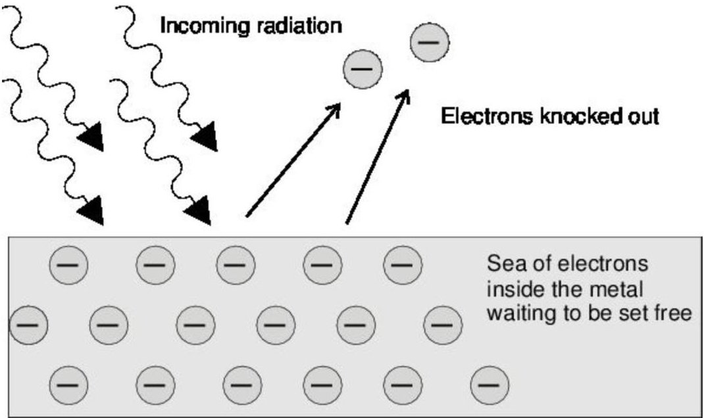


<div align="center">

FIGURE 1-1: THE PHOTOELECTRIC EFFECT [2]

</div>

## 1.1.2. PHOTOVOLTAIC EFFECT

The photovoltaic effect was discovered by Edmond Becquerel in 1839 when it was noted that voltage of a cell increased under exposure to sunlight [3]. The photovoltaic effect is similar to the photoelectric effect however in the photovoltaic effect the ejected electrons directly enter a new material whereas in the photoelectric effect the emitted electrons enter space. In photovoltaic cells, the emission of these electrons is guided and ultimately harvested for usable energy.

The photovoltaic effect occurs when two dissimilar materials are in close proximity and electrons flow from one material to the other as a result of excitation caused by radiation [4]. The two materials are charged as opposites in that one is negatively charged and the other positively. This causes a gradient when excited electrons are ejected and travel between the two materials. This movement of electrons causes a current which can be harnessed and is the working principle behind the ability of photovoltaic cells to generate power.

<!-- PDF_PAGE: 10 -->

## 1.1.3. PHOTOVOLTAIC SOLAR CELL CURRENT GENERATION

The primary purpose of photovoltaic (PV) cells is to convert solar energy into electrical energy. This is achieved by intaking solar irradiation that is normal to the surface of the solar cell and harnessing energy that is expelled through the excitation of excess electrons. The conversion of energy is achieved through the implementation of a P-N junction where a n-type Silicon (Si) layer meets with a p-type Si layer. The p-type Si layer is positively charged and thus contains empty spaces which are capable of accepting a stray electron. The n-type Si layer on the other hand has these vacancies filled with electrons. The region in between the two layers is known as a depletion zone and contains both positive and negative ions on each respective side. Once the solar radiation makes contact with the n-type layer, the then excited excess electrons are expelled and flow towards the positively charged layer. This functionality is depicted in Figure 1-2 shown below.


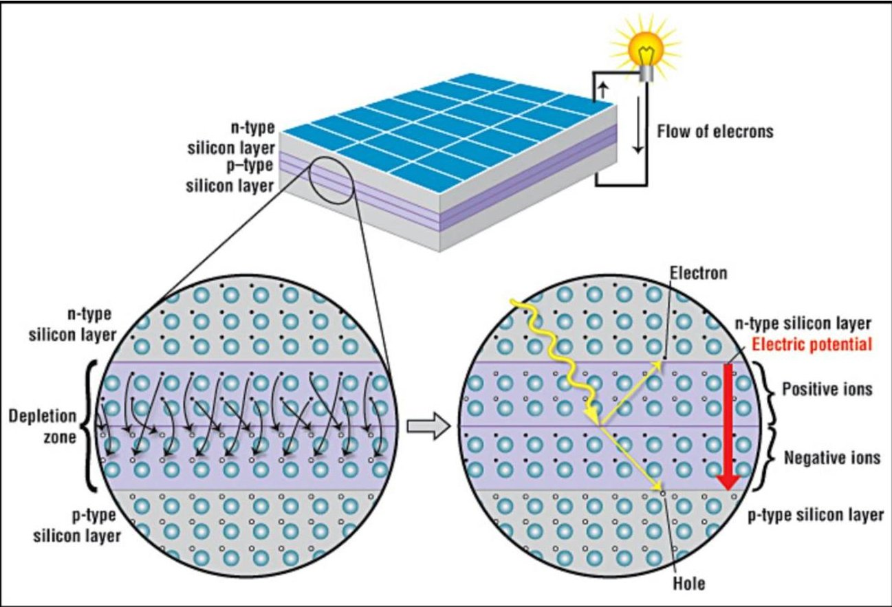


<div align="center">

FIGURE 1-2: PHOTOVOLTAIC CELL P-N JUNCTION [5]

</div>

In order to harness the energy from the solar irradiation, the collective flow of excited electrons is diverted and thus an electric current is induced ultimately generating electrical power. Overtime however as can be expected, the overall charge of each layer is reduced as it nears equilibrium. PV cells also degrade over time as a result of thermal cycling which causes cracks within the material resulting in current leakage. These are a result of expansion and contraction cause by temperature variance. Finally, degradation may also occur as a result of radiation acting upon the cell surface.

<!-- PDF_PAGE: 11 -->

## 1.1.4. TRIPLE JUNCTION PHOTOVOLTAIC CELLS

As discussed in section 1.1.3, PV cells generate current through the induction of solar radiation which is then converted to electrical energy which may then be used for work. The primary power generation being discussed is triple junction PV cells which contain three separate sub cell layers each capable of generating an electrical current when receiving an influx of solar radiation. The presence of three sub cell layers increases the capability of the PV cell primarily due to the following [6].

i. Higher yield (30% as compared to 17% for single junction silicon-based cells of same surface area) resulting in greater power generation capability overall.

ii. Better radiation resistance and temperature coefficients resulting in greater power delivery from BOL to EOL.

iii. Higher output voltage as compared to single junction silicon-based PV cells. Ultimately reduces number of cells required in series to obtain a desired output voltage.

For the reasons as listed, triple junction PV cells are nearly exclusively deployed for Low Earth Orbiting (LEO) missions due to limited availability of physical space as well as constrictive mass requirements. Triple junction cells offer superior performance while minimizing both mass and surface area requirements. Shown in Figure 1-3 is the complete simplified single diode electrical schematic structure of a generic triple junction PV cell.


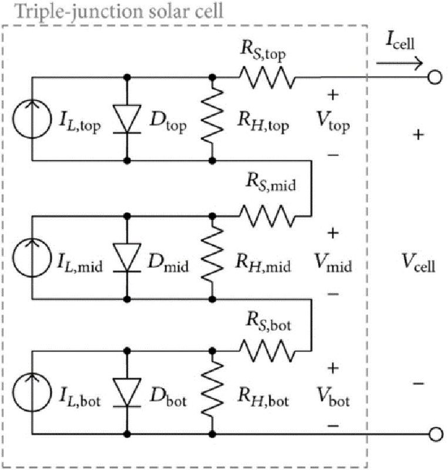


<div align="center">

FIGURE 1-3: TRIPLE JUNCTION PV CELL COMPLETE ELECTRICAL SCHEMATIC [7]

</div>

In the above figure, a current is induced as a result of the phenomenon described in section 1.1.3 which is known as the photovoltaic effect. The schematic shows a diode as well as two resistances, one in parallel commonly referred to as a shunt resistance and one in series known as the series resistance. The two resistances are parasitic to the overall output of the PV cell where generally, the shunt resistance is typically significantly larger than the series resistance. This results in the shunt current being significantly

<!-- PDF_PAGE: 12 -->

smaller than the series current. The diode is placed for the sole purpose of preventing reverse current which can damage the PV cell and thus very little current is lost through the diode branch.

Since triple junction cells are being analyzed, each layer has its own respective diodes and resistances. The variables of interest for a PV cell are the output current, output voltage and the output power. For triple junction solar cells, when analysis is carried out on Figure 1-3, the net output current is the minimum of the currents generated by each of the three respective sub cells while the output voltage is the summation of output voltage of the three sub cells as follows.

$$
I _ {o u t p u t} = \min \left(I ^ {i}\right)
$$

EQUATION 1-1

$$
V _ {o u t p u t} = \sum \left(V ^ {i}\right)
$$

EQUATION 1-2

In Equation 1-1 and Equation 1-2 shown, i corresponds to the number of the sub cell being analyzed. For triple junction PV cells, i = 1,2,3.

As Equation 1-1 and Equation 1-2 above show, the output benefit of multiple sub cell layers is output voltage and since power is directly proportional to both current and voltage, the resultant output power is also proportionally increased. Losses are seen in the output current since only the minimum current induced by the individual sub cell of minimum current is realized as net output current.

For analysis purposes, the schematic shown in Figure 1-4 is simplified to an equivalent circuit with equivalent output where an equivalent diode, equivalent shunt resistance and equivalent series resistance is used to describe PV cell performance. This equivalent circuit is shown in the following figure.


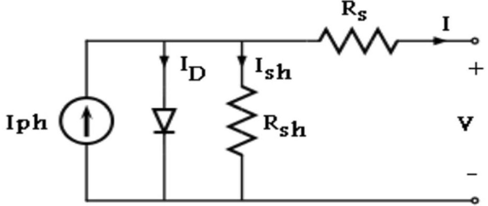


<div align="center">

FIGURE 1-4: TRIPLE JUNCTION PV CELL EQUIVALENT ELECTRICAL CIRCUIT [8]

</div>

With the simplified equivalent circuit shown in Figure 1-4, it is possible to carry out analysis on the output of a PV cell with respect to ambient conditions. As expected, the photocurrent, $ I_{ph} $ is directly proportional to the solar irradiation. As the solar radiation that is normal to the PV cell surface increases, so does the current generated. For all intents and purposes, since the shunt resistance is significantly larger than the series resistance, the current flowing through the shunt may be neglected. This is due to the nature of current where it prefers the path of least resistance which in the case of a PV cell is through the series resistance to the load where it becomes usable energy.

<!-- PDF_PAGE: 13 -->

## 1.2. ESSENCE LAYOUT

ESSENCE is known as a 3U CubeSat with dimensions of 10x10x30 cm. The negative x face of the CubeSat is a 1U face with a mounted experimental camera. All other sides have mounted solar cells, the opposing 1U side to the camera, denoted the positive x face, has two PV cells connected in series while the longitudinal 3U sides (positive and negative y, and positive and negative z sides) each respectively contain six PV cells.


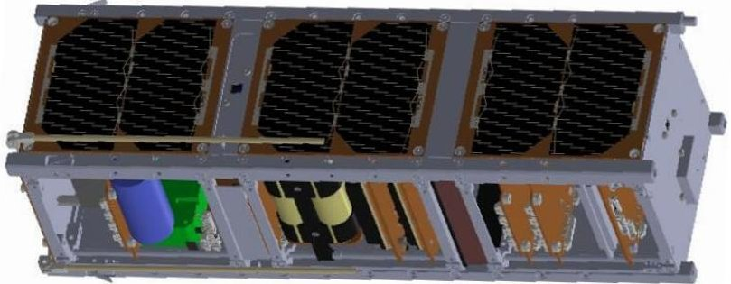


<div align="center">

FIGURE 1-5: ESSENCE CAD MODEL

</div>

The solar cells are responsible for charging the onboard battery packs which are to sustain all loads as required by the mission. The onboard power distribution unit (PDU) is responsible for directing all power through subsystems primarily resulting in either charging or discharging of the battery packs.

<!-- PDF_PAGE: 14 -->

## 1.3. THEORY

## 1.3.1. PV CELL OUTPUT VOLTAGE

PV cells are analyzed to determine output parameters including output current, output voltage and output power. In order to determine these output parameters, the PV cell circuit must be analyzed to determine resultant currents and voltages as they are outputted. When Figure 1-2 is analyzed for output currents, the following equation is determined to depict the output current of the PV cell.

$$
I = I _ {p h} - I _ {s} \left(e x p \frac {q \left(V + R _ {s} I\right)}{n K T} - 1\right) - \frac {\left(V + R _ {s} I\right)}{R _ {s h}}
$$

Where,

I = Output Current

V = Output Voltage

$ I_{s} $ = Saturation Current

$ I_{ph} $ = Photocurrent

$ q $ = Electron Charge (1.60217662 x $ 10^{-19} $ Coulombs)

$ n $ = Diode Ideality Factor

$ K $ = Boltzmann's Constant (1.380649 x $ 10^{-23} $ Joules/Kelvin)

$ T $ = PV cell temperature

$ R_{s} $ = Series Resistance

$ R_{sh} $ = Shunt Resistance

The above equation describes the output current of a PV module with respect to the complete electrical circuit. As can be seen, the output current is a function of itself which makes analysis of PV cells more difficult in addition to the numerous other input parameters some of which may not be readily available or clearly defined for a given PV cell.

Typically, when modelling and simulation of PV cells is conducted, the current passing through $ R_{sh} $ can be neglected. This is due to the fact that $ R_{sh} $ is significantly greater than $ R_{s} $ . This results in minimal current flowing through the shunt branch of a PV cell electric circuit when compared to the other branches.

As can be expected, $ I_{ph} $ is directly proportional to the solar irradiance acting upon its surface in addition to ambient temperature. This can be expected since amount of solar radiance can directly vary temperature. It must be noted however that $ I_{ph} $ is generated only by solar radiation that is normal to the surface of the PV cell and any component that is not normal to the surface does not generate current.

<!-- PDF_PAGE: 15 -->

## 1.3.2. PV CELL CRITICAL POINTS

Manufacturers of PV cells provide data regarding PV cell performance under standard spatial test conditions (STCs). The provided values are critical points on a typical power curve for a PV cell under prescribed and declared ambient conditions. These values include the open circuit voltage, $ V_{oc} $ , short circuit current, $ I_{sc} $ , and finally maximum power points, $ I_{mp} $ and $ V_{mp} $ respectively. These values represent the critical points on a characteristic current-voltage (I-V) curve of a PV cell. Output current of a PV cell remains constant as voltage is ramped (increased) until a point at which it begins to decline. Since voltage is ramping as current remains constant, the power-voltage (P-V) curve of the PV cell linearly increases. Eventually as voltage increases, the current begins to decline as does the slope of the increasing P-V curve. As voltage is ramped further, power reaches a maximum value after which output current exponentially declines towards zero output current at which point power output is also zero. A generic I-V and P-V curve for a PV cell is shown in the following figure.


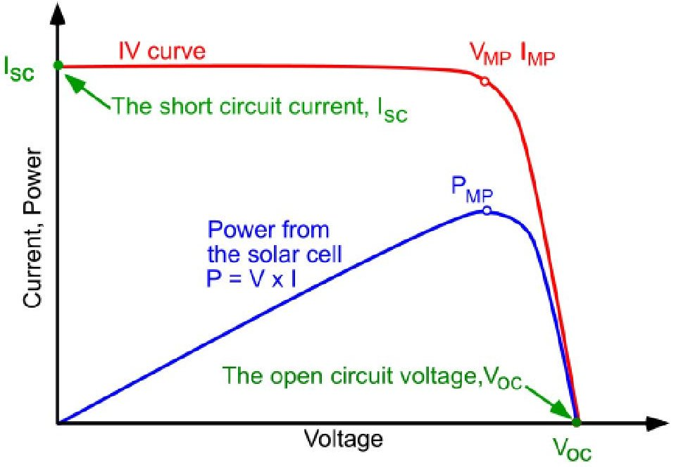


<div align="center">

FIGURE 1-6: GENERIC PHOTOVOLTAIC OUTPUT I-V AND P-V CURVE [9]

</div>

Figure 1-6 depicts the generic I-V and P-V curves for a PV cell. These curves are constant for a given PV cell under constant ambient conditions including solar irradiation upon the PV cell surface and temperature. As can be seen, the three critical points include that at zero voltage, $ I_{sc} $ , that at zero current, $ V_{oc} $ , and finally the output current and voltage at the maximum power point, $ I_{mp} $ and $ V_{mp} $ respectively. Typically, it is considered ideal to operate a PV cell at the maximum power point so as to maximize power output from the solar cell.

Maximum power occurs at a specific voltage with current being a dependent variable. This results in varying voltage in order to maximize power as opposed to varying output current since current is dependant on ambient conditions. Voltage on the other hand may be altered and adjusted throughout operation to alter output power of a PV cell. With proper tracking, PV cell output power may be maximized through the variation of operational voltage. This is known more commonly as Maximum Power Point Tracking or MPPT.

<!-- PDF_PAGE: 16 -->

## 1.3.3. PEAK POWER POINT

As discussed in previously, there is a unique maximum or peak power point for a PV cell operated at a given set of ambient conditions (Solar irradiation normal to PV cell surface, PV cell temperature and ambient temperature). So long as the ambient conditions remain consistent, the PV cell output curves, I-V and P-V shall also remain constant. These curves can then be analyzed and used to determine optimal voltage of operation for a PV cell thereby increasing overall efficiency and power output.

Finding the optimal voltage allows for the PV cell to operate within a condition of maximum power for a given set of ambient conditions. A module known as MPPT, briefly discussed in section 1.3.2, is employed to shift the operating current of a PV module to the peak power point, thereby maximizing output.

## 1.3.4. SOLAR IRRADIATION AND PHOTOCURRENT

Only solar radiation that is normal to the surface of the solar cell may be used to generate photocurrent. The angle between the sun vector and PV cell surface is denoted $ \beta $ , or the sun vector. When the cosine of this angle is taken, the component of solar radiation that is normal to the PV cell surface is determined.

For solar radiation analysis, satellite orbital position is determined and for each step the amount of solar radiation acting upon the PV cell surface must be determined. This is achieved using satellite position in the Earth Centered Inertial (ECI) Frame, and the sun position in the ECI frame. When the sun position is subtracted from the spacecraft position both in ECI frame, the vector between the spacecraft and sun is determined. Furthermore, using the Body Centered Inertial (BOF) frame, the spacecraft position with respect to the sun vector may be determined. The spacecraft position in BOF frame is then utilized to determine sun vector angles and using the cosine of the beta angle and solar radiation from the sun, solar irradiation acting upon the PV cell surface may be determined.

Throughout orbit, there are points during which the spacecraft PV cells may not be exposed to solar radiation. During these periods the output of the PV cells is zero. These can occur when the half angle between the sun and spacecraft surface is greater than pi/2 (90 degrees) or when the spacecraft is within eclipse where the Earth is between the spacecraft and sun. This scenario is displayed in the following figure.


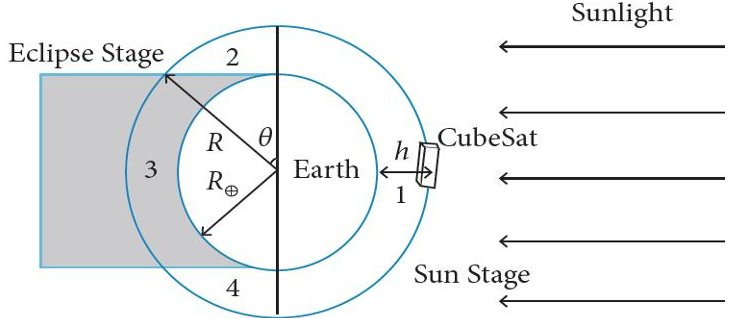


<div align="center">

FIGURE 1-7: SPACECRAFT ECLIPSE [10]

</div>

As shown in Figure 1-7, The spacecraft enters total eclipse during an orbital period as a function of the Earth's radius and orbital radius of the spacecraft. During these periods, solar cell output is zero

<!-- PDF_PAGE: 17 -->

and power generation likewise as expected is also zero. When outside of these eclipse period, surface vectors may be used to determine amount of solar radiation that is incident to solar cell surface, and like in cases of eclipse, should the angle between the face surface and sun vector surpass pi/2 (90 degrees), the output is set to zero.

## 1.3.5. COMPUTATION OF PV CELL OUTPUT

Unknown PV cell parameters include the shunt resistance, series resistance, reverse saturation current and diode ideality. The provided parameters include critical points on the I-V and P-V curves under STCs. Typically, the shunt resistance is neglected since it is significantly larger than the series resistance. Due to this the current lost through the shunt branch is minimal. When it is assumed that the shunt resistance approaches infinity, the shunt current approaches zero and thus all equations used for modelling of PV cells reduce to the following.

$$
I = I _ {p h} - I _ {s} \left(\exp \frac {q \left(V + R _ {s} I\right)}{N _ {s} n K T} - 1\right)
$$

$$
I _ {s} = I _ {r s} \left(\frac {T}{T _ {r}}\right) ^ {3} \exp \left\{\frac {q E _ {G 0}}{n K} \left(\frac {1}{T _ {r}} - \frac {1}{T}\right) \right\}
$$

$$
I _ {p h} = \left(I _ {s c} + K _ {i} \left(T - T _ {r}\right)\right) \frac {G}{G _ {r}}
$$

With the shunt current and shunt resistance neglected, the equations used to describe PV cell output significantly reduce as do unknown parameters. The series resistance, reverse saturation current and diode ideality however remain unknown parameters. In order to extract these parameters, the critical points of the PV cell provided by the manufacturer at STC are utilized. In terms of (V,I) these points are denoted as the following; $ ( 0, I_{sc} ) $ $ ( V_{oc},0 ) $ and $ ( V_{mp}, I_{mp} ) $ . With these points known and rearrangement of characteristic equations, the following set of equations are simultaneously solved for the three unknown parameters [6].

$$
I _ {r s} = \frac {I _ {s c}}{\exp \left(\frac {q}{N _ {s} n K T} V _ {o c}\right) - \exp \left(\frac {q}{N _ {s} n K T} I _ {s c} R _ {s}\right)}
$$

$$
\frac {I _ {s c}}{\exp \left(\frac {q}{N _ {s} n K T} V _ {o c}\right) - \exp \left(\frac {q}{N _ {s} n K T} I _ {s c} R _ {s}\right)} = \frac {I _ {m p}}{\exp \left(\frac {q}{N _ {s} n K T} V _ {o c}\right) - \exp \left[ \frac {q}{N _ {s} n K T} \left(V _ {m p} + R _ {s} I _ {m p}\right) \right]}
$$

$$
\frac {I _ {m p}}{\exp \left(\frac {q}{N _ {s} n K T} V _ {o c}\right) - \exp \left[ \frac {q}{N _ {s} n K T} \left(V _ {m p} + R _ {s} I _ {m p}\right) \right]} = \frac {\frac {I _ {m p}}{V _ {m p} - R _ {s} I _ {m p}}}{\frac {q}{N _ {s} n K T} \exp \left[ \frac {q}{N _ {s} n K T} \left(V _ {m p} + R _ {s} I _ {m p}\right) \right]}
$$

Once Equation 1-7 through Equation 1-9 are solved and unknown parameters extracted, It becomes possible to solve PV cell output by implementing Equation 1-4 through Equation 1-6.

<!-- PDF_PAGE: 18 -->

## 2. METHOD

All models are to be constructed using Simulink software to determine output. Within this section, Theories from section 1.3 are implemented and the PV cells and modules are modelled as is satellite positioning and solar radiance acting upon the various satellite faces.

## 2.1. PV CELL MODELLING

Modelling for the PV cells was conducted using Simulink software. With manufacture provided values and the procedure outlined in section 1.3.5, a working simulation model was built for further analysis including variation of parameters under varying ambient conditions.

## 2.1.1. PV CELL MANUFACTURER PROVIDED PARAMETERS

The PV Cells onboard ESSENCE include the GOMSPACE P110 solar cells. The datasheet for the solar cells is provided by the manufacturer. The provided values are recorded at Standard Spatial Test Conditions (STCs) which are reported as follows.

<div align="center">

TABLE 2-1: STANDARD SPATIAL TEST CONDITIONS FOR REPORTED PV CELL PARAMETERS

</div>

<table border="1"><tr><td>Parameter</td><td>Value</td></tr><tr><td>Ambient Temperature</td><td>28℃</td></tr><tr><td>Incident Solar Irradiation</td><td>1350W/m2</td></tr></table>

With the STC conditions known, the parameters as stated by the manufacturer for the GOMSPACE P110 PV cells are reported in the following table.

<div align="center">

TABLE 2-2: GOMSPACE P110 PV CELL PARAMETERS AT STC

</div>

<table border="1"><tr><td>Parameter</td><td>Value</td><td>Description</td></tr><tr><td>$V_{oc}$</td><td>2.69V</td><td>Open Circuit Voltage</td></tr><tr><td>$I_{sc}$</td><td>0.5196A</td><td>Short Circuit Current</td></tr><tr><td>$V_{mp}$</td><td>2.409V</td><td>Voltage at MPP</td></tr><tr><td>$I_{mp}$</td><td>0.5029A</td><td>Current at MPP</td></tr><tr><td>$P_{max}$</td><td>1.211W</td><td>Maximum Power</td></tr><tr><td>$\eta$</td><td>29.3%</td><td>Average Cell Efficiency</td></tr><tr><td>$\frac{\delta V_{oc}}{\delta t}(K_{v})$</td><td>-0.0062V/K</td><td>Temperature Gradient of $V_{oc}$</td></tr><tr><td>$\frac{\delta I_{sc}}{\delta t}(K_{i})$</td><td>0.00036A/K</td><td>Temperature Gradient of $I_{sc}$</td></tr><tr><td>$\frac{\delta V_{mp}}{\delta t}$</td><td>-0.0067V/K</td><td>Temperature Gradient of $V_{mp}$</td></tr><tr><td>$\frac{\delta I_{mp}}{\delta t}$</td><td>0.00024A/K</td><td>Temperature Gradient of $I_{mp}$</td></tr></table>

<!-- PDF_PAGE: 19 -->

## 2.1.2. COMPUTING UNKNOWN PV CELL PARAMETERS

As discussed in section 1.3.5, the unknown cell parameters including the reverse saturation current, $ I_{r s} $ , the diode ideality factor, n, and the series resistance, $ R_{s} $ , have to be computed. In order to determine the parameters equations Equation 1-7 through Equation 1-9 were programmed into a MATLAB script with all known parameters obtained from PV cell datasheets at STC conditions.

By implementing the MatLab 'vpasolve' command, the unknown parameters were extracted for STC conditions using the system of three equations and three variables. Since multiple solutions were apparent for the system of equations, initial guesses had to be implemented to determine acceptable parameter values. The unknown variables are listed in the following table.

<div align="center">

TABLE 2-3: COMPUTED UNKNOWN PV CELL PARAMETERS [STC, NS = 1]

</div>

<table border="1"><tr><td>Parameter</td><td>Value</td></tr><tr><td>Diode Ideality Factor(n)</td><td>3.0739</td></tr><tr><td>Reverse Saturation Current(Irs)</td><td>1.1769e-15A</td></tr><tr><td>Total Series Resistance(Rs)</td><td>0.0135Ω</td></tr></table>

The reported series resistance is per PV cell and as such is directly proportional to the number of cells connected in series. The reverse saturation current is constant for multiple cell connected in series while the diode ideality factor is also constant for multiple cells in series. Each of the three parameters however is temperature dependant thus vary for changes in ambient temperature.

<!-- PDF_PAGE: 20 -->

## 2.1.3. VARIATION OF UNKNOWN PARAMETERS WITH TEMPERATURE

As discussed in section 2.1.2, the computed unknown parameters vary with respect to temperature. To better understand the variance of these parameters, the method utilized in section 2.1.2 was repeated iteratively for varying temperature and results plotted and stored as an array. The results of the iterative procedure are shown below.

<div align="center">

Series Resistance vs Temperature

</div>


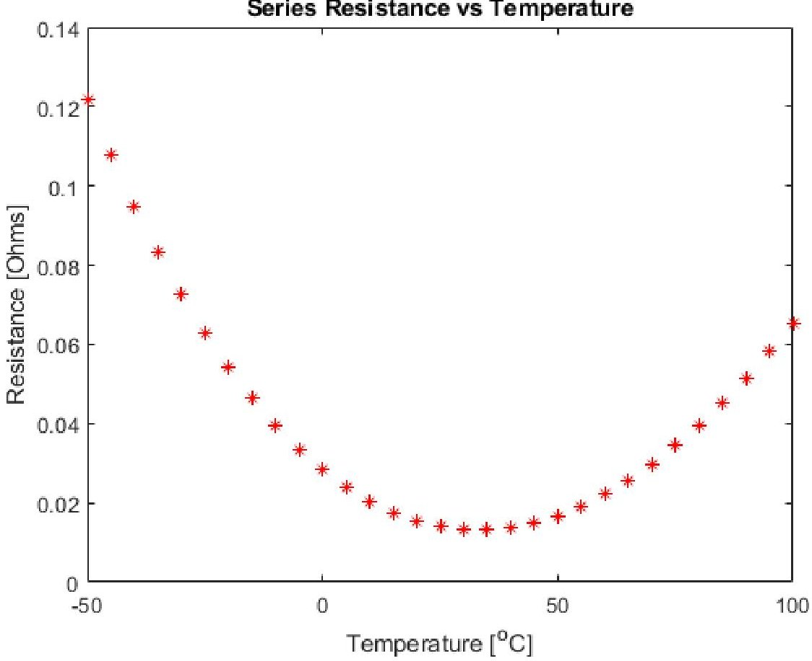


<div align="center">

FIGURE 2-1: SERIES RESISTANCE TEMPERATURE VARIANCE

</div>

<!-- PDF_PAGE: 21 -->


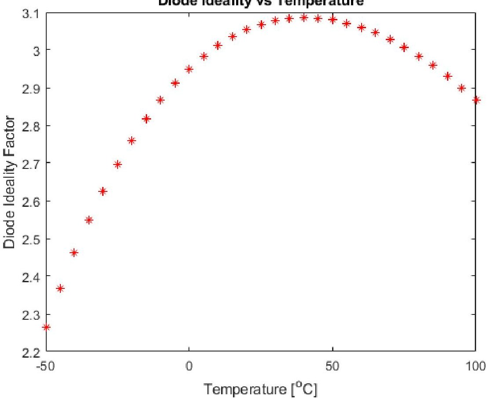


<div align="center">

FIGURE 2-2: DIODE IDEALITY TEMPERATURE VARIANCE

</div>


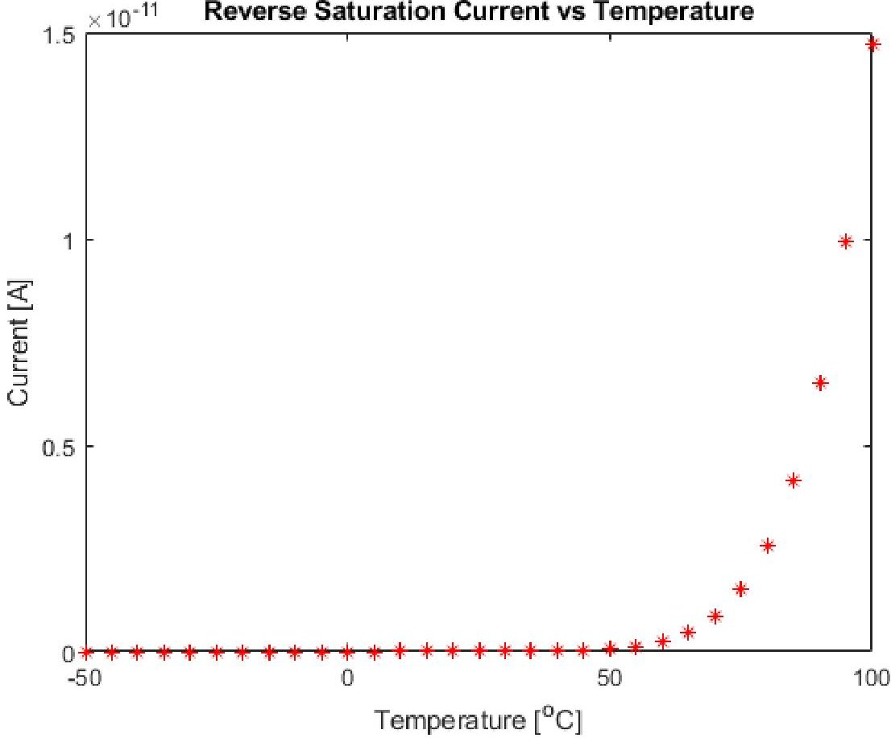


<div align="center">

FIGURE 2-3: REVERSE SATURATION CURRENT TEMPERATURE VARIANCE

</div>

<!-- PDF_PAGE: 22 -->

As can be seen in the above figures, the unknown parameters can vary drastically as temperature is varied. The range of temperature used for modelling is $ - 5 0^{\circ} \mathrm{C} $ to $ + 1 0 0^{\circ} \mathrm{C} $ . The equations may be used for a wider range of temperatures however due to the complexity of the equations and small values of saturation current, approximating values beyond the provided range iteratively is more difficult and requires large amounts of computing power.

For simulation purposes, an initialization script has been developed to input temperature values and output the unknown parameters prior to system simulation. This allows for the parameters to be computed for a given temperature. It is also possible to iterate for a larger range of values and feed the array data to the simulation, this method will allow for greater scalability and lesser computation for subsequent simulations with varying ambient conditions.

<!-- PDF_PAGE: 23 -->

## 2.1.4. PV CELL OUTPUT MODELLING

With the unknown parameters computed as in section 2.1.2, it is possible to model the PV cell output utilizing Equation 1-4 through Equation 1-7. This was achieved using Simulink software. Each equation was modelled within a MatLab function block within Simulink and wired according to the characteristic equations. With PV cell parameters loaded upon the simulation it is possible to model output using the characteristic equations. As discussed in section 1.3.5, the shunt current was neglected. The Simulink model is displayed in Appendix B: PV Module Model.

With the model built and all parameters loaded. The simulation was ran using manufacturer provided test conditions to confirm output for a single PV cell. The operating voltage of the system was ramped and the current versus voltage and power versus voltage graphs were produced. These charts are displayed below.


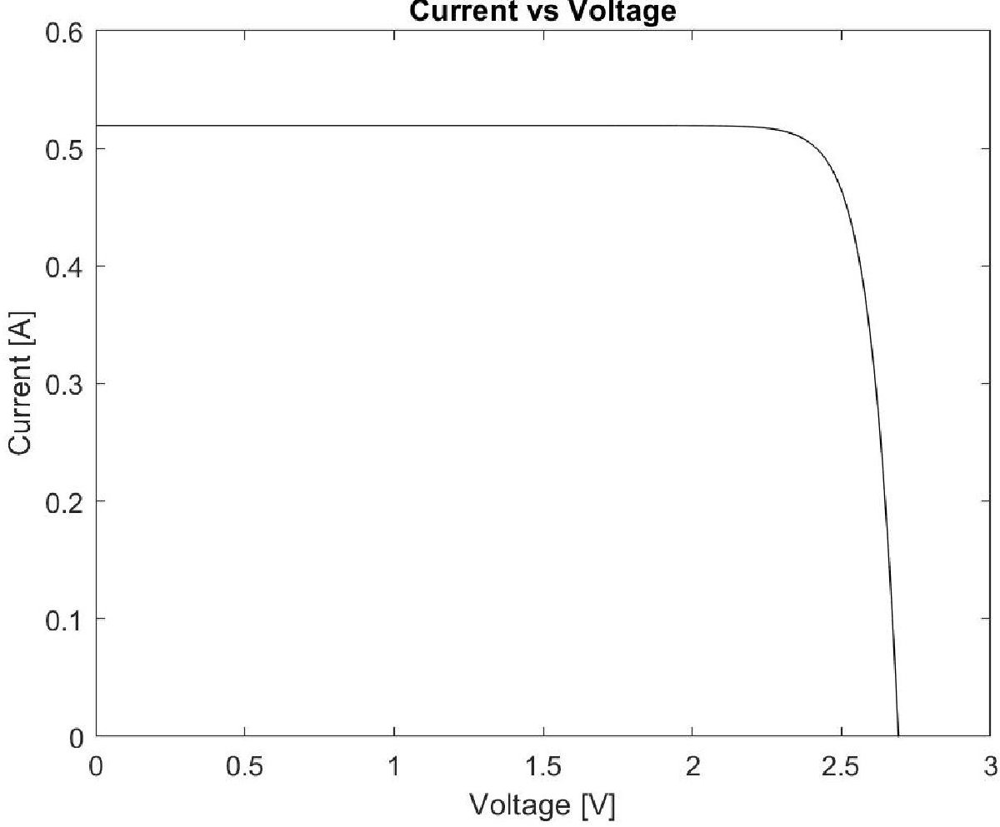


<div align="center">

FIGURE 2-4: CURRENT VERSUS VOLTAGE CHARACTERISTIC CURVE AT STC

</div>

<!-- PDF_PAGE: 24 -->


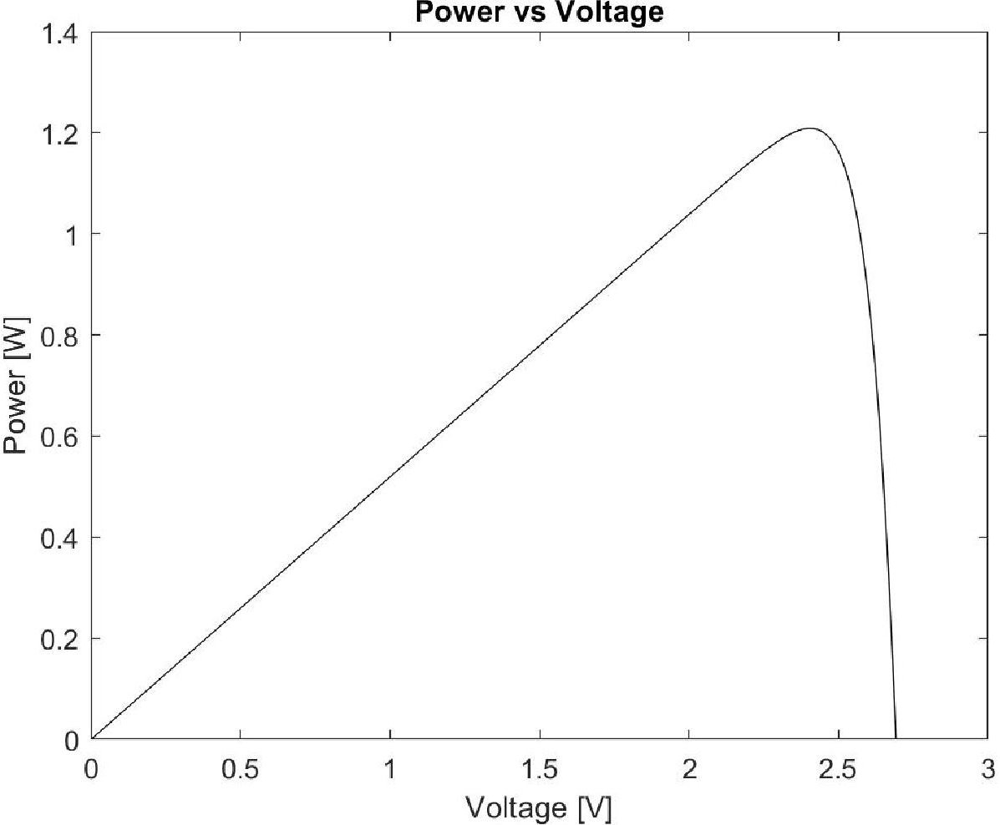


<div align="center">

FIGURE 2-5: POWER VERSUS VOLTAGE CHARACTERISTIC CURVE AT STC

</div>

As can be seen the model yielded results similar to those provided by the manufacturer at STC. All raw data for the simulation is presented in Appendix C: PV Cell STC Raw Data. The critical point values computed, those provided by the manufacturer as well as errors are reported below.

<div align="center">

TABLE 2-4: COMPUTED VALUES FOR PV CELL AT STC [NS = 1]

</div>

<table border="1"><tr><td>Parameter</td><td>Computed Value</td><td>Manufacturer Value</td><td>Error %</td></tr><tr><td>Short Circuit Current ($I_{sc}$)</td><td>0.5196 A</td><td>0.5196 A</td><td>0.00 %</td></tr><tr><td>Open Circuit Voltage ($V_{oc}$)</td><td>2.688 V</td><td>2.69 V</td><td>0.07 %</td></tr><tr><td>Maximum Power ($P_{mp}$)</td><td>1.208 W</td><td>1.21 W</td><td>0.17 %</td></tr><tr><td>Voltage at MPP ($V_{mp}$)</td><td>2.408 V</td><td>2.409 V</td><td>0.04 %</td></tr><tr><td>Current at MPP ($I_{mp}$)</td><td>0.5016 A</td><td>0.5029 A</td><td>0.26</td></tr></table>

When computed values and manufacturer provided values are compared, the error between the two is found to be minimal. The maximum recorded error is found to be 0.26 % for the operating current at the Maximum Power Point (MPP). The computed short circuit current is found to have zero error when the model is run. This verifies that the assumptions made regarding shunt current are valid and the model as constructed may be used for further analysis with minimal error. Furthermore, the error may be further reduced when step size of simulation is reduced.

<!-- PDF_PAGE: 25 -->

## 2.2. SATELLITE POSITIONING

## 2.2.1. SATELLITE POSITIONING RELATIVE TO SUN

Computation of satellite positioning relative to sun position was developed in Earth Centered Inertial (ECI) Frame. ECI frame has an origin located at the center of mass of the Earth and vectors protrude towards the target from the origin. In ECI Frame the stars do not rotate and are considered fixed in place. The sun position was incrementally computed within the ECI Frame.

Satellite position was determined within ECI frame similar to sun positioning which was also computed in ECI Frame. With both the sun and satellite position computed in ECI frame it is possible to determine positioning of spacecraft relative to the sun by subtracting earth-spacecraft position in ECI frame from the earth-sun position in ECI frame and reversing the vector direction. The vector algebra results in the determination of spacecraft position relative to the sun for each incremental step of simulation as displayed both algebraically and graphically below.

$$
\overline {{S U N _ {-} S C}} = - \left(\overline {{E A R T H _ {-} S u n}} - \overline {{E A R T H _ {-} S C}}\right)
$$

EQUATION 2-1


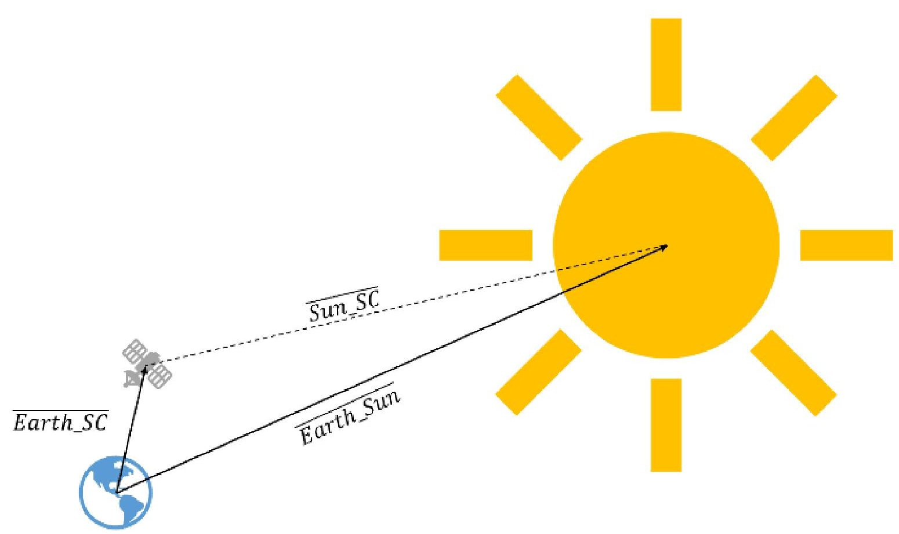


<div align="center">

FIGURE 2-6: VECTOR DETERMINATION OF SPACECRAFT RELATIVE TO SUN

</div>

As shown visually depicted in Figure 2-6 and shown algebraically in Equation 2-1, the vector between the spacecraft and sun may be determined by subtracting the spacecraft position in ECI frame from the sun position in ECI frame. This vector may then be used for further analysis related to incident solar irradiation acting upon the spacecraft through orbit in addition to the sun beta angles.

<!-- PDF_PAGE: 26 -->

## 2.2.2. INCIDENT SOLAR RADIATION

Using vector transforms as well as orbital data, the sun vector could be determined. The spacecraft BOF frame was used in addition to the sun position relative to the spacecraft as determined in section 2.2.1 to determine spacecraft orientation relative to the sun. Furthermore, with regions of eclipse known, it was possible to implement eclipses into the model as a flag.

With the spacecraft positioning relative to the sun known as well as the spacecraft positioning known in BOF frame, the sun beta angle $ (\beta) $ could be derived. The sun beta angle refers to the angle between the spacecraft and that of the sun vector which is parallel to the emitted solar radiation. The beta angle is an important parameter to compute since it is paramount in determining the amount of solar radiation that is normal to the surface of the PV cells. With the sun beta angle known, when the cosine of the beta angle is multiplied by the net of solar radiation, the component of radiation normal to the PV cell surface may be computed.

$$
G _ {i} = G \cdot \cos (\beta)
$$

EQUATION 2-2


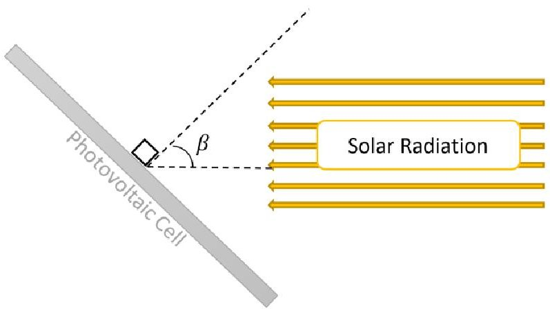


<div align="center">

FIGURE 2-7: SUN BETA ANGLE

</div>

As can be seen in Figure 2-7, the beta angle is the angle between the PV cell normal and solar radiation. This parameter may be used to compute solar radiation incident to PV cell surface for each step of simulation as shown in Equation 2-2. Since the spacecraft BOF frame is implemented, using unit vectors in BOF frame, the beta angle relative to each side of the spacecraft may be computed. The solar radiation at any point through orbit is pulled from the ESSENCE simulation, and using the computed beta angles, as well as solar radiation throughout orbit, solar radiation acting upon each PV module is computed.

Simulation includes eclipse flags throughout orbit. A single eclipse period is expected for each full orbit and when the eclipse flag is tripped, solar radiation is set to zero. The second case of zero radiation occurs when the half angle between the PV module surface and sun vector is greater than 90 degrees. To implement this into simulation, a half angle of 90 degrees or greater is included as a flag to set incident solar radiation to zero should the half angle be exceeded. The eclipse flag as well as half angle flag are outputted as a sun visibility parameter which is used to identify if the sun is visible to the respective PV module in question. When either flag is tripped, solar irradiation upon PV cell surface is arbitrarily set to zero, otherwise the solar radiation as well as beta angle are used to compute incident solar radiation at each step during simulation. The Irradiance model is displayed in Appendix D: Solar Irradiance Model.

<!-- PDF_PAGE: 27 -->

## 2.3. POWER DISTRIBUTION BOARD

The Power Distribution Board (PDU) is responsible for all power management onboard ESSENCE. It is responsible for managing all power generated by the PV modules as well as providing power to all loads as required. The PDU converts power generated by the PV modules into optimal charging current and voltage for the battery charging state and allows for battery discharging to supply all loads.

## 2.4. BATTERY MODELLING

ESSENCE employs the usage of a GOMSPACE BPX battery pack with the following manufacturer specifications.

<div align="center">

TABLE 2-5: GOMSPACE BPX 4S2P SPECIFICATIONS

</div>

<table border="1"><tr><td>Number of Cells</td><td>Capacity</td><td>Vrange</td><td>Vnominal</td><td>Capacity</td><td>Icharge</td><td>Idischarge</td></tr><tr><td>8</td><td>77Wh</td><td>12-16.8V</td><td>14.8V</td><td>5.2Ah</td><td>1250-2500mA</td><td>1250-3750mA</td></tr></table>

The parameter to be determined regarding the onboard battery packs is the battery state of charge (SOC) which is a ratio of battery current charge to full capacity typically reported as a percentage. The relationship for battery SOC is displayed algebraically as the following.

$$
S O C = S O C _ {i n i t i a l} - \frac {1}{C} \int I _ {b a t t} d t
$$

EQUATION 2-3

In the above equation, $ I_{batt} $ is the current that is discharging from the battery, which in cases of charging will be negative. C is the capacity of the battery. Using Equation 2-3 allows for the determination of battery state of charge as a function of current either entering or leaving the battery as determined by the PDU.

## 2.5. POWER DISTRIBUTION UNIT

The Power Distribution Unit (PDU) is responsible for all power flows across the system. It is responsible for providing charging current to the battery as well as supplying all loads as required. The PDU simply determines all power requirements by various loads, supplies power as required and sends all generated power from the PV modules to the onboard batteries.

<!-- PDF_PAGE: 28 -->

## 3. RESULTS

Using developed models from section 2, analysis is conducted under varying conditions to determine overall effect on output parameters. The variations are both reported and analyzed. With results obtained, further simulations become possible and accuracy of results increased. Furthermore, with effect of varying conditions known, performance of the power system may be optimized. The parameters to be analyzed and reported include the number of cells connected in series, incident solar irradiance and temperature variations. Once analysis is completed and PV module output is optimized for varying conditions. Once optimized, full scale tests may be performed to determine peak power generation capabilities.

## 3.1. PHOTOVOLTAIC TESTS

For PV testing, various parameters were varied while others held constant to determine effect on PV cell output. The primary parameter of interest is the operating voltage required for maximum PV cell power output so as to maximize performance. The parameters to be varied included the temperature, amount of incident solar irradiation and number of cells connected in series. Each of these parameters are varied and results logged to determine overall effect on output. This data can then be utilized to develop a subsystem responsible for ensuring the PV cells operate at optimal voltage for peak power output.

<!-- PDF_PAGE: 29 -->

## 3.1.1. NUMBER OF CELLS CONNECTED IN SERIES

The first set of testing to be conducted includes multiple cells connected in series. In order to determine output, number of cells connected in a series must be investigated. ESSENCE is known as a 3U CubeSat. This setup allows for the longitudinal axis to be triple the length of the other axis in question. For the purposes of essence, the 3U sides of the satellite shall contain a set of 6 PV cells connected in series while the single 1U side opposing the camera shall contain 2 PV cells connected in series. For the sake of analysis, characteristic curves are plotted for a variation between 1 and 4 solar cells connected in series. All analysis conditions are set to STC values for the testing and held constant.


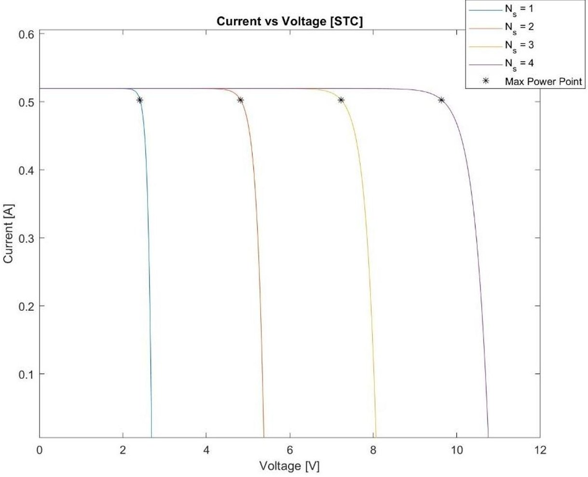


<div align="center">

FIGURE 3-1: CURRENT VS VOLTAGE MULTIPLE CELLS IN SERIES

</div>

<!-- PDF_PAGE: 30 -->


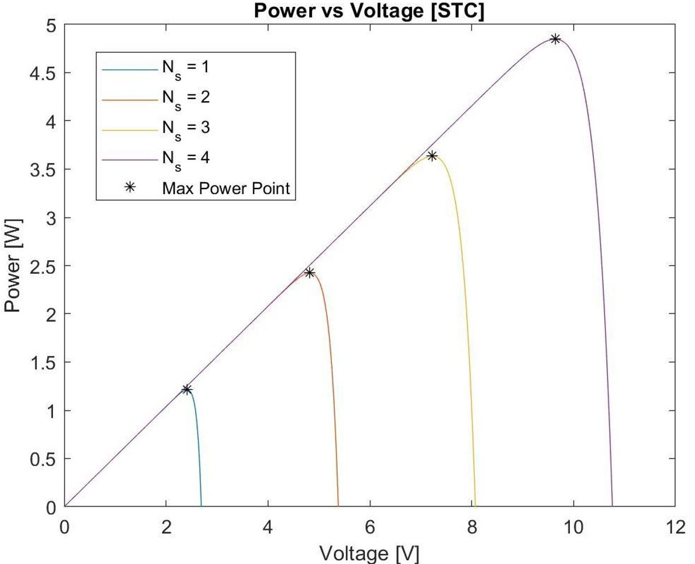


<div align="center">

FIGURE 3-2: POWER VS VOLTAGE MULTIPLE CELLS IN SERIES

</div>

As the above figures display, an increase in the number of cells connected in series does not impact output current. The variance however is seen in the output voltage of the PV module. The current for all critical points has no variation with respect to multiple PV cells in series. In order to determine variation on voltage, the maximum power voltage is considered and plotted with respect to number of cells connected in series as the following.

<!-- PDF_PAGE: 31 -->


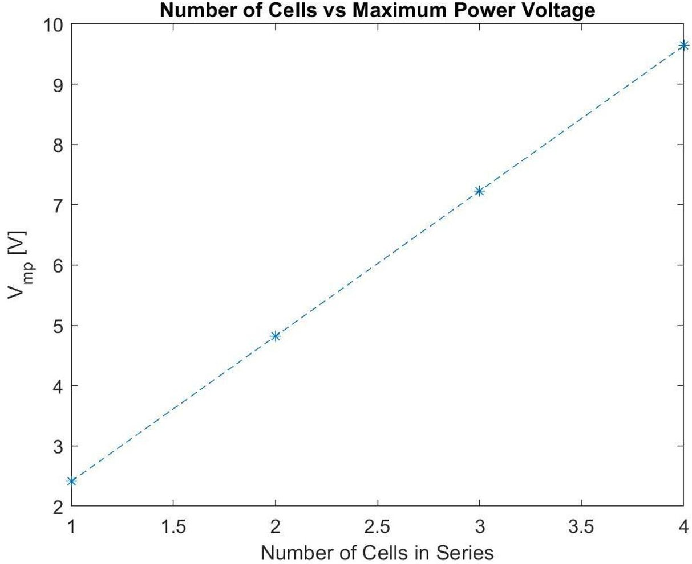


<div align="center">

FIGURE 3-3: NUMBER OF CELLS IN SERIES VARIATION ON MAXIMUM POWER VOLTAGE

</div>

When Figure 3-3 is analyzed, it becomes clear that the effective output voltage of a module composed of multiple cells in series is the sum of the voltage produced by each of the individual PV cells. Algebraically this reduces to the following relationship.

$$
V _ {m o d u l e} = \sum V _ {c e l l _ {i}} = N _ {s} \cdot V _ {c e l l}
$$

EQUATION 3-1

As can be seen in Equation 3-1, the total output voltage of a module composed of multiple cells connected in series is simply the sum of each individual PV cell. In the case of identical PV cells, it is simply the number of cells connected in series multiplied by the operating voltage of each PV cell individually.

<!-- PDF_PAGE: 32 -->

## 3.1.2. SOLAR IRRADIATION VARIANCE

The incident solar irradiation is proportional to the output of a PV cell as it is the source of current via the photoelectric effect as discussed in section 1. Testing was conducted at varying amount of solar radiance to determine effect on output and the following results obtained.


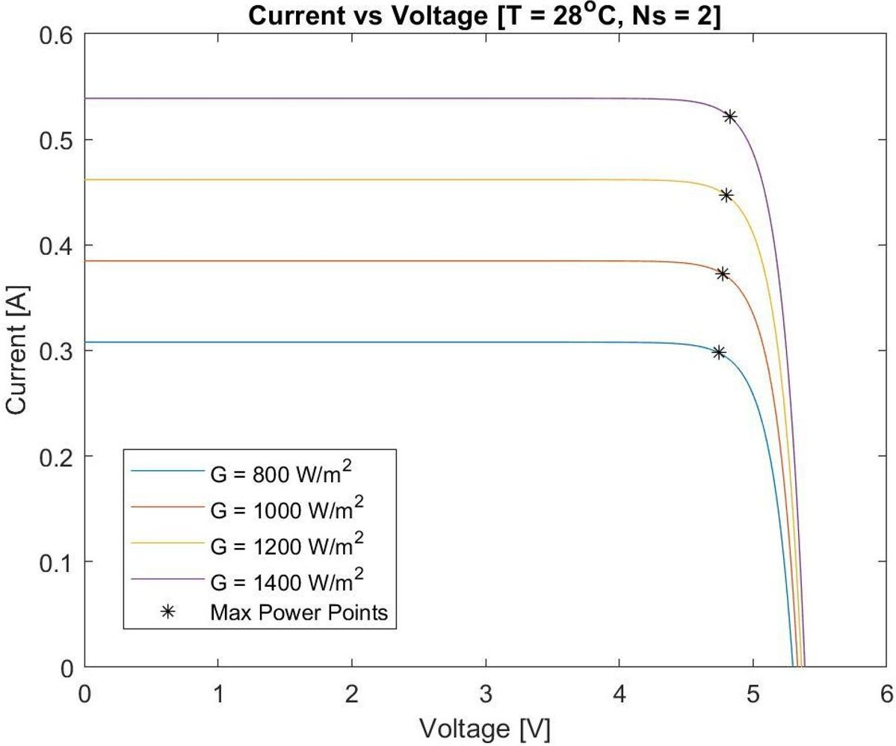


<div align="center">

FIGURE 3-4: CURRENT VS VOLTAGE VARYING SOLAR RADIATION

</div>

<!-- PDF_PAGE: 33 -->


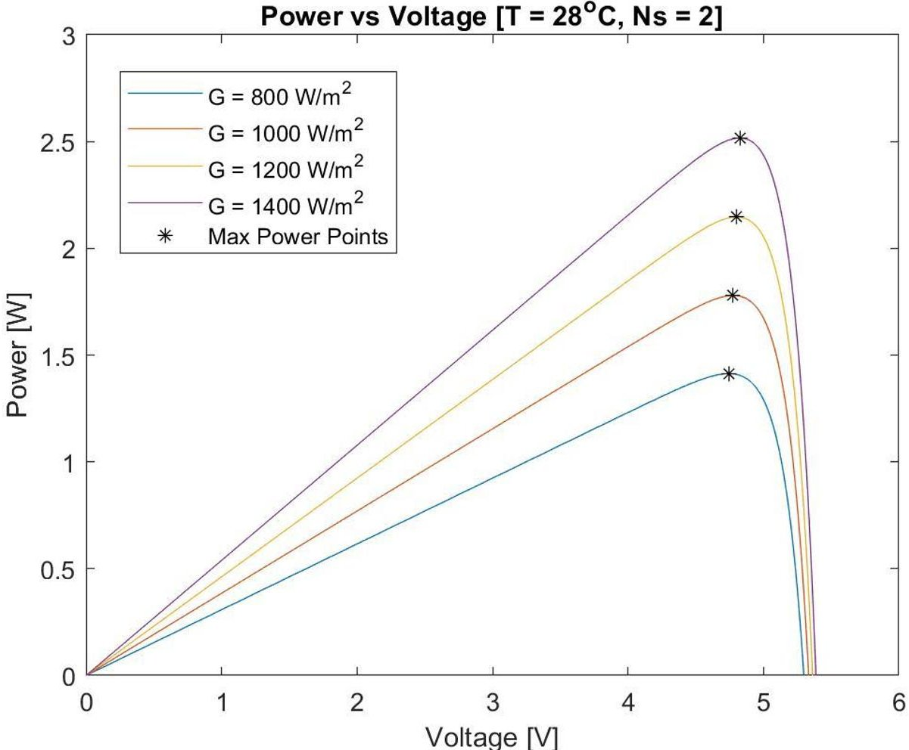


<div align="center">

FIGURE 3-5: POWER VS VOLTAGE VARYING SOLAR RADIATION

</div>

As can be seen a variation of solar radiance significantly alters output current however has a minimal effect on voltage. When the effect of varying solar radiance was analyzed upon maximum power voltage the following results were obtained.

<div align="center">

TABLE 3-1: EFFECT OF SOLAR RADIANCE ON MAXIMUM POWER VOLTAGE

</div>

$$
\frac {\partial V _ {m p}}{\partial G} \quad \begin{array}{c c} N _ {s} = 2 & N _ {s} = 1 \\ 1. 0 1 2 5 \cdot 1 0 ^ {- 4} V / \left(W / m ^ {2}\right) & 5. 0 6 2 5 \cdot 1 0 ^ {- 5} V / \left(W / m ^ {2}\right) \end{array}
$$

The effect of solar radiance upon output voltage were found to be minimal, and since the output current cannot be altered for a given solar radiance, it was determined that peak power would not be affected in any significant manner by amount of incident solar irradiance.

<!-- PDF_PAGE: 34 -->

## 3.1.3. TEMPERATURE VARIANCE

Tests were conducted on the model to determine variation of output parameters when temperature was varied, and all other parameters held constant. The parameter of interest was primarily the operating voltage required for maximum power output. Temperature was varied from between $ - 8 0^{\circ} \mathrm{C} $ to $ + 8 0^{\circ} \mathrm{C} $ and the I-V and P-V curves were developed. Furthermore, the operating voltage at maximum power was determined for each temperature variant. The following figures depict the two characteristic curves for varying temperatures.


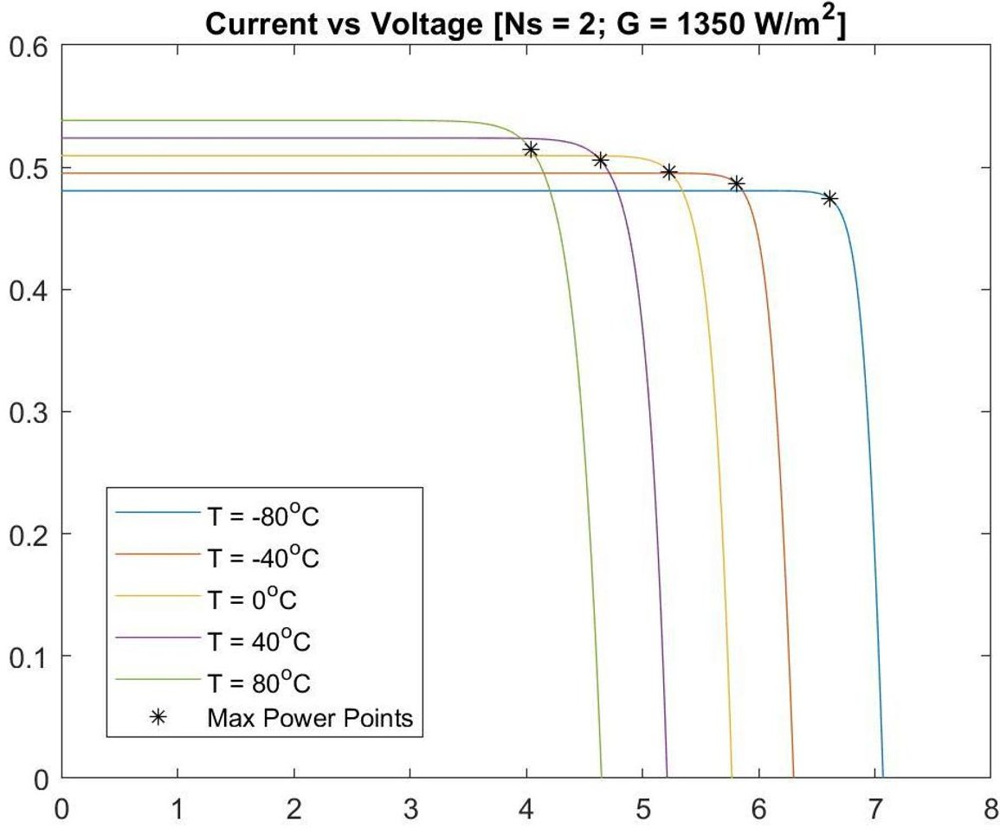


<div align="center">

FIGURE 3-6: PV CELL TEMPERATURE VARIANCE I-V PLOT

</div>

<!-- PDF_PAGE: 35 -->


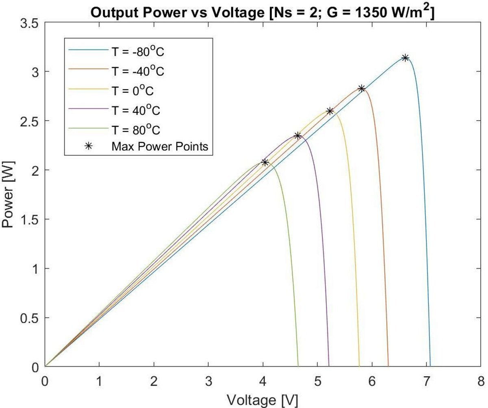


<div align="center">

FIGURE 3-7: PV CELL TEMPERATURE VARIANCE P-V PLOT

</div>

As can be seen in Figure 3-6 and Figure 3-7, as temperature increases a slight increase in overall output current results. The major change is noted in the open circuit voltage as well as the voltage for maximum power. Increased temperature results in lower overall voltage, both open circuit voltage and maximum power voltage. This results in overall lower peak power point. A clear trend is noticed in greater solar cell power output associated with a decrease in temperature. To investigate variance of voltage at peak power, the maximum power voltage at each step is compared to the temperature and plotted as the following figure along with a line of best fit to determine the trend associated with varying temperature.

<!-- PDF_PAGE: 36 -->


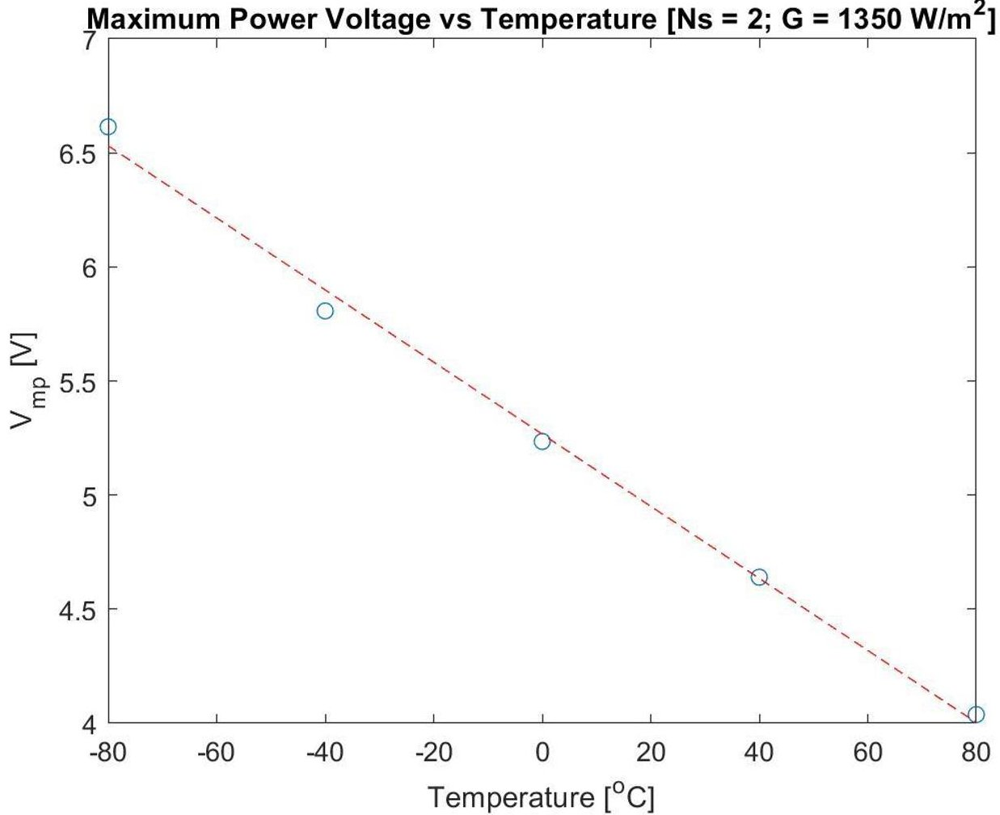


<div align="center">

FIGURE 3-8: MAXIMUM POWER VOLTAGE VARIATION WITH RESPECT TO TEMPERATURE

</div>

As can be seen in Figure 3-8, maximum power voltage is proportional to the temperature in a relatively linear fashion. This fact can later be used to determine optimal operating voltage and maximize module power output. The variability of $ V_{mp} $ with respect to T was found to be the following

<div align="center">

TABLE 3-2: MAXIMUM POWER VOLTAGE VARIATION WITH TEMPERATURE

</div>

<table border="1"><tr><td rowspan="2">$\frac{\partial V_{mp}}{\partial T}$</td><td colspan="2">$N_{s}=2$</td><td colspan="2">$N_{s}=1$</td><td rowspan="2">Error %</td></tr><tr><td>Computed</td><td>Actual</td><td>Computed</td><td>Actual</td></tr><tr><td>-0.0161V/℃</td><td>-</td><td>-</td><td>-0.0081V/℃</td><td>-0.0067V/℃</td><td>20.9%</td></tr></table>

It is determined that voltage decreases with an increase in temperature. The computed temperature gradient results in an error of approximately 21 % when compared with the manufacturer provided values. This can be due to the extreme temperature variations under which modelling is conducted.

<!-- PDF_PAGE: 37 -->

## 3.1.4. ORBITAL SIMULATION

For orbital simulations, it was required to compute position of spacecraft relative to sun as discussed in section 2.2. With the position known it becomes possible to determine ambient conditions primarily involving incident solar radiation upon each of the PV module surfaces. As previously discussed, the model includes a simple flag to set solar irradiation upon a surface to zero should a half angle of 90 degrees be surpassed. Furthermore, periods of eclipse were also flagged as zero incident solar radiance. With solar radiation, G, known at each point of satellite orbital position, and the sun angle, $ \beta $ , it is possible to compute solar irradiance which is acting upon the surface of each PV module under conditions of sun visibility. With a Simulink model constructed, a simulation was ran with the following results for a total of four orbital periods. The provided sample is for the positive x face of ESSENCE which is a 1U side opposing the nadir pointing camera face.


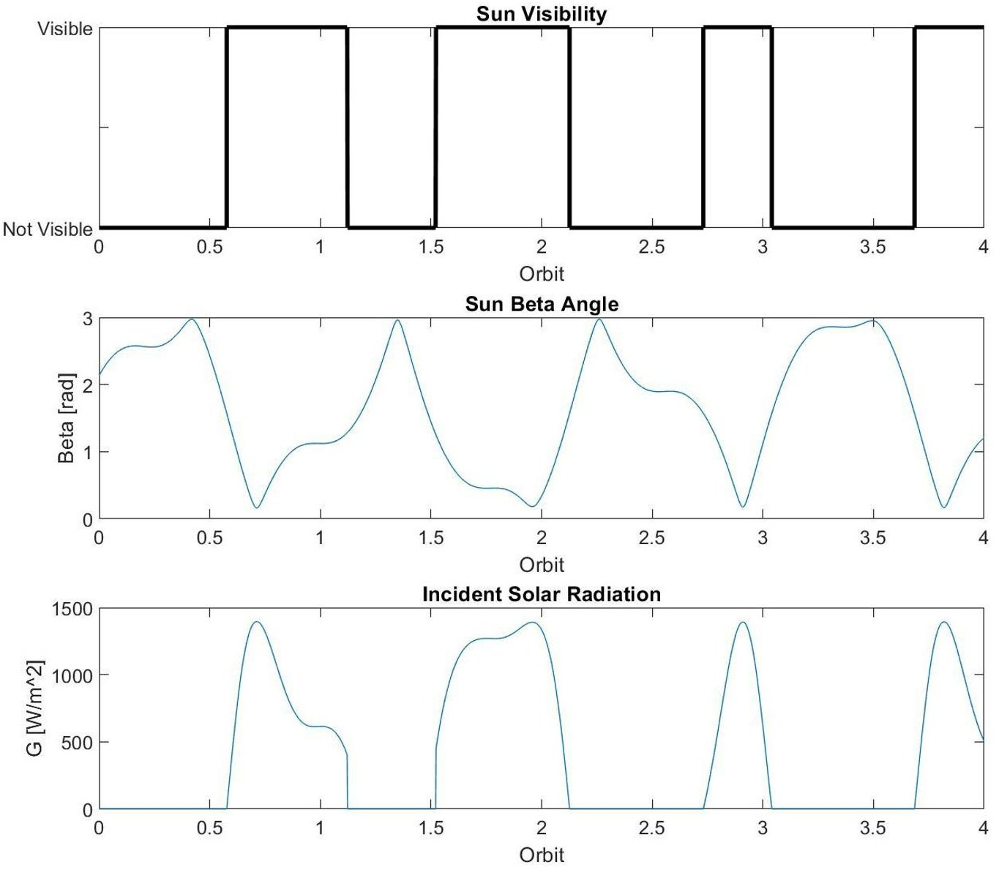


<div align="center">

FIGURE 3-9: POSITIVE X FACE ORBITAL SIMULATION RESULTS

</div>

<!-- PDF_PAGE: 38 -->

Ambient solar radiation at all points of orbital simulation are used in addition to the sun beta angle for each respective face to determine incident solar radiation as in Equation 2-2. As expected, during periods of no sun visibility the incident solar radiation is zero. This is achieved through the implementation of eclipse flags to determine periods of eclipse during orbit in addition to a half angle limitation since only solar radiation that is perpendicular to solar cell surface is used to generate photocurrent.

To further demonstrate the orbital simulation, the results of the positive y face are also displayed which is not opposing a nadir pointing face. The positive y face is a 3U face configuration with a total of 6 solar cells mounted. The results are displayed in the following.

<!-- PDF_PAGE: 39 -->


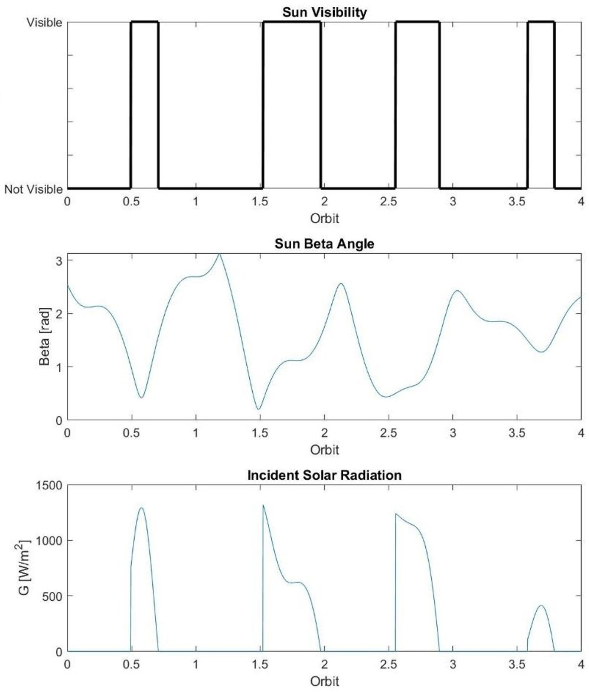


<div align="center">

FIGURE 3-10: POSITIVE Y FACE ORBITAL SIMULATION RESULTS

</div>

<!-- PDF_PAGE: 40 -->

As expected, the positive X face has 4 periods of no sun visibility. This is primarily due to satellite attitude during simulation. Since the negative X face has a mounted camera and is nadir pointing, the X face typically only loses sun visibility once per orbital period. The positive Y face on the other hand as can be seen in Figure 3-10 loses sun visibility through a total of 5 periods due to satellite tumbling and beta angle surpassing the half angle threshold. The positive X face on the other hand, since it opposes the nadir facing side typically will only lose sun visibility for a short period prior to eclipse and regain visibility a short period following eclipse. This is shown graphically in the following figure.


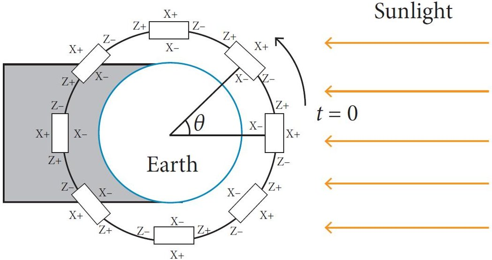


<div align="center">

FIGURE 3-11: SATELLITE ATTITUDE NADIR POINTING [10]

</div>

As shown in Figure 3-11, the positive X face will only lose sun visibility once per orbital period due to the nadir pointing opposing face. This is seen within the simulation and confirmed through results. Typically, the opposing side to nadir pointing will lose sun visibility once the half angle exceeds 90 degrees, enter eclipse, exit eclipse and regain sun visibility once the half angle is lesser than 90 degrees. The 3U sides on the other hand are tumbling along their axis and as such have periods where the half angle is exceeded and lose sun visibility.

<!-- PDF_PAGE: 41 -->

## 3.2. MAXIMUM POWER POINT TRACKING

The primary purpose of maximum power point tracking (MPPT) is to adjust voltage to a PV cells maximum power point so as to maximize power output. The system intakes data regarding operating conditions and adjusts system voltage to the peak power point (PPT). For the ESSENCE power system, since ambient parameters are known as is the variation of maximum power point voltage with respect to ambient conditions, the MPPT shall be developed to identify optimal voltage as a function of known ambient conditions.

It was determined through testing that the greatest effect upon $ V_{mp} $ is a result of changes in temperature. Incident solar irradiation also has an effect on the peak power voltage however is negligible when compared to the gradient upon voltage imposed by variations in temperature. For this reason, the primary source of voltage regulation shall be imposed by operating temperature and the gradient of voltage with respect to temperature shall be used in selecting operating voltage of the PV module.

## 3.3. PV MODULE TOTAL POWER OUTPUT

To determine total power output of the PV modules, all faces must be simulated, and output power of each respective module summed to determine net power generation. Each face has a respective solar irradiation acting upon the PV cells which is used to generate photocurrent, $ I_{ph} $ , which is then converted to electrical energy. The following figure displays the incident solar radiation acting upon each respective face through a total of four orbits.


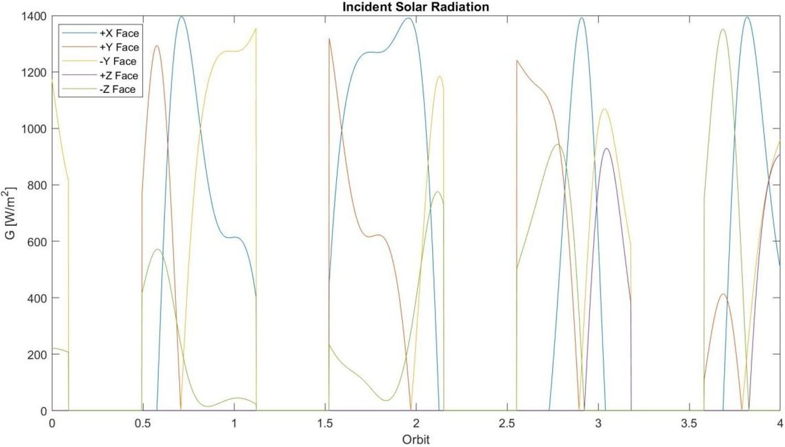


<div align="center">

FIGURE 3-12: INCIDENT SOLAR IRRADIATION

</div>

<!-- PDF_PAGE: 42 -->

With the incident solar irradiation computed on each respective face, the configured PV module may utilize the solar irradiance as an input to determine output of each respect PV module. The MPPT is configured to adjust operating voltage based on ambient conditions as discussed in section 3.2. Since a temperature model is unavailable at the moment, two tests are conducted at static ambient temperatures of $ - 7 0^{\circ} \mathrm{C} $ and $ + 5 0^{\circ} \mathrm{C} $ . The resulting power output from each respect PV module is summed and the following results obtained for four orbital periods.


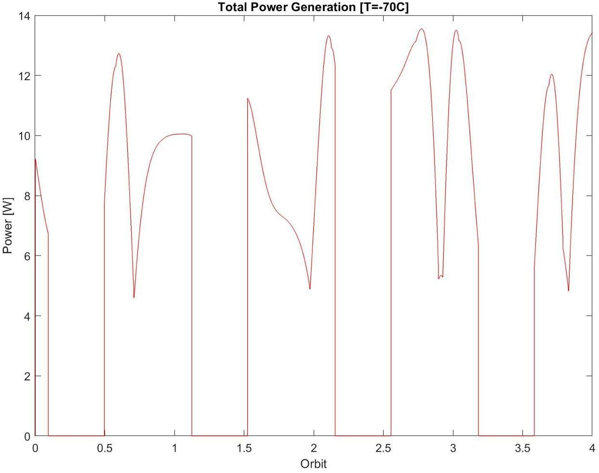


<div align="center">

FIGURE 3-13: TOTAL POWER GENERATION [T=-70 $ ^{\circ} \mathrm{C} $]

</div>

<!-- PDF_PAGE: 43 -->


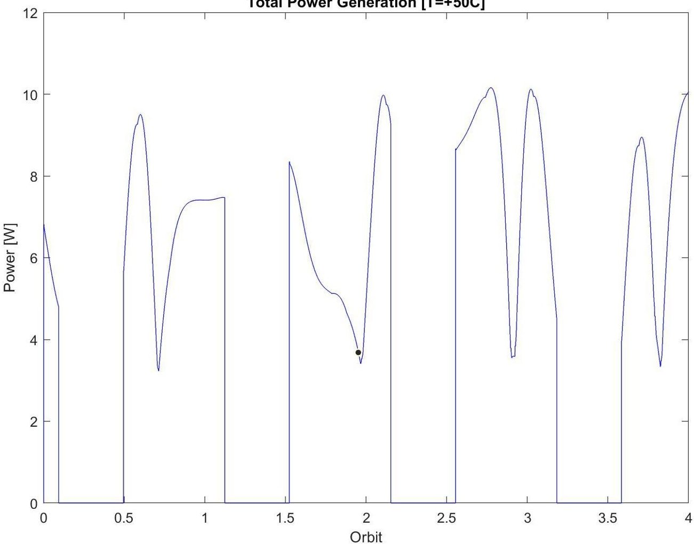


<div align="center">

FIGURE 3-14: TOTAL POWER GENERATION [T=+50 $ ^{\circ} \mathrm{C} $]

</div>

In Figure 3-13 and Figure 3-14, periods of zero power generation signify an eclipse period since at any point outside eclipse, at least one face will have sun visibility. The figures display total power output of all PV modules located on the +X, +Y, -Y, +Z, and -Z faces respectively. PV cells are setup to operate at their peak power points and all voltages are adjusted for number of PV cells connected in series for each respective module. The significant data from the above figures is displayed in the following table.

<div align="center">

TABLE 3-3: POWER GENERATION COMPUTED VALUES

</div>

<table border="1"><tr><td>Temperature</td><td>Maximum Power</td><td>Minimum Power</td><td>Average Power</td></tr><tr><td>-70℃</td><td>13.5506W</td><td>4.6051W</td><td>5.8150W</td></tr><tr><td>+50℃</td><td>10.1591W</td><td>3.2313W</td><td>4.2753W</td></tr></table>

As expected, the lower temperature generates greater power. The reported minimum power is the minimum power generated outside of an eclipse period whereas the average power computation includes the period of zero power generation during eclipse.

<!-- PDF_PAGE: 44 -->

## 3.4. BATTERY TEST

Using an initial SOC of zero a battery charging test was conducted. For the preliminary test no loads were activated and thus the battery was in a strictly charging state. Temperature was held constant at $ - 7 0^{\circ} \mathrm{C} $ . The charging current as handled by the PDU was the lesser of the maximum charging current assuming charging at battery nominal voltage or the peak charging current as specified by the manufacturer. The results of the battery SOC after a total of four orbits are displayed as follows.


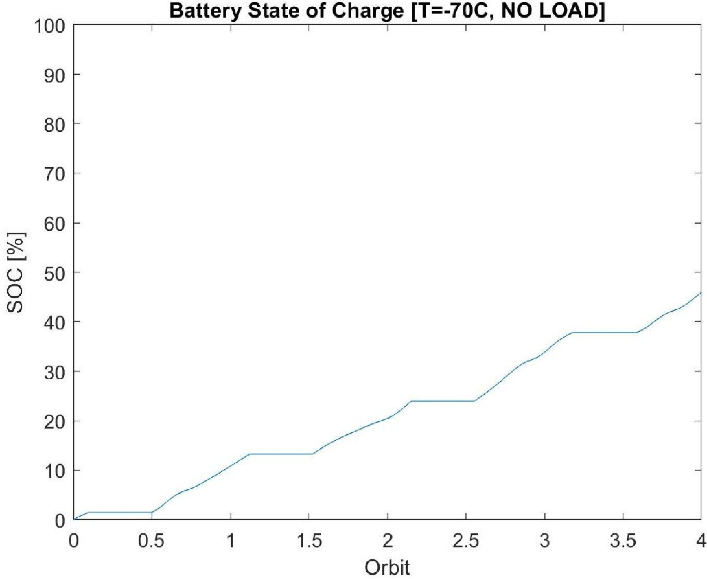


<div align="center">

FIGURE 3-15: BATTERY STATE OF CHARGE [T=-70 $ ^{\circ} $ C, NO LOAD]

</div>

At the conclusion of four orbits, the battery attained a final SOC of 46% when starting initially at a SOC of 0%. This results in a battery capacity of 2392 mAh at the conclusion of four orbits assuming zero loads.

<!-- PDF_PAGE: 45 -->

## 3.5. INTEGRATION TEST

For a final test, the completed power system was assembled, and loads applied. For the loading the following components were added with constant power draws as listed.

<div align="center">

TABLE 3-4: SPACECRAFT LOAD POWER BUDGETS

</div>

<table border="1"><tr><td>Component</td><td>Number of Components</td><td>Consumption per component</td><td>Total Consumption</td></tr><tr><td>Reaction Wheels</td><td>3</td><td>15mW</td><td>45mW</td></tr><tr><td>Magnetic Torquers</td><td>-</td><td>-</td><td>500mW</td></tr></table>

The output parameters of interest for the final integration test included battery SOC as well as battery capacity. Integration testing was conducted at an ambient temperature of $ - 7 0^{\circ} \mathrm{C} $ . These results are shown in the following figures.


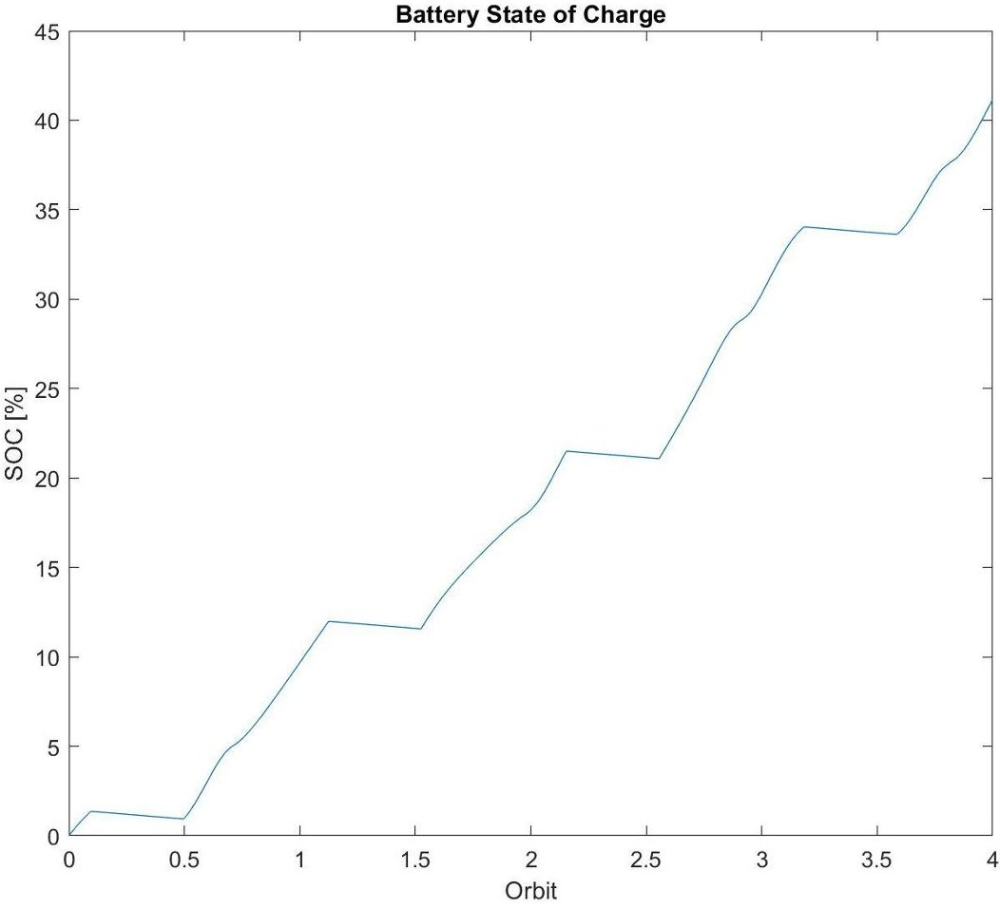


<div align="center">

FIGURE 3-16: BATTERY SOC INTEGRATION TEST [T=-70 $ ^{\circ} \mathrm{C} $]

</div>

<!-- PDF_PAGE: 46 -->


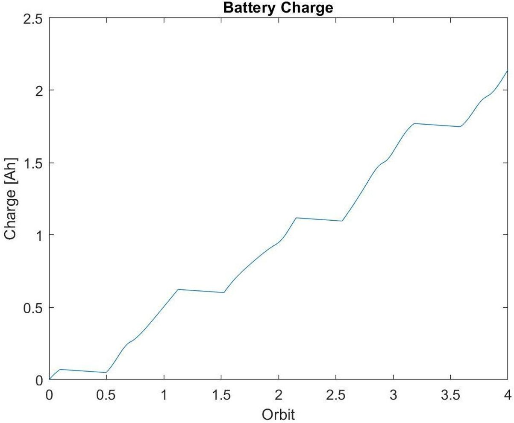


<div align="center">

FIGURE 3-17: BATTERY CHARGE INTEGRATION TEST [T=-70 $ ^{\circ} \mathrm{C} $]

</div>

As shown in Figure 3-16 and Figure 3-17, the loads from the ADCS components consumed minimal power when compared with the power generation capabilities through orbit. As expected, both the battery state of charge as well as overall charge reduce during orbital periods when power generation is zero and the battery is responsible for supplying all components. At the conclusion of four orbits, the batteries final state of charge was at 41.17 % and the charge amount was a total of 2.14 Ah at nominal voltage. This effectively results in a minimal 5 % reduction in power compared to power generation with no loads applied as was computed in section 3.4.

<!-- PDF_PAGE: 47 -->

For the sake of analysis and determining worst case scenarios, with the knowledge that PV cells generate lesser power at greater temperatures, an integration test was also conducted at $ 1 0 0^{\circ} \mathrm{C} $ . The results of this simulation are presented in the following figures.


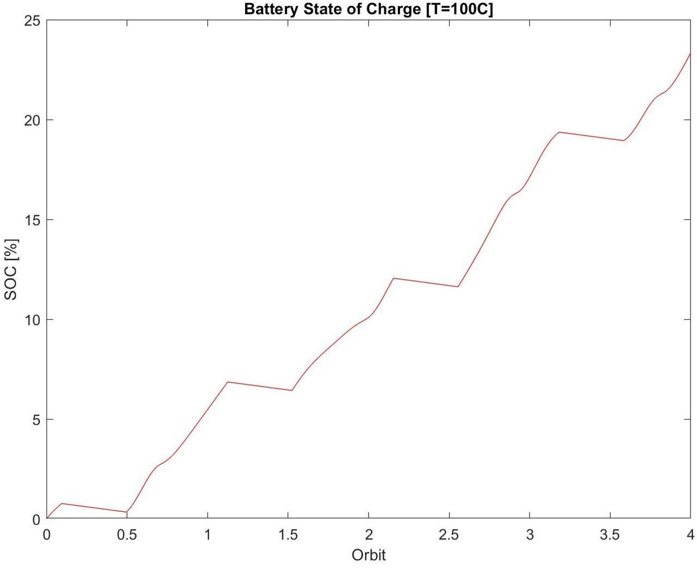


<div align="center">

FIGURE 3-18: BATTERY SOC INTEGRATION TEST [T=+100 $ ^{\circ} \mathrm{C} $]

</div>

<!-- PDF_PAGE: 48 -->


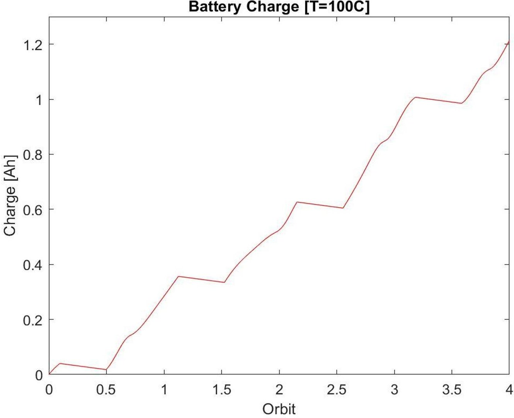


<div align="center">

FIGURE 3-19: BATTERY CHARGE INTEGRATION TEST [T=+100 $ ^{\circ} \mathrm{C} $]

</div>

As can be seen in Figure 3-18 and Figure 3-19, the power generation capabilities are greatly diminished at larger temperatures. With the loads constant and temperature at $ 1 0 0^{\circ} \mathrm{C} $ , it was found that the final charge level of the battery at the conclusion of four orbits was 1.21 Ah at a SOC of 23.3 %.

It must be noted that the above integration tests do not consider charging efficiency of the batteries, which can range from 0.85 to 0.95. This will result in overall lower final charge as well as overall lower final SOC. The efficiency may simply be included in the model as a 'gain' block within Simulink.

<!-- PDF_PAGE: 49 -->

## 4. DISCUSSION

Upon examination, it was determined that PV cells operate at larger efficiency as temperature is lowered. For simulation purposes, due to the absence of a temperature model, analysis was conducted at static temperature values. Comparisons could be made for variance in temperature and for LEO they were found to be substantial. When temperature was varied from $ - 7 0^{\circ} \mathrm{C} $ to $ + 1 0 0^{\circ} \mathrm{C} $ for integration tests, it was found that battery final state of charge was nearly halved.

As was expected, multiple PV cells in series resulted in a summation of voltage output. The current however was found to remain constant. For varying solar irradiation however, it was found that output current was varied proportionally. Voltage in this case however had negligible variance.

ADCS components including magnetic torquers as well as reaction wheels were considered as loadings for this study. When the loading was modelled as per a Poisson distribution with a $ \lambda $ of 2, the draws upon the system were negligibly small. With lack of other loads to be applied, it was decided to allow the loads to operate continuously at their provided power requirements.

Ultimately it was determined that the system as configured is capable of supplying loads and providing sufficient power.

## 4.1. FUTURE CONSIDERATIONS

Although a large portion of modelling is complete, there is always room for improvement. It is noted that the simulation lacks the ability to vary temperature in real time and the battery voltage as a function of the state of charge is unknown. Finally, the models, as they are built currently are not fully scalable as library blocks.

## 4.1.1. TEMPERATURE MODEL

Upon examination of PV cell performance under varying temperature, it was found that the output capability of PV cells is greatly affected by temperature. To enhance the model's ability to better predict output capabilities, a temperature model should be developed. This will allow for a greater understanding of power generation capabilities as opposed to the assumption of static temperature which when examined yields significant variances in power outputs.

## 4.1.2. BATTERY OPEN CIRCUIT VOLTAGE

Preliminary work was completed in determining battery open circuit voltage as a function of state of charge however could not be completed due to lack of battery characteristic parameters. These parameters can be extracted through testing of the battery under both charging and discharging conditions with respect to battery overall SOC.

The batteries employed in ESSENCE are Lithium-Ion batteries and thus do not have a linear relationship between SOC and voltage. Typically, the relationship may be modelled as a third-degree polynomial. The coefficients of this polynomial may be determined through either physical testing of the

<!-- PDF_PAGE: 50 -->

battery or knowledge of the battery's internal capacitance and resistance. Determining the battery voltage through orbit will allow for a deeper understanding of battery output abilities and further enhance the accuracy of the model.

## 4.1.3. LIBRARY MODELS

The final consideration to be accounted for is the generation of library blocks within Simulink. This must be completed to assure that the models are better scalable as the scope of the project grows. Library blocks will allow for easier manipulation of parameters or models within various systems. The models as built currently are able to adjust according to project demands, however conversion to library blocks will further simplify this process. This project will be completed after the conclusion of this report.

<!-- PDF_PAGE: 51 -->

## 5. CONCLUSION

In conclusion, PV cells were analyzed for output characteristics examined. It was found that temperature variance has the greatest impact on performance of PV cells and the temperature gradient of voltage is negative for increases in temperature. The temperature gradient was computed as approximately -0.0081V/ $ ^{\circ} \mathrm{C} $ which resulted in a 20.9% error when compared to the manufacturers provided -0.0067V/ $ ^{\circ} \mathrm{C} $ . This variation is primarily attributed to approximations made during modelling namely the neglection of shunt current and extraction of unknown PV cell parameters. Furthermore, the large temperature variance which was examined likely resulted in larger errors. When the same comparison was made under standard spatial test conditions (STCs), the error was found to be well under 1% therefore it may be concluded that the error was likely due to large temperature variations. To reduce this error, real world testing may be necessary to generate critical points under varying temperature conditions.

Overall, it was determined that the power generation capabilities of ESSENCE are suitable for the requirements by the various loads. This paper only modelled the loads from ADCS as other power budgets were not readily accessible. The model however is designed to be scalable and other loads may be included at a later date.

As discussed in section 4.1.1, a temperature model should also be developed due to the large variance in PV module output as a result of temperature variance. This will increase the accuracy of the simulation with respect to real world conditions. The modelling and simulation is setup such that once a temperature model is developed, it may be implemented with ease.

<!-- PDF_PAGE: 52 -->

## 6. REFERENCES

[1] W. Davis, "PhysLink," PhysLink Education, [Online]. Available: https://www.physlink.com/education/askexperts/ae24.cfm. [Accessed 07 April 2020].

[2] Siyavula, "Siyavula: Technology Powered Learning," Siyavula, [Online]. Available: https://www.siyavula.com/read/science/grade-12/optical-phenomena-and-properties-of-matter/12-optical-phenomena-and-properties-of-matter-02. [Accessed 7 April 2020].

[3] J. Hanania, K. Stenhouse and J. Donev, "Energy Education," University of Calgary, [Online]. Available: https://energyeducation.ca/encyclopedia/Photovoltaic_effect. [Accessed 7 April 2020].

[4] W. L. Hosch and The Editors of Encyclopaedia Britannica, "Encyclopedia Brittanica: Physics- Photovoltaic Effect," Brittanica, [Online]. Available: https://www.britannica.com/science/photovoltaic-effect. [Accessed 7 April 2020].

[5] American Chemical Society (ACS), "How a Solar Cell Works," 2014. [Online]. Available: https://www.acs.org/content/acs/en/education/resources/highschool/chemmatters/pastissues/archive-2013-2014/how-a-solar-cell-works.html. [Accessed 14 February 2019].

[6] S. Chtita, C. Yassine, A. Derouich and J. Belkadid, "Modeling and Simulation of a Photovoltaic Panel Based on a Triple Junction Cells for a Nanosatellite," in International Symposium on Advanced Electrical and Communication Technologies (ISAECT), Morocco, 2018.

[7] Y.-P. Huang and P.-F. Tsai, "Improving the Output Power Stability of a High Concentration Photovoltaic System with Supercapacitors: A Preliminary Evaluation," Mathematical Problems in Engineering, vol. 2015, pp. 1-7, 2014.

[8] X. H. Nguyen and M. P. Nguyen, "Mathematical modeling of photovoltaic cell/module/arrays with tags in Matlab/Simulink," Environmental Systems Research, vol. 4, no. 24, pp. 1-13, 2015.

[9] C. Honsberg and S. Bowden, "IV Curve," PVeducation, 2019. [Online]. Available: https://www.pveducation.org/pvcdrom/solar-cell-operation/iv-curve. [Accessed 27 March 2020].

[10] S. Sanchez-Sanjuan, J. Gonzalez-Llorente and R. Hurtado-Velasco, "Comparison of the Incident Solar Energy and Battery Storage in a 3U CubeSat Satellite for Different Orientation Scenarios," Journal of Aerospace Technology and Management, vol. 8, no. 1, pp. 91-102, 2016.

<!-- PDF_PAGE: 53 -->

## APPENDIX A: SOLVING UNKNOWN PARAMETERS Compute values at STC

%For values at single temperature value, output unknowns.

clc; clear;

disp('Unknown Parameters at STC Conditions [T = 28 Degree Celcius]'

T = 28;

[Rs Irs n] = ComputeParam(T);

fprintf('Rs = %.4f\n',Rs);

fprintf('n = %.4f\n',n);

fprintf('Irs = %.4d\n',Irs);

Unknown Parameters at STC Conditions [T = 28 Degree Celcius]

Rs = 0.0135

n = 3.0739

Irs = 1.1769e-15

## Compute for multiple temperature values

%Iterative Solution for varying temperature, store all as arrays of values

T = -50:5:100; %Temperature in Celcius

```for i = 1 : length(T)

    [R,I,N] = ComputeParam(T(i));

    Rs(i) = R;

    Irs(i) = I;

    n(i) = N;

end; clearvars R I N;

%Generate table of values

disp('Unknown Parameters at Varying Temperature:')

R = table(T',Rs',n',Irs','VariableNames',{'Temperature'};

    'SeriesResistance';'DiodeIdeality';'ReverseSaturationCurrent'});

disp(R);

```

Unknown Parameters at Varying Temperature:

| Temperature | SeriesResistance | DiodeIdeality | ReverseSaturationCurrent |

| :--- | :--- | :--- | :--- |

| -50 | 0.12168 | 2.2647 | 1.1031e-32 |

| -45 | 0.10769 | 2.3678 | 2.3751e-30 |

| -40 | 0.094874 | 2.4621 | 2.3782e-28 |

| -35 | 0.083164 | 2.5479 | 1.2878e-26 |

| -30 | 0.072509 | 2.6258 | 4.2249e-25 |

| -25 | 0.062861 | 2.6963 | 9.1638e-24 |

| -20 | 0.054179 | 2.7596 | 1.4066e-22 |

| -15 | 0.046424 | 2.8163 | 1.6125e-21 |

| -10 | 0.039559 | 2.8667 | 1.4415e-20 |

| -5 | 0.033553 | 2.9111 | 1.0407e-19 |

<!-- PDF_PAGE: 54 -->

<table border="1"><tr><td>0</td><td>0.028376</td><td>2.9498</td><td>6.2443e-19</td></tr><tr><td>5</td><td>0.023998</td><td>2.9831</td><td>3.1887e-18</td></tr><tr><td>10</td><td>0.020395</td><td>3.0112</td><td>1.4135e-17</td></tr><tr><td>15</td><td>0.017541</td><td>3.0345</td><td>5.5305e-17</td></tr><tr><td>20</td><td>0.015414</td><td>3.0532</td><td>1.9369e-16</td></tr><tr><td>25</td><td>0.013991</td><td>3.0674</td><td>6.1457e-16</td></tr><tr><td>30</td><td>0.013253</td><td>3.0774</td><td>1.7847e-15</td></tr><tr><td>35</td><td>0.01318</td><td>3.0835</td><td>4.7859e-15</td></tr><tr><td>40</td><td>0.013753</td><td>3.0856</td><td>1.1942e-14</td></tr><tr><td>45</td><td>0.014955</td><td>3.0842</td><td>2.791e-14</td></tr><tr><td>50</td><td>0.01677</td><td>3.0792</td><td>6.1456e-14</td></tr><tr><td>55</td><td>0.019181</td><td>3.0709</td><td>1.2814e-13</td></tr><tr><td>60</td><td>0.022173</td><td>3.0594</td><td>2.5411e-13</td></tr><tr><td>65</td><td>0.025732</td><td>3.0448</td><td>4.8119e-13</td></tr><tr><td>70</td><td>0.029843</td><td>3.0273</td><td>8.7306e-13</td></tr><tr><td>75</td><td>0.034494</td><td>3.007</td><td>1.5225e-12</td></tr><tr><td>80</td><td>0.039671</td><td>2.984</td><td>2.5585e-12</td></tr><tr><td>85</td><td>0.045362</td><td>2.9584</td><td>4.1533e-12</td></tr><tr><td>90</td><td>0.051556</td><td>2.9303</td><td>6.5266e-12</td></tr><tr><td>95</td><td>0.058239</td><td>2.8999</td><td>9.9467e-12</td></tr><tr><td>100</td><td>0.065402</td><td>2.8672</td><td>1.4726e-11</td></tr></table>

## Plot

Plot variation of values

figure(1); plot(T,Rs,'*r');

xlabel('Temperature [^oC]');ylabel('Resistance [Ohms]');

title('Series Resistance vs Temperature');

figure(2); plot(T,n,'*r');

xlabel('Temperature [^oC]');ylabel('Diode Ideality Factor');

title('Diode Ideality vs Temperature');

figure(3);

plot(T,Irs,'*r');

xlabel('Temperature [^oC]');ylabel('Current [A]');

title('Reverse Saturation Current vs Temperature');

<!-- PDF_PAGE: 55 -->


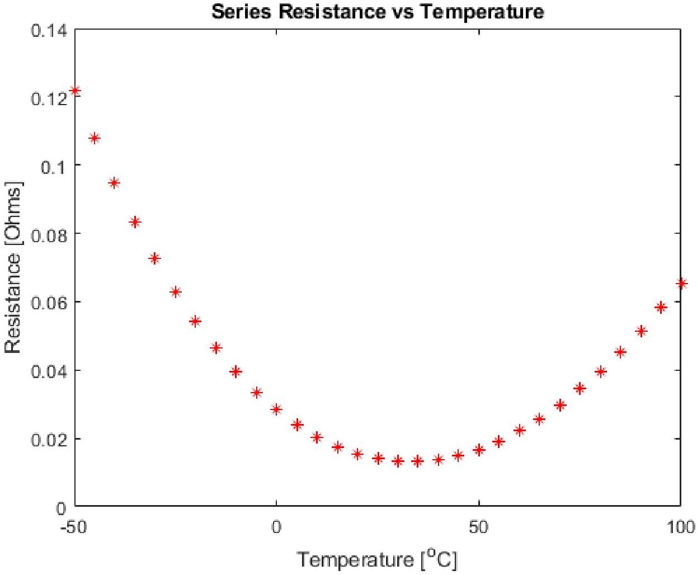


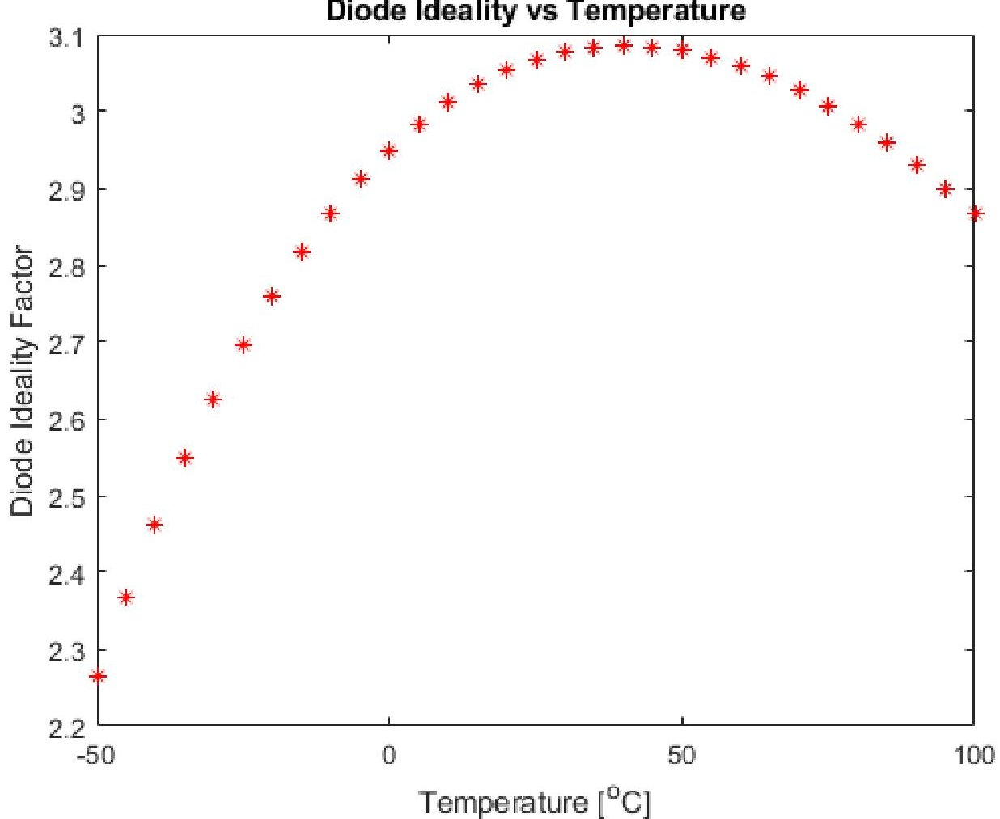


<!-- PDF_PAGE: 56 -->


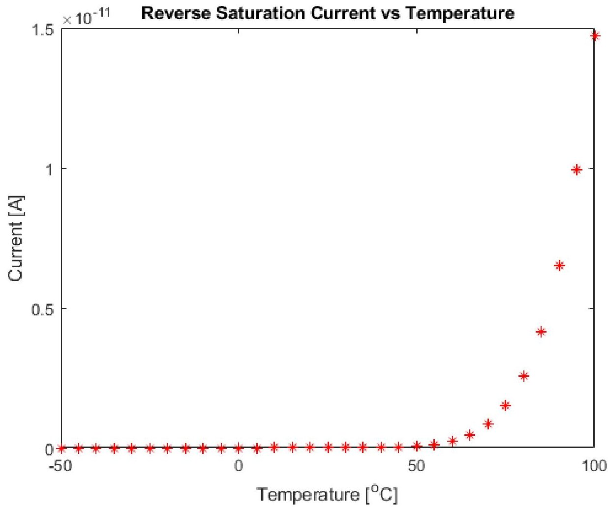


Function to Solve Unknowns

```matlab

function [Rs,Irs,n] = ComputeParam(T)

T = T + 273.15; %Convert Temperature to Kelvins

%GOMSPACE P110 Manufacturer Provided Values at STC

Voc          = 2690e-3;

Isc          = 519.6e-3;

Vm          = 2409e-3;

Im          = 502.9e-3;

Pmax        = 1.211;

eff         = 0.293;

%Temperature Gradients

Kvoc        = -6.2e-3; %Voc

Kisc        = 0.36e-3; %Isc

Kvm         = -6.7e-3; %Vmp

Kim         = 0.24e-3; %Imp

K            = 1.38064852e-23; %Boltzmann's Constant

q            = 1.60217662e-19; %Electron Charge

Ns            = 1; %Number of Cells in Series

```

<!-- PDF_PAGE: 57 -->

syms Rs n Irs % Generate symbolic variables Rs, n and Irs

Tr = 28 + 273.15; %Reference Temperature

%Adjust all variables for Temperature variation

Isc = Isc + Kisc*(T-Tr);

Voc = Voc + Kvoc*(T-Tr);

Vm  = Vm  + Kvm*(T-Tr);

Im  = Im  + Kim*(T-Tr);

MA = q / (Ns*n*K*T);

i = Irs == Isc / (exp(MA*Voc) - exp(MA*Isc*Rs));

j = Irs == Im / (exp(MA*Voc) - exp(MA*(Vm+Rs*Im)));

a = Irs == (Im/(Vm-Rs*Im))/(MA*exp(MA*(Vm+Rs*Im)));

z = vpasolve([i j a],[Rs Irs n],[0 1;0 inf;0 inf]);

Rs          = double(z.Rs);

Irs          = double(z.Irs);

n            = double(z.n);

end

Published with MATLAB $ ^{\circledR} $ R2018b

<!-- PDF_PAGE: 58 -->


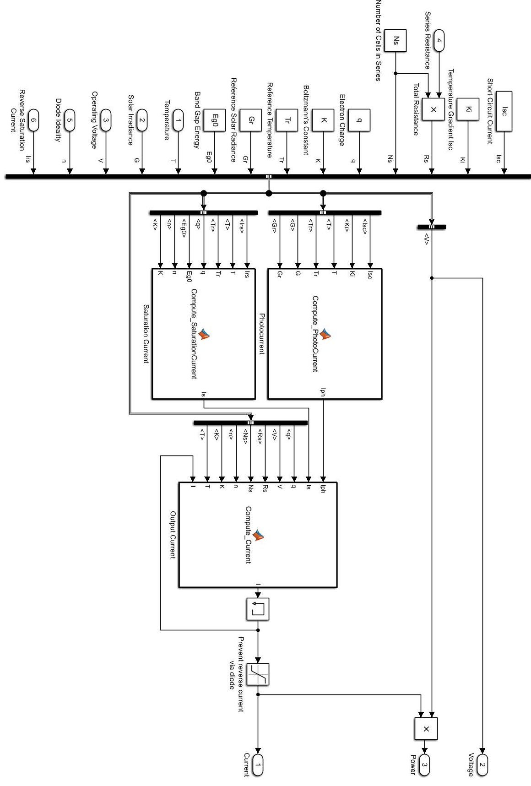


<!-- PDF_PAGE: 59 -->

## APPENDIX C: PV CELL STC RAW DATA

Number of Cells in Series: 1

Solar Irradiance: 1350 W/m $ ^{2} $

Temperature: 28 $ ^{\circ} \mathrm{C} $

Maximum Power: 1.208 W

Short Circuit Current: 0.5196 A

Open Circuit Voltage: 2.688 V

<table border="1"><tr><td>Voltage[V]</td><td>Current[A]</td><td>Power[W]</td></tr><tr><td>0</td><td>0.519600000000000</td><td>0</td></tr><tr><td>0.056000000000000</td><td>0.51959999999998</td><td>0.029097599999999</td></tr><tr><td>0.112000000000000</td><td>0.51959999999995</td><td>0.058195199999995</td></tr><tr><td>0.168000000000000</td><td>0.51959999999990</td><td>0.0872927999999982</td></tr><tr><td>0.224000000000000</td><td>0.519599999999978</td><td>0.116390399999995</td></tr><tr><td>0.280000000000000</td><td>0.519599999999954</td><td>0.145487999999987</td></tr><tr><td>0.336000000000000</td><td>0.519599999999907</td><td>0.174585599999969</td></tr><tr><td>0.392000000000000</td><td>0.519599999999810</td><td>0.203683199999926</td></tr><tr><td>0.448000000000000</td><td>0.519599999999616</td><td>0.232780799999828</td></tr><tr><td>0.504000000000000</td><td>0.519599999999224</td><td>0.261878399999609</td></tr><tr><td>0.560000000000000</td><td>0.519599999998433</td><td>0.290975999999122</td></tr><tr><td>0.616000000000000</td><td>0.519599999996837</td><td>0.320073599998052</td></tr><tr><td>0.672000000000000</td><td>0.519599999993617</td><td>0.349171199995711</td></tr><tr><td>0.728000000000000</td><td>0.519599999987120</td><td>0.378268799990624</td></tr><tr><td>0.784000000000000</td><td>0.519599999974012</td><td>0.407366399979625</td></tr><tr><td>0.840000000000000</td><td>0.519599999947562</td><td>0.43646399955952</td></tr><tr><td>0.896000000000000</td><td>0.519599999894196</td><td>0.465561599905199</td></tr><tr><td>0.952000000000000</td><td>0.51959999786518</td><td>0.494659199796765</td></tr><tr><td>1.008000000000000</td><td>0.519599999569258</td><td>0.523756799565812</td></tr><tr><td>1.064000000000000</td><td>0.51959999130894</td><td>0.552854399075271</td></tr><tr><td>1.120000000000000</td><td>0.51959998246410</td><td>0.581951998035979</td></tr><tr><td>1.176000000000000</td><td>0.51959996461794</td><td>0.611049595839070</td></tr><tr><td>1.232000000000000</td><td>0.51959992860988</td><td>0.640147191204737</td></tr><tr><td>1.288000000000000</td><td>0.51959985595669</td><td>0.669244781447221</td></tr><tr><td>1.344000000000000</td><td>0.51959970936490</td><td>0.698342360938642</td></tr><tr><td>1.400000000000000</td><td>0.519599941358777</td><td>0.727439917902288</td></tr><tr><td>1.456000000000000</td><td>0.519599881680053</td><td>0.756537427726158</td></tr><tr><td>1.512000000000000</td><td>0.519599761266754</td><td>0.785634839035331</td></tr><tr><td>1.568000000000000</td><td>0.519599518309776</td><td>0.814732044709728</td></tr><tr><td>1.624000000000000</td><td>0.519599028097402</td><td>0.843828821630181</td></tr><tr><td>1.680000000000000</td><td>0.519598038999896</td><td>0.872924705519824</td></tr><tr><td>1.736000000000000</td><td>0.519596043306428</td><td>0.902018731179958</td></tr><tr><td>1.792000000000000</td><td>0.519592016615055</td><td>0.931108893774179</td></tr><tr><td>1.848000000000000</td><td>0.519583892007214</td><td>0.960191032429331</td></tr><tr><td>1.904000000000000</td><td>0.519567499115366</td><td>0.989256518315657</td></tr><tr><td>1.960000000000000</td><td>0.519534423576480</td><td>1.01828747020990</td></tr><tr><td>2.016000000000000</td><td>0.519467688428170</td><td>1.04724685987119</td></tr><tr><td>2.072000000000000</td><td>0.519333041962175</td><td>1.07605806294563</td></tr><tr><td>2.128000000000000</td><td>0.519061385266135</td><td>1.10456262784633</td></tr><tr><td>2.184000000000000</td><td>0.518513340718987</td><td>1.13243313613027</td></tr><tr><td>2.240000000000000</td><td>0.517407861024364</td><td>1.15899360869458</td></tr><tr><td>2.296000000000000</td><td>0.515178586392067</td><td>1.18285003435619</td></tr><tr><td>2.352000000000000</td><td>0.510685650943087</td><td>1.20113265101814</td></tr><tr><td>2.408000000000000</td><td>0.501640814390470</td><td>1.20795108105225</td></tr><tr><td>2.464000000000000</td><td>0.483474233938594</td><td>1.19128051242469</td></tr><tr><td>2.520000000000000</td><td>0.447154450612701</td><td>1.12682921554401</td></tr><tr><td>2.576000000000000</td><td>0.375206376902264</td><td>0.966531626900232</td></tr><tr><td>2.632000000000000</td><td>0.235241026916984</td><td>0.619154382845503</td></tr><tr><td>2.688000000000000</td><td>0</td><td>0</td></tr></table>

<!-- PDF_PAGE: 60 -->


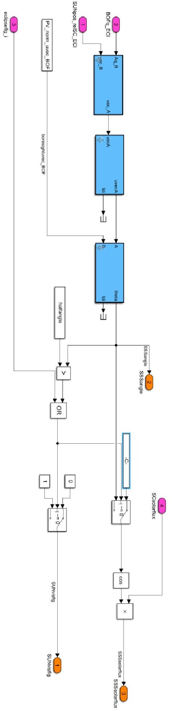


<!-- PDF_PAGE: 61 -->


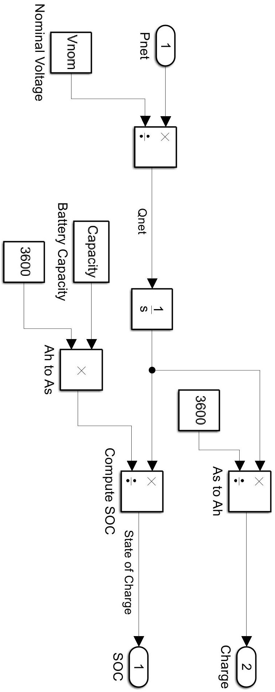


<!-- PDF_PAGE: 62 -->

## APPENDIX F: COMPLETE POWER SUBSYSTEM


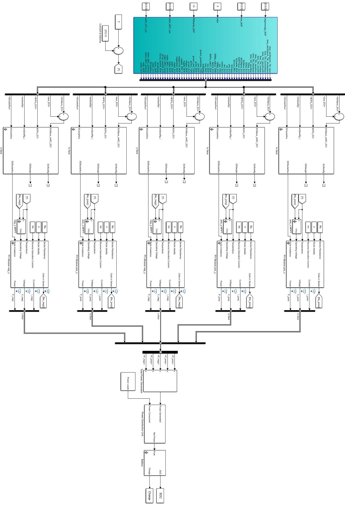

