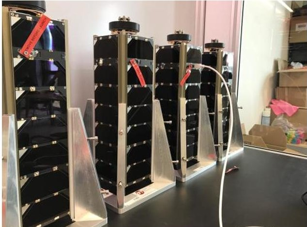
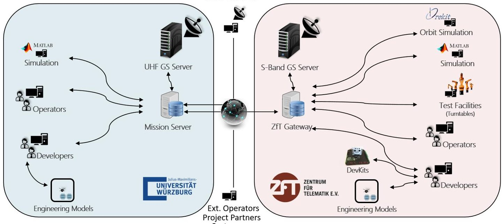
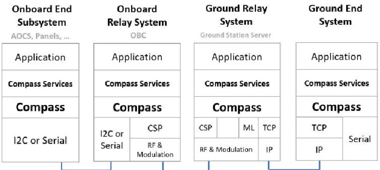
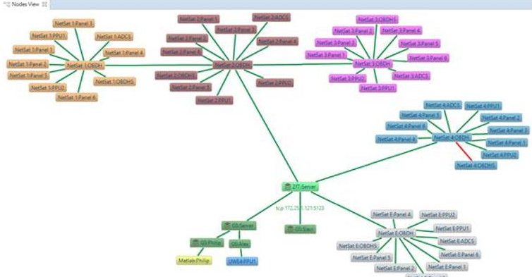
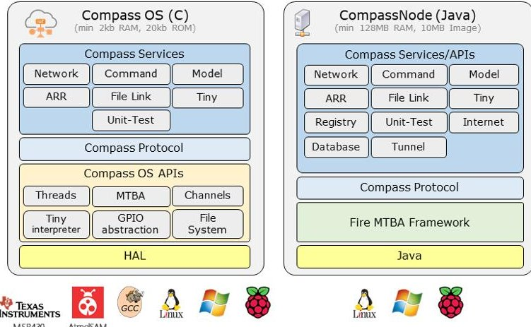
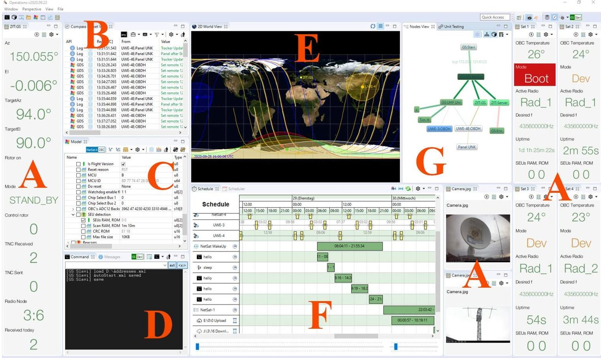
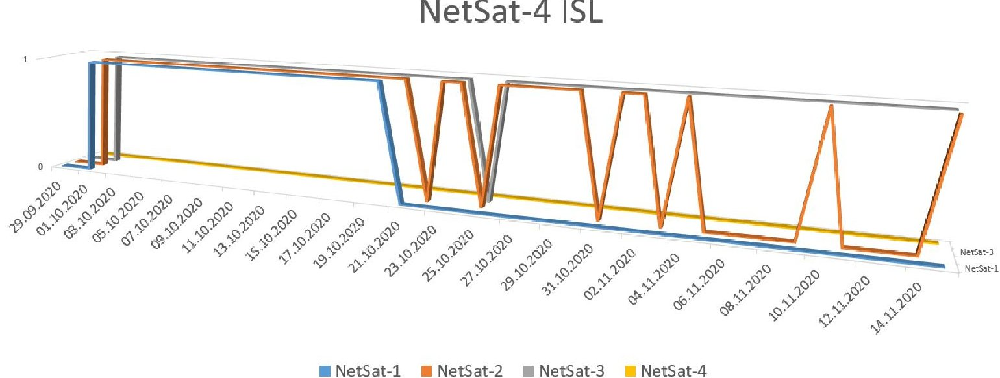
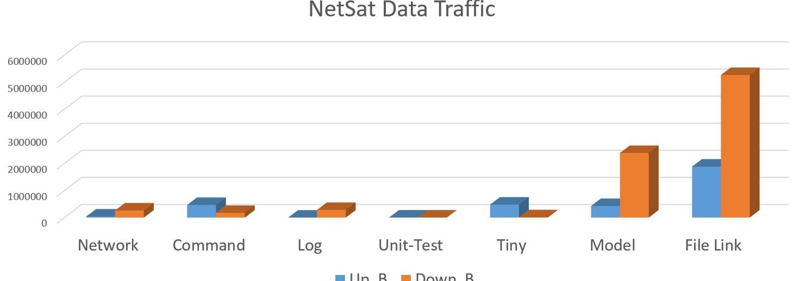
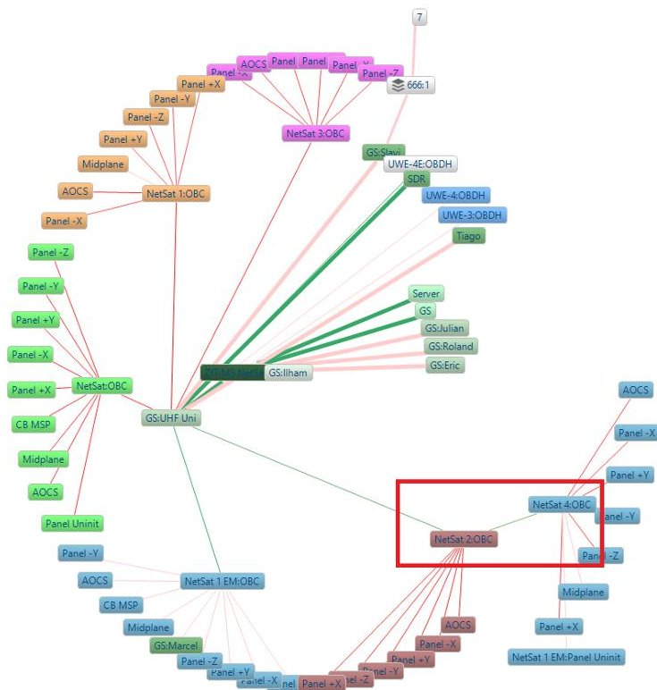

<!-- PDF_PAGE: 1 -->

IAC-21-B4.3.6

# Experience with Compass-based IoT Approach used in NetSat Formation Mission

V. Dombrovski $ ^{a\star} $ , J. Scharnagl $ ^{a} $ , Prof. K. Schilling $ ^{a,b} $

$ ^{a} $ Center for Telematics, Würzburg, Germany, veaceslavd@telematik-zentrum.de

$ ^{b} $ Chair of Robotics and Telematics, University of Würzburg, Germany

* Corresponding Author

## Abstract

NetSat is a satellite formation composed of four 3U-CubeSats. It was launched on 28.9.2020 to demonstrate in orbit IoT approaches for realizing the interconnection functionality and the accessibility of all distributed ground and space system components.

The Compass middleware, which offers inherent IoT capabilities, was used to create a dynamic decentralized virtual mission network, which was active during all mission stages: satellite development, in-house and external satellite tests, and in-orbit operations. The middleware is an implementation of the Compass network protocol and standardized Compass services, and is used as a software and protocol basis for all NetSat satellite subsystems and all ground systems, which are involved in the mission: ground stations, mission control, formation control simulators and high precision test equipment. The Compass network does not follow the classic server-client approach instead, all systems are uniformly accessible as autonomous nodes and offer their entire functionality via standardized services. The design of Compass services was inspired by several existing protocols and standards, such as CCSDS PUS and MO services, CCSDS File Delivery Protocol, and MQTT.

We will show that this approach improved the realization process, the testability and controllability of space and ground systems in the NetSat mission. An overview of prominent standardized services will be given along with the associated improvement of particular systems: commanding, file exchange, unit-tests, dynamic code execution and model service. Thereafter, it will be explained how model service was used to uniformly represent the system's model: states, parameters, sensor and control values and how it enabled model-based M2M communication between Compass network nodes, which became the major contingent of the entire mission traffic. We will show that the entirety of distributed system models forms a top-level digital twin of the entire mission and how the distributed model approach can be utilized for future research and developments, such as AI based anomaly detection and cooperation between satellites from different missions.

Keywords: multi-satellite operations, IoT, compass protocol, ISL, auto operations, autonomy

## 1. Introduction

Center for Telematics is cooperating with Chair 7 of the University of Wurzburg in the field of CubeSat missions. The University has already launched four 1U UWE satellites, whereat every UWE was an upgraded version of its predecessor [1]. The latest UWE-4 CubeSat was launched in 2018 to demonstrate orbit control capabilities with four NanoFEEP thrusters [2][3]. The so gained knowledge should support ZfT's first CubeSat formation mission, which eventually was launched in 2020.

NetSat [4][5], developed at the Center for Telematics (ZfT), is set to demonstrate in-orbit the autonomous control of a formation of four 3U CubeSats. The aim of NetSat mission is to develop methods and technologies for cubesat formations, such as distributed control approaches, inter-satellite communication and on-board autonomy [6].

Fig. 1 Four NetSat 3U CubeSats ready for launch.

This contribution is a summary of the main author's dissertation [7], which introduces ZfT's solution to the problem of monitor and control both ground and space segment systems as well as operation approaches that evolve from the IoT capabilities of the Compass protocol and services. We start with an overview of all

<!-- PDF_PAGE: 2 -->

Fig. 2 Overview of the ground segment systems used in the NetSat Mission. Left and right: ground systems located at the University of Wurzburg and ZfT respectively. Source: [7]

ground and space systems that were relevant for the NetSat mission during all mission phases. We introduce then our approaches to unify the functional interfaces and communication protocols for all mentioned systems which eventually became uniform nodes in a dynamic mission network. Thereafter it will be shown how the Model service has enabled model-based communication, straightforward design of cooperative tasks and uniform monitor and control of all systems within the network. Eventually results and experience gained during the inorbit phase will be presented.

## 2. Systems in the NetSat mission

NetSat mission is realized by numerous systems, which are located either in the space or in the ground segment. The space segment consists of four 3U CubeSats, whereat each satellite is composed of nine programmable subsystems: redundant on-board controller (OBC), redundant attitude and orbit control system (AOCS), five active panels, three electrical power systems (EPS), high-speed computing system and thruster control system. Despite the Linux-based computing board, all subsystems are driven by very low-powered microcontrollers (OBC: 16 bit, 16kB RAM, 256kB ROM). All subsystems are individually accessible. A simplified overview of the ground segment is shown in Fig. 2:

- Numerous workstations used by software developers, satellite operators, ground support, test engineers and simulation conductors

- ZfT's test facilities, such as two high precision motion simulators (turntables)

- (Orbit) simulation instances

- Flat-Sats and (partially equipped) satellite engineering models

- Two ground stations (2x UHF and S-Band)

- Gateway servers

- Mission server (UWE-4, NetSat)

- Interfaces for external ground stations (e.g. SatNogs) [8], operators, project partners and customers

One of the major tasks during the NetSat mission was to develop a common protocol stack, which allows all ground and space systems to communicate and cooperate with each other irrespective of their computational capabilities and communication link properties.

## 3. Unification of ground and space segment

During the transition from single-satellite projects towards our first multi-satellite mission we had to find a way for small development teams to successfully achieve mission goals with continuously growing complexity in practically all areas. Despite being "just" a CubeSat mission, there are still numerous responsibilities, which have to be fulfilled by experts: satellite software development, ground station control, simulations, conducting system tests, satellite operations, etc. These tasks are obviously supported by numerous hardware systems, which in turn are driven by different software solutions that are designed for specific tasks.

Another finding is that satellite operations are not performed for the first time after launch instead the satellites are operated during all development stages: inhouse testing [9][13], external facilities testing, in-the-loop-simulations, verification phase, calibration, etc. Therefore a new system and mission design philosophy had to be elaborated in order to keep up with the complexity.

<!-- PDF_PAGE: 3 -->

## 3.1. Model Tree Based Approach (MTBA)

The aim of the Model Tree Based Approach is to unify the way how software-driven functionality of a system is designed and offered. The functionality is represented by the system's Model Tree: functions, states, variables and other key-value entities. The model is accessed via the Model service. Most monitoring and controlling tasks are achieved by accessing and modifying the model values of the target system. That is, an operator follows the same philosophy and can use same front-end tools to control any desired ground and space system (see examples in the Fig. 3). Also cooperating tasks can be achieved by mutual model values modifications (model-based communication).

<table class="table table-bordered"><thead><tr><th>Name</th><th>Value</th><th>Type</th></tr></thead><tbody><tr><td>Compass</td><td></td><td></td></tr><tr><td>Sat</td><td></td><td></td></tr><tr><td>SAT current</td><td>UWE-4</td><td>char[5]</td></tr><tr><td>UWE-4</td><td></td><td></td></tr><tr><td>NetSat</td><td></td><td></td></tr><tr><td>NetSat-1</td><td></td><td></td></tr><tr><td>TLE</td><td>1 46506U 20068...</td><td>char[140]</td></tr><tr><td>Uplink Strength</td><td>100%</td><td>s32</td></tr><tr><td>NORAD ID</td><td>46506</td><td>s32</td></tr><tr><td>Priority (0=min)</td><td>8</td><td>s32</td></tr><tr><td>Protocol</td><td>AX25_CRC32_C...</td><td>char[22]</td></tr><tr><td>NetSat-2</td><td></td><td></td></tr><tr><td>NetSat-3</td><td></td><td></td></tr><tr><td>NetSat-4</td><td></td><td></td></tr><tr><td>NetSat-EM</td><td></td><td></td></tr><tr><td>Hardware</td><td></td><td></td></tr><tr><td>Antenna</td><td></td><td></td></tr><tr><td>Az</td><td>314*</td><td>s32</td></tr><tr><td>EI</td><td>0*</td><td>s32</td></tr><tr><td>Camera.jpg</td><td>/9j/4AAQSkZJR...</td><td>binary[166]</td></tr><tr><td>Beam width</td><td>21*</td><td>s32</td></tr></tbody></table>

Fig. 3 Model examples visualized in the Compass Operations front-end. Left: model of the UHF ground station. Right: model of the NetSat-3:OBC.

System's model does not only act as an interface for other systems instead it is also used by the system's software itself. All model values of a system are always in-sync with the actual software and hardware states. That is, the model approach is not only used to formalize the access to system capabilities it also acts as a software implementation pattern, which dictates how software components within a specific system communicate with each other by reading and writing corresponding local model values (model-based software design). Distributed cooperative tasks are achieved in a very similar manner with the only difference being that the corresponding components access and modify remote model values.

## 3.2. Compass protocol and services

Compass protocol unifies the communication between all space and ground systems and forms a decentralized and dynamic mission network, consisting of satellite subsystems, test equipment, ground stations mission servers, simulations, operator's workstations and further Compass-enabled devices [9]. Compass is used between the satellite's subsystems (intra satellite

link), between the satellites (ISL), for space-ground communication and between the ground nodes.

Following the MTBA approach the functionality of all systems is made uniformly accessible, hence introducing model-based communication. Every node can propagate on-demand its internal states, parameters, functions, sensor and control values as a hierarchically ordered model via the Model service. With Compass used as a carrier, all remote system models form a mission model (i.e. top-level digital twin), which represents the functionality, knowledge and current state of the entire mission.

Compass supports up to $ 2^{40} $ Nodes, offers intrinsic auto-routing and network awareness capabilities (network protocol) as well as DTN functionality. All nodes within a Compass network are self-sufficient, i.e. any Compass-enabled node can access the network without further configuration. The protocol configuration of all systems involved in the NetSat mission is shown in Fig. 4. On space systems Compass stack starts mostly at OSI layer 2 or 3 the usage of the Cubesat protocol (CSP) is unnecessary but cannot be deactivated in the Gomspace AX100 transceivers used in the NetSat platform. An example of the mission network, as visualized in the Network View of the Compass Operations front-end, is depicted in Fig. 5.

Fig. 4 Protocol Configuration in the NetSat Mission Source: [7]

Standard Compass services were implemented to enable commanding, model access and modification, file transmission, unit testing and dynamic code execution on remote systems. The protocol design was inspired by several existing protocols and standards, such as CCSDS PUS and MO services, CCSDS File Delivery Protocol and MQTT [10][11]. Most prominent services are:

- Model service

- Network service

- Log service

- Command service

- Tiny Script interpreter service

- File service

<!-- PDF_PAGE: 4 -->

Fig. 5 NetSat Compass IoT mission network showing four flight models (orange, red, pink and blue), engineering model (grey), ground station (light green) and further workstations and instances. Source: [7]

## 3.3. Compass middleware

Compass protocol core and services were implemented for ultra-low power satellite subsystems (Compass OS) and for higher-level machines (CompassNode). Compass OS requires at least: 16 bit architecture, 2 kB RAM and 10 kB ROM thus allowing every existing satellite subsystem of the NetSat mission to enter the network as a discrete node. The Java-based CompassNode aims at more powerful systems in the ground segment (or NetSat computing module), it offers more advanced functions and is used as a middleware library in other software solutions, such as MATLAB, Orekit, Operations front-end, etc.

Fig. 6 Two Compass middleware implementations: Compass OS and CompassNode. Source: [7]

Due to the hardware abstraction layer, any software based on Compass OS becomes portable, i.e. the satellite software can be compiled and executed on workstations (with activated emulation for non-existent hardware components, such as flash memory). With this functionality Model-driven development (MDE) became possible in the NetSat mission, i.e. many software components and cooperative processes were developed by following the Model $ \rightarrow $ Software $ \rightarrow $ Processor $ \rightarrow $ Hardware in-the-loop scheme [12].

## 3.4. Compass Operations front-end

Compass Operations front-end was designed to allow operators to access an existing Compass network and to monitor, control and operate all available nodes in the same way: satellites, ground stations, mission servers, test equipment and simulations. It provides numerous arrangeable views for accessing remote services for model modifications, commanding, file transmission, unit testing, script execution, etc. The integrated constraint-based operations task scheduler allows visual recording of complex satellite operations, which are automatically conducted during the overpasses. The front-end was extensively used during all phases of the UWE-4 and NetSat missions by test engineers, simulation designers, satellite software developers, ground station advisers and satellite operators. It offers standard views for all available Compass services, e.g. for file transfer, model access, command execution and to keep track of the entire compass network. Advanced views rely on the existing services (mostly on the Model service) and offer a more comfortable way to visualize and control specific model value types such as TLEs, attitude vectors, camera streams, etc.

## 4. Operation approaches used in NetSat

In NetSat our team has established a decentralized mission control system, i.e. the operations were performed with multiple distributed instances of the Compass front-end located at ZfT, University of Wurzburg and home-office. Every instance was configured individually depending on the specific operator's interests. For example, for payload operations the front-end was configured to access the satellite's model and to create schedules for long lasting auto-operation activities. In contrast to that, a person who was responsible for the ground segment used the front-end to keep track of the entire mission network, view all satellite-related traffic and supervise the healthiness of all servers.

## 4.1. Self-configuring operations front-end

Beside the desired network entry point, a Compass Operations front-end instance has initially no a priory information about any of the nodes within the network. As soon as it is connected to the network it gains information about all currently available nodes from an incoming network beacon: addresses, network shape and characteristics of all hops (max. speed, max. packet size). The operator can select a node, access its model or perform any other supported action. In the meantime the front-end gradually learns about the capabilities of all previously operated nodes and caches the knowledge for later use. The so gained model knowledge is also used by advanced views, e.g. if the remote node contains a

<!-- PDF_PAGE: 5 -->

Fig. 7 Configuration example of the Compass Operations front-end as used by the ground segment operator. A: Monitor widgets visualizing remote model values, B: Packet View, C: Model View, D: Remote Console, E: World View, F: Schedule View, G: Network View. Source: [7]

"Location" model value with three floats, it is considered as LLA location parameter and is automatically visualized in the World View.

## 4.2. High-level digital twin of the mission

The model-caching technique is not only active in the front-end, instead it is enabled on all CompassNodebased instances, such as server and front-end instances, simulations, etc. Since it can also learn from forwarded packets and the entire mission traffic passes the mission server, it automatically gains the most recent knowledge about all space and ground systems. Mission servers additionally store the entire Compass traffic, thus allowing the operators to reconstruct the entire mission model knowledge at any given time in the past.

## 4.3. Remote testability

Besides the verification tests performed at ZfT, NetSat EM and flight models were also tested at external facilities: temperature regulated vacuum chamber tests, acceptance shaker test and propulsion system test. During the tests the satellites were connected with serial cables to Compass front-end instances. With Compass the test execution and outcome was dramatically enriched as compared to the pre-Compass era. The entire traffic between the satellites and the front-end nodes was continuously recorded using the build-in record function of the front-

end software. Eventually the recording could either be re-played or the auto post-process was used to generate a traffic report: summary, log file with all detected Log service entries and separate CSV files for every model element containing all value changes.

Another advancement was the ability of test conductors to additionally connect their Compass frontends via mobile phones with the ZfT's network. Due to organizational reasons (and the COVID-19 situation) not all experts were able to support the test procedure on site - but they were able to access remotely connected satellites and supervise all subsystems during the test.

## 4.4. Recording-based operations

Since all UWE and NetSat satellites are accessed during an overpass over a single half-duplex UHF ground station, the communication windows had to be utilized wisely. Therefore, the vast majority of the NetSat Operations was pre-recorded. The Operations front-end offers the ability to record any operator actions. Recorded jobs are executed as soon as the desired target node becomes accessible in the network e.g. during an overpass. All created jobs are additionally visualized in the Schedule-View, which also shows future and past satellite overpasses.

The recording takes place on the packet level, thus practically any remote operation can be pre-recorded-

<!-- PDF_PAGE: 6 -->

Fig. 8 Long-term ISL experiment from the point of view of the NetSat-4. The corresponding lines show whether there was at least one successful ISL transmission per day towards NetSat-1 (blue), NetSat-2 (orange) or NetSat 3 (gray). NetSat-1 is considered "lost" after 2020/10/21. String of pearls formation: N2-N1-N3-N4. Source: [7]

including the desired remote answer (success constraint). An example is shown in Fig. 9.

## 4.5. In-orbit experiment scheduler

Tiny scripting language was designed to support dynamic code execution in a sandbox on ultra-low power microcontrollers, thus eliminating the need to perform hazardous in-orbit software updates, which otherwise would be required to enable the execution of on-demand designed experiments [14]. Scripts can be used to read and modify local or remote model values, execute commands locally or remotely and access local file system.

Due to its very low memory requirements (1 kB), the interpreter was enabled on all NetSat subsystems and is accessed via the Tiny service. In NetSat Tiny scripts were mostly used on the always-on OBC subsystems to enable constraint-based on-board scheduler and to execute in-orbit experiments.

Tiny scripts are written in the Operations front-end and then transmitted as pre-compiled byte-code to the remote Tiny service. Uploaded scripts can both be executed once or in a loop, and can also be loaded automatically during the boot-up. The operator can also convert recorded operation jobs to Tiny scripts and upload them for later in-orbit execution, thus enabling the on-board computer to reproduce in-orbit any possible operator's action (being only limited by the maximum script size).

## 4.6. Traffic-sensitive satellite tracking

The satellite tracking algorithm was significantly improved to support formation operations and was made traffic-sensitive. The basic idea of the tracking is: if multiple satellites are in range, then the one with the highest priority is selected for tracking. In a formation,

all satellites are prioritized equally if multiple satellites with same priority are in-range then the first ascending one is selected. During the operations, the ground station server scans outgoing (ground to space) traffic and detects whether another in-range satellite with same priority as the currently tracked one is desired by the (auto-)operator and automatically switches the antenna tracking. In NetSat operation schedules were ordered manually, so that the execution was performed in the ascending order. In future our team will implement schedule optimization techniques to automatically decide the execution order.

<table class="table table-bordered"><thead><tr><th>Name</th><th>Target</th><th>Status</th><th>Info</th></tr></thead><tbody><tr><td>11-14 Nightly</td><td></td><td>0%</td><td></td></tr><tr><td>NS4</td><td>NetSat 4:OBC</td><td>0%</td><td>recording...</td></tr><tr><td>&gt; Tiny: 3B</td><td>NetSat 4:OBC</td><td>0%</td><td>DELETE #0 with file</td></tr><tr><td>&gt; Tiny: 121B</td><td>NetSat 4:OBC</td><td>0%</td><td>ADD 113b with Steps=1000 Cycle=</td></tr><tr><td>&gt; Tiny: 5B</td><td>NetSat 4:OBC</td><td>0%</td><td>SAVE #0 to A:\2\1</td></tr><tr><td>J\1\1 Download</td><td>NetSat 4:OBC</td><td>0%</td><td></td></tr><tr><td>Command: DELETE J:\1\1</td><td>NetSat 4:OBC</td><td>0%</td><td>DELETE J:\1\1</td></tr><tr><td>AnswerConstraint</td><td></td><td></td><td>answer equals 'OK'</td></tr><tr><td>&gt; NS3</td><td>NetSat 3:OBC</td><td>0%</td><td></td></tr><tr><td>&gt; NS1</td><td>NetSat 1:OBC</td><td>0%</td><td></td></tr><tr><td>&gt; NS2</td><td>NetSat 2:OBC</td><td>0%</td><td></td></tr><tr><td>&gt; Tiny: 3B</td><td>NetSat 2:OBC</td><td>0%</td><td>DELETE #0 with file</td></tr><tr><td>&gt; Tiny: 121B</td><td>NetSat 2:OBC</td><td>0%</td><td>ADD 113b with Steps=1000 Cycle=</td></tr><tr><td>&gt; Tiny: 5B</td><td>NetSat 2:OBC</td><td>0%</td><td>SAVE #0 to A:\2\1</td></tr></tbody></table>

Fig. 9 Example of recorded operation jobs

## 5. Further experience and results

The NetSat operations were started one day after the launch on 29 September 2020. At that time all satellites were very close to each other, thus the beam width of the UHF ground station antenna could enclose the entire formation. During the first operated overpass Hello command was uplinked as a broad-cast packet, which permanently turned on the downlink capabilities on all four satellites.

<!-- PDF_PAGE: 7 -->

Fig. 10 Recorded traffic of the NetSat mission with model-based communication and file transfer being the major downlink traffic. Source: [7]

## 5.1. LEOP

Initially an unnamed TLE list of all satellites from the launch event was provided. During the first week all feasible TLE combinations were tried to properly map the NORAD-IDs with the corresponding NetSat.

To improve the downlink capabilities, an additional SDR radio node was installed and connected as remote Compass-enabled radio node to the ground station server. As has been shown by Tim Horst in [15], the recorded RF traffic during the first days could be used to identify the Doppler shift of the downstream, which in turn was used to find a proper mapping between the provided TLEs and the satellites.

Two weeks after launch, the formation became wider and it became necessary for the ground station to move the antenna between the single satellites, thus increasingly baffling disordered satellite operations Since the vast majority of the operations in NetSat were performed with auto-operations capabilities of the Compass Operations front-end, all required tasks were grouped in satellite-specific jobs, i.e. during the overpass first all tasks for NetSat-1 were executed, then for NetSat-2 and so forth.

Unfortunately on 27 October 2020 the contact to NetSat-1 was lost and could not be recovered yet. Since the software on all four satellites is identical and the remaining satellites were still accessible and performed well, most probable explanation is a hardware failure.

## 5.2. In-Orbit task scheduler

During the early operations, also undesired behaviors were detected on the satellites. One solution was to perform in-orbit software updates, which in turn would require long-lasting file uplinks to all four satellites using only one half-duplex UHF ground station. Since all satellite's capabilities are controllable via its model, Tiny scripts could be designed, uploaded

and executed in the OBC's on-board interpreter at boot-up to fix the undesired behavior.

During the LEOP phase multiple scripts were designed to switch on and off multiple subsystems during several orbits and periodically create reports, such as results of the I2C bus scanning or power consumption of subsystems during specific time periods. The logs were then automatically downloaded by the auto-operator and were used to evaluate the overall system performance. It became evident that Tiny is increasingly used to execute actions that were otherwise conducted from ground.

The ability to execute dynamic code on all satellite subsystems and the code's ability to perform virtually any possible local and remote model access and modification became an essential satellite operations technology at ZfT. It allowed our team to promptly resolve observed issues and to quickly design new experiments based on new observations.

## 5.3. Cooperative tasks

In NetSat two cooperation levels were tested: within the satellite (subsystem cooperation) and between the satellites. All experiments were designed as Tiny scripts, which were running on several cooperating subsystems.

Examples of successfully performed intra-satellite cooperation: test new attitude control algorithms (OBC AOCS, Panels), earth imaging (OBC, computing board and Panels), reaction wheels test (OBC, AOCS, Panels and EPS) and GPS tests (OBC and Panels). Most of the experiments were performed using the Tiny's distributed computation capabilities, i.e. a script running on the OBC was dynamically creating scripts on other cooperating subsystems. The actual experiments were achieved using the Model service (model-based communication), e.g. AOCS setting magnetorquer actuator values located on panels by accessing corresponding panel model values.

<!-- PDF_PAGE: 8 -->

Inter-satellite cooperation tasks were created to test the quality of the ISL communication. So the satellites were broadcasting some preselected local model values, whereat the receiving satellites were storing these packets along with timestamps to local file systems. Eventually the files were downloaded by the auto-operator and post-processed to quantify the link quality.

## 5.4. ISL

NetSat has shown first ISL communication between multiple 3U platforms. Also automatic routing and forwarding within the formation and to ground could be successfully shown. The latter was observed frequently as soon as the first satellite of the formation was in sight and other satellites could be indirectly accessed. The route was settled down automatically by the Compass network solely by processing received satellite network beacons.

Fig. 11 ISL packet forwarding with only NetSat-3 being in ground station range. The UHF ground station is in the middle and all flight models are shown in the outer area of the network representation: NetSat-1 (orange), NetSat-2 (dark red), NetSat-3 (pink), NetSat-4 (bottom right, blue), NetSat broadcast (light green) and NetSat EM (bottom left, blue) and remaining nodes (servers, simulations and front-end instances).

To our surprise the ISL worked up to 1000 km distance between the communicating satellites - though becoming sporadically at that distance. Table 1 shows distances between NetSat satellites at four different dates. Successful direct communication attempts between NetSat-4 (last satellite in the string of pearls

formation) and its siblings is shown in Fig. 8. Until 2020/10/20 all satellites could successfully transmit a packet to all other formation nodes at least once per day. Depending on the formation algorithm, a packet per day may be enough for very basic autonomous formation control.

Table 1. Distances between NetSat satellites. String of pearls formation: N2-N1-N3-N4

<table border="1"><tr><td></td><td>N2-N1</td><td>N1-N3</td><td>N3-N4</td><td>N2-N4</td></tr><tr><td>2020/10/19</td><td>132km</td><td>425km</td><td>358km</td><td>914km</td></tr><tr><td>2020/10/31</td><td>200km</td><td>630km</td><td>542km</td><td>1371km</td></tr><tr><td>2020/11/08</td><td>247km</td><td>761km</td><td>664km</td><td>1668km</td></tr><tr><td>2020/11/15</td><td>294km</td><td>890km</td><td>788km</td><td>1967km</td></tr></table>

Fig. 12 Image taken by NetSat-3

## 6. Summary and future work

To date three CubeSat missions with a total of 6 satellites (almost 60 individually accessible nodes in space) were realized with Compass. Due to the modeldriven philosophy new operation concepts became possible: self-configuring Compass Operations frontend, straightforward creation of cooperative tasks and cooperation between entirely different systems. Cached models represent the knowledge of the entire mission and can be considered a high-level digital twin. Models cached on intermediate nodes can satisfy model requests without forwarding the request towards the actual destination, hence reducing ground to space traffic.

Based on the now available distributed computing capabilities, different distributed formation control mechanisms will be evaluated. Since the Tiny interpreter is permanently active in low-power mode, continuous formation control with more frequent update rates can now be established.

Since the established Compass-based system can be viewed as a mission-global middleware, many existing standards and technologies will be adopted in order to make them available in the ZfT's mission networks. So CCSDS protocols and ECSS-standardized protocols will

<!-- PDF_PAGE: 9 -->

be utilized either on top or below the Compass stack. This will be of particular importance for missions that require these standardized protocols. Such missions will still benefit from the existing dynamic mission network (routing, DTN) and uniform access to all already existing Compass-enabled nodes.

In future machine learning techniques can be used to automatically detect anomalies based on the model knowledge or even perform model-based FDIR activities.

Mentioned approaches, Compass stack, Compass OS, CompassNode and Compass Operations front-end were developed by Veaceslav Dombrovski - more details can be found in his dissertation "Software Framework to Support Operations of Nanosatellite Formations" [7].

## Acknowledgments

This work has been supported by the European Research Council (ERC) Advanced Grant NetSat under the Grant Agreement No. 320377.

## References

[1] S. Busch, P. Bangert, S. Dombrovski and K. Schilling, "UWE-3, In-Orbit Performance and Lessons Learned of a Modular and Flexible Satellite Bus for Future Picosatellite Formations", in Acta Astronautica, Volume 117, Pages 73-89, 2015

[2] A. Kramer, P. Bangert and K. Schilling, "UWE-4: First Electric Propulsion on a 1U CubeSat - InOrbit Experiments and Characterization", Aerospace 2020 Volume 7, 2020

[3] D. Bock, A. Kramer, P. Bangert, K. Schilling, and M. Tajmar, "NanoFEEP on UWE Platform - Formation Flying of CubeSats using Miniaturized Field Emission Electric Propulsion Thrusters," in Joint Conference of 30th International Symposium on Space Technology and Science, 34th International Electric Propulsion Conference and 6th Nano-satellite Symposium, Hyogo-Kobe, Japan, 2015.

[4] R. Haber, J. Scharnagl and K. Schilling, ,NetSat A Formation of Four 3U-Satellites Using Electric Propulsion“, in $ 71^{\mathrm{st}} $ International Astronautical Congress, 2020

[5] K. Schilling, P. Bangert, S. Busch, S. Dombrovski, A. Freimann, A. Kramer, T. Nogueira, D. Ris, J. Scharnagl, and T. Tzschichholz, ,NetSat: A Four Pico/Nano-Satellite Mission for Demonstration of

Autonomous Formation Flying," in 66th International Astronautical Congress, Jerusalem, Israel, 2015

[6] T. Nogueira, S. Dombrovski, S. Busch, A. Gasparyan and K. Schilling, "Monitoring and Control of the NetSat Formations: Concepts and Tools for Operations of Multi-satellite Systems", in $ 68^{\mathrm{th}} $ International Astronautical Congress, Adelaide, Australia, 2017

[7] S. Dombrovski, "Software Framework to Support Operations of Nanosatellite Formations", PhD, University of Würzburg, 2021

[8] S. Dombrovski, "Simple Downlink Share Convention", publicly accessible standard, University of Würzburg, 2015

[9] S. Dombrovski, O. Ruf, K. Schilling, "Uniform, Multi-Level Protocol for Ground and Space Segment Operations and Testing", 4S Symposium, Sorrento, Italy, 2018

[10] National Aeronautics and Space Administration, "Overview of Space Communication Protocols", in Green Book. Washington, DC, USA, CCSDS Secretariat, 2014

[11] National Aeronautics and Space Administration. "CCSDS FILE DELIVERY PROTOCOL (CFDP)”, in Blue Book, Issue 4. Washington, DC, USA, CCSDS Secretariat, 2020

[12] P. Waeltermann, "Hardware-in-the-Loop: The Technology for Testing Electronic Controls in Vehicle Engineering", Paderborn, Germany, dSpace GmbH, 2016

[13] O. Ruf, S. Busch, S. Dombrovski and K. Schilling, "Challenges and Novel Approaches for Testing Large Number of Small Satellites", in $ 68^{\mathrm{th}} $ International Astronautical Congress, Adelaide, Australia, 2017

[14] S. Dombrovski and P. Bangert. "Introduction of a new sandbox interpreter approach for advanced satellite operations and safe on-board code execution". In $ 6 6^{\mathrm{th}} $ International Astronautical Congress, Jerusalem, Israel, 2015

[15] T. Horst, A. Kleinschrodt, A. Freimann, E. Jaeger, S. Dombrovki, R. Haber "Extended Ground Station Concept and its Impact on the In-Orbit Communication with the Four-Nano-Satellite Formation NetSat", IEEE Radio and Wireless Week, 2021