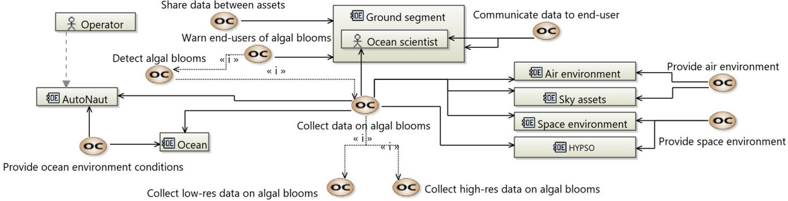
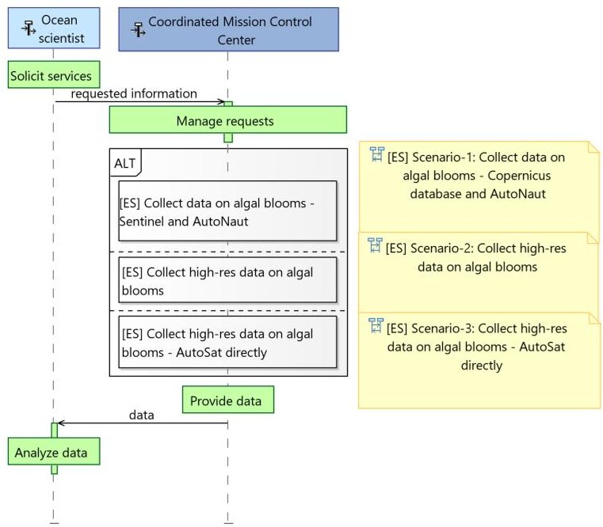
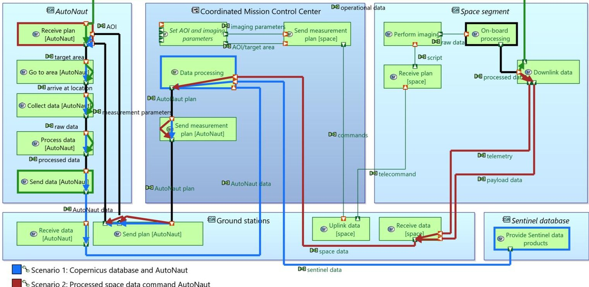
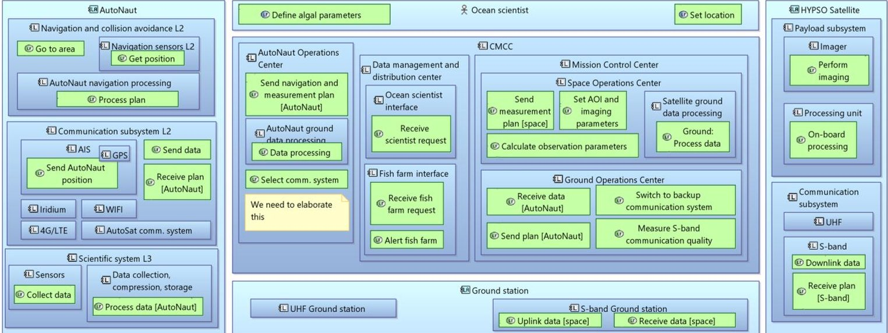

<!-- PDF_PAGE: 1 -->

# MBSE modeling of a SoS with a small satellite and autonomous surface vessels for persistent coastal monitoring

$ 1^{\mathrm{st}} $ Evelyn Honoré-Livermore Norwegian University of Science and Technology Trondheim, Norway evelyn.livermore@ntnu.no

$ 2^{\mathrm{nd}} $ Alberto Dallolio Norwegian University of Science and Technology Trondheim, Norway alberto.dallolio@ntnu.no

$ 3^{\mathrm{rd}} $ Roger Birkeland Norwegian University of Science and Technology Trondheim, Norway roger.birkeland@ntnu.no

4th Dennis D. Langer Norwegian University of Science and Technology Trondheim, Norway dennis.d.langer@ntnu.no

$ 5^{\mathrm{th}} $ Cecilia Haskins

Norwegian University of Science and Technology Trondheim, Norway cecilia.haskins@ntnu.no

$ 6^{\mathrm{th}} $ Tor Arne Johansen

Norwegian University of Science and Technology Trondheim, Norway tor.arne.johansen@ntnu.no

Abstract-Oceanographic phenomena can be monitored using both remote sensing and in-situ measurements. However, it is challenging to gain actionable insight by just utilizing one source. Combining these data sources in near real-time enables high temporal, spectral and spatial resolution of phenomena in target areas. In this article, we use Model-Based Systems Engineering to model and highlight missing functions or new capabilities needed within an acknowledged System-of-Systems that can support the monitoring of oceanographic phenomena in coastal regions. Different system architectures and a logical architecture have been modeled to provide new insights for developers through reinforcement of a common mental model as well as technical considerations.

Index Terms—systems engineering, system-of-systems, autonomous surface vessels, satellite, remote sensing

## I. MOTIVATION AND BACKGROUND

Monitoring coastal areas and the ocean is necessary to understand the environmental change trends, such as warming of the planet, loss of sea-ice and migrating animal habitats. Human activity is already exploiting and affecting the coastal regions through kelp harvesting, fish farming, offshore oil drilling, shipping, and inadvertently through on-shore operations that influence the ecosystem and atmosphere. There is a need to understand oceanographic phenomena better to allow decision-makers to opt for sustainable choices in the management of the coastal regions. The observation and study of oceanographic phenomena is challenging for several reasons. The regions to be monitored are vast and cannot be monitored with a single class of assets. Moreover, atmospheric and oceanographic phenomena are in continuous fluctuation.

Water obscures visibility of sea-mammals, fish and microscopic phytoplankton and no single parameter provides the information many scientists or commercial institutions need.

In this paper we present a System of Systems (SoS) consisting of multiple space and ground assets for monitoring coastal regions for detection of harmful algal blooms. The SoS combines existing assets with new technologies and systems, which results in integration challenges [1], [2]. The management of SoS is more challenging than that of individual systems, especially considering the establishment of unified requirements and capabilities, testing and validation, and the modeling and understanding of emergent behavior of the SoS [3]. We explore how Model-Based Systems Engineering (MBSE) using the Arcadia method [4] can support the design and integration process of an SoS through modeling different system architectures and scenarios, developing logical architectures and discussion points. We address the following research questions:

## "How can MBSE support the development of an SoS

The research reported here is a part of a larger effort at the Norwegian University of Science and Technology (NTNU) to develop and integrate an SoS for consistent monitoring of the oceans using a concert of autonomous agents [5].

## A. System-of-Systems for Monitoring Coastal Regions

The system-of-interest consists of multiple Constituent System (CS) such as a ground segment, a space segment and an in-situ segment to satisfy the needs of the stakeholders, requiring an SoS approach to structure the analysis. Managing an SoS is not as straight-forward as managing an individual system, which may already be complex in itself because the

<!-- PDF_PAGE: 2 -->

SoS involves multiple organizations with different objectives for each of their CS. Using the SoS viewpoint has been applied in other studies for autonomous vehicles [6] -[8]. The SoS viewpoint can aid understanding the emergent behavior the SoS may exhibit depending on the CS and their relationships, especially if the CS choose to "leave" the SoS. Classification of the SoS can be based on the aspect of management, and how it was developed [2], [9]. The types are: (1) Virtual, (2) Collaborative, (3) Acknowledged, and (4) Directed. We classify this SoS as an acknowledged SoS, in which the CS "has recognized objectives, a designated manager, and resources (...] [and] changes in the system are based on collaboration between the SoS and the system" [2, p. 6].

The process of decision-making for the design and development of a SoS is more complicated than with a single system. Establishing reliable trade-off models requires insight into the different CS and how their parameters affect the overall achievement of SoS objectives. ISO-21839 outlines different considerations to be made for the life-stages of an SoS; concept, development, production, utilization, retirement, and support [10]. For this paper, we focus on the concept phase, exploring viable options and proposing solutions. The specific considerations made are: (1) capability, (2) technical, and (3) management. The proposed CS have constraints, and there are interfaces that should be identified and negotiated early to facilitate adjustment of, or development of, new interfaces and capabilities needed to satisfy the user needs.

## B. Monitoring Oceanographic Phenomena in Coastal Regions

In a previous paper we described the high-level design of the SoS and the needs of the stakeholders [11]. Satellite remote sensing has a proven track-record for observing oceanographic phenomena, and most ocean monitoring programs employ either expensive monolithic spacecraft (e.g. the Copernicus program) [12], or data collected via ship-based observations [13]. However, this picture is changing with the advent of small satellites and autonomous vessels. Autonomous systems provide an opportunity for missions in remote or harsh locations, which were previously explored by manned assets [14]. Recent advances in small satellite technology and availability of reliable and efficient Commercial-Off-The-Shelf (COTS) components have enabled faster and cheaper development cycles of science-driven small satellite missions [15].

With the primary focus on monitoring of ocean color, NTNU designed and developed the 6U CubeSat HyperSpectral SmallSat for Ocean Observation (HYPSO) [5]. HYPSO is equipped with a Hyper-Spectral (HS) imaging and processing payload that can deliver specialized data products in real time covering a selected geographic region. HS imaging allows for detection and classification of chemical substances based on the reflected spectra. The HS data provided by space assets complemented by geo-physical parameters collected by ground assets, enable marine biologists to study the primary productivity (i.e. plankton and microalgae) of the ocean surface layer as described in [16]. Moreover, the onboard processing payload includes routines for updating software in

flight, meaning that new capabilities can be implemented as they are needed, providing flexibility suitable for inclusion in an SoS.

In this paper, we have analyzed the use-case of "Ondemand high resolution monitoring of algal blooms" using an Autonomous Surface Vessel (ASV), the NTNU AutoNaut [17], [18], and HYPSO. The commercially available, waveand solar-powered AutoNaut is equipped with a scientific sensor suite and can operate autonomously in both coastal regions and open ocean. The sensors sample upper water column properties, such as ocean currents, water conductivity, temperature, salinity, oxygen saturation, chlorophyll, organic matter, as well as atmospheric parameters.

For the purpose of this work, we define high resolution ondemand monitoring as:

- High temporal resolution: revisit times less than 3 hours because the algal blooms are dynamic and can move and change characteristics quickly [5], [19].

- High spectral resolution: more than 20 spectral bands in the visual spectrum are required to identify different phytoplankton and other colorizing phenomena [20], [21].

- Upper water column sampling of multiple characteristics such as sea surface temperature, salinity, oxygen concentration, chlorophyll concentration, wave height and weather conditions [20].

## II. MODELING A SYSTEM-OF-SYSTEMS

Modeling complicated systems to gain pertinent knowledge for design and decision-making can be done with different methods and tools in the various life-stages of the SoS [22]. Firstly, modeling capabilities and objectives of the SoS, as well as different concepts of operations are required to determine the SoS architecture options via a top-down modeling approach. Secondly, modeling is needed for each of the CS to determine and define the interfaces and how the CS satisfy the objectives of the SoS. Thirdly, the modeling should support simulation of or prediction of emergent behavior, to lower the probability of undesired effects. Lastly, modeling for testing and validation of the SoS should ensure the traceability from the top-level objectives to the lower-level requirements and functional elements of the CS.

The process of exploring the solutions in this paper have been supported by the use of Capella 1.4.1 $ ^{1} $ with the Arcadia method. This has facilitated discussions in the project development team in addition to providing specific functional scenarios and functional chains. The Arcadia method looks at Operational analysis in which stakeholder needs, the environment, actors and activities are defined; System analysis in which the boundary and context of the system are defined, and behavior modeling of what the system must accomplish; Logical architecture in which the system is seen as a white box and functions are allocated to different logical components in order to fulfill the expectations; Physical architecture in which the physical architecture describes how the system will

<!-- PDF_PAGE: 3 -->

Fig. 1. Operational capabilities. OC = Operational Capabilities. $ < < i > > $ means an included capability. Dashed line = communication link. Solid line = involved operational elements.

be built; and, Product breakdown structure defining physical components or configuration items that are in the system in its realization.

The use of MBSE has gained strong adoption the last decades, supported by the establishment of SysML and the development of software tools that support MBSE. Using MBSE reduces some of the challenges with document-based systems engineering, by allowing different viewpoints to show relevant information of the same system without needing to continuously update and trace documents [23], [24]. For this study, we have used the diagrams and artifacts available in the three high-level viewpoints in Capella. The Arcadia method does not specify which level to start with, and Capella allows for semantic referencing between elements at each level. This enables iteration and designing with agility at both system and logical level as we learn more about the systems, user needs, and constraints.

A challenge that emerges when using conventional MBSE for modeling SoS is related to the choice of the "system-of-interest", since there are multiple CS which are all system-of-interests at the same time but to different stakeholders. Furthermore, the architecture can quickly become complicated, and modeling should allow for "sufficient requisite variety, parsimony and harmony [25, Table 2]."

## III. RESULTS AND DISCUSSION

The purpose of the modeling efforts was to map out the capabilities required to meet the use-case needs, describe the technical considerations such as interface design, sensor limitations or communication constraints, and identify management considerations. All diagrams shown are from Capella, and are representations of the system model that has been developed using the Arcadia method.

## A. Operational analysis

The operational analysis identified the actors and entities involved, i.e. operators, scientists, space environment and ocean environment, with associated operational capabilities (OC) as shown in Fig. 1. The central operational capability, "OC: Collect data on algal blooms" includes other capabilities such as "OC: Detect algal blooms", and is also split into collecting

both high and low resolution (spectral and temporal) data on algal blooms. Low resolution data could increase the coverage area or reduce the size and speed of the data link required by the asset collecting data. This separation is to show that the system design may differ for each of the capabilities, and that the detection of algal blooms is a capability that will be offered in the future because it is dependent on more functions and parameters.

Next, operational activities (OA) were identified and placed in an operational context with the entities and actors. For example, the ocean will act as both an environment and a data source, and the AutoNaut needs to be "OA: Protected against ocean environment" to survive in addition to collecting samples. Not all activities, actors or entities identified in the operational analysis phase need to be transitioned to "lower level" analysis, as some may be provided by a COTS provider, or identified later in the development life cycle. While the specific requirements had not been derived at this stage, it was possible to model the OA of the Actor Ocean Scientist by keeping the description at a higher abstraction level, e.g. "OA: Ask for data in specific area". The system model can be continuously refined, and having the requirements before the modeling starts is not necessary. Similarly for the data format or details of exchanged information.

## B. System analysis

The system analysis in Capella resulted in three exchange scenarios which would guide the rest of the domain-specific analyses (e.g. coverage area and communication analyses) and would then feed back to the system design. The three scenarios were: Scenario 1: using existing satellite databases to provide the AutoNaut with instructions on where to perform in-situ measurements; Scenario 2: using processed data received through the HYPSO ground segment to inform where the AutoNaut should measure; and (3), a special case where HYPSO could communicate directly with AutoNaut using a dedicated communication interface, nicknamed AutoSat. There is a "master exchange scenario" diagram to show which ones can be chosen to provide the end user with required information, Fig. 2.

<!-- PDF_PAGE: 4 -->

Fig. 2. Modeling choice between scenarios. The yellow sticky-notes are links in the Capella software.

The different system functions involved are also represented by functional chains in the system architecture blank diagram in Fig. 3. The functional chains can later be broken down and can aid verification and validation activities of the SoS, by highlighting what the developers should be testing to ensure that the scenarios can be fulfilled.

## C. Logical analysis

The logical analysis was mainly used to map the functions to different logical components, such as the AutoNaut processing system or the ground processing system. From the system needs analysis, a logical architecture blank diagram was developed with the required logical functions needed to fulfil the system functions. There is model consistency through automated transitions of actors and functions, and allocations of these are shown in Fig. 4.

The Ocean scientist actor functions include "Define algal parameters" and "Set location", which are the critical functions needed to manage the assets. However, we can expect that the Ocean scientist actor will have more functions, but these are not relevant for the current discussion. The choice of which elements to display in a diagram at any time without losing information in the system model can greatly help discussion by managing the requisite variety, parsimony and harmony.

## D. Insight provided by modeling

The capabilities needed were mapped out in the operational analysis, which can be further elaborated with e.g. "Operational Activity Interaction" diagrams. Use-case diagrams, such as in SysML, could also have been used to identify needed capabilities. The capabilities and operational activities may be further allocated to functions that can be verified, and associated requirements. The system model maintains the semantic relationships between operational needs, activities, system functions, logical functions, etc., which could be more

complicated to express and maintain consistency of across documents. The system model gives the system context and scenarios, which, when supplemented by textual requirements gives a holistic and rich picture of the state of the system [4].

Technical considerations were discussed in both the system level analysis and in the logical level analysis. We found that the exchange of information could happen in three different scenarios. Elaboration of exchange scenarios also identified missing system functions and the need for better coordination of CS development efforts. This coordination entailed agreement on the data to be exchanged, documentation of the technical specification for the communication system, and analysis of the impact of the interface on the collective data budget for the SoS. The discussions leading up to the (relatively) simple logical architecture identified the need to develop a function that could choose the communication system which determines which of the scenarios would be selected. Furthermore, a "Coordinated Mission Control Center" was identified as a required logical component, to coordinate the different CS involved and their capabilities to fulfill the needs of the end-users.

Critical management considerations were not uncovered during the modeling process. This may be because the CS are under the same operational management (in the case of HYPSO and the AutoNaut), or because they are provided as a service (such as ground segment and Copernicus data), or that this system model and MBSE approach do not incorporate these aspects well enough to give insight. However, there is an important managerial consideration to be made when it comes to willingness-to-pay for a potential "Harmful Algal Bloom Watch" service not yet shown or allocated. The AutoNaut makes use of commercial communication services such as Iridium, and the satellite needs a ground segment that can support both large and small data volumes, which may be costly. For research institutes, the specific requirements and end-users may not be actively involved in the SoS development, but represented by reviewing research in the specific field of interest. In this context, the MBSE approach with high-level needs represented by operational activity and capability elements allows the researchers developing the CS and SoS to be aware of the existence of needs, and to account for them until they evolve to specific requirements.

## E. Lessons learned and future modeling

We chose to use the Capella tool because it is open source, supports integration with GitHub, has a very active user group on forums, and multiple webinars that can be used for training, lowering the barriers for usage. While the online resources can help the users get familiar with the tool, time and resources are still required to use it effectively. We found that using webinars and examples that closely resemble the system-of-interest were helpful to understand how to start the modeling effort.

Capella provides progress flags such as "to be reviewed" or "draft" that can be attached to all elements to assist the development process. The progress monitoring can be viewed

<!-- PDF_PAGE: 5 -->

Scenario 3: Operational data command AutoNaut

Fig. 3. System architecture blank with functional chains. The blue functional chain includes the system functions for Scenario 1, the red functional chain for Scenario 2, while the green for Scenario 3. The black is when more than one functional chain involves those exchanges.

Fig. 4. Logical architecture blank diagram. The exchanges are not shown because it would make the diagram messy, but are available in the system model. Sticky notes are included for highlight where more development is needed.

and exported so that the system engineers of the different CS and the SoS coordinator have visibility of the status of the development. Capella also has built-in model validation in terms of: integrity, design completeness, design coverage, and traceability. Designers can also specify their own rules than can be executed on the model.

It is challenging to train the systems engineers in SoS and MBSE [26], and to engage the CS developers in providing necessary details to build a useful system model. One reason for this is that the purpose of the modeling effort and expected insights are not clearly defined at the onset of the effort, and the CS developers do not know what information is needed

or to what level of detail. For the HYPSO and AutoNaut developers, the operational diagrams and exchange scenarios helped them understand what information was needed to give valuable insight. Moreover, what is needed to document the system model sufficiently so that it can be re-used. While SoS as a concept is not new, thinking in terms of SoS engineering instead of "just" Systems Engineering (SE) [27] supported the SoS development because the designers were using appropriate terms. For example, operational capabilities instead of specific system requirements. It is also more complicated to deliver a resilient SoS with consistent performance to the stakeholders. Future modeling should look at multi-level risk analysis and

<!-- PDF_PAGE: 6 -->

resilience, to avoid adverse effects to the SoS if one CS leaves the SoS, or is compromised by e.g. cybersecurity issues.

Furthermore, the management considerations should be explored further. This includes creating high-level plans for integration and updating of the SoS, aligning funding for implementation of necessary interfaces, synchronizing testing, and continuous risk management for development and operations. Using systemigrams [22] have been recommended for conceptualizing complexity in SoS, and can be used to complement the analysis in Capella, and can provide new insights of the interdependencies and sociotechnical aspects.

## IV. CONCLUSION

To understand our oceans we need to use a variety of sensing instruments and assets. Oceanographic phenomena present spatial and temporal scales that can vary significantly, e.g. algal blooms span over meso-scale ranges whereas primary productivity happens at microscopic scales. The employment of space-borne sensors in combination with in-situ measurements provided by ASV, allows ocean scientists to gain new insight about coastal regions and about the effects of environmental changes. However, most information is obtained by coordinated measurements and data processing, requiring an SoS approach.

In this paper we have described how Model-Based Systems Engineering can assist system developers in aligning their efforts by specifying models with the capabilities needed by stakeholders. Operational analysis, system analysis and logical analysis have provided both capability identification, important technical considerations for further integration and development of CS, but not management considerations. The modeling effort was limited to what was needed for the CS development in at the current phase. Future modeling efforts are focused on developing integration and other processes to use results from the domain-specific tools to support system trade-offs and validation and verification activities.

The authors thank the NTNU SmallSat Lab and NTNU UAV-lab for the work and cooperation in this development. E.H-L. thanks Stéphane Lecrampe (ObeoSoft Canada Inc) for modeling ideas and support.

## ACKNOWLEDGMENT

## REFERENCES

[1] J. Fuchs and N. Lindman, "Using modeling and simulation for system of systems engineering applications in the european space agency," in Modeling and Simulation Support for System of Systems Engineering Applications, L. B. Rainey and A. Tolk, Eds. New York: John Wiley and Sons, 2015, pp. 303-336.

[2] A. M. Madni and M. Sievers, "System of systems integration: Fundamental concepts, challenges and opportunities," in Advances in Systems Engineering, J. Hsu and R. Curran, Eds. Reston, VA, USA: American Institute of Aeronautics and Astronautics, 2016, vol. 252, pp. 1-34.

[3] INCOSE, "Incose Systems of Systems Primer INCOSE-TP-2018-003- 01.0," Tech. Rep., 2018.

[4] S. Bonnet, J.-L. Voirin, and J. Navas, "Augmenting requirements with models to improve the articulation between system engineering levels and optimize v&v practices," INCOSE International Symposium, vol. 29, no. 1, pp. 1018-1033, 2019.

[5] M. E. Grøtte, R. Birkeland, E. Honoré-Livermore, S. Bakken, J. L. Garrett, E. F. Prentice, F. Sigernes, J. T. Gravdal, and T. A. Johansen, "Ocean Color Hyperspectral Remote Sensing with High Resolution and Low Latency - the HYPSO-1 CubeSat Mission," IEEE Transactions on Geoscience and Remote Sensing, 2021, to be published.

[6] R. Gomes, J. Straub, A. Jones, J. Morgan, S. Tipparach, A. Sletten, K. W. Kim, D. Loegering, N. Feikema, K. Dayananda, G. Miryala, A. Gass, K. Setterstrom, J. Mischel, D. Shipman, and C. Nazzaro, "An interconnected network of UAS as a system-of-systems," in IEEE/AIAA 36th Digital Avionics Systems Conference (DASC), 2017, pp. 1-7.

[7] R. Zhang, B. Song, Y. Pei, and Q. Yun, "Improved method for subsystems performance trade-off in system-of-systems oriented design of uav swarms," Journal of Systems Engineering and Electronics, vol. 30, pp. 720-737, 2019.

[8] M. LaSorda, J. M. Borky, and R. M. Sega, "Model-based architecture and programmatic optimization for satellite system-of-systems architectures," System Engineering, vol. 21, 2018.

[9] M. W. Maier, "Architecting principles for systems-of-systems," Systems Engineering, vol. 1, no. 4, pp. 267-284, 1998.

[10] International Standards Organization 2019, "ISO21839:2019(E) systems and software engineering - System of systems (SoS) considerations in life cycle stages of a system," 2019.

[11] E. Honoré-Livermore, R. Birkeland, and C. Haskins, "Addressing the sustainable development goals with a system-of-systems for monitoring arctic coastal regions," in INCOSE International Symposium, vol. 30, 2020, pp. 604-619.

[12] M. Aguirre, B. Berruti, J.-L. Bezy, M. Drinkwater, F. Heliere, U. Klein, C. Mavrocordatos, P. Silvestrin, B. Greco, and J. Benveniste, "Sentinel-3 - the ocean and medium-resolution land mission for GMES operational services," ESA Bulletin, vol. 131, pp. 24-29, Aug 2007.

[13] S. R. Smith et al., "Ship-based contributions to global ocean, weather, and climate observing systems," Frontiers in Marine Science, vol. 6, p. 434, 2019.

[14] A. Zolich, D. Palma, K. Kansanen, K. Fjørtoft, J. Sousa, K. H. Johansson, Y. Jiang, H. Dong, and T. A. Johansen, "Survey on communication and networks for autonomous marine systems," Journal of Intelligent Robotic Systems, vol. 95, no. 3, pp. 789-813, 2019.

[15] M. N. Sweeting, "Modern small satellites-changing the economics of space," Proceedings of the IEEE, vol. 106, no. 3, pp. 343-361, 2018.

[16] IOCCG (2014), Phytoplankton Functional Types from Space, ser. Reports of the International Ocean-Colour Coordinating Group, No. 15, IOCCG, S. Sathyendranath, Ed. Dartmouth, Canada: IOCCG, 2014.

[17] A. Dallolio, B. Agdal, A. Zolich, J. A. Alfredsen, and T. A. Johansen, "Long-endurance green energy autonomous surface vehicle control architecture," in OCEANS 2019, Seattle, Washington., 2019.

[18] NTNU, "Ntnu AutoNaut documentation wiki," http://autonaut.itk.ntnu. no, Dec 2018.

[19] T. D. Dickey and R. R. Bidigare, "Interdisciplinary oceanographic observations: the wave of the future," Scientia Marina, vol. 69, pp. 23- 42, 2005.

[20] IOCCG, Why Ocean Colour? The Societal Benefits of Ocean-Colour Technology, ser. Reports of the International Ocean Colour Coordinating Group. Dartmouth, Canada: IOCCG, 2008, vol. 7.

[21] F. Ortenberg, Hyperspectral Sensor Characteristics. Hyperspectral Remote Sensing of Vegetation, 10 2011, pp. 39-68.

[22] B. Sauser and J. Boardman, "Systemigram modeling for contextualizing complexity in system of systems," in Modeling and Simulation Support for System of Systems Engineering Applications, L. B. R. Tolk and Andreas, Eds. John Wiley and Sons, 2015.

[23] T. Huldt and I. Stenius, "State-of-practice survey of model-based systems engineering," Systems Engineering, vol. 22, no. 2, pp. 134-145, 2019.

[24] K. Henderson and A. Salado, "Value and benefits of model-based systems engineering (MBSE): Evidence from the literature," Systems Engineering, pp. 1-16, 2020.

[25] J. Ring and A. M. Madni, "Key challenges and opportunities in 'system of systems' engineering," in 2005 IEEE International Conference on Systems, Man and Cybernetics, vol. 1, 2005, pp. 973-978.

[26] J. Holt, S. Perry, R. Payne, J. Bryans, S. Hallerstede, and F. O. Hansen, "A model-based approach for requirements engineering for systems of systems," IEEE Systems Journal, vol. 9, no. 1, pp. 252-262, 2015.

[27] J. Dahmann, G. Rebovich, J. Lane, R. Lowry, and K. Baldwin, "An implementers' view of systems engineering for systems of systems," in 2011 IEEE International Systems Conference, 2011, pp. 212-217.