<!-- PDF_PAGE: 1 -->

IAC-21,D1,4B,1,x64040

# MODEL-BASED SYSTEMS ENGINEERING (MBSE)—WHAT GOOD IS IT? LESSONS LEARNED FROM SMALL SATELLITE PROJECTS

Dr. Jerry Sellers Teaching Science and Technology Inc, USA, jsellers@tsti.net

Vicky Anderson, John Paffett KISPE Space, United Kingdom, vanderson@kispe.co.uk, jpaffett@kispe.co.uk,

Prof. Paul Grogan, Dr. Brian Chell Systems Engineering Research Center, USA, pgrogan@stevens.edu, bchell@stevens.edu

Amanda Winters, Elad Dermer Infinite Outcomes Inc., USA, amanda@infiniteoutcomesinc.com, edermer@tsti.net

Model-based systems engineering (MBSE) is at the cutting edge of systems engineering. MBSE provides a unique means to capture, connect and communicate the various architectures that comprise complex systems. The paper begins with an overview of MBSE, what it is, and what it isn't. The paper then goes to highlight the key advantages of MBSE over traditional, paper-based methods of systems engineering. Recent specific cases studies for the application of MBSE are then highlighted beginning with a desk-top educational cubesat system—EssentialSAT. Details of its design, implementation, and verification operations model are highlighted. Further examples focus on MBSE applications to various on-going small satellite projects highlighting the challenges of application across a diverse set of stakeholders. The paper concludes with a summary of lessons learned and guidelines for other organizations looking to apply MBSE to their satellite projects.

## I. INTRODUCTION

Model-based systems engineering (MBSE) is rapidly gaining ground as the state-of-the-art approach for managing the Authoritative Source of Truth as part of an overall digital engineering approach the design, development, test and operations of complex systems. However, a recent NASA study conducted by Harlan Brown & Company, Inc. that reviewed 50 reports from over 56 sources found that overall MBSE adoption is still in its infancy as shown in Figure 1. Among the impediments to adoption the study found were cultural issues, tooling issues, workforce issues, and communicating value as shown in Figure 2. This paper will focus on the last issue—communicating value, by examining the recent application of MBSE in three separate projects. The paper will begin with some basic background on MBSE, examining its value proposition. The discussion will then shift to lessons learnt from the following diverse space projects:

- Open Source Satellite: a small satellite platform promoting open satellite architectures

- EssentialSAT: a desktop educational cubesat

- New Observation Strategies Testbed (NOS-T): a software testbed designed to investigate remote sensing architectures

A brief background on each project will be offered followed by specific examples of MBSE applications used along with direct experience on the value realized. The paper concludes with overall suggestions for best practices in adopting MBSE in future space projects.

<!-- PDF_PAGE: 2 -->

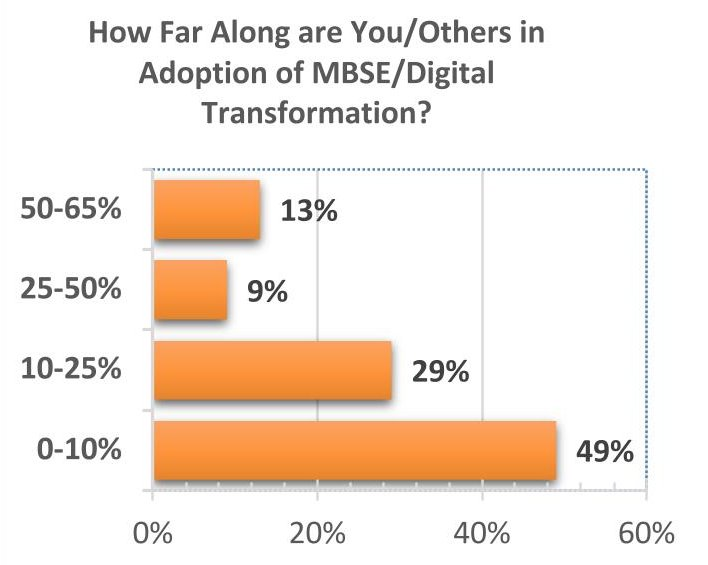

Figure 1: Results of NASA study conducted by Harlan Brown & Company, Inc. showing adoption rates for MBSE [1]

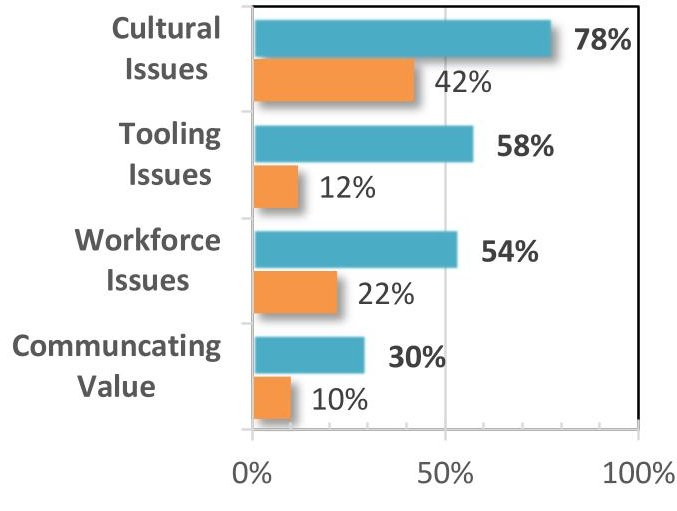

Across All 50 Sources #1 Challenge Mentions

Figure 2: Results of NASA study conducted by Harlan Brown & Company, Inc. showing Impediments to adoption of MBSE within organizations [1]

## II. BACKGROUND

The text Applied Space Systems Engineering defines MBSE as "the art and science of applying softwarebased tools to capture systems engineering evidence in a systematic, disciplined way, to connect system relationships, control system configuration and communicate a common system site picture in the form of an integrated model to all stakeholders throughout the lifecycle." [2] This definition highlights six attributes that make up the value proposition for MBSE as shown in Figure 3.

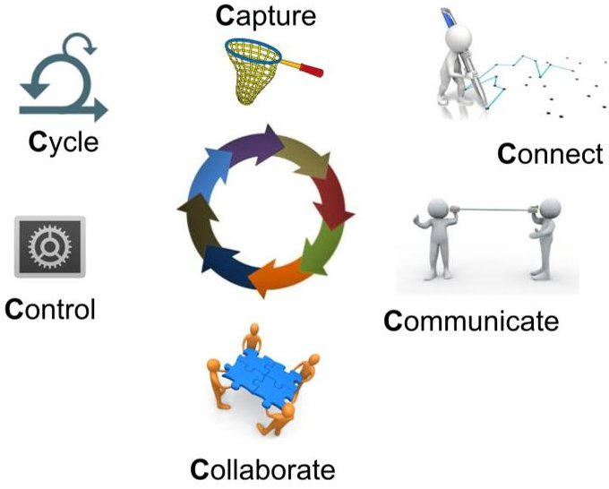

Figure 3: MBSE six-c's [2]

Software-based MBSE tools are built upon databases that employ a schema. The schema stores data in tables that contain records. Records then contain fields. The taxonomy and types of data along with their relationships are based on an ontology. The ontology defines different data types or classes and their relationship to each other. For example, one could imagine two classes of data—people and addresses with the relationship "live at," i.e. people live at addresses. We could then imagine instances of those classes such that Bob lives at 15 Elm St. This is known as an ontological "triple." These ontologies are then instantiated using modeling languages. For example, requirements are an important data type in systems engineering, as is the system physical architecture that comprises the system. Within a modeling language such as the Lifecycle Modeling Language (LML) [3] requirements are called "requirements" and system physical architecture elements are called "assets." In the System Modeling Language (SysML), the system physical architecture elements are called "blocks." [4] In both languages, requirements are related to physical architecture elements via the "satisfied by" relationship. "Requirement A is satisfied by Asset B" is an example of an ontological "triple."

These relationships can then be extended through additional classes of elements and relationships to create very complex descriptions of system structure behavior, cost, risk, parametrics, requirements verification and validation (V&V) and ultimately any type of information needed for systems engineering and even project management. This web of connections reflects the underlying complexity of system functional and physical interfaces as well as other important relationships. Most important when it

<!-- PDF_PAGE: 3 -->

comes to effective communication, these complex relationships can be described using a variety of diagrams. SysML is limited to only nine diagram types. In contrast, LML has no restrictions on possible diagram types.

With system data captured in an MBSE tool, connected using ontologies defined by various modeling languages, and communicated using diagrams, systems engineers have an extremely powerful capability for understanding and communicating complex systems. In the next section, this paper will examine how this capability has been leveraged to benefit three different space projects.

## III. CASE STUDIES

This section will examine three recent space-related projects to highlight how MBSE was employed during various stages of the lifecycle and associated lessons learnt. First off will be EssentialSAT, a desktop cubesat used to teach fundamentals of space systems engineering. Next will be OSSAT or "Open Source Satellite," a project aimed at defining and promoting open-source satellite architectures. Finally, the New Observing Strategies Testbed (NOS-T) will be described, a purely software-based system used to investigate remote sensing mission architectures.

## EssentialSAT

The first case study to be examined is EssentialSAT, a desktop cubesat developed exclusively for classroom use. A brief background on the EsssentialSAT project will first be presented, followed by a summary of MBSE applications for the system and lessons learnt.

## EssentialSAT background

Beginning in 2003, the USAF Academy (USAFA) began development of a series of desktop classroom satellites called EyasSAT. Over the last two decades, the EyasSAT system has evolved through several model iterations. The latest version in use by USAFA and other training courses is EyasSAT3, based on a 3-U cubesat design. To optimize classroom use, especially to teach principles of system verification and validation, a detailed system model for EyasSAT3 was developed and forms the backbone for much of the in-class instruction. Beginning in 2019, two of the authors on this paper began a collaboration that included several other principal engineers to develop a replacement for the ageing EyasSAT3 models-called EssentialSAT. EssentialSAT will provide space

professionals the opportunity to gain hands-on experience with "flight-like" space hardware in a 2U cubesat format. They will be able to explore, use and understand the inner workings of spacecraft subsystems including structure, attitude control, RF communications, data handling and remote sensing, as well as overall integrated operations using realistic ground support equipment. The developers leveraged the extensive MBSE experience gained from EssentialSAT3 as they began this new development. As of the publication of this paper, a "flat-sat" version of the system has been produced, extensive software development has been accomplished and the team is finalizing a beta-version that will be used for integrated testing. A CAD model of the beta version is shown in Figure 4.

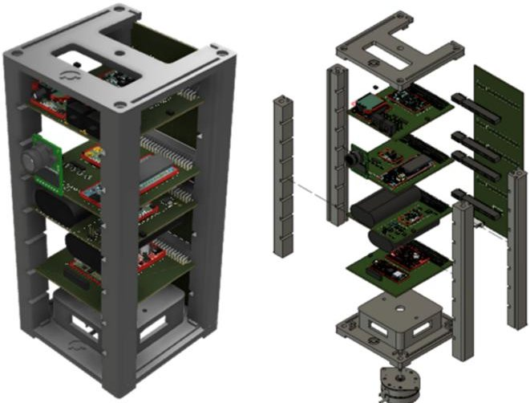

Figure 4: EssentialSAT beta-version CAD model

## EssentialSAT MBSE Applications

Use of MBSE for the EssentialSAT system development began on day-1 of the project using the Innoslate MBSE tool (www.innoslate.com) that implements the Lifecycle Modeling Language (LML), the same tool used for the EyasSAT3 project. Both projects use Innoslate's cloud-based version running as software-as-a-service. A platform-based Enterprise version is also available but was not used on these projects as the cloud-based version better supports the geographically separated team members.

Following the classic systems engineering process framework described in [2], the first thing any new project must do is ascertain the stakeholder's expectations in the form of a need statement along with some specific goals and objectives (success

<!-- PDF_PAGE: 4 -->

criteria) for the endeavor. The EssentialSAT need statement is: Space professionals needs a new system of interest for use in training and education programs to provide hands-on learning opportunities associated with spacecraft, cubesats, and software/hardware integration. The associated goals and objectives were captured in the MBSE tool using the requirements class and can be communicated in a variety of ways including the Tree Diagram shown in Figure 5.

PowerPoint. An example output of one critical design document is shown in Figure 8.

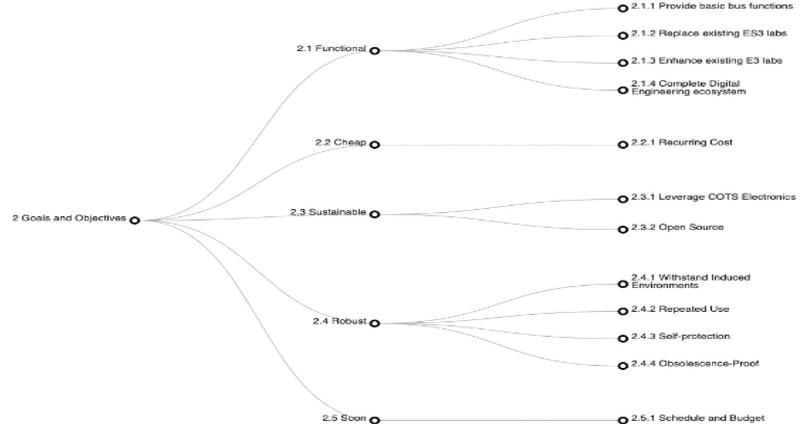

Figure 5: Tree Diagram of the EssentialSAT goals and objectives.

From this basic understanding of the system's purpose, more detailed technical information about the physical architecture (see Figure 6), functional architecture, software architecture, interface architecture (see Figure 7) and requirements architecture were captured using MBSE. Not only was MBSE used to develop individual snap-shots of system architecture, but even more useful was the ability to integrate these different views to create documentation needed by external stakeholders. Innoslate has a powerful feature that allows for "live" documents to be developed that reflect the internal diagrams and data of the model in real-time. This gives developers the confidence that the model represents an Authoritative Source of Truth for the project and eliminates the need to perform tedious and error-prone copy/pasting of diagrams and data into MS Word or

<!-- PDF_PAGE: 5 -->

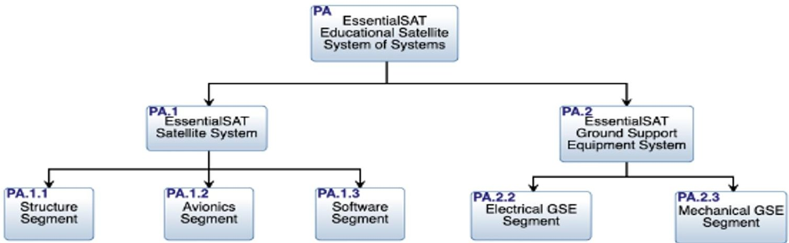

Figure 6: EssentialSAT Physical Architecture

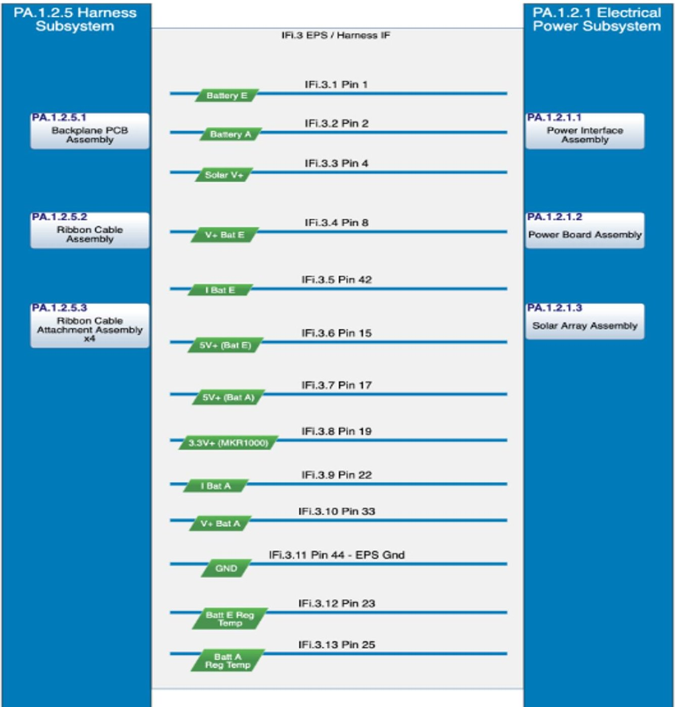

Figure 7: EssentialSAT Interface Architecture

<!-- PDF_PAGE: 6 -->

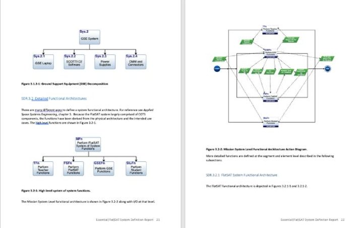

Figure 8: Auto-generated Design Report

## EssentialSAT MBSE Lessons Learnt

Key lessons learnt from the ongoing application of MBSE to the EssentialSAT system design and development include:

- Force Multiplier

- Design "De-confuser"

- System Teacher

We will briefly examine each of these beginning with Force Multiplier to highlight the impact each had on the project.

## Force Multiplier

The EssentialSAT is very resource constrained. There are only about 5 engineers working on the EssentialSAT project part time (roughly 5% of their time each). As a result, the total man-hours available is tiny compared to similar projects. In military terms, a "force multiplier" is any technology that can make possible for one or a few people to have the effective impact of 10's or even 100's of people. It is difficult to fully quantify the massive force multiplier MBSE has become for EssentialSAT project. As stated above, only a handful of engineers are working on the project for a small fraction of their time, yet the project has gone from concept to beta design in very short time.

A huge part of this force multiplier effect has been the time savings of having all project technical information in one integrated model. Having this single, Authoritative Source of Truth available at all times, to all project participants, saves an untold amount of time. Traditionally engineers would have to wade through myriad documents to find the latest information. They would then need to spend even more time ensuring it is in fact the latest version of the document and does not conflict with other

documentation. This time savings force multiplier was in further evidence when formal documentation was required for external stakeholders. Because this documentation was created within the model as shown above, creating the final report for delivery took minutes instead of days to consolidate and finalize for delivery and review.

## Design "De-confuser"

It is always a source of amazement how, on even a relatively small project with only a handful of engineers involved, misunderstandings over basic system design definitions can proliferate. These issues arise in any project and EssentialSAT has been no different. However, a key difference has been having a single, integrated model that can be viewed by the whole team during technical meetings to immediately zoom in on any point of contention, resolving the confusion in real-time. Often these issues were due to to differences of interpretation by engineers, but sometimes they highlighted errors in the model that could be quickly captured that source of truth was maintained. It is a common saying in English that it is important in a project for "everyone to be on the same page." That metaphor no longer applies as we can go well beyond mere paper and instead ensure everyone on the team shares the same mental (and digital model) of the system.

## System Teacher

A final lesson learnt has to do with the value of MBSE for rapidly bringing new team members up to speed on system details. Here again, having a single, integrated model organized around a simple framework makes it possible for engineers new to the project to rapidly review and learn about the system from various viewpoints. The nature of navigating information in a system model makes it possible for them to easily "zoom out" to understand the big picture of the system or "zoom in" to explore design details. During the project, one new engineer joined the team who had only a basic background in MBSE and no background on the project. But by using the system model he was able to quickly get up to speed on the project details and start contributing to the project.

## OSSAT

The second case study to be examined is OSSAT, an open-source satellite architecture. A brief background on the OSSAT project will first be presented, followed

<!-- PDF_PAGE: 7 -->

by a summary of MBSE applications for the system and lessons learnt.

## Open Source Satellite (OSSAT) Background

The commercial space domain is growing ever more competitive, with more entities entering the market, increased push to reduce price points and shorten implementation schedules. Global revenues stood at over $271 billion in 2020 [5], Figure 9, and as of the $271 billion in 2020 [5], Figure 9, and as of the $271 billion in 2020, over one thousand satellites were launched and 90% of these launches were for the commercial space sector [6], Figure 10.

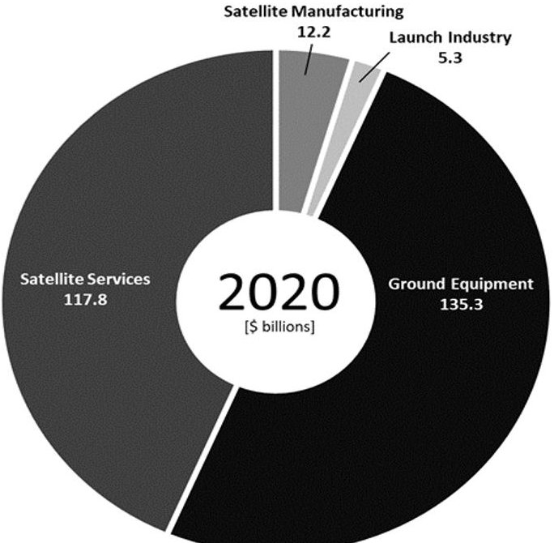

Figure 9: Satellite 2020 Global Revenues [5]

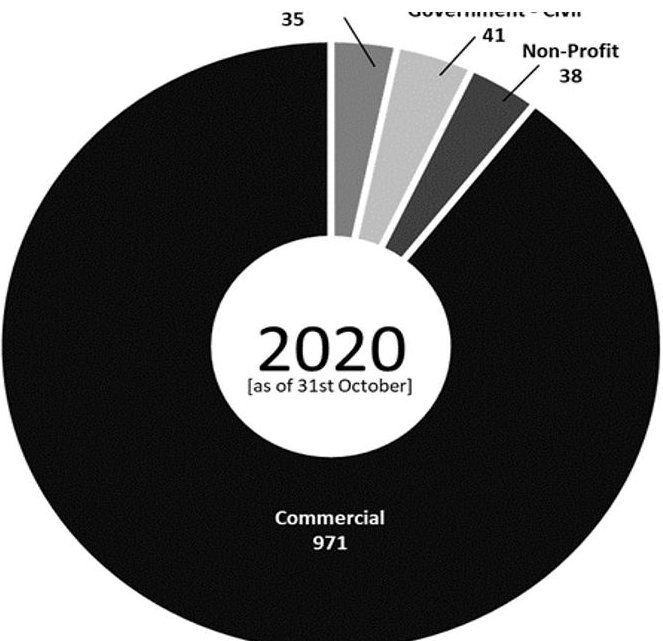

Figure 10: Number of Satellites Launched as of 31st October 2020 [6]

The space domain is a demanding environment that relies on complex systems with a high degree of interconnectivity. Traditional approaches to development in the space arena led to the use of siloed toolsets and processes that can limit the ability to rapidly respond to the economic drivers that are determine the direction of the sector. Here is where MBSE and Digital Engineering (DE) can be leveraged to respond to evolving market factors more quickly.

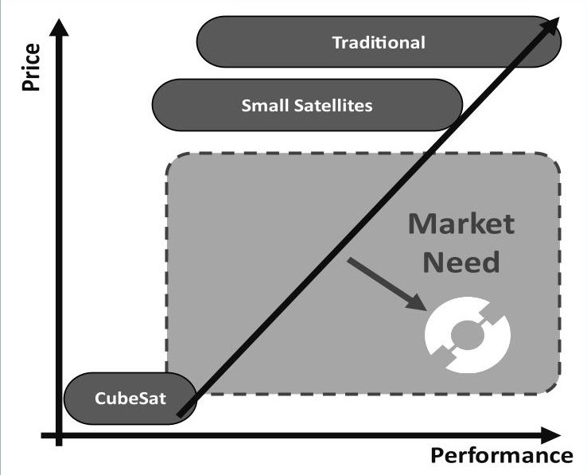

Figure 11: Open-Source Satellite Market Need [7]

Despite the growth in the space market, and the pivot to look at other methods of implementation, there are still a number of business cases that aren't able to be closed due to the cost barriers and what can be obtained within the available budget. The use of CubeSats has been critical in recent years in lowering the barriers to entry, but the platform inherently has limitations. Their form factor limits the available payload envelope, may also impact the degree of attitude and orbital control available and the amount of redundancy that can be implemented. The limited degree of redundancy can impact reliability and limit mission lifetime. These factors prevent them from being suitable for certain applications and payloads. For some cases, the increased cost to go to a larger small satellite form factor, which would address these issues, is too expensive and prevents the business case from closing.

KISPE Space has identified that there is a gap in the market that needs to be fulfilled as shown in Figure 10, in order to help improve the affordability, accessibility and sustainability of space. The Open-Source Satellite (OSSAT) will be a microsatellite class platform (25kg

<!-- PDF_PAGE: 8 -->

to 250kg) and is larger than a cubesat so it can accommodate larger payloads, implement redundancy to provide additional robustness and lifetime, and have sufficient agility to be able to service a wide range of applications. It will however be at the price point of a CubeSat and therefore helping to break down some of the economic barriers to space access. All the design information associated with the OSSAT will be released within one year of the first launch and will be freely available to whoever wants to use it.

In conjunction with the development of the OSSAT is the building of an open-source space community. This community will contribute directly to the design and development of the OSSAT but also bring together other programs of work and parties who have philosophies that share synergies with the OSSAT to help bring about the next wave of disruption in the small satellite industry.

## OSSAT MBSE Applications

The starting point of the OSSAT was particularly exciting and unique...it was a blank piece of paper with the remit to actively challenge the current mindset "...but it has always been done this way"! There are very few instances in engineering where you have the opportunity to be freed of the shackles of heritage designs or not to be stuck within the confines of work that has come before. An experienced team was brought together to tackle this problem but instantly ran into challenges.

The design trade space that the OSSAT inhabits is incredibly large. One of the aims of the OSSAT is to be able to accommodate a wide range of different applications and mission types without the need for modification, thus the core design always remains the same. A survey was conducted to explore the different uses of space. The number of permutations ran into triple figures! This is before considering the different stakeholders who have varied interests, ranging from the operators of the spacecraft to the regulatory and insurance bodies.

Due to the large volumes of interconnecting data needed to meet all the potential mission options, MBSE was adopted to allow leveraging of its strengths when exploring the problem space and to allow traceability between concepts. An example of its use is shown in Figure 12 that illustrates how the mission context was explored. Representing the information in this form made the discussions and development of the environment much more accessible by parties with a

variety of background and experiences. It also made the identification of disconnects in terminology easier to identify.

Document reading tends to be a solo sport and there isn't always an easy feedback loop to check understanding across multiple different parties. The generation and review of the MBSE artifacts generated lent themselves to a more dynamic and collective reviewing experience. It became apparent during context exploration that, although there was a shared understanding of the English language, there were varying domain specific implementations based upon the different mental models of the participants.

For some members of the team, this encompassed all aspects of the ground infrastructure required for satellite control, from the mission planning aspects right through to the physical ground station that communicated with the satellite. For other members of the team, this term had a subtly different meaning, perhaps solely encompassing the physical infrastructure only and thus meant that the interfaces to this system from their perspective were different.

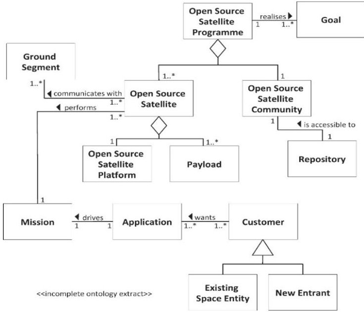

Figure 12: Open-Source Satellite Context [snapshot incomplete] [7]

Acknowledging that within the team itself there were different terminologies in use, improved appreciation that when sharing the work more widely as part of the open-source community, there is a high probability that others, with different perspectives, are likely to interpret things differently again. This kind of disconnect can manifest itself later in an engineering program, perhaps in the worst case, a disconnect

<!-- PDF_PAGE: 9 -->

between the system provider and the customer meaning that a program cannot get signed off at the point of validation.

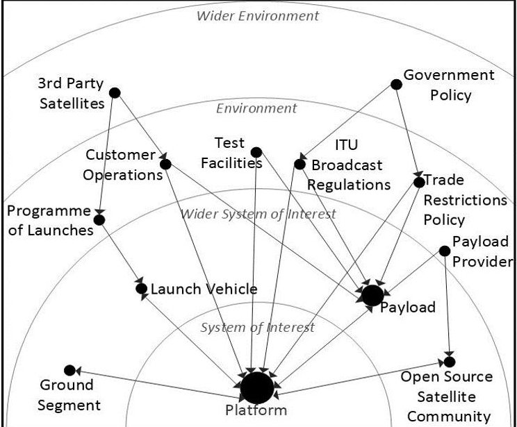

Figure 13: Open-Source Satellite Ontology [snapshot incomplete] [7]

Therefore, OSSAT is maintaining an ontology shown in Figure 13 that will be built up and added to as the program develops to ensure there is common understanding of how things are defined and organized. This should also help promote consistency which is important as the team grows. OSSAT is also intended to be enduring, with a long roadmap with different generational products. Setting out the domain language and context at the start means that across the entire lifecycle, historical and current artifacts should be comparable and understood within this context.

With the large problem space, multiple different perspectives and a team that has a range of experience, it was important to put some structure around the work that is being undertaken (as illustrated in Figure 14). The team is keen that we don't get sucked into the trap of getting focused on the detail before exploring the bigger picture, which can be a tendency of engineers!

For each of these activities, a series of appropriate MBSE artifacts have been defined. This creates structure for the effort and defines a process for their development. This consistent set of artifacts also supports concurrent engineering with greater confidence that all products will integrate at the end.

Although the context and environment within which the OSSAT resides is complex, at its core a satellites inherently do similar things regardless their specific application or mission. Capturing and maximizing what is common is at the core of what the OSSAT requires to meet its overall aim. The intention is to have a single design for the core platform of the OSSAT which is reusable with minimal change for different missions or applications. This will reduce the non-recurring engineering (NRE) costs and keep the price point down. Therefore, in addition to exploring the problem space, the stakeholders and mission context, the teams has also focused on defining the functional needs of OSSAT. Figure 15 shows a generic activity diagram which shows a general lifecycle that is independent of any specific application. Each of these activities are being considered from a generic perspective to determine what functions are required. This generic function set is then exercised for a specific application to verify whether it is complete or whether there are any constraints or conflicts that arise.

This approach gave the team a "toolbox" of functions to choose from. This ensured that the minimal viable set of functions was selected enabling better "apples to apples" comparisons between options. This also

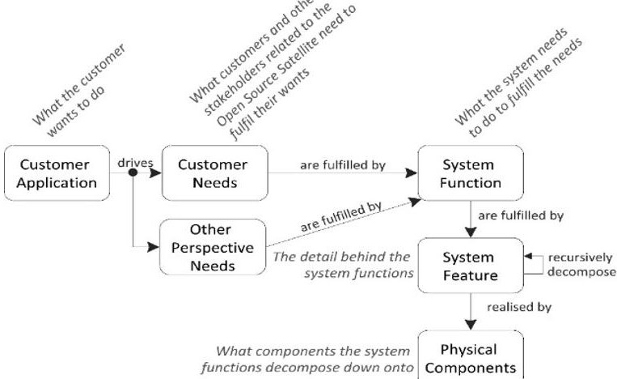

Figure 14: Open-Source Satellite Approach [7]

facilitates making the program accessible to those in the open-source community, promoting the use of common languages, approaches, comparison integration as well as concurrent engineering.

The next steps on the OSSAT program are to take the functions that have been derived, continue their decomposition and allocate them to specific physical entities. Heavy use of the ability to trace through system hiearchies will be used along with relationship management. As discussed previously, the OSSAT program has an enduring roadmap, taking the OSSAT

<!-- PDF_PAGE: 10 -->

from Low Earth Orbit (LEO) missions to eventual

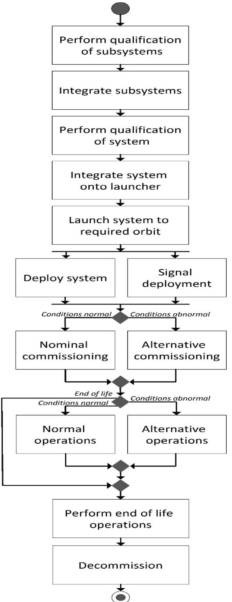

Figure 15: Open-Source Satellite Generic Activity Diagram [7]

interplanetary applications. This will take several years. Thus, the ability to look back to see where certain requirements or constraints originated, as well as understand the impact of changes due to revised regulations or other drivers, will be essential in ensuring program costs stay low.

## OSSAT MBSE Lessons Learnt

For many in the team, this was the first time MBSE had been used from this early context setting phase through to implementation. There were members of the team who were comfortable with the use of specific modelling language syntax and those who have never seen it before. The team did not want MBSE to get "in the way" of the engineering. Therefore, design workshops that were held to elicit information relating to the context of the problem space did not overtly use specific MBSE syntax or were "notation agnostic." It was more important to get the views of the different stakeholders and to allow those sessions to "flow" than to break this up by spending time trying to get information into a specific tool or language format. This worked successfully at this early stage of the program since the sessions were quite targeted and the number of links at the early stages were minimal.

Follow-up sessions were then held with various stakeholders to show them the "formal" versions of the material that had been generated. These versions used more specific modelling language notation. This improved engagement as the stakeholders could recognize the information that they had provided and that helped them become familiar with the modelling language notation.

This foundation has become important as the OSSAT program has progressed. Since consistency and the minimal viable set of functionalities is a key tenet of the design, maintaining the Authoritative Source of Truth has become more important. This has enable us to bring stakeholders along on the system design journey from the start (first putting material onto a whiteboard) to full implementation in an MBSE tool. This approach also facilitated the engagement of nonsystems engineers who have been critical to ensuring that a holistic view has been taken to the problem space.

The ability to have a centralized repository for all the information is particularly important to the OSSAT Program as well. Having the model as truth provides insight into traceability and promotes consistency across the project. Ultimately, OSSAT will have a wide user base with different backgrounds. As the design evolves, the model will facilitate better communication among these users, change management and support design pattern re-use for different OSSAT use cases.

<!-- PDF_PAGE: 11 -->

## NOS-T

The final case study to be examined is the New Observing Strategies Testbed (NOS-T). NOS-T is a software-based platform being developed by the Systems Engineering Research Center (SERC) at Stevens Institute of Technology for NASA. A brief background on the NOS-T project will first be presented, followed a summary of MBSE applications for the system and lessons learnt.

## NOS-T background

The purpose of the New Observing Strategies Testbed (NOS-T) is to facilitate the design and development of mission architectures for remote sensing. NOS-T will be used to validate the inclusion of new technologies and demonstrate novel end-to-end mission concepts. The aim is to increase technology and system readiness levels while socializing new concepts within the science community. NOS-T is being developed for NASA's Earth Science Technology Office (ESTO) Advanced Information Systems Technology (AIST) program. The initial testbed applications will focus on integrating software models and simulations for prephase A and conceptual design stages. Later iterations will consider hardware-in-the-loop and human-in-the-loop configurations to further increase the technology readiness level (TRL) and system readiness level (SRL) in environments of increasing realism and fidelity. As of this writing, NOS-T has just completed a beta-version of the framework. The first full version is targeted for February 2022. For the purposes of this paper, NOS-T provides an interesting contrast to the other two case studies as it is entirely software-based.

## NOS-T MBSE Applications

Like the EssentialSAT project described previously, MBSE was applied to NOS-T from the initial phases of the project to capture, connect and communicate key system artifacts. This paper will focus on only two of the many MBSE applications for the project, verification and validation as well as interface definition.

In the Spring of 2021 the team developed an alphaversion of the software. As with any project, it is critical to the system engineering process to ensure that all design requirements are met (verification) as well as that the system meets stakeholder expectations (validation). The NOS-T requirements (in the form of user stories) were captured in the Innoslate MBSE tool. From there, the team employed the Test Center feature in the tool that facilitates the definition of Test Suites that are composed of Test Cases. Within the

tool, design requirements were traced to Test Cases using the "verified by" relationship. Test Cases then contain detailed procedures for closing out each requirement. An example of this traceability relationship in the form of a spider diagram is shown in Figure 16.

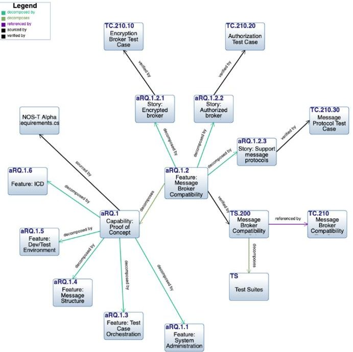

Figure 16: Spider diagram of verification traceability

Another key deliverable for the NOS-T project is a comprehensive Interface Control Document (ICD) and User's Guide. It is envisioned that principal investigators from NASA and academia will want to use the testbed to explore new concepts and technologies. This diverse user-base necessitates that the ICD provide detailed information allowing users to rapidly integrate their applications to the testbed. Here too, MBSE has been applied within the project. The ICD starts with a detailed description of the system which includes key artifacts developed within the system model. A critical part of that is understanding the overall system behavior including the interaction between the testbed and user applications. A sequence diagram developed within the model illustrating the message traffic between the testbed manager and user applications is shown in Figure 17.

<!-- PDF_PAGE: 12 -->

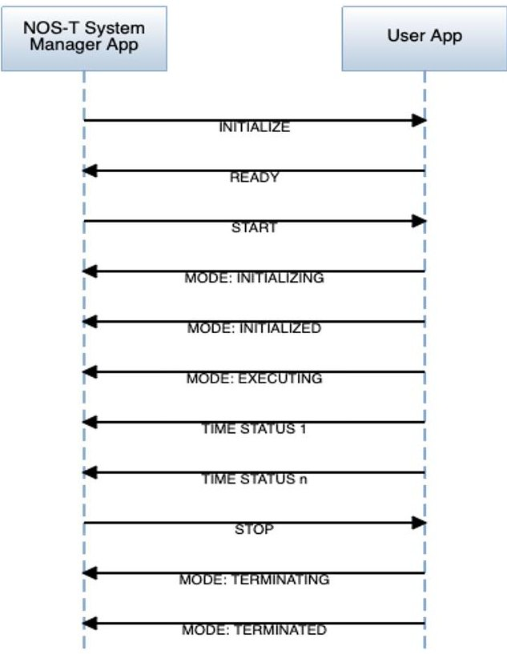

Figure 17: NOS-T Sequence Diagram

## NOS-T Lessons Learnt

Using MBSE, the team was able to quickly converge on a Test Plan with the confidence that full path coverage of all requirements was achieved. Iteration of the plan to identify and fix errors also occurred rapidly using the model as authoritative source of truth. The team then used the output from the model to guide the alpha-release verification and validation activities. The overall compliance results were then easy to

capture and communicate to NASA sponsors via required project deliverables. A similar process is being employed for the beta-release planned for Fall 2021.

As of this writing, the beta-version of the ICD is in draft form. However, the ability to leverage information from within the system model and to develop diagrams to communicate interface behavior has proven invaluable. This has been especially useful in working with new members of the team who have been able to use model artifacts to quickly grasp system design architectures and then build upon them for the next iteration of the testbed.

## IV. CONCLUSIONS

The challenges with lessons learnt with any new tool or technology is that many of these lessons, especially the value added by this new capability, are subjective in nature. This can be frustrating to project managers who would prefer to know the return on investment for MBSE in purely budgetary terms. Unfortunately, it would be difficult, if not impossible, to perform a controlled experiment with two projects, one using MBSE one not, and compare the results against a specific budget number. One could never fully control for the complexity of the project and at the critical inputs of individual engineers who work to make the project successful.

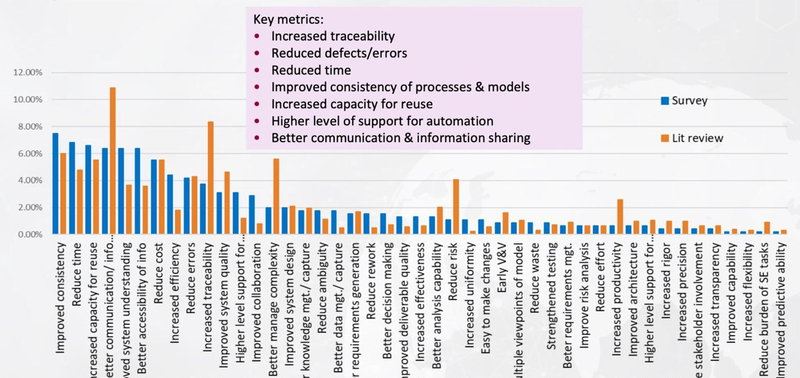

Figure 18: Top Cited DE Benefits Areas from Literature and Survey Results [8]

<!-- PDF_PAGE: 13 -->

This challenge of quantifying MBSE ROI is addressed in [2] and [9] among other places. However, there is clear consensus across the three project case studies described in this paper that MBSE has immense value in supporting the design, development, test and operation of systems. These lessons learned are corroborated by the results of recent study by the SERC shown in Figure 18 that cited increased traceability, reduced time, as well as improved communication and information sharing, among other benefits.

The goal of this paper was to highlight recent, realworld applications of MBSE to motivate wider adoption of the tools and practices. All the case studies highlighted in this paper have found considerable value in MBSE, and plan to continue using this valuable tool to the fullest extent practical. Additional lessons learnt will from these experiences will be presented in future publications.

## V. REFERENCES

[1] Knizhnik, Jessica, Pawlikowski, Gerald, Briefing "Systems Engineering and Model Based Systems Engineering Stakeholder State of the Discipline," 2020.

[2] Larson et. al., Applied Space Systems Engineering, $ 2^{\mathrm{n d}} $ Ed. Coyote Publishing, 2014.

[3] Lifecycle Modeling Language (LML) Specification, http://www.lifecyclemodeling.org/spec/1.1, 2015.

[4] OMG Systems Modeling Language v1.6, https://www.omg.org/spec/SysML/1.6/, December 2019.

[5] BryceTech (2021) State of the Satellite Industry Report June 2021, Satellite Industry Association available at: https://brycetech.com/reports/reportdocuments/SIA_SSIR_2021.pdf

[6] BryceTech (2020) 2020 Year in Review, available at: https://brycetech.com/reports/reportdocuments/Bryce_2020_Year_In_Review.png

[7] Open Source Satellite (2021) https://opensourcesatellite.org/

[8] McDermott, Tom, "Roadmapping the Future of MBSE," Lifecycle Modeling Conference, February 2021.

[9] Dam, Steve, "Is There a Return on Investment for MBSE?," https://www.innoslate.com/resource/is there-a-return-on-investment-from-model-based systems-engineering-mbse/