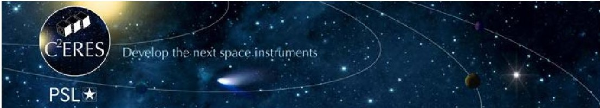

<!-- PDF_PAGE: 1 -->

# First lessons with a Model-Based System Engineering approach for nanosatellites

B. Segret $ ^{1^{*}} $; R. Jain $ ^{1} $, B. Mosser $ ^{1} $,

$ ^{1} $Paris Observatory - PSL University, Meudon, FRANCE,

*Primary author contact details: boris.segret@observatoiredeparis.psl.eu

## 1. Abstract

Model-Based System Engineering (MBSE) is promising to support space instrumentation. CCERES [1] set up an MBSE approach for the early phases of scientific nanosatellite missions with free tools only. Our mission analysis covers more than only the trajectory of a space mission: it addresses the scientific coverage as the main driver, then also its coupling with the functional modes, the pointing requirements, the data volume and the power. The early requirements for these main functions are translated in tiny models, i.e. pieces of codes in python or GNU Octave, whose outputs are formatted to get displayed in the CNES' VTS display, a free tool available for Windows and Linux. An in-house software called DOCKS has been developed in python and made open-source. DOCKS simplifies some parts of modelling with the same philosophy of producing outputs to VTS display. We will present some of our scientific nanosatellite projects translated in MBSE terms with VTS displays, in Earth orbit or in deep space, and discuss about their advantages and limitations. We will also report on their application during Concurrent Engineering sessions. As a result, the traditional studies and tools for system analysis at platform level are certainly not deemed deprecated. Our MBSE approach was made possible and necessary in a CubeSat context: the CubeSat form factor simplifies many aspects and also provides the space laboratories with opportunities for entirely new measurement concepts and not only for payload development. The main lesson of this MBSE approach is to guide an instrumentation team to increase its Concept Maturity Level (CML) from CML 0 to CML 4 typically, and to install an efficient dialog among all actors, within a project and with its partners from the New Space or from the traditional space sector.

## 2. References

Acknowledgments: C $ ^{2} $ ERES ([1], pronounced "C-CERES", Figure 1) has been hosted by Paris Observatory [2] since 2014 and funded by the French Laboratory of Excellence ESEP [3] under the grant ANR #2011-LABX-030 in the "Investissements d'Avenir" and by PSL University Paris ([4]).

[1] C $ ^{2} $ ERES, Space pole of PSL University Paris (Figure 1): https://cceres.psl.eu/?lang=en

[2] Paris Observatory: https://www.observatoiredeparis.psl.eu/?lang=en

[4] Paris Sciences Lettres (PSL Université): https://www.psl.eu/en

Figure 1: $ \mathrm{C}^{2} $ERES is the Space Pole of PSL University Paris.

