<!-- PDF_PAGE: 1 -->

<div align="center">

# A Novel Graph-Based Modelling Approach for Reducing Complexity in Model-Based Systems Engineering Environment

</div>

<div align="center">

# Maxim Filimonov

</div>

<div align="center">

# A thesis submitted to BIRMINGHAM CITY UNIVERSITY in partial fulfilment

</div>

for the degree of

Doctor of Philosophy

June 2020

<!-- PDF_PAGE: 2 -->

To

<div align="center">

# My parents Olga Filimonova and Valeriy Filimonov, My brother Anton Filimonov,

</div>

and

My beloved wife Liudmila Filimonova

"A method is more important than a discovery, since the right method will lead

to new and even more important discoveries."

- Lev Davidovich Landau

<!-- PDF_PAGE: 3 -->

## Abstract

multiple issues arise such as over complexity, lack of communication or understanding of the design process on different stages of its lifecycle. Model-based systems engineering (MBSE) has been introduced to overcome the communication issues and reduce systems complexity. A novel approach for modelling interactions is proposed to enhance the existing MBSE methodologies and further address the identified challenges. The approach is based on graph theory, where pre-defined rules and relationships are substituted and reorganised dynamically with graphical constructs.

A framework for reducing complexity and improving logic modelling in MBSE with metagraph object-oriented approach is presented. This framework is tested in use cases from literature, where the model-based systems approach is applied to design an automobile system to match the acceleration requirements, and to improve a CubeSat nanosatellite communication subsystem. Through the use case scenarios, it has been proven that the methodology framework meets all the identified functional and design requirements and achieves the aim of the research.

This work may be viewed as a step forward towards more consistent and automatic modelling of interactions among subsystems and components in MBSE. Automation techniques have multiple applications in systems engineering field as engineers always aim to produce higher quality and cost-effective products in less time and that is achieved by integrating knowledge on every stage of a development lifecycle. In addition to those advantages for SE field, the research provides basis for potential research proposals for future work in various engineering fields such as knowledge based engineering or virtual engineering.

<!-- PDF_PAGE: 4 -->

## Acknowledgements

In the beginning, I would like to say thanks to my supervisors, Prof Ilias Oraifige and Dr Venkatesh Vijay, for their support and guidance throughout the research process. Their extensive knowledge, motivation and advice have provided me with the strength to complete the work and excel in the research writing. Conducting such a complicated academic study could not have been completed without their guidance and help. Their comments and advice have constantly encouraged me to expand the research my ideas further.

Apart from my supervisors, I would like to express my sincere thanks to all the people who were part of the research team at different times. That includes my original supervisors, Dr Pathmeswaran Raju and Prof Craig Chapman. I am eternally grateful to them for believing in me, acknowledging my skillset and providing me the opportunity to join their team in the UK. Identifying the focus of this research could not have been done without their ideas and vision. It was an honor to work with them.

Also, I would like to acknowledge the support of the Birmingham City University staff for providing consistent support and resolving all the issues during the PhD studies.

I would always remember my friends at Birmingham City University for all our time spent together, both fun day outs and thorough scientific discussions in the lab. Their support and comments provided me a lot of useful information and helped me to identify the correct scope of the research.

In the end, I am grateful to my parents, brother and especially my wife, Liudmila Filimonova, for constantly supporting me at all times, believing in me no matter what and providing me enough encouragement and motivation to accomplish the goal of completing this research.

<!-- PDF_PAGE: 5 -->

## Contents

Abstract ... I

Acknowledgements ... II

Contents ... III

List of Figures ... VI

List of Tables ... X

List of Publications ... XI

List of Acronyms ... XIII

1.0 Introduction ... 1

    1.1 Background ... 1

    1.2 Aim and objectives ... 5

    1.3 Outline of the thesis ... 6

2.0 Systems engineering and interaction modelling ... 8

    2.1 Introduction ... 8

    2.2 Systems engineering ... 8

    2.3 Model-based systems engineering ... 9

        2.3.1 Systems Modelling Language ... 11

    2.4 Design automation and Knowledge Based Engineering ... 13

        2.4.1 Adaptive Modelling Language ... 15

    2.5 Limitation in model-based systems engineering ... 15

        2.5.1 What is logic? ... 15

        2.5.2 Growing complexity in systems engineering ... 16

        2.5.3 Inconsistencies in MBSE ... 19

        2.5.4 Development state of logic models in MBSE and lack of dynamism ... 20

        2.5.5 Research gap summary ... 21

    2.6 Research questions and hypotheses ... 22

        2.6.1 Research Question 1 and Hypothesis 1 ... 22

        2.6.2 Research Question 2 and Hypothesis 2 ... 23

    2.7 Need for interaction modelling automation and expected contribution to knowledge ... 24

    2.8 Summary ... 25

3.0 Graph-based systems modelling ... 27

    3.1 Introduction ... 27

    3.2 Graph theory ... 27

<!-- PDF_PAGE: 6 -->

3.2.1 General definitions...28

3.2.2 Comparative analysis of graphical structures...29

3.3 Metagraph definition...33

3.3.1 Metagraph properties...34

3.3.2 Model as a metagraph...35

3.3.3 Metagraphs, directed hypergraphs and hierarchical graphs (higraphs)...37

3.3.4 Metagraph applicability...38

3.4 Design structure matrix...40

3.4.1 Decomposition principle...40

3.4.2 General concept...40

3.4.3 DSM applicability and connection with graph theory...42

3.5 Graph-based design languages...43

3.6 Summary...46

4.0 Interaction Modelling Framework...47

4.1 Introduction...47

4.2 Research methodology...47

4.3 Research plan...49

4.4 Requirements...50

4.5 The interaction modelling framework...52

4.5.1 System definition...54

4.5.2 Systems Modelling...55

4.5.3 Interaction Modelling...57

4.5.4 Validation and Verification...58

4.5.5 Visualisation...61

4.6 Summary...62

5.0 Development and Implementation...64

5.1 Introduction...64

5.2 Interaction Modelling Framework...64

5.2.1 Framework outline...64

5.2.2 System definition...65

5.2.3 Systems modelling...66

5.2.4 Interaction modelling...69

5.2.5 Validation and verification...74

5.2.6 Visualisation...76

<!-- PDF_PAGE: 7 -->

5.3 Summary...80

6.0 Evaluation and Effectiveness of the framework...81

6.1 Introduction...81

6.2 Evaluation objectives...81

6.3 USE CASE 1: Acceleration Analysis of Automobile Development ...82

    6.3.1 Use case overview...82

    6.3.2 Current interaction modelling state ...84

    6.3.3 Systems modelling ...85

    6.3.4 Interaction modelling framework application ...91

    6.3.5 Critical analysis...104

6.4 USE CASE 2: Standard CubeSat example ...107

    6.4.1 Use case overview...107

    6.4.2 Current interaction modelling state ...108

    6.4.3 Systems modelling ...109

    6.4.4 Interaction modelling framework application ...111

    6.4.5 Critical analysis...122

6.5 Discussion and findings...126

6.6 Validation of Research Hypotheses...130

    6.6.1 Research question 1 and Hypothesis 1...131

    6.6.2 Research question 2 and Hypothesis 2...132

6.7 Summary...133

7.0 Discussion, conclusion, and recommendations for future work ...134

    7.1 Introduction...134

    7.2 Discussion ...134

    7.3 Contribution to knowledge...141

    7.4 Limitations of research ...142

    7.5 Recommendations for future work ...143

References...146

<!-- PDF_PAGE: 8 -->

## List of Figures

Figure 1-1: Complexity description through relationships ...4

Figure 2-1: Relationship between SysML and UML (Willard, 2007) ...12

Figure 2-2: Complexity description through relationships ...16

Figure 3-1: Graphs as a way of model representation (Herzig and Paredis, 2014) ...28

Figure 3-2: Graphical representation of a set of interacting variables (a) Simple graph, (b)

Directed graph, (c) Hypergraph and (d) AND/OR graph ...30

Figure 3-3: Example metagraph ...33

Figure 3-4: Metagraph with a Metapath ...35

Figure 3-5: (a) Metagraph, (b) directed hypergraph and (c) hierarchical graph representation

of the same system (Basu and Blanning, 2007) ...38

Figure 3-6: Example DSM ...41

Figure 3-7: Example DSM: ...42

Figure 3-8: Example DSM (Yassine and Braha, 2003): ...43

Figure 3-9: Data exchange process (Gross and Rudolph, 2016b) ...43

Figure 3-10: Central data model (Gross and Rudolph, 2016b) ...44

Figure 3-11: Robot Cell example design graph (Kiesel et al., 2017) ...45

Figure 4-1: Current thesis research design ...49

Figure 4-2: The framework for interaction modelling ...53

Figure 4-3: System definition process to acquire key system design concepts, design rules and

parameters ...54

Figure 4-4: Systems modelling process to create the comprehensive SysML system model .56

Figure 4-5: Interaction modelling process to construct the formalised object-oriented

metagraph-based logic model of MBSE system ...58

<!-- PDF_PAGE: 9 -->

Figure 4-6: Steps to validate and verify the system and interaction model at the current moment of time ... 59

Figure 5-1: Example DSM with external input/output regions (Eppinger and Browning, 2012)

... 65

Figure 5-2: SysML Block Definition diagram modelled with Visual Paradigm SysML modelling tool (“Visual Paradigm Web Site,” n.d.) ... 69

Figure 5-3: Developed object-oriented tool example screenshot ... 71

Figure 5-4: Example data for parsed objects ... 72

Figure 5-5: Example data for parsed relationships and interactions ... 72

Figure 5-6: Metagraph objects data after original data analysis ... 74

Figure 5-7: Input for the developed tool... 75

Figure 5-8: Metagraph objects example data of the original and modified system models... 75

Figure 5-9: Example data for changes after metagraph comparison ... 76

Figure 5-10: Force-Directed Algorithms Method metagraph visualisation example for 50 vertices, 20 metaobjects and 34 edges (Globa et al., 2015)... 78

Figure 5-11: Force-Directed Algorithms Method metagraph visualisation example for 20 vertices, 10 metaobjects and 13 edges (Globa et al., 2015)... 78

Figure 6-1: Model organisation package diagram ... 87

Figure 6-2: Automobile Domain block definition diagram ... 88

Figure 6-3: Vehicle Hierarchy block definition diagram... 89

Figure 6-4: Vehicle Acceleration Analysis (Analysis Context) block definition diagram ... 90

Figure 6-5: Vehicle Acceleration Analysis parametric diagram ... 90

Figure 6-6: Metagraph for the Automobile Acceleration Example... 91

<!-- PDF_PAGE: 10 -->

Figure 6-7: The proof-of-concept tool interface representing the metagraph objects automatically generated from the system model data ... 92

Figure 6-8: Metagraph objects of the original and modified system models... 93

Figure 6-9: The proof-of-concept tool interface representing the automatically tracked changes from the SysML data ... 94

Figure 6-10: Automatically detected changes between the original and modified system models and list of affected parameters, as shown in the tool ... 95

Figure 6-11: Metagraphs of the Automobile Example, Use Case 1, Scenario 3 ... 96

Figure 6-12: Metagraphs of the Automobile Example, Use Case 1, Scenario 1 ... 98

Figure 6-13: Metagraphs of the Automobile Example, Use Case 1, Scenario 2 ... 99

Figure 6-14: Metagraphs of the Automobile Example, Use Case 1, Scenario 4 ... 101

Figure 6-15: Metagraphs of the Automobile Example, Use Case 1, Scenario 5 ... 103

Figure 6-16: CubeSat overall system structure ... 109

Figure 6-17: Signal-to-noise ratio analysis block definition diagram ... 110

Figure 6-18: Signal-to-noise ratio analysis parametric diagram ... 111

Figure 6-19: The proof-of-concept tool interface for CubeSat example ... 112

Figure 6-20: The proof-of-concept tool interface representing the metagraph objects automatically generated from the system model data for CubeSat example... 113

Figure 6-21: Metagraphs of the CubeSat Example, Use Case 2, Scenario 1 ... 115

Figure 6-22: Metagraphs of the CubeSat Example, Use Case 2, Scenario 2 ... 117

Figure 6-23: Metagraphs of the CubeSat Example, Use Case 2, Scenario 3 ... 118

Figure 6-24: Metagraphs of the CubeSat Example, Use Case 2, Scenario 4 ... 119

Figure 6-25: Signal-to-noise ratio analysis parametric diagram for scenario 5 ... 120

Figure 6-26: Metagraphs of the CubeSat Example, Use Case 2, Scenario 5 ... 121

<!-- PDF_PAGE: 11 -->

Figure 6-27: The proof-of-concept tool interface representing the metagraph objects and results for scenario 5 of CubeSat example...122

<!-- PDF_PAGE: 12 -->

## List of Tables

Table 3-1: Comparative analysis of graphical constructs...32

Table 3-2: Adjacency matrix A for Figure 3-4...36

Table 3-3: Closure A* of the adjacency matrix for Figure 3-4...37

Table 5-1: Time required for random metagraph representation...79

Table 6-1: Full list of models in the Automobile Example ...83

Table 6-2: List of models in the Automobile Example relevant for the use case implementation

...86

Table 6-3: Results. Automatically detected changes for scenario 3, use case 1 ...95

Table 6-4: Colour in metagraphs visualisation...97

Table 6-5: Results. Automatically detected changes for scenario 1, use case 1 ...97

Table 6-6: Results. Automatically detected changes for scenario 2, use case 1 ...99

Table 6-7: Results. Automatically detected changes for scenario 4, use case 1 ...100

Table 6-8: Results. Automatically detected changes for scenario 5, use case 1 ...102

Table 6-9: Critical analysis of the Use Case 1 Interaction Modelling Framework implementation results...105

Table 6-10: Results. Automatically detected changes for scenario 1, use case 2 ...114

Table 6-11: Results. Automatically detected changes for scenario 2, use case 2 ...116

Table 6-12: Results. Automatically detected changes for scenario 3, use case 2 ...117

Table 6-13: Results. Automatically detected changes for scenario 4, use case 2 ...119

Table 6-14: Results. Automatically detected changes for scenario 5, use case 2 ...120

Table 6-15: Critical analysis of the Use Case 2 Interaction Modelling Framework implementation results...124

<!-- PDF_PAGE: 13 -->

## List of Publications

Papers:

- Filimonov, M., Oraifige, I. and Vijay, V. (2020) 'A novel graph-based modelling approach for reducing complexity in model-based systems engineering environment', Int. J. System of Systems Engineering, Vol. 10, No. 2, pp.143-163.

## Abstract

Field of systems engineering is developing rapidly and becoming more complex, where multiple issues arise like overcomplexity, lack of communication or understanding of the design process. Model-based systems engineering (MBSE) has been introduced to overcome these issues and reduce systems complexity. Nonetheless, the system model remains static and the interactions among submodels are modelled in the form of hard-coded rules. Therefore, systems interaction in MBSE is not dynamic enough to satisfy the evolving nature of system models with growing complexity. In this paper, a novel approach for modelling logic is proposed to address the above challenge. The aim of the research is to improve existing methodologies and interaction modelling as well as deal with inconsistencies. The approach is based on graph theory, where pre-defined rules and relationships are substituted and reorganised dynamically with graphical constructs while metagraphs being the most applicable for systems modelling. Framework for reducing complexity is presented.

<!-- PDF_PAGE: 14 -->

- Filimonov, M., Raju, P. and Chapman, C.B. (2016) 'Graph-based modelling of systems interaction in model-based systems engineering environment', 7th International Systems & Concurrent Engineering for Space Applications Conference, Madrid, Spain, 5-7 October 2016, pp. 45-62.

## Abstract

Systems engineering (SE) is a rapidly developing engineering field. Growing complexity of modern systems causes issues in the development process. Model-based systems engineering (MBSE) is an emerging area in SE and one of the most advanced ways of reducing the complexity. By definition MBSE is a formalised application of modelling to support all aspects of systems development on all lifecycle phases. This paper aims to tackle problems connected with overcomplexity of system models such as lack of communication, lack of understanding and lack of dynamic interaction. The aim is set to be achieved by developing new methods and tools for modelling logic in MBSE, which will allow to avoid problems such as inconsistencies and will be dynamic. Developing new ways of modelling logic will provide improvements for systems engineering.

<!-- PDF_PAGE: 15 -->

List of Acronyms

List of Acronyms

AML Adaptive Modelling Language

CAD Computer-Aided Design

CFD Computational Fluid Dynamics

DEE Design and Engineering Engine

DSM Design Structure Matrix

IBM International Business Machines

IMCE Integrated Model-Centric Engineering

INCOSE International Council on Systems Engineering

JPL Jet Propulsion Laboratory

KBE Knowledge Based Engineering

KNOMAD Knowledge Nurture for Optimal Multidisciplinary Analysis and Design

KOMPRESSA Knowledge-Oriented Methodology for the Planning and Rapid Engineering of

Small-Scale Applications

MBSE Model-Based Systems Engineering

MOKA Methodology and tools Oriented to Knowledge-based engineering Applications

NASA The National Aeronautics and Space Administration

OMG Object Management Group

OOP Object-Oriented Programming

OOSEM Object-Oriented System Engineering Method

XIII

<!-- PDF_PAGE: 16 -->

RAD Rapid Application Development

RGB Red Green Blue Colour Model

SE Systems Engineering

SNR Signal-to-Noise Ratio

SWRL Semantic Web Rule Language

SysML System Modelling Language

UML Unified Modelling Language

XML Extensible Markup Language

<!-- PDF_PAGE: 17 -->

## 1.0 Introduction

## 1.1 Background

In the modern era, a lot of different definitions of engineering has been derived. Engineering itself is "the creative exploitation of energy, materials and information in organized systems of people, machine and environment, systems which are useful in terms of contemporary human values" (Wymore, 1993). At the same time, systems engineering (SE) arouse as an advanced way of engineering by providing an inter-disciplinary approach and means to enable the realisation of successful systems from different points of view. SE is "an inter-disciplinary approach and means to enable the realisation of successful systems" (Haskins, 2006). It has been evolving rapidly in the past decades and the rate of this evolvement has risen dramatically recently. This leads to growing complexity of the systems being designed with the use of SE methods as more sophisticated and larger systems are being developed nowadays. Numerous issues have become problematic for successful system development process, which are over complexity, lack of communication and lack of understanding of the design process at different stages of a lifecycle (Holt and Perry, 2008). Increasing complexity is further identified as one of the main challenges of the current state of systems engineering in the most recent studies (Mayfield et al., 2018). Furthermore, a requirement for common understanding of complex systems is distinguished as key opportunity for future research in the field (Akundi et al., 2018).

Model-based systems engineering (MBSE) is an emerging approach in SE field that distinguishes itself as an advanced way to reduce and maintain systems complexity through storing all development knowledge in an organised model structure. As a fundamental principle of good system design, the essence of MBSE relies on the application of appropriate formal models to a given domain (Bahill and Botta, 2008). MBSE itself is "a formalised

<!-- PDF_PAGE: 18 -->

application of modelling to support system requirements, design, analysis, verification and validation activities beginning in the conceptual design phase and continuing throughout development and later lifecycle phases” ("Systems Engineering Vision 2020," 2007). Despite rapid development of MBSE field significant issues exist in the way of its further development. These issues involve over complexity, lack of understanding and proper interaction among different models as they are parts of the main system model (Madni and Sievers, 2018a). Existing MBSE approaches propose resolving these by using Systems Modelling Language and representing the data in the form of diagrams (Feldmann et al., 2019). Even though that is successful to some extent, the representation remains static and does not offer appropriate capabilities to automate interactions when one of the models is changed. New directions involve using the Digital Twin approach, which can be expected to become the integral part of MBSE in the future (Madni et al., 2019). Despite the promising applicability of the digital twin technology for MBSE, being a relatively new concept, there is a number of concerns that need to be resolved before its wide-spread application. These concerns include the data management, privacy, and data security. Making data management more dynamic and automating the interactions between different parts of the main system model can possibly help to ease the application of the virtual reality concepts for MBSE.

Main system model in MBSE is decomposed into multiple sub models corresponding to separate sub systems (Yassine and Braha, 2003). These submodels represent various aspects of the development process - design engineering, computational analysis, cost model, manufacturing analysis, requirements model etc. All the components and systems are in constant interaction among each other but this interaction is not modelled in a way to automatically and dynamically update the system on time as well as check the consistency of the development process on its every stage (Shekar et al., 2011). The interactions within

<!-- PDF_PAGE: 19 -->

systems need to be understood and identified before they can be modelled using MBSE methodologies. One of the ways to analyse systems is using decomposition principle, which is one of the key aspects of engineering helping to organise complex problem in the initial stages of the systems development. That provides a technique for quantifying the complexity of system being developed and understanding of how each individual sub system and component affects the behaviour of the system as a whole (Akundi et al., 2018).

Once the model interactions are understood, the communication such as messages, decisions and response among models are set to be analysed. In this research, such communication among systems, subsystems and components is defined as logic. In current systems this logic is maintained manually through hard-coded rules, pre-defined relationships, constraints and fixed mathematical formulas (Wang et al., 2017). This increases the time required for the actual development and further leads to designing the system from scratch whenever serious and contradicting problems are discovered at the later stages of lifecycle. Moreover, often there are logical contradictions - inconsistencies in rules and dependencies among the rules that are not captured (Herzig et al., 2014). This could lead to incorrect system design, increased time spent on testing, redesign, and ultimately systems failures.

Holt and Perry discuss the broader issues facing SE and call them "three evils of systems engineering" (Holt and Perry, 2008). These are further analysed in more recent research, and it is confirmed that they are becoming more evident with modern systems (Bajaj et al., 2017). These issues have been distinguished as follows:

- Complexity: large systems have lots of interacting components and relationships between its entities. As shown in Figure 1-1, adding more rules and relationships make system more complex than before.

<!-- PDF_PAGE: 20 -->

- Lack of understanding: concept of "lack of understanding" can arise at any stage of a lifecycle beginning with requirements formulation. It might lead to issues during the development stage, and then even during the operation of a product. Understanding of a system model is a major factor in any development (Rousseau, 2018). Models have to be dynamic as the systems are usually observed only from particular aspects of certain design. Similarly, it is legit for overcomplicated models with lots of communication, rules and relationships.

- Communication problems: This problem can arise on any level, between several people or groups of people, companies, systems or different departments involved in process of development, where there is not enough data exchange among various sub models.


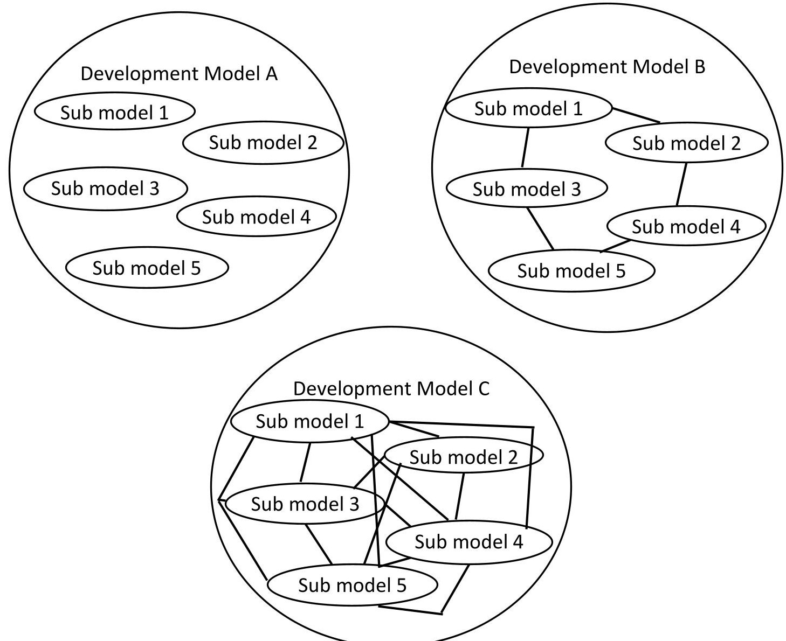


<div align="center">

Figure 1-1: Complexity description through relationships

</div>

<!-- PDF_PAGE: 21 -->

Thus, at present the mechanism of modelling interaction among different models is not dynamic enough to be able to support MBSE to full extent and there is a need to improve the way of modelling logic for future development in MBSE domain. Delivering new ways of modelling logic has its potential utilisation in design automation as making interaction mechanism dynamic, demand-driven and, therefore, more automatic, provides improvements to Knowledge Based Engineering (KBE) field (Vatchova et al., 2019). Therefore, this study aims to answer the following research questions:

- How can the organisation of the interactions among the sub systems be analysed in MBSE for the purpose of solving complexity issues such as lack of communication and lack of understanding?

- How can the new dynamic ways of interactions modelling improve and enhance the existing MBSE methods and static ways - hard-coded rules, pre-defined rules, relationship and mathematical expressions?

In this research, the author proposes a novel approach that would address those questions. The proposed approach develops a central model that governs all interactions and data exchange among different models as well as substituting pre-defined rules and relationships with more sophisticated dynamic approach by utilising the principles of graph theory specifically the graphical constructs known as Metagraphs.

## 1.2 Aim and objectives

In the previous section the general need for improving the interaction modelling has been presented and that leads to the aim and objectives of the study.

This research aims to identify and develop methods and tools for creating dynamic ways of modelling logic in form of systems interaction for reducing complexity in MBSE environment.

<!-- PDF_PAGE: 22 -->

The aim will be accomplished through successful achievement of the following objectives:

1. Review methods and tools used in systems engineering for developing system models.

2. Analyse current approaches for modelling logic in MBSE and KBE.

3. Distinguish new approaches and techniques of improving the process of modelling systems interaction in MBSE where knowledge can be most usefully held and reasoned with.

4. Develop these approaches to make dynamic ways of modelling logic in MBSE.

5. Validate proposed approaches of modelling logic in MBSE and their potential utilisation for reducing systems complexity and design automation.

6. Generate guidance on how to utilise the approach and enhance the effectiveness of the framework for product development using MBSE.

## 1.3 Outline of the thesis

The outline of the thesis is presented in this section. The research consists of five primary sections: research problem statement, literature review, framework representation, validation and verification, and conclusions.

Chapter 1 of the thesis provides a brief introduction to the field of the research and shows the research questions addressed by the current work. This chapter also presents aim and objectives of the research.

Chapter 2 of the thesis focuses on the literature review of the current approaches in modelbased systems engineering and design engineering. The different methods are discussed and compared. Expected contribution to knowledge is also presented. As a conclusion, the need for interaction modelling framework is summarised.

<!-- PDF_PAGE: 23 -->

Chapter 3 explains the graph-based modelling theories and reviews the potential utilisation of graphical constructs for achieving the aim of the research. It discusses various methods, compares them, shows limitations and at the end selects the most appropriate ones.

Chapter 4 presents the interaction modelling framework, which bridges the research gaps identified in the previous chapters. The chapter initially distinguishes the requirements for the developed framework and moves on to the actual representation of the framework elements themselves. Additional explanations are provided where appropriate.

Chapter 5 explains the techniques and tools used for the proof-of-concept implementation and development explaining why particular methods have been utilised and on which stages.

Chapter 6 shows the evaluation of the framework in a set of use cases. These test cases are Automobile Acceleration analysis example and CubeSat development example from the literature. The validation ensures that the proposed framework is doing appropriate job on modelling interactions among subsystems in MBSE environment.

Chapter 7 overviews the key research thesis objectives, provides the summary of the thesis, discusses the findings of the proof-of-concept implementation and evaluation, summarises the research outcome in detail, limitations and draws conclusions based on the results. Furthermore, it outlines the recommendations for future work.

<!-- PDF_PAGE: 24 -->

## 2.0 Systems engineering and interaction modelling

## 2.1 Introduction

As the research lies within the area of systems engineering there is a need to analyse definitions of key elements in this field in order to thoroughly understand research context of the thesis and key trends in the discipline being researched. A careful assessment of the current systems engineering and model-based systems engineering techniques has identified that the interaction modelling is still done mostly manually without the use of appropriate interactions automation techniques. This chapter provides an overview of the current state of systems engineering, model-based systems engineering and design automation. In the end the research gaps are distinguished based on the identified shortcomings of existing methodologies.

## 2.2 Systems engineering

As cited by Rhodes, one of the earliest definitions of Systems Engineering (SE) was given by Ramo in 1973 where Ramo argued that there is a necessity of looking at the bigger picture and taking into account all aspects on every stage of a lifecycle, which include non-technical sides such as various social factors (Rhodes and Hastings, 2004). Chase in 1974 also spoke of SE as a way of looking at systems being developed as not separate components but a coherent whole (Chase, 1974). Thus, defining SE started with identifying the importance of looking at a broader picture while developing systems.

Systems engineering definition evolved through time while scientists added some new aspects as well as making old definitions clearer. In his definition Eisner introduced iterative process as a compulsory part of any design process (Eisner, 2008). Holt spoke of SE simply as "the implementation of common sense" (Holt, 2004), although it is rather difficult to define the

<!-- PDF_PAGE: 25 -->

meaning of "common sense". Humans have also started to be seen as a component of SE (Hybertson and Sheard, 2008).

Modern definition of SE was provided by International Council on SE (INCOSE) and in fact was seen to be a combination of various viewpoints - "An interdisciplinary approach and means to enable the realization of successful systems. SE integrates all the disciplines and specialty groups into a team effort forming a structured development process that proceeds from concept to production and operation" (Haskins, 2006). Systems engineering consists of a rich and useful set of principles, tools, and techniques. SE provides ways to deal with complex issued in understandable and quantitative terms (Kenett et al., 2019).

Moreover, there are already references to "the old SE" and "the new SE" which arose in the beginning of 2010s (Tien, 2008), (Sheard, 2007). The main difference is that "the new SE" identifies already existent complex systems and their development patterns whereas "conventional SE" solves specified problem with design and solution.

Thus, it is significant not to forget about the ongoing evolving nature of the core subject itself systems engineering.

## 2.3 Model-based systems engineering

The term "model" is a key concept part of Model-Based Systems Engineering (MBSE), which leads to the fact there is a need to define the model itself at first. According to Rumbaugh, a model is identified as a representation of a certain part of the world, which captures needed important aspects and does not include irrelevant features (Rumbaugh et al., 2004). A model has to obtain three features: it has to be based on original, it has to reflect some properties accordingly and it has to have a purpose to be used in place of the original (Stachowiak, 1973).

<!-- PDF_PAGE: 26 -->

2. 0 Systems engineering and interaction modelling MBSE is an emerging approach and considered to be one of the most advanced approaches in engineering (Rhodes, 2008). It is acknowledged that practice of MBSE is becoming more widely adopted in engineering, industry and academia (Holt et al., 2016). INCOSE defines MBSE as "a formalised application of modelling to support system requirements, design, analysis, verification and validation activities beginning in the conceptual design the phase and continuing throughout development and later life cycle phases" (Sillitto et al., 2018). The key aspect of MBSE is the system model which consists of all aspects of the system being developed and used to support the development process on every stage of a lifecycle from meeting requirements to integrating design engineering and engineering analysis. It is widely recognised that MBSE is going to become the most applicable new generation approach in SE allowing systems engineers to model any kind of systems and support development of any product type.

Weilkiens provides a survey through leading MBSE methodologies (Weilkiens et al., 2016). There are numbers of methodologies but among them there is a Vitech MBSE methodology and INCOSE Object-Oriented System Engineering Method (OOSEM) which involve generation of a system model with numerous interacting components.

Vitech methodology is based on four concurrently maintained SE activities that are linked together through a common System Design Repository (Morkevicius et al., 2017). It is necessary to adequately manage behaviour of model components whereas organised scheme or ontology is essential. OOSEM methodology utilises System Modelling Language (SysML) to support all aspects of systems engineering which is used alongside object-oriented methodology in a hybrid approach (Dickerson and Mavris, 2013).

This research aims to develop new methods and tools for modelling logic and comparison between various MBSE methodologies lies beyond the scope of the thesis. Nevertheless, one

<!-- PDF_PAGE: 27 -->

of the MBSE methodologies must be utilised since the field of interest is building improvements upon existing MBSE basis. Thus, OOSEM methodology has been identified to be the most suitable candidate now as it involves object-oriented mechanisms which are widely used in programming, MBSE and can be utilised to develop framework to achieve the research goal. Also, SysML is a key part of OOSEM and this particular language is going to be used in the research process.

## 2.3.1 Systems Modelling Language

Systems Modelling Language (SysML) is defined by OMG as "a general-purpose graphical modelling language for specifying, analysing, designing and verifying complex system that may include hardware, software, information, personnel, procedures and facilities" ("The Official OMG SysML site," n.d.).

Technically SysML is a language intended for systems engineers allowing them to model all aspects of systems engineering such as requirements, behaviour and structure. The main purpose of developing SysML is to unify various modelling languages that are used by systems engineers for better cooperation and understanding (Holt et al., 2016). The work comes from initiative by OMG and INCOSE ("INCOSE Model-Based Systems Engineering (MBSE) initiative," n.d.).

SysML is considered as a newly language although it shares a close relationship to Unified Modelling Language (UML). Indeed, SysML is based on UML and utilises same kind of diagrams used in UML. Nevertheless, UML was developed in 1997 and mainly aimed at software engineering which leads to the fact that SysML is more advanced, includes all advantages of UML and offers more for SE. SysML and UML relationship is illustrated in Figure 2-1.

<!-- PDF_PAGE: 28 -->


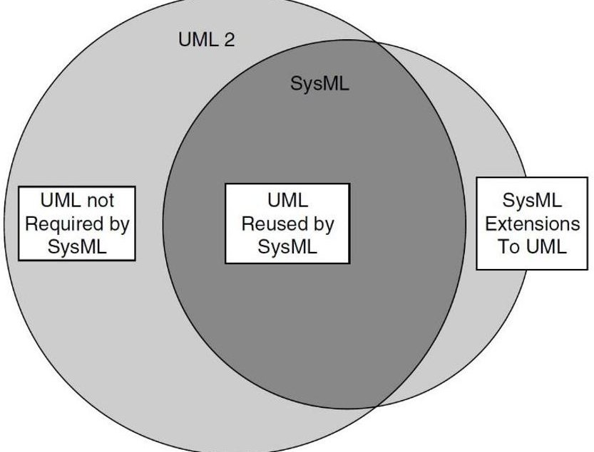


<div align="center">

Figure 2-1: Relationship between SysML and UML (Willard, 2007)

</div>

Willard identifies usefulness of UML/SysML in SE field and recognises SysML as a step in right direction in evolution of modelling languages for systems engineering (Willard, 2007). SysML is considered to be a more advanced tool for systems engineers then UML which is intended more for software engineers. Additionally, SysML has a history of successful application in MBSE field (Holt et al., 2016). Thus, SysML is more suitable for the research.

Nikolaidou further recognises growing significance of SysML and argues that additional diagrams used in SysML allow engineers to model more complex systems for systems engineering purposes (Nikolaidou et al., 2015). Moreover, it is emphasised that SysML is not a methodology itself but a tool that can be utilised in any environment. In fact, UML and/or SysML are implemented in most of MBSE methodologies (Wymore, 2018).

There are nine diagrams in SysML, each of them represents certain aspects of a system model and can be utilised as a representation of a corresponding submodel/subsystem of the system model for the purpose of defining interactions between models.

<!-- PDF_PAGE: 29 -->

## 2.4 Design automation and Knowledge Based Engineering

According to Rosenfeld in 1989, Knowledge Based Engineering (KBE) "is software technology that provides a means of storing product of process information as a set of engineering attributes, rules and requirements. The rules and requirements can generate designs, tooling or process plans automatically" (Rosenfeld, 1989). Conventional computer-aided design (CAD) software works only with geometric data and do not capture ideas involved to generate this geometry. On the other hand, KBE systems capture the intent behind the product design - the how and why, in addition to the what of the design - and then use the model of engineering design processes to automate all or part of the process and reduce lead-time of the product development (Chapman and Pinfold, 1999).

Thus, the idea of KBE is to utilise previously collected knowledge of product development for design automation. This is achieved by integration of this knowledge into the design process making this process easier to maintain and allowing new products development with higher quality in less time (Reddy et al., 2015).

There is a number of KBE methodologies. One of objectives of the research is to review these methodologies to be able to understand how they deal with logic modelling.

MOKA (Methodology and tools Oriented to Knowledge-based engineering Applications) describes in terms of rules, processes, modelling techniques and definitions, the necessary stages for the specification of KBE systems (Stokes, 2001). As shown by Perry, there are two levels in this framework: informal (formalisation of knowledge in language that can be understood by experts without being specialist in formalisation languages) and formal (representing and storing knowledge in an encoding form) (Perry and Ammar-Khodja, 2010).

<!-- PDF_PAGE: 30 -->

The MOKA methodology takes structural division of knowledge into account for its representation and storing (Górski et al., 2016).

KOMPRESSA (Knowledge-Oriented Methodology for the Planning and Rapid Engineering of Small-Scale Applications) is designed to develop small-scale KBE systems (Chapman et al., 2007). It shares lots of principles with MOKA but makes a bigger emphasis on risk evaluation and management (Lindholm and Johansen, 2018).

KNOMAD (Knowledge Nurture for Optimal Multidisciplinary Analysis and Design) methodology identifies drawbacks in MOKA and aims to place KBE techniques within the design process supporting it on every stage from knowledge capturing to knowledge retention and maintenance (Curran et al., 2010).

Methodologies such as Design and Engineering Engine (DEE) (Rocca and Tooren, 2007) and Rapid Application Development (RAD) (Zhou et al., 2015)try to improve KBE process even further although they do not move away from utilisation of pre-defined relationships and hard-coded rules.

All of these methodologies were successful (Reddy et al., 2015), (Chapman and Pinfold, 2001), (Sandberg, 2003) in improving KBE on different stages of its lifecycle by providing techniques for capturing, acquiring and analysing knowledge through implementing different ways of representing it diagrammatically and visually (KOMPRESSA) and creating formal knowledge representation models in MOKA.

Most KBE systems are based on object-oriented programming (OOP), so they use special procedures called objects (Chapman and Pinfold, 1999), (Stjepandić et al., 2015). Methodologies behind OOP and KBE define these objects, what properties are assigned to them, how they interact and combined to form more complex objects.

<!-- PDF_PAGE: 31 -->

## 2.4.1 Adaptive Modelling Language

One of the most advanced modern KBE modelling frameworks is Adaptive Modelling Language(AML) from Technosoft ("Technosoft Inc. The Adaptive Modelling Language. A Technical Perspective," n.d.). This approach enables multidisciplinary modelling and integration of the entire product and process development cycle. Computation in AML is innately demand-driven, utilizing automatic dependency tracking between objects and properties to compute only that which is required. In that perspective AML can be hypothetically used in combination with MBSE approaches for creating truly dynamic logic modelling techniques.

## 2.5 Limitation in model-based systems engineering

## 2.5.1 What is logic?

With decomposition principle in place all the subsystems and components are maintained independently, therefore modelling of individual sub models is done simultaneously. Classic approach to model and increase understanding of a complex system, which can be any kind of process, product or organisation, is to follow three steps (Browning, 2001):

1. Decompose main complex system into simpler subsystem and then into components about which we have more information.

2. Distinguish relationships among the subsystems to understand system behaviour.

3. Identify external influence on the system.

In context of this research logic is defined as a way of interaction among different sub models included in the main system model in the process of development (Chapman and Pinfold, 1999). Each of these models covers its own part of product development such as design

<!-- PDF_PAGE: 32 -->

engineering, requirements management, analysis, cost model etc. Any of these sub models can possess its own internal logic.

## 2.5.2 Growing complexity in systems engineering

In his book on SE Holt identifies "the three evils of engineering" as (Holt et al., 2016):

## Complexity

Large systems have large number of relationships between its entities and adding more of them make its complexity become significantly higher than it was previously. Figure 2-2 illustrates this problem and a block-diagram is utilised to show the complexity increase with the addition of more relationships and rules where (c) is the most complex one.


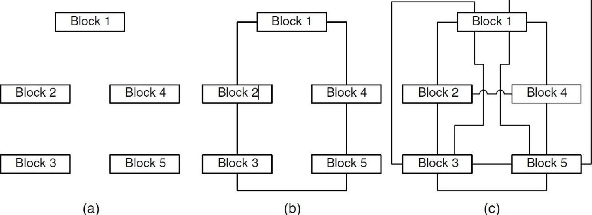


<div align="center">

(a)

</div>

<div align="center">

(b)

</div>

<div align="center">

(c)

</div>

<div align="center">

Figure 2-2: Complexity description through relationships

</div>

## Lack of understanding

Concept of "lack of understanding" can arise at any stage of a lifecycle beginning with formulation of requirements which will lead to issues during the development stage and after that even during the operation of a product. Friedenthal argues that understanding of a system model is a major factor (Friedenthal et al., 2014). Models have to be dynamic due to the fact that usually there is a need to look at the system only from a particular aspect of

<!-- PDF_PAGE: 33 -->

certain design. The same thing can be said about overcomplicated models with lots of communication, rules and relationships.

## Communication problems

With the "complexity concept" in place another issue arise which is the communication problem. This can happen on any level, between several people, groups of people, companies, systems or different departments involved in process of development. This problem leads to lack of communication between different models which are parts of a main system model in MBSE.

Three of these problems cannot happen on their own but they will generate one another. It is always significant to tackle these issues on early stages of lifecycle. It is highlighted that modern systems are becoming more and more complex and these issues persist (Mayfield et al., 2018). Thus, creating a proper dynamic model of communication between different models of MBSE is a needed step in the development of the corresponding field.

Paul Goossens from Maplesoft identifies major challenged arising when designing and delivering dynamic in nature products (Goossens, 2016). The most significant one is the need to follow through the entire design process multiple times due to discovering serious design issues in the later stages of lifecycle. The worst possible option is identifying problems even after a system has been commissioned and sold to end customers.

In a paper from European Southern Observatory main issues of system projects complexity are stated (Karban et al., 2014) as identified by NASA's Jet Propulsion Laboratory (JPL) （Integrated Model-Centric Engineering (IMCE) Workshop for JEO, 2011). These issues consist of growing mission complexity, huge number of pieces in system design without exact architecture, losing knowledge at lifecycle stage boundaries and different technical sides communicating poorly. This shows growing complexity of modern models in MBSE. The author

<!-- PDF_PAGE: 34 -->

2. 0 Systems engineering and interaction modelling argues that MBSE is an advanced modern approach and identifies SysML as a key for modelling and integrating all parts of systems engineering. Nevertheless, conventional V-model development is seen to be outdated as validation stage comes too late and it is almost impossible to deal with the design problems on later stages of a lifecycle as it basically means to develop everything from scratch once again. MBSE allows verification and validation of requirements, concept and full design on early stages of the lifecycle but proper means of communication between different parts of design process are required to be integrated in MBSE.

The concepts of concurrent engineering require a large amount of coordination between engineers who focus on different parts of product development. Mayfield names this problem as "design management's challenge" and identifies that engineers usually works in isolation (Mayfield et al., 2018). The reason behind this challenge is to break down complex tasks into simple subtasks that individual engineers can perform. Addressing all these subtasks simultaneously makes engineering truly parallel and concurrent (Martelo Gomez et al., 2018). Thus, transforming a complex problem into sequence of relatively simple sub problems and organising communication between all these sub problems make the project work and improve problem-solving mechanisms.

Farnell identifies growth of engineering system in size, scope and complexity (Farnell et al., 2019). Concurrent engineering is seen to be a philosophy which makes product development lifecycle more successful in its completion but lacks certain aspects like proper parallelism, decomposition and stability.

<!-- PDF_PAGE: 35 -->

## 2.5.3 Inconsistencies in MBSE

Finkelstein identifies inconsistency as a logical contradiction (Finkelstein, 2000). As an example of inconsistency in MBSE any technical statement which includes ambiguous definition can be considered. With complexity of systems in industry increasing through time modern approaches tend more to decompose main system model into simpler sub models. Thus, quite a lot of inconsistencies can arise when you arrange communication between all the sub models.

Friedenthal recognises that design inconsistencies can arise especially when multiple people work on the same model (Friedenthal et al., 2014).To tackle this problem just a well-defined disciplined process is proposed which leaves space for human mistakes generating inconsistencies. The crucial point of the systems engineering development process is the need to study the systems from various viewpoints as different experts study the systems from their own perspective. These views might hold multiple interrelations and that might lead to potential inconsistencies (Herzig and Paredis, 2014). It was identified that in current MBSE practices managing inconsistencies is highly limited by the underlying methods and overall static representation nature (Sandhu, 2015). Currently some graph-based methods to distinguish inconsistencies are being developed but as the number of all possible inconsistency patterns is infinitely large, the issue remains (Feldmann et al., 2019).

Developing proper means for communication between all parts of MBSE process and stages of product development lifecycle will allow systems engineers to reduce quantity of inconsistencies and lower possible impact of mistakes in design originating from inconsistent management.

<!-- PDF_PAGE: 36 -->

## 2.5.4 Development state of logic models in MBSE and lack of dynamism

MBSE methodologies utilise logic models where interaction is modelled in the ways of hardcoded rules, pre-defined relationships and strict mathematical expressions. Knowledge is being implemented into the model itself or broken-down during capturing stage into different parts, features, relationships and rules.

It is implied that there are some further limitations present in MBSE regarding the system representation for addressing general behavioural aspects of the product development process (Graignic et al., 2013). Furthermore, it has been shown that MBSE methods and tools are able to integrate and manage not only requirements but also all other aspects of the development process - product design, development test and production. Indeed, MBSE is successful in achieving its aim - minimising risks and avoiding changes at the later stages of the lifecycle. Despite that, systems are becoming more complex and even though MBSE can most definitely be applied to many industrial applications, in practice large systems remain static and extra difficult to manage and maintain (Li et al., 2019). That shows the need for the improvements for the current MBSE methodologies to be able to diminish the complexity of the system and make it manageable on all the development stages and making the system more dynamic (Motamedian, 2013).

Also, it was recognised that most MBSE approaches demand certain forms of code instrumentalism that prevents the use of dynamic verification through the development process (Sandhu, 2015). MBSE tools allow the division of the production into two separate processes - domain engineering and application engineering that further generates the gap between different engineers involved in the modelling process.

<!-- PDF_PAGE: 37 -->

According to Chapman, successful commercial developments are felt not to be flexible enough to model the dynamic design engineering environment (Chapman and Pinfold, 2001). Work carried out by Reddy et al. recognises the scarcity of dynamic specific KBE methodologies (Reddy et al., 2015). Moreover, Lolli argues that "blind spots" exist in logic because of the fact that pre-described set of rules can't prove to be useful in every situation (Lolli et al., 2014). This identifies shortcomings of current methodologies and shows the potential of their improvement in the area of dynamic logic development.

## 2.5.5 Research gap summary

In summary, the outcome of the literature review has identified research gaps that need to be addressed. Logic in context of this research is seen as an interaction between different sub models forming the main system model. The survey through existing systems engineering trends shows that major issues in the engineering process which include growing complexity, lack of understanding, communication problems, and inconsistent management.

Thus, the research gaps are:

- Interactions are hard-coded in the form of rules, relationships or mathematical expressions not providing enough flexibility in the design process.

- Logic is not dynamic leading to bulky rules/mathematical expressions systems with many unused parts in the logical tree process.

- Growing complexity of current system models leads to a high possibility of inconsistencies existence in the form of logical contradictions which must be dealt with on all stages of a lifecycle.

<!-- PDF_PAGE: 38 -->

- Different models in MBSE uses different forms of interaction models in its structure. Therefore, universal way for dynamic modelling of the systems interaction is not existent.

## 2.6 Research questions and hypotheses

The objective of this section is to go from the statement and description of the problem and gaps to developing research questions and hypotheses for a possible solution approach. As discussed in Chapter 1, the primary question that motivated this research is as follows:

How can the organisation of the interactions among the sub systems be analysed in MBSE for the purpose of solving complexity issues such as lack of communication and lack of understanding?

Having explored and discussed this question, key research gaps have then been identified and presented in the previous sections.

Based on the literature review presented in this Chapter, it was concluded that existing MBSE methodologies and approaches do not provide enough capabilities to effectively analyse and model the interactions among sub systems of the main system model. That leads to the formulation of the primary research hypothesis. Also, based on the original research hypotheses, the additional research question is posed for this research stating its own hypotheses.

## 2.6.1 Research Question 1 and Hypothesis 1

Research question 1: How can the organisation of the interactions among the sub systems be analysed in MBSE for the purpose of solving complexity issues such as lack of communication and lack of understanding?

<!-- PDF_PAGE: 39 -->

Research hypothesis 1: The new methods and tools for modelling interactions in MBSE can improve the effectiveness of interactions analysis MBSE by:

- Creating the common interaction module storing all information on interactions and relationships among the sub systems.

- Formalising the interactions definitions and generating new dynamic ways of tracking the relationships among system model components.

## 2.6.2 Research Question 2 and Hypothesis 2

Research question 2: How can the new dynamic ways of interactions modelling improve and enhance the existing MBSE methods and static ways - hard-coded rules, pre-defined rules, relationship and mathematical expressions?

Research hypothesis 2: The new methods and tools for modelling interactions can improve the existing MBSE techniques in such a way that the interaction model can be reused at any stage of the development process by:

- Using a general formalism to describe the concept and the interaction knowledge storage.

- Automatically tracking changes in the main system model and its sub systems and propagating changes to the other model components.

- Providing capabilities to track interactions and relationships when performing various changes on all stages of the development lifecycle.

<!-- PDF_PAGE: 40 -->

2. 7 Need for interaction modelling automation and expected contribution to knowledge The interaction modelling addresses critical research gaps in effectively modelling interaction among sub systems and components in the main system model in MBSE methodologies.

From the literature review conducted through this work, it is evident that there are many MBSE methodologies present in the current state of systems engineering. Also, from the description of the methods it can be distinguished that there are similarities between them. Each of the MBSE methodologies is successful in providing systems modelling capabilities to some extent based on the needs of a systems engineer (Weilkiens et al., 2016). However, the interactions are defined in the same manner and there is no automation mechanism used in the methodologies. Changes propagation is performed by all methods but ultimately leaves the changes tracking to the systems engineer to do it manually. With growing complexity, it becomes impossible to take everything into account, resulting in the lack of understanding of the design process on different stages of the development lifecycle and errors in design that might lead to redoing many things from scratch. The literature also shows that MBSE methodologies and associated methods pre-define the relationships between components of the main system model in form of hard-coded rules and constraints making systems not dynamic and leading to the drastic growth of overall system complexity (Shekar et al., 2011). The development of any engineering system highly depends on quality, time and cost of the product (Chapman and Pinfold, 1999). Ultimately, MBSE methodologies provide the means to diminish times required to develop better quality in less time but fail to fully automate that process and still leave room for many mistakes based on unanticipated changes in some components while changing other models, values or relationships. Knowledge based engineering extends the automation capabilities but even though they are successful in making design knowledge reusable in new design processes, literature review of the current

<!-- PDF_PAGE: 41 -->

KBE methodologies shows that they also require a lot of manual modelling and deep understanding of the whole project by everyone involved in the process of development (Rocca and Tooren, 2007). A similar understanding of KBE and MBSE methodologies limitations is discussed in the graph-based design languages paper (Gross and Rudolph, 2016a).

With regards to solving the interaction modelling issue, a research conducted by Albers (Albers and Zingel, 2013) provided some background information. Unfortunately, author acknowledges the fact that a lot of advancements are still needed for MBSE methodologies in product development processes to make changes propagation easier and more convenient for systems engineering. The relationships among sub systems are presented with pre-defined rules with not enough flexibility in the design process. The author distinguishes the need for extending existing methodologies and developing central model for controlling interactions in model-based systems engineering environment.

The need for developing central model is further discussed by Rudolph and Gross (Groß and Rudolph, 2012). Designing modern complex systems includes solving a huge amount of problems among different interacting engineering domains (Madni and Sievers, 2018b). Thus, it is significant to construct proper data exchange mechanism between different engineering models to allow easy and convenient way of propagating changes in one model to all other models and track these changes beginning in early stages with conceptual modelling.

## 2.8 Summary

In this chapter review of the current state of systems engineering is provided. Initially, understanding of the existing systems engineering, model-based systems engineering, and design automation techniques is shown. The chapter further discusses the tools and software

<!-- PDF_PAGE: 42 -->

2. 0 Systems engineering and interaction modelling that are available for performing systems engineering such as SysML. Even though modelbased systems engineering has been successful in its attempt to allow engineers to reduce systems complexity, significant research gaps were identified that interactions among subsystems are modelled manually in the form of hard-coded rules and pre-defined relationships. Based on the research gaps and the motivation, the research questions were formulated with corresponding hypotheses of how to provide an answer for them. The need for the interaction modelling automation is discussed based on the findings from the literature and expected contribution to knowledge is provided. That clearly shows that current logic modelling in systems engineering is limited and interaction modelling framework is needed, which fills the research gaps and answers the research questions. That leads to the next chapter that further discusses the state of the interaction modelling in the current engineering applications and introduces graph-based modelling approaches.

<!-- PDF_PAGE: 43 -->

## 3.0 Graph-based systems modelling

## 3.1 Introduction

This chapter outlines the major aspects of the graph theory, which is a basis for the methodology developed in this research. Key graphical constructs are identified, and their own advantages and disadvantages are discussed. Next, the comparative analysis of all the graphical structures is provided where the best applicable concept is derived, which is a metagraph. Then the theory behind metagraphs utilisation for systems modelling is provided with examples of existing research and applications. Also, the related research is further discussed with the introduction to the graph-based design languages being developed. Finally, the applicability and the need of the metagraphs concept is discussed while concluding the chapter.

## 3.2 Graph theory

Literature review shows that graph theory is widely utilised in engineering and provides many functional capabilities for systems engineers. Deo highlights the usefulness of different graphical constructs in various engineering and computer science applications (Deo, 2017). Walter provides the information on utilising graph theory representation of engineering systems and their knowledge (Walter et al., 2019). Moreover, Basu and Blanning discuss the effectiveness of using graph and their extensions, such as metagraphs, in modelling decision support systems (Basu and Blanning, 2007). That leads to the clear idea that graphs provide extensive capacity to be used in the systems engineering field and be applied in modelling of sub systems, components and interactions among them in MBSE.

<!-- PDF_PAGE: 44 -->

## 3.2.1 General definitions

Graph itself is a "representation of a set of objects where some pairs of objects are connected by links. The interconnected objects are represented by mathematical abstractions called vertices (also called nodes or points), and the links that connect some pairs of vertices are called edges (also called arcs or lines)” (Tutte, 1984).

Herzig recognises graphs as the best way of model representation and utilisation (Herzig et al., 2014). Every statement is divided into three parts - subject, predicate and object, vertices of a graph stand for subject and object as directed labelled edge is a predicate between subject and object (Giarratano and Riley, 1998). Graph visual representation is illustrated in Figure 3-1. For finding inconsistencies in MBSE Herzig proposes exact matching problem of graph patterns to determine whether or not ambiguous definition of a property exists.


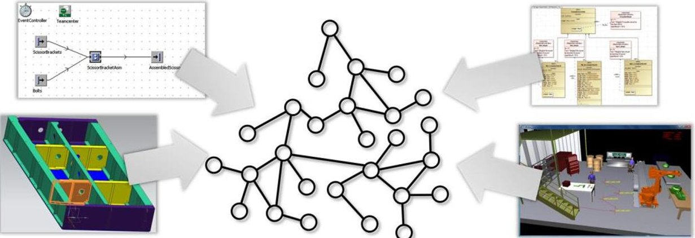


<div align="center">

Figure 3-1: Graphs as a way of model representation (Herzig and Paredis, 2014)

</div>

<div align="center">

Heckmann recognises the fact that any big system with numerous related entities can be modelled by some kind of a graph (Heckmann et al., 2015). By utilising graph constructs number of benefits is provided. First of all, basis for use of graphs is the reason that it is an effective way to represent, visualise and understand very complex systems. This might not be possible with conventional system description techniques either text-based or formal ones, which are useful only to those who can understand utilised formal language. Secondly, formal properties of graph structures provide one of the most applicable ways to analyse structure

</div>

<!-- PDF_PAGE: 45 -->

and behaviour of complex systems. The further usefulness of graph theory in application to systems engineering is highlighted by applying it to explore complex system of systems architecture (Potts et al., 2017).

The main reason behind the use of the graphs is the fact that they provide effective means to represent, visualise and maintain very complex systems that might not be possible with standard text-based or formal description methods useful only to those who can understand corresponding formal language or familiar with the organisation of corresponding text-based document. Additionally, use of graphical structures present applicable ways to analyse structure and behaviour of complex systems.

## 3.2.2 Comparative analysis of graphical structures

There are a number of different graphical constructs applicable to various areas. Therefore, there is a need to distinguish among them the best methodology for the purposes of this research. To solve this problem a comparative analysis of different graphical constructs was performed with the help of literature. For this comparison the following list of criteria were identified:

- Visualisation - shows model representation capabilities.

- Directionality - implies that current graphical construct has means for showing directions of each input-output dependencies.

- Model composition - displays whether we have enough information to determine set of variables involved in each relationship.

- Multiple inputs/outputs - represents capabilities of each graphical construct to deal with multiple inputs/outputs in relationships.

<!-- PDF_PAGE: 46 -->

- Simple algebraic form - shows that graphical construct has algebraic form representation that can be utilised to some extent in programming and this graphical construct application.

- Multiple components - implies that graphical construct has developed theory for dealing with multiple interacting components.

Based on the example set of interacting variables it is possible to perform comparative analysis of different graphical constructs that can be utilised for modelling interaction among these variables (Basu and Blanning, 1995). This example is shown in Figure 3-2.


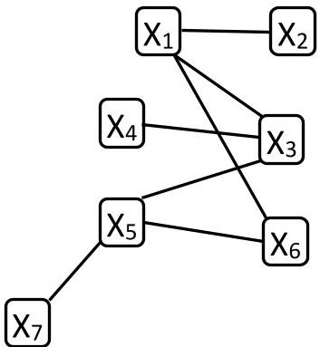


<div align="center">

(a) Graph

</div>


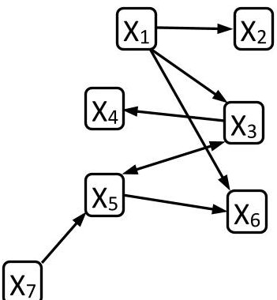


<div align="center">

(b)

</div>

<div align="center">

Directed

</div>


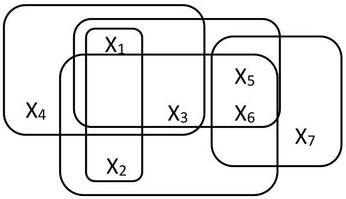


<div align="center">

(c) Hypergraph

</div>


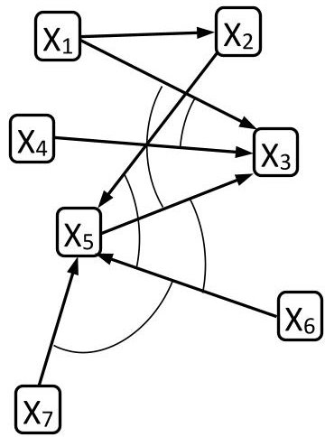


<div align="center">

(d)

</div>

<div align="center">

AND/OR

</div>

<div align="center">

Figure 3-2: Graphical representation of a set of interacting variables ) Simple graph, (b) Directed graph, (c) Hypergraph and (d) AND/OR graph

</div>

Simple graph provides a good visualisation that can be utilised to show that a link between some variables exists but fails in providing information about the direction of existing relationships. Directed graph, in addition to showing the relationships among entities, includes the direction of the input-output dependencies. Thus, we know that some variables

<!-- PDF_PAGE: 47 -->

determine other variables but we still do not have enough information about the composition of models to determine particular variables.

The more sophisticated concept such a hypergraph is seen to be even more advanced way that can be utilised in systems engineering. Hypergraph handles any generalised object that represents physical or abstract properties: particles, states, points in space etc. Analytical representation in the matrix form can be comfortably used by the computer and easily modified according to the needs of a particular system. Gazdik's analysis of modern graph approaches shows that hypergraph has to be considered as one of the most adaptable tool for modelling systems (Gazdik, 2006). That is further confirmed by more recent studies carried out by Bruza (Bruza, 2018).

Hypergraph representation provides additional capabilities to determine the set of variable relevant to each relationship as a single hypergraph edge covers all the variables involved in particular interaction. However, hypergraph does not provide enough information to determine outputs and inputs in each relationship. A possible solution to this is to label all the variables/nodes of a hypergraph but it can be rather difficult for variables involved in different models simultaneously. Additionally, Basu provides discussion on existence of directed hypergraphs that are helpful to overcome identified problems.

Directed hypergraphs can be used to overcome identified problems although theory of directed hypergraphs has been developed mostly for modelling relationships among individual elements and we aim to model interaction among large quantity of components. AND/OR graphs combines advantages of both previous graph constructs but in some situations, where model has multiple outputs, requires multiple edges and becomes too difficult. Harel explains that in Higraphs variables are grouped into special objects called "blobs", which can be additionally grouped into higher-level blobs and so on (Harel, 1988).

<!-- PDF_PAGE: 48 -->

Thus, these blobs can be sets of variables, sets of sets of variables etc., where edges connect one blob to another blob. Higraph is a useful and flexible graphical structure but requires very difficult mathematical concepts to represent it.

Summary of this comparison together with directed hypergraphs and hierarchical graphs (Higraphs), which were introduced in section 3.5, is shown in Table 3-1.

<div align="center">

Table 3-1: Comparative analysis of graphical constructs

</div>

<table border="1"><tr><td>Criteria</td><td>Simple graph</td><td>Directed Graph</td><td>Hypergraph</td><td>AND/OR Graph</td><td>Metagraph</td><td>Directed hypergraph</td><td>Higraph</td></tr><tr><td>Visualisation</td><td>+</td><td>+</td><td>+</td><td>+</td><td>+</td><td>+</td><td>+</td></tr><tr><td>Directionality</td><td>-</td><td>+</td><td>-</td><td>+</td><td>+</td><td>+</td><td>+</td></tr><tr><td>Model composition</td><td>-</td><td>-</td><td>+</td><td>+</td><td>+</td><td>+</td><td>+</td></tr><tr><td>Multiple inputs/outputs</td><td>+</td><td>+</td><td>-</td><td>-</td><td>+</td><td>+</td><td>+</td></tr><tr><td>Simple algebraic form</td><td>+</td><td>+</td><td>-</td><td>-</td><td>+</td><td>+</td><td>-</td></tr><tr><td>Multiple components</td><td>+</td><td>+</td><td>+</td><td>+</td><td>+</td><td>-</td><td>+</td></tr></table>

Pluses (+) in the table mean that corresponding graphical construct has capabilities to meet the developed criteria whereas Minus (-) means the opposite.

Thus, all these constructs can be useful to some extent in numerous scientific areas but each of them fails to cover all aspects of models interaction. This includes direction representation, input/output identification and overcoming inconsistencies problems that can exist if we work with multiple models with large number of interacting variables involved in numerous models simultaneously. To solve this problem, it is possible to utilise a more sophisticated graphical construct known as metagraph.

<!-- PDF_PAGE: 49 -->

## 3.3 Metagraph definition

Metagraphs, an extension of directed graphs and hypergraphs, differ from conventional graphical constructs as each edge is an ordered pair of sets of elements, not an ordered pair of elements as in directed graphs or an unordered set of one or more elements as in hypergraph (Basu and Blanning, 2007). Metagraphs are considered to be a powerful method for decision support systems as they can be utilised for interaction between components analysis no matter what these components are, models, relationships or rules (Basu and Blanning, 1999).

Nodes or elements of a metagraph represent the variables and the edges represent calculation procedure of models. Example metagraph is shown in Figure 3-3. This example represents the same model, which was used for comparative analysis of different graph structures in section 3.2.


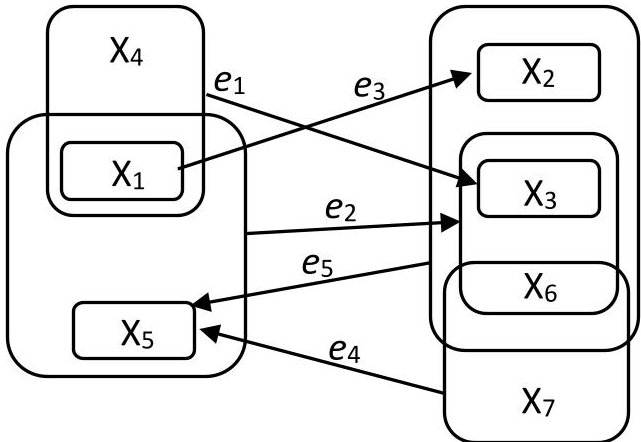


<div align="center">

Figure 3-3: Example metagraph

</div>

Here metagraph consists of 7 elements and 5 edges and each edge provides full information on scope and direction of every relationship. For example, edge $ e_{5} $ shows that knowing variables TCOST and LSLS is enough to fully determine variable CAP, which makes TCOS and LSLS invertex of $ e_{5} $ and CAP its outvertex.

<!-- PDF_PAGE: 50 -->

## 3.3.1 Metagraph properties

Path. The one of the important aspects of metagraphs is a path that is a sequence of metagraph edges. First element of each path is its source whereas end of a path is its target. The source is a part of the invertex of the first edge in the path, the target is a part of the outvertex of the last edge in the path and the length of the path is number of edges in it (Basu and Blanning, 2007). For any adjacent pair of edges invertex of the first edge and outvertex of the second edge have at least one element in common. Paths not necessarily provide enough information to determine a target from its source as some other variable might be needed and these variables are called coinput of the path's target.

Metapath. However, concept of the path is not sufficient to describe all calculations in metagraphs. Figure 3-4 shows a metagraph, which contains two paths {sls, fin} and {cost, fin} but both paths do not have null coinput and do not provide enough information to calculate NI out of INFL. Thus, variable INFL, both edges sls and cost and edge fin form general instrument of metagraph connectivity called a metapath. Like a path, each metapath consists its source, which is an origin set of elements, and a target, which is a final set of elements. Metapath has three key properties: each edge of a metapath is on a conventional path from an element in metapath's source to an element in metapath's target, set of all elements in the invertices of the edges of the metapath that are not in the outvertex of some edge in the metapath are contained within metapath's source, set of elements in the outvertices of all the edges in the metapath contains a target.

<!-- PDF_PAGE: 51 -->


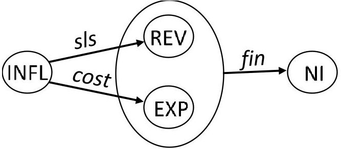


<div align="center">

Figure 3-4: Metagraph with a Metapath

</div>

Metapath is considerably different from a conventional path as edges do not have to be put in sequence, which allows designer to model parallel calculation procedures. Also, source and target of a metapath are sets of elements so there is no need for considering the coinput for metapaths as all the necessary information for calculation is contained inside a metapath.

For small metagraphs it is easy to determine path and metapaths visually but for modelling real and large systems this can be done with the use of an adjacency matrix.

## 3.3.2 Model as a metagraph

In the metagraph view of models each model is represented as an edge with inputs as invertex and the outputs as outvertex. Yet, the main issue is connectivity, which implies that there might be lack of existence of one of more metapaths connecting a source set of elements to a target set of elements. This means that the corresponding models must exist if the source elements can be utilised to calculate the target elements. To overcome this issue, we need to distinguish whether there are any bridges, which are the intersection of all metapaths, and if there are more than one metapath between invertex and outvertex.

Simple example model base is illustrated in Figure 3-4 (Basu and Blanning, 2007). There are four variables: INFL stands for inflation rate, REV are the revenues, EXP are the expenses and NI is the net income. Also, there are three models, which are represented by three edges: s/s is a sales model that calculates REV out of INFL, cost model cost that calculates EXP from INFL and financial model fin, which determines NI from REV and EXP.

<!-- PDF_PAGE: 52 -->

Table 3-2 shows the adjacency matrix A for this simple metagraph. From this matrix we can distinguish in simple manner that sls and cost models do not have coinputs or cooutputs but NI column of the matrix defines that financial model fin takes both EXP and REV as inputs and produces NI as output, which means that EXP is a coinput of $ a_{\mathrm{REV,NI}} $ and REV is a coinput of $ a_{\mathrm{EXP,NI}} $ .

<div align="center">

Table 3-2: Adjacency matrix A for Figure 3-4

</div>

<table border="1"><tr><td></td><td>INFL</td><td>REV</td><td>EXP</td><td>NI</td></tr><tr><td>INFL</td><td>∅</td><td>{<∅,∅,<sls>>}</td><td>{<∅,∅,<cost>>}</td><td>∅</td></tr><tr><td>REV</td><td>∅</td><td>∅</td><td>∅</td><td>{<EXP,∅,<fin>>}</td></tr><tr><td>EXP</td><td>∅</td><td>∅</td><td>∅</td><td>{<REV,∅,<fin>>}</td></tr><tr><td>NI</td><td>∅</td><td>∅</td><td>∅</td><td>∅</td></tr></table>

The closure of the adjacency matrix A $ ^{*} $ is shown in Table 3-3.

It completes adjacency in a way that it shows the smallest relations among the elements. From this closure, we can determine that there are only two simple paths of length more than 1 - <sls, fin> and <cost, fin> and there is no sequence of models connecting INFL to NI that is free of coinputs. For that purpose, there is a metapath {sls, cost, fin} connecting INFL and NI, which shows the advantage of representing model bases as metagraphs and defining metapaths that can define connectivity where simple paths fail to do so.

<!-- PDF_PAGE: 53 -->

<div align="center">

Table 3-3: Closure A $ ^{*} $ of the adjacency matrix for Figure 3-4

</div>

<table border="1"><tr><td></td><td>INFL</td><td>REV</td><td>EXP</td><td>NI</td></tr><tr><td>INFL</td><td>∅</td><td>{<∅,∅,<sls>>}</td><td>{<∅,∅,<cost>>}</td><td>{<EXP},{REV},<sls,fin>>,<REV},{EXP},<cost,fin>>}</td></tr><tr><td>REV</td><td>∅</td><td>∅</td><td>∅</td><td>{<EXP,∅,<fin>>}</td></tr><tr><td>EXP</td><td>∅</td><td>∅</td><td>∅</td><td>{<REV,∅,<fin>>}</td></tr><tr><td>NI</td><td>∅</td><td>∅</td><td>∅</td><td>∅</td></tr></table>

Main advantage of a metagraph is a general, non-procedural formalism that defines all properties such as reachability, connectivity and transitive closure. This formalism can be utilised to distinguish coinputs, cooutputs of any path or metapath. Also, metagraphs provide convenient mathematical way of defining metapaths with the use of an adjacency matrix as discussed earlier.

This further shows applicability of metagraphs for model organisation and logic management. Thus, this research currently identifies metagraphs as a basis upon which the desired framework can be most reasonably developed. Graphs extensions, such as hypergraphs and metagraphs, provide all sorts of potential to be applied for modelling systems interaction.

## 3.3.3 Metagraphs, directed hypergraphs and hierarchical graphs (higraphs)

Metagraphs, directed hypergraphs and higraphs share similar capabilities and from a visualisation point they appear close as shown in Figure 3-5.

For directed hypergraph useful notions such as metapath, coinputs and cooutputs have not been developed as theory of directed hypergraphs has been developed mostly for modelling relationships among individual elements.

Basu cites Harel and explains that in higraphs variables are grouped into special objects called "blobs", which can be additionally grouped into higher-level blobs and so on (Harel, 1988). Thus, these blobs can be sets of variables, sets of sets of variables etc., where edges connect

<!-- PDF_PAGE: 54 -->

one blob to another blob. Higraph is a useful and flexible graphical structure but requires much more difficult mathematical concepts to represent it, therefore metagraphs are found to be more adequate for systems engineering purposes. Nevertheless, one cannot forget about the higraph existence and its capabilities.

Higraph and directed hypergraph capabilities in comparison with metagraphs are shown in Table 3-1.


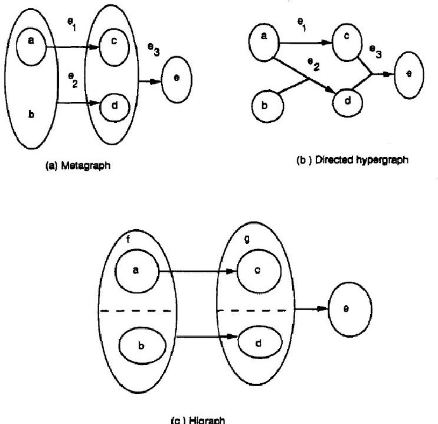


<div align="center">

Figure 3-5: (a) Metagraph, (b) directed hypergraph and (c) hierarchical graph representation of the same system (Basu and Blanning, 2007)

</div>

## 3.3.4 Metagraph applicability

According to Basu, a number of features are needed in representing interactions among multiple models such as directionality representation, visualisation capabilities, understanding sets of variables involved in each relationship and formalised algebraic representation (Basu and Blanning, 2007). Thus, metagraphs support all these features and prove to be applicable for the purposes of the current research.

It was identified from the literature that metagraphs can be applied to data and rule management, where rule bases can be represented as metagraphs and integrated into

<!-- PDF_PAGE: 55 -->

models. Moreover, workflows and processes can be modelled with the use of metagraphs. Metagraphs are considered to be a powerful method for decision support systems as they can be utilised for interaction between components analysis no matter what these components are, models, relationships or rules (Skvortsova and Grout, 2018).

The other application of metagraphs is in the field of complex systems and software engineering and deals with the semantic complex event processing (Gapanyuk, 2019). The goal is to develop an engine to distinguish meaningful events in the form of complex situations. Metagraph model is used as a single model for describing semantic events, complex situations and global ontologies, and makes it possible to construct hierarchy of dynamic metagraph agents.

Also, metagraphs are successfully used in machine learning applications and neural networks (Sankar et al., 2019). Metagraph approach is utilised to extract features from local metagraph-structured neighbourhoods and to capture semantic higher-order relationships in attributed heterogeneous information networks. These networks consist of multiple nodes of different types interconnected through various semantic relationships. That shows how metagraphs are applicable in the systems with multiple interacting components.

Main advantage of a metagraph is a general, non-procedural formalism that defines all properties such as reachability, connectivity and transitive closure. This formalism can be utilised to distinguish coinputs, cooutputs of any path or metapath. Also, metagraphs provide convenient mathematical way of defining metapaths with the use of an adjacency matrix as discussed earlier.

<!-- PDF_PAGE: 56 -->

Thus, this research identifies metagraphs as a basis upon which the desired framework can be most reasonably developed. Graphs extensions, such as hypergraphs and metagraphs, provide all sorts of potential to be applied for modelling systems interaction.

## 3.4 Design structure matrix

## 3.4.1 Decomposition principle

According to "decomposition" principle of concurrent engineering, complex systems often can be divided into a number of more simple subsystems that are utilised to correspond to one or several tasks (Yassine and Braha, 2003). Then subsystems can be decomposed into completely independent components for further simplification of the main system model. All the subsystems and components are maintained independently, therefore modelling of individual submodels is done simultaneously. Yassine implies that proper decomposition of a complex system into simple manageable parts allows to boost product development efficiency by making engineering concurrent and easier maintainable on all phases of a life cycle.

## 3.4.2 General concept

There is another concept applicable to managing complexity in SE-Design Structure Matrix (DSM), which became a popular representation and dependency analysis tool. Browning identified growing popularity of this technique (Browning, 2015). DSM represents the interactions between different components of a system in a matrix form, advantageous for logic analysis in SE. DSM itself is a square matrix, as shown in Figure 3-6. Rows, columns and diagonal elements are identical and stand for different system components. Each nondiagonal mark represents dependency existence between two components in one way or another. Going across a row reveals what other elements this component affects (output

<!-- PDF_PAGE: 57 -->

sinks), while going down a column shows what other elements this component depends on (input sources).


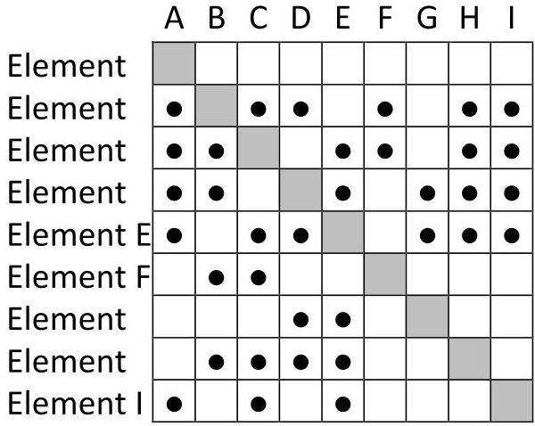


<div align="center">

Figure 3-6: Example DSM

</div>

Zhang identifies that DSM approach helps to manage complexity in projects (Zhang et al., 2019). DSM itself is a useful matrix representation of a directed graphs that can be integrated in the development process. Author implies that for better system structure transparency and understanding DSM matrix can be partitioned, which includes identification of tasks series that can be executed sequentially.

Although partitioning is an effective way for organising DSM matrix, and therefore managing complexity, it is useful mostly when the elements are direct tasks. When these elements are people controlling the tasks or subsystems of a larger complex system, the process called clustering is utilised. Clusters are special combinations of elements, where all the interaction is done inside of a cluster, minimising links to other clusters. An example of clustering is shown in Figure 3-7.

<!-- PDF_PAGE: 58 -->


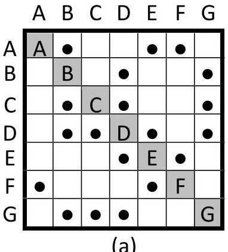


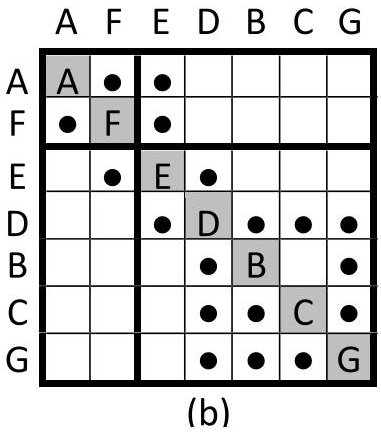


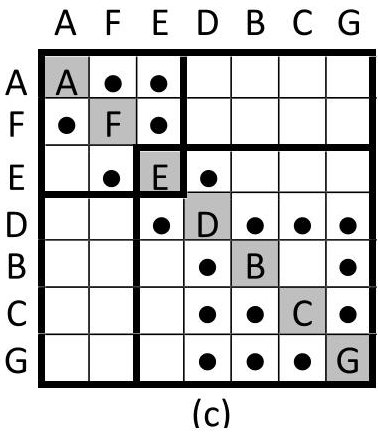


<div align="center">

Figure 3-7: Example DSM:

</div>

<div align="center">

(a) Base DSM; (b) Clustered DSM; (c) Alternative Clustering DSM

</div>

Overall Yassine implies that DSM method helps to control complexity and makes a better formal representation of the interactions among different subsystems. Clustering and partitioning allow to minimise needed quantity of iterations, which as well leads to reducing complexity.

Tang identifies that DSM approach is able to help knowledge based engineering by utilising DSM-based change propagation analysis (Tang et al., 2010). This analysis can distinguish all possible indirect dependencies or interactions among system sub models with the help of DSM matrix. With all possible change options identified the knowledge about corresponding changes can be brought in advance, which is useful for design automation and prevents mistakes and inconsistencies in the design process. Although DSM approach is helpful for redesign process, only structured design knowledge can be addressed in the matrix, while unstructured knowledge must be organised at first.

## 3.4.3 DSM applicability and connection with graph theory

DSM offers a good way of models interaction representation in matrix form, which is comfortable and applicable for programming. It is worth noting that there is a strong connection between DSM and a graph, which is shown in Figure 3-8. Therefore, utilising DSM in combination with metagraphs will provide further benefits for systems modelling.

<!-- PDF_PAGE: 59 -->


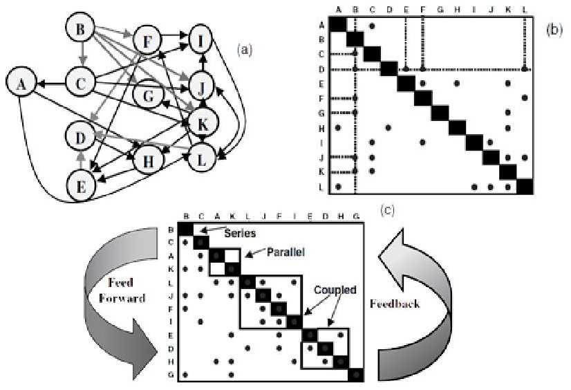


<div align="center">

Figure 3-8: Example DSM (Yassine and Braha, 2003):

(a) Directed graph; (b) Base DSM; (c) Partitioned DSM

</div>

## 3.5 Graph-based design languages

Complexity in spacecraft design is identified through the discussion of graph-based design languages and the requirement of new ways for solving complexity problems are distinguished (Gross and Rudolph, 2016a). In addition to that, designing modern complex systems includes solving a huge amount of problems among different interacting engineering domains (Gross and Rudolph, 2016b). Thus, it is significant to construct proper data exchange mechanism between different engineering models to allow easy and convenient way of propagating changes in one model to all other models and track these changes beginning in early stages with conceptual modelling. Data exchange process general view is shown in Figure 3-9.


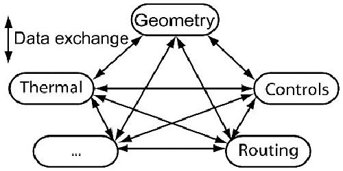


<div align="center">

Figure 3-9: Data exchange process (Gross and Rudolph, 2016b)

</div>

One way of solving this problem is the use of a central model to govern all interactions and data exchange among different models, which is shown in Figure 3-10.

<!-- PDF_PAGE: 60 -->


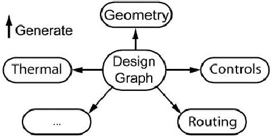


<div align="center">

Figure 3-10: Central data model (Gross and Rudolph, 2016b)

</div>

Design graph approach is introduced in application to open FireSat example and provides design graph generation for FireSat example, where nodes are instances specifications (UML Classes) and edges are links between those instances (Gross and Rudolph, 2016c). Required equations for conceptual design of a satellite are provided by Wertz, where in graph-based design languages they are defined by edges of the design graph (Larson and Wertz, 2008). Design graph itself represents an analytical model and it is possible to analyse it in several ways, one of them being graphical representation of the solution sequence for the whole equation system.

Another application of the design graph approach is enhancing the maintenance capabilities of virtual commissioning digital models (Kiesel et al., 2017). An example design graph of a robot cell is shown in Figure 3-11. In this case a robot cell consists of 6 axis robots and only needs the functionality to manage the connections among the inputs and outputs of the robots. The example design graph is a fragment of a larger graph as indicated by dashed elements.

<!-- PDF_PAGE: 61 -->


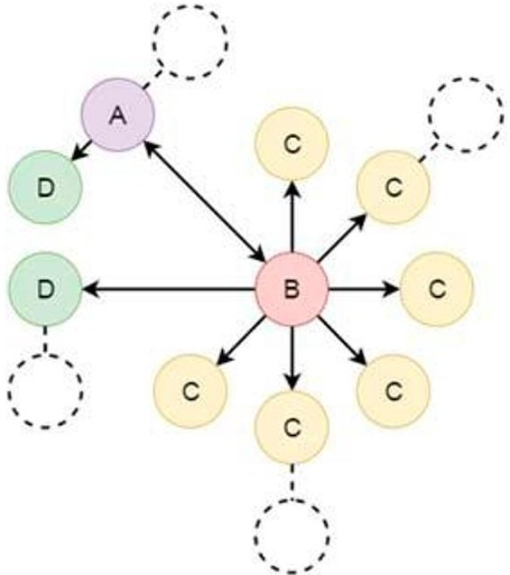


<div align="center">

Figure 3-11: Robot Cell example design graph (Kiesel et al., 2017)

</div>

Overall graph-based design language has been demonstrated as a useful way of representing entire design by a complex equation system revealing all the design dependencies along the design process. Keeping large and complex system manageable by assembling all its parts by rules and dependencies is an important process (Gitelman et al., 2017). Graph view of variables involved in the development process and interactions among them provides a comfortable way of analysing systems in their current state.

Although even one missing constraint or rule can lead to the entire equation system being unsolvable with no way of searching for the error, where one minor change in one subsystem can lead to an uncontrollable chain of changes. The same is applicable to inconsistencies in the design process, which often exist on different stages of a lifecycle. Therefore, in our study we aim to utilise such graph-based approaches that can not only represent the design in every moment but also be reliable and help design engineers to keep track of all the changes on every stage of a lifecycle automatically.

<!-- PDF_PAGE: 62 -->

## 3.6 Summary

This chapter introduced graph theory concepts and provided the general understanding of their utilisation in the systems engineering field. Based on the graph theory methods review the current chapter discussed the potential use of the graphical structures for achieving the aim of the research. The chapter explained the various graph constructs, their advantages and disadvantages and potential utilisation in systems engineering for systems modelling. The selection process of the most applicable graphical construct for this research purposes is provided. The chapter shows the understanding of metagraphs as the best suitable approach for modelling interactions in systems engineering. Metagraphs provide all necessary functionality for modelling interactions automatically based on the current research purposes. Moreover, it further highlighted the need for the systems interaction automation in engineering with links to the related research in the field based on graph-based design languages. Two previous chapters cover all aspects of the current methodologies used in MBSE and how they deal with interaction modelling. Also, findings from the current chapter clearly show the applicability of metagraphs for the purpose of this research. The outcomes of Chapters 1-3 are reflected in the papers from the list of publications (Filimonov et al., 2020), (Filimonov et al., 2016). The next chapter extends the findings and formulate the actual methodology framework based on the use of metagraphs and systems engineering methodologies.

<!-- PDF_PAGE: 63 -->

## 4.0 Interaction Modelling Framework

## 4.1 Introduction

Previous chapters have provided an overview of current systems engineering methodologies, their comparison and applicability to the purpose of this research. It was identified that currently there is no appropriate methodology to automate the interaction process. From Chapter 3 it was concluded that graph theory helps modelling interactions in model-based systems engineering environment. It was further shown that metagraph is the most applicable concept to cover the research gaps. Hence, there is a need to develop a framework or method that helps to model interactions among different models. First, this chapter presents the research methodology and research plan. Then it proceeds with an interaction modelling framework, its requirements, and other infrastructural aspects. It discusses all phases of the methodology based on conclusions drawn from previous chapters.

## 4.2 Research methodology

The aim of this research is to identify and develop methods and tools for creating dynamic ways of modelling logic in form of systems interaction for reducing complexity in MBSE environment. The purpose of this research is to address both practical and theoretical issues of the interaction modelling in the existing MBSE methodologies. It is required to identify overall approach of the research based on the most applicable methods (Flick, 2015). This involves the ability to improve quantitative parameters of systems engineering, such as time needed on each stage of the development life cycle. Moreover, quality of life improvements are required for making development process easier by reducing its complexity and providing systems engineers a framework for being able to observe the system behaviour when various changes occur in one of the system model sub models. Therefore, for the purpose of this

<!-- PDF_PAGE: 64 -->

research a combined method utilising both qualitative and quantitative information and techniques is adopted. It is known as "mixed method" and according to Creswell, "a mixed methods approach is one in which the researcher tends to base knowledge claims on pragmatic ground" (Creswell, 2013).

This research includes two use cases, which are examples of development of real-life industry objects gathered from the literature. One is the general automobile acceleration analysis and the other is the standard CubeSat systems development example. They are represented by their project description and SysML diagrams with all the necessary parameters, relationships, interactions, and logic. The research utilises the use case approach. Even though case studies have been criticised in the past as lacking scientific robustness and not addressing general outcomes of the research, it has been reiterated and noted by many authors as appropriate technique when dealing with evaluation within the complex research (Noor, 2008).

The qualitative and quantitative data from these use cases is then utilised for the verification and evaluation purposes. Modern systems engineering models are becoming more complex with appearance of a large amount of sub models showcasing smallest details of the development process. These systems are the subject of this research and it has been acknowledged that complex models are difficult to analyse so there is a need to create an appropriate amount of test cases that interpret sufficient behavioural aspects of the systems (Zhu et al., 2018).

Use cases data is used to develop five unique scenarios for each use case that results in the comprehensive analysis based on essentially 10 different scenarios for the parametric and qualitative evaluation. According to the fundamentals of the research design (Ramdhani and Ramdhani, 2014), the amount of data needed for an effective evaluation depends on the systems being researched, their parameters, possible behaviour and the expected evaluation

<!-- PDF_PAGE: 65 -->

outcome. Even though mixed method research is essentially more complicated than a single qualitative or quantitative method, it is supposed to drastically improve the results' validity and reliability. Also, it presents means to observe data convergence or divergence in hypothesis testing (Abowitz and Toole, 2010). Therefore, the author implies that having 10 different scenarios provides sufficient data for verification and evaluation purposes. It covers all possible and necessary types of changes in system models and accommodates enough information for the data convergence. Ultimately it is expected to fully justify framework effectiveness based on the evaluation outcome.

## 4.3 Research plan


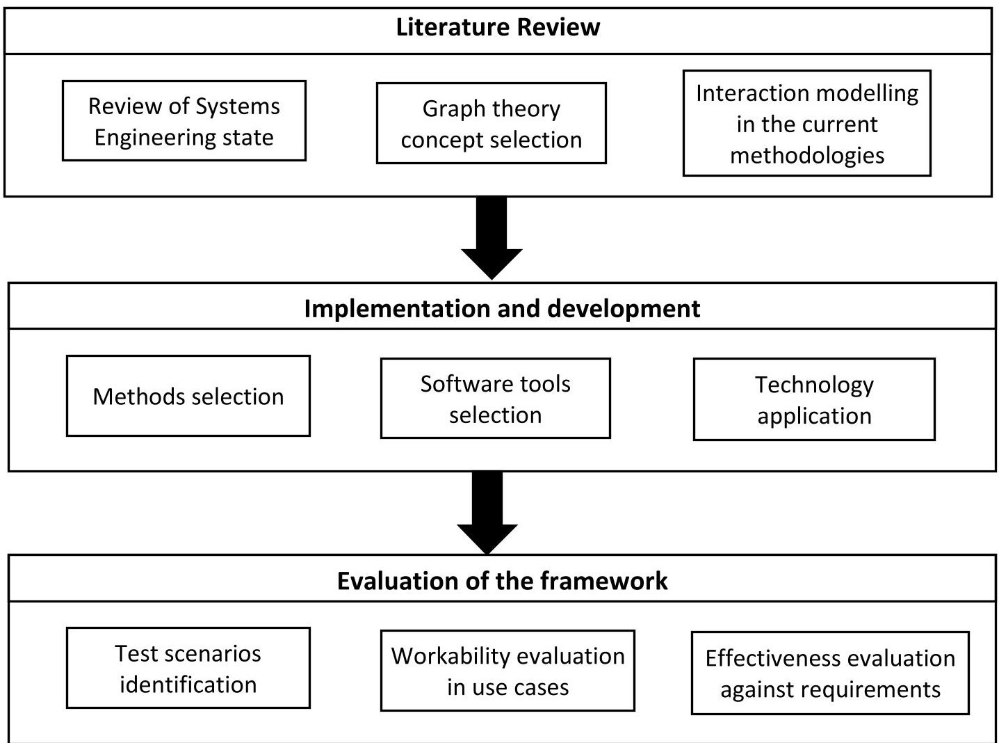


<div align="center">

Figure 4-1: Current thesis research design

</div>

Identify research methodology, leads to the formulation of the research plan, and Figure 4-1 shows the research plan adopted for this research. The whole process is broken down into three stages starting with literature review, proceeding to the methodology framework

<!-- PDF_PAGE: 66 -->

development, and then finishing up with the evaluation of the framework. To be able to construct a well-designed framework that fulfils the aim of this research, detailed literature review was necessary and was carried out, presented and discussed in chapters 2 and 3. Thorough analysis of various model-based systems engineering methodologies was performed to fully understand the field of systems engineering and its current status. Based on these findings the research aim and objectives were outlined. The detailed review of the current graph theory methods was then performed. The comparison of different graph structures showed that metagraph is the most suitable method for interaction modelling in application to the research aim. The applications of metagraph methods in decision support systems further demonstrated its potential for utilisation in model-based systems engineering environment. The proposed framework based on metagraph theory and its different aspects are explained in the next sections of this chapter. The developed framework will be evaluated using two use cases and findings will be discussed in chapter 6. These findings account for the workability of the framework while measuring framework against distinguished requirement will show the effectiveness of the framework. The final outcome from the evaluation will be utilised to measure final potential and limitations of the proposed framework.

## 4.4 Requirements

To develop the framework, first it is needed to identify the requirements for how it should operate. The requirements for the methodology being developed are subdivided into two categories as functional and design. Functional requirements are responsible for the correct practical implementation of the developed methodology. These requirements are as follows:

- Correctness - this requirement states that the developed method will allow effective modelling of systems interaction in MBSE environment. Correctness is defined and measured in a series of scenarios during the verification and validation stage.

<!-- PDF_PAGE: 67 -->

- Automatic control over interactions - this is important so that modelling logic in the form of subsystems interaction is dynamic and allows systems engineer to automatically track the changes through the relationships according to certain rules. This helps to diminish the time needed for the development of products.

- Systems interaction representation - requirement related to correct and simple representation of needed relationships from different points of view.

- Design requirements provides the methodology from the developer's point of view and its other users. These requirements are as follows:

- Special knowledge - there is a need for a special systems interaction engineer who will have knowledge of the composition of the interaction module and will be able to control this module in case there is a need for it.

- Relationships models - it is necessary to provide systems interaction engineer full capabilities and a range of building blocks/models to be able to control automatically built interaction module.

- Applicability for multiple users - this requirement states that different users should be able to utilise the developed methodology. These users involve engineers of different expertise involved in various stages of the development process. Not all of these engineers have adequate knowledge on how the actual system's interaction is modelled inside the interaction module of the main system model but still, they have to be able to define relationships between their work and other engineers.

- Friendly user experience - this requirement related to both users and the systems interaction engineer as they should be able to seamlessly utilise developed framework with the help of software with friendly and simple user interface. Also, the framework

<!-- PDF_PAGE: 68 -->

should provide simple ways of representing certain relationships from different points of view, which is set to be achieved with the help of special graphical representation software.

All design requirements are related to certain functional requirements as the developed method is set to be fully capable of simultaneously modelling interactions among models and providing means and tools to control and utilise the interaction model by all its users.

## 4.5 The interaction modelling framework

A framework for developing interaction mechanism, shown in Figure 4-2, consists of five phases, namely

1. System definition

2. System Modelling

3. Interaction Modelling

4. Validation and verification

5. Visualisation.

The framework provides a set of activities for MBSE experts to employ in order to implement graph-based systems interaction technique in the development process.

<!-- PDF_PAGE: 69 -->


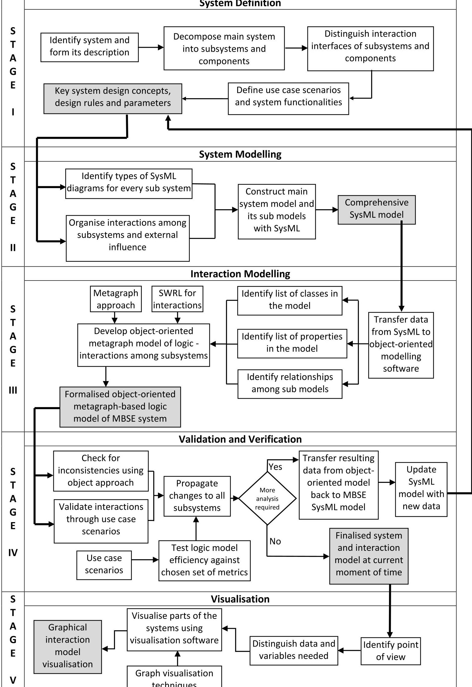


<div align="center">

Figure 4-2: The framework for interaction modelling

</div>

<!-- PDF_PAGE: 70 -->

## 4.5.1 System definition

The first phase of the methodology framework is to define the system - this includes identifying its key aspects and decomposing main system into subsystems and components while defining corresponding interaction interfaces and system functionalities. It is essential for correct system modelling to adequately distinguish key design concepts, rules, and parameters.


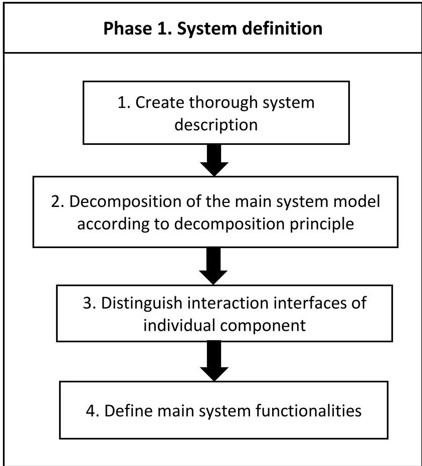


<div align="center">

Figure 4-3: System definition process to acquire key system design concepts, design rules and parameters

</div>

It has been identified from the literature that the main principle of making the development process simpler is to decompose the main system into subsystems and as independent components as possible (Browning, 2001). Decomposition principle is the most important concept for correctly performing that task.

The process of system definition is shown in Figure 4-3. It shows the tasks needed for the correct model representation. These tasks include the following:

<!-- PDF_PAGE: 71 -->

1. Identify the system being developed and form its general description

2. Decompose main system into sub systems and components that are as independent as possible. This complies with the decomposition principle.

3. Distinguish system functionality and real-life scenarios for better understanding of the system.

4. Identify interaction interfaces of all individual components based on their functional roles.

Then system engineer can then model the relationships between these components.

Following these tasks allows system engineer to create a comprehensive system design that is well decomposed and represented for further modelling and analysis with the use of software tools, modelling and programming languages. The result is shown in the same Figure 4-3 - key systems design concepts, design rules and parameters.

## 4.5.2 Systems Modelling

The second phase is the systems modelling, where all sub systems identified in the previous sections are modelled with the use of systems modelling methods and techniques resulting in the creation of a comprehensive representation of the system model.

<!-- PDF_PAGE: 72 -->


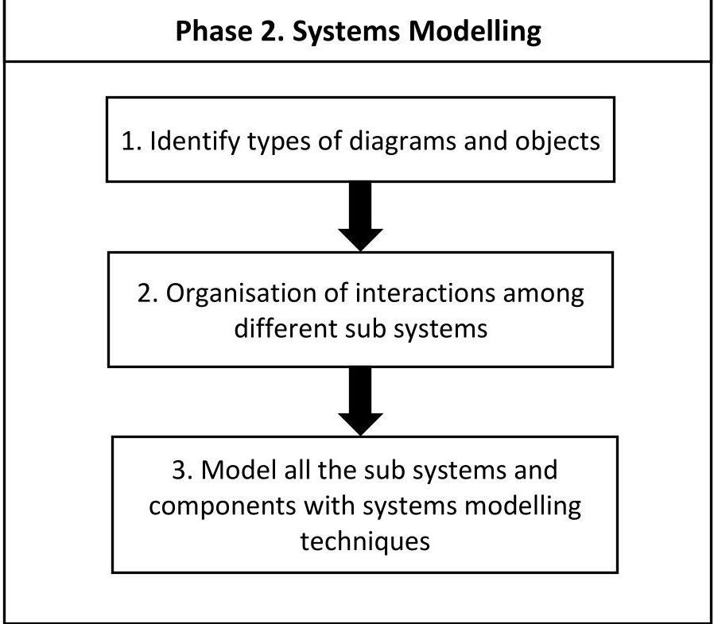


<div align="center">

Figure 4-4: Systems modelling process to create the comprehensive SysML system model

</div>

The tasks performed in that stage are shown in Figure 4-4. These tasks include the following:

1. Based on the systems and components defined in the previous phase, distinguish types of diagrams and objects needed for modelling each sub system of the main system model.

2. Based on the interaction interfaces of components and their relationships, organize the interactions between the components and identify their types.

3. Model all the sub systems and components with relevant constructs and generate the final system model.

The result of performing these tasks is the comprehensive main system model with all its sub systems, components and interactions among them modelled with help of SysML.

Systems Modelling Language is used since it allows systems engineers to model all aspects of systems engineering such as requirements, behaviour and structure. Literature review showed that SysML is recognised by one of the most essential tools in the current MBSE methodologies, where Estefan in his review of these methodologies confirms the growing

<!-- PDF_PAGE: 73 -->

significance of one common language and argues that additional diagrams used in SysML allow engineer to model more complex systems, which is the main subject of the current research (Estefan, 2008). As SysML is not a methodology itself and is entirely independent it can be used by any systems engineer and is used for the current research purposes.

The major advantage of using SysML is the possibility of modelling complex systems in a simple manner and demonstrated in examples such as automated vehicle controllers (Ferreira and Gorlach, 2016).

## 4.5.3 Interaction Modelling

The third and the most significant part of the framework is metagraph construction, which automatically governs the interactions among different components. This is the phase where the interaction modelling happens. Data is set to be transferred from SysML to object-oriented modelling software, where metagraph approach is utilised to successfully model the interaction mechanism in the system being developed. The data from SysML is exported into XML-file and parsed using the object-oriented approach. XML has been widely adopted as a universal way to format data. Object-oriented approach grants capabilities to enhance knowledge categorisation and to model relationships among systems in a simple object-oriented graph-based manner.

The tasks for this phase have been distinguished as follows:

1. Export system model data from SysML with all its modelling artefacts relevant for analysis.

This is done with the use of XML format.

2. Analyse the acquired data using object-oriented approach while distinguishing necessary objects, classes, properties and relationships among them.

<!-- PDF_PAGE: 74 -->

3. Based on the metagraph concepts and parsed data, generate the object-oriented metagraph model of systems interaction for the current system.


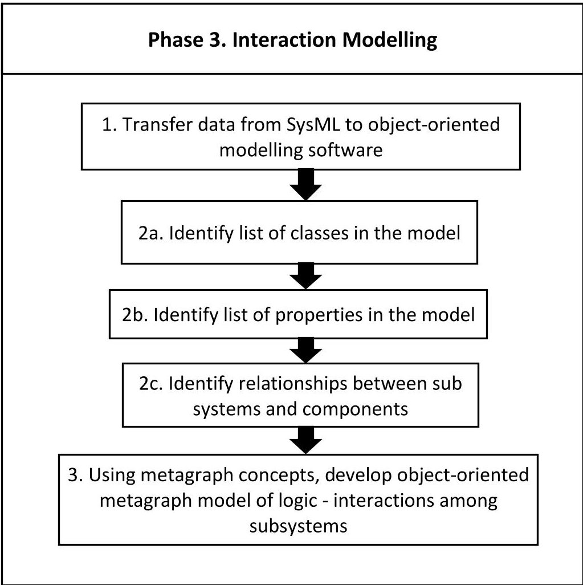


<div align="center">

Figure 4-5: Interaction modelling process to construct the formalised object-oriented metagraph-based logic model of MBSE system

</div>

The tasks are summarised in Figure 4-5. Successfully performing these tasks generates the metagraph of interactions among sub systems and components of the main system model. This is the common interaction module that was discussed in the introduction and literature review section of this research.

## 4.5.4 Validation and Verification

The fourth phase is the validation and verification phase, where the developed model is checked for consistency and correct representation of the initial model. As discussed in section 4.2, the mixed qualitative and quantitative method is utilised for the verification purposes, where both parametric evaluation and qualitative analysis is performed for identifying

<!-- PDF_PAGE: 75 -->

effectiveness of the proposed framework. If something changes in one of the subsystems of the initial model and its SysML representation the object-oriented metagraph interaction model checks the updates for consistencies and propagates changes to other sub systems and ultimately transferring data back to SysML and updating the corresponding diagrams. Systems engineer on all the stages of the lifecycle can check what will be affected if variables are to be changed in one model or another. That allows to vastly increase the predictability of the development process and avoid unnecessary complications in the later stages that, as discussed in the literature review, can result in practically developing the system from scratch.


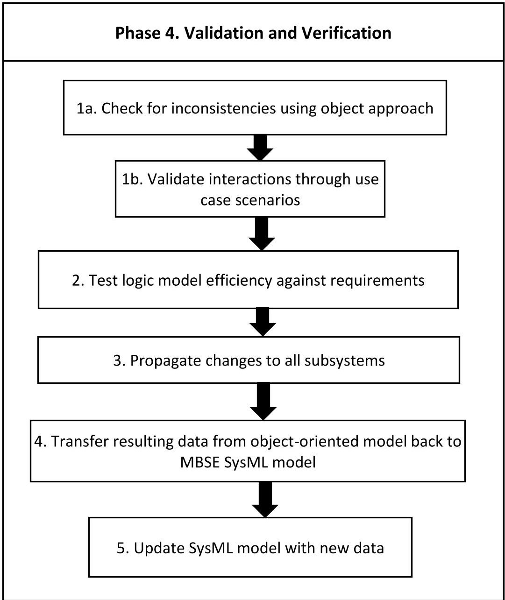


<div align="center">

Figure 4-6: Steps to validate and verify the system and interaction model at the current moment of time

</div>

<!-- PDF_PAGE: 76 -->

Literature review of the related research showed the evaluation principles utilised in the similar research based on graph-based design languages (Gross and Rudolph, 2016a). It has been noted that even though parametric quantitative evaluation is the key to measure the effectiveness of the method being developed, there is a need to weigh the quality of the proposed framework by developing proper tasks and criteria in order to prove the effectiveness and enhancements over existing MBSE methodologies. Based on these idea the tasks for the verification and validation were developed and are presented in Figure 4-6 and are summarised as follows:

1. First the use case scenarios for the system are distinguished based on the system functionalities defined during the first phase of the methodology framework.

2. The defined scenarios are used for validating interactions and making sure they comply with the system actual purpose. At the same time existence of inconsistencies can be checked based on changes made to the same components of the original model. Metagraph approach automatically takes into account the ambiguous definition of parameters and models resulting in not getting errors due to inconsistencies in the main system model.

3. Find the parameters and models that will be affected by changes in other models and parameters based on the scenarios results defined from the previous tasks.

4. Transfer the resulting data back from object-oriented view to the SysML diagrams and update the original system model accordingly.

Following up on that, the evaluation criteria were developed and are set to be utilised in the use case and results analysis. These criteria are as follows:

- The framework capabilities to propagate changes in one model to the other models.

<!-- PDF_PAGE: 77 -->

- Correctness of the affected model identification based on manual check-up of the affected parameters.

- The framework capability to diminish time needed to track the changes and ultimately develop products.

- The framework potential to allow systems engineers identify the expected changes on all the stages of the development lifecycle and adjust the development process accordingly.

- The framework potential to visualise the changes and provide systems engineers ways to easily observe the affected system components.

Executing this sequence of tasks allows system engineer to verify that the object-oriented model complies with the actual system functionality by performing pre-defined use case test scenarios. Then after the metagraph model shows full functionality without errors, systems engineer can test any changes and see, which parameters are going to be affected in the original SysML system model on any stage of the development process. Then the acquired results are measured against the evaluation criteria.

## 4.5.5 Visualisation

The final visualisation phase is to provide a method to represent the model at any moment from different points of view with the help of graph visualisation techniques.

From the methodology framework perspective, the visualisation highlights the ability to represent the parameters and models affected by changes made anywhere in the original model. This is done both in text and graphical ways (Abad et al., 2016). Going through different papers and books on metagraph theory revealed that currently there is no automatic metagraph visualisation techniques fully developed and adopted (Basu and Blanning, 2007).

<!-- PDF_PAGE: 78 -->

But there is a promising method that was not fully developed yet but will be used for the implementation purposes. That method is based on the principles of force algorithms and is proposed by (Globa et al., 2015). It defines the set of rules for forces between metagraph nodes depending on the types of the nodes between which the forces act. It allows the visualisation of medium size metagraph but still has many issues exist such as the intersection between the edges.

Visualisation is an important aspect of the proposed framework as it provides means for effective quality of life improvements for systems engineers. According to the literature on visualisation techniques, the engineering data is becoming more complex and that leads to the fact that it is getting more difficult to visualise relevant data from the necessary point of view (Pathak and Pathak, 2020). Effective visualisation improves the decision makers with an opportunity to observe the parametric data visually and make more quality decisions in less time. This helps systems engineers to better understand complex systems and find trends and correlations that might lead to a certain design mistake being unnoticed (Hariharan et al., 2016).

Being able to automatically visualise the changes and to compare the original and modified system models, results in easier development process, and ultimately leads to development of the product in less time with fewer resources spent. Overall, metagraph visualisation issue is one of the existing research problems that is currently being solved by graph theory experts, and poses interest for the future research, which will be discussed in the conclusion chapters.

## 4.6 Summary

This chapter provided the full overview of the interaction modelling framework. The initial sections of the chapter discussed the distinguished requirements that are later going to be

<!-- PDF_PAGE: 79 -->

utilised for evaluation. Then the key elements that form the framework are described. Furthermore, each phase depicted in the framework is provided a detailed explanation to help determine the exact process of modelling interaction in model-based systems engineering environment. Later sub-sections explain how different phases of the framework work. First, the main system is decomposed into the as independent as possible components to allow system engineers model each component separately and define the interaction. This allows to simplify the process of development and avoid inconsistencies by multiple definition of the same thing. Then, the system is modelled with the use of Systems Modelling Language that is the common tool for most of current MBSE methodologies. After that, the model is exported and the metagraph of interactions is constructed that is then utilised to compare the initial and the changed systems and define, which components have been affected by the changes. This chapter has managed to identify all the aspects of the interaction modelling framework. The outcome of this chapter is reflected in the journal paper (Filimonov et al., 2020). Results from this chapter will be utilised in Chapter 5 describing the development and implementation of the framework and tools used for that.

<!-- PDF_PAGE: 80 -->

## 5.0 Development and Implementation

## 5.1 Introduction

This chapter focuses on the further description of the interaction modelling framework and its proof of concept implementation. Selection of tools is presented to demonstrate how the methodology is implemented in real life use cases. It presents how and why particular software tools and packages are used for the purposes of this research. The next chapter provides the use case evaluation and shows the effectiveness of the framework based on the tools selected and described in this chapter.

## 5.2 Interaction Modelling Framework

## 5.2.1 Framework outline

As discussed in the previous chapter interaction modelling framework consists of five phases:

1. System definition

2. System Modelling

3. Interaction Modelling

4. Validation and verification

5. Visualisation.

This chapter will go through each phase of the methodology and discuss the tools that are possible to utilise in each case and then describe, which tool is utilised for the proof of concept implementation in the current research.

<!-- PDF_PAGE: 81 -->

## 5.2.2 System definition

System definition is the first phase of the methodology for interaction modelling framework. In this stage the main system model's components are being described in detail. Then the main system model is decomposed into as independent as possible subsystems and components with interaction interfaces of these components distinguished and used for further organisation of interactions and relationships among the components. In order to do so the concepts described in the previous literature review chapters are utilised such as the design structure matrix and decomposition principle. This phase is one of the most important stages of the framework as the correctness of model definition is essential for further modelling of all its aspects using modelling languages.

External Inputs

Company_Historical_Data

Functional_Innovations_&_Assumptions

C&A_Requirements

Specific_Vehicle_Mission_Requirements

Payload_&_Avionics_Power_Info.

Conceptual_Design_Deadline

Conceptual_Design_Budget

USAF_Requirements

Preliminary_Design_Budget

Preliminary_Design_Deadline

Preliminary_Design_Resources

Equipment_Geometry

UCAV_Propulsion_Analyses

Results_from_similar_loads_problems

## Activities

Prepare UCAV Conceptual DR&O

Create Configuration Concepts

Prepare 3-View Drawing & Geometry Data

Perform Aerodynamics Analyses & Evaluation

Perform Propulsion Analyses & Evaluation

Perform S&C Characteristics Analyses & Eval.

Perform Mechanical & Electrical Analyses & Eval.

Perform Weights Analyses & Evaluation

Perform Performance Analyses & Evaluation

Perform Multidisciplinary Analyses & Evaluation

Make Concept Assessment and Variant Decisions

Prepare & Distribute Choice Config. Data Set

Prepare UCAV Preliminary DR&O

Create UCAV Preliminary Design Configuration

Prepare & Dist. Surf. Models & Int. Arngmnt. Drwngs.

Create Initial Structural Geometry

Prepare Structural Geometry & Notes for FEM

Perform Aerodynamics Analyses & Evaluation

Perform Weights & Inertias Analyses & Evaluation

Perform S&C Analyses & Evaluation

Develop Structural Design Conditions

Develop Bal. Freebody Diagrams & Ext. App. Loads

Establish Internal Load Distributions

Evaluate Structural Strength, Stiffness, & Life

Evaluate & Plan Manufacturing & Tooling

Create Resource Tables & Evaluate Cost

Prepare UCAV Proposal


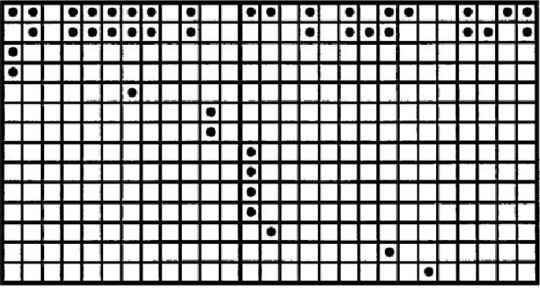


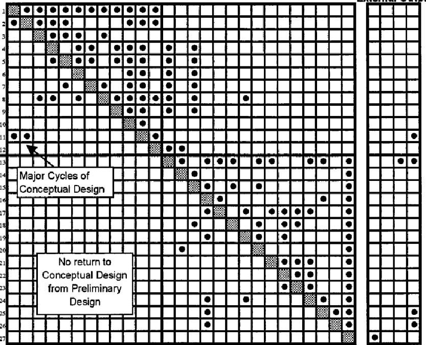


Proposal Propulsion Avionics Pricing, etc.

<div align="center">

Figure 5-1: Example DSM with external input/output regions (Eppinger and Browning, 2012)

</div>

<!-- PDF_PAGE: 82 -->

<div align="center">

Figure 5-1 shows the example Design Structure Matrix that has augmented external input and output regions that allow the model to account for any external interactions. This illustrates how the DSM can be utilised for model organisation in the system definition phase to define all the interactions and have a better understanding of the system and its components.

</div>

## 5.2.3 Systems modelling

Next phase in the interaction modelling framework is systems modelling. During this stage the chosen systems modelling technique is utilised to model all the aspects of the system model from the previous stage. As discussed in chapter 2 many Model-Based Systems Engineering methodologies utilise Systems Modelling Language for representing its components through various diagrams. SysML is a general-purpose graphical modelling language that supports all aspects of the general design process - the analysis, specification, design, verification and validation of complex systems. These systems can potentially include anything that is being under consideration including hardware, data, personnel, procedures, facilities, and other elements of man-made and natural systems (Friedenthal et al., 2014).

As the research is focusing on developing general methodology that can be utilised to enhance the existing MBSE methodologies, the most important requirement for the tools being used for that is being methodology independent. SysML is the perfect example of that and it is emphasised that it is entirely methodology independent while being an essential part of most of the MBSE methodologies (Holt et al., 2016). SysML can create the cohesive and consistent model of the system that represents the following aspects of systems, sub systems and components:

- Structural composition, interconnection, and classification

- Function-based, message-based, and state-based behaviour

<!-- PDF_PAGE: 83 -->

- Constraints on the physical and performance properties

- Allocations between behaviour, structure, and constraints

- Requirements and their relationship to other requirements, design elements, and test cases

- There are many software packages that provide capabilities for systems modelling with SysML. The next step is to find the tool that is perfectly suitable for the purpose of the research. The following requirements on the systems modelling tool have been identified:

- For the proof of concept implementation, the tool needs to be free of charge.

- Even though the tool is free to use, it still needs to contain the full functionality of SysML modelling capabilities.

- The chosen SysML tool should be able to specify the parametric modelling artefacts with defining relationships and interactions among different components.

- The tool needs to contain export features to the XML format as that is the format that is used for further metagraph modelling in the next phase of the framework.

For the selection process a thorough research of all current SysML tools have been conducted using the official SysML Open Source Project web platform ("How to Select a SysML Modeling Tool for MBSE," n.d.) and official OMG Group SysML web site ("The Official OMG SysML site," n.d.). These web platforms contain the process of how to choose the correct SysML modelling tool and provide and comprehensive list of the current tools. Originally IBM Rational Rhapsody software package was chosen as it contains evaluation version that can be used to model most of the systems artefacts while being free of charge. But as a matter of fact, the free version turned out to be limited in its modelling and export capabilities at the moment of technology

<!-- PDF_PAGE: 84 -->

selection therefore the selection process continued and stopped at Visual Paradigm software package with its SysML plugin for Model-Based Systems Engineering Applications.

The review of Visual Paradigm SysML modelling capabilities was performed by experts from SysML Open Source Project web platform ("How to Select a SysML Modeling Tool for MBSE," n.d.) using the following weighted evaluation criteria: usability, major functions (drawing, simulation and execution), standards and interoperability, team modelling and tech support, and value. The results show that Visual Paradigm is a reasonable choice as MBSE tool that draws SysML-complaint notation and offers basic support for requirements traceability and basic model simulation. Also, Visual Paradigm has fully functional free of charge Community Edition version for non-commercial such as the current research. Moreover, Visual Paradigm has rich exporting capabilities and allows to easily export the whole system model to readable XML file.

Figure 5-2 provides an example of an essential block definition diagram modelled with Visual Paradigm.

<!-- PDF_PAGE: 85 -->


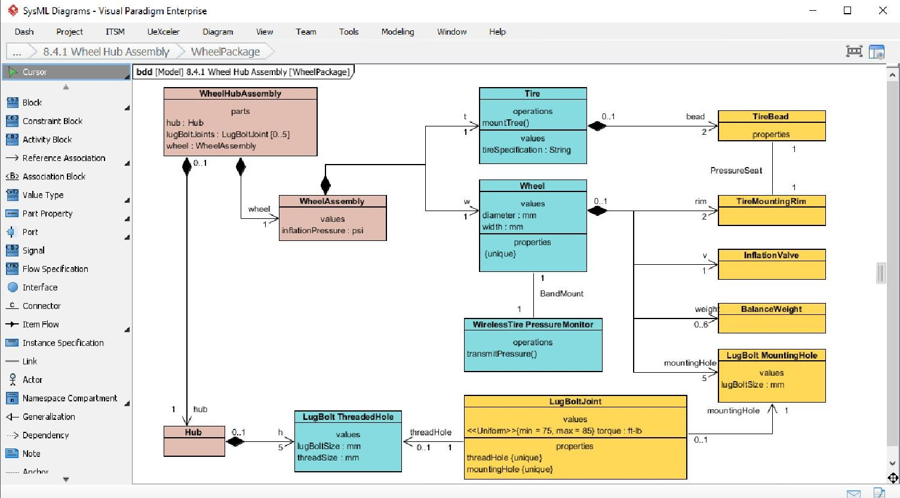


<div align="center">

Figure 5-2: SysML Block Definition diagram modelled with Visual Paradigm SysML modelling tool ("Visual Paradigm Web Site," n.d.)

</div>

Therefore, for the implementation and development in the current research Visual Paradigm is utilised for the systems modelling of all subsystems and components distinguished in the previous section. Visual Paradigm fully satisfies all the distinguished requirements for the SysML modelling tool.

## 5.2.4 Interaction modelling

Next phase of the interaction modelling framework is the interaction modelling itself. This is the stage, where SysML main systems model with all its artefacts is being exported to XML file and then the acquired data is used to create a metagraph of the system model for further analysis.

To achieve the goal of using all XML model data for the metagraph generation and analysis the object-oriented approach has been selected since it has all the capabilities necessary for the current research objectives. Object-oriented programming is widely utilised in multiple

<!-- PDF_PAGE: 86 -->

fields of engineering and it is emphasised that it is the best possible solution to model many aspects in MBSE (Fusaro et al., 2016).

As a competition to object-oriented approach the ontological modelling approach has been considered. In the recent years increased interest has been growing in the development and utilisation of engineering ontologies to support systems engineering [Sanya and Shehab, 2014]. Ontology is a formal specification of a domain, which seeks to classify entities and relations that tie them together [Davies et al., 2003]. Ontological approach grants capabilities to enhance knowledge categorisation and to model relationships among systems in a simple object-oriented graph-based manner. Ontology modelling software such as Protégé provides graphic user interface to define ontologies and includes ways to validate model consistency through reasoning. The main drawback of using ontology modelling software is the fact that it does not have pre-existing reusable libraries for parsing XML data and creating certain objects required for the research such as metagraph. Ontological modelling focuses on using directed and undirected graphs but does not provide any functionality to create metagraph objects such as metapath or metavertex.

Therefore, object-oriented programming is shown to be the most applicable in the current research as many programming languages contain existing libraries that can be used at certain stages of the data parsing and transforming it into a metagraph of the system model.

The selection of the best object-oriented programming language lies beyond the scope of the research, so it has been decided to choose the language that I am most experienced with and that provides all necessary libraries for making coding implementation easier. Therefore, C# has been distinguished as object-oriented programming language backbone of the research. C# is a general-purpose multi-paradigm object-oriented programming language that is

<!-- PDF_PAGE: 87 -->

developed by Microsoft and has many pre-existing libraries that can be used for various tasks during the implementation process.

Not to develop XML parsing technique from scratch, the LINQ to XML parsing technique is utilised to analyse and parse XML data. This technique is a fast, forward-only, non-caching parser with a lot of useful built-in programming functions and guides. It is well documented by Microsoft and is easy to use. The software tool to parse XML data has been developed with the use of object-oriented programming in C# language and allows selection of the XML file created in the Systems Modelling phase of the interaction modelling language and automatic analysis of the entire system model. The overall tool interface is represented in Figure 5-3.


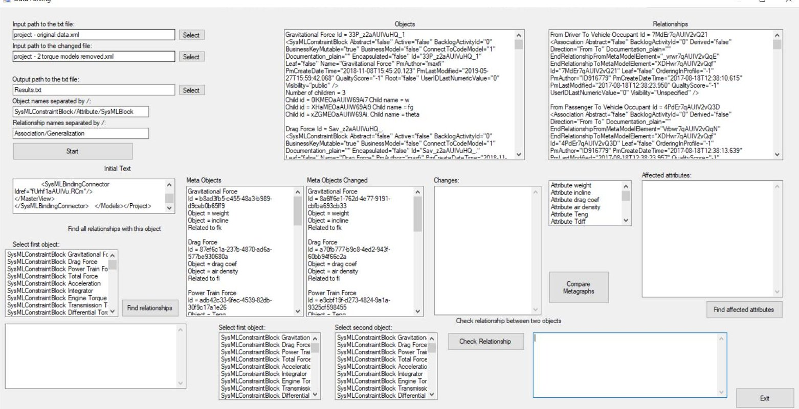


<div align="center">

Figure 5-3: Developed object-oriented tool example screenshot

</div>

All the acquired data is stored in the separate lists of objects inside the tool. These lists include the objects all the individual components from system model, and relationships all the interactions defined during the systems modelling phase. Corresponding example data for objects and relationships is presented in Figure 5-4 and Figure 5-5.

<!-- PDF_PAGE: 88 -->

Gravitational Force Id = 33P_z2aAUIVuHQ_1

<SysMLConstraintBlock

    Abstract="false" Active="false" BacklogActivityId="0"

    BusinessKeyMutable="true" BusinessModel="false"

    ConnectToCodeModel="1" Documentation_plain=""

    Encapsulated="false" Id="33P_z2aAUIVuHQ_1" Leaf="false"

    Name="Gravitational Force" PmAuthor="maxfi"

    PmCreateDateTime="2018-11-08T15:45:20.123"

    PmLastModified="2019-05-27T15:59:42.068" QualityScore="-1"

    Root="false" UserIDLastNumericValue="0" Visibility="public" />

Number of children = 3

Child id = 01KMEOaAUIW69Ai7 Child name = w

Child id = XHaMEOaAUIW69Ai9 Child name = fg

Child id = xZGMEOaAUIW69Ai. Child name = theta

## Figure 5-4: Example data for parsed objects

```json

From Vehicle To Body Id = fEfPz2aAUIVuHQyx

<Association Abstract="false" BacklogActivityId="0"

Derived="false" Direction="From To" Documentation_plain=""

EndRelationshipFromMetaModelElement="0pvwr7qAUIV2vQq5"

EndRelationshipToMetaModelElement="O4T3z2aAUIVuHQuM" Id="fEfPz2aAUIVuHQyx"

Leaf="false" Name="b" OrderingInProfile="-1" PmAuthor="maxfi"

PmCreateDateTime="2018-11-08T15:32:18.623" PmLastModified="2019-03-19T13:09:03.082"

QualityScore="-1" UserIDLastNumericValue="0" Visibility="Unspecified" />

From Interior To Engine Id = QrKvz2aAUIVuHQ1a

<Association Abstract="false" BacklogActivityId="0"

Derived="false" Direction="From To" Documentation_plain=""

EndRelationshipFromMetaModelElement="myH3z2aAUIVuHQua"

EndRelationshipToMetaModelElement="n0qPz2aAUIVuHQv8" Id="QrKvz2aAUIVuHQ1a"

Leaf="false" Name="eng" OrderingInProfile="-1" PmAuthor="maxfi"

PmCreateDateTime="2018-11-08T15:33:51.554" PmLastModified="2019-03-19T13:09:03.081"

QualityScore="-1" UserIDLastNumericValue="0" Visibility="Unspecified" />

```

<div align="center">

Figure 5-5: Example data for parsed relationships and interactions

</div>

Then the data is used to generate the metagraph of the system model. This process is performed within the same tool with the entirely self-written code that automatically analyses all the objects and relationships and then generate the nodes and metapaths based on the acquired knowledge.

The developed metagraph generation algorithm is performed by following these steps:

<!-- PDF_PAGE: 89 -->

1) Search for the nodes involved in the interaction links alongside the identified relationships from SysML parametric diagram information stored in the XML file and sort them with the help of DSM and adjacency graph matrices.

This is performed by automatically searching through the XML tags and collecting those relevant to the system model such as Package, SysMLBlock, Class, Attribute, Association and Generalization. That results in the formation of the Objects list in the tool.

2) Identify the relationship directions and multiplicativity of the nodes in case they are involved in several relationships simultaneously. That means that these nodes will be part of several metanodes at the same time.

The XML data contains the SysMLBindingConnector tag that stores the information on related nodes and the relationship direction. This data is utilised to form the list of Relationships objects in the tool.

3) Based on the acquired relationship and nodes information, form the metanodes and distinguish interactions among these metanodes.

4) Add the metanodes interaction in the same object as the metanode. In the code, that forms the Meta Objects that are shown later in the pictures. These Meta Objects are then utilised to compare original and modified system models by direct comparison between the objects and relationships these Meta Objects consists of.

The list of Meta Objects is also shown in the tool under "Meta Objects" block and represented in Figure 5-6. Other software functionality will be explained later during the use case evaluation.

<!-- PDF_PAGE: 90 -->


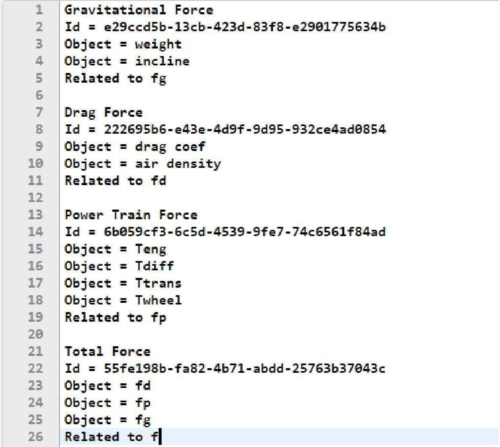


<div align="center">

Figure 5-6: Metagraph objects data after original data analysis

</div>

## 5.2.5 Validation and verification

After automatic metagraph generation comes the next phase of the interaction modelling framework. During this phase verification scenarios need to be identified and then implemented to be able to show that metagraph is fully representing the real behaviour of the system model. These scenarios strongly depend on the certain use case aspects and the systems engineer needs. They might include the following:

- Changing parameter values and seeing other parameters affected by the changes

- Adding or removing parameters and seeing other values affected by the changes

- Adding or removing models and see the affected parts of the original system model

- To analysis each scenario following steps should be followed:

- Export original system model into XML format

<!-- PDF_PAGE: 91 -->

- Perform the desired changes in original system model and export the changed model into XML format

- Run the developed software tool and select both original system model and changed model as shown in the screenshot of the tool inputs in Figure 5-7.


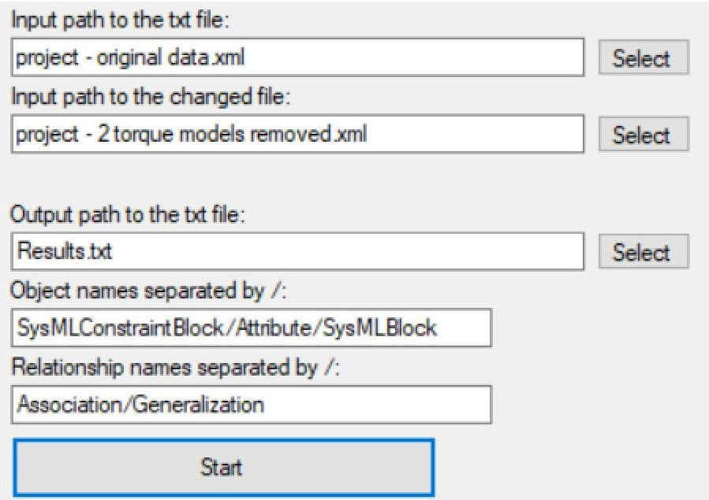


<div align="center">

Figure 5-7: Input for the developed tool

</div>

These inputs include paths to the original and modified files, path to the output file, names of the SysML objects and relationships involved in the system model.

- Click "Start" in the tool to automatically generate original system model metagraph and the changed system model metagraph. This results into the generation of two metagraphs of the original system model and of the modified system model. The example metagraph objects data for both cases is shown in Figure 5-8.


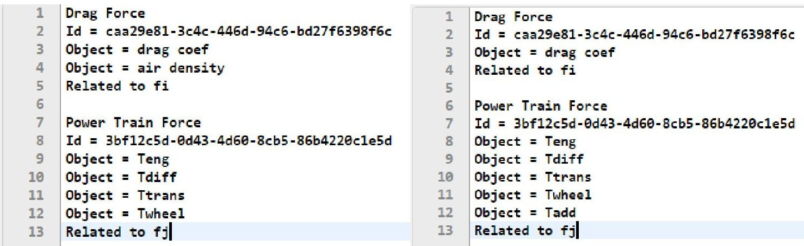


<div align="center">

Figure 5-8: Metagraph objects example data of the original and modified system models

</div>

<!-- PDF_PAGE: 92 -->

- Click "Compare metagraphs" button in the tool to automatically detect the changes between the original and modified models. The list of changes then represented in the "Changes" window of the tool. The results for the example used in this section is presented in Figure 5-9.


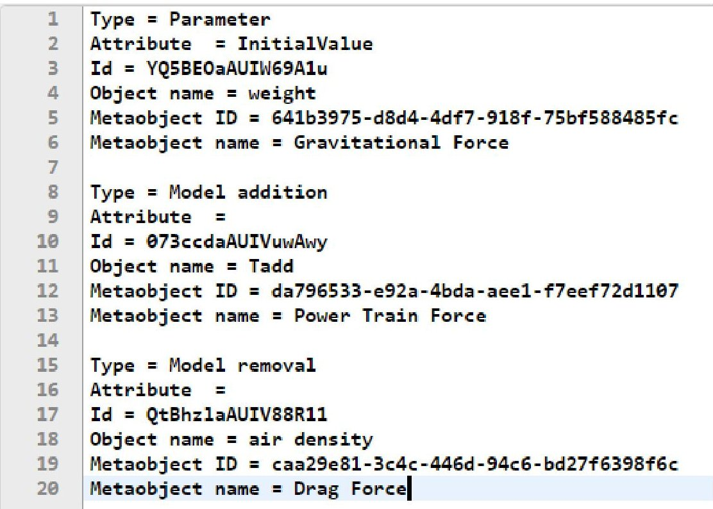


<div align="center">

Figure 5-9: Example data for changes after metagraph comparison

</div>

This developed process will automatically detect all the changes that was caused by the systems engineer in the o-reginal model. Then, it will perform the comparative analysis between the original and modified metagraph to determine the parameters and models that will be affected by the changes. This allows systems engineer to check and validate the model on every stage of the development lifecycle without a need to manually track every relationship, which turns out to be too complicated with the growing systems.

## 5.2.6 Visualisation

Next phase in the interaction modelling framework is the visualisation of the changes or, in other words, ability to see the changes that will happen in the original system model.

<!-- PDF_PAGE: 93 -->

Visualisation can be of different types as discussed by (Abad et al., 2016) and that includes text and graphical representation of data.

First type of visualisation is shown in the tool itself in the special block "Affected parameters" and provides the list of models that will be affected by performing changes to the original system model.

Graphical representation is a much broader topic that requires the visualisation of the automatically generated metagraphs. Literature review of papers on metagraphs show that there is no unified developed algorithm to automatically represent any metagraph that meets the requirements of aesthetics criteria that are defined across the literature and were summarised by (Beck et al., 2009). The use of the same algorithm on small and much larger metagraphs will violate these criteria. That includes positioning inner vertices of metavertex at a significant distance from each other leading to the loss of the metavertex form. The other issues might be positioning wrong inner vertices in metavertex or not being able to determine the metavertex edges.

(Globa et al., 2015) proposes modified metagraph visualisation layout criteria as follows:

- Metavertices coordinates can be equal in the presence of common inner vertices.

- Metavertex figure contains the only inner vertices of the corresponding metavertex.

- Metavertices figures without the common vertices do not intersect.

Based on these criteria a modified algorithm for metagraph is proposed based on the Fruchterman and Reingold visualisation technique (Fruchterman and Reingold, 1991). Metagraph is defined as a system of objects, related by springs based on pre-defined rules. Each spring affects pair of nodes with the force of attraction or repulsion. Then vertices

<!-- PDF_PAGE: 94 -->

position is transformed under the influence of the sum of these forces. The representation is considered complete as soon as a point of equilibrium is reached in the system.

Visualisation result examples are shown in Figure 5-10 and Figure 5-11 as adopted from (Globa et al., 2015).


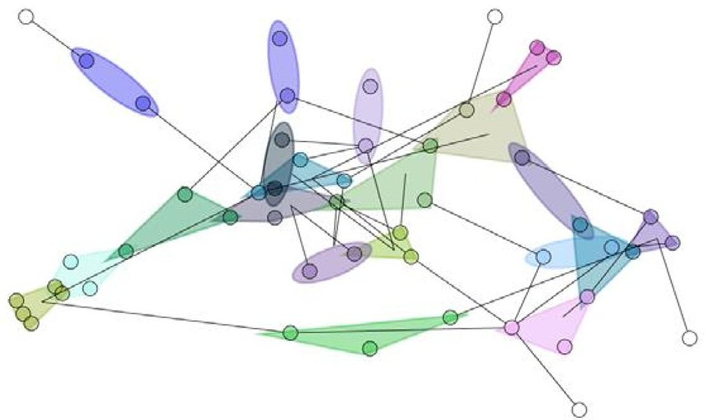


<div align="center">

Figure 5-10: Force-Directed Algorithms Method metagraph visualisation example for 50 vertices, 20 metaobjects and 34 edges (Globa et al., 2015)

</div>


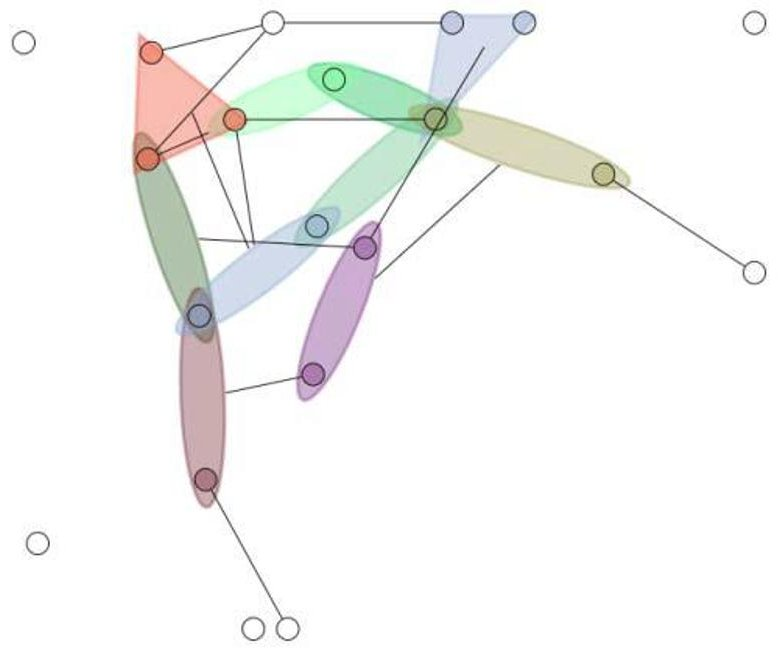


<div align="center">

Figure 5-11: Force-Directed Algorithms Method metagraph visualisation example for 20 vertices, 10 metaobjects and 13 edges (Globa et al., 2015)

</div>

This showcases the use of the proposed visualisation technique on a random metagraph with 50 vertices, 20 metaobjects and 34 edges, and a random metagraph with 20 vertices, 10 metaobjects and 13 edges. According to the authors' findings, the pictures were automatically

<!-- PDF_PAGE: 95 -->

generated in 10.3 seconds and 1.0 seconds. It is worth noting that result varies depending on the initial nodes location, and the time required to get the satisfactory image is highly dependent on the user needs.

<div align="center">

Table 5-1: Time required for random metagraph representation

</div>

<table border="1"><tr><td>Metagraph composition</td><td>Time needed</td></tr><tr><td>10 vertices,5 metaobjects</td><td>0.41 sec</td></tr><tr><td>20 vertices,10 metaobjects</td><td>1.91 sec</td></tr><tr><td>30 vertices,15 metaobjects</td><td>5.39 sec</td></tr><tr><td>40 vertices,20 metaobjects</td><td>9.98 sec</td></tr><tr><td>50 vertices,20 metaobjects</td><td>14.81 sec</td></tr><tr><td>60 vertices,25 metaobjects</td><td>15.49 sec</td></tr></table>

The Table 5-1 presents the time needed for random metagraph representation. The developed method allows visualising medium size metagraphs with a limit on the number of metavertices intersections.

Despite the fact that this method is successful in visualising metagraphs to some extent, there are still a number of issues preventing fully automatic metagraph representation. It could be difficult to distinguish metavertices if some of them are included in other and intersect. Still this method has proven to be the applicable for the research and is utilised for automatic metagraph representation in the use cases.

The C# code has been written that follows all the steps of this algorithm and it has been proven that is effective in visualising small-scale metagraphs used for the proof-of-concept verification and evaluation in this research. The code generates a high number of possible options of metagraph representation based on the mentioned force-based algorithm. Then it

<!-- PDF_PAGE: 96 -->

checks for possible intersection between metanodes and metapaths in those options and produces one final variant with least amount of inconsistencies. As there is no ideal automatic algorithm for metagraph visualisation, the picture remains imperfect and there is still room for improvement. Overall, the metagraph visualisation problem is a separate large area that will be further discussed in the next chapters.

## 5.3 Summary

Based on the outline of the interaction modelling framework this chapter presented and discussed each phase of the methodology with regards to implementation and development, and specific techniques and software tools were discussed. The chapter provides understanding of the tool variety. The selection process of the most applicable tools was provided based on the specified requirements and research needs. Some limitations were derived from visualisation point of view and will be further discussed in the next chapters. The selected tools provide the basis for the actual implementation in real-life use cases and evaluation. These software packages and languages were used for the development of the proof-of-concept tool. The following chapter presents use case evaluation of the interaction modelling framework based on the findings of this and previous chapters.

<!-- PDF_PAGE: 97 -->

## 6.0 Evaluation and Effectiveness of the framework

## 6.1 Introduction

The focus of this chapter is to present test application of the interaction modelling framework, and to validate the research hypotheses. In this chapter, use cases are presented to demonstrate all aspects of the proposed methodology. Use case evaluation is an important part of the research and that is based on both the existing information and actual results from the research (Yue et al., 2009). The critical analysis and comparison between current MBSE methodologies and interaction modelling framework are provided. Both use cases show the workability of the framework and then its limitations and advantages are discussed based on the requirements distinguished in the previous chapter.

## 6.2 Evaluation objectives

The objectives of the evaluation process are identified as follows:

- Perform different scenarios in the use cases to compare the actual results from applying the interaction modelling frameworks against the functional and design requirements defined in the previous chapter.

- Analyse the interaction modelling framework results and compare and contrast the application of the interaction modelling technique to the manual tracking of the changes

- Critically analyse the difference in interaction modelling between current MBSE methodologies and interaction modelling methodology evaluation results in this thesis based on the evaluation criteria and findings from the literature review of existing methodologies.

<!-- PDF_PAGE: 98 -->

The criteria for the evaluation have been defined in Section 4.5.4. The evaluation through use cases is based on the data collected from the literature during the literature review. The use case 1 is based on the acceleration analysis example for the automobile development. This use case is selected due to its general nature that showcases the application of Systems Modelling Language in actual real-life scenario of automobile development. The second use case is the CubeSat development example from literature. The CubeSat mission describes a nanosatellite flying in low earth orbit for earth observation or other research purposes. The model of the satellite is supposed to enable the layout of most of the subsystems on a conceptual level. In the following sections, a selection of some class diagrams from the model are presented along with short descriptions of their purpose (Groß and Rudolph, 2012).

## 6.3 USE CASE 1: Acceleration Analysis of Automobile Development

## 6.3.1 Use case overview

The first use case is the Automobile Example from literature (Friedenthal et al., 2014). In this use case the model-based systems approach is applied to design an automobile system, where the final is set to match the acceleration and fuel efficiency requirements. The full range of Automobile design systems is modelled in SysML and the full list of models is shown in Table 6-1.

<!-- PDF_PAGE: 99 -->

<div align="center">

Table 6-1: Full list of models in the Automobile Example

</div>

<table border="1"><tr><td>Diagram name/System</td><td>Diagram Type</td></tr><tr><td>Model Organisation</td><td>Package diagram</td></tr><tr><td>Automobile System Requirements</td><td>Requirement diagram</td></tr><tr><td>Automobile Domain</td><td>Block definition diagram</td></tr><tr><td>Operate Vehicle</td><td>Use case diagram</td></tr><tr><td>Drive Vehicle</td><td>Sequence diagram</td></tr><tr><td>Turn On Vehicle</td><td>Sequence diagram</td></tr><tr><td>Control Power</td><td>Activity diagram</td></tr><tr><td>Drive Vehicle States</td><td>State machine diagram</td></tr><tr><td>Vehicle Context</td><td>Internal block diagram</td></tr><tr><td>Vehicle Hierarchy</td><td>Block definition diagram</td></tr><tr><td>Provide Power</td><td>Activity diagram</td></tr><tr><td>Power Subsystem</td><td>Internal block diagram</td></tr><tr><td>Analysis Context</td><td>Block definition diagram</td></tr><tr><td>Vehicle Acceleration Analysis</td><td>Parametric diagram</td></tr><tr><td>Vehicle Performance Timeline</td><td>Timing diagram(not SysML)</td></tr><tr><td>Engine Specification</td><td>Block definition diagram</td></tr><tr><td>Max Acceleration Requirement Traceability</td><td>Requirement diagram</td></tr><tr><td>Architect and Regulator Viewpoints</td><td>Package diagram</td></tr></table>

That example showcases the use of SysML in actual model-bases systems engineering modelling example. It also defines at least one diagram for each SysML diagram kind and most of the SysML feature set is illustrated. There are even some extensions beyond the basic set, including continuous flows and generalisation sets. Modelling artefacts that are included in this example are representative of the types of modelling artefacts that are generated from a typical MBSE method. So that shows the general nature of the use case that can be applied in any of the possible MBSE methodologies mentioned in the literature review.

A multidisciplinary team is responsible for designing an automobile with multiple participants and roles that constantly share information and adjust their own parts of the development process according to the changes made by the other engineers. First, the team needs to identify the needs of the stakeholders and distinguish their individual needs to form system requirements. In the Automobile example the main stakeholders include both purchaser and user of the car being developed. In addition to those, systems engineering key feature is to

<!-- PDF_PAGE: 100 -->

address the requirements of all the other stakeholders who may be impacted during the product life cycle. That includes the manufacturers, maintenance engineers and governments that express their needs through driving laws and restrictions. Even though it is necessary that the analysis takes each stakeholder requirements into account, clearly their concerns have different importance. Therefore, in this example the main effectiveness measures are primary transportation needs such as comfort, performance, fuel economy etc. The functional requirements for the automobile system are selected by analysing what the system must do to achieve its original goals. The early and correct identification of the requirements is crucial to the success of the development process. Overall system design also distinguishes components involved in the system-level requirements. This research works with the acceleration analysis of the automobile system in order to be able to meet functional requirements to achieve certain speed in less than certain period of time. The selected aspects of the system design are appropriate to support an initial trade-off analysis. In order to satisfy the acceleration requirement, many parameters need to be changed and their effect on the other parameters needs to be determined.

The later sections will focus on each phase of the proposed interaction modelling framework in application to the use case.

## 6.3.2 Current interaction modelling state

As mentioned in the previous section, the Automobile Acceleration Analysis example is modelled using various SysML diagrams showcasing their capabilities. Block definition diagrams present the overall structure of the project with the break-down of the Automobile Domain and Vehicle Hierarchy. Internal block diagrams highlight the more detailed structure of the Vehicle Context, which is the system of interest in this example.

<!-- PDF_PAGE: 101 -->

Vehicle acceleration analysis itself is represented with the use of another block definition diagram - Analysis Context, and a parametric diagram - Vehicle Acceleration Analysis. While Analysis Context diagram presents the parameters and the equations used for the analysis, the Vehicle Acceleration Analysis parametric diagram showcases how these parameters and equations are utilised for the purpose of this example.

Despite the fact that all the aforementioned diagrams provide the comprehensive picture of the automobile system being developed, the author of the example implies that these diagrams remain only the representation of the system without the capabilities to track the relationships between the models (Friedenthal et al., 2014). Therefore, interactions are entirely static in the existing implementation. That results in a complete redevelopment of the model whenever changes are needed to be made in the system model and the increased unpredictability of the system in question, as currently there is no way to automatically find the affected parameters.

Even though SysML allows representation of the system model from various perspectives, each of these perspectives is a complex sub system on its own. Making the model consistent across all the different perspectives showcases more challenges for the current implementation of MBSE methodologies. The limitations of the current implementation state will be further discussed during the critical analysis of the results of the interaction modelling framework application in this use case.

## 6.3.3 Systems modelling

As shown in Table 6-1, the automobile example consists of 18 different diagrams and modelling artefacts. These diagrams cover all different aspects of the automobile development process including the ones that are not relevant for the research such as state

<!-- PDF_PAGE: 102 -->

modelling of how the vehicle is being used by the driver and the occupant. Therefore, for the actual research purposes the simplification is needed. Relevant list of model components has been distinguished from the full list of models and is show in Table 6-2. Also, the diagrams were modified to better comply with the decomposition principle making components more independent from each other to better be able to model interactions among them.

<div align="center">

Table 6-2: List of models in the Automobile Example relevant for the use case implementation

</div>

<table border="1"><tr><td>Diagram name/System</td><td>Diagram Type</td></tr><tr><td>Model Organisation</td><td>Package diagram</td></tr><tr><td>Automobile System Requirements</td><td>Requirement diagram</td></tr><tr><td>Automobile Domain</td><td>Block definition diagram</td></tr><tr><td>Vehicle Hierarchy</td><td>Block definition diagram</td></tr><tr><td>Analysis Context</td><td>Block definition diagram</td></tr><tr><td>Vehicle Acceleration Analysis</td><td>Parametric diagram</td></tr></table>

The distinguished diagrams fully model the acceleration analysis in the automobile example. Next stage of the interaction modelling framework methodology application is to model the system using Systems Modelling Language. This example was modelled with the use of Visual Paradigm software tool for SysML modelling. The overall model organisation is shown in Figure 6-1 and that is the package diagram representing overall model structure and its underlying systems.

<!-- PDF_PAGE: 103 -->


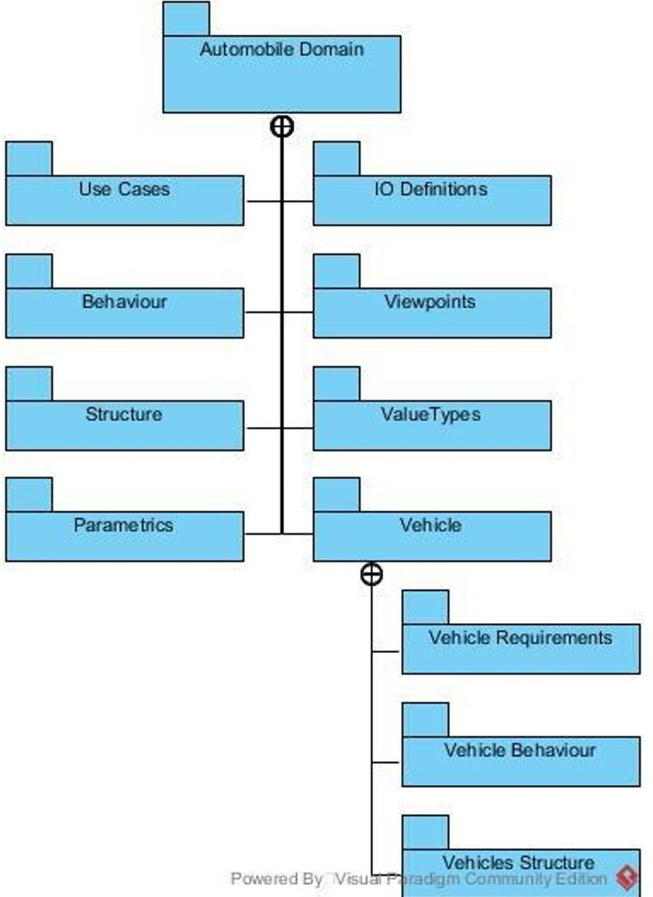


<div align="center">

Figure 6-1: Model organisation package diagram

</div>

From the overall structure, automobile domain represents the more detailed composition of the test case as an internal diagram. Automobile domain block definition diagram is shown in Figure 6-2. It represents the blocks that are contained in the Structure package of the original model organisation and specifies their interrelationships. Although these diagrams contain all the modelling aspects of the main system model, the system of interest for the use case is the vehicle itself. Thus, the vehicle block is expanded with another block definition diagram showing all the components of the vehicle - system of interest.

<!-- PDF_PAGE: 104 -->


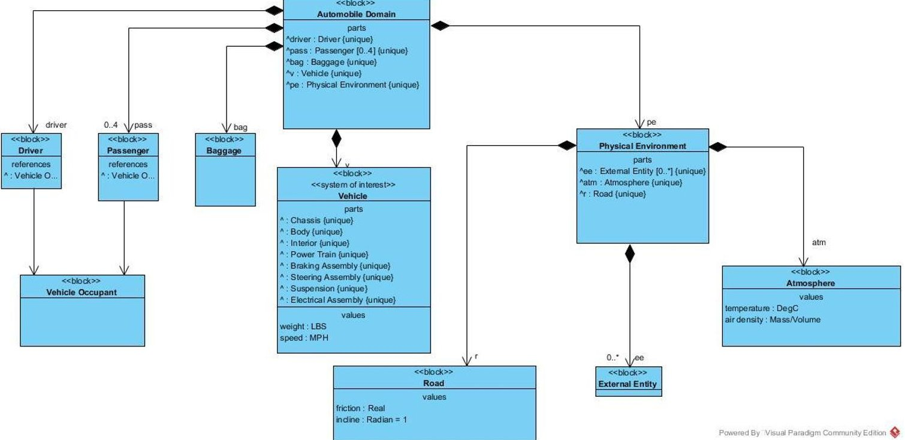


<div align="center">

Figure 6-2: Automobile Domain block definition diagram

</div>

The vehicle block definition is shown in and provides the decomposition of the Vehicle block that was previously shown in components. The Vehicle is composed of the Body, Chassis, Interior, Power Train, and other components, while some of these blocks are further decomposed into more independent components. This completely complies with the decomposition principle discussed in the previous chapters and allows systems engineers to control the complexity level of the system from the start. The vehicle hierarchy block definition diagram is shown in Figure 6-3.

<!-- PDF_PAGE: 105 -->


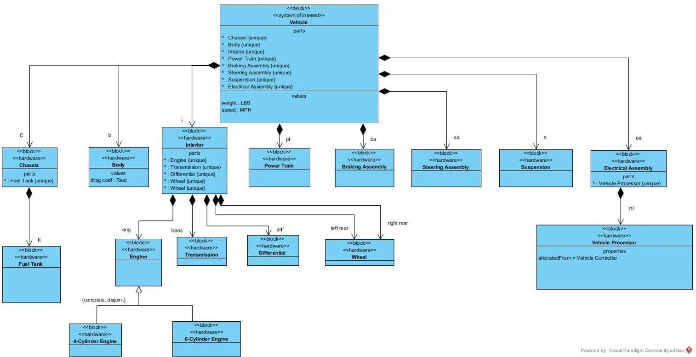


<div align="center">

Figure 6-3: Vehicle Hierarchy block definition diagram

</div>

Previous diagrams provided the comprehensive picture of the main system model and of all its modelling artefacts. In the current work, the focus is on the interaction modelling, therefore before the use case can be applied to the framework, there is a need to model the relevant interaction diagrams in SysML to get enough data for further analysis and changes propagation. The specification for the given problem is to analyse the vehicle acceleration based on the input parameters and requirements. The vehicle acceleration analysis in SysML is first modelled as another block definition diagram to provide the necessary models involved in the analysis process. This diagram is shown in Figure 6-4 and showcases the usability of the constraint block, that defines constraints in terms of equations and their parameters. That diagram is situated in the Parametrics package of the original model organisations and is composed of several blocks that are used to analyse vehicle acceleration.

<!-- PDF_PAGE: 106 -->


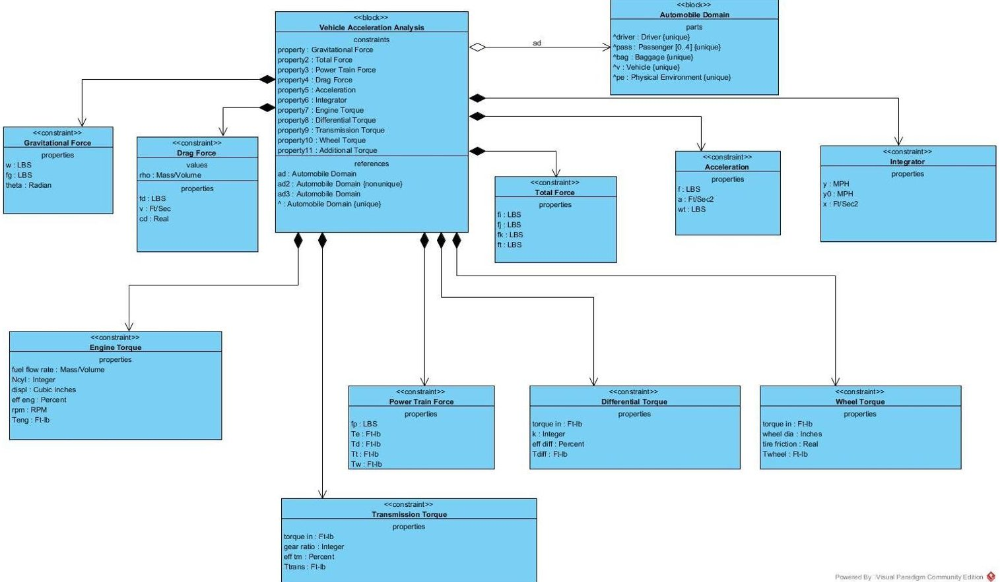


<div align="center">

Figure 6-4: Vehicle Acceleration Analysis (Analysis Context) block definition diagram The next and the most important diagram is a parametric diagram expanding the vehicle acceleration analysis block and showing how the distinguished parameters are used to analyse the system. It shows a network of constraints that use previously defined constraint blocks from the Analysis Context diagram. The parametric diagram is represented in Figure 6-5.

</div>


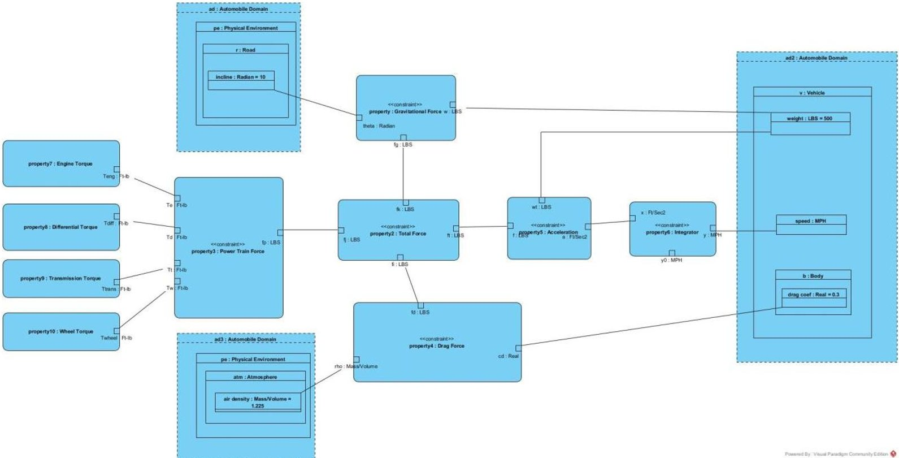


<div align="center">

Figure 6-5: Vehicle Acceleration Analysis parametric diagram

</div>

<!-- PDF_PAGE: 107 -->

The parametric diagram and related modelling information can be used in the simulation and/or analysis tools to support analysis execution. However, SysML does not provide simulation capabilities on its own. This is the relevant information that is further used for the automated metagraph generation.

## 6.3.4 Interaction modelling framework application

Once the system is defined and built, the next stage is to utilise the system model data to be able to analyse the changes occurring in sub systems and components. A proof-of-concept tool is developed for the task and used for analysing systems modelling information with help of the tools discussed in the previous chapter.

First, the expected metagraph was defined in theory and on paper. That is presented in Figure 6-6 and shows the overall picture of what is expected to be achieved in the next stage of the interaction modelling framework application.


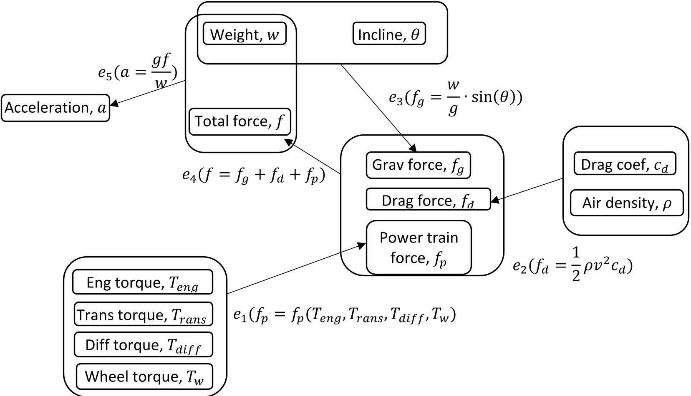


<div align="center">

Figure 6-6: Metagraph for the Automobile Acceleration Example

</div>

<!-- PDF_PAGE: 108 -->

To generate the similar metagraph automatically the SysML model is exported to XML format and then the XML file is taken as the original data for the developed tool. The tool automatically parses the data and generates the metagraph of the original system model. In the current use case, the result is shown in Figure 6-7. In the tool the user selects the path to the original XML file and then program automatically acquires all the necessary data for the objects and relationships among the objects. These objects and relationships are shown in the corresponding Objects and Relationships windows. After the process is done, the metagraph is automatically generated and the results can be seen in the Meta Objects window of the tool.


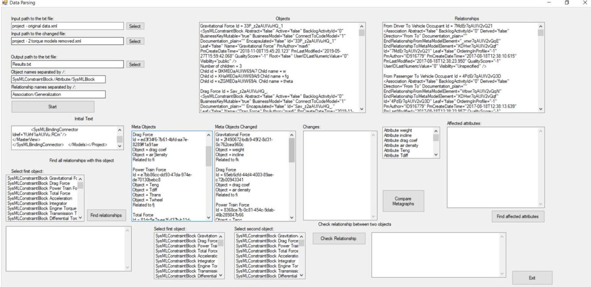


<div align="center">

Figure 6-7: The proof-of-concept tool interface representing the metagraph objects automatically generated from the system model data

</div>

The metagraph objects automatically acquired by the tool execution completely comply with the theoretical use case metagraph discussed previously. The more detailed metagraph objects, of the original and modified system models, are presented in Figure 6-8 as shown in the tool.

<!-- PDF_PAGE: 109 -->


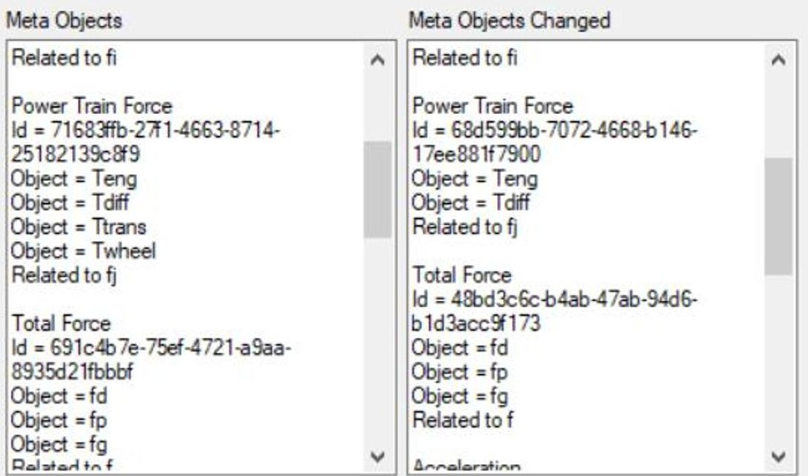


<div align="center">

Figure 6-8: Metagraph objects of the original and modified system models

</div>

Next, the scenarios for verifying the tool effectiveness are distinguished. This involves changing parameter values, removing existing and adding new components to the vehicle acceleration analysis. Five scenarios are identified:

- Single parameter changed - incline.

- Three parameters changed - weight, incline, drag coefficient.

- Two torque components removed.

- Two parameters changed and one component added - additional torque.

- One model added - additional torque, one model removed - wheel torque, three parameters changed.

After systems engineer changes something in the original system model, the resulting SysML is being exported to XML file again. Then, the path to both the original and changed system models are selected in the proof-of-concept tool, which results in the automatic construction of two metagraphs - based on the original SysML data and based on the modified SysML data. Figure 6-8 already shows the metagraph objects for both cases in Meta Objects and Meta Objects Changed windows.

<!-- PDF_PAGE: 110 -->

The interaction modelling framework continues to analyse the data by comparing both metagraphs and searching for the affected parameters based on the results of this comparison. In the main tool window this is done by clicking the buttons "Compare metagraphs" and "Find affected attributes". The results for the scenario with two torque models removed are provided in Figure 6-9.


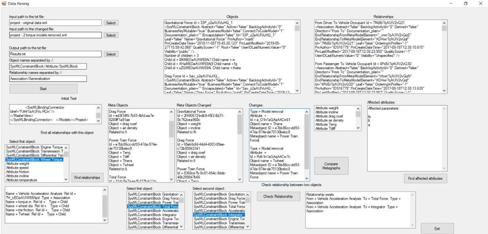


<div align="center">

Figure 6-9: The proof-of-concept tool interface representing the automatically tracked changes from the SysML data

</div>

The changes are showcased in the Changes window and the affected components are shown in the Affected attributes window. The changes for the scenario in question are showcased in Figure 6-10.

<!-- PDF_PAGE: 111 -->


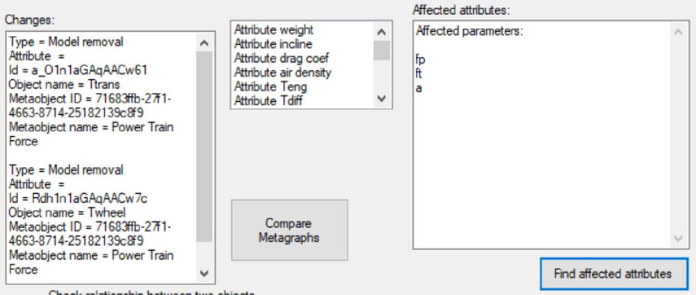


<div align="center">

Figure 6-10: Automatically detected changes between the original and modified system models and list of affected parameters, as shown in the tool

</div>

These changes clearly show the two models removal and are presented in Table 6-3.

<div align="center">

Table 6-3: Results. Automatically detected changes for scenario 3, use case 1

</div>

<table border="1"><tr><td>Change type</td><td>Attribute Affected</td><td>Object name and information</td><td>Metagraph object information</td></tr><tr><td>Model Removal</td><td>N/A</td><td>Object name = TtransId = a_O1n1aGAqAACw61</td><td>Metaobject ID = e7bb86cc-dd93-47da-974e-de70130bebc8Metaobject name = Power Train Force</td></tr><tr><td>Model Removal</td><td>N/A</td><td>Object name = TwheelId = Rdh1n1aGAqAACw7c</td><td>Metaobject ID = e7bb86cc-dd93-47da-974e-de70130bebc8Metaobject name = Power Train Force</td></tr></table>

Affected attributes after these changes $ - f_{p}, f_{t}, a. $

This completely complies with the manual tracking of the system model.

The visualisation of the results is performed both in text and graph visualisation. The text changes and affected parameters are shown in the tool as mentioned before. That provides systems engineer a clear picture of what is going to be affected by certain changes that might have been done in the original system model.

<!-- PDF_PAGE: 112 -->


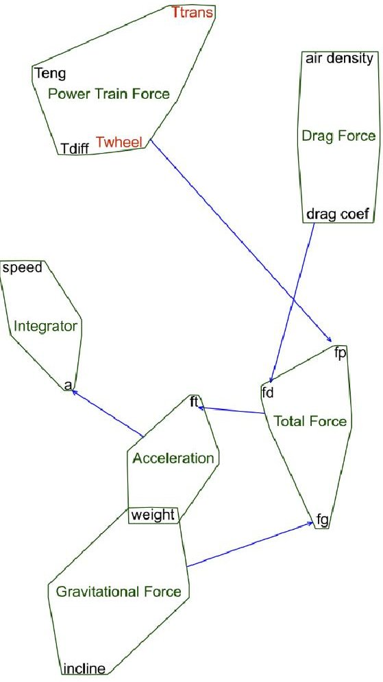


<div align="center">

(a)

</div>


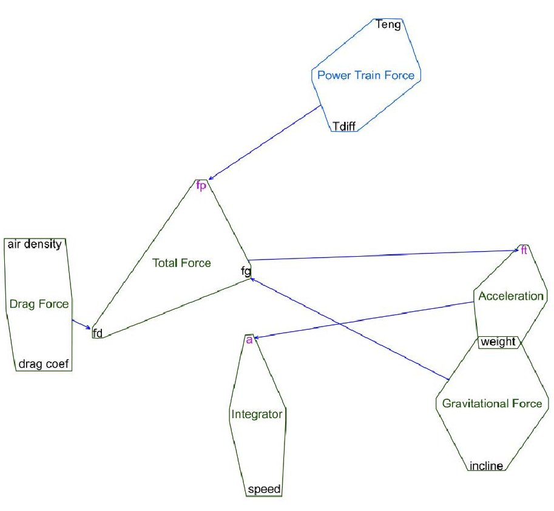


<div align="center">

(b)

</div>

<div align="center">

Figure 6-11: Metagraphs of the Automobile Example, Use Case 1, Scenario 3 (a) Original System Model (b) Modified System Model

</div>

The metagraph visualisation technique results discussed in the implementation chapter are shown in Figure 6-11. This represents the automatically generated metagraphs using forcebased algorithm of the original (a) and modified (b) system models. As can be seen the metagraph is fully representing the one that was drawn in theory before the modelling and represented in Figure 6-6. The colours in the metagraph automatically highlight the changes occurring in the system and the parameters affected by these changes. The colours are further explained in Table 6-4.

<!-- PDF_PAGE: 113 -->

<div align="center">

Table 6-4: Colour in metagraphs visualisation

</div>

<table border="1"><tr><td>Colour</td><td>Hex colour code</td><td>RGB colour code</td><td>Meaning</td></tr><tr><td>Blue</td><td>#075DDD</td><td>RGB(7,93,221)</td><td>Parameter modified</td></tr><tr><td>Green</td><td>#10C100</td><td>RGB(16,193,0)</td><td>Model addition</td></tr><tr><td>Red</td><td>#CD2507</td><td>RGB(205,37,7)</td><td>Model removal</td></tr><tr><td>Purple</td><td>#B213D1</td><td>RGB(178,19,209)</td><td>Parameter affected</td></tr></table>

The results for the other scenarios are provided below.

- Scenario 1. Single parameter changed - incline.

Changes are presented in Table 6-5.

<div align="center">

Table 6-5: Results. Automatically detected changes for scenario 1, use case 1

</div>

<table border="1"><tr><td>Change type</td><td>Attribute Affected</td><td>Object name and information</td><td>Metagraph object information</td></tr><tr><td>Parameter</td><td>InitialValue</td><td>Object name = incline
Id = cCo6EOaAUIW69Ax0</td><td>Metaobject ID = c54571b4-9940-49ca-bc36-9535fa3a5c8b
Metaobject name = Gravitational Force</td></tr></table>

Affected attributes after the changes $ - f_{g}, f_{t}, a. $

The metagraphs for that scenario are shown in Figure 6-12.

<!-- PDF_PAGE: 114 -->


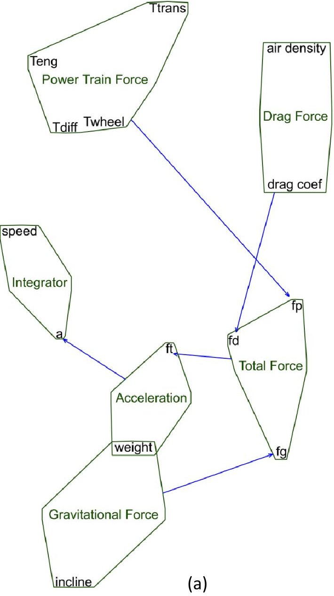


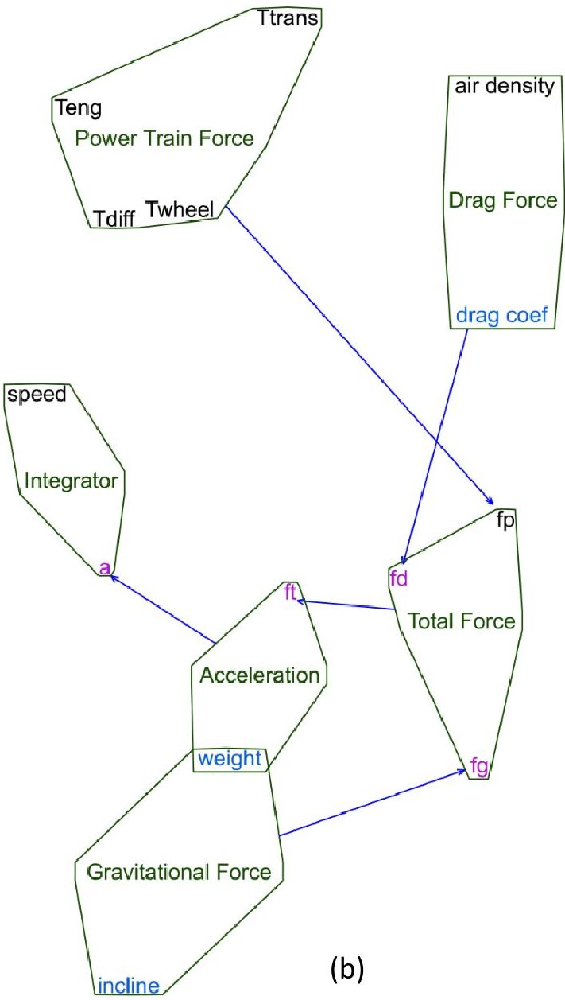


<div align="center">

Figure 6-12: Metagraphs of the Automobile Example, Use Case 1, Scenario 1 (a) Original System Model (b) Modified System Model

</div>

- Scenario 2. Three parameters changes - weight, incline, drag coefficient.

Changes are presented in Table 6-6.

Affected attributes after the changes $ - f_{g}, f_{t}, f_{d}, a. $ The metagraphs for that scenario are shown in Figure 6-13.

<!-- PDF_PAGE: 115 -->

<div align="center">

Table 6-6: Results. Automatically detected changes for scenario 2, use case 1

</div>

<table border="1"><tr><td>Change type</td><td>Attribute Affected</td><td>Object name and information</td><td>Metagraph object information</td></tr><tr><td>Parameter</td><td>InitialValue</td><td>Object name = weightId=YQ5BEOaAUIW69A1u</td><td>Metaobject ID=d51376ac-9386-4257-abf8-9af26708a363Metaobject name=Gravitational Force</td></tr><tr><td>Parameter</td><td>InitialValue</td><td>Object name=inclineId=cCo6EOaAUIW69Ax0</td><td>Metaobject ID=d51376ac-9386-4257-abf8-9af26708a363Metaobject name=Gravitational Force</td></tr><tr><td>Parameter</td><td>InitialValue</td><td>Object name=drag coefId=EqTBEOaAUIW69A2j</td><td>Metaobject ID=739fc973-f291-4b0a-a9c5-2461a79f947dMetaobject name=Drag Force</td></tr></table>


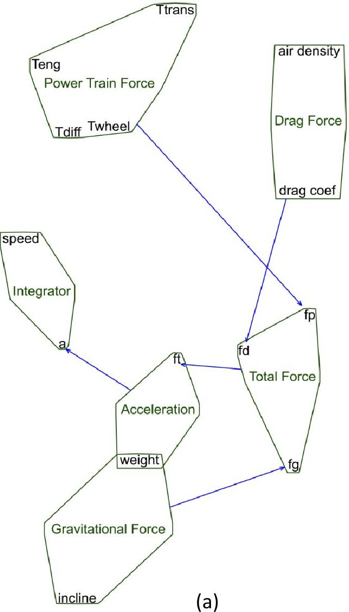


<div align="center">

Figure 6-13: Metagraphs of the Automobile Example, Use Case 1, Scenario 2 (a) Original System Model (b) Modified System Model

</div>

<!-- PDF_PAGE: 116 -->

- Scenario 4. Two parameters changed and one component added - additional torque.

Changes are presented in Table 6-7.

<div align="center">

Table 6-7: Results. Automatically detected changes for scenario 4, use case 1

</div>

<table border="1"><tr><td>Change type</td><td>Attribute Affected</td><td>Object name and information</td><td>Metagraph object information</td></tr><tr><td>Parameter</td><td>InitialValue</td><td>Object name = weightId=YQ5BEOaAUIW69A1u</td><td>Metaobject ID=6c95ead1-0b6f-489a-912f-3becd42e4770Metaobject name=Gravitational Force</td></tr><tr><td>Parameter</td><td>InitialValue</td><td>Object name=inclineId=cCo6EOaAUIW69Ax0</td><td>Metaobject ID=6c95ead1-0b6f-489a-912f-3becd42e4770Metaobject name=Gravitational Force</td></tr><tr><td>Model Addition</td><td>N/A</td><td>Object name=TaddId=073ccdaAUIVuwAwy</td><td>Metaobject ID=16c3ef47-1e25-4ad0-9d82-caebb8a3d662Metaobject name=Power Train Force</td></tr></table>

Affected attributes after the changes $ - f_{g}, f_{t}, f_{p}, a. $ The metagraphs for that scenario are shown in Figure 6-14.

<!-- PDF_PAGE: 117 -->


<div align="center">

(a)

</div>


<div align="center">

(b)

</div>

<div align="center">

Figure 6-14: Metagraphs of the Automobile Example, Use Case 1, Scenario 4 (a) Original System Model (b) Modified System Model

</div>

<div align="center">

- Scenario 5. One model added - additional torque, one model removed - wheel torque, three parameters changed.

</div>

Changes are presented in Table 6-8.

<!-- PDF_PAGE: 118 -->

<div align="center">

Table 6-8: Results. Automatically detected changes for scenario 5, use case 1

</div>

<table border="1"><tr><td>Change type</td><td>Attribute Affected</td><td>Object name and information</td><td>Metagraph object information</td></tr><tr><td>Parameter</td><td>InitialValue</td><td>Object name = weightId=YQ5BEOaAUIW69A1u</td><td>Metaobject ID=7e5eab3c-e2ef-481d-b071-52a2fa102c66Metaobject name=Gravitational Force</td></tr><tr><td>Parameter</td><td>InitialValue</td><td>Object name=inclineId=cCo6EOaAUIW69Ax0</td><td>Metaobject ID=7e5eab3c-e2ef-481d-b071-52a2fa102c66Metaobject name=Gravitational Force</td></tr><tr><td>Parameter</td><td>InitialValue</td><td>Object name=drag coefId=EqTBEOaAUIW69A2j</td><td>Metaobject ID=7f960cb6-7b5d-46f0-9ab1-e36b9fd48239Metaobject name=Drag Force</td></tr><tr><td>Model Addition</td><td>N/A</td><td>Object name=TaddId=073ccdaAUIVuwAwy</td><td>Metaobject ID=f24d19f8-a240-42e4-b378-b6358235b43fMetaobject name=Power Train Force</td></tr><tr><td>Model Removal</td><td>N/A</td><td>Object name=air densityId=073ccdaAUIVuwAwy</td><td>Metaobject ID=f7a6bb85-7541-48f5-bac4-80061cfa7338Metaobject name=Drag Force</td></tr></table>

Affected attributes after the changes $ - f_{g}, f_{t}, f_{d}, f_{p}, a. $

The metagraphs for that scenario are shown in Figure 6-15.

<!-- PDF_PAGE: 119 -->


<div align="center">

(b)

</div>

<div align="center">

Figure 6-15: Metagraphs of the Automobile Example, Use Case 1, Scenario 5 (a) Original System Model (b) Modified System Model

</div>

The results after performing all the identified scenarios and manually tracking the changes, clearly show that the tool is successful in analysing the SysML system model data, generating both original and modified metagraphs, comparing them and finding the affected parameters. Also, it is proven to show both textual and graphical visualisation capabilities. The next section focuses on critically analysing the differences in interaction modelling between the existing MBSE implementation in this use case and the results obtained from the interaction modelling framework application.

<!-- PDF_PAGE: 120 -->

## 6.3.5 Critical analysis

After performing the full cycle of the interaction modelling framework methodology application for the Automobile Example use case, the next evaluation objective is to critically analyse the differences between interaction modelling in the existing MBSE methodologies and the proposed framework. This is done based on the results of the use case implementation.

Going back to the evaluation criteria identified before, the author concurs that the framework satisfies all of them in this use case. First, the Interaction Modelling methodology is successful in propagating changes from one model to the other models. Also, the correctness of the affected model identification is proven based on the manual check-up of the system model. Next, framework indeed provides potential for systems engineers to identify the expected changes on every stage of the development lifecycle and adjust the model accordingly in less time without the need to redevelop many aspects from scratch based on the feedback and changes in the later stages of the development process. Moreover, the metagraph visualisation technique chosen and discussed in the development and implementation sections is fully successful in representing the metagraphs of the system models, changes and the affected parameters.

The comparison between the interaction modelling in the existing MBSE methodology implementation for the current use case and the results of the interaction modelling framework is summarised in Table 6-9. This comparison is based on the evaluation criteria identified in the beginning of this chapter.

<!-- PDF_PAGE: 121 -->

<div align="center">

Table 6-9: Critical analysis of the Use Case 1 Interaction Modelling Framework implementation results

</div>

<table border="1"><tr><td>Evaluation Criteria</td><td>Existing MBSE methodology implementation</td><td>Interaction modelling framework implementation</td></tr><tr><td>Capabilities to propagate changes in one model to the other models</td><td>Manual tracking of the changes required along the relationships in SysML diagrams of the Automobile Example systems.</td><td>Automatic detection of the changes between the original system model and the modified one, based on the scenarios outcome.</td></tr><tr><td>Correctness of the affected parameters identification</td><td>Manual check-up of the model required.</td><td>Framework application correctness proven during the implementation and validation stage.</td></tr><tr><td>Capabilities to diminish time needed to track the changes</td><td>Manual tracking of changes takes times depending on the number of the components in the system model. For the Automobile Example it takes between minutes to hours to propagate the changes manually and adjust the system model.</td><td>Automatic tracking of changes allows systems engineer to instantly identify the affected parameters after performing any changes in the system model and then adjust the system model accordingly.The software tool performs the changes detection in seconds for the Automobile Example.</td></tr><tr><td>Potential to allow systems engineers to identify the expected changes on all stages of the development lifecycle</td><td>Manual tracking of the changes results in the possible redevelopments of the whole model in the later stages of the development lifecycle due to unexpected changes occurring.</td><td>Performed scenarios for the Automobile Example clearly show that the interaction modelling framework provides the capability to probe any kind of changes in the main system model and</td></tr></table>

<!-- PDF_PAGE: 122 -->

<table border="1"><tr><td></td><td>That results in inconsistencies and unpredictability of the model.</td><td>being able to automatically identify the affected parts of the system model.
That results in increase of the predictability of the development process and capability to deal with inconsistencies in due course.</td></tr><tr><td>Potential to visualise the changes and provide systems engineers ways to easily observer the affected system components</td><td>The visualisation in the existing MBSE methodologies stops at the SysML diagrams for the Automobile Example. There are a lot of interacting components in the use case with various forces and torque models. That results in the increasingly difficult process of the models tracking performed by manual navigation through the model.</td><td>The text visualisation of the changes between the original and modified system models with the affected parameters in the proof-of-concept tool allows systems engineers to automatically track the affected parameters.
Metagraph visualisation technique provided further graphical capabilities to observe the changes based on colours of the certain nodes of the metagraph. Metagraph visualisation completely complies with the initial theoretically constructed metagraph.</td></tr></table>

The comparison between the interaction modelling in the existing MBSE methodology and the interaction modelling framework implementation further proves the effectiveness of the proposed framework in the chosen Automobile Example use case.

<!-- PDF_PAGE: 123 -->

## 6.4 USE CASE 2: Standard CubeSat example

## 6.4.1 Use case overview

The second use case is the standard CubeSat systems development example. CubeSats are low-cost, standardised nanosatellites that a typically launched as secondary payloads during space launches. It is recognised that CubeSat standard is widely utilised as a means of performing scientific research, technology findings or surveillance missions (Spangelo et al., 2012). Small spacecraft are more constrained in the development process by cost, mass, volume, power etc., and become increasingly complex with many sub systems functions being interconnected to overcome these constraints. Model-based systems engineering is an emerging approach and its applicability for describing small space systems have been evaluated on example of the FireSat satellite system, which was used in the book by (Larson and Wertz, 2008). Unfortunately, due to the hypothetical nature of the FireSat system, use of the model could not be properly shown and validated.

The CubeSat modelling framework utilises Systems Modelling Language to model each aspect of its design process. That includes modelling sub systems, components, parameters, describing scenarios and functions of the spacecraft, and the interaction among these sub systems and components. It has been shown that SysML provides a comprehensive design capabilities to model every CubeSat system (Spangelo et al., 2012).

The most basic CubeSat consists of both Space System and Ground System, which further consists of its subsystems serving various mission functionalities. One of those systems is the communication subsystem that passes the data from the spacecraft to the ground station. The main measure to evaluate effectiveness of this communication is signal-to-noise (SNR) ratio that must exceed certain minimum level in order for the ground team to be able to utilise the

<!-- PDF_PAGE: 124 -->

data and get meaningful readings from the spacecraft. The SNR analysis depends on many external and internal influences such as atmosphere parameters, spacecraft trajectory, space loss, propagation path distance etc. The intent of the analysis is to optimise the download rate of the data that can be achieved under certain conditions. Due to the sheer number of parameters involved in the SNR calculations, it is crucial to establish fast and reliable means to find the affected parameters if some other parts of the systems are modified. Increasing the predictability of the CubeSat mission on each of its stages remains one of the most desirable improvements. Applying the interaction modelling approach to one of the CubeSat subsystems is expected to showcase the advantages that can be achieved for the system design. Therefore, this research interaction modelling framework is applied for the signal-to-noise ratio analysis and tackles the issues of mission predictability and design optimisation.

The CubeSat modelling example showcases the use of SysML and the interaction modelling framework in a real-life example that is currently being researched and utilised in the actual development of the CubeSats. The SysML reference models are currently being developed for the CubeSat standard that can be openly used as a backbone for the real CubeSat development as well as the proof-of-concept implementation in this research (Kaslow et al., 2018). That shows that the Interaction Modelling Framework can also be applied to enhance the process of development of the most current systems.

## 6.4.2 Current interaction modelling state

As mentioned in the previous section, the main issue with the development of small spacecraft arises from the fact that it is more constrained in terms of mass, cost, volume and power. That results in many intersections between different systems and the reuse of various components for different purposes (Kaslow et al., 2018). The CubeSat reference model combines advantages of both MBSE methodologies and SysML method-independent techniques.

<!-- PDF_PAGE: 125 -->

Even though the CubeSat Reference Model contains a lot of reusable knowledge, it is implied that the complete manual filling up of the model is required for each CubeSats system in question, as every system is different and a lot of changes are involved in the development process (Kaslow and Madni, 2018). The CubeSat communication sub system and signal-to-noise ratio analysis that are going to be used later in this use case evaluation, further highlight the representative nature of SysML and current MBSE implementation. Stand-alone tools for the analysis and changes tracking are used to supplement the existing MBSE methodologies and they all require separate licenses and do not solve the issue of interaction modelling to full extent (Spangelo et al., 2013). It is further discussed that a lot of improvements are required for the simulations and analysis of CubeSat sub systems based on the limitations of SysML such as being static and representative in nature (Akyildiz et al., 2019).

## 6.4.3 Systems modelling

First, the overall structure and organisation of the CubeSat needs to be modelled. For that purpose, the decomposition principle is utilised, and the key aspects of the main system model are distinguished and decomposed into sub systems and components. Overall structure of the CubeSat system is shown in Figure 6-16.


<div align="center">

Figure 6-16: CubeSat overall system structure

</div>

<!-- PDF_PAGE: 126 -->

This example focuses on the Communication sub system of the main system model. Therefore, Communication block is marked as the system of interest. Developing an effective communication sub system for a small spacecraft is a challenging process due to constraints mentioned before (Spangelo et al., 2013). The purpose of the sub system is to download data from the satellite to the ground systems for further analysis. In order to correctly evaluate the communication system functionality on the spacecraft, the signal-to-noise ratio (SNR) is calculated and measured against the requirements, where SNR should be higher than certain minimum threshold to achieve the given error rate.

SNR analysis is modelled with help of SysML block definition diagram and represents the communication link that is being measured. The parameters used for the evaluation include design variables of the Communication block itself as well as parameters of Ground Network, Atmosphere and the spacecraft trajectory modelled by Orbital Elements block. The SNR analysis structure is represented in Figure 6-17, where everything is connected to SNR Analysis block.


<div align="center">

Figure 6-17: Signal-to-noise ratio analysis block definition diagram

</div>

<!-- PDF_PAGE: 127 -->

The previous diagrams showed the composition of the main system model, communication sub systems and parameters involved in the SNR analysis that all belong to their own components. Next, there is a need to define how these components interact with each other. For that purpose, the parametric diagram is again utilized and shows the comprehensive picture of all the models and parameters involved in the analysis. This parametric diagram is shown in Figure 6-18.


<div align="center">

Figure 6-18: Signal-to-noise ratio analysis parametric diagram

</div>

Overall system model definition and relevant SNR analysis information provides enough data to move on to the next stage of the interaction modelling framework application, that is the object-oriented automated metagraph modelling.

## 6.4.4 Interaction modelling framework application

Similar to the Use Case 1, since the system is defined and modelled with SysML, the next stage is to utilise the acquired modelling data to analyse the changes that might happen in sub systems or components on different stages of the development lifecycle. Same proof-of-concept tool is used for the task of analysing systems modelling information.

<!-- PDF_PAGE: 128 -->

6. 0 Evaluation. Effectiveness of the framework The SysML is again exported to XML format and then the XML file is used as the original data for the analysis tool. The data is parsed using the object-oriented techniques, and then the metagraph interaction model is automatically generated for the system model. The result To generate the similar metagraph automatically the SysML model is exported to XML format and then the XML file is taken as the original data for the developed tool. The tool automatically parses the data and generates the metagraph of the original system model. In the current use case, the original XML file is named cubesat_originalModel.xml, and the result is shown in Figure 6-19 and Figure 6-20. The interaction model metagraph is automatically generated and the results can be seen in the Meta Objects window of the tool. Same as in the previous use case, the generated metagraph complies with theoretical metagraph representation for the CubeSat example.


<div align="center">

Figure 6-19: The proof-of-concept tool interface for CubeSat example

</div>

<!-- PDF_PAGE: 129 -->


<div align="center">

Figure 6-20: The proof-of-concept tool interface representing the metagraph objects automatically generated from the system model data for CubeSat example

</div>

After the automated metagraph generation process is complete, the scenarios for verifying the tool effectiveness are distinguished. Same as in the previous use case, this involves changing parameter values, removing existing and adding new components to the SNR analysis. Five scenarios are identified:

- Single parameter changed-propagation path distance L_p.

- Four parameters changed - propagation path distance L_p, data download rate r_dl, antenna gain G_t and frequency f.

- One component added - additional influence and one component removed - atmosphere influence.

- Two parameters changed (frequency f, data download rate r_dl) and one component removed - atmosphere influence.

- One model added - additional influence in the CubeSat Ground Network, one model removed - frequency, three parameters changed (data download rate r_dl, available power p_dl and antenna gain G_t).

<!-- PDF_PAGE: 130 -->

After systems engineers change variables in the original system model, the resulting SysML model is being exported to new modified XML file. Then, the path to both the original and changed system models are selected in the proof-of-concept tool, which results in the automatic construction of two metagraphs - based on the original SysML data and based on the modified SysML data. Figure 6-20 already shows the metagraph objects for both cases in Meta Objects and Meta Objects Changed windows.

The interaction modelling framework technique continues to analyse the data by comparing both metagraphs and searching for the affected parameters based on the results of this comparison.

The results for performing distinguished scenarios are provided below.

- Scenario 1. Single parameter changed - propagation path distance L_p.

Changes for this scenario are presented in Table 6-10.

<div align="center">

Table 6-10: Results. Automatically detected changes for scenario 1, use case 2

</div>

<table border="1"><tr><td>Change type</td><td>Attribute Affected</td><td>Object name and information</td><td>Metagraph object information</td></tr><tr><td>Parameter</td><td>InitialValue</td><td>Object name = L_p
Id = g5qCi3aGAqAAC06o</td><td>Metaobject ID = 90af3040-f7aa-4c26-b631-aac5d500d112
Metaobject name = Calculate SNR</td></tr><tr><td>Parameter</td><td>InitialValue</td><td>Object name = L_p
Id = g5qCi3aGAqAAC06o</td><td>Metaobject ID = e4177191-ab0a-4d7a-a6a5-7b29e1441e47
Metaobject name = Calculate L_s</td></tr></table>

Even though there is only change in the original system model, the tool automatically detected that it affects two metagraph objects as L_p is included in both.

Automatically found affected attributes after the changes: L_s, SNR.

The same visualisation force-based graph visualisation technique is used for this use case and the results are shown in Figure 6-21 with metagraphs of both original and modified system

<!-- PDF_PAGE: 131 -->

models presented. Colours highlight the changes and the affected parameters. The visualisation complies with the theoretical metagraph for the CubeSat example while the textual visualisation in the tool interface allows engineer to see the simple list of the affected parameters.


<div align="center">

Figure 6-21: Metagraphs of the CubeSat Example, Use Case 2, Scenario 1 (a) Original System Model (b) Modified System Model

</div>

<div align="center">

- Scenario 2. Four parameters changed - propagation path distance L_p, data download rate r_dl, antenna gain G_t and frequency f.

</div>

Changes for this scenario are presented in Table 6-11.

<!-- PDF_PAGE: 132 -->

<div align="center">

Table 6-11: Results. Automatically detected changes for scenario 2, use case 2

</div>

<table border="1"><tr><td>Change type</td><td>Attribute Affected</td><td>Object name and information</td><td>Metagraph object information</td></tr><tr><td>Parameter</td><td>InitialValue</td><td>Object name = L_p
Id = g5qCi3aGAqAAC06o</td><td>Metaobject ID = e498f9af-48a5-4c49-baec-b850c08005b2
Metaobject name = Calculate SNR</td></tr><tr><td>Parameter</td><td>InitialValue</td><td>Object name = G_t
Id = gSXSi3aGAqAAC0_V</td><td>Metaobject ID = 697074bf-ab7c-4906-b9ac-db3baacba502
Metaobject name = Antenna</td></tr><tr><td>Parameter</td><td>InitialValue</td><td>Object name = r_dl
Id = svsYi3aGAqAAC0as</td><td>Metaobject ID = e498f9af-48a5-4c49-baec-b850c08005b2
Metaobject name = Calculate SNR</td></tr><tr><td>Parameter</td><td>InitialValue</td><td>Object name = f
Id = 3g2Ui3aGAqAAC0t3</td><td>Metaobject ID = 10b73339-2b17-4dbf-bc3a-74e54b9aa97e
Metaobject name = Calculate L_s</td></tr><tr><td>Parameter</td><td>InitialValue</td><td>Object name = L_p
Id = g5qCi3aGAqAAC06o</td><td>Metaobject ID = 10b73339-2b17-4dbf-bc3a-74e54b9aa97e
Metaobject name = Calculate L_s</td></tr></table>

Automatically found affected attributes after the changes: G_t, L_s, SNR.

In this scenario system model is shown to be able to track multiple changes at the same time, detecting everything correctly and tracking the changes further down the model metagraph.

The metagraphs of the original and modified system models are shown in Figure 6-22.

<!-- PDF_PAGE: 133 -->


<div align="center">

(a)

</div>


<div align="center">

(b)

</div>

<div align="center">

Figure 6-22: Metagraphs of the CubeSat Example, Use Case 2, Scenario 2 (a) Original System Model (b) Modified System Model

</div>

- Scenario 3. One component added - additional influence for calculating parameter L_s and one component removed - atmosphere influence.

Changes for this scenario are presented in Table 6-12.

<div align="center">

Table 6-12: Results. Automatically detected changes for scenario 3, use case 2

</div>

<table border="1"><tr><td>Change type</td><td>Attribute Affected</td><td>Object name and information</td><td>Metagraph object information</td></tr><tr><td>Model Addition</td><td>N/A</td><td>Object name = Add_infl
Id = rnnMa3aGAqAACxCJ</td><td>Metaobject ID = 05be7338-639f-43de-87e5-099ceb39fc46
Metaobject name = Calculate L_s</td></tr><tr><td>Model Removal</td><td>N/A</td><td>Object name = L_a
Id = UtNCi3aGAqAAC07P</td><td>Metaobject ID = e376c478-6f22-4611-a333-9e0a1867a96c
Metaobject name = Atmosphere</td></tr></table>

Automatically found affected attributes after the changes: L_a, L_s, SNR.

It is seen from that scenario that as we remove the value property for atmosphere L_a it effects the L_a_out parameter. Also, additional influence is correctly added to the Calculate

<!-- PDF_PAGE: 134 -->

L_s constraint block and shows that it affects the result of L_s calculation and further calculations of SNR.

The metagraphs of the original and modified system models are shown in Figure 6-23.


<div align="center">

(a)

</div>


<div align="center">

(b)

</div>

<div align="center">

Figure 6-23: Metagraphs of the CubeSat Example, Use Case 2, Scenario 3 (a) Original System Model (b) Modified System Model

</div>

- Scenario 4. Two parameters changed (frequency f, data download rate r_dl) and one component removed - atmosphere influence.

Changes for this scenario are presented in Table 6-13.

<!-- PDF_PAGE: 135 -->

<div align="center">

Table 6-13: Results. Automatically detected changes for scenario 4, use case 2

</div>

<table border="1"><tr><td>Change type</td><td>Attribute Affected</td><td>Object name and information</td><td>Metagraph object information</td></tr><tr><td>Parameter</td><td>InitialValue</td><td>Object name=r_dl
Id=svsYi3aGAqAAC0as</td><td>Metaobject ID=d69bafe3-2390-4046-ad54-03b033175dcd
Metaobject name=Calculate SNR</td></tr><tr><td>Parameter</td><td>InitialValue</td><td>Object name=f
Id=3g2Ui3aGAqAAC0t3</td><td>Metaobject ID=f9e1994e-67d1-49db-bca5-ba76b22de5c3
Metaobject name=Calculate L_s</td></tr><tr><td>Model Removal</td><td>N/A</td><td>Object name=L_a
Id=UtNCi3aGAqAAC07P</td><td>Metaobject ID=1108e6b1-7996-4285-a345-b26513dce9cc
Metaobject name=Atmosphere</td></tr></table>

Automatically found affected attributes after the changes: L_a, L_s, SNR.

This scenario showcases the correctness of how both changing parameters and removing models affect the system model. Atmosphere influence parameter L_a is removed from the system as well as two parameters in the entirely different sub systems.

The metagraphs of the original and modified system models are shown in Figure 6-24.


<div align="center">

(a)

</div>


<div align="center">

(b)

</div>

<div align="center">

Figure 6-24: Metagraphs of the CubeSat Example, Use Case 2, Scenario 4 (a) Original System Model (b) Modified System Model

</div>

<!-- PDF_PAGE: 136 -->

- Scenario 5. One model added - additional influence in the CubeSat Ground Network, one model removed - frequency, three parameters changed (data download rate r_dl, available power p_dl and antenna gain G_t).

The changed parametric diagram for this scenario is represented in Figure 6-25.


Figure 6-25: Signal-to-noise ratio analysis parametric diagram for scenario 5 The automatically detected changes for this scenario are presented in Table 6-14.

<div align="center">

Table 6-14: Results. Automatically detected changes for scenario 5, use case 2

</div>

<table border="1"><tr><td>Change type</td><td>Attribute Affected</td><td>Object name and information</td><td>Metagraph object information</td></tr><tr><td>Parameter</td><td>InitialValue</td><td>Object name=G_tId=gSXSi3aGAqAAC0_V</td><td>Metaobject ID=ffa660d6-5949-4d6a-887f-2074fe62291aMetaobject name=Antenna</td></tr><tr><td>Parameter</td><td>InitialValue</td><td>Object name=p_dlId=sZKoi3aGAqAAC0YO</td><td>Metaobject ID=a9fb28cf-80f6-4338-97fc-999f0e66fb90Metaobject name=Calculate SNR</td></tr><tr><td>Parameter</td><td>InitialValue</td><td>Object name=r_dlId=svsYi3aGAqAAC0as</td><td>Metaobject ID=a9fb28cf-80f6-4338-97fc-999f0e66fb90Metaobject name=Calculate SNR</td></tr></table>

<!-- PDF_PAGE: 137 -->

<table border="1"><tr><td>Model Addition</td><td>N/A</td><td>Object name = Add_infl
Id = rnnMa3aGAqAACxCJ</td><td>Metaobject ID = d36b1998-9639-49cb-8939-b72fca4e3b24
Metaobject name = CubeSat
Ground Network</td></tr><tr><td>Model Removal</td><td>N/A</td><td>Object name = f
Id = 3g2Ui3aGAqAAC0t3</td><td>Metaobject ID = dca45999-d290-400b-bcaa-246d86f11e35
Metaobject name = Calculate L_s</td></tr></table>

Automatically found affected attributes after the changes: G_t, L_s, T_s, SNR.

The metagraphs of the original and modified system models are shown in Figure 6-26.


<div align="center">

(a)

</div>


<div align="center">

Figure 6-26: Metagraphs of the CubeSat Example, Use Case 2, Scenario 5 (a) Original System Model (b) Modified System Model

</div>

<div align="center">

The multiple changes in this scenario as well as the different types of changes at the same time showcases flexibility of the method to automatically generate metagraphs, comparing them and then tracking the affected attributes and models based on the changes occurred in the system model. The results for that scenario are shown in Figure 6-27 with the screenshot of the proof-of-concept tool.

</div>

<!-- PDF_PAGE: 138 -->


<div align="center">

Figure 6-27: The proof-of-concept tool interface representing the metagraph objects and results for scenario 5 of CubeSat example

</div>

The results after performing all the identified scenarios and manually tracking the changes, clearly show that the tool is successful in parsing the SysML system model data, generating both original and modified metagraphs, comparing them and finding the affected parameters.

## 6.4.5 Critical analysis

The advantages of the CubeSat example is that the interaction modelling framework is applied to the real-life example that is currently being researched by various teams and considered to be one of the most applicable for the use of MBSE and more specifically Systems Modelling Language (Cipera et al., 2019).

Similar to Use Case 1, the next evaluation objective is to critically analyse the difference between the interaction modelling in the current MBSE implementation in CubeSat communication system analysis and interaction modelling framework application results. This is done based on the evaluation criteria identified in the beginning of this chapter and the use case implementation results.

The interaction modelling framework implementation in CubeSat example further proves that the framework satisfied all the evaluation criteria identified before. The proposed methodology is successful in tracking changes between models, which is proven by the manual

<!-- PDF_PAGE: 139 -->

6. 0 Evaluation. Effectiveness of the framework check-up of the system models in all of the five performed scenarios. Next, framework shows full potential for systems engineers to automatically identify changes that would happen if some variables and models are modified in the main system model. The most important result of this is the increase in systems modelling predictability and decrease in the time needed for the development of the systems. By probing various changes on any stage of the development lifecycle, systems engineer is able to automatically find the affected parts of the system, identify potential inconsistencies and then adjust the system model accordingly. Both visualisation techniques - textual and graphical - are proven to be effective and correct. The textual representation of the changes and affected parameters completely matches the manual check-up of the system model based on the finding from the performed evaluation scenarios. The metagraph visualisation technique is successful in graphical representation of the changes and checked against graph theory and design requirements of the framework. That provides systems engineer a clear picture of what is going to be affected by certain changes that might have been done in the original system model.

The comparison between the interaction modelling in the existing MBSE methodology implementation for the CubeSat example and the results of the interaction modelling framework is summarised in Table 6-15. This comparison is based on the evaluation criteria identified in the beginning of this chapter.

<!-- PDF_PAGE: 140 -->

<div align="center">

Table 6-15: Critical analysis of the Use Case 2 Interaction Modelling Framework implementation results

</div>

<table border="1"><tr><td>Evaluation Criteria</td><td>Existing MBSE methodology implementation</td><td>Interaction modelling framework implementation</td></tr><tr><td>Capabilities to propagate changes in one model to the other models</td><td>Manual tracking of the changes along the relationships in SysML parametric and block definition diagrams of the CubeSat systems.</td><td>Automatic detection of the changes between the original system model and the modified one, based on the scenarios outcome.</td></tr><tr><td>Correctness of the affected parameters identification</td><td>Manual check-up of the model required.</td><td>Check-up of the framework application correctness during the implementation and validation stage.</td></tr><tr><td>Capabilities to diminish time needed to track the changes</td><td>Manual tracking of changes takes between minutes to hours to propagate the changes manually with many interacting variables involves in the signal-to-noise ratio analysis in the CubeSat Communication sub system. Then it also takes hours to adjust the system model accordingly.</td><td>Automatic tracking of changes allows systems engineer to instantly identify the affected parameters after performing any changes in the CubeSat Communication sub system. The software tool performs the changes detection in seconds for the Automobile Example.
Then methodology provides capabilities to automatically update the SysML models.</td></tr></table>

<!-- PDF_PAGE: 141 -->

<table border="1"><tr><td>Evaluation Criteria</td><td>Existing MBSE methodology implementation</td><td>Interaction modelling framework implementation</td></tr><tr><td>Potential to allow systems engineers to identify the expected changes on all stages of the development lifecycle</td><td>The increased number of the variable involved in the SNR analysis results in the increasingly difficult process of manual tracking of the changes and possible redevelopments of the whole model in the later stages of the development lifecycle due to unexpected changes occurring.The SysML model remains representative and static in nature.</td><td>Performed scenarios for the CubeSat SNR analysis showcase that the interaction modelling framework provides the capability to probe any kind of changes in the Communication subsystem.Even though a lot of variable are involved in the analysis,the result is the increase in the predictability of the development process and fewer inconsistencies.</td></tr><tr><td>Potential to visualise the changes and provide systems engineers ways to easily observer the affected system components</td><td>The visualisation in the existing MBSE methodologies stops at the SysML diagrams for the SNR Analysis and the involvement of external commercial tools that need to be adjusted each time they are applied.There are a lot of interacting components in the use case.That results in the increasingly difficult process of the models tracking.</td><td>The text visualisation of the changes between the original and modified system model with the affected parameters in the proof-of-concept tool was proven to be correct in the performed scenarios.Metagraph visualisation technique provided further graphical capabilities to observe the changes based on colours of the certain nodes of the metagraph.Metagraph visualisation completely complies with the graph theory.</td></tr></table>

<!-- PDF_PAGE: 142 -->

6. 0 Evaluation. Effectiveness of the framework The critical comparison between the interaction modelling in the existing MBSE methodology and the interaction modelling framework implementation for the SNR analysis in CubeSat Communication sub system shows the effectiveness of the interaction modelling framework implementation in real-life industrial example. The proposed framework provides clear enhancements to the existing MBSE and SysML implementation techniques.

## 6.5 Discussion and findings

To perform the effectiveness assessment of the framework, a use case evaluation was utilised. It was shown how all the stages of the Interaction Modelling Framework are applied in the real-life examples. It was seen that the proof-of-concept implementation tool correctly interprets the SysML data and analyses it for searching the changes occurring in the model, propagates them to other models and finds all the affected components of the main system model. It was demonstrated in a series of scenarios that the framework was able to handle multiple changes and identify the affected parameters fully automatically and correctly. This showcases the technique's capability of allowing systems engineers to be able to monitor changes happening on different changes of the development lifecycle and making necessary adjustments by seeing, which parts of the system model are being impacted by certain changes. Also, the developed proof-of-concept software tool showed the visualisation capabilities with both textual representation of the changes in the system model and affected components of other subsystems, and visual representation with the automatic picture generation of the metagraph of the system model.

In comparison to the existing model-based systems engineering methodologies, it is evident that the proposed interaction modelling framework provides extended capabilities and enhancements to the development process. Based on the survey of existing MBSE methodologies (Weilkiens et al., 2016) and literature review conducted in Chapters 2 and 3,

<!-- PDF_PAGE: 143 -->

6. 0 Evaluation. Effectiveness of the framework legacy MBSE techniques do not provide means to automatically track. As discussed by (Zhang et al., 2015) the MBSE methodologies are successful in providing ways to reduce complexity of the system model but still require a lot of manual tracking of the changes that might lead to inconsistencies (Herzig et al., 2014) and whole redevelopment of large parts of the products. Interaction Modelling Framework is methodology independent and is shown to fill these gaps by providing automatic change propagation. Therefore, it can be used to enhance existing MBSE methodologies and provide improvements for the development process where necessary. Critical analysis of the differences between the interaction modelling in the existing MBSE methodologies and the proposed framework application proved the advantages of this research and highlighted the potential enhancements to the legacy MBSE techniques. These improvements include the following:

- Automatic changes propagation when some parts of the main system model are modified.

- Increase of the predictability of the development process by allowing systems engineers to probe the changes and identify the potential changes needed in every stage of the development lifecycle.

- Decrease of the time needed for the changes propagation and ultimately the product development.

- Potential for the textual and graphical visualisation of both the changes found in the system model and the affected components by these modifications.

- Reduce the complexity in model-based systems engineering environment.

To ensure that the Interaction Modelling Framework shows full effectiveness, it was essential to compare it against the framework requirements and evaluation goals identified in Chapter 4 and earlier in the current Chapter. First, the requirements are going to be assessed. There

<!-- PDF_PAGE: 144 -->

requirements were subdivided into two categories - functional and design. Functional requirements are responsible for the correct practical implementation of the developed methodology. These requirements are as follows:

- Correctness - this requirement states that the developed method will allow effective modelling of systems interaction in MBSE environment.

- This requirement was achieved through the use case evaluation with series of scenarios involving multiple kinds of changes in the main system model and then propagating of these changes and being able to identify the parameters and models affected.

- Automatic control over interactions - this is important so that modelling logic in the form of subsystems interaction is dynamic and allows systems engineer to automatically track the changes through the relationships according to certain rules.

- It was shown that the changes propagation happens in a fully automatic manner and systems engineers can probe any possible changes, observe the affected parameters and make necessary adjustments on each stage of the development lifecycle.

- Systems interaction representation - requirement related to correct and simple representation of needed relationships from different points of view.

The proof-of-concept tool has been proven to contain the necessary capabilities to automatically represent the changes and affected parameters in all the tested scenarios during the use case evaluation. It is done both textually and graphically with metagraph visualisation technique implementation.

The design requirements that were distinguished for the framework were as follows:

<!-- PDF_PAGE: 145 -->

- Special knowledge - there is a need for a special systems interaction engineer who will have knowledge of the composition of the interaction module and will be able to control this module in case there is a need for it.

- The one engineer responsible for the application of the interaction modelling framework in a real-life example should have the knowledge of how the framework works and thus, being able to correctly implement it for the specific development process. In case of proof-of-concept implementation in this research, this is achieved by the authors having done thorough research of metagraph theory.

- Relationships models - it is necessary to provide systems interaction engineer full capabilities and a range of building blocks/models to be able to control automatically built interaction module.

- Systems Modelling Language was used as the systems modelling foundation of the methodology framework. It is a MBSE methodology independent framework that provides full modelling capabilities.

- Applicability for multiple users - this requirement states that different users should be able to utilise the developed methodology.

- Proof-of-concept was shown to be completely independent. The utilisation of the interaction modelling framework does not require specific graph theory knowledge from systems engineers to be able to use the methodology to track the affected parameters.

- Friendly user experience - this requirement related to both users and the systems interaction engineer as they should be able to seamlessly utilise developed framework with the help of software with friendly and simple user interface.

<!-- PDF_PAGE: 146 -->

This requirement was achieved through developing the software tool that can is user friendly and provides good visualisation capabilities. Even though proof-of-concept is successful in that to some extent, there is still a lot of room for improvement in that regard and will be further discussed in the limitations of this research and recommendations for future work.

Therefore, it has been proven that all the requirements are achieved based on the results from use case evaluation. The objectives and the criteria of the evaluation process were identified earlier in this chapter and it is needed to check if they were achieved as well. The objectives included performing full cycle of the interaction modelling framework implementation in the use cases, validating the implementation through scenarios and then comparing the results with the existing MBSE methodologies. As shown in this Chapter, the use case evaluation was successful in achieving all these objectives.

All the evaluation criteria defined in Section 4.5.4 have been matched to full extent based on the evaluation process through the use cases and the critical comparative analysis between the existing MBSE methodologies and the proposed framework results outcome provided in Section 6.3.5 and 6.4.5. The evaluation also demonstrated that the framework provided consistent results in all the tested scenarios in both use cases. Based on these findings, it can be concluded that the results of the interaction modelling framework application are adequate and viable.

## 6.6 Validation of Research Hypotheses

In this section, both research hypotheses are validated using results obtained from the use case evaluation. The research questions and hypotheses are discussed. Capabilities of the interaction modelling framework in the context of each hypothesis are highlighted. Then, the description of the methodology effectiveness is presented.

<!-- PDF_PAGE: 147 -->

## 6.6.1 Research question 1 and Hypothesis 1

Research question 1: How can the organisation of the interactions among the sub systems be analysed in MBSE for the purpose of solving complexity issues such as lack of communication and lack of understanding?

Research hypothesis 1: The new methods and tools for modelling interactions in MBSE can improve the effectiveness of interactions analysis MBSE by:

- Creating the common interaction module storing all information on interactions and relationships among the sub systems.

- Formalising the interactions definitions and generating new dynamic ways of tracking the relationships among system model components.

Interactions management in MBSE environment was modelled with help of a common interaction module based on object-oriented metagraph approach. Metagraph of the original system model and a metagraph of the modified are automatically and independently constructed and then compared to be able to track the changes in the system model and find the affected parameters. This way is dynamic in nature as it provides systems' engineers capabilities to constantly monitor the affected sub systems and parameters by any changes happening in the main system model. Thus, the first research question had been fully answered and the research hypothesis appears to be correctly stated in the early stages of this research.

<!-- PDF_PAGE: 148 -->

## 6.6.2 Research question 2 and Hypothesis 2

Research question 2: How can the new dynamic ways of interactions modelling improve and enhance the existing MBSE methods and static ways - hard-coded rules, pre-defined rules, relationship and mathematical expressions?

Research hypothesis 2: The new methods and tools for modelling interactions can improve the existing MBSE techniques in such a way that the interaction model can be reused at any stage of the development process by:

- Using a general formalism to describe the concept and the interaction knowledge storage.

- Automatically tracking changes in the main system model and its sub systems and propagating changes to the other model components.

- Providing capabilities to track interactions and relationships when performing various changes on all stages of the development lifecycle.

Interaction modelling framework was based on the graph theory, which is a general formal mathematical theory widely utilised in all aspects of engineering and sciences. It is completely methodology independent and is applied to specific tasks with necessary adjustments based on tasks needs. A novel approach used in this research was based on a more sophisticated concept such as a metagraph that provides full general formalise and is being able to store interaction knowledge in a general formalised manner. Utilising the proposed methodology, systems engineer is able to probe various changes occurring on any stage of the development process. Then based on the automatically generated metagraphs, systems engineer can monitor the affected parameters and sub systems. Therefore, it allows to track interactions and relationships and adjust the development process where necessary, avoiding mistakes, inconsistencies and ambiguous definitions of parameters.

<!-- PDF_PAGE: 149 -->

## 6.7 Summary

The developed interaction modelling framework was applied to two different use cases and the use cases worked through the framework. Series of scenarios were distinguished, and the use cases were verified through their application. This chapter presented the evaluation of the framework with regards to its effectiveness. First, it started with the evaluation objectives and criteria that all have been met during the process. Next, it was shown that the framework is successful in achieving all the functional and design requirements distinguished in previous chapters. The chapter concludes with revising research questions and hypotheses and showing that both hypotheses were correct as an answer to the research questions. Based on the evaluation results, next chapter discusses the research outcomes in more details, discusses the limitation of the current work, provides recommendations to future research and draws overall conclusions.

<!-- PDF_PAGE: 150 -->

7. 0 Discussion, conclusion, and recommendations for future work 7.0 Discussion, conclusion, and recommendations for future work

## 7.1 Introduction

The research has been successful in its development of the interaction modelling framework for reducing complexity in model-based systems engineering environment. The current chapter goes back to the foundations of the research, summarises the work done and discusses the findings of the use case implementation. The purpose of the research is further discussed, the aim and objectives of the research are restated, and it is shown how they are achieved by the work performed in this research. This chapter outlines the contributions to knowledge and defines limitations of the research. Furthermore, this chapter provides identified directions for future work such as automation of the full interaction cycle of the development process and virtual engineering. This chapter serves as the closure to the research and completes the thesis.

## 7.2 Discussion

The study aim was to identify and develop methods and tools for creating dynamic ways of modelling logic in form of systems interaction for reducing complexity in MBSE environment. To achieve that, this research has introduced a novel graph-based modelling approach. In Chapter 1 it was shown that aim of this work was derived from the general limitations of systems engineering and model-based systems engineering with regards to increasingly growing complexity of the modern systems. The review of the current state of systems engineering provided the basis and formed the understanding of how the SE methodologies have been evolving since first introduction of its principles in 1970s.

It was identified that MBSE has emerged as a powerful technique to make the product development lifecycle simpler and more robust. The key challenge was to thoroughly

<!-- PDF_PAGE: 151 -->

7.0 Discussion, conclusion, and recommendations for future work understand the design process in model-based systems engineering environment, find its limitations with regards to interactions automation and then to identify appropriate techniques and tools for improving the interaction modelling. These limitations include inconsistencies and lack of overall dynamism of the modelling process. Design inconsistencies arise on every stage of the lifecycle and need to be considered (Friedenthal et al., 2014).

Even though model-based systems engineering has been successful in its attempt to allow engineers to reduce systems complexity and to improve systems engineering process to some extent, significant research gaps were identified that interactions among subsystems are modelled manually in the form of hard-coded rules and pre-defined relationships. It has been concluded from the literature that all the MBSE methodologies do not provide suitable ways to automatically track interactions among sub systems and components. Based on the type of relationships all the methodologies propose different ways of representation of the system, but ultimately tracking the interactions is left for a systems engineer to perform manually.

Systems Modelling Language is a methodology independent technique to create comprehensive system model representation with the help of diagrams. Even though it provides a convenient way of representing systems interactions it still does not provide the capabilities to propagate the changes from one model to the others. SysML is widely utilised in most of the MBSE methodologies and remains methodology independent.

Knowledge Based Engineering was discussed as another modern approach for developing more quality cost-effective products in less time. KBE methodologies also deal with multiple interacting systems on every stage on the lifecycle and at the same time provide capacity to automate the development process by reusing the existing knowledge from the previously developed product while working on something new. Nevertheless, work carried out by researchers recognised the scarcity of dynamic specific KBE methodologies with “blind spots”

<!-- PDF_PAGE: 152 -->

7. 0 Discussion, conclusion, and recommendations for future work in logic as pre-described rules cannot be useful in every situation (Lolli et al., 2014). This research results can also be applied to KBE applications.

Since the focus of this research is graph-based modelling methods in application to systems engineering field, distinguishing graph theory functionalities and performing the comparative analysis of graph structures allowed the author to find the most applicable concept for interaction modelling - metagraph. Metagraph is an emerging and mostly theoretical graph theory approach that has not been applied to many engineering problems yet and is being researched mostly from academia point of view. It is seen that metagraph theory provides wide range of capabilities that can be successfully utilised in engineering, decision support systems and systems with multiple interacting components. A detailed literature review was conducted for graph modelling approaches and it was proven that graph-based modelling perfectly fits the research purpose.

The selected graph theory constructs have the following capabilities:

- Ability to visualise the model.

- Provide information on model composition.

- Show the relationships directionality.

- Possess multiple inputs/outputs for the system.

- Have mathematical form for representation.

- Ability to model multiple components at the same time.

The related research - graph-based design languages - focuses on the similar problem of connecting various models involved in the development process and dealing with complexity issues (Gross and Rudolph, 2016a). Overall, the concept of graph-based languages has been

<!-- PDF_PAGE: 153 -->

7.0 Discussion, conclusion, and recommendations for future work proven to be a useful way of representing the entire design by a complex equation system showing all design dependencies. Although, this interaction representation remains static and even one missing rules definition can lead to the entire equation system being unmanageable and unsolvable with no appropriate way of searching for the actual error due to the system being too complex and the sheer number of components.

In order to address the need for automatic changes propagation in MBSE environment, this research proposed an interaction modelling framework. As shown in Chapters 4 and 5, it was developed through the selection of appropriate tools and technique and was based on initially distinguished functional and design requirements and all the underlying concepts of MBSE and metagraph theory. Finding ways to connect the metagraph modelling with MBSE proved to be the main difficulty of this research. In the end the object-oriented programming solution was identified as the most suitable, while proof-of-concept showed the effectiveness of the developed framework.

With the support of the framework, the thesis answered the research questions and showed how the interactions among the sub systems in the form of models could be analysed in MBSE for solving complexity problems such as lack of communication and lack of understanding. Through the framework, this research proposes an automatic object-oriented approach by storing all interaction in the common object-oriented metagraph-based module. This approach combines the advantages of the existing MBSE methodologies and expands it with the ability to dynamically track the relationships and changes that will be caused by modifications in other models on every stage of the development lifecycle. Systems engineer can always observe the parameters that will be affected by certain changes and make necessary adjustments to the model, and also can validate the model being developed by probing different solutions. In contrast to existing methodologies, this reduces the

<!-- PDF_PAGE: 154 -->

7.0 Discussion, conclusion, and recommendations for future work unpredictability of the development process and eliminates the need to make last minute changes to design. Ultimately it leads to a dynamic evolutionary approach for product development. In comparison to legacy MBSE methodologies, that allows the creation of more quality cost-effective products in less time while also helping with tracking the inconsistencies and errors in the design process.

The major difference between current work and these methods are that, in the interaction modelling method the changes traceability is done automatically and does not require systems engineer manual attention every time there is a need to adjust the model based on the changes done in individual components. Secondly, generated interaction data can be reused for multiple changes tracking, which allows for a much greater level of reusability and sharing of knowledge. The current approach utilises the more sophisticated concepts for modelling interactions such as metagraph. But at the same time systems engineer does not require to have underlying knowledge of such an academic centric graph theory method and still can utilise the methodology. That is programmed using object-oriented approach and remains methodology independent and allows for flexibility in modelling generic relationship types coming from SysML.

The proposed method also allows for simultaneous identification of multiple parameters and values affected by certain model modifications as the process is ultimately automatic and has capabilities to analyse the data coming from SysML without a need to pre-define any rules and manually track the changes.

Through the use case evaluation, the framework showed potential regarding effectiveness and workability. In order to measure the effectiveness of the framework evaluation objectives and criteria were derived. These included performing different scenarios in the use cases to

<!-- PDF_PAGE: 155 -->

7.0 Discussion, conclusion, and recommendations for future work

compare the actual results from applying the interaction modelling frameworks against the functional and design requirements and then critically analysing the evaluation outcome.

The verification and validation through use cases is based on the data collected from the literature. The first use case is the acceleration analysis example for the automobile development. This use case is selected due to its general nature that showcases the application of Systems Modelling Language in actual real-life scenario of automobile development. The second use case is the CubeSat development example from literature. The CubeSat mission describes a nanosatellite flying in low earth orbit for earth observation or other research purposes. The model of the satellite is supposed to enable the layout of most of the subsystems on a conceptual level. For the purpose of this research communication subsystem was used and signal-to-noise ratio was analysed.

The critical analysis was performed based on the differences between the legacy MBSE methodologies implementation and the interaction modelling framework application results. The results are provided in the form of table comparisons in Chapter 6 and clearly showed the effectiveness of the developed method. The advantages are as follows:

- Automatic changes propagation when some parts of the main system model are modified.

- Increase of the predictability of the development process by allowing systems engineers to probe the changes and identify the potential changes needed in every stage of the development lifecycle.

- Decrease of the time needed for the changes propagation and ultimately the product development.

- Potential for the textual and graphical visualisation of both the changes found in the system model and the affected components by these modifications.

<!-- PDF_PAGE: 156 -->

7.0 Discussion, conclusion, and recommendations for future work

- Reduce of the complexity in model-based systems engineering environment.

This analysis shows the effectiveness of the framework and that it fully fills the research gaps identified in this research. The findings from the evaluation were presented and further discussed against the distinguished framework requirements. As opposed to spending resources and time on manual interaction tracking, it is proven that the interaction modelling framework methodology shall provide the foundation to bridge the gap between interaction automation and MBSE tools and techniques. As a result, applying the developed framework will provide systems engineers an easier way to focus on the design process and increase the predictability of the systems being developed.

The proposed methodology has successfully answered the research questions showing that the research hypotheses were correctly stated. The interaction modelling framework matches all the requirements distinguished before the proof-of-concept implementation and development stage. Also, the defined evaluation objectives have been reached to fully prove the usefulness of the developed method. Overall, the proposed interaction modelling framework successfully manages to achieve the aim of the research and ultimately allows to enhance existing MBSE methodologies by providing new ways of modelling logic in the form of interaction among sub systems and components of the main system model.

As the developed framework is methodology independent, it remains flexible and leaves space for necessary adjustments that might need to occur due to specific requirements of individual development process.

<!-- PDF_PAGE: 157 -->

## 7.3 Contribution to knowledge

In this section a summary of research contributions is presented. This research proposed the interaction modelling framework for the distinguished requirements. The contributions to knowledge are summarised below:

- Modern model-based systems engineering methodologies are limited with regards to modelling interactions among sub systems and components. A novel interaction modelling framework is proposed that would provide an approach for tracking the changes in the system that might occur on any stage of the development lifecycle. This provides systems engineers capabilities to automatically observe the changes and adjust the system model where necessary. The predictability of the development is increased and prevents engineers from making errors in the development process.

- The proposed methodology automatically generates the object-oriented metagraphbased interaction model. This results in the simplification of the process of modelling the main system model. The proposed algorithm is capable of automatically showing all the models and values being affected by certain changes made in any other model. Systems engineers have more time to spend on the actual development and being able to see the possible development options that might need to be closely followed.

- The framework is methodology independent and works as a possible enhancement of existing MBSE methodologies. This approach allows the framework to be flexible so that systems engineers can make necessary adjustments to it based on their own specific development needs. Making the adjustments would not cause any disruption in the functioning of the original main system model.

<!-- PDF_PAGE: 158 -->

7. 0 Discussion, conclusion, and recommendations for future work The presented framework for graph-based modelling of systems interaction in MBSE environment is set to help systems engineers to develop better quality cost-effective products in less time. This work may be viewed as a step forward toward more consistent and automatic modelling of interactions among subsystems and components in MBSE.

## 7.4 Limitations of research

This research addresses the aim and objectives, and answers research questions that are set in Chapters 1 and 2 of this thesis. Still, there are limitations to this work that are not considered.

Even though framework is completely methodology independent and generic, this research utilises specific system models for its proof-of-concept implementation in the use cases. The software tool needs to be further developed to become more generic regarding the data that can be analysed.

Secondly, the framework provides automatic way of generating object-oriented metagraph interaction model of the system model coming from SysML. Then this model is used to analyse the changes and find the affected models and values. However, it proposes the process for exporting resulting data back to XML and automatically updating the original SysML. This research focused on proving capabilities to track the changes and find affected parameters while automatic update of the SysML model is going to be recommended for the future work. Lastly, the framework visualisation is currently limited due to the fact that metagraphs remain a highly academic concept that is not being widely researched for engineering purposes. The potential force-based algorithm for visualisation is utilised in this research but there is much room for improvement in that regard as visualisation is highly dependent on specific project

<!-- PDF_PAGE: 159 -->

7. 0 Discussion, conclusion, and recommendations for future work needs. For some projects just text visualisation might be enough, while for some commercial large products there is a need for high quality automatically generated picture.

Despite these limitations, this research has proven that the proposed framework provides all the necessary capabilities, as indicated by the use case evaluation. Therefore, the aim and objectives of this research are achieved. Also, it can be argued that covering all mentioned limitations would require moving the product from research academia state to the development of a much larger scale software tool, and that requires more people involved in the development.

## 7.5 Recommendations for future work

Many potential research aims can be derived from this research for future work. This can be summarised as follows.

As mentioned in the previous section, the software tool used for proof-of-concept implementation is limited for specific use case scenarios. Therefore, one of the potential future work directions is to further improve and develop the software tool and make it more generic and being able to model any kind of a system model.

The other possible direction for future work is to make the automatic update of the original SysML model based on the results acquired from changes tracking. That will further extend the functional capabilities of the proposed framework and increases its effectiveness capacity. Also, as mentioned in limitations sections, working on the ways of metagraph representation is essential for providing much better-quality visualisation of the changes whenever required based on the specific development needs. Therefore, improving the metagraph automatic representation is another possible direction. This can be a completely new method, or an improvement of the force-based algorithms proposed in this research.

<!-- PDF_PAGE: 160 -->

7.0 Discussion, conclusion, and recommendations for future work The potential applications of the interaction modelling framework include various fields of engineering such as virtual engineering, additive manufacturing, or machine learning.

One of the modern technologies that is expected to become an integral part of MBSE in the nearest future is the Digital Twin approach (Madni et al., 2019). Digital twin is a virtual prototype – dynamic representation of a physical system. As mentioned in Chapter 1, even though the applicability of such technology is extra promising, being a relatively new concept, there is a number of issues that need to be resolved before it can be applied in MBSE to full extent. These issues include defining and dynamically managing the interactions among different subsystems and components within the virtual prototype. Therefore, one potential direction for expanding this research outcomes usability into the field of virtual engineering is developing methods and tools for applying the interaction modelling framework for controlling the interactions in the model’s digital twin – its virtual prototype.

The other possible future work is connecting model-based systems engineering and additive manufacturing with help of the developed interaction modelling framework. Leveraging existing efforts in the fields of MBSE and rapid manufacturing, efforts were made to bring together requirement analysis, automated design and rapid prototyping in order to verify and validate the requirements (Justin et al., 2018). Interaction modelling framework can potentially be applied as a central module for controlling interactions among different parts of the system in order to provide a seamless way to verify and validate changes in the requirements and/or system itself and enhance the process of rapid manufacturing.

As another future research direction, author suggests applying interaction modelling framework in conjunction with machine learning algorithms. New advances in the field such as natural language processing, deep learning, and overall interest in the big data analysis provide more potential in the use of machine learning techniques in the field of systems

<!-- PDF_PAGE: 161 -->

7. 0 Discussion, conclusion, and recommendations for future work engineering (Lee et al., 2018). MBSE tools can be used to define complex adaptive system architecture in multiple contexts and capture interrelationships in the system at different levels. That provides structured data format standards to integrate natural language processing techniques and thus, research behaviour of a system. Example of such systems can be complex natural gas systems with the examination of geographical, physical and commercial value streams through the machine learning analysis (McDermott et al., 2016). Interaction modelling framework can be applied for similar cases and improve overall predictability of the model with many interacting and changing components.

<!-- PDF_PAGE: 162 -->

## References

Abad, Z.S.H., Noaeen, M., Ruhe, G., 2016. Requirements engineering visualization: a systematic literature review, in: 2016 IEEE 24th International Requirements Engineering Conference (RE). pp. 6-15.

Abowitz, D.A., Toole, T.M., 2010. Mixed method research: Fundamental issues of design, validity, and reliability in construction research. J. Constr. Eng. Manag. 136, 108-116.

Akundi, A., Smith, E., Tseng, T.-L., Rubio, I., 2018. Quantifying system structural complexity using design structure matrices, in: 2018 Annual IEEE International Systems Conference (SysCon). pp. 1-8.

Akyildiz, I.F., Jornet, J.M., Nie, S., 2019. A new CubeSat design with reconfigurable multi-band radios for dynamic spectrum satellite communication networks. Ad Hoc Networks 86, 166-178.

Albers, A., Zingel, C., 2013. Challenges of model-based systems engineering: A study towards unified term understanding and the state of usage of SysML, in: Smart Product Engineering. Springer, pp. 83-92.

Bahill, T., Botta, R., 2008. Fundamental Principles of Good System Design. Eng. Manag. J. 20, 9-17.

Bajaj, M., Backhaus, J., Walden, T., Waikar, M., Zwemer, D., Schreiber, C., Issa, G., Intercax Martin, L., 2017. Graph-Based Digital Blueprint for Model Based Engineering of Complex Systems, in: INCOSE International Symposium. pp. 151-169.

Basu, A., Blanning, R.W., 2007. Metagraphs and their applications. Springer Science & Business Media.

<!-- PDF_PAGE: 163 -->

Basu, A., Blanning, R.W., 1999. Metagraphs in workflow support systems. Decis. Support Syst. 25,199-208.

Basu, A., Blanning, R.W., 1995. Metagraphs. Omega 23, 13-25.

Beck, F., Burch, M., Diehl, S., 2009. Towards an aesthetic dimensions framework for dynamic graph visualisations, in: 2009 13th International Conference Information Visualisation. pp. 592-597.

Browning, T.R., 2015. Design structure matrix extensions and innovations: a survey and new opportunities. IEEE Trans. Eng. Manag. 63, 27-52.

Browning, T.R., 2001. Applying the design structure matrix to system decomposition and integration problems: a review and new directions. Eng. Manag. IEEE Trans. 48, 292-306.

Bruza, P.D., 2018. Modelling contextuality by probabilistic programs with hypergraph semantics. Theor. Comput. Sci. 752, 56-70.

Chapman, C., Preston, S., Pinfold, M., Smith, G., 2007. Utilising enterprise knowledge with knowledge-based engineering. Int. J. Comput. Appl. Technol. 28, 169. https://doi.org/10.1504/IJCAT.2007.013354

Chapman, C.B., Pinfold, M., 2001. The application of a knowledge based engineering approach to the rapid design and analysis of an automotive structure. Adv. Eng. Softw. 32, 903- 912.

Chapman, C.B., Pinfold, M., 1999. Design engineering - a need to rethink the solution using knowledge based engineering. Knowledge-based Syst. 12, 257-267.

Chase, W.P., 1974. Management of system engineering. John Wiley & Sons.

Cipera, D., Jacques, D., Ford, T., 2019. Using MBSE in Satellite Architecture Trade Studies: A

<!-- PDF_PAGE: 164 -->

Practical Example, in: Systems Engineering in Context. Springer, pp. 543-552.

Creswell, J.W., 2013. Research design: Qualitative, quantitative, and mixed methods approaches. Sage publications.

Curran, R., Verhagen, W.J.C., Van Tooren, M.J.L., Van Der Laan, T.H., 2010. A multidisciplinary implementation methodology for knowledge based engineering: KNOMAD. Expert Syst. Appl. 37, 7336-7350. https://doi.org/10.1016/j.eswa.2010.04.027

Deo, N., 2017. Graph theory with applications to engineering and computer science. Courier Dover Publications.

Dickerson, C.E., Mavris, D., 2013. A brief history of models and model based systems engineering and the case for relational orientation. IEEE Syst. J. 7, 581-592.

Eisner, H., 2008. Essentials of project and systems engineering management. John Wiley & Sons.

Eppinger, S.D., Browning, T.R., 2012. Design structure matrix methods and applications. MIT press.

Estefan, J.A., 2008. Survey of Model-Based Systems Engineering (MBSE) Methodologies.

Farnell, G.P., Saddington, A.J., Lacey, L.J., 2019. A new systems engineering structured assurance methodology for complex systems. Reliab. Eng. Syst. Saf. 183, 298-310.

Feldmann, S., Kernschmidt, K., Wimmer, M., Vogel-Heuser, B., 2019. Managing inter-model inconsistencies in model-based systems engineering: application in automated production systems engineering. J. Syst. Softw. 153, 105-134.

Ferreira, T., Gorlach, I.A., 2016. Development of an automated guided vehicle controller using a model-based systems engineering approach. South African J. Ind. Eng. 27, 206-217.

<!-- PDF_PAGE: 165 -->

Filimonov, M., Oraifige, I., Vijay, V., 2020. A novel graph-based modelling approach for reducing complexity in model-based systems engineering environment. Int. J. Syst. Syst. Eng. Vol. 10, 143-163.

Filimonov, M., Raju, P., Chapman, C.B., 2016. Graph-based modelling of systems interaction in model-based systems engineering environment, in: 7th International Systems & Concurrent Engineering for Space Applications Conference. Madrid, Spain, pp. 45-62.

Finkelstein, A., 2000. A foolish consistency: Technical challenges in consistency management in: Database and Expert Systems Applications. pp. 1-5.

Flick, U., 2015. Introducing research methodology: A beginner's guide to doing a research project. Sage.

Friedenthal, S., Moore, A., Steiner, R., 2014. A practical guide to SysML: the systems modeling language. Morgan Kaufmann.

Fruchterman, T.M.J., Reingold, E.M., 1991. Graph drawing by force-directed placement. Softw. Pract. Exp. 21, 1129-1164.

Fusaro, R., Ferretto, D., Viola, N., 2016. Model-Based Object-Oriented systems engineering methodology for the conceptual design of a hypersonic transportation system, in: 2016 IEEE International Symposium on Systems Engineering (ISSE). pp. 1-8.

Gapanyuk, Y.E., 2019. The Semantic Complex Event Processing Based on Metagraph Approach, in: Biologically Inspired Cognitive Architectures Meeting. pp. 99-104.

Gazdik, I., 2006. Modelling systems by hypergraphs. Kybernetes 35, 1369-1381.

Giarratano, J.C., Riley, G., 1998. Expert systems. PWS Publishing Co.

Gitelman, L.D., Sandler, D.G., Gavrilova, T.B., Kozhevnikov, M. V, 2017. Complex systems

<!-- PDF_PAGE: 166 -->

management competency for technology modernization.

Globa, L., Ternovoy, M., Shtogrina, O., Kryvenko, O., 2015. Based on force-directed algorithms method for metagraph visualization, in: Soft Computing in Computer and Information Science. Springer, pp. 359-369.

Goossens, P., 2016. Model-Driven Innovation in Machine Design [WWW Document]. Eng. Solut. Maplesoft. URL https://www.theengineer.co.uk/supplier network/product/model-driven-innovation-in-machine-design/ (accessed 5.10.20).

Górski, F., Zawadzki, P., Hamrol, A., 2016. Knowledge based engineering as a condition of effective mass production of configurable products by design automation. J. Mach. Eng. 16.

Graignic, P., Vosgien, T., Jankovic, M., Tuloup, V., Berquet, J., Troussier, N., 2013. Complex system simulation: proposition of a MBSE framework for design-analysis integration. Procedia Comput. Sci. 16, 59-68.

Gross, J., Rudolph, S., 2016a. Modeling graph-based satellite design languages. Aerosp. Sci. Technol. 49, 63-72.

Gross, J., Rudolph, S., 2016b. Geometry and simulation modeling in design languages. Aerosp. Sci. Technol. 54, 183-191.

Gross, J., Rudolph, S., 2016c. Rule-based spacecraft design space exploration and sensitivity analysis. Aerosp. Sci. Technol. 59, 162-171.

Groß, J., Rudolph, S., 2012. Generating simulation models from UML-A FireSat example, in: Proceedings of the 2012 Symposium on Theory of Modeling and Simulation-DEVS Integrative M&S Symposium. p. 25.

<!-- PDF_PAGE: 167 -->

Harel, D., 1988. On visual formalisms. Commun. ACM 31, 514-530.

Hariharan, B., Krithivasan, R., others, 2016. Data Visualization tools-A case study. Int. J. Comput. Sci. Inf. Secur. 14, 834.

Haskins, C., 2006. INCOSE Systems Engineering Handbook: A Guide for System Life Cycle Processes and Activities, v. 3. John Wiley & Sons.

Heckmann, T., Schwanghart, W., Phillips, J.D., 2015. Graph theory - Recent developments of its application in geomorphology. Geomorphology 243, 130-146.

Herzig, S.J.I., Paredis, C.J.J., 2014. A conceptual basis for inconsistency management in modelbased systems engineering. Procedia CIRP 21, 52-57.

Herzig, S.J.I., Qamar, A., Paredis, C.J.J., 2014. An approach to identifying inconsistencies in model-based systems engineering. Procedia Comput. Sci. 28, 354-362.

Holt, J., 2004. UML for Systems Engineering: watching the wheels. IET.

Holt, J., Perry, S., 2008. SysML for systems engineering. IET.

Holt, J., Perry, S., Brownsword, M., 2016. Foundations for Model-based Systems Engineering: From Patterns to Models. IET.

How to Select a SysML Modeling Tool for MBSE [WWW Document], n.d. URL https://sysmltools.com/select-sysml-modeling-tool/ (accessed 4.10.20).

Hybertson, D., Sheard, S., 2008. Integrating and Unifying Old and New SE Elements. INSIGHT 11, 13-16.

INCOSE Model-Based Systems Engineering (MBSE) initiative [WWW Document], n.d. URL http://www.omgwiki.org/MBSE/doku.php (accessed 8.15.20).

<!-- PDF_PAGE: 168 -->

Integrated Model-Centric Engineering (IMCE) Workshop for JEO, 2011.

Justin, C.Y., Ramamurthy, A., Beals, N., Spero, E., Mavris, D.N., 2018. On-Demand Small UAS Architecture Selection and Rapid Manufacturing using a Model-Based Systems Engineering Approach, in: 31st Congress of the International Council of the Aeronautical Sciences, 2018.(ICAS 2018_0851).

Karban, R., Andolfato, L., Bristow, P., Chiozzi, G., Esselborn, M., Schilling, M., Schmid, C., Sommer, H., Zamparelli, M., 2014. Model based systems engineering for astronomical projects, in: SPIE Astronomical Telescopes+ Instrumentation. pp. 91500L--91500L.

Kaslow, D., Ayres, B., Cahill, P.T., Hart, L., Levi, A.G., Croney, C., 2018. Developing an MBSE CubeSat Reference Model--Interim Status# 4, in: 2018 AIAA SPACE and Astronautics Forum and Exposition. p. 5328.

Kaslow, D., Madni, A.M., 2018. Validation and Verification of MBSE-Compliant CubeSat Reference Model, in: Disciplinary Convergence in Systems Engineering Research. Springer, pp. 381-393.

Kenett, R.S., Swarz, R.S., Zonnenshain, A., 2019. Systems engineering in the fourth industrial revolution: Big data, novel technologies, and modern systems engineering. John Wiley & Sons.

Kiesel, M., Klimant, P., Beisheim, N., Rudolph, S., Putz, M., 2017. Using graph-based design languages to enhance the creation of virtual commissioning models. Procedia CIRP 60, 279-283.

Larson, W.J., Wertz, J.R., 2008. Space mission analysis and design.

Lee, J.H., Shin, J., Realff, M.J., 2018. Machine learning: Overview of the recent progresses and

<!-- PDF_PAGE: 169 -->

implications for the process systems engineering field. Comput. Chem. Eng. 114, 111- 121.

Li, L., Soskin, N.L., Jbara, A., Karpel, M., Dori, D., 2019. Model-based systems engineering for aircraft design with dynamic landing constraints using object-process methodology. IEEE Access 7, 61494-61511.

Lindholm, J., Johansen, K., 2018. Is Design Automation a Feasible Tool for Improving Efficiency in Production Planning and Manufacturing Processes?, in: 8th Swedish Production Symposium (SPS 2018), 16-18 May Stockholm, Sweden. pp. 194-201.

Lolli, G., Panza, M., Venturi, G., 2014. From Logic to Practice: Italian Studies in the Philosophy of Mathematics. Springer.

Madni, A.M., Madni, C.C., Lucero, S.D., 2019. Leveraging digital twin technology in modelbased systems engineering. Systems 7, 7.

Madni, A.M., Sievers, M., 2018a. Model-based systems engineering: motivation, current status, and needed advances, in: Disciplinary Convergence in Systems Engineering Research. Springer, pp. 311-325.

Madni, A.M., Sievers, M., 2018b. Model-based systems engineering: Motivation, current status, and research opportunities. Syst. Eng. 21, 172-190.

Martelo Gomez, A., Jahnke, S.S., Fischer, P.M., Romberg, O., 2018. Considerations and first steps towards the implementation of Concurrent Engineering in later project phases.

Mayfield, M., Punzo, G., Beasley, R., Clarke, G., Holt, N., Jobbins, S., 2018. Challenges of complexity and resilience in complex engineering systems. ENCORE Network+ White Pap.

McDermott, T., Nadolski, M., Stulberg, A., Basole, R.C., 2016. Analysis of political and trade

<!-- PDF_PAGE: 170 -->

decisions in international gas markets: a model-based systems engineering framework in: 2016 Annual IEEE Systems Conference (SysCon). pp. 1-8.

Morkevicius, A., Aleksandraviciene, A., Mazeika, D., Bisikirskiene, L., Strolia, Z., 2017. MBSE Grid: A simplified SysML-based approach for modeling complex systems, in: INCOSE International Symposium. pp. 136-150.

Motamedian, B., 2013. MBSE applicability analysis. Int. J. Sci. Eng. Res. 4, 7.

Nikolaidou, M., Kapos, G.-D., Tsadimas, A., Dalakas, V., Anagnostopoulos, D., 2015. Simulating SysML models: Overview and challenges, in: 2015 10th System of Systems Engineering Conference (SoSE). pp. 328-333.

Noor, K.B.M., 2008. Case study: A strategic research methodology. Am. J. Appl. Sci. 5, 16021604.

Pathak, Shreyans, Pathak, Shashwat, 2020. Data Visualization Techniques, Model and Taxonomy, in: Data Visualization and Knowledge Engineering. Springer, pp. 249-271.

Perry, N., Ammar-Khodja, S., 2010. A Knowledge Engineering Method for New Product Development. J. Decis. Syst. 19, 117-133. https://doi.org/10.3166/jds.19.117-133

Potts, M., Sartor, P., Johnson, A., Bullock, S., 2017. Hidden structures: using graph theory to explore complex system of systems architectures, in: International Conference on Complex Systems Design & Management. CSD & M.

Ramdhani, M.A., Ramdhani, A., 2014. Verification of research logical framework based on literature review. Int. J. Basic Appl. Sci. 3, 1-9.

Reddy, E.J., Sridhar, C.N. V, Rangadu, V.P., 2015. Knowledge based engineering: notion approaches and future trends. Am. J. Intell. Syst. 5, 1-17.

<!-- PDF_PAGE: 171 -->

Rhodes, D., 2008. Addressing systems engineering challenges through collaborative research. SEARI-Systems Eng. Adv. Res. Initiat. Massachusetts Inst. Technol.

Rhodes, D., Hastings, D., 2004. The Case for Evolving Systems Engineering as a Field within Engineering Systems, in: MIT Engineering Systems Symposium. pp. 1-10.

Rocca, G. La, Tooren, M.J.L. Van, 2007. Enabling distributed multi-disciplinary design of complex products: a knowledge based engineering approach. J. Des. Res. 5, 333-352. https://doi.org/10.1504/JDR.2007.014880

Rosenfeld, L.W., 1989. Using Knowledge-Based Engineering.

Rousseau, D., 2018. A framework for understanding systems principles and methods. Insight 21, 9-18.

Rumbaugh, J., Jacobson, I., Booch, G., 2004. Unified Modeling Language Reference Manual, Object Technology Series. Pearson Higher Education.

Sandberg, M., 2003. Knowledge based engineering-in product development. Lulea Univ. Technol. Sweden 5.

Sandhu, R., 2015. Model-Based Software Engineering (MBSE) and Its Various Approaches and Challenges. Compusoft 4, 1841.

Sankar, A., Zhang, X., Chang, K.C.-C., 2019. Meta-GNN: Metagraph neural network for semi supervised learning in attributed heterogeneous information networks, in: Proceedings of the 2019 IEEE/ACM International Conference on Advances in Social Networks Analysis and Mining. pp. 137-144.

Sheard, S., 2007. Principles of complex systems for systems engineering. INCOSE Symp. 12, 24-28.

<!-- PDF_PAGE: 172 -->

Shekar, B., Venkataram, R., Satish, B.M., 2011. Managing complexity in aircraft design using design structure matrix. Concurr. Eng. 19, 283-294.

Sillitto, H., Griego, R., Arnold, E., Dori, D., Martin, J., McKinney, D., Godfrey, P., Krob, D., Jackson, S., 2018. What do we mean by system?--System Beliefs and Worldviews in the INCOSE Community, in: INCOSE International Symposium. pp. 1190-1206.

Skvortsova, M., Grout, V., 2018. Basic approaches to assessing risks and threats in decision support systems, in: 2018 IEEE Conference of Russian Young Researchers in Electrical and Electronic Engineering (ElConRus). pp. 1563-1566.

Spangelo, S.C., Cutler, J., Anderson, L., Fosse, E., Cheng, L., Yntema, R., Bajaj, M., Delp, C., Cole, B., Soremekum, G., others, 2013. Model based systems engineering (MBSE) applied to Radio Aurora Explorer (RAX) CubeSat mission operational scenarios, in: 2013 IEEE Aerospace Conference. pp. 1-18.

Spangelo, S.C., Kaslow, D., Delp, C., Cole, B., Anderson, L., Fosse, E., Gilbert, B.S., Hartman, L. Kahn, T., Cutler, J., 2012. Applying model based systems engineering (MBSE) to a standard CubeSat, in: 2012 IEEE Aerospace Conference. pp. 1-20.

Stachowiak, H., 1973. General Model Theory [Allgemeine Modelltheorie] 494.

Stjepandić, J., Verhagen, W.J.C., Liese, H., Bermell-Garcia, P., 2015. Knowledge-based engineering, in: Concurrent Engineering in the 21st Century. Springer, pp. 255-286.

Stokes, M., 2001. Managing Engineering Knowledge; MOKA: Methodology for Knowledge Based Engineering Applications, Moka Methodology for Knowledge. Professional Engineering Publishing, London.

Systems Engineering Vision 2020, 2007. . INCOSE-TP-2004-004-02, Version 2.03.

<!-- PDF_PAGE: 173 -->

Tang, D., Zhu, R., Tang, J., Xu, R., He, R., 2010. Product design knowledge management based on design structure matrix. Adv. Eng. Informatics 24, 159-166.

Technosoft Inc. The Adaptive Modelling Language. A Technical Perspective [WWW Document], n.d. URL http://www.technosoft.com/docs/AML-Technical-Perspective.pdf (accessed 2.10.18).

The Official OMG SysML site [WWW Document], n.d. URL http://www.omgsysml.org/ (accessed 5.10.20).

Tien, J.M., 2008. On integration and adaptation in complex service systems. J. Syst. Sci. Syst Eng.17,385-415. https://doi.org/10.1007/s11518-008-5087-5

Tutte, W.T., 1984. Graph Theory. Springer.

Vatchova, B., Sanders, D., Adda, M., Gegov, A., 2019. Knowledge based modelling of complex interconnected systems, in: 2019 Big Data, Knowledge and Control Systems Engineering (BdKCSE). pp. 1-4.

Visual Paradigm Web Site [WWW Document], n.d. URL https://www.visual paradigm.com/features/sysml-diagram-tool/ (accessed 4.15.20).

Walter, B., Kaiser, D., Rudolph, S., 2019. From Manual to Machine-executable Model-based Systems Engineering via Graph-based Design Languages., in: MODELSWARD. pp. 201208.

Wang, T., Truptil, S., Benaben, F., 2017. An automatic model-to-model mapping and transformation methodology to serve model-based systems engineering. Inf. Syst. E-bus. Manag. 15, 323-376.

Weilkiens, T., Scheithauer, A., Di Maio, M., Klusmann, N., 2016. Evaluating and comparing

<!-- PDF_PAGE: 174 -->

MBSE methodologies for practitioners, in: 2016 IEEE International Symposium on Systems Engineering (ISSE). pp. 1-8.

Willard, B., 2007. UML for systems engineering. Comput. Stand. Interfaces 29, 69-81.

Wymore, A.W., 2018. Model-based systems engineering. CRC press.

Wymore, A.W., 1993. Model-based systems engineering. CRC Press.

Yassine, A., Braha, D., 2003. Complex concurrent engineering and the design structure matrix method. Concurr. Eng. 11, 165-176.

Yue, T., Briand, L.C., Labiche, Y., 2009. A use case modeling approach to facilitate the transition towards analysis models: Concepts and empirical evaluation, in: International Conference on Model Driven Engineering Languages and Systems. pp. 484-498.

Zhang, D., Lu, J., Wang, L., Li, J., 2015. Research of model-based aeroengine control system design structure and workflow. Procedia Eng. 99, 788-794.

Zhang, X., Ma, S., Chen, S., 2019. Healthcare process modularization using design structure matrix. Adv. Eng. Informatics 39, 320-330.

Zhou, L.Z., Gu, Q., Li, Q.Z., 2015. Research and Development of Rapid Design System for Modular Machine Tool Based on KBE, in: Advanced Materials Research. pp. 822-828.

Zhu, H., Moulin, M., Murray, B., Fonoberov, V., Mezic, I., 2018. System Analysis and Verification: A Comprehensive Approach and Case Study, in: Disciplinary Convergence in Systems Engineering Research. Springer, pp. 215-230.