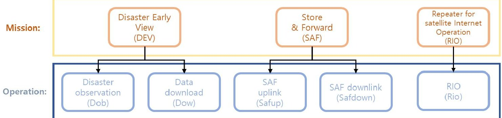
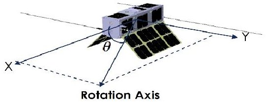
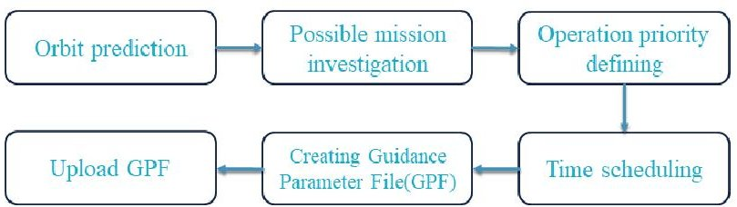
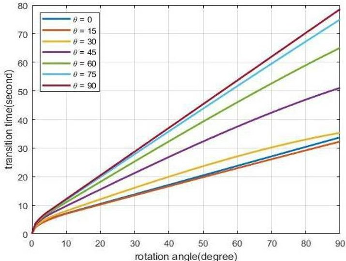
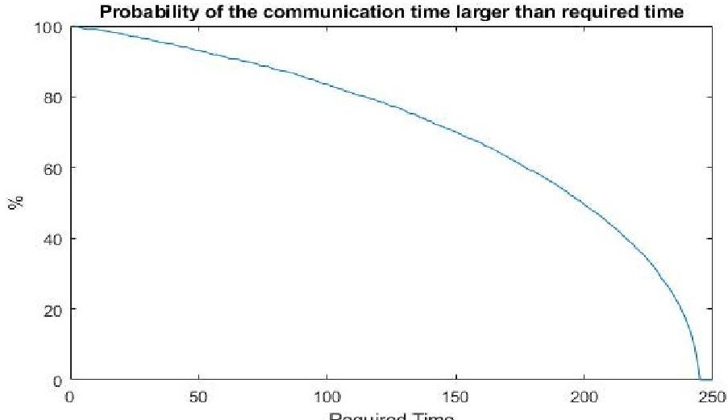
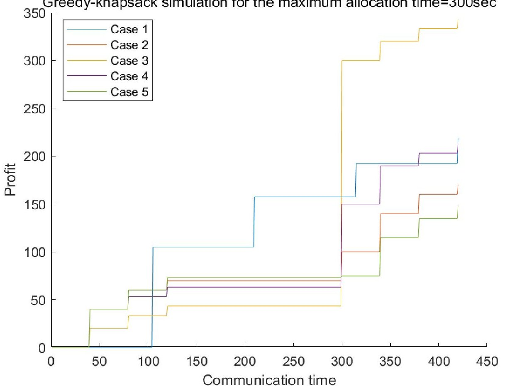
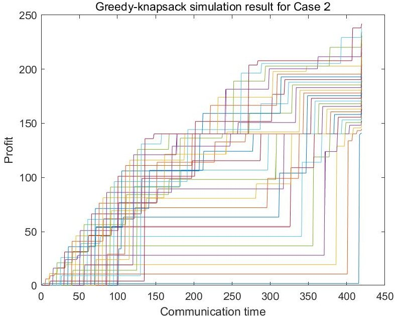
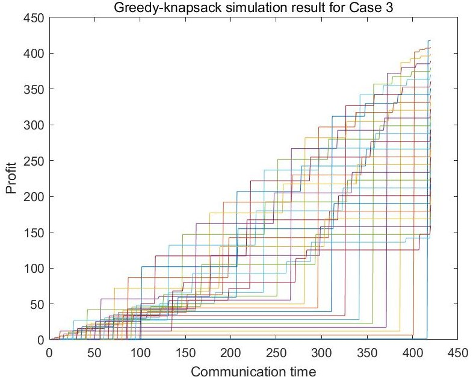
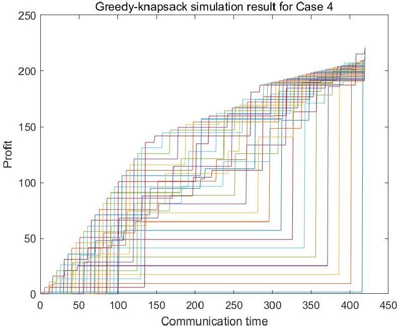
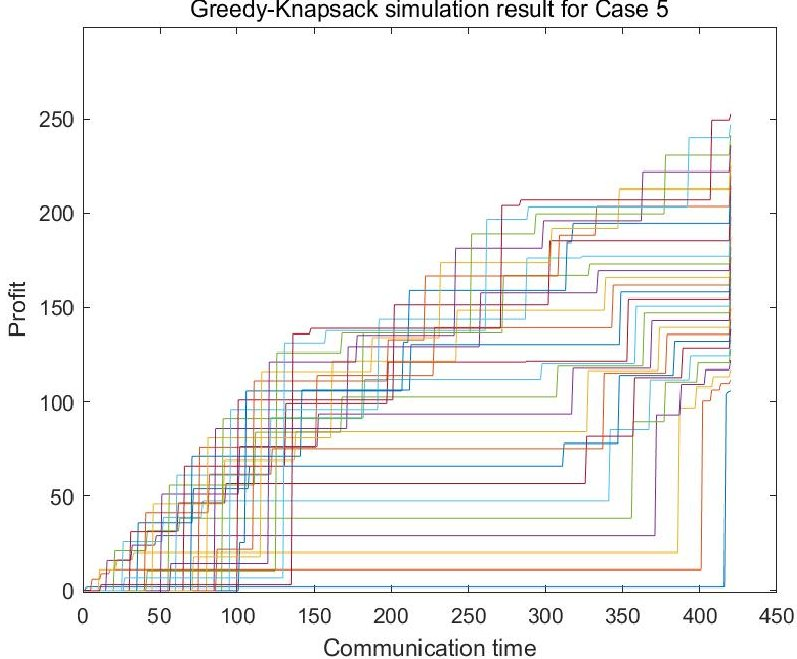

<!-- PDF_PAGE: 1 -->

# A scheduling optimization using greedy knapsack algorithm for RANDEV CubeSat communication and observation missions analyzed with MBSE Activity Diagram

Hanik Kim $ ^{1} $ , Snyoll Oghim $ ^{2} $ , Mingi Mun $ ^{3} $ , and Hyochoong Bang $ ^{4} $

Department of Aerospace Engineering, Korea Advanced Institute of Science and Technology,

Daejeon, 34141, Korea

Repeater Arrangement & Disaster Early View (RANDEV) is a 3U CubeSat whose payloads are hyper-spectral camera, S-band receiver, and X-band transmitter. RANDEV conducts an earth observation mission to collect potential hazard image data from volcanoes, coasts, and clouds. The antennas are used to conduct store & forward and satellite internet missions. The concept of operations (CONOPS) of RANDEV is organized using a top-down approach, and the top of the CONOPS is defined to 'Operation' which is comprised of 'Modes'. A Mode consists of 'Behaviors', and they are composed of 'Actions'. The Actions are the bottom of the RANDEV missions, and defined by SysML Activity Diagram in language. The Actions are function names of RANDEV subsystem softwares. The time consumption of software functions is estimated using the Activity Diagram, and in order to practice three missions, a time scheduling methodology is proposed using greedy-knapsack algorithm in this research.

## I. Introduction

Repeater Arrangement & Disaster Early View (RANDEV) is a 3U CubeSat practicing observation and communication missions using S-band receiver, X-band transmitter, and Hyper-spectral camera. The observation mission is Disaster Early View (DEV), for which RANDEV is pointing nadir direction or a target to collect hyper-spectral images, and the satellite is being developed by the team ASTRIS-II in KAIST Aerospace System and Control Lab (ASCL). The wavelength of the images is from 350 nm to 900 nm with about 58 bands. There are two types of missions in the communication operations, and they are Store & Forward (SAF) and the Repeater for satellite Internet Operation (RIO). In SAF, data transferred from a ground station to RANDEV is conveyed to another ground station which is in different area to the uplink ground station. RANDEV is practicing satellite internet for about 10 minutes using S-band uplink and X-band downlink for RIO, and there are two ground stations one of which is connected to internet router to send and receive the internet request and response. The concept of operations (CONOPS) of RANDEV is organized using top-down approach and the system and state definitions in the text [1], and the top of the CONOPS is defined as 'Operation', and they are composed of 'Modes'. A Mode consists of 'Behaviors', and they are comprised of 'Actions'. An Action is in the bottom level of the RANDEV missions, and Model Based Systems Engineering (MBSE) is utilized to describe the Operation, Mode, Behavior, and Action to apply in RANDEV software names without correction. The objective of this paper is organizing a tight relation between a language-based system modeling and time scheduling of the system. In order to organize the system model, SysML which is a language-based methodology of MBSE is used.

<!-- PDF_PAGE: 2 -->

## II. The RANDEV missions

The targets for the DEV mission are volcanoes, coasts, and clouds. When volcanoes start activity, $ SO_{2} $ is leaked from the mixed magma under them. $ SO_{2} $ absorbs radiation the wavelength of which is from 300 nm to 400 nm. The volcano activities can be observed using the $ SO_{2} $ absorption characteristic in low bands. Plastics and seaweeds floating nearby coasts are entangled and fragmented, and the fragmented micro-plastics harm ocean ecosystem [5]. The peak reflectance of the plastics is 833 nm and the seaweed is detected around 560 nm and 700-780 nm bands. For the cloud observation, the thickness and mixture of clouds are estimated using the hyper-spectral image data based on the graph features from 400-900 nm [6].

These observation data will be analyzed the hazard potential of volcanoes, coasts, and clouds. The Repeater Arrangement missions are data Store & Forward (SAF) and Repeater for satellite Internet Operation (RIO). SAF is practiced for information transmission from one location to the other, even though the other location has no network connection, for example, middle of an ocean, a jungle, or a mountain. Furthermore, secured messages can be transferred through the SAF mission. In the RIO mission, satellite internet is requested from a ground station to RANDEV and the distance from the ground station to a router connected ground station should be less than the RANDEV X-band coverage about 488 km.

RANDEV will be launched on a date between Feb and April 2022 by Nuri rocket, known as KSLV-II, which is a South Korea carrier rocket developed by Korea Aerospace Research Institute (KARI). The orbit of RANDEV is sun synchronous and the altitude is about 700km. The ascending node is not confirmed, since the launch date cannot be designated yet and RANDEV has no propulsion system.

Figure 1 The mission and Operation classification of RANDEV CubeSat

Table 1 The summarized definition of nine SysML diagrams [4]

<table border="1"><tr><td>SysML diagrams</td><td>Definition</td></tr><tr><td>Block Definition Diagram(BDD)</td><td>It is used to display elements such as blocks and value types and the relationships between those elements.Common uses for a BDD include displaying system hierarchy trees and classification trees.</td></tr><tr><td>Internal Block Diagram(IBD)</td><td>It is used to specify the internal structure of a single block.More precisely,an IBD shows the connections between the internal parts of a block and the interfaces between them.</td></tr><tr><td>Use Case Diagram</td><td>It is used to convey the use cases that a system performs and the actors that invoke and participate in them.A Use Case Diagram is a block-box view of the services that a system performs in collaboration with its actors.</td></tr><tr><td>Activity Diagram</td><td>It is used to specify a behavior,with a focus on the flow of control and the transformation of inputs into outputs through a sequence of actions.Activity Diagrams are commonly used as an analysis tool to understand and express the desired behavior of a system.</td></tr><tr><td>Sequence Diagram</td><td>It is used to specify a behavior,with a focus on how the parts of a block interact with one another via operation calls and synchronous signals.Sequence Diagrams are commonly used as a detailed design tool to precisely specify a behavior as an input to the development stage of the life cycle.</td></tr><tr><td>State Machine Diagram</td><td>It is used to specify a behavior,with a focus on the set of states of a block and the possible transitions between those states in response to event occurrences.A State Machine Diagram,like a Sequence Diagram,is a precise specification of a block&#x27;s behavior that can serve as an input to the development stage of the life cycle.</td></tr><tr><td>Parametric Diagram</td><td>It is used to express how one or more constraints-specifically,equations and inequalities-are bound to the properties of a system.Parametric Diagrams support engineering analyses,including performance,reliability,availability,power,mass,and cost.</td></tr><tr><td>Package Diagram</td><td>It is used to display the way a model is organized in the form of a package containment hierarchy.A Package Diagram may also show the model elements that packages contain and the dependencies between packages and their contained model elements.</td></tr><tr><td>Requirements Diagram</td><td>It is used to display text-based requirements,the relationships between requirements(containment,derive requirement,and copy),and the relationships between requirements and the other model elements that satisfy,verify,and refine them.</td></tr></table>

<!-- PDF_PAGE: 3 -->

## III. Model Based Systems Engineering and SysML

The mathematical formalism of MBSE is organized in [1], and the applicable formulation on language is developed in [2]. The discrete system definition in MBSE is based on the set theory and function theory which are fundamentals of abstract algebra, and the mathematical formalism in MBSE satisfies homomorphism. The concept of system homomorphism is perhaps the most important concept of all because it provides the intellectual tool to ensure that the model manipulations of systems engineering (for example, simplification or elaboration) are consistent and correct and will accomplish what they are intended to accomplish [2]. Because of the homomorphic property, MBSE is utilized for modelling to support system requirements, design, analysis, verification, and validation activities beginning in the conceptual design phase and continuing throughout development and later life cycle phases [3]. Because the phases are written in a language, the requirements, design, analysis, verification, and validation activities can be written in a language, even though the fundamentals of MBSE is based on set theory and function theory. SysML is a language-based MBSE modelling method, called document-based approach, and visualizes graphical modelling written in languages for system description. There are nine diagrams in SysML and its characteristics summarized in Table 1. For describing RANDEV mission scheduling, the Activity Diagram of SysML is utilized to model the Attitude Determination and Control System (ADCS) operation with the observation and communication time consumptions in the DEV, SAF, and RIO missions in this paper. The language description of RANDEV project based on SysML has been adopted and tailored for the project team to achieve their objectives [4].

## IV. Language-based system modelling

The top of the RANDEV CONOPS is 'Operation' which is defined using the acronym of the RANDEV operations, and they are composed of 'Modes'. The Modes describe the processes of its Operation which are written with Subject, Verb, and Object (SVO) without the prepositions to apply the description to SysML. A Mode consists of 'Behaviors', The Behaviors are describing its Mode from the perspective of the On-Board Computer (OBC) in RANDEV. The directionality of a Behavior is described using "From" and "To" prepositions and the purpose of a Behavior is written with "For" preposition. Lastly, a Behavior is comprised of 'Actions' which are the bottom of the RANDEV missions and the subjects of the Actions are the subsystems of RANDEV, which are OBC, hyper-spectral camera, UHF, VHF, S-band, and X-band antennas, EPS, and ADCS. An Action is also written with their directionality and purpose as a Behavior, but the subject of an Action is not always OBC. The Actions are used for the function names in subsystem software to help the subsystem stakeholders understand the meaning of the functions. In this paper, the Modes, Behaviors, and Actions are written in simplified grammar and the descriptions are used to organize the SysML Activity Diagrams for the time scheduling of the RANDEV missions.

In the DEV mission, there are two Operations which are Dob (Disaster observation) and Dow (Data download). Dob Operation is an assignment collecting 350 - 900 nm wavelength hyper-spectral image data. The observation targets of the hyper-spectral camera are volcanoes, coasts, and clouds. Clouds are observed in the nadir pointing operation in DEV operation, and the hyper-spectral image data of volcanoes and coasts are collected with target pointing attitude controls. The nadir pointing attitude control can be defined as a target pointing attitude control since the nadir direction is considered to a target which is Z direction in Vehicle Velocity, Local Horizontal (VVLH) frame. Therefore, Dob operation can be simply explained as "mRandevObserveTarget". The "mRandevObserveTarget" is composed of the Behaviors which are "bObcCommandToAdcsForPointingTarget", "bObcCommandToPayloadFor-StartingCamera", "bObcCommandToPayloadForTakingPicture", and "bObcCommandToPayloadForStopping-Camera". The "bObcCommandToAdcsForPointingTarget" Behavior consists of two Actions which are "aObcSetTargetPointingToAdcs" and "aObcGetStatusFromAdcs". The DEV mission should transmit the image data to a ground station, and this Operation is defined as Dow. The DEV mission's Operations, Modes, and Behaviors are listed in Table 2 with their ADCS Behaviors. The Actions are detailed in Table 3 with their subsystem and Behaviors. In the Repeater Arrangement (RA) missions, Store & Forward (SAF) and Repeater for satellite Internet Operation (RIO) are conducted. SAF mission is composed of Safup and Safdown Operations. Safup Operation practices "mRandevConnectGs", "mRandevUplinkSband", and "mRandevDisconnectGs" Modes to uplink from a ground station for delivering data. After the uplink, satellite moves to the other ground station, then RANDEV practices Safdown Operation to downlink the data through "mRandevConnectGs", "mRandevDownlinkXband", and "mRandevDisconnectGS" Modes. While SAF requires an orbiting process, Rio Operation is conducted in a local area bounded by X-band circular coverage diameter 488 km. The Rio's Modes are "mRandevConnectGs", "mRandevUplinkSband", "mRandevDownlinkXband", "mRandevUplinkSband", "mRandevDownlinkXband", and "mRandevDisconnectGS". In order to access an internet, a source host should request data to the Internet Protocol (IP) address of a destination host, then the destination host responses its data to the source host. The former "mRandevUplinkSband" and "mRandevDownlinkXband" Modes are the request process and the latter same Modes

<!-- PDF_PAGE: 4 -->

are the response process. The request and response are repeated in the Rio Operation until the "mRandevDisconnectGs".

Table 2 The Operations, Modes, and Behaviors of the RANDEV missions

<table border="1"><tr><td>Mission</td><td>Operations</td><td>Modes</td><td>Behaviors</td></tr><tr><td rowspan="5">DEV mission</td><td>oDob</td><td>mRandevObserveTarget</td><td>bObcCommandToAdcsForPointingTargetbObcCommandToPayloadForStartingCamerabObcCommandToPayloadForTakingPicturebObcCommandToPayloadForStoppingCamera</td></tr><tr><td rowspan="4">oDow</td><td>mRandevConnectGs</td><td>bObcUplinkFromGsForConnectingGsbObcCommandToAdcsForPointingGs</td></tr><tr><td>mRandevDownlinkWod</td><td>bObcDownlinkToGsForDownloadingWod</td></tr><tr><td>mRandevDownlinkXband</td><td>bObcCommandToPayloadForStartingXbandbObcCommandToPayloadForDonwlinkingMd</td></tr><tr><td>mRandevDisconnectGs</td><td>bObcUplinkFromGsForDisconnectingGsbObcCommandToPayloadForStoppingSbandbObcCommandToPayloadForStoppingXband</td></tr><tr><td rowspan="6">SAF mission</td><td rowspan="3">oSafup</td><td>mRandevConnectGs</td><td>bObcUplinkFromGsForConnectingGsbObcCommandToAdcsForPointingGs</td></tr><tr><td>mRandevUplinkSband</td><td>bObcCommandToPayloadForStartingSbandbObcCommandToPayloadForUplinkingMd</td></tr><tr><td>mRandevDisconnectGs</td><td>bObcUplinkFromGsForDisconnectingGsbObcCommandToPayloadForStoppingSbandbObcCommandToPayloadForStoppingXband</td></tr><tr><td rowspan="3">oSafdown</td><td>mRandevConnectGs</td><td>bObcUplinkFromGsForConnectingGsbObcCommandToAdcsForPointingGs</td></tr><tr><td>mRandevDownlinkXband</td><td>bObcCommandToPayloadForStartingXbandbObcCommandToPayloadForDonwlinkingMd</td></tr><tr><td>mRandevDisconnectGs</td><td>bObcUplinkFromGsForDisconnectingGsbObcCommandToPayloadForStoppingSbandbObcCommandToPayloadForStoppingXband</td></tr><tr><td rowspan="6">RIO mission</td><td rowspan="6">oRio</td><td>mRandevConnectGs</td><td>bObcUplinkFromGsForConnectingGsbObcCommandToAdcsForPointingGs</td></tr><tr><td>mRandevUplinkSband</td><td>bObcCommandToPayloadForStartingSbandbObcCommandToPayloadForUplinkingMd</td></tr><tr><td>mRandevDownlinkXband</td><td>bObcCommandToPayloadForStartingXbandbObcCommandToPayloadForDonwlinkingMd</td></tr><tr><td>mRandevUplinkSband</td><td>bObcCommandToPayloadForStartingSbandbObcCommandToPayloadForUplinkingMd</td></tr><tr><td>mRandevDownlinkXband</td><td>bObcCommandToPayloadForStartingXbandbObcCommandToPayloadForDonwlinkingMd</td></tr><tr><td>mRandevDisconnectGs</td><td>bObcUplinkFromGsForDisconnectingGsbObcCommandToPayloadForStoppingSbandbObcCommandToPayloadForStoppingXband</td></tr></table>

Table 3 The Actions of the Behaviors for the RANDEV missions

<table border="1"><tr><td>Subsystem</td><td>Behavior</td><td>Action</td></tr><tr><td rowspan="6">ADCS</td><td rowspan="2">bObcCommandToAdcsForPointingSun</td><td>aObcSetSunPointingToAdcs</td></tr><tr><td>aObcGetStatusFromAdcs</td></tr><tr><td rowspan="2">bObcCommandToAdcsForPointingGs</td><td>aObcSetGsPointingToAdcs</td></tr><tr><td>aObcGetStatusFromAdcs</td></tr><tr><td rowspan="2">bObcCommandToAdcsForPointingTarget</td><td>aObcSetTargetPointingToAdcs</td></tr><tr><td>aObcGetStatusFromAdcs</td></tr><tr><td rowspan="4">UHF/VHF antenna</td><td rowspan="2">bObcUplinkFromGsForConnectingGs</td><td>aObcReceiveAckFromComm</td></tr><tr><td>aObcDecodeAckFromObc</td></tr><tr><td rowspan="2">bObcDownlinkToGsForDownloadingWod</td><td>aObcReadWodFromStorage</td></tr><tr><td>aObcSendWodToComm</td></tr><tr><td rowspan="3">HS camera</td><td>bObcCommandToPayloadForStartingCamera</td><td>TBD</td></tr><tr><td>bObcCommandToPayloadForTakingPicture</td><td>TBD</td></tr><tr><td>bObcCommandToPayloadForStoppingCamera</td><td>TBD</td></tr><tr><td rowspan="8">X/S antenna</td><td>bObcCommandToPayloadForStartingXband</td><td>TBD</td></tr><tr><td>bObcCommandToPayloadForDonwlinkingMd</td><td>TBD</td></tr><tr><td>bObcCommandToPayloadForStartingSband</td><td>TBD</td></tr><tr><td>bObcCommandToPayloadForUplinkingMd</td><td>TBD</td></tr><tr><td>bObcCommandToPayloadForStoppingSband</td><td>TBD</td></tr><tr><td>bObcCommandToPayloadForStoppingXband</td><td>TBD</td></tr><tr><td rowspan="2">bObcUplinkFromGsForDisconnectingGs</td><td>aObcReceiveAckFromComm</td></tr><tr><td>aObcDecodeAckFromObc</td></tr></table>

<!-- PDF_PAGE: 5 -->

## V. Time scheduling for the RANDEV missions

## A. Time allocation for the Operations

The missions of RANDEV are classified as temporal and continuous. A temporal mission conducts its Operations in a discontinued period. In other words, a temporal mission does not need to be operated in a period. Dob and Dow can be practised in discontinued time and Safup and Safdown do not need to be operated at once. Therefore, DEV and SAF are temporal missions. While a continuous mission should be operated in a continuous period. The RIO mission is operated in a continuous period because the internet network should not be disconnected for a period.

On the other hand, the RANDEV Operations are practised in a period different from the missions. Although the RANDEV Operations can be specified using the Behaviors and Actions, cannot be practised in a discontinued period. So, the Operations can be the smallest elements for the RANDEV mission time scheduling. There are five Operations for the RANDEV missions, and they are Dob, Dow, Safup, Safdown, and RIO. Before RANDEV practices the Operations, ADCS should change its attitude to point at the observation target for DEV mission or a ground station for SAF or RIO missions.

Cube ADCS 3-Axis made by CubeSpace will be equipped in RANDEV, and its attitude control performance is simulated in Figure 2. The moment of inertia is J=diag[0.016 0.04 0.049] $ kgm^{2} $ and cube wheel performance is $ H_{max}=1.77mNms $ $ T_{max}=0.23mNm $ . Using these values, the attitude control time is simulated according to the rotation axis angle $ \theta $ from $ 0^{\circ} $ to $ 90^{\circ} $ with $ 15^{\circ} $ gaps. When RANDEV is rotating in Y-direction (pitch), the consumption time is estimated as 80 sec and is the highest value for the simulated rotation axis. So, the maximum time consumption is determined to 90 sec including 10 sec for margin about $ 90^{\circ} $ pitch rotation, and this value is the ADCS time consumption for the Operations to ensure feasibility.

When RANDEV is orbiting, a mission cannot be practised if the ground stations or observation targets are not located within the satellite field of view. Moreover, even though they are in the satellite field of view bound, if the time allocation is insufficient for the Operation, the satellite cannot attempt its works. Because of this reason, sufficient time allocation for the RANDEV Operations is the most significant factor in the time scheduling, and in order to do that the priority of the Operations should be confirmed. In this paper, the priority order is designated to Safup, Safdown, Dow, RIO, and Dob. Safup and Safdown are emergent Operations to deliver data, and Dow has the third priority due to the limitation of payload storage size. The RIO is the fourth priority, since should be practised within a ground station networking boundary with RANDEV, and the Dob is the lowest priority because it is not operated in a communication period. The time scheduling will be converted to the Guidance Parameter File (GPF) which is delivered to RANDEV when the satellite is connected with KAIST ground station. In order to upload GPF to a satellite, Figure 4 procedures should be practised.

Figure 2 The definition of rotation axis simulation

Figure 3 The GPF uploading procedures

Figure 4 The simulated time for attitude control

## B. Methodologies for orbit prediction and mission time allocation

RANDEV will orbit on 700 km altitude in sun-synchronous orbit. The bus size of RANDEV is 3U with a 40 cm $ \times $ 30 cm deployable solar panel, so the radiation pressure and atmospheric drag should be considered to develop a RANDEV orbit simulator. The geopotential perturbation effects are considered including J5, and Lunar and Solar perturbations are considered. The torque effects caused by geomagnetic field and gravity gradient are not used in the orbit simulator,

<!-- PDF_PAGE: 6 -->

because the attitude variation does not influence on satellite position. $ 6^{\mathrm{th}} $ order Runge-Kutta-Nystrom method is applied in the orbit propagator to calculate precise RANDEV position for mission period 1 year. The contacting time is estimated with $ 20^{\circ} $ elevation angle. The calculated contacting time will be a main constraint in the RANDEV missions, and the consuming time of Behaviors is the parameter of the satellite scheduling. The contacting time constraints are analyzed using the developed simulation model, and the probability of contacting time larger than the required times is represented in Figure 5.

The Operations control the satellite attitude before practice their assignments, and the ADCS control time is added to formulate the Operation time consumption. Especially, Dow Operation delivers the RANDEV whole orbit data which is considered to formulate its time scheduling. Using these considerations, the time consumption of the Operations can be formulated as Equation 1.

Figure 5 The feasibility of the Dow Operation in the required time at a contact with KAIST from Jan $ 1^{\mathrm{st}} $ 2022 to Dec $ 31^{\mathrm{st}} $ 2022

$$
T _ {1}: \text {R e q u i r e d t i m e f o r D o b}, \quad T _ {1} = 9 0, 0 0 0 + t _ {1}
$$

$$
T _ {2}: \quad \text {R e q u i r e d t i m e f o r D o w}, T _ {2} = 1 5 5, 0 0 0 + t _ {2}
$$

$$
T _ {3}: \quad \text {R e q u i r e d t i m e f o r S a f u p}, T _ {3} = 9 5, 0 0 0 + t _ {3}
$$

$$
T _ {4}: \quad \text {R e q u i r e d t i m e f o r S a f d o w n}, T _ {4} = 9 5, 0 0 0 + t _ {4}
$$

$$
T _ {5}: \quad \text {R e q u i r e d t i m e f o r R i o}, T _ {5} = 9 5, 0 0 0 + t _ {5}
$$

$ t_{1} $ is the observation time which is defined by the Dob time for a day, and the mean available communication time is about 7 mins at the elevation $ 20^{\circ} $ for a day. With assuming that X-band data transfer rate is 100Mbps and 200Mpixels optical sensor is equipped in hyper-spectral camera, the available observation time is calculated as Equation 2. Using this equation, the observation time can be allocated without $ t_{1} $ variable and the RANDEV mission time scheduling only needs to consider the communication Operations, which are Dow, Safup, Safdown, and Rio.

$$
t _ {1} = \frac {X b a n d D a t a R a t e \times t _ {2}}{2 0 0 M p i x e l I m a g e D a t a \times F r a m e R a t e} = \frac {1 0 0 M b p s \times t _ {2}}{2 3 7 , 9 6 8 b i t s \times F r a m e R a t e}
$$

## VI. Greedy-knapsack algorithm

Knapsack problem is an optimization problem determining the item number to maximize the total profit of items in a knapsack. An item has its own volume and profit, and the knapsack has a limited volume. The greedy knapsack algorithm is written in pseudo-code as Table 5, and it can be utilized to solve the RANDEV time scheduling by maximizing the total profit of the RANDEV missions. An item in knapsack problem is the time of an Operation and the knapsack volume is the possible communication time with a ground station.

The possible communication time is set as 420 sec which is the mean value of possible Dow time and is used for describing the other Operations with sufficient margin time. The profit of Operation is defined by the inverse of priority multiplied by the communication time. This can be modelled to an optimization problem as Equation 3. In this equation, $ t_{i} $ should be requested from the stakeholders.

This Equation 3 problem can be solved using greedy algorithm by varying the available communication time from 0

<!-- PDF_PAGE: 7 -->

to 420 sec with Operation requiring time $ t_{i} $ . The available communication time range can be extended and reduced for analyzing the feasibility of real-time communication missions. Before analyzing the feasibility, the priority of Operations should be defined, since the Operation profit of communication missions are determined by the priority.

$$
\max \sum_ {2} ^ {5} P _ {i} = \frac {t _ {i}}{p _ {i}}
$$

$$
\mathrm {s . t} \sum_ {2} ^ {5} t _ {i} = 4 2 0, 0 0 0
$$

($p_{i}$ : the priority of index)

t2: Dow downlink time,

t3: Safup uplink time.

$ t_{4} $ : Safdown donwlink time, and

t5: Required time for Rio

Table 4 The time allocation for the Behaviors with priority

<table border="1"><tr><td>Mission</td><td>Operations</td><td>Modes</td><td>Behaviors</td><td>Time consumption(ms)</td><td>Priority</td></tr><tr><td rowspan="6">DEV mission</td><td rowspan="2">oDob</td><td rowspan="2">mRandevObserveTarget</td><td>bObcCommandToAdcsForPointingTarget</td><td>90,000</td><td rowspan="2">5</td></tr><tr><td>bObcCommandToPayloadForTakingPicture</td><td>t1</td></tr><tr><td rowspan="4">oDow</td><td rowspan="4">mRandevConnectGs</td><td>bObcUplinkFromGsForConnectingGs</td><td>5,000</td><td rowspan="4">3</td></tr><tr><td>bObcCommandToAdcsForPointingGs</td><td>90,000</td></tr><tr><td>mRandevDownlinkWod</td><td>bObcDownlinkToGsForDownloadingWod</td></tr><tr><td>mRandevDownlinkXband</td><td>bObcCommandToPayloadForDonwlinkingMd</td><td>t2</td></tr><tr><td rowspan="6">SAF mission</td><td rowspan="3">oSafup</td><td rowspan="3">mRandevConnectGs</td><td>bObcUplinkFromGsForConnectingGs</td><td>5,000</td><td rowspan="3">1</td></tr><tr><td>bObcCommandToAdcsForPointingGs</td><td>90,000</td></tr><tr><td>mRandevUplinkSband</td><td>bObcCommandToPayloadForUplinkingMd</td><td>t3</td></tr><tr><td rowspan="3">oSafdown</td><td rowspan="3">mRandevConnectGs</td><td>bObcUplinkFromGsForConnectingGs</td><td>5,000</td><td rowspan="3">2</td></tr><tr><td>bObcCommandToAdcsForPointingGs</td><td>90,000</td></tr><tr><td>mRandevDownlinkXband</td><td>bObcCommandToPayloadForDonwlinkingMd</td><td>t4</td></tr><tr><td rowspan="6">RIO mission</td><td rowspan="6">oRio</td><td rowspan="6">mRandevConnectGs</td><td>bObcUplinkFromGsForConnectingGs</td><td>5,000</td><td rowspan="6">4</td></tr><tr><td>bObcCommandToAdcsForPointingGs</td><td>90,000</td></tr><tr><td>mRandevUplinkSband</td><td>bObcCommandToPayloadForUplinkingMd</td><td rowspan="4">t5</td></tr><tr><td>mRandevDownlinkXband</td><td>bObcCommandToPayloadForDonwlinkingMd</td></tr><tr><td>mRandevDownlinkXband</td><td>bObcCommandToPayloadForDonwlinkingMd</td></tr></table>

## Table 5 Greedy-knapsack algorithm pseudo-code

Greedy_Knapsack (P[] , V[] , T)

P[]: Profit array, V[]: Volume array (Time array)

X: A set of Behaviors, T: The contacting time

P and V are arranged in descending order.

{

AvailableTime $ \leftarrow $ T; i $ \leftarrow $ 1;

while (V[i] $ \leq $ AvailableTime and i $ \leq $ n){

X $ \leftarrow $ X $ \cup $ {i};

AvailableTime $ \leftarrow $ AvailableTime- V[i];

i++;

}

return X;

}

<!-- PDF_PAGE: 8 -->

## VII. Time scheduling optimization examples

Greedy-knapsack algorithm is tested for the communication with the same time allocated Operations and communications with dominant single Operation. The total time is assumed to 420 sec, which is the average communication time of KAIST ground station at $ 2 0^{\circ} $ elevation angle for a day, and the time of the dominant Operation is set to 300 sec. The conditions for this simulation are summarized below.

Case 1. Same time allocated communication: $ t_{2}=1 0 5 $ $ t_{3}=1 0 5 $ $ t_{4}=1 0 5 $ , and $ t_{5}=1 0 5 $

Case 2. Dow dominant communication: $ t_{2}=300 $ $ t_{3}=40 $ $ t_{4}=40 $ , and $ t_{5}=40 $

Case 3. Safup dominant communication: $ t_{2}=4 0 $ $ t_{3}=3 0 0 $ $ t_{4}=4 0 $ , and $ t_{5}=4 0 $

Case 4. Safdown dominant communication: $ t_{2}=4 0 $ $ t_{3}=4 0 $ $ t_{4}=3 0 0 $ , and $ t_{5}=4 0 $

Case 5. Rio dominant communication: $ t_{2}=4 0 $ $ t_{3}=4 0 $ $ t_{4}=4 0 $ and $ t_{5}=3 0 0 $

In Figure 6, the highest profit result is Case 3, since Safup has the first priority, and Case 1 maintains the highest profit from 105 sec to 300 sec. Figure 7 indicates that the allocated time of a single dominant Operation is changed from $ t_{i}=0 $ to $ t_{i}=420 $ for Case 2-5. Case 3 presents that the highest profit is shown when Safup is only operated.

Figure 6 Greedy-knapsack simulation for the maximum allocation time 300 sec from Case 1-5

<!-- PDF_PAGE: 9 -->

Figure 7 The optimal value searching by varying the time value for the case 2-5 (for Case i, $ t_{i} $ is variable)

## VIII. Conclusion and discussion

This paper organizes the tight connection between SysML Activity Diagram based on MBSE and time scheduling for satellite missions. The SysML Activity Diagram is modelled using language with simplified grammar and differently defined by system hierarchy levels. The top of RANDEV hierarchy for Activity Diagram is Operation and it is described using only SVO in the second hierarchy Modes. A Mode is described using Behaviors written in SVO grammar with "From", "To", and "For" to describe its directionality and the purpose. A Behavior is composed of Actions which is the specified description of the Behaviors from the perspective of the subsystems, and the name of Actions is directly used in functions of the subsystems for helping stakeholder understanding. Even though graphical modelling is not organized, the Behaviors are Activity Diagrams, since the directionality of the Behaviors is specified in a language. Using these Activity Diagrams, time scheduling for the RANDEV missions can be modelled as Equation 1, and simplified as Equation 3 which does not need to consider observation time $ t_{1} $ . The simplified equation is solved in this paper using Greedy-knapsack algorithm with examples of time allocation in the Operations, which are Dow, Safup, Safdown, and Rio.

Two assumptions are used for simplifying RANDEV time scheduling. The first assumption is that the time consumption for contacting to a ground station is 155 sec, but this can be reduced when the whole orbit data transmitting and ADCS control are performed simultaneously. The secondary assumption is the KAIST ground station elevation angle which is fixed at $ 2 0^{\circ} $ for all Operations, however, if elevation angle is replaced to $ 1 0^{\circ} $ , the average communication time increases to 18 mins 28 sec with considering whole orbit data downlink and ADCS control time

<!-- PDF_PAGE: 10 -->

consumptions. After analyzing, these two assumptions, the time scheduling performance can be enhanced. Moreover, if Equation 3 is formulated using the other approach, the profit can be enhanced. However, if the formulation is changed, the other types of algorithm should be utilized to search the optimal profit of modelled satellite missions.

## References

[1] Wymore, Wayne. "A mathematical theory of systems engineering: the elements." (1967).

[2] Wymore, A. Wayne. Model-based systems engineering. Vol. 3. CRC press, 2018.

[3] International Council on Systems Engineering. Systems Engineering Handbook; Version 3.1; International Council on Systems Engineering: San Diego, CA, USA, 2007

Council on Systems Engineering: San Diego, CA, USA, 2007.

[4] Delligatti, Lenny. SysML distilled: A brief guide to the systems modeling language. Addison-Wesley, 2013.

[5] Biermann, Lauren, et al. "finding plastic patches in coastal Waters using optical Satellite Data." Scientific reports 10.1 (2020): 1-10.

[6] Li, Haoyang, et al. "Onboard spectral and spatial cloud detection for hyperspectral remote sensing images." Remote Sensing 10.1 (2018): 152.