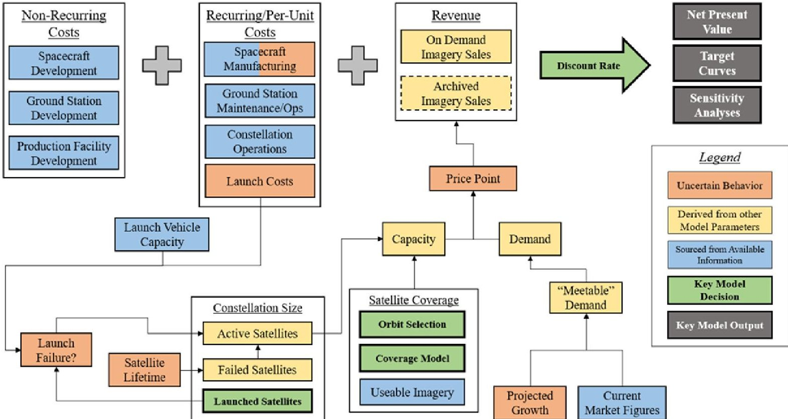
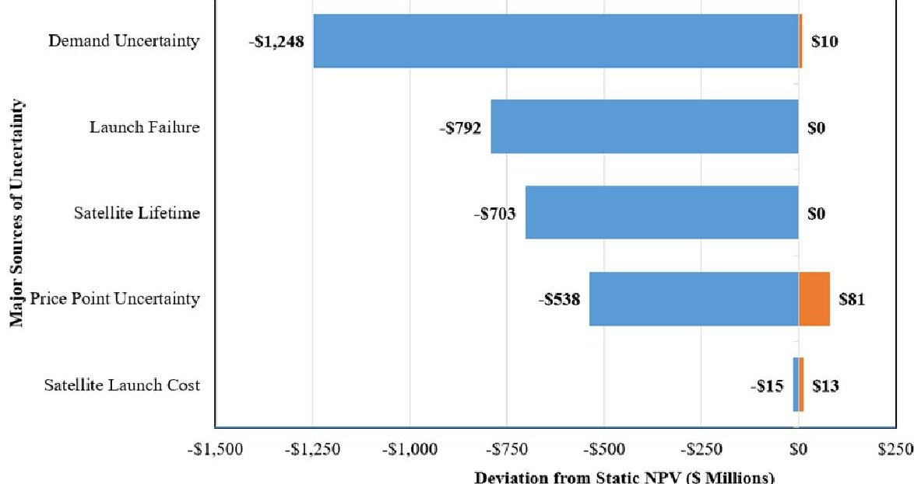
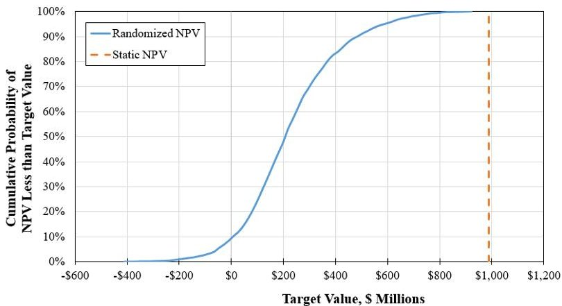
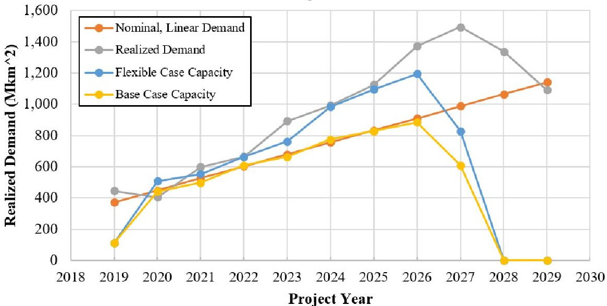
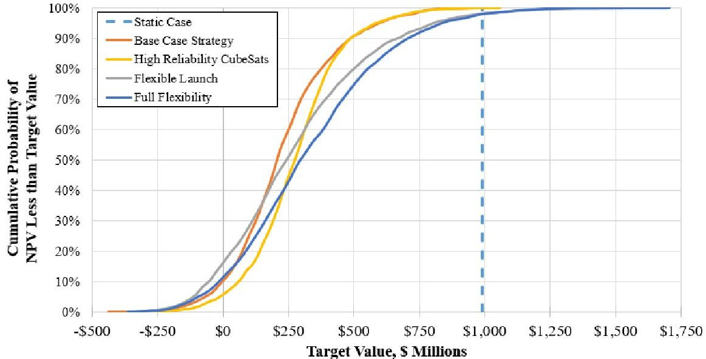

<!-- PDF_PAGE: 1 -->

# Deployment Strategies for a Financially Viable Remote Sensing Constellation

Alejandro E. Trujillo Massachusetts Institute of Technology 77 Massachusetts Avenue Cambridge, MA 02139 alextruj@mit.edu

Dr. Richard de Neufville Massachusetts Institute of Technology 77 Massachusetts Avenue Cambridge, MA 02139 ardent@mit.edu

Abstract—Traditional space-based remote sensing architectures are characterized by small quantities of large, monolithic, and expensive satellites. In recent years, constellations of CubeSats have emerged as a competitive challenge to this approach. These large, coordinated deployments of miniaturized spacecraft trade the higher resolution payloads of large satellites for other benefits such as faster revisit times, larger coverage, and lower unit costs. Despite these benefits, an Earth-imaging CubeSat constellation is a complex engineering undertaking not without significant technical and financial risk. This paper investigates the strategic decisions that make for a successful commercial remote sensing constellation. A system model is developed to capture the impact of architectural and business decisions, along with external economic and technical uncertainties, which impact the success of the venture, as measured by Net Present Value (NPV). The system model is implemented for two architectural approaches. The first is a "rigid strategy" where business decisions and cost commitments are made at the outset of the project, when best guesses for the realization of uncertain parameters are required. The second architectural approach is a "flexible strategy" which leverages the physically and temporally distributed deployment of a small satellite constellation to make responsive decisions as the future unfolds and uncertainties are better understood. It is shown that employing flexible strategies can yield up to 30% increases in average NPV, nearly double maximum expected NPV, and improve Value at Risk (VAR) figures by as much 60% over a rigid strategy. This work confirms that commercial success of a remote-sensing constellation is as dependent on technical decisions as on the realization of an uncertain future. Thus, the most prudent course of action is to understand these uncertainties and adopt a reactive and flexible deployment strategy.

## TABLE OF CONTENTS

1. INTRODUCTION...1

2. PROBLEM STATEMENT ...2

3. SYSTEM MODEL ...2

4. BASELINE CASE ...5

5. INCORPORATING FLEXIBILITY...7

978-1-7821-2734-7/20/$31.00 ©2020 IEEE

6. LIMITATIONS...10

7. CONCLUSION...11

## 1. INTRODUCTION

Satellite-based remote sensing can be defined as a service which obtains, processes and provides data on terrestrial objects, phenomena and scenes as gathered by imaging technologies onboard space-based assets. Otherwise known as satellite imagery, this service is provided by both government and commercial parties to a wide range of customers including military and intelligence agencies, agriculture and resource excavation operations, and humanitarian organizations. Users of Geographic Information Systems (GIS) such as mapping software, GPS visualization, and everyday applications on smart phones, are also increasingly important downstream customers of satellite imagery.

A variety of architectures have been deployed which vary in terms of number, size and capability of satellite systems for gathering such imagery. This paper examines a particular subset of these architectures, namely, constellations of CubeSats. CubeSats are a paradigm in satellite design which miniaturize subsystems into shoebox-sized satellites which are cheaper, albeit with lower performance. Constellations of these CubeSats are large, coordinated deployments that can present a competitive challenge to large, monolithic, low quantity remote sensing architectures [1]. However, several design and business decisions are critical in determining the success of such a constellation including: orbit selection, design lifetime, and number/cadence of satellite deployment. In addition, factors such as launch vehicle failures and demand fluctuation are external uncertainties which affect a venture's success.

The decision to deploy a constellation of CubeSats is thus a potentially lucrative but also highly risky business decision. This study performs a cost-centric analysis of an Earth

<!-- PDF_PAGE: 2 -->

imaging CubeSat constellation constrained to a few key design decisions.

## 2. PROBLEM CONTEXT

The investigation is framed from the perspective of a hypothetical company seeking to develop and deploy an Earth-imaging satellite constellation. They must make certain architectural decisions to maximize the likelihood of fielding a profitable product. The problem statement is then "To develop a simulation model for exploring the best combination of architectural decisions which deliver a space-based Earth imaging CubeSat constellation that is responsive to uncertain market and technological conditions." The model factors the impacts of managerial and architectural decisions in terms of potential costs and revenues. In addition, sources of uncertainty (both internal and external) are considered which affect these figures. Most importantly, the model investigates the value of adopting a flexible deployment strategy - one that is reactive to uncertainties as they are realized as the future unfolds - over a rigid strategy defined at the outset of the project.

## 3. SYSTEM MODEL

A system model was built to parametrically investigate the impacts of the various design and management decisions. This was done on Excel in modular fashion such that each module - pertaining to a particular cost, demand, capacity, or

revenue contribution - could be modified as needed. The flow of inputs and outputs is depicted in Figure 1. Some parameters, primarily cost and demand figures, are taken from publicly available sources, cost models, and analogous missions. Other inputs capture the inherent uncertainty of the problem via probabilistic distributions. Lastly, some of the inputs in the model are user defined, and thus are the key architectural decisions that a manager would be faced with.

Methods for determining parameter values or their distributions are discussed briefly in the following subsections.

## Model Parameters: Sourced Values

The boxes shown in blue in Figure 1 correspond to parameters whose values were gathered mainly from publicly available sources. These include market reports for the commercial remote sensing industry and data provided on company websites and spec sheets (e.g. launch vehicle capacities, manufacturing facility costs, etc.). These sources were used to arrive at most cost figures for recurring and non-recurring expenses of the satellite development, operation and maintenance lifecycle.

One additional source used was The Aerospace Corporation's Small Satellite Cost Model 2014 (SSCM 14) which was used to estimate development and per-unit costs for the CubeSats. While it is not explicitly meant for CubeSat

Figure 1. Flow diagram representing the input/output parameters of the System Model. The top row of boxes represents the sum of costs and revenues to arrive at a net cash-flow. The lower level boxes represent the supporting modules to arrive at final values for costs and revenues.

$$
9 7 8 - 1 - 7 8 2 1 - 2 7 3 4 - 7 / 2 0 / \$ 3 1. 0 0 \mathrm {c} 2 0 2 0 \mathrm {I E E E}
$$

<!-- PDF_PAGE: 3 -->

class missions, SSCM 14's Cost Estimating Relationship (CER) parameter bounds are those closest to values of CubeSat missions [2]. SSCM 14 estimated that the 12U CubeSat bus development (non-recurring) costs would be around $2.6M while the first unit costs would be around $3.5M. CER inputs for this estimate included: 20 kg satellite wet mass, 50 W Beginning of Life power, and UHF/VHF communications. In addition, a $10M imaging payload development cost was included. These costs should be seen as conservative estimates, as many CubeSat projects are developed and launched for around $1M [2].

Table I shows a summary of costs, divided into non-recurring, recurring, and per-unit figures. Non-recurring costs can be seen as those upfront development and engineering costs needed to support the eventual "Theoretical First Unit" and standing up required infrastructure. The $50M Ground Station Development and Manufacturing Facility costs are taken from [3] assuming 10 ground sites stationed throughout the world for near-continuous downlink capabilities. The recurring costs are those that must be paid every year of operation; these include facility upkeep and maintenance, operations costs, employee salaries etc. In addition, per-unit costs are incurred with each satellite that is manufactured. In the model, non-recurring costs are fixed while the recurring "Constellation Operations" cost is modulated by the number of active satellites which need to be operated; the $100M figure is estimated from Planet's published fund-raising efforts, assuming $50% goes to fleet operations [4]. Also, satellite launch costs are modulated by an uncertain parameter and the per-unit satellite manufacturing costs are affected by learning effects.

Table I. Summary of nominal non-recurring, recurring, and per-unit costs for the system.

<table border="1"><tr><td colspan="2">Non-Recurring Costs</td></tr><tr><td>Satellite Bus Development</td><td>$2,600,000</td></tr><tr><td>Satellite Imager Payload Development</td><td>$10,000,000</td></tr><tr><td>Ground Station Development</td><td>$50,000,000</td></tr><tr><td>Manufacturing Facility Construction</td><td>$50,000,000</td></tr><tr><td colspan="2">Recurring Costs</td></tr><tr><td>Ground Facilities Maintenance and Upkeep</td><td>$45,000,000</td></tr><tr><td>Constellation Operations</td><td>$100,000,000</td></tr><tr><td>Program Management and Systems Engineering</td><td>$14,500,000</td></tr><tr><td colspan="2">Per-Unit Costs</td></tr><tr><td>Satellite Manufacturing, per Satellite</td><td>$3,500,000</td></tr><tr><td>Satellite Launch Costs, per Satellite</td><td>$450,000</td></tr></table>

## Model Parameters: Capturing Uncertainties

Five predominant sources of uncertainty are captured in the system model. These uncertainties are considered to be the primary causes for deviation from a nominal view of the problem. As such, the ultimate metrics of success for the project are highly dependent on these uncertainties and how they are realized over the course of the project lifecycle.

978-1-7821-2734-7/20/$31.00 ©2020 IEEE

1. Demand for satellite imagery drastically varies - A significant decrease in demand for satellite imagery might be due to a rise in the capabilities (at lower cost) of the aerial or drone-based remote-sensing markets [5]. Another scenario would be an economic downturn which might see customers deeming satellite imagery a luxury they cannot afford to have. Conversely, we could see upticks in demand during good economic conditions or during high-impact global events. As demand directly determines revenue and the need for capacity, it is likely the most important uncertain parameter in the problem.

2. Satellite Lifetime - Spacecraft are typically designed to operate for a particular amount of time (i.e. the satellite's lifetime). However, the hostile environment of space could lead to failures and loss of service well in advance of this lifetime. Typical causes include malfunctioning hardware, random (or partly cyclic) radiation activity, and orbital debris. This introduces an uncertainty about the actual amount of time that a particular satellite in the constellation might yield revenue. A nominal CubeSat operational lifetime is assumed to be 2 years for this analysis [6]. Lifetime improvements may come in the form of radiation improvements, higher-reliability hardware, etc.

3. Price-point variability - This uncertainty captures the various factors which set the competitive price of the imagery. The activities of other players in the market, such as launching their own constellation or going defunct, can significantly change the price-point at which we are able to sell imagery. A nominal price point of $1.50 per km $ ^{2} $ of image area is used. This is taken from figures provided by image brokers for the expected "medium" resolution of the imagery [7].

4. Launch cost variability - This uncertainty reflects how much is paid to Launch Service Providers (LSPs) to deploy the constellation of satellites. We have seen revolutionary technologies and capabilities in the launch services industry that have led to a sharp decrease in launch costs (measured in $/kg) [8]. However, various factors could lead to increases or uncertain behavior. These include manufacturing cost variability, launch failures which lead to backlogs and delays, etc. Increased launched costs would raise the deployment costs of each satellite, significantly impacting revenue and net present value. Conversely, continuation of the trend of launch cost reductions would foster an environment more amenable to large constellation deployments.

<!-- PDF_PAGE: 4 -->

Table II. Summary of values/ranges for each of the uncertainty parameters.

<table border="1"><tr><td>Uncertain Parameter</td><td>Above Expected Value</td><td>Below Expected Value</td><td>Rationale</td></tr><tr><td>Demand for satellite imagery</td><td>30%</td><td>30%</td><td>This parameter is difficult to predict. However, we do know that“Forecasts are always wrong”.This figure is for Year 10 demand.In addition,a 25% annual demand volatility is incorporated</td></tr><tr><td>Satellite Lifetime</td><td>0%</td><td>35%</td><td>CubeSats are not typically designed for a long lifetime.In addition,their low cost approach implies that lower reliability can be expected.</td></tr><tr><td>Price-Point Variability</td><td>10%</td><td>30%</td><td>A competitive price is very difficult to know in advance without knowledge of what competitors might do.However,as similar CubeSat constellations are deployed,we expect significant price to decrease.Also,a 2% price degradation per year is incorporated.</td></tr><tr><td>Launch Cost Variability</td><td>20%</td><td>20%</td><td>The major launch providers are being shaken awake by SpaceX and other start-up style rocket companies.We can expect it to be more likely that costs continue to fall than the to rise,however this is still to be demonstrated in the small satellite launch industry</td></tr><tr><td>Launch Failures</td><td>5%</td><td>-</td><td>Launch failures are very rare,but devastating when they occur.The seemingly high 5% figure is due to the new class of small launch vehicles,intended for CubeSat deployments,which do not have the legacy or track record of larger vehicles.</td></tr><tr><td>Learning Curve Slope</td><td>-</td><td>97%,fixed</td><td>Typical learning curve slopes for satellite manufacturing are within this range.It is unknown whether these will be significantly different once figures are reported for CubeSats.For this analysis,it is fixed at 97%</td></tr></table>

5. Launch Failures- This uncertainty has to do with our ability to access space to deploy our constellation of satellites. While launch vehicles are very reliable there are plenty of examples of launch failures leading to the loss of the payloads intended for delivery. Especially if we consider small satellites or CubeSats which are often launched many at a time from a single launch vehicle (the model assumes a launch vehicle capacity of 25 CubeSats), a launch failure could lead to the loss of multiple assets. This in turn would prevent us from meeting the demand which they were launched to accommodate.

6. Learning Effects - we consider uncertainty in how learning effects will be realized in the spacecraft manufacturing process. Learning is a welldocumented phenomenon, especially in multisatellite systems. However, this effect is known for medium to large class satellites; it is uncertain how it will be realized in CubeSat systems of dozens or even hundreds of units [9].

In order to capture the above uncertainties, probability distributions were attached to the relevant calculations. For example, the demand forecast is modulated with uncertainty in two ways: 1) an annual demand volatility and 2) a total demand growth uncertainty figure. This captures both shortterm and long-term trends. An example of a non-symmetric uncertainty distribution is in the satellite lifetime figure; here, we assume that a satellite has no probability of operating

978-1-7821-2734-7/20/$31.00 ©2020 IEEE

beyond its lifetime, while it has a certain likelihood of failing before its intended lifetime. This manifests as a +0/-30% distribution. The assumed figures for all uncertainties are shown in Table II.

## Model Parameters: Architecture Decisions

The green boxes in Figure 1 represent the elements which are chosen by the mission designer and are thus the key architectural and managerial decisions that must be made. The primary decision is the number and cadence of satellites deployed each year. This decision drives all aspects of the cost and revenue for the system and is thus critically important. Indeed the goal of this analysis is to determine a suitable strategy for selecting annual launch numbers. Other decisions up to the manager include the selection of the discount rate, and technical facets of the mission including orbit selection and methods for estimating satellite coverage or imaging capacity.

Due to the endeavor's risky nature, a high discount rate of 25% was selected. An orbital altitude of 475 km was chosen due to a variety of factors including lower atmospheric drag than lower orbits (preventing orbital decay), acceptable theoretical resolution limits of about 1.7 m, and ease of access by most launch vehicles. While orbital altitude is fixed in the current version of the model, a higher fidelity model would leave it as a tunable parameter which captures the interplay of altitude, coverage, and resolution. Additionally, a simplified coverage model assumed that each new CubeSat

<!-- PDF_PAGE: 5 -->

<table border="1"><tr><td>Net Present Value Analysis</td><td colspan="6"></td></tr><tr><td>Year</td><td>2018</td><td>2019</td><td>2020</td><td>2021</td><td>2022</td><td></td></tr><tr><td>Demand</td><td></td><td></td><td></td><td></td><td></td><td></td></tr><tr><td>Demand(Deterministic)(Mkm^2)</td><td>-</td><td>372</td><td>449</td><td>525</td><td>602</td><td></td></tr><tr><td>Demand(Uncertain)(Mkm^2)</td><td>-</td><td>405</td><td>429</td><td>489</td><td>659</td><td></td></tr><tr><td>Demand(Realized)(Mkm^2)</td><td>-</td><td>405</td><td>429</td><td>489</td><td>659</td><td></td></tr><tr><td>Capacity</td><td></td><td></td><td></td><td></td><td></td><td></td></tr><tr><td>Total Satellites(at beginning of year)</td><td>0</td><td>0</td><td>0</td><td>0</td><td>0</td><td>0</td></tr><tr><td>Available Satellite Capacity(at beginning of year)</td><td>0</td><td>0</td><td>0</td><td>0</td><td>0</td><td>0</td></tr><tr><td>New Satellites to Deploy(for end of year)</td><td></td><td></td><td></td><td></td><td></td><td></td></tr><tr><td>Launch Vehicles Needed</td><td>0</td><td>0</td><td>0</td><td>0</td><td>0</td><td>0</td></tr><tr><td>Launch Failure?</td><td>No</td><td>No</td><td>No</td><td>No</td><td>No</td><td></td></tr><tr><td>Satellites Lost in Failure(Assume 1 launch failure)</td><td>0</td><td>0</td><td>0</td><td>0</td><td>0</td><td>0</td></tr><tr><td>Successfully Deployed Satellites(for end of year)</td><td>0</td><td>0</td><td>0</td><td>0</td><td>0</td><td>0</td></tr><tr><td>Failed Satellites</td><td>0</td><td>0</td><td>0</td><td>0</td><td>0</td><td>0</td></tr><tr><td>Revenue</td><td></td><td></td><td></td><td></td><td></td><td></td></tr><tr><td>Demand Met(Mkm^2)</td><td>0</td><td>0</td><td>0</td><td>0</td><td>0</td><td>0</td></tr><tr><td>Price Point(Realized)($ per Mkm^2)</td><td>-</td><td>$1,420,000</td><td>$1,471,000</td><td>$1,442,000</td><td>$1,413,000</td><td></td></tr><tr><td>Revenue from Demand Met(requested imagery)</td><td>$</td><td>$-</td><td>$-</td><td>$-</td><td>$-</td><td>$-</td></tr><tr><td>Costs</td><td></td><td></td><td></td><td></td><td></td><td></td></tr><tr><td>Spacecraft Bus Development Cost(Non-Recurring)</td><td>$2,600,000</td><td>0</td><td>0</td><td>0</td><td>0</td><td>0</td></tr><tr><td>Spacecraft Imager Development Cost(Non-Recurring)</td><td>$10,000,000</td><td>0</td><td>0</td><td>0</td><td>0</td><td>0</td></tr><tr><td>Ground Station Development Cost(Non-Recurring)</td><td>$50,000,000</td><td>0</td><td>0</td><td>0</td><td>0</td><td>0</td></tr><tr><td>Large Scale Production Facility Cost(Non-Recurring)</td><td>$50,000,000</td><td>0</td><td>0</td><td>0</td><td>0</td><td>0</td></tr><tr><td>Spacecraft Development Cost,(Recurring)</td><td>$-</td><td>$-</td><td>$-</td><td>$-</td><td>$-</td><td>$-</td></tr><tr><td>Ground Station Maintenance and Upkeep(Recurring)</td><td>$45,000,000</td><td>$45,000,000</td><td>$45,000,000</td><td>$45,000,000</td><td>$45,000,000</td><td></td></tr><tr><td>Constellation Operations Cost(Recurring)</td><td>$100,000,000</td><td>$-</td><td>$-</td><td>$-</td><td>$-</td><td>$-</td></tr><tr><td>Program Management and Systems Engineering Cost(Recurring)</td><td>$14,500,000</td><td>$14,500,000</td><td>$14,500,000</td><td>$14,500,000</td><td>$14,500,000</td><td></td></tr><tr><td>Satellite Launch Costs(Recurring)</td><td>$-</td><td>$-</td><td>$-</td><td>$-</td><td>$-</td><td>$-</td></tr></table>

Figure 2. Main model computation section; the primary architecture decision is highlighted in green.

added to the constellation adds a constant amount of imaging capacity. In reality, Earth coverage from orbit is a highly nonlinear function of orbital planes, altitude, inclination, and desired coverage latitudes [3]. As such, coverage and capacity models should be taken as first order estimates.

## Model Parameters: Derived Values

An important modeling decision that was encountered was how to quantify and model demand. We want to model demand in the same units as capacity - in this case, satellite capacity is measured in terms of area imaged per year (in $ km^{2} $ ）[10]. However, figures for the demand of satellite imagery were not readily available. Current and historical data as well as trending were, however, available for the market value of the satellite imagery industry [11]. Therefore, a mapping was made which 1) relates market value to revenue, 2) relates quoted revenue from imaging company DigitalGlobe [12] to the stated total imaging capacity (in $ km^{2} $ ）of its fleet [13], 3) extrapolates total U.S. demand from this relationship and DigitalGlobe's market share and 4) applies the market value trending [11] to this demand as modulated by the above relationships. This yields a linear trend over the next decade for satellite imagery demand as measured in total image area captured in a year.

The final model then is a network of various inputs with a final output of net cash-flow for each year of the project. The cash-flow is then discounted to account for the time devaluation of money. The aggregate of cash-flows for each

year of the project is summed into a Net Present Value (NPV) figure. The model may be run thousands of times, calling upon the probabilistic modules to vary across their potential distribution (given in Table II). This Monte Carlo analysis allows us to develop Target Curves of Expected Net Present Value (ENPV) for each set of decisions. Knowing the extreme values for uncertain parameters allows for sensitivity analyses, as well. The main interface of the model is shown in Figure 2 for the first several years of the project. The green row is the main architecture decision which specifies the number of satellites to launch each year.

## 4. BASE CASE

With the System Model built, we can begin to investigate strategies for maximizing the value of the project. We start by ignoring the question of uncertainty temporarily in order to develop a "Base Case". This Base Case is selected as if everything will occur exactly as predicted (i.e. parameters described by probabilistic distributions take values of 0). By deciding ahead of time on a strategy based on unrealistic expectations of perfect predictions, we arrive at a "Rigid" strategy. We can then proceed to understand the impacts of

<!-- PDF_PAGE: 6 -->

<table border="1"><tr><td colspan="10">Net Present Value Analysis</td></tr><tr><td>Year</td><td>2018</td><td>2019</td><td>2020</td><td>2021</td><td>2022</td><td>2023</td><td>2024</td><td>2025</td><td></td></tr><tr><td>Demand</td><td colspan="9"></td></tr><tr><td>Demand(Realized)(Mkm^2)</td><td>-</td><td>372</td><td>449</td><td>525</td><td>602</td><td>679</td><td>756</td><td>833</td><td></td></tr><tr><td>Capacity</td><td colspan="9"></td></tr><tr><td>Total Satellites(at beginning of year)</td><td>0</td><td>10</td><td>40</td><td>45</td><td>55</td><td>60</td><td>70</td><td>75</td><td></td></tr><tr><td>Available Satellite Capacity(at beginning of year)</td><td>0</td><td>111</td><td>442</td><td>498</td><td>608</td><td>664</td><td>774</td><td>829</td><td></td></tr><tr><td>New Satellites to Deploy(for end of year)</td><td>10</td><td>30</td><td>15</td><td>40</td><td>20</td><td>50</td><td>25</td><td>55</td><td></td></tr><tr><td>Launch Vehicles Needed</td><td>1</td><td>2</td><td>1</td><td>2</td><td>1</td><td>2</td><td>1</td><td>3</td><td></td></tr><tr><td>Launch Failure?</td><td>No</td><td>No</td><td>No</td><td>No</td><td>No</td><td>No</td><td>No</td><td>No</td><td></td></tr><tr><td>Satellites Lost in Failure(Assume 1 launch failure)</td><td>0</td><td>0</td><td>0</td><td>0</td><td>0</td><td>0</td><td>0</td><td>0</td><td></td></tr><tr><td>Successfully Deployed Satellites(for end of year)</td><td>10</td><td>30</td><td>15</td><td>40</td><td>20</td><td>50</td><td>25</td><td>55</td><td></td></tr><tr><td>Failed Satellites</td><td>0</td><td>0</td><td>10</td><td>30</td><td>15</td><td>40</td><td>20</td><td>50</td><td></td></tr><tr><td>Revenue</td><td colspan="9"></td></tr><tr><td>Demand Met(Mkm^2)</td><td>0</td><td>111</td><td>442</td><td>498</td><td>602</td><td>664</td><td>756</td><td>829</td><td></td></tr><tr><td>Price Point(Realized)($ per Mkm^2)</td><td>-</td><td>$1,500,000</td><td>$1,471,000</td><td>$1,442,000</td><td>$1,413,000</td><td>$1,386,000</td><td>$1,359,000</td><td>$1,332,000</td><td></td></tr><tr><td>Revenue from Demand Met(requested imagery)</td><td>$</td><td>-</td><td>$166,000,000</td><td>$651,000,000</td><td>$718,000,000</td><td>$851,000,000</td><td>$920,000,000</td><td>$1,028,000,000</td><td>$1,105,000,000</td></tr><tr><td>Costs</td><td colspan="9"></td></tr><tr><td>Spacecraft Bus Development Cost(Non-Recurring)</td><td>$2,600,000</td><td>0</td><td>0</td><td>0</td><td>0</td><td>0</td><td>0</td><td>0</td><td></td></tr><tr><td>Spacecraft Imager Development Cost(Non-Recurring)</td><td>$10,000,000</td><td>0</td><td>0</td><td>0</td><td>0</td><td>0</td><td>0</td><td>0</td><td></td></tr><tr><td>Ground Station Development Cost(Non-Recurring)</td><td>$50,000,000</td><td>0</td><td>0</td><td>0</td><td>0</td><td>0</td><td>0</td><td>0</td><td></td></tr><tr><td>Large Scale Production Facility Cost(Non-Recurring)</td><td>$50,000,000</td><td>0</td><td>0</td><td>0</td><td>0</td><td>0</td><td>0</td><td>0</td><td></td></tr><tr><td>Total Satellites Manufactured</td><td>10</td><td>40</td><td>55</td><td>95</td><td>115</td><td>165</td><td>190</td><td>245</td><td></td></tr><tr><td>Spacecraft Development Cost,(Recurring)</td><td>$31,630,000</td><td>$87,420,000</td><td>$42,370,000</td><td>$110,780,000</td><td>$54,550,000</td><td>$134,680,000</td><td>$66,630,000</td><td>$145,300,000</td><td></td></tr><tr><td>Ground Station Maintenance and Upkeep(Recurring)</td><td>$45,000,000</td><td>$45,000,000</td><td>$45,000,000</td><td>$45,000,000</td><td>$45,000,000</td><td>$45,000,000</td><td>$45,000,000</td><td>$45,000,000</td><td></td></tr><tr><td>Constellation Operations Cost(Recurring)</td><td>$100,000,000</td><td>$100,000,000</td><td>$160,200,000</td><td>$165,300,000</td><td>$174,000,000</td><td>$177,800,000</td><td>$184,500,000</td><td>$187,500,000</td><td></td></tr><tr><td>Program Management and Systems Engineering Cost(Recurring)</td><td>$14,500,000</td><td>$14,500,000</td><td>$14,500,000</td><td>$14,500,000</td><td>$14,500,000</td><td>$14,500,000</td><td>$14,500,000</td><td>$14,500,000</td><td></td></tr><tr><td>Satellite Launch Costs(Recurring)</td><td>$4,500,000</td><td>$13,500,000</td><td>$6,800,000</td><td>$18,000,000</td><td>$9,000,000</td><td>$22,500,000</td><td>$11,300,000</td><td>$24,800,000</td><td></td></tr><tr><td>Cashflow Analysis</td><td colspan="9"></td></tr><tr><td>Net Cashflow</td><td>$ (308,200,000)</td><td>$ (94,400,000)</td><td>$ 382,100,000</td><td>$ 364,400,000</td><td>$ 554,000,000</td><td>$ 525,500,000</td><td>$ 706,100,000</td><td>$ 687,900,000</td><td></td></tr><tr><td>Discounted Cashflow</td><td>$ (308,200,000)</td><td>$ (75,500,000)</td><td>$ 244,500,000</td><td>$ 186,600,000</td><td>$ 226,900,000</td><td>$ 172,200,000</td><td>$ 185,100,000</td><td>$ 144,300,000</td><td></td></tr><tr><td>Net Present Value</td><td>$ 989,500,000</td><td colspan="8"></td></tr></table>

Figure 3. NPV Model with static base case satellite deployment decisions. A total of 245 satellites are launched over 7 years for a deterministic (over optimistic) NPV of around $1B.

uncertainty on this strategy and lastly devise a flexible strategy for responding proactively to this uncertainty as it is realized.

## Static Base Case

With most architectural decisions fixed in this analysis (for simplicity), the central decision we need to make is the number of satellites to launch in each year. The large number of assumptions made in this model might allow us to arrive at a base case with a very high NPV; instead, we seek a more realistic strategy that resembles that employed by current players in the market. In particular we will model our base case after Planet's deployment strategy. Planet currently operates a constellation of 130+ Earth imaging CubeSats [14]. They follow an annual deployment strategy that seeks to steadily add to their total active satellite count with blocks incorporating incremental upgrades while also replenishing failed predecessors.

One important factor of a satellite deployment strategy is having a feasible launch cadence. While building and launching dozens of large satellites rapidly is likely infeasible, doing so with CubeSats is both feasible and proven. In fact, some launch providers have demonstrated the ability to deliver up to a hundred miniature satellites in one launch [15]. As such, our base strategy includes years with launches of 40 or more satellites. This strategy is depicted in Figure 3. Years beyond 2025 do not include any more deployments as the discounted revenue from those years does not justify additional operations. Thus, the base case

effectively ends when the satellites launched in 2025 fail nominally in 2027, with a total of 245 CubeSats deployed and an NPV of $1 B.

## Uncertainty in the Base Case

Before performing the full simulation, an understanding of the relative importance of each of the uncertainty considerations is desired. The modular design of the system model allows for the uncertain parameters to be individually "turned on/off" by overwriting their outputs. Running the base case calculations with the extreme values of each uncertainty can produce a "Tornado Diagram". This diagram (shown in Figure 4) orders the uncertainties in terms of their independent impact on the Static NPV.

The impacts of uncertainty are highly asymmetric, skewed towards negative impacts. This is because in a capacity constrained rigidly deployed system, it is not possible to reap the benefits of higher demand; however, it is entirely possible to suffer the consequences of various downsides as captured by these uncertainties. Clearly the most highly impactful uncertainties as measured in difference from the static case are 1) demand not meeting expectations, 2) several launch failures, and 3) satellites underperforming in terms of lifetime. Indeed, the impacts of launch failures are not necessarily from the sunk cost of their development but from the diminished ability of the deployed constellation to meet demand. Satellite launch cost uncertainty is not highly impactful (contrary to conventional wisdom) since we assume a per kg launch cost structure and our CubeSats are

978-1-7821-2734-7/20/$31.00 ©2020 IEEE

<!-- PDF_PAGE: 7 -->

Figure 4. Tornado diagram of the sources of uncertainty and their independent impact on NPV (as compared to the static case). Note, if the negative value is greater than the static NPV, this uncertainty may end up causing a net negative discounted cash flow.

very light payloads. This may not be the case if we were to incorporate a discrete launch vehicle purchasing scheme.

Now "turning on" all of the uncertainties, we arrive at a truly probabilistic base case calculation. We can run this simulation 2500 times in a Monte Carlo analysis. This analysis yields a probabilistic distribution (i.e. "Randomized NPV") of Net Present Values (shown in Figure 5). This is complemented by Table III which shows the key statistical values including minimum, maximum, and mean NPV. The maximum expected value of the randomized case (i.e. everything going as predicted or better) approaches the static NPV of around $1B; however, as the CDF plot shows, this is unlikely to occur. There is at most a 5% chance of making above $600M, as measured by the Value at Gain, P95 value. That means there is a 95% chance of making 60% or less of the Static NPV. On the other end, there is at most a ~10% chance of being net negative, as suggested by the Value at Risk, P10 value. There is less than a 5% chance of losing more than ~$70M.

Figure 5. Target curve for the randomized base case including the 5 source of uncertainty.

978-1-7821-2734-7/20/$31.00 ©2020 IEEE

Table III. Tabulation of approximate statistical measures of the randomized base case example.

<table border="1"><tr><td>Statistical Parameter</td><td>Value,$Millions</td></tr><tr><td>Maximum NPV</td><td>$960</td></tr><tr><td>Minimum NPV</td><td>($440)</td></tr><tr><td>Average NPV</td><td>$230</td></tr><tr><td>Value At Risk,P5</td><td>($70)</td></tr><tr><td>Value At Risk,P10</td><td>$0</td></tr><tr><td>Value at Gain,P90</td><td>$500</td></tr><tr><td>Value at Gain,P95</td><td>$600</td></tr></table>

## 5. INCORPORATING FLEXIBILITY

While the figures in the base case analysis suggest that the odds of breaking even, or making money are greater than $ \sim 90\% $ , we would like to design a strategy that optimizes NPV by deploying a system that is responsive to uncertainty. This can be done in two ways: 1) maximizing the upside by capturing more demand, if present and 2) minimizing the downside by avoiding or mitigating situations which lead to losses. This is the motivation for developing a flexibility strategy.

## Flexibility Options

We can envision a variety of actions that we might take depending on the realization of uncertainty as the project develops. Table IV details a few of these actions as well as the rationale behind them and the type of effect the option might have.

<!-- PDF_PAGE: 8 -->

Table IV. Summary of possible flexibility actions in the development and deployment of the CubeSat constellation

<table border="1"><tr><td>Flexibility Action</td><td>Rationale</td><td>Effect of Action</td></tr><tr><td>Conditional satellite launch to meet realized demand trends</td><td>Significant variations in demand might require us to reconsider further launches or to schedule even more of them.</td><td>Maximize Upside</td></tr><tr><td>Distribute batch launches across multiple launch vehicles</td><td>Since we saw that Launch Failures are one of the highest impact uncertainty, we should not “put all our eggs in one basket” when it comes to launching large amounts of satellites. This might offset the cost of purchasing additional vehicles.</td><td>Minimize Downside</td></tr><tr><td>Upgrade investment for high-reliability CubeSats</td><td>To address the highly impactful uncertainty of potential shorter-than-expected lifetime.</td><td>Minimize Downside</td></tr><tr><td>Conditional move to higher orbit for subsequent launches</td><td>Higher orbit results in higher coverage area (and greater capacity to meet Demand)...however, this comes at the cost of lower resolution for the same system and potential radiation issues.</td><td>Maximize Upside</td></tr><tr><td>Flexibly incorporate payloads which deliver higher priced imagery</td><td>This is to take advantage of potential upsides in imagery prices that might come from higher quality images (in terms of resolution or spectral composition).</td><td>Maximize Upside</td></tr></table>

Table V. Flexibility action implementation in NPV model

<table border="1"><tr><td>Flexibility Action</td><td>Implementation in Model</td><td>Result</td></tr><tr><td>Conditional satellite launch to meet realized demand trends</td><td>Sats_To_Deploy_YearX=Base_Case_Sats_To_Deploy_YearX*(1+Annual_Percent_Change_In_Demand_Due_To_Uncertainty_YearX)</td><td>Satellite launch numbers that attempt to follow demand trends</td></tr><tr><td>Upgrade investment for high-reliability CubeSats</td><td>If(Sat_Lifetime_FailureRate&gt;20%)Payload Upgrade Cost=$10MBus Upgrade Cost=$10MGround Station Upgrade Cost=$2.5MFacility Upgrade Cost=$12.5MNew Sat_Lifetime_FailureRate=10%ElseDo Nothing</td><td>Reduced satellite failure rates</td></tr></table>

For the scope of this analysis, we investigate one flexibility action from each of the "Effect" categories. First, a flexible launch strategy determines the number and timing of satellite launches based off of the demand that was realized over the previous year(s); this is in contrast to the rigid baseline case in which we deploy satellites in pre-determined numbers based off of forecasted annual demand. Such a strategy allows us to fully take advantage of higher than expected demand. Conversely, it allows us to scale back when demand is less than anticipated over several years. The upfront costs for enabling this option are covered by the constellation specific costs including ground station, production facility and launch which are modulated by the number of satellites in the constellation.

Secondly, a reactive approach is employed to address high satellite failure rates (i.e. lower than expected satellite lifetimes). The "High Reliability CubeSat" strategy is activated in Year 1 if the lifetime uncertainty value (failure

rate) is above 20%. In this case, a secondary development period is initiated to "upgrade" all phases of the CubeSat development cycle to deliver higher reliability units. This includes additional expenditures on Payload development, Bus development, production facility upgrades, and ground station development - this assumes that the initial design of the system allowed for easily (i.e. cheaply) upgradeable systems. The end result of these additional costs is a new satellite lifetime uncertainty value of 10%. The two implemented strategies are summarized in Table V.

An example of the effects of implementation of the flexible launch strategy is shown in Figure 6. This case considered no other uncertainty effects, such as launch failure or lifetime uncertainty. In this run of the simulation, the realized demand is typically larger than what is forecasted. As such, the launched capacity (based on number of satellites launched) attempts to capture this additional demand, and garners additional revenue as a result. The NPV of the flexible case

<!-- PDF_PAGE: 9 -->

Figure 6. Capacity deployment to meet demand, for the Flexible Case and the Base Case, for one run of the simulation.

for this one run is around $1.2 B, around $300 M more than the max NPV of the Base Case With Uncertainty ("Rigid Case") Monte Carlo analysis.

## Flexible Cases

The next step is to conduct a Monte Carlo analysis of a flexible deployment and development strategy similar to the one done for the Base Case with Uncertainty. Four cases are compared: 1) The Base Case Strategy ("Rigid Case”), 2) The High Reliability CubeSat Strategy, 3) the Flexible Launch Strategy, 4) Full Flexibility which combines the High Reliability and Launch Flexibility Strategy.

Figure 7 shows the cumulative probabilities for NPV Target Values for each strategy along with the deterministic "static case" value discussed previously. Table VI shows the statistical parameters for each of the cases examined. As can be seen on the plot and read from the statistics, each

flexibility option yields certain benefits, along with certain drawbacks as well.

The High Reliability CubeSat case significantly lowers the risk of the lower end of the NPV values. It has the best VAR performance, meaning the 5% and 10% lowest performing runs in its Monte Carlo analysis yield the best results (i.e. smallest losses). In fact, its P10 value is positive, meaning that we have a 90% or better chance of being net positive with this case. The mean NPV in this case is also around 20% better than the Base Case. However, on the upper end, it is the worst performing of the flexibility strategies, yielding P90 and P95 values actually lower than the Base Case. This may be a result of the added expenses of the CubeSat upgrades (totaling $35 M) tied with lower than expected demand, reducing the effective value of the upgrades.

Conversely, the Flexible Launch strategy performs poorly in the high risk regime; that is, it has the worst VAR performance. This may be a result of the possibility of

Figure 7. NPV Cumulative distribution for each of the cases investigated.

978-1-7821-2734-7/20/$31.00 ©2020 IEEE

<!-- PDF_PAGE: 10 -->

Table IVI. Approximate values of statistical parameters for each of the cases investigated.

<table border="1"><tr><td>Statistical Parameter</td><td>Base Case</td><td>High Reliability CubeSats</td><td>Flexible Launch</td><td>Full Flexibility(High Reliability+Flexible Launch)</td></tr><tr><td>Maximum NPV,$M</td><td>$960</td><td>$1,050</td><td>$1,500</td><td>$1,700</td></tr><tr><td>Minimum NPV,$M</td><td>($440)</td><td>($350)</td><td>($350)</td><td>($360)</td></tr><tr><td>Average NPV,$M</td><td>$230</td><td>$275</td><td>$240</td><td>$300</td></tr><tr><td>Value At Risk,P5,$M</td><td>($70)</td><td>($10)</td><td>($120)</td><td>($100)</td></tr><tr><td>Value At Risk,P10,$M</td><td>$0</td><td>$60</td><td>($50)</td><td>($10)</td></tr><tr><td>Value at Gain,P90,$M</td><td>$500</td><td>$480</td><td>$680</td><td>$700</td></tr><tr><td>Value at Gain,P95,$M</td><td>$600</td><td>$580</td><td>$800</td><td>$840</td></tr></table>

significantly greater launch numbers tied with higher than expected launch costs and multiple launch failures. The plot shows that in fact, up to around the 30% cumulative probability mark, this case performs worse than the Base Case. On the other hand, the upside performance of this strategy is drastically better than the previous options. Its maximum potential NPV is nearly 60% greater than the Base Case and there is a 10% chance of making $680 M, nearly $200 M more than either the Base Case or the High Reliability case at that same cumulative probability. At most, the flexible Launch cases sees a deployment of 350 satellites, over 100 more than the Base Case.

The data suggests that adopting both flexibility strategies can significantly outperform either one individually. Per the statistical data, the Full Flexibility strategy inherits the drastic upper end improvements of the Flexible Launch strategy. It seems that the lower end benefits of the High Reliability case temper some of the poorly performing aspects in this regime of the Flexible Launch strategy. While the P5 and P10 VAR values are worse than the Base Case. Figure 7 shows that after the 20% value, the Full Flexibility case begins to statistically outperform the Base Case. Beyond 50% cumulative probability, the Full Flexibility case outperforms all the others. This is well captured by its Average NPV being higher than any other case.

## Selecting a Flexibility Strategy

We have discussed the performance, drawbacks and benefits of three flexibility strategies. It is another thing altogether to decide on pursuing one or the other. This decision must be based on the priorities of the stakeholders. For example, while the Full Flexibility case might have the highest possible NPV and even the highest Average NPV, it also has a poor P10 VAR. As such, a highly risk or loss intolerant decision maker may not be willing to take on a project with a 10% chance of losing $10 M. This fact would also prevent them from opting for the Flexible Launch plan with an even worse P10 VAR. They might instead choose to sacrifice potential value with the High Reliability strategy which performs very well in the P5 and P10 figures. Conversely, a risk-taking decision maker or one insensitive to loss (say, an eccentric

978-1-7821-2734-7/20/$31.00 ©2020 IEEE

billionaire) might go for the Full Flexibility strategy to maximize their potential revenue. Particularly since none of the strategies statistically dominate any other, a case might be made for any of them.

## 6. LIMITATIONS

To properly take advantage of the results of this analysis, we must understand the key assumptions and limitations of the approach. In terms of the technical details of the constellation, we made several simplifying assumptions which may reduce the fidelity of the model. As discussed previously, a linear coverage model was used to estimate the constellation capacity with each new added satellite. In reality, Earth coverage is a non-linear function with input including desired latitude of coverage, number of orbital planes and geometric relationships between the various planes. The linear model thus loses some of this fidelity while allowing for an order of magnitude estimate of coverage. The capacity model also contains a few correction terms to account for: clouded imagery, errors in data downlinking and "desirable imagery". Clouded imagery accounts for up to 40% of all imagery gathered and is useless - the capacity model uses an optimistic figure of 30% useful images in this sense. Data downlink is the key gateway between gathered imagery and imagery that can be sold; it is assumed that 75% of imagery gathered by a satellite is successfully transmitted to the ground without error and before being overwritten. Lastly, it is assumed that only 10% of imagery transmitted without cloud cover is considered useful. This accounts for the 70% of the Earth that is ocean (limited sale potential) and the over 90% of global land that is considered remote or uninhabited.

For imagery pricing, it was assumed that the CubeSat imaging payloads were capable of capturing imagery at a resolution equal to the theoretical maximum resolution for a particular combination of orbital altitude and aperture diameter. This physical limit is given by the Rayleigh criterion and is valid for highly specialized optical systems. In reality, CubeSat imaging payloads may not yet be at this level of quality to deliver the maximum possible resolution.

<!-- PDF_PAGE: 11 -->

Thus we can expect the pricing of our imagery to be more optimistic than realistic.

Additional assumptions were required in terms of cost figures. While cost models were used for the spacecraft bus and payload non-recurring and recurring costs, other figures were estimated from analogous missions and publicly quoted sources. Perhaps the most important figure that was assumed was the $100 M constellation operations and maintenance cost. As this is a substantial recurring cost, the value of the project is closely tied to the accuracy of this figure. This speaks to the broader sensitivity of the model and the outcome to various inputs whose values had to be estimated. Thus, the model and these assumptions require validation.

## 7. CONCLUSION

This analysis can be leveraged to make informed decisions on the deployment of the CubeSat constellation. We have found that our uncertain knowledge in how the future might unfold is a key consideration when developing an endeavor as risky as a satellite constellation. After performing the statistical analysis, it is clear that the $ \sim $1 B NPV of the deterministic case (which does not consider uncertainty at all) is highly unlikely. As such, it would be fundamentally wrong to make decisions based on a deterministic (i.e. average value) case alone. We found that by considering uncertainty, the expected NPV of our deployment plan was significantly reduced. Reacting to this uncertainty with a flexible and responsive plan of attack was shown to be the most prudent strategy. However, selection of a particular flexibility strategy is dependent on the priorities of the stakeholder or decision maker. In the end, the profitability of such an undertaking is as dependent on design and managerial decisions as on the realization of an uncertain future. Thus, our best course of action is to understand these uncertainties and design flexible systems which allow us to easily modify our plans as the future unfolds.

## ACKNOWLEDGEMENTS

Access to the Small Satellite Cost Model (SSCM14) was provided by The Aerospace Corporation. This work prepared for Course 16.861 "Engineering Systems Analysis for Design" taught at MIT by Prof. Richard de Neufville, sprung out of a NASA-funded research project to develop a Commercial Space Technology Roadmap (CSTR) as a companion to NASA's own Technology Roadmaps. It borrowed from an analysis of the Earth Imaging sector of the space economy carried out for the CSTR project.

## REFERENCES

[1] Denis, G., Claverie, A., Pasco, X., Darnis, J. P., de Maupeou, B., Lafaye, M., and Morel, E., "Towards 978-1-7821-2734-7/20/$31.00 $2020 IEEE

disruptions in Earth observation? New Earth Observation systems and markets evolution: Possible scenarios and impacts," Acta Astronautica, vol. 137, 2017, pp. 415-433.

[2] Brumbaugh, K. M., "The Metrics of Spacecraft Design Reusability and Cost Analysis as Applied to CubeSats," University of Texas at Austin, 2012.

[3] Wertz, J. R., Everett, D. F., and Puschell, J. J., Space Mission Engineering: The New SMAD, Hawthorne, CA: Microcosm Press, .

[4] Vance, A., "The Tiny Satellites Ushering in the New Space Revolution," Bloomberg Businessweek Available:https://www.bloomberg.com/news/features/2017-06-29/the-tiny-satellites-ushering-in-the-newspace-revolution.

[5] Colomina, I., and Molina, P., "Unmanned aerial systems for photogrammetry and remote sensing: A review," ISPRS Journal of Photogrammetry and Remote Sensing, vol. 92, 2014, pp. 79-97.

[6] Qiao, L., Rizos, C., and Dempster, A. G. A., "Analysis and Comparison of CubeSat Lifetime," Proceedings of the 12th Australian Space Conference, 2013.

[7] LandInfo, "Buying Satellite Imagery: Pricing Information for High Resolution Satellite Imagery."

[8] Jones, H. W., "The Recent Large Reduction in Space Launch Cost," 48th International Conference on Environmental Systems, Albuquerque, NM: 2018, pp. 1- 10.

[9] Nag, S., Lemoigne, J., and De Weck, O., "Cost and risk analysis of small satellite constellations for earth observation," IEEE Aerospace Conference Proceedings, Big Sky, MT: 2014.

[10] Wong, F. C., "Understanding the revenue potential of satellite-based remote sensing imagery providers," IEEE Aerospace Conference Proceedings, vol. 2005, 2005.

[11] Prescient and Strategic (P&S) Intelligence, "Commercial Satellite Imaging Market Report - Report Description," 2018.

[12] Russell, K., "DigitalGlobe Boasts 28 Percent Jump in Revenue," Via Satellite Available: https://www.satellitetoday.com/innovation/2017/07/21 digitalglobe-boasts-28-percent-jump-revenue/.

[13] DigitalGlobe, "About Us" Available: https://www.digitalglobe.com/company/about-us.

[14] Planet, "Our Constellation" Available: https://www.planet.com/products/planet-imagery/.

[15] Foust, J., "India sets record with launch of 104 satellites

<!-- PDF_PAGE: 12 -->

on a single rocket," SpaceNews2 Available: https://spacenews.com/india-sets-record-with-launch of-104-satellites-on-a-single-rocket/.

## BIOGRAPHY

Alejandro Trujillo is a PhD candidate in the Engineering Systems Lab in the Department of Aeronautics and Astronautics at MIT. He received an S.M. in Aerospace Engineering from the same department in 2018 and a B.S. in Aerospace Engineering from Georgia Tech in 2015. His research

focuses on architecting methods and strategies for campaigns of space missions. He has experience throughout the industry including at NASA MSFC, SpaceX, and The Aerospace Corporation.

Dr. Richard de Neufville is Professor of Engineering Systems in the MIT Institute for Data, Systems, and Society. He has been associated with the development of major infrastructure projects 'on every continent except Antarctica'. He has authored 7 major textbooks particularly: "Flexibility and Real

Estate Valuation under Uncertainty: A Practical Guide for Developers" (Wiley, 2013) and "Flexibility in Engineering Design," (MIT Press, 2011, and PHI Learning, Delhi). Dr. de Neufville is an innovator in engineering practice. He was the Founding Chairman of the MIT Technology and Policy Program. Numerous prizes have recognized his work, including the Sizer Award for the Most Significant Contribution to MIT Education, the McKelvey Award for Aviation, and an honorary doctorate from the Delft University of Technology. In 1965 he was a White House Fellow for US President Lyndon Johnson.