<!-- PDF_PAGE: 1 -->

# Development and Application of the CubeSat System Reference Model

David Kaslow Consultant

Berwyn, PA 19312

610-405-6685

david.kaslow@gmail.com

Philip T Cahill Consultant

Bryn Mawr, PA 19010

610 787-0283

navyred@msn.com

Bradley Ayres Air Force Institute of Technology

2950 Hobson Way

Wright-Patterson AFB,

OH 45433

937-255-3355 x3422

bradley.ayres@afit.ed

Abstract—The International Council on Systems Engineering (INCOSE) Space System Working Group (SSWG) has created the CubeSat System Reference Model (CSRM), a representation of the logical architecture of a CubeSat system, intended to be used by system architects and engineers as a starting point as they develop the logical architecture of the Space and Ground components of the CubeSat mission of interest to them. The CSRM is based on Model-Based System Engineering (MBSE) principles, is System Modeling Language (SysML) compliant, is hosted in a graphical modeling tool, and is intended to introduce quality enhancements and economies associated with reusability. The CSRM has been vetted by System Engineering professionals and has been introduced to the CubeSat mission development team community with favorable results. It has been submitted to the Object Management Group (OMG) as a CubeSat specification, and is being evaluated for that role. The SSWG has created a notional outline describing how the CSRM can be applied to a specific mission development effort; and has also identified possible future efforts to expand the applicability, value, and use of the CSRM by the satellite development community.

## TABLE OF CONTENTS

<table><tr><td>1. INTRODUCTION</td><td>1</td></tr><tr><td>2. BACKGROUND</td><td>2</td></tr><tr><td>3. APPLICATION OF THE CSRM TO A CUBESAT MISSION</td><td>2</td></tr><tr><td>4. FUTURE EFFORTS</td><td>12</td></tr><tr><td>REFERENCES</td><td>12</td></tr><tr><td>BIOGRAPHY</td><td>14</td></tr></table>

## 1. INTRODUCTION

## CubeSat System Reference Model (CSRM)

The CubeSat System Reference Model (CSRM) is a representation of the logical architecture of a CubeSat System, intended to be used by system architects and engineers as a starting point as they develop the logical architecture of the Space and Ground components of the CubeSat mission of interest to them. Though not limited to any single CubeSat community, it is targeted at the community of University Teams developing CubeSat mission architectures, and provides them the exo-structure which the Team can populate with specific stakeholders,

requirements, behaviors, architecture, and technical measures. It is founded on Model-Based System Engineering (MBSE) principles, is System Modeling Language (SysML) compliant, is hosted in a graphical modeling tool, and is intended to introduce quality enhancements and economies associated with reusability.

The CSRM is a SysML compliant and platform-independent model that provides building blocks that can be specialized to support CubeSat mission design.

This reusable model supports reducing development times and increasing the quality of CubeSat spacecraft and ground system design, whether embraced by research, government, or commercial engineering teams. The CSRM allows organizations to extend their knowledge base with component libraries from their own mission-unique subsystems and experience, enhancing internal reuse and transfer of institutional knowledge to successive programs.

The CSRM was initially developed in support of teaching space system engineering in the class room and then using that knowledge and the CSRM to develop and launch a mission-specific CubeSat. The CSRM specifically addresses the needs of the CubeSat community; however, because the basic architecture partitioning and the functional allocation of most satellites are similar, the CSRM can be applied not only for CubeSat development but for satellite missions in general.

## Purpose of this paper

This paper provides the following:

- A working definition of the CSRM, including the benefits available to university and other CubeSat development teams by adopting it in their CubeSat mission specific design efforts (Section 1);

- Background information about the CSRM, including the history of the INCOSE project which resulted in its germination; a precis of the vetting the CSRM has received thus far from the community of interest; and a brief description of the efforts of the Object Management Group (OMG) to establish a CubeSat specification and the applicability of the CSRM to perform this role (Section 2);

<!-- PDF_PAGE: 2 -->

- A notional outline of how the CSRM could be applied to a specific mission development effort (Section 3); and

- A description of future efforts being considered to expand the applicability, value, and use of the CSRM by the satellite development community (Section 4).

## 2. BACKGROUND

## Project History

The development of the CSRM has been underway since 2012, with the project work sponsored by the International Council on System Engineering (INCOSE), performed by the INCOSE Space Systems Working Group (SSWG), and divided into four phases:

- The first phase consisted of developing a SysML model of a CubeSat, and then applying it to the Radio Aurora Explorer (RAX) CubeSat. [1] RAX was a Michigan Exploration Lab and SRI International mission.

- The second phase focused on expanding the RAX CubeSat model to include modeling communication downlink and power usage behaviors. [2]

- The third phase included establishing a modeling development environment consisting of 1) No Magic's MagicDraw/Cameo Simulation Toolkit, 2) Phoenix Integration's ModelCenter and MBSE Analyzer, 3) Analytical Graphics Inc.'s Systems Tool Kit, and 4) MathWorks' MATLAB.

- The fourth phase is the phase currently in progress, and includes the development of the CubeSat System Reference Model.

Trade studies were carried out in the third phase: 1) Different configurations of solar panel areas and maximum battery capacity were traded off to compare on-board energy levels and 2) Different orbital altitudes and ground station network configurations were traded off to compare quantity of data downloaded. [3]

## Vetting

The CSRM has been formally reviewed and recommended by 1) a Certified Architect Program engineering fellow and 2) by a team lead by Director level system engineer. The team review included individuals experienced in modeling CubeSats. The CSRM is currently in use by CubeSat development teams from several universities and has been considered for inclusion in the MBSE curriculum at others.

## Current Effort with the Object Management Group (OMG)

The OMG, an international standards organization, has released a Request for Proposal (RFP) for a CubeSat specification. OMG has a detailed process for identification of the need for a specification followed by the solicitation, development, approval, and distribution of a specification. The OMG process includes: 1) development and distribution of the RFP, 2) submission of Letters of Intent from interested parties, and 3) submission of candidate models for formal

review and approval. In response to the RFP, the CSRM has been submitted to OMG for consideration as a CubeSat specification.

Conformance criteria for implementation of this specification are the retention of:

- Five fundamental elements: stakeholders, requirements, behaviors, architecture, and technical measures.

- Architecture levels: Enterprise, and space and ground segments and subsystems.

- The CubeSat form factor and the accommodation of a CubeSat deployment system.

Retention of these logical elements provides a common baseline for comparing and evaluating different mission-specific implementations and for the sharing and reuse of design elements.

In the past, OMG specifications have all been documentbased. If approved, since the CSRM is model-based, it would serve as a precedent for future reference architectures and reusable libraries.

## 3. APPLICATION OF THE CSRM TO A CUBESAT MISSION

The following subsections provide a notional outline of how the CSRM could be applied to a specific mission following a traditional top-down approach starting with identifying stakeholders and ending with verification and validation. It should be noted that the CSRM is not methodology-specific, and is intended to support whatever methodology a CubeSat development team is using.

## CSRM Landing Page

The CSRM landing page, shown in Figure 1, provides for an overview and navigation of the CSRM including the requirements and architecture hierarchies. The hierarchies are: enterprise, space and ground systems, subsystems, and subsystem components.

The five fundamental elements identified on the landing page are: stakeholders, requirements, behaviors, architecture, and technical measures.

Figure 2 provides an overview of these elements. Also shown are the element properties that establish the relationships between the elements.

The CSRM provides for defining these elements; and for tracing requirements from stakeholders, behaviors, and technical measures down to subsystems and components and then to validation and verification activities.

<!-- PDF_PAGE: 3 -->

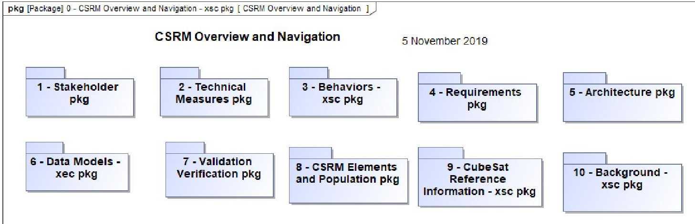

Figure 1. CSRM Landing and Navigation Page

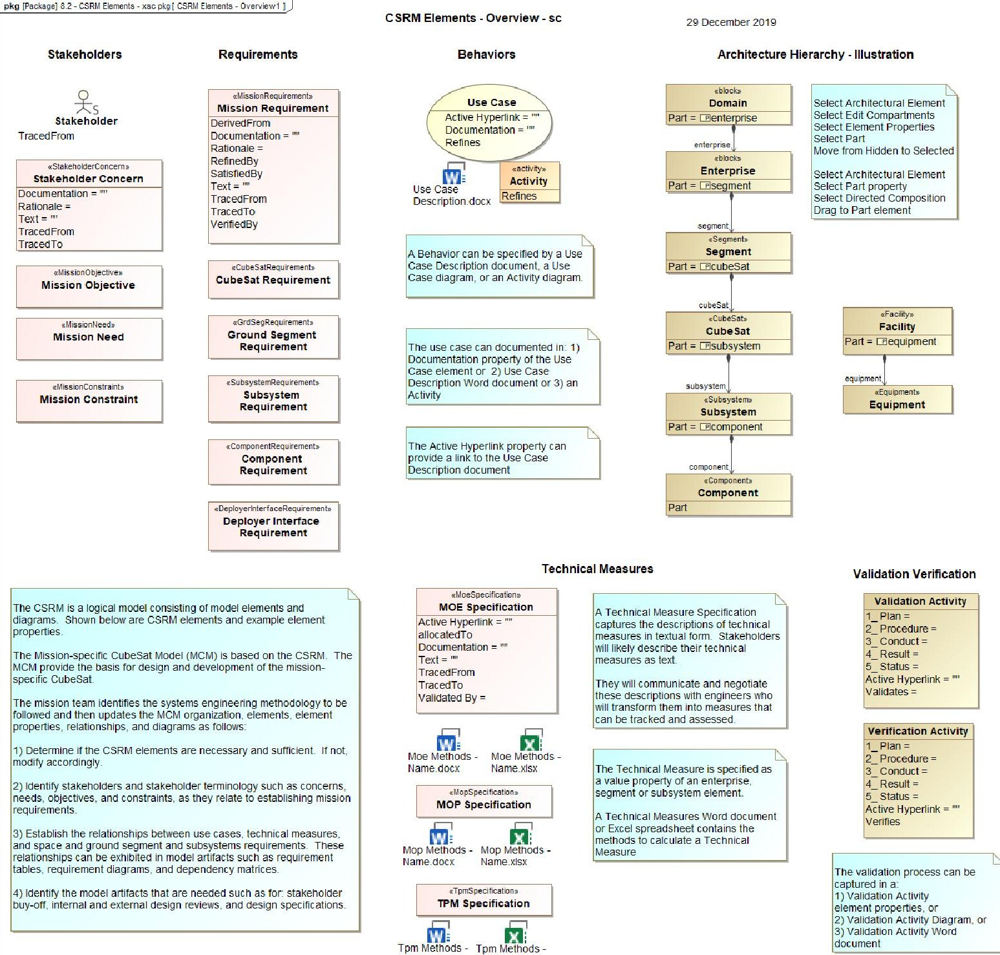

Figure 2. CSRM Elements Overview

<!-- PDF_PAGE: 4 -->

While the CSRM itself is methodology-agnostic, these model elements and their relationships are mission- and engineering methodology-specific. The mission and methodology may dictate starting with stakeholder concerns, or starting with mission objectives and mission constraints; or there may be a simpler approach of starting with just mission requirements. In the event that the five fundamental elements identified earlier in this Section are inconsistent with the methodology in use, the development team can modify the containment tree of the modeling tool in use as appropriate to conform with its methodology.

The CSRM provides a library of model elements but does not dictate what model elements and relationships to use. This is determined by the development team, and the development team has the responsibility of populating the CSRM with the maturing elements. The CSRM is well-documented and explains to the team how to populate it with those elements, with notes which CSRM users have found easy to understand and to follow.

## Stakeholders [4]

Each of the five fundamental elements is discussed in more detail beginning with the stakeholders, progressing from the left to right in Figure 2, and ending with validation and verification.

For example, CubeSat projects are pursued internationally, but the licenses and regulations that cover their activities are administered at the national level. The timelines and procedures for requesting and receiving approval must be well-understood and part of the model. As such, the CSRM includes the following U.S. regulatory stakeholders:

A stakeholder is any entity that has an interest in the system. Representative stakeholders are included in the model.

- Federal Communications Commission

- NASA Orbital Debris Program Office

- NOAA Commercial Remote Sensing Regulatory Office

The design and development of a mission-specific CubeSat must satisfy the requirements for interfacing with a CubeSat deployer such as the Cal Poly CubeSat Design Specification. This is another stakeholder included in the CSRM.

A stakeholder concern can be manifest in many forms, such as in relation to one or more stakeholder needs, goals expectations, responsibilities, requirements, design constraints, assumptions, dependencies, quality attributes, architecture decisions, risks or other issues pertaining to the system.

There can be a number of stakeholders and a number of concerns. The needs, objectives, constraints, and requirements result from review, assessment, and integration of the varied concerns.

Figure 3 shows the relationships that can be established between stakeholder concerns, technical measures, use cases,

and requirements. As a starting point, the CSRM contains representative stakeholders like the ones discussed above and shown in Figure 4. These Stakeholder packages contain instructions for adding additional stakeholders and their concerns as shown in Figure 5.

## Requirements [5]

The CSRM requirements package hierarchy is shown in Figure 6. Each requirements package has a table containing a "header" requirement element that establishes a prefix and numbering scheme which can be easily changed. These tables provide the capability to add, delete, and modify requirements. The requirements tables can be exported to spreadsheets.

The requirement elements and tables can expose requirement properties including: Id, Name, Text, Traced To, Derived From, Refined By, Verify Method, Verified By, and Satisfied By. The exposed properties can be easily added to or hidden.

## Behaviors [6]

A Behavior describes the functionality of a system in terms of how it is used to achieve the goals of its various users. The users of the system are described by actors, which may represent external systems or humans who interact with the system.

A Behavior can be specified by a Use Case Description document, a Use Case diagram, or an Activity diagram. The Behavior architecture levels are Enterprise, CubeSat, Ground System, CubeSat Subsystems, and Ground Subsystems. Figure 7 illustrates the Enterprise level Behaviors Architecture.

At each level there are:

- Behavior packages containing Use Case Description documents and their listing table;

- Use Case packages containing Use Cases Diagrams and their listing table; and

- Activity packages containing Activity Diagrams and their listing table.

- The CSRM provides a Behavior architecture that mission modelers can populate and establish relationships to best serve their missions. For example:

- A Mission Requirement has a Refined By property that can point to a either Enterprise Behavior or a Enterprise Use Case.

- An Enterprise Behavior has a Refines property that can point to a Mission Requirement.

- An Enterprise Use Case has both a Refines property that can point to a Mission Requirement and a Realizing Element property that can point to an Enterprise Activity.

- An Enterprise Activity has a Refines property that can point to an Enterprise Use Case.

<!-- PDF_PAGE: 5 -->

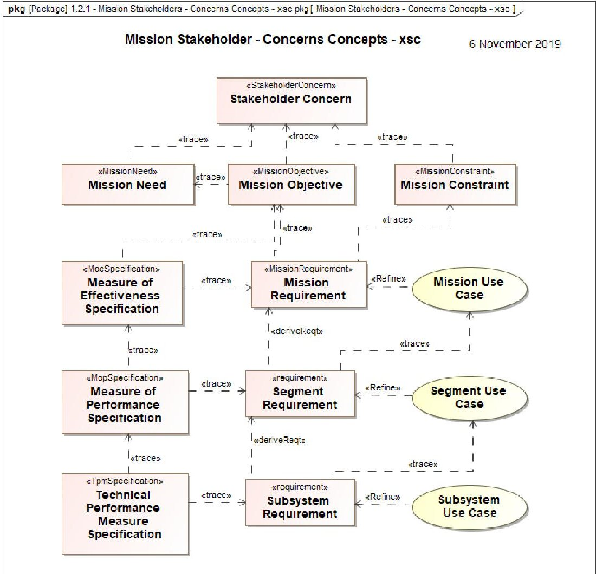

Figure 3. Mission Stakeholder Concerns

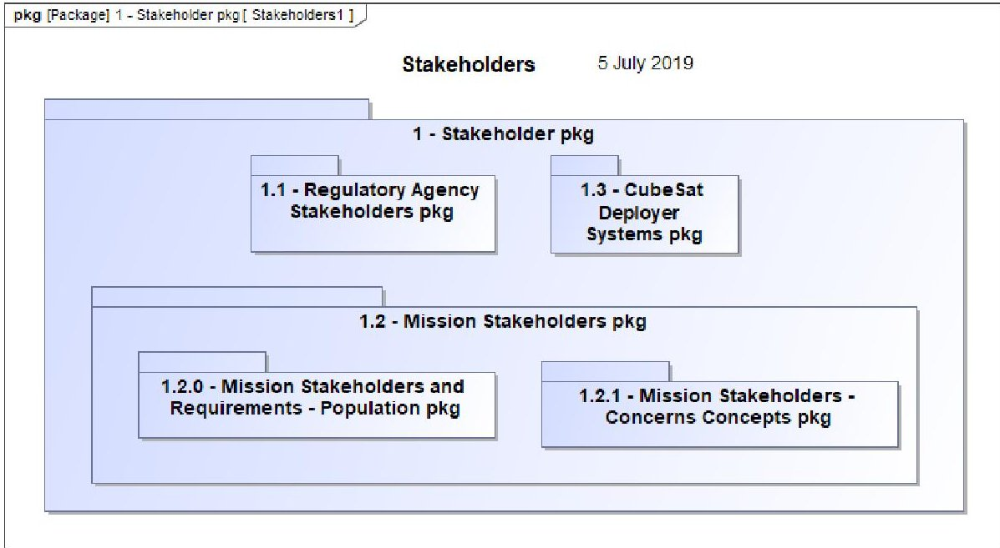

Figure 4. Stakeholders

<!-- PDF_PAGE: 6 -->

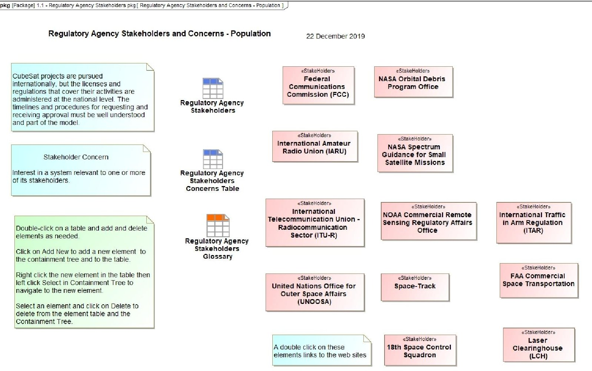

Figure 5. Instructions for Populating the Model with Stakeholders and Stakeholder Concerns

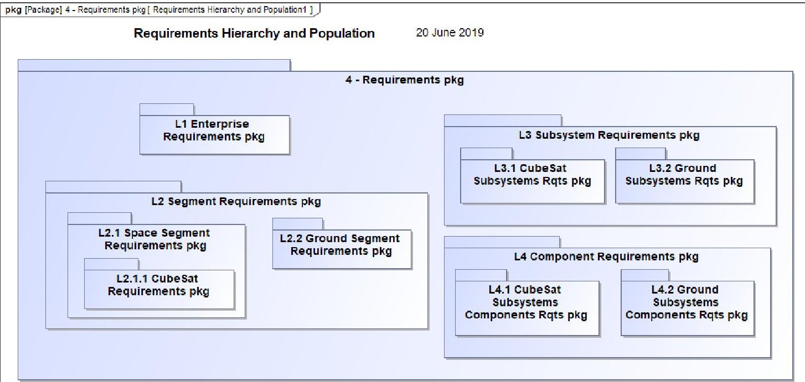

Figure 6. Requirements Hierarchy

<!-- PDF_PAGE: 7 -->

## Architecture [5]

The CSRM provides a CubeSat logical space-ground architecture. The logical components are abstractions of the physical components that perform the system functionality without imposing implementation constraints. The physical architecture defines physical components of the system including hardware, software, persistent data, and operational procedures. The logical components are a starting point for a mission-specific CubeSat logical architecture, followed by the physical architecture and development of the CubeSat.

The CSRM architecture package hierarchy is shown in Figure 8. The decomposition of this hierarchy is shown in Figure 9 (CubeSat Domain), Figure 10 (CubeSat Mission Enterprise), Figure 11 (Space Segment and Subsystems), and Figure 12 (Ground Segment and Subsystems). The Requirements and Logical Architecture hierarchies are parallel constructs.

The CSRM architecture structures and behaviors artifacts start at the Domain and Enterprise levels and decompose all the way to subsystems and subsystem components. The Architecture as implemented in our graphical modeling tool can be navigated from domain to components with hyperlinks.

The CSRM Architecture Domain level is shown in Figure 9. The External Environment includes space radiation and atmospheric density. The External Constraints include items such as budgets and milestones.

The CubeSat Mission Enterprise, shown in Figure 10 consists of the Space Segment and the Ground Segment. It also includes Ground Station Services and a Transport, Launch, and Deploy Service which likely will be provided to the CubeSat project. The Enterprise package includes a behavior package in addition to the structures package.

The Space Segment, illustrated in Figure 11, consists of the CubeSat and its subsystems and the CubeSat orbit and a behaviors package. The CubeSat subsystems package includes a package diagram that provides guidance for adding, modifying and deleting subsystems.

The CubeSat subsystems are generically and loosely defined as a starting point for the mission specific CubeSat team. The CubeSat team determines what subsystem capabilities are needed and whether they are provided by software, hardware, persistent data, or operator procedures.

The Ground Segment, illustrated in Figure 12, consists of its subsystems and a behaviors package. The Ground Segment subsystems package includes a package diagram that provides guidance for adding, modifying, and deleting subsystems.

The Ground subsystems are generically and loosely defined as a starting point for the mission specific CubeSat team. The CubeSat team determines what subsystem capabilities are needed and whether they are provided by software, hardware, persistent data, or operator procedures.

The subsystem architectures decompose to component architectures with a notional example shown in Figure 13. The mission-specific architecture team will replace these notional components with identified logical components which will be eventually be replaced with physical components. Each subsystem package contains a package diagram that provides guidance for adding and deleting

## Technical Measures [5] [7]

Technical Measures (TMs) are an established set of measures based on the expectations and requirements that are tracked and assessed to determine overall system effectiveness and stakeholder satisfaction. Common terms for these measures are Measures of Effectiveness (MOEs), Measures of Performance (MOPs), and Technical Performance Measures (TPMs).

TMs provides a stakeholder insight into the definition and development of a technical solution. Verification activities provide data to the technical measurement process that are used to assess how well the TMs are either projected to meet, or are meeting, their stated value.

Technical Measure Specifications capture descriptions of technical measures in textual form. Stakeholders will likely describe their TMs as text. They will communicate and negotiate these descriptions with engineers who will transform them into measures that can be tracked and assessed.

As illustrated in Figure 14, a Technical Measures Word document or Excel spreadsheet contains the methods to calculate Technical Measures. These methods can be incorporated into the Constraint block Constraints and Parameters compartments. The document or spreadsheet is part of the model and can be edited within the model.

## Verification and Validation [4]

In the context of this section, Verification and Validation refer to the Inspection, Demonstration, Test, and Analysis of the mission specific model. While this distinction may appear obvious, it has proved to introduce some level of ambiguity into technical discussions unless it is clear.

Verification confirms, by providing objective evidence, that the system and all its elements perform their intended functions and satisfy the requirements allocated to them, i.e., that the system has been built right.

The Verification Activity element describes the process for verifying an element, e.g. a requirement. As an example, the process could include verification plans, procedures execution notes, results, and status. The process can be captured in 1) Verification Activity element properties, or 2) Verification Activity Diagram, or 3) Verification Activity Word document. Refer to Figure 15.

<!-- PDF_PAGE: 8 -->

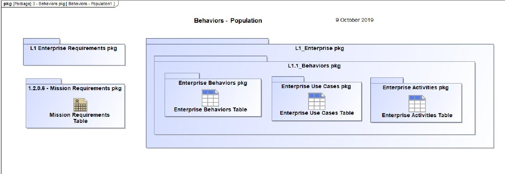

Figure 7. Enterprise Behaviors

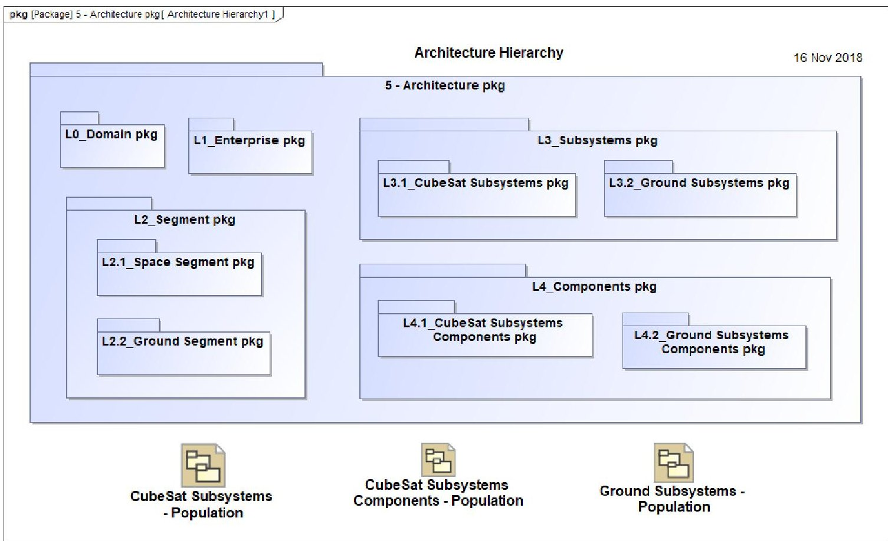

Figure 8. Architecture Hierarchy

<!-- PDF_PAGE: 9 -->

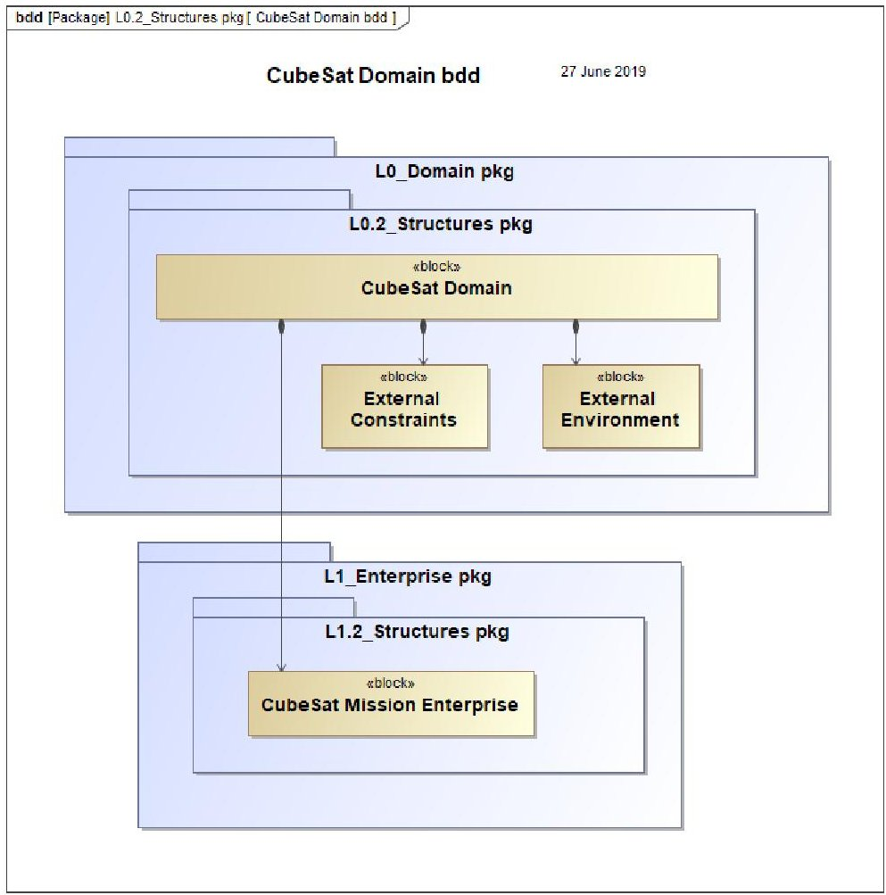

Figure 9. CubeSat Domain

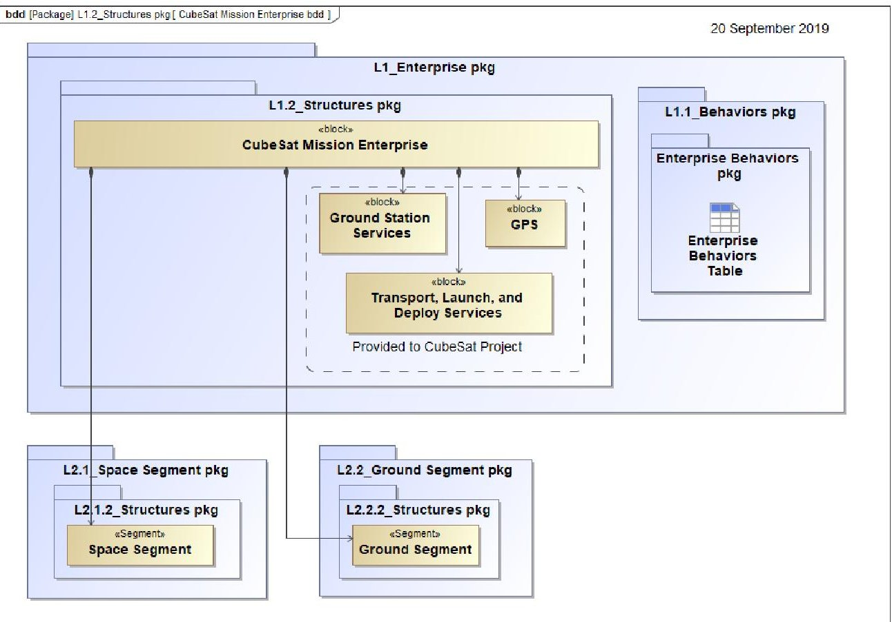

Figure 10. CubeSat Mission Enterprise

<!-- PDF_PAGE: 10 -->

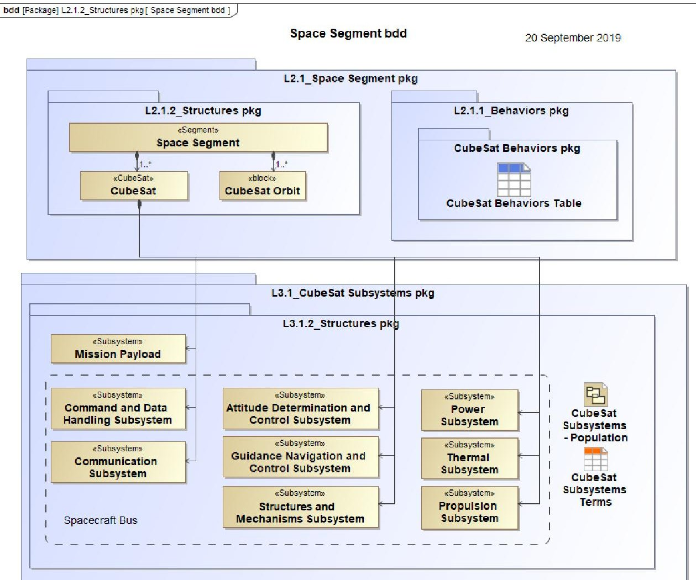

Figure 11. Space Segment and Subsystems

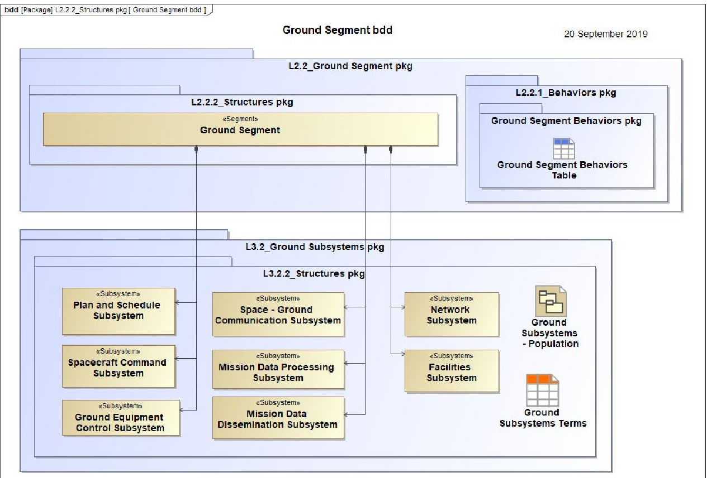

Figure 12. Ground Segment and Subsystems

<!-- PDF_PAGE: 11 -->

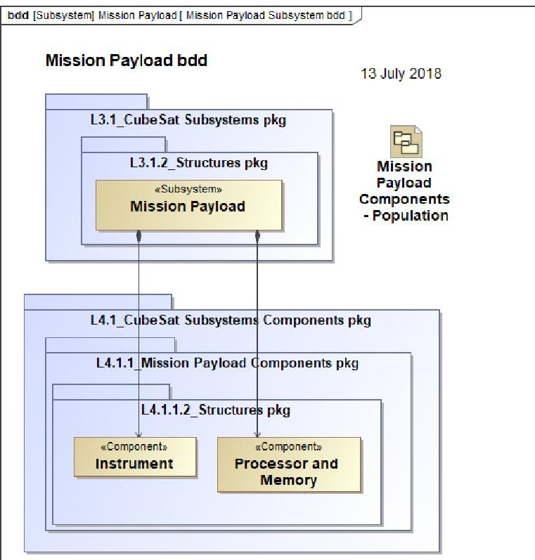

Figure 13. CubeSat Mission Payload Representative Components

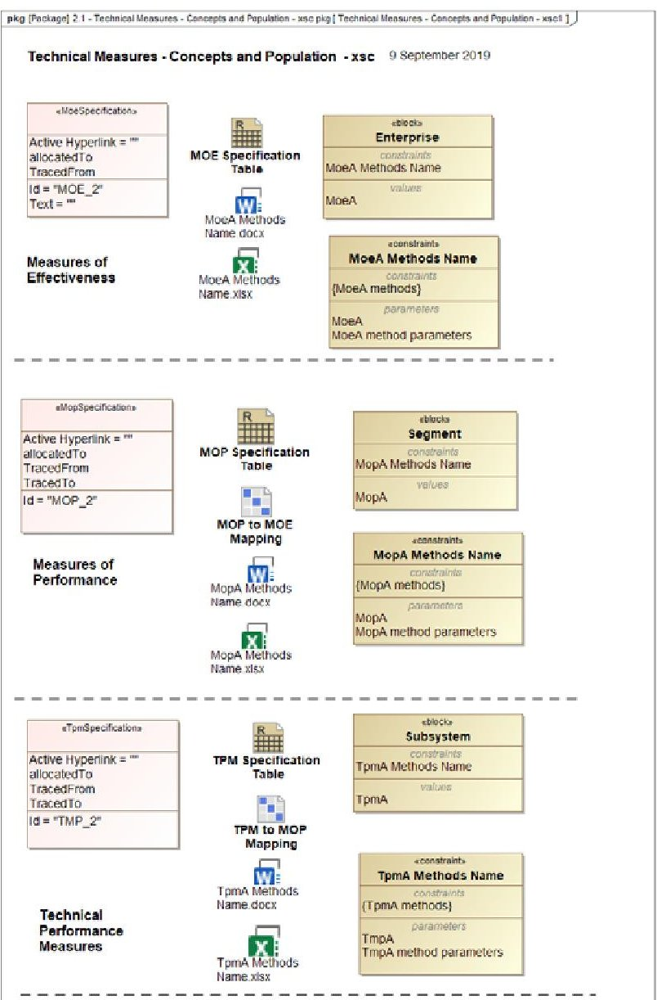

Figure 14. Technical Measures

<!-- PDF_PAGE: 12 -->

Validation confirms, by providing objective evidence, that the system, as-built (or as it will be built), satisfies the stakeholders' needs, objectives, and technical measures, i.e., that the right system has been (or will be) built.

The Validation Activity element describes the process for validating an element, e.g. a Technical Measure or a Mission Objective. As an example, the process could include validation plans, procedures, execution, results, and status. The validation process can be captured in a 1) Validation Activity element properties, or 2) Validation Activity Diagram, or 3) Validation Activity Word document. Refer to Figure 15.

## CSRM Elements and Population [4]

Figure 16 is an overview of the CSRM Population package. While the Population package does not contribute to the development of a mission specific CubeSat model, it is valuable for the insight it provides to the development team as it performs its work. Each package contains the associated CSRM elements and tables residing in the containment tree. The tables are used to add, delete, and modify the individual elements and to establish relationships between the elements.

## 4. FUTURE EFFORTS

## Continued Vetting

Feedback from university teams currently using the CSRM will be evaluated for inclusion in the model in order to provide a better quality product. Lessons learned from these teams can be instrumental in identifying: 1) value-added model elements not currently in the CSRM, 2) portions of the model that do not function as intended, and 3) new capabilities to be added the model to increase its usefulness and applicability.

## OMG Specification Efforts

Efforts aimed at adopting the CSRM as an OMG specification will continue as requirements are further defined. Processes for dissemination and control of the CSRM once it becomes an OMG specification, maintaining updates to it, and what formats will be available have yet to be worked out.

## Satellite Reference Model

As was pointed out in the introduction to this paper, the basic architecture partitioning and functional allocation of most satellites are similar. Efforts to assess what would be required to expand the CSRM to include a broader class of satellites can be initiated as a natural follow-on to the work done to date.

## REFERENCES

[1] D. Kaslow, S. Spangelo, L. Anderson, E. Fosse, C. Delp, B. Cole, B. Gilbert, L. Hartman, T. Kahn, and J. Cutler, "Applying MBSE to a Standard CubeSat," Proceedings of IEEE Aerospace Conference, Big Sky, MT, March 2012.

[2] D. Kaslow, S. Spangelo, G. Soremekun, L. Anderson, E. Fosse, R. Yntema, M. Bajaj, C. Delp, B. Cole, J. Cutler, and L. Cheng, "MBSE Applied to RAX CubeSat Mission Operational Scenarios," Proceedings of IEEE Aerospace Conference, Big Sky, MT, March 2013.

[3] D. Kaslow, G. Soremekun, H. Kim, and S. Spangelo, "Integrated Model-Based Systems Engineering (MBSE) Applied to the Simulation of a CubeSat Mission," Proceedings of IEEE Aerospace Conference, Big Sky, MT, March 2014.

[4] D. Kaslow, P. Cahill, and R. Frank. "Developing a CubeSat System MBSE Reference Model - Interim Status #5," Proceeding of AIAA/USU Conference on Small Satellites, Logan, UT. 2019.

[5] D. Kaslow, B. Ayres, P. Cahill, L. Hart, Croney, L Hart, A. Levi. "Developing a CubeSat Model-Based Systems Engineering (MBSE) Reference Model - Interim Status #4," Proceedings of AIAA Space Forum. Orlando, FL. 2018.

[6] D. Kaslow, B. Ayres, P. Cahill, L. Hart, and R. Yntema, "A Model-Based Systems Engineering (MBSE) Approach for Defining the Behaviors of CubeSats," Proceedings of IEEE Aerospace Conference, Big Sky, MT. 2017

[7] D. Kaslow, B. Ayres, P. Cahill, and L. Hart, "A ModelBased Systems Engineering Approach for Technical Measurement with Application to a CubeSat," Proceedings of IEEE Aerospace Conference, Big Sky, MT. 2018.

<!-- PDF_PAGE: 13 -->

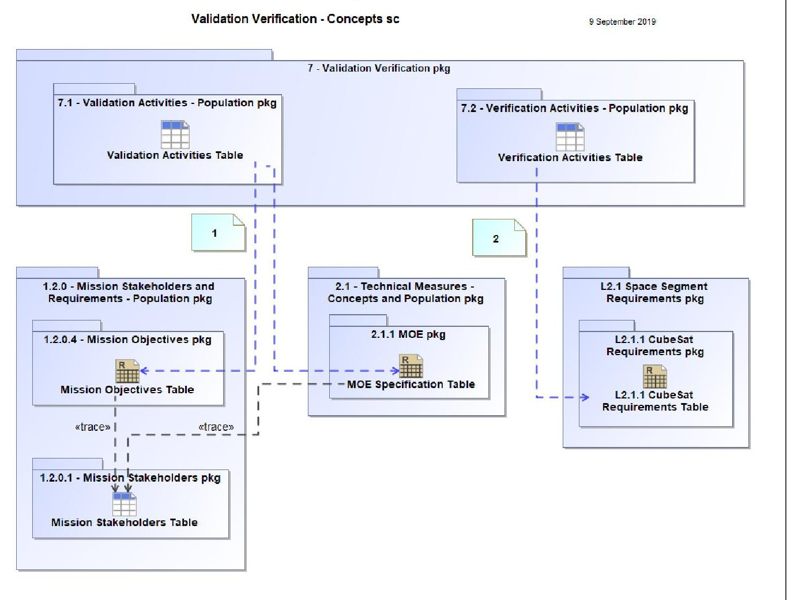

Figure 15. Validation and Verification Activities

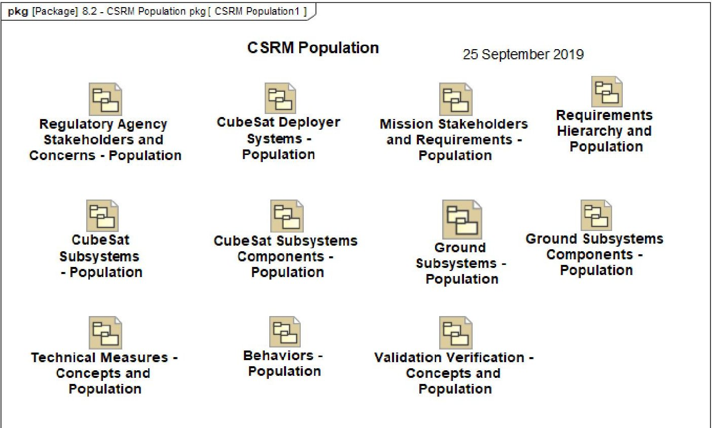

Figure 16. CSRM Population Package

<!-- PDF_PAGE: 14 -->

## BIOGRAPHY

David Kaslow has thirty-four years of experience at Lockheed Martin in both the technical and management aspects of developing ground mission capabilities. He has five years of experience at Analytical Graphics including pursuing Model-Based Systems Engineering. Dave is a co-author

of four chapters Cost-Effective Space Mission Operations. He is Co-Chair for the INCOSE Space Systems Working Group. Dave has participated in the Space Systems MBSE Challenge Team since its founding in 2007 and is the lead for the CubeSat System Reference Model.

Philip T Cahill has forty-five years of experience in the Information Technology industry, as consultant, customer, and contractor for government and commercial systems. He spent thirty of those years with the Lockheed Martin Corporation,

concerned primarily in the specification and development of defense and space systems, and retired as a Lockheed Martin Fellow. Phil's professional interests center on System Engineering, particularly for Systems of Systems, but he developed a passion for Data Center Operations late in his career and maintains an active interest in that field. He received his PhD in Physics from the University of Illinois at Urbana-Champaign.

Bradley Ayres is currently an Assistant Professor of Aerospace Engineering in the Department of Aeronautics and Astronautics, Graduate School of Engineering and Management, at the Air Force Institute of Technology. Brad has worked in the Aerospace and Defense industry for over 35 years. He holds a BS from the

University of Missouri-Columbia, an MS from the Air Force Institute of Technology, and a PhD from the Florida State University..

<!-- PDF_PAGE: 15 -->

