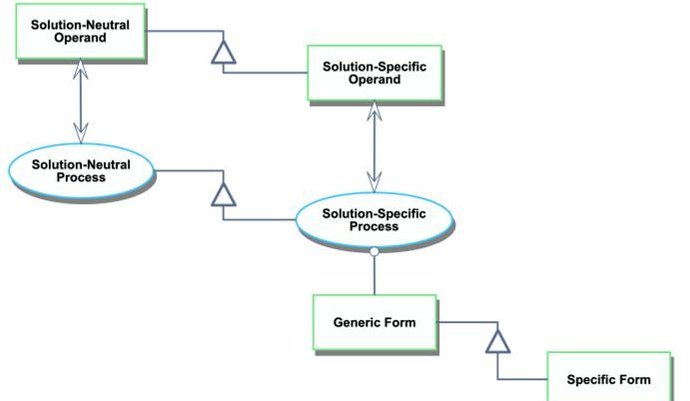
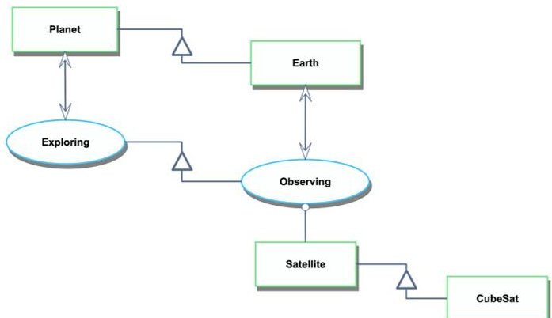
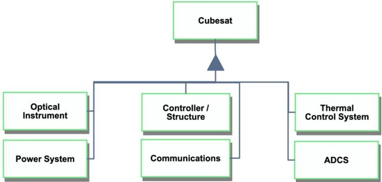
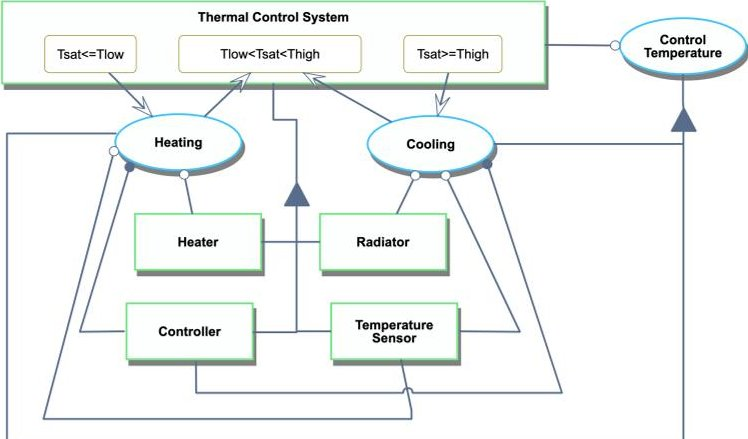
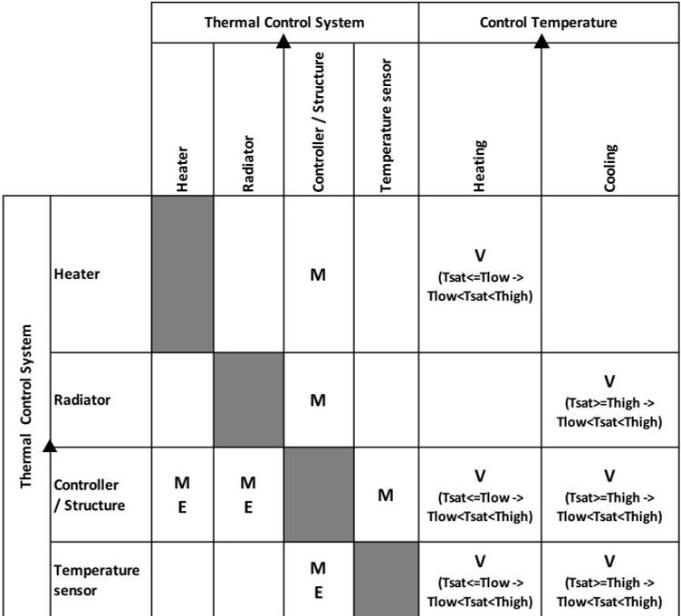
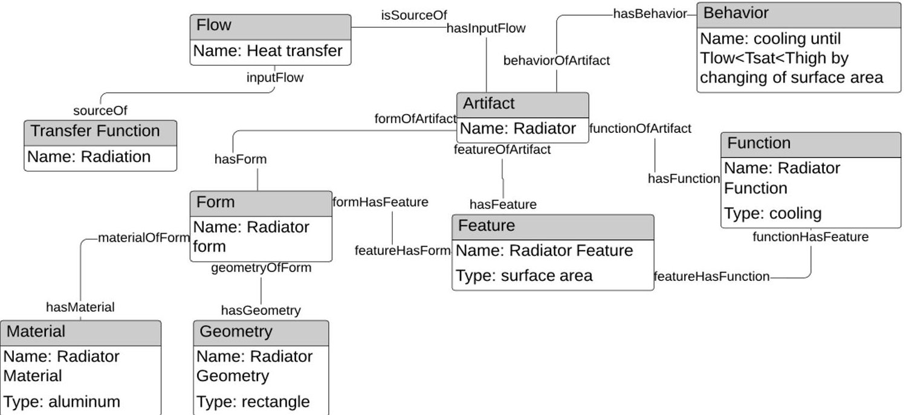

<!-- PDF_PAGE: 1 -->

IAC-20-D1.4A.6

# Digital Engineering Information Exchange Model for Space Missions Architecture: a Case Study of a CubeSat Mission

Yaroslav Menshenin $ ^{a} $ $ ^{*} $ , Yana Brovar $ ^{a} $ , Dominik Knoll $ ^{a} $ , Edward Crawley $ ^{b} $ , Clement Fortin $ ^{a} $

$ ^{a} $ Space Center, Skolkovo Institute of Science and Technology, Bolshoy Boulevard 30, bld. 1, Moscow, Russia 121205, {y.menshenin,yana.brovar,d.knoll,c.fortin}@skoltech.ru

$ ^{b} $ Department of Aeronautics and Astronautics, Massachusetts Institute of Technology, 77 Massachusetts Avenue 33-409, Cambridge, MA, USA 02139, crawley@mit.edu

* Corresponding Author

## Abstract

A Digital Engineering Information Exchange supports an exchange of digital artifacts between system engineering entities (INCOSE). Such entities might include processes, models, and organizational elements associated with space missions design. Reducing complexity and errors, as well as improving efficiency are critical capabilities associated with a digital transformation of space missions design and delivery. In our work we propose an approach to manage a digital engineering information exchange through the DSM-based approach (Eppinger and Browning 2012). Applied to space systems architecture, the method allows keeping track of the information exchange throughout the product development. Such information includes the core entities and relationships of CubeSat's subsystems. This would integrate systems engineering (MBSE) approaches and PLM methods. In our paper we apply the proposed approach to a CubeSat mission design. One of the forms of utility of the proposed approach is the ability to represent the subsystems and their interfaces including objects/processes/states in one DSM/DMM representation. In our paper we demonstrate how such evaluation can be performed. Another utility of the proposed approach is that it facilitates a digital information flow through different product lifecycle stages. A proposed approach might serve as an effective method to reduce complexity associated with different ontologies in different design tools. Ultimately, it allows engaging digital tools in a concurrent engineering environment.

Keywords: digital engineering, digital artifact, knowledge management, conceptual design, system architecture

## 1. Introduction

1. 1 Need for Digital Engineering Information Exchange Model

With advances in computer technology, the industry is following digitization by transforming its engineering practices to digital engineering, incorporating technological innovations into an integrated, modelbased approach. A strategy for the reorganization of engineering methods, processes, and tools to the Informational Age is known as Digital Engineering Transformation, that aims to "promote the use of digital representations of systems and components and the use of digital artifacts as a technical means of communication across a diverse set of stakeholders" [1]. The Digital Artifact is a digital object that contains data, behaviors, attributes, or properties. For example, in software applications the digital artifacts are used to extract and represent the digital forms of data, information, knowledge, and wisdom called DIKW [2,3]. The DIKW model is a commonly used four-level hierarchy method, where each level adds certain attributes in addition to the previous one. Data is the most basic level, representing the raw data, that does not have the meaning of itself; the second level is information that adds context by adding

links between raw data. The next level is knowledge which adds rules of what to do with the given information. And finally, wisdom is included as the most refined type of data, which adds understanding as to when and why knowledge is used [4]. Thus, the main goal of digitization is to transform the DIKW model into a digital artifact so that stakeholders can effectively unpack, interpret and consume DIKW entities.

Therefore, the challenge of efficient data exchange lies not only in the technical aspect of the issue, but as well in the unique interpretation of information and its effective exchange. So, during the International Council on Systems Engineering's (INCOSE) International Workshop (IW) 2017, the need for a new way of sharing digital artifacts was indicated in order to improve the traditional model-based approach.

There already exists a large number of model-based representations of digital artifacts. For instance, core information relevant for the conceptual design phase can be represented using the Object-Process Methodology (OPM) [5] or SysML [6]. SysML, the most common approach, is based on UML and therefore has a strong information system component. However, its weakness is that it does not offer a well-structured ontology that links the 9 types of diagrams of which it is composed.

<!-- PDF_PAGE: 2 -->

Therefore, considerable effort is currently under way to further develop this modeling language as part of the SysML 2.0 initiative to align it with the digital engineering vision. In this paper we use OPM [5], which provides a well-structured formal ontology to support the development of any system and therefore offers a better basis to build the digital engineering environment.

In later stages of product development, STEP with its various application protocols (AP) could be used to structure the detail system artifact representations. ISO 10303 STEP is an international standard that defines a system-independent format for computer-interpretable representation of product data and for its exchange between different CAD systems or between CAD and downstream application systems. Nowadays, almost every major PLM system contains a module for managing technical product data defined by the STEP standard. In particular, the AP242 application protocol of STEP [7] which has been updated very recently for both the automotive and aerospace sectors offer detailed exchange formats including Product Manufacturing Information (PMI) but does not include any behavior, function or state information types, which are very important for the digital engineering integration. STEP does not offer either a well-structured ontology between its various Application Protocols which has been defined over the last 3 decades. Therefore, in this paper we consider the Core Product Model (CPM) approach because it offers a more advanced representation from a system perspective than STEP, supporting behavior and function within the geometrical representation. We foresee that the data model proposed by CPM as a better candidate to support a well-coordinated Digital Engineering environment in the future.

Nevertheless, all of these representations are based on the specifics at a particular stage of product development and need to be integrated into a coherent digital thread made of model-driven digital artifacts through the stages of product development using digital technologies.

As an alternative approach for aerospace, the Department of Defense Systems Engineering office of the USA has proposed a framework of Digital Engineering Information Exchange Model (DEIXM) to enable a fully integrated digital information exchange [4]. In concrete terms, DEIXM provides a way to use digital technologies to define, create, use and exchange digital artifacts for any producer or consumer of engineering information during the complete lifecycle management. The DEIX models are represented by a set of views of the different models and tend to become very complex as it becomes difficult to maintain, extend and comprehend the model. In our paper, we propose a promising approach to managing digital information exchange using the Design Structure Matrix (DSM) as a tool, that allows to track the relationships between the various system elements in simple and concise format

and can be easily extended by a Domain Mapping Matrix (DMM), allowing mapping between two domains.

## 1.2 The specific objective of the research

The specific objective of our paper is to demonstrate an approach of managing a digital engineering information exchange for a CubeSat system. Another specific objective of our paper is to present the CubeSat subsystems and their interfaces including objects/processes/states in one DSM/DMM representation. Additionally, the goal of our work is to demonstrate how the proposed approach facilitates a digital information flow through different product lifecycle stages - from the Model-Based Systems Engineering (MBSE) [8] to the product lifecycle management (PLM) [9] phases.

## 1.3 Paper structure

The rest of the paper is organized as follows. In section 2 we describe the methodology used in our work. Section 3 presents a CubeSat case study to demonstrate the application of the proposed model. In Section 4 we present a Digital Engineering Information Exchange Model. We discuss the presented results and make conclusions in Section 5.

## 2. Methodology

In this paper we exploit the idea of the system concept representation framework proposed by Menshenin and Crawley [10]. This framework provides the means to encode a CubeSat models in a systematic way, doing this not only for the entire system but also for its subsystems.

To support the process of encoding the core information about a CubeSat, we use the OPM methodology [5] in the OPCloud environment [11] (see section 2.1). This information includes the entities of the CubeSat, by which we understand its subsystems. And at subsequent design phases, we use CPM (see section 2.3), which allows us to represent the information necessary at the stage of detailed design by linking CubeSat's subsystems behavior and functions to its form attributes (geometry, material).

To manage the exchange of digital artifacts between system engineering entities and to analyze the MBSE to PLM data integration, we use the Design Structure Matrix (DSM) [12] (see section 2.4). The DSM approach is an effective tool to manage interconnections within a complex system or product [13] providing the system engineers capability to keep track of the relationships between the various systems elements [14, 15]. In our work we use a DSM to encode the core entities of the CubeSat system "holistically" and to demonstrate the MBSE to PLM integration at the detailed design for one of the CubeSat's subsystems.

<!-- PDF_PAGE: 3 -->

We will demonstrate the CubeSat subsystems and their interfaces including objects/processes/states in one DSM/DMM representation.

## 2.1 Object-Process Methodology

The Object-Process Methodology (OPM) [5] is a holistic approach to data modeling and representation at the conceptual design phase. OPM is based on solid fundamental knowledge of systems and is now standardized in ISO 19450 [16]. As proposed by Dori, 3 core system entities (object, process, state) and two classes of links (structural and procedural) are used to define the main elements of the system. Objects (physical or informational) represent things that exist, while processes are things that transform objects. At any given moment of time, an object can be in exactly one state, and the states of the object are changed through the occurrences of processes. In addition, OPM has 4 main types of structural links between entity pairs to express the static relationships between them. These relationships are specialization, exhibition, decomposition, instantiation. There are also 6 procedural links, such as agent link, instrument link, condition link etc., that connect processes to objects and states to represent how a system operates to implement its function.

## 2.2 System Concept Representation Framework

Figure 1 is a simplified version of the system concept representation framework [10]. This Figure rationalizes the process of conceptual design, which progresses from the solution-neutral environment where the problem is formulated (left hand side of Figure 1) to the solution-specific environment (right hand side of Figure 1) where not only the problem is specialized, but also the possible solutions are identified (generic form and specific form).

Fig. 1. Conceptual modeling representation in OPCloud [10]

In this representation we follow the OPM notation [5], demonstrating that any system can be described by means of three main entities: the form (the instrument object), a process (a transformation), and an operand (an object that is changed by the process). The white triangle denotes the specialization relationship, which narrows down the

operand/process from the solution-neutral to the solution-specific environment.

The core utility of Figure 1 is that it supports the design process allowing the systems engineer to have the digital engineering information about the space system. It is important to note that in Figure 1, the term "specific form" represents the complete physical system, where in the CPM model, the term "form" represents a part of a single artifact.

## 2.3 CPM

The core product model (CPM), initially developed by NIST [17], is an abstract model for describing the key characteristics of PLM information using generic semantics driven by the need of next-generation product development systems to manage voluminous and heterogeneous data flows. It was developed by synthesizing various unrelated system artifact representations to create a robust representation of design information data by linking the geometry of the system to its function and behavior. The core model can be used as an information support mechanism to retrieve information obtained during the ongoing design process prior to the final design decision. The main entity of the core model is an artifact that represents a distinct element of the system. In turn, the artifact entity has three main entities representing the main characteristics which include form, corresponding function and behavior of the product. Function entity describes what the artifact is supposed to do based on engineering requirements and stakeholders' needs. In turn, the form entity represents the design solution for implementing a function in terms of geometry and material. The behavior entity describes how an artifact's form implements its function.

## 2.4 Design Structure Matrix

To arrange the management of the digital engineering information exchange we propose to use the Design Structure Matrix (DSM). DSM, developed by Steward [12], supports the management of interconnections within complex systems [14], [15]. Through these interconnections DSM-based techniques allow to define relationships between systems' entities. Thus, DSM has capabilities that make it a versatile approach not only for architecture analysis, but also for managing the exchange of digital engineering information.

## 3. CubeSat Case Study

Applying the approach presented in Figure 1 to a CubeSat case study, we should first identify the solution-neutral problem, the example of which is "exploring planet" (solution-neutral process plus operand) (see Figure 2). Such a highly abstract problem can be specialized to "observing the Earth" (solution-specific process plus operand). The key difference of solution-specific is the presence of form that can be served to

<!-- PDF_PAGE: 4 -->

execute the function - a satellite (generic form), and a CubeSat (specific form) - see Figure 2.

Fig. 2. Conceptual design for CubeSat

This process rationalizes the system design. Once we have the CubeSat as a specific form, we should decompose it to reveal the subsystems. A CubeSat can potentially be decomposed into six subsystems presented in Figure 3 [18]. Note that a black triangle in OPM notation denotes the decomposition relationship, thus defining the system breakdown structure.

Fig. 3. CubeSat decomposition [18]

Figure 3 contains the subsystems appearing as a result of the CubeSat decomposition.

The utility of the proposed approach is that it keeps the same principles regardless of the level of decomposition. In this respect, our approach supports the digital information flow through different product lifecycle stages - from MBSE (a high-level abstraction of the system presented in Figure 3) to PLM (a detailed design, presented for one of the subsystems - Radiator shown in Figure 6). We are therefore proposing a digital thread that carries the system's fundamental elements of behavior, objects, states throughout the product/system life cycle.

Fig. 4. CubeSat Subsystem (Thermal Control System) decomposition in DSM

Figure 4 stores the core information about the Thermal Control System decomposition into its own subsystems. Among these subsystems are the heater, radiator, controller, and temperature sensor. The heater's function is to heat the thermal control system by changing its state from $ T_{sat}\leq T_{low} $ to $ T_{low} < T_{sat} < T_{high} $ (see Figure 4). The radiator is used for cooling the thermal control system by changing its state from $ T_{sat}\geq T_{high} $ to $ T_{low} < T_{sat} < T_{high} $ . The controller performs two functions: heating thermal control system and cooling thermal control system. The temperature sensor is used for the measuring of the thermal control system' parameters to perform the same functions.

All this information can be encoded using the DSM-based approach [15] - see Figure 5. The left-hand side of this Figure is a DSM representation of mechanical (M) and energy (E) interfaces between the decomposed elements of the thermal control system (rows and columns are the same, and their intersections denote the related interfaces). The right-hand side of Figure 5 is a DMM that is used for two purposes. Its first purpose is to describe which subsystem is used for which function (for example, the Controller is used for both heating and cooling which is indicated by the "V" symbol). The second purpose of the DMM part is to encode the information about states related to the required temperature $ \left(T_{sat}\right). $

<!-- PDF_PAGE: 5 -->

Fig. 5. Thermal Control System decomposition in DSM/DMM

A practical utility of Figure 5 is the ability to represent the CubeSat subsystems and their interfaces including objects/processes/states in one DSM/DMM representation. Additionally, the systems engineer can specify the interfaces of the subsystems. In this particular case a DSM part of the Figure 5 demonstrates that the controller/structure has the interfaces with every other subsystem (heater, radiator, and temperature sensor) mechanical (M), and energy (E). The heater, radiator, and temperature sensor all have one interface. The DMM part of the Figure 5 contains two set of information: (1) which process the specific subsystem is responsible for; and (2) how does specific process supports the change of state of the thermal control system (in case of the presented

example, this is realized either through the "heating", or the "cooling" processes).

Based on the data that is encoded in DSM/DMM in Figure 5 we could trace the flow of data that was created during the conceptual design phase to the next phase of the design process. An example of detailed design is shown in Figure 6, which represents the Radiator using a CPM data structure. Thus, the OPM representation of "cooling" process which requires Radiator moved to the detailed design stage represented in Artifact's behavior and function attributes. And state that could be changed through the cooling process is encoded in the artifact's behavior entity. By analyzing Figure 5 and Figure 6, we could trace the flow of the data which consists of elements, their attributes and links between all of them. It allows to notice gaps in the data exchange between ontologies which are used at the appropriate stages of product development, and determine relationships that are necessary in order to most fully and representatively transfer data from the stage of conceptual design to the detailed design.

## 4. Digital Engineering Information Exchange Model

To represent the digital information flow from conceptual design to detailed design and vice versa, we need to integrate all models into a single representation with the corresponding relationships between the various elements. To develop this synthetic representation, we propose to use a DSM matrix of the various models with their constituting elements which represent their ontologies. To illustrate the approach, we developed such an integrated model composed by the OPM and CPM models as shown in Figure 7. We are therefore proposing to build the Digital Engineering System based on a set of complementary ontologies as shown in Figure 7 with a set of relationships which links their elements into a

Fig. 6. CPM representation of the Radiator

<!-- PDF_PAGE: 6 -->

coherent system. This approach could also be used with other models.

Thus, Figure 7 demonstrates a mapping between all the entities of OPM and CPM ontologies. The relationships within each of the data models represented in purple (for OPM) and yellow (for CPM) boxes. To map entities within OPM, we have analyzed the interconnections between its key entities. If there exists a link from one entity to another, then the value of matrix element at the intersection of the corresponding row and column is unity. Otherwise, the value of the matrix element is left empty. Mapping within CPM has been done based on the same rule as for OPM.

To represent the digital information representation of OPM ontology in CPM we took each OPM entity and checked whether this entity transferred to the next stage of product design and in which entities of the CPM ontology is represented. In case of a representation of the selected OPM entity in any CPM entity, the values of the matrix elements at the intersection of corresponding rows and columns are units, and in absence, the matrix element is left empty. In the DSM, this corresponds to the elements in the green box that represent the downstream information flow. The mapping of the CPM entities was carried out in a similar way, with the only difference that the mapping was performed from detailed design to

conceptual design. That is, we checked in which OPM entities will CPM entities be presented in case of upstream information flow. In this way, the elements in the red box of the DSM represent feedback from the detailed phase to the conceptual phase.

Based on the DSM representation similar to Figure 7, any integrated digital engineering data model can be represented and analysed in a very dense and coherent format.

## 5. Discussion and Conclusions

In this paper we demonstrated an approach to manage the digital engineering information exchange illustrated by a CubeSat system. In this respect, the CubSat system and its subsystems have been modeled in the OPCloud environment and later transformed into the DSM representation. We demonstrated the system "holistically" following the systems engineering principles as shown in Figure 3, after which we built the model for the decomposed subsystem following the same design principles (see Figure 4).

We have also presented an approach to represent the CubeSat subsystems and their interfaces including objects/processes/states in one DSM/DMM representation. Our analysis has shown that the controller/structure subsystem has the interfaces with

<table border="1"><tr><td rowspan="2" colspan="2"></td><td colspan="3">OPM</td><td colspan="8">Core Product Model</td></tr><tr><td>(1) Object</td><td>(2) Process</td><td>(3) State</td><td>(4) Artifact</td><td>(5) Feature</td><td>(6) Product Function</td><td>(7) Form</td><td>(8) Product Behavior</td><td>(9) Geometry</td><td>(10) Material</td><td>(11) Specification</td><td>(12) Flow in product</td></tr><tr><td rowspan="3">OPM</td><td>(1) Object</td><td></td><td>1</td><td>1</td><td>1</td><td></td><td></td><td></td><td></td><td></td><td></td><td></td><td></td></tr><tr><td>(2) Process</td><td>1</td><td></td><td>1</td><td></td><td></td><td>1</td><td></td><td>1</td><td></td><td></td><td></td><td>1</td></tr><tr><td>(3) State</td><td>1</td><td>1</td><td></td><td>1</td><td></td><td>1</td><td></td><td>1</td><td></td><td></td><td></td><td></td></tr><tr><td rowspan="8">Core Product Model</td><td>(4) Artifact</td><td>1</td><td></td><td>1</td><td></td><td>1</td><td>1</td><td>1</td><td>1</td><td></td><td></td><td>1</td><td>1</td></tr><tr><td>(5) Feature</td><td></td><td></td><td></td><td>1</td><td></td><td>1</td><td>1</td><td></td><td></td><td></td><td></td><td></td></tr><tr><td>(6) Product Function</td><td></td><td>1</td><td>1</td><td>1</td><td>1</td><td>1</td><td></td><td></td><td></td><td></td><td></td><td></td></tr><tr><td>(7) Form</td><td></td><td></td><td></td><td>1</td><td>1</td><td></td><td></td><td></td><td>1</td><td>1</td><td></td><td></td></tr><tr><td>(8) Product Behavior</td><td></td><td>1</td><td>1</td><td>1</td><td></td><td></td><td></td><td></td><td></td><td></td><td></td><td></td></tr><tr><td>(9) Geometry</td><td></td><td></td><td></td><td></td><td></td><td></td><td>1</td><td></td><td></td><td></td><td></td><td></td></tr><tr><td>(10) Material</td><td></td><td></td><td></td><td></td><td></td><td></td><td>1</td><td></td><td></td><td></td><td></td><td></td></tr><tr><td>(11) Specification</td><td></td><td></td><td></td><td>1</td><td></td><td></td><td></td><td></td><td></td><td></td><td></td><td></td></tr><tr><td>(12) Flow in product</td><td></td><td>1</td><td></td><td>1</td><td></td><td></td><td></td><td></td><td></td><td></td><td></td><td></td><td></td></tr></table>

Fig. 7. Digital information flow from OPM to CPM

<!-- PDF_PAGE: 7 -->

every other subsystem; whereas the heater, radiator, and temperature sensor are all having one interface with other subsystems.

The methodology presented in our work is aimed to support systems engineers with a digital information tool through different product lifecycle stages - from MBSE to PLM. We are proposing a coherent solution at both the satellite system and subsystem levels at the conceptual stage and also at the MBSE to PLM information exchange level. When compared to the DEIXM which is based on various views, our approach proposes to represent the digital thread as a set of complementary ontologies which are linked by various types of relationships as shown in Figure 7.

The fundamental utility of our work is that it proposes concrete means and modeling tools to support the digital engineering information exchange model for space systems.

In future work, we will apply the proposed approach to more complex systems being developed in a concurrent engineering design environment facilitating a specific space system design session from the very beginning of the design process to the detailed design stage. We will also be planning to apply the proposed approach to extended system lifecycle phases.

## References

[1] DoD Digital Engineering Strategy https://fas.org/man/eprint/digeng-2018.pdf (accessed 03.09.20)

[2] INCOSE, Digital Engineering Information Exchange 2018, https://www.incose.org/incose-memberresources/working-groups/transformational/digital- engineering-information-exchange (accessed 03.09.20)

engineering-information-exchange, (accessed 03.09.20).

[3] P. Zimmerman, Exchanging Digital Artifacts for the Engineering Life Cycle, 25 October 2018. http://www.omgwiki.org/MBSE/lib/exe/fetch.php?media=mbse:deix:21337_zimm_dig-artifacts.v2-18-s-2377.pdf, (accessed 03.09.20)

[4] G. Jif, Z. Lingling, Data, DIKW, Big data and Data science, 2nd International Conference on Information Technology and Quantitative Management, 2014.

[5] D. Dori, Object-Process Methodology: A Holistic System Paradigm, Springer, Berlin, 2002.

[6] S. Friedenthal, A. Moore, R. Steiner, A practical guide to SysML: the systems modeling language, Morgan Kaufmann, 2014.

[7] ISO 10303-1 Industrial automation systems and integration Product data representation

and exchange Part 1: Overview and fundamental principles.

[8] INCOSE, Systems Engineering Handbook (Version 4), 2015.

[9] J. Stark, Product lifecycle management. In Product Lifecycle Management, 2, pp. 1-35. Springer, Cham, 2016.

[10] Y. Menshenin, E. Crawley, A system concept representation framework and its testing on patents, urban architectural patterns, and software patterns. Systems Engineering, 2020.

[11] D. Dori, H. Kohen, A. Jbara, N. Wengrowicz, R. Lavi, N.L. Soskin, K. Bernstein, U. Shani, U, OPCloud: An OPM Integrated Conceptual-Executable Modeling Environment for Industry 4.0. Systems Engineering in the Fourth Industrial Revolution, pp. 243-271, 2019.

[12] D.V. Steward, The design structure system: A method for managing the design of complex systems. IEEE transactions on Engineering Management, (3), pp. 71-74, 1981.

[13] S.D. Eppinger, T.R. Browning, Design structure matrix methods and applications. MIT press, 2012.

[14] T.R. Browning, Applying the Design Structure Matrix to System Decomposition and Integration Problems: a Review and New Directions, In IEEE Transactions on Engi-neering management, 48, 292-306, 2001.

[15] Y. Menshenin, E. Crawley, DSM-Based Methods to Represent Specialization Relationships in a Concept Framework, In 20th International DSM Conference, 151- 157, 2018.

[16] ISO 19450, Automation systems and integration Object-Process Methodology, 2015.

[17] S.J. Fenves, A Core Product Model for Representing Design Information, National Institute of Standards and Technology, NISTIR 6736, Gaithersburg, MD 20899, USA, 2001.

[18] Y. Menshenin, D. Knoll, Y. Brovar, C. Fortin Analysis of MBSE/PLM Integration: From Conceptual Design to Detailed Design, In the IFIP 17th International Conference on Product Lifecycle, 2020.