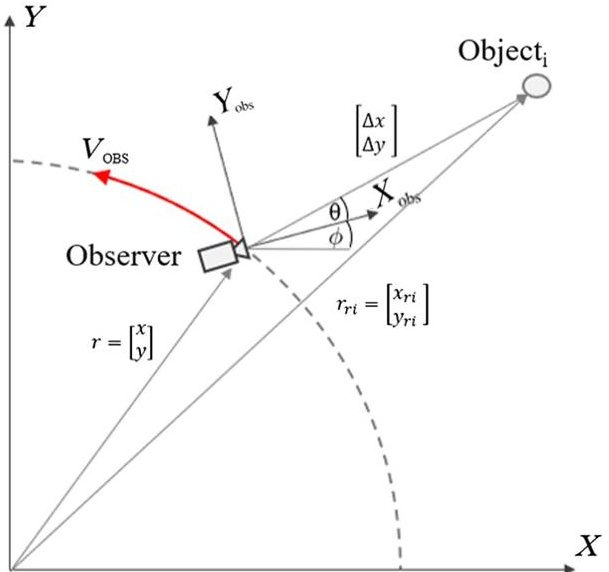
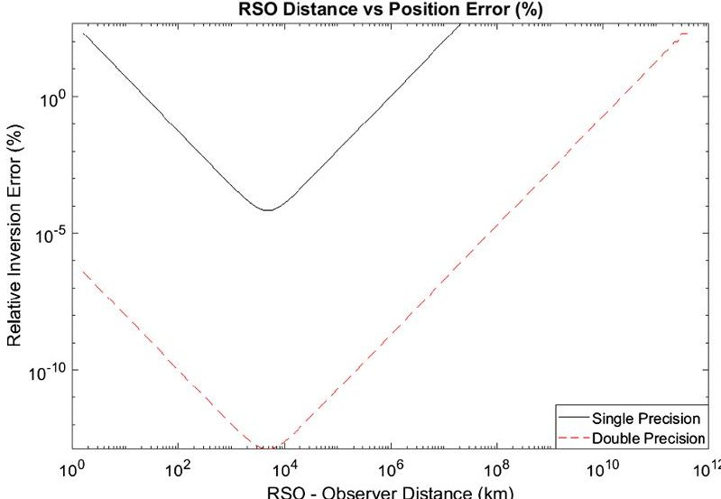
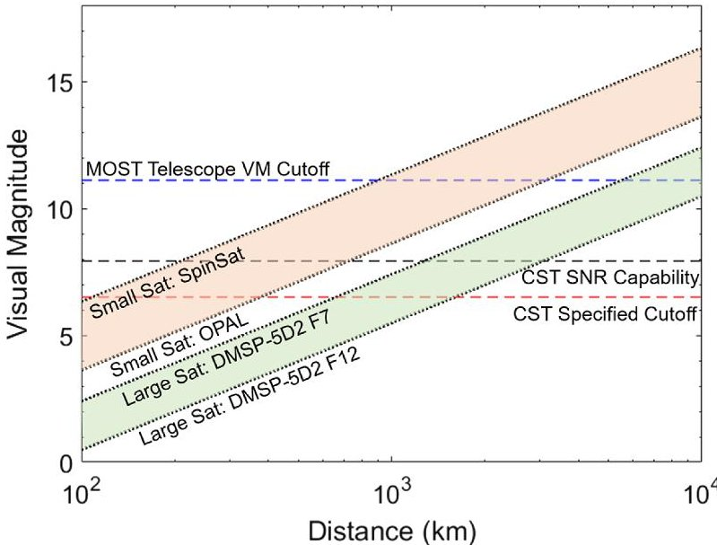
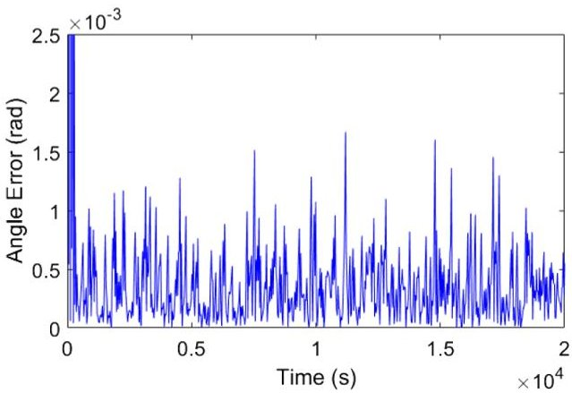
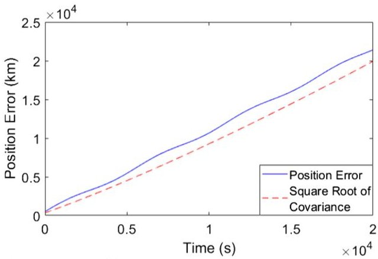
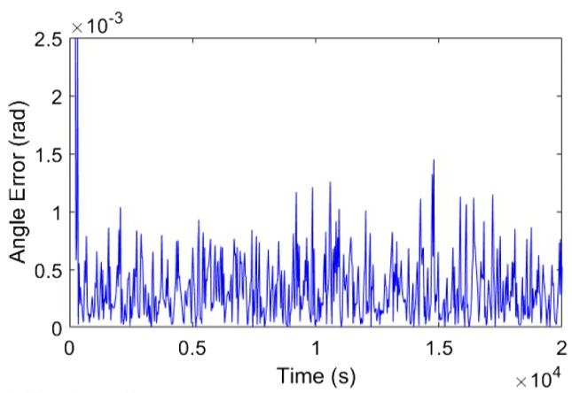
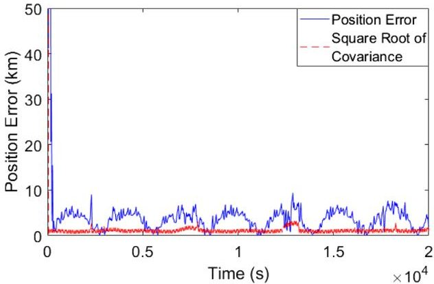
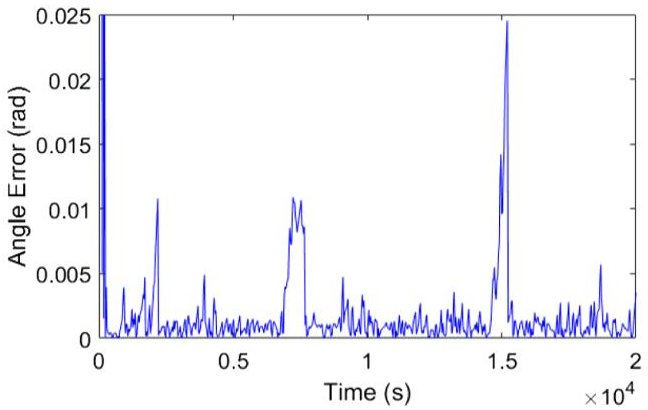
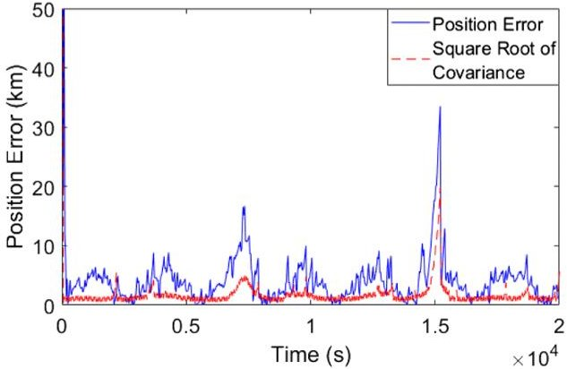

<!-- PDF_PAGE: 1 -->

# Engineering Notes

Feasibility Study of an Orbital Navigation Filter Using Resident Space Object Observations

Matthew Driedger $ ^{*} $ and Philip Ferguson $ ^{\dagger} $ University of Manitoba, Winnipeg, Manitoba R3T 5V6, Canada

https://doi.org/10.2514/1.G005210

## I. Introduction

THIS research investigates the feasibility of using optical detections of resident space objects (RSOs) by star trackers to improve a spacecraft's navigational (both attitude and orbit) solution while simultaneously reducing the cadre of sensors required to execute a given mission. If done efficiently, RSO-based navigation could eliminate the need for certain sensors, leading to a cost and schedule reduction when designing and manufacturing satellites, while also reducing a spacecraft's dependence on ground-based tracking.

This section introduces related work in the field of optical navigation and star trackers as optical attitude sensors, how these sensors can be used for space situational awareness, and the RSO population that star trackers can observe. We then conclude the section by providing an overview of the structure and contributions of this paper.

Optical navigation using reference objects has been used or proposed for many interplanetary [1,2], lunar [3,4], and other [5,6] exploratory missions since the Apollo program. Other work [7,8] has examined optical navigation techniques for rendezvous and docking applications in which an observing spacecraft is in close proximity to an observed object. Optical navigation techniques have used various sensors, including custom designs such as VISNAV [8] or the Apollo space sextant [4], dual-purpose science cameras such as on Voyager 2 [1] and New Horizons [5], and wide-field-of-view star trackers [2].

Optical navigation is typically used for spacecraft outside of Earth orbit; however, Hu et al. have explored the feasibility of using optical navigation for orbital estimation in LEO: examining how an observing spacecraft could use optical sightings of a reference satellite in geostationary orbit to estimate the observer's state using a batched least-squares estimator [9]. Although Hu et al. bring credence to the concept of RSO-based navigation techniques, they did not examine potential imaging sensors, observations of multiple objects or objects outside of Geostationary Earth Orbit, or the numerical sensitivities associated with navigating using objects at varying distances. Our own previous research into RSO-based optical navigation used an extended Kalman filter (EKF) to allow an observer to estimate its position by measuring multiple RSOs using a star tracker [10].

Although our results were promising, we did not include RSO dynamics or explore potential numerical sensitivities.

Using star tracker measurements of nearby space debris extends the efficacy of optical navigation methods for spacecraft in Earth orbit. These sensors provide spacecraft with attitude estimates by focusing star light onto a detector to form a digital image. This image is processed by the star tracker's computer to identify any stars present within the image and then compare these stars to the star tracker's onboard star catalog. Using this method, a spacecraft's attitude can be estimated to a high accuracy, often with errors less than 1 arcsec [11]. The accuracy of a star tracker depends on both the number of stars detected within a given image and the brightness of these stars [11]. Both of these factors must be considered carefully by the star tracker's designer, as more stars in the catalog will increase the star tracker's accuracy but will require more memory to operate and may increase the number of false matches. Additionally, expanding the catalog to include dimmer stars makes the star tracker more susceptible to noise [12]. To balance accuracy and computational load, star trackers use visual magnitude thresholds to mask stars below certain brightness [13]. For CubeSat star trackers, such as the Sinclair Interplanetary ST-16, this cutoff visual magnitude is at or near 5.75 [14].

RSOs are another source of false star matches, forcing star trackers to implement sophisticated RSO rejection algorithms. These algorithms attempt to identify and actively reject nonstar images before forwarding the starfield image to the guide star catalog correlator for identification [15]. Recent research by York University and Magellan Aerospace [16] has made progress toward using these RSO identification algorithms for detecting and cataloging RSOs. With the possibility of positively identifying RSOs using star trackers now becoming a reality, this research addresses the feasibility of applying those RSO observations as a means of navigation. Unlike a star tracker that only detects stars, assumed to be effectively an infinite distance away, the observed position of an RSO changes as a function of the observing satellite's position. This apparent RSO position sensitivity and attitude dependence means that a star tracker could provide orbital knowledge, in addition to the traditional attitude knowledge, by using observations of known RSOs.

As space commerce continues to grow, so does the density of RSOs in popular orbits including low Earth orbit (LEO), polar orbits, sun synchronous orbits, and geostationary orbits [17]. Space researchers and military organizations such as U.S. Space Surveillance Network (SSN) measure and track orbital parameters of most RSOs larger than 5-10 cm in diameter, with the SSN tracking, correlating, and cataloguing approximately 23,000 such objects [18]. The orbits of trackable RSOs are published as two-line element sets (TLEs), which consist of several orbital parameters, including the RSO's identifier, epoch, six orbital elements, and a B $ ^{*} $ term, which describes the object's ballistic coefficient. Using an RSO's TLE, its orbit can be propagated using methods such as the Standard General Perturbations 4 (SGP4) model. However, TLE-derived orbit propagations are not without their errors, especially due to factors such as variable atmospheric drag [19]. To account for the increased uncertainty of objects in lower orbits, TLEs for LEO objects are updated several times per day, whereas those in higher orbits are updated several times per week [20].

This paper studies how a spacecraft equipped with a star tracker can use RSO detections to perform combined position and attitude estimation using an EKF and assesses the feasibility of such an estimator for a spacecraft in LEO. In Sec. II we present our simplified two-dimensional model and measurement function. In Sec. III, we explore the potential numerical precision of this system, TLE/propagator accuracy, and RSO observability. In Sec. IV we describe the design of our navigation filter. We present and discuss our simulation results in Secs. V and VI, respectively, and provide our conclusions in Sec. VII.

<!-- PDF_PAGE: 2 -->

## II. Problem Formulation

First, let us explore a simplified two-dimensional model of an observing satellite and a detectable object such as an RSO or star. As shown in Fig. 1, the observer attempts to estimate its position, attitude, and rates by measuring the relative angle $ \theta $ between itself and the observed object.

Using an Earth-centric inertial Cartesian coordinate system, the observer has a position of $ r=[x,y]^{T} $ and an angle $ \phi $ between its body frame and inertial frame x axes. The observer uses a star tracker to measure the relative angle $ \theta $ between its local frame of reference and the line of sight vector to the object. We assume that the observer has access to a database of objects, and thus we know the position of the object within a certain accuracy (discussed later in Sec. III). Let the global position of the object be $ r_{\mathrm{ri}}=[x_{\mathrm{ri}},y_{\mathrm{ri}}]^{T} $ and let $ \Delta x $ and $ \Delta y $ denote the relative position of the object with respect to the observer. From Fig. 1 we note that

$$
\tan (\theta + \phi) = \frac {\Delta y}{\Delta x} = \frac {y _ {\mathrm {r i}} - y}{x _ {\mathrm {r i}} - x}
$$

Assuming that the position of the observed object is known, we can express the measured angle $ \theta $ as a function of the observed object's position and the observer's position

$$
\theta = \tan^ {- 1} \left[ \frac {y _ {\mathrm {r i}} - y}{x _ {\mathrm {r i}} - x} \right] - \phi
$$

The measurement $ \theta $ is analogous to the measurement we would obtain from a star tracker. For simplicity, we have assumed that this angle has been derived from the position of a centroided image on an imaging plane already.

We chose to use two translational dimensions and one rotational dimension to keep the filter and underlying model clear and understandable. While future implementations will need to consider full six-dimensional navigation to assess absolute performance predictions, this reduced-order feasibility analysis provides critical insights into the specific challenges of a combined orbit/attitude filter using RSO measurements.

## III. Observability Analysis

In our previous work [10] we examined a reduced state vector X and observation matrix H, which we will use here to investigate the observability of position and attitude states using a collection of RSO and star measurements. This reduced state vector, containing only the x position and attitude, is $ X=[x\quad \phi ]^{T} $ . We then derived the simplified observation matrix H using one star measurement and one RSO measurement as follows:

Fig.1 An observing spacecraft detecting the angle $ \theta $ between its camera's bore axis and the line of sight vector $ [\Delta x,\Delta y]^{T} $ between the spacecraft's internal reference frame and an external object i.

$$
H = \left[ \frac {\partial \theta_ {i}}{\partial x} \frac {\partial \theta_ {i}}{\partial \phi} \right] = \left[ \begin{array}{c c} a _ {\mathrm {s t a r}} & - 1 \\ a _ {\mathrm {r i}} & - 1 \end{array} \right] \approx \left[ \begin{array}{c c} 0 & - 1 \\ a _ {\mathrm {r i}} & - 1 \end{array} \right]
$$

where for subscript j = ri and j = star for the RSO and star observation, respectively.

$$
a _ {j} = \frac {y _ {j} - y}{x _ {j} ^ {2} + y _ {j} ^ {2} + x ^ {2} + y ^ {2} - 2 x _ {j} x - 2 y _ {j} y}
$$

Noting that $ | r_{j} |^{2}=x_{j}^{2}+y_{j}^{2} $ and $ | r |^{2}=x^{2}+y^{2} $ and dividing the numerator and denominator by $ | r_{j} |^{2} $

$$
a _ {j} = \frac {\left(y _ {j} / \left| r _ {j} \right| ^ {2}\right) - \left(y / \left| r _ {j} \right| ^ {2}\right)}{1 + \left(\left| r \right| ^ {2} / \left| r _ {j} \right| ^ {2}\right) - 2 \left(x _ {j} x / \left| r _ {j} \right| ^ {2}\right) - 2 \left(y _ {j} y / \left| r _ {j} \right| ^ {2}\right)}
$$

For cases where the observed object is a star, we can approximate the observer-object distance $ | r_{j} |^{2} $ as $ \infty $ . In this case, we can immediately see that for measurements from stars, the quantity $ a_{\mathrm{star}} $ vanishes, but for RSOs located some distance from the observer (i.e., $ y_{\mathrm{ri}} \neq y $ ） $ a_{\mathrm{ri}} $ is nonzero. The practical implication of this is that observations of stars and other very distant objects provide no observer position information. Obtaining a kinematic position estimate requires observations of objects closer than infinity.

The value of $ a_{\mathrm{ri}} $ can vary depending on the units used to describe the RSO and observing spacecraft's position. However, this variability can be removed by normalizing the distances using r as follows:

$$
a _ {\mathrm {r i}} = \frac {\left[ \left(y _ {\mathrm {r i}} / r\right) / \left(\left| r _ {\mathrm {r i}} / r \right| ^ {2}\right) \right] - \left[ \left(y / r\right) / \left(\left| r _ {\mathrm {r i}} / r \right| ^ {2}\right) \right]}{1 + \left[ (1) / \left(\left| r _ {\mathrm {r i}} / r \right| ^ {2}\right) \right] - 2 \left[ \left(x _ {\mathrm {r i}} x\right) / \left(r ^ {2} \left| r _ {\mathrm {r i}} / r \right| ^ {2}\right) \right] - 2 \left[ \left(y _ {\mathrm {r i}} y\right) / \left(r ^ {2} \left| r _ {\mathrm {r i}} / r \right| ^ {2}\right) \right]}
$$

It is well-understood in the field of estimation that the invertibility of $ H^{T}H $ describes the instantaneous observability of our measurements to our state. For our observation matrix, this is

$$
^ {T} H = \left[ \begin{array}{c c} a _ {\mathrm {r i}} ^ {2} & - a _ {\mathrm {r i}} \\ - a _ {\mathrm {r i}} & 2 \end{array} \right]
$$

By inspection, we can see that the above matrix will be invertible for any nonzero $ a_{\mathrm{ri}} $ (with a reasonable magnitude). $ ^{+} $ The next section explores how close an RSO needs to be to an observer, to enable instantaneous position and attitude observability.

## A. Measurement Precision and RSO Distance

Similar to stars, as RSOs move further from an observer, $ a_{\mathrm{ri}} $ will also approach zero. As $ a_{\mathrm{ri}} $ approaches zero, the relative error in the inverse of $ H^{T}H $ increases until the condition number becomes so large that numerical inversion becomes inaccurate. This matrix inversion error is related to the matrix's condition number: the unitless ratio between the maximum and minimum singular values of the matrix. For a positive definite matrix (which is $ H^{T}H $ by construction), these singular values are the eigenvalues of the matrix. We computed the eigenvalues $ \lambda $ of our simplified $ H^{T}H $ and calculated our condition number $ \kappa(A) $ as

$$
\kappa (A) = \frac {\lambda_ {\max}}{\lambda_ {\min}} = \frac {(1 / 2) \left(a _ {\mathrm {r i}} ^ {2} + 2 + \sqrt {a _ {\mathrm {r i}} ^ {4} + 4}\right)}{(1 / 2) \left(a _ {\mathrm {r i}} ^ {2} + 2 - \sqrt {a _ {\mathrm {r i}} ^ {4} + 4}\right)}
$$

Using the condition number $ \kappa(A) $ , we can determine the relative error E of $ H^{T}H $ as follows [21]:

<!-- PDF_PAGE: 3 -->

$$
E = \frac {\| H ^ {T} H - \tilde {f} \|}{\| H ^ {T} H \|} \leq \kappa (A) e
$$

where $ \tilde{f} $ is the numerical approximation of $ H^{T}H $ and e is the residual in each element of $ H^{T}H $ . The machine epsilon e, the smallest floating point number that a computer can store, can be used to approximate e. MATLAB, which was used for our analysis, has a default doubleprecision machine epsilon of $ 2.22\times10^{-16} $ [22]. However, many space-grade processors [23] are limited to single-precision floating points and have a machine epsilon of $ 1.19\times10^{-7} $ [22].

To explore the relationship between an RSO's distance to an observer and the inversion accuracy of $ H^{T} H $ , we made a simplified system with two objects. The first object, approximating a star, was placed at an effectively infinite distance to our observer (100 light years), whereas the second RSO-like object was placed at the same position as the observer. All distances were normalized by dividing by r and we varied the close object's position away from the observer. Using Eqs. (8) and (9), we tracked the relative error of $ H^{T} H $ as a function of the RSO-observer distance for both single- and doubleprecision machine epsilons.

Figure 2 shows that the relative inversion error has a global minimum at approximately 4500 km. Using a double-precision $ \epsilon $ this error remains below 1% for distances under $ 2.3\times 10^{10} $ km and only exceeds 100% at $ 2.2\times 10^{11} $ km. However, if a single precision $ \epsilon $ is used, the relative inversion error is much greater, exceeding 100% at distances under 23 km and over $ 9.8\times 10^{5} $ km.

Although reasonably simple, this analysis suggests that near-object observations can lead to sufficient position and attitude observability, so long as the objects are detectable and within the range shown in Fig. 2. Both single- and double-precision floating point-capable processors could be used; however, a double-precision processor can neglect inversion errors for objects within $ 2. 3 \times1 0^{1 0} $ km (approximately 150 AU).

## B. Measurement Precision and Propagation Uncertainty

For RSO-based optical navigation to be successful, the observing spacecraft will need to propagate the orbits of a number of reference RSOs and have updated RSO TLEs uplinked to correct for propagation errors. As such, it is key to select reference RSOs in stable orbits to minimize propagation errors.

Riesing and Cahoy [20] measured the mean in-track position errors of CubeSats in sub-400 km orbits over a 30-day period by comparing the true reconstructed position of 10 CubeSats to their predicted locations, based on two-way ranging and TLE updates, respectively. Even with multiple TLE updates per day, these CubeSats experienced mean in-track position errors of 4.52 km. This error is higher in sub 300 km orbits, where it can exceed 25 km within a single day [19].

Fig. 2 RSO-observer distance vs relative inversion error as an RSO moves away from an observer, displayed for single- and double-precision machine epsilons $ \epsilon $

Fortunately, propagation error decreases with increasing altitude, and Wang et al. found that, over a 3-month observation period, spacecraft in low-eccentricity orbits between 900 and 1000 km had average single-day in-track position errors of approximately 200 m.

As propagation error is primarily driven by atmospheric drag in LEO, we can expect this error to be inversely proportional to the square of the RSO's altitude. Combined with the need to update TLE databases more often, this suggests that RSO-based optical navigation will work best for RSOs in higher altitudes.

## C. Measurement Precision and RSO Brightness

To be visible, light must be reflected by an RSO toward the observer at sufficient intensity to be detected by a star tracker. This intensity, as seen by an observer, is referred to as the object's apparent visual magnitude. Apparent visual magnitude $ V_{\mathrm{ri}} $ is a function of several parameters, including the visual magnitude of the light source (i.e., the sun, $ V_{\mathrm{sun}}=-2 6. 5 $ near the Earth), the distance R between the object and observer, and the object's optical cross section (OCS) $ \gamma_{v}. $ OCS describes how well the RSO can reflect light from a source to the observer and is a function of the object's physical properties, such as size, geometry, and material properties, as well as geometric properties, including the aspect angle and phase angle. Aspect angle is the angle between the satellite-sun vector and the vector normal to the spacecraft's surface, whereas phase angle is the angle between the satellite-observer and satellite-sun vectors [24]. For an RSO with a known apparent visual magnitude and orbit, the object's OCS can be expressed by the following equation [24]:

$$
\gamma_ {v} = R ^ {2} 1 0 ^ {- 0. 4 \left(V _ {\mathrm {r i}} + V _ {\mathrm {s u n}}\right)}
$$

To find the range at which an RSO can be detected by a commercial star tracker, we first calculated the mean OCS of various spacecraft using the mean apparent visual magnitudes from ground-based observations taken over a one-year period by Gasdia [25]. These values, summarized in Table 1, consider the mean apparent visual magnitude of each object as measured over multiple orbits at varying phase angles from one observatory. As discussed by Gow et al. [26], ground-based visual magnitude measurements tend to be slightly dimmer than on-orbit measurements but are within one visual magnitude of on-orbit measurements for the same radar cross section. As such, we believe that the RSO mean apparent visual magnitudes presented here are conservative for the optically observed RSO population as reported by [25].

Using the mean apparent visual magnitude values from Gasdia and mean OCS values calculated from Eq. (10), summarized in Table 1 each spacecraft's mean apparent visual magnitude was plotted in Fig. 3 as a function of observer-object distance. Although the apparent visual magnitude will vary depending on the RSO's aspect and phase angles, the mean visual magnitude presented here provides a rough guide to how far a given RSO can be from an observer while being frequently detectable. Note that larger RSOs tend to have greater visual magnitudes, due to their larger surface areas with which to reflect light toward an observer. However, apparent visual magnitude is dependent on an object's surface geometry and material properties, and so this size dependency is not guaranteed. These apparent visual magnitude values were overlaid with the visual magnitude cutoff of a typical CubeSat-class star tracker and the sensitivity of the MOST space telescope to determine at what distances each object is visible [11,27].

Table 1 OCS values for sample spacecraft (the size of DMSP-5D2 F12 is unknown [25])

<table border="1"><tr><td>Spacecraft</td><td>Length(m)</td><td>Orbit(km)</td><td>Mean apparent visual magnitude</td><td>Mean OCS, $\gamma_{v}$(m2/sr)</td></tr><tr><td>DMSP-5D2 F7</td><td>9.3</td><td>835</td><td>7</td><td>0.0278</td></tr><tr><td>DMSP-5D2 F12</td><td></td><td>800</td><td>5</td><td>0.1608</td></tr><tr><td>OPAL</td><td>0.42</td><td>750</td><td>8</td><td>0.00892</td></tr><tr><td>SpinSat</td><td>0.56(diameter)</td><td>345</td><td>9</td><td>0.00075</td></tr></table>

<!-- PDF_PAGE: 4 -->

Fig. 3 Apparent visual magnitude (VM) vs object-observer distance for various RSOs. Limiting VMs are shown for a CubeSat star tracker (CST) and the MOST Space telescope.

It is possible for a star tracker to detect dimmer RSOs than their cutoff magnitudes, but these sightings must occur with a sufficient signal-to-noise ratio (SNR) to ensure unambiguous detections. Muruganandan et al. [13] suggested a minimum SNR of 8 for star detections. However, it must be noted that determining a specific star tracker's SNR threshold is a function of many star-tracker-specific parameters. Enright et al. described the relationship between SNR and the minimum detectable visual magnitude $ m_{t} $ as [28]

$$
m _ {t} = - \frac {5}{4} \log_ {1 0} \left[ \frac {\rho \left(\pi \rho \gamma_ {p} + 2 D F _ {\#} \tan \left(\omega t _ {e}\right)\right) R _ {t} ^ {2} \sigma^ {2}}{\gamma_ {p} \left(\eta t _ {e} \pi D ^ {2} \phi_ {0}\right) ^ {2}} \right]
$$

where $ \rho $ is the array pixel radius, $ \gamma_{p} $ is the pixel size, $ F_{\#} $ is the lens focal number, D is the lens diameter, $ \omega $ is the spacecraft's slew rate, $ t_{e} $ is the exposure time, $ R_{t} $ is the target SNR, $ \sigma $ is the sensor's dark current, $ \eta $ is the mean quantum efficiency, and $ \phi_{0} $ is the stellar flux from a reference star. Using values from star tracker design 1 of Enright et al. [28] and an SNR threshold of 8, we found the theoretical minimum viable visual magnitude of Enright's star tracker to be 7.9. We plotted this threshold, in addition to the previously mentioned visual magnitude cutoff, for several RSOs under varying observer-object distances. Using an SNR threshold rather than a star tracker's visual magnitude cutoff will increase the quantity of detected RSOs. However, these parameters are highly specific to a given star tracker, and the performance increase from an SNR-cutoff approach may differ greatly for different star trackers.

As seen in Fig. 3, the CubeSat-type star tracker is theoretically capable of detecting larger spacecraft, such as DMSP-5D2 F12, to distances up to 1000 km, whereas the MOST space telescope could detect this spacecraft at distances greater than 3000 km. Conversely, small satellites may not be visible at distances of 200 km even when pushing the star tracker detectability to the SNR limit.

Based on this visual magnitude analysis, it is clear that the ability of a star tracker to optically detect RSOs will ultimately determine the feasibility of RSO-based navigation. When compared with the feasibility limits of numerical computation and sensor resolution, the detectability problem provides the most restrictive limitations. However, we believe that the restricted detection ranges caused by apparent visual magnitude limitations are not severe enough to prevent the use of this type of filter, especially given the more than 23,000 objects greater than 5-10 cm currently in orbit [18].

## IV. Navigation Filter Design

We developed an EKF using the geometry shown in Fig. 1 to determine if an observer's state can be estimated using the measurement equation [Eq. (2)]. We chose to use an EKF per the methods of [29] as it is a common filter for attitude and orbit estimation [2,30].

The observer's state vector $X$, including the observer's position in $x$ and $y$, attitude $\phi$, and rates, was defined as $X = [x y \dot{x} \dot{y} \phi \dot{\phi}]^{T}$. The initial state estimate was made by adding an estimate error $X_{\mathrm{err}} = [500\mathrm{km} 500\mathrm{km} 5\mathrm{km/s} 5\mathrm{km/s} 10^{\circ} 1^{\circ}/\mathrm{s}]^{T}$ to the true initial state. The initial covariance estimate was set to $P = [X_{\mathrm{err}} X_{\mathrm{err}}^{T}]$.

Incorporating the limitations discussed previously, we simulated the observing spacecraft in a circular orbit, using Cartesian coordinates, and propagated our state vector using a fourth-order Runge-Kutta integrator. In the simulations that follow, values from a small spacecraft similar to Sputnik were used for the observing spacecraft's mass and inertia, 84 kg and $ 2. 8 \mathrm{~ k g} \cdot \mathrm{m}^{2} $ , respectively. An arbitrary sinusoidal torque with a magnitude of $ 5 \mu\mathrm{N} \cdot \mathrm{m} $ and a frequency of once per orbit (approximately $ 1. 8 \times1 0^{-4} $ Hz) was applied to the observer, and time steps of 1 s were used. Process noise was applied to the observer as a random normal distribution with a Gaussian white noise with a standard deviation of 1% of the gravitational force and control torque: 7.3 N for position dynamics and 0.05 $ \mu\mathrm{N} \cdot \mathrm{m} $ for attitude dynamics.

After these observer dynamics and process noises were created, a reference model was developed with the true observer orbit as well as true and approximate object orbits. True object and approximate object orbits represented the discrepancy between actual and propagated RSO orbits. True object orbits were modeled with a constant $ 5. 6 4 \times1 0^{-6} \mathrm{~ m / s^{2}} $ deceleration to roughly model the single-day propagated in-track position error of 200 m for an RSO in a 1000 km circular orbit [19]. Meanwhile the approximate orbits did not include perturbations and were initialized with a random Gaussian in-track position error with a mean of zero and standard deviation of 5 km.

Measurements were taken using the true positions of objects within a $ 3 1 5^{\circ} $ field of view, representing the combined fields of view of several star trackers, centered on the observing spacecraft's x axis using Eq. (2). The detection range was limited to 3000 km to represent the mean apparent visual magnitude detection limit discussed in Sec. III.C. The cross-boresight accuracy of a commercially available nanosatellite star tracker was modeled by discretizing sample measurements to a minimum resolvable angle of 5 arcsec, and a Gaussian white noise was added with a standard deviation of 5 arcsec to these measurements [14].

These sample measurements and the approximate object positions were then fed into our EKF. Because of the highly nonlinear measurements, we found that we needed to supplement the diagonal of the Kalman filter discrete process noise matrix $ Q_{k} $ by increasing the position and velocity noises by 1000 and the angular position and angular velocity noises by 1. This slightly larger $ Q_{k} $ artificially increased the filter's covariance estimate and prevented scenarios where the filter's covariance become so low in comparison to the measurement error covariance that measurements no longer had any effect on the estimate, referred to as "falling asleep" in the estimation community. This artificially increased $ Q_{k} $ resulted in better handling of the highly nonlinear measurement relation. Similarly, we had to increase the measurement noise matrix $ R $ by a factor of $ 6.8\times 10^{-4} $ to account for the difference between true and perceived object positions.

## V. Simulation Results

This section describes the simulations that we performed to assess the feasibility of our combined position and attitude estimator using several combinations of star and RSO observations. These tests were used to assess the utility of such an estimator in several different scenarios, including when using stars only, using a combination of stars and RSOs, and finally RSOs only.

All tests were performed using time steps of 30 s for an observer in a 400 km circular orbit with measurements taken every 60 s. As previously mentioned, observed objects were modeled to move in circular orbits. Note that the results predicted by these tests likely overstate the accuracy of an RSO-based optical navigation system as many sources of error have not been considered. However, we believe that these results support our hypothesis that RSO-based optical navigation is possible for an observing spacecraft in Earth-orbit detecting other objects orbiting the Earth.

The reliability of an optimal filter, such as a classic Kalman filter, can be assessed by computing the square roots of the diagonal

<!-- PDF_PAGE: 5 -->

elements of the filter's covariance estimate, which correspond to the filter's estimated variance for each state. For an optimal filter with Gaussian noises and both linear measurements and dynamics, these square roots should correspond to the actual variances in the real estimator error. Nonlinear extensions to the Kalman filter, such as the EKF used here, may not accurately represent this real error variance. We have presented the square roots of the diagonal elements of the EKF's covariance estimate in the position error plots in Fig. 4. However, due to our nonlinear measurements and augmented $ Q_{k} $ and R, these square roots do not bound the position errors. Because of these factors, the square roots of the angle variance significantly overbounded the angle errors by approximately $ \pm 33 $ rad and are not presented in Fig. 4.

First, we verified that the simulation functioned as expected when only eight infinitely far objects representing stars were measured. As expected, the filter was incapable of determining the observer's position or velocity but quickly converged on an attitude estimate with a mean error of approximately $ 5 \times1 0^{-4} $ rad as seen in Figs. 4a and 4b. This is expected because star trackers cannot provide position estimates from star measurements alone per our analysis above.

After confirming that our model cannot converge on a position estimate using only stars, we added 36 equally spaced objects in 1000 km circular orbits to represent LEO objects. With these additional objects, the observing spacecraft was able to detect between

two and eight stars and LEO objects with a median of six objects over the simulation. The filter quickly converged on attitude and position estimates, reaching a cyclic position error with peaks of approximately 6 km and a similar attitude estimate as the first test, as seen in Figs. 4c and 4d. This confirms our hypothesis that RSO observations could enable star trackers to estimate position as well as attitude.

We then repeated test 2, without the infinitely far objects (stars), to test the filter's ability to track position and attitude using only near objects. Without the far objects, the filter observed between one and five objects with a median of three during the simulation. As seen in Figs. 4e and 4f, the position estimate error was similar to the second test with peaks of approximately 6 km. However, the attitude estimate error increased to $ 2 \times1 0^{-3} $ rad. Additionally, without star measurements, the filter was more susceptible to error spikes when transitioning between observed objects.

## VI. Discussion

As seen in Figs. 4c-4f, the filter is capable of converging using RSO observations. The first test shows that the filter can provide an attitude estimate using only star measurements but is not able to converge on a position estimate as object distances approach infinity, as expected based on our precision analysis. The second test converged to a more accurate attitude estimate, as it received attitude information from both the star and RSO beacons, and converged to a

a) Test 1 angle error

b) Test 1 x-position error

c) Test 2 angle error

d) Test 2 x-position error

e) Test 3 angle error

f) Test 3 x-position error

Fig. 4 Extended Kalman filter $ x $ position and angular position errors for several observation conditions.

<!-- PDF_PAGE: 6 -->

position estimate. Comparing tests 2 and 3, the filter converges to a similar position error, which is also consistent with our analysis, as both tests use the same number of objects with position information.

The steady-state position error for these tests is primarily due to the error between the true and approximated RSO positions, with the $ H^{T} H $ inversion error for these tests being negligible. This RSO position error also introduces slight eccentricities to the RSO dynamics and causes the steady-state error to become cyclic. When the RSO position error was removed, the steady-state error decreased substantially and became noncyclic. Moving forward, we have identified three ways to better quantify and reduce this error to improve the performance of an RSO-based optical navigator: better quantify RSO TLE and propagation errors; increase the observing spacecraft's detection range to increase the quantity of measurements; and augment the estimator to include error estimation of RSO positions and include RSO position error into the filter's measurement error model.

This simplified filter achieves promising results, as shown by its ability to converge on navigation solutions. In future work, the authors will improve the fidelity of our visual magnitude and camera models to better quantify the number of measurements an RSO-based optical navigation system will receive. Additionally, we will explore various RSO propagators to reduce the error between the true and estimated RSO positions. Finally, we will consider other nonlinear filters, such as an unscented Kalman filter, to handle our nonlinear measurements and characterize measurement errors.

## VII. Conclusions

This paper presents a feasibility study of a combined position and attitude estimator using star tracker measurements from stars and RSOs. The subsequent analysis considered the practical limitations of this method affecting its ultimate feasibility, including numerical sensitivity, propagator/TLE accuracy, and RSO detectability.

Based on our analysis, an RSO-based state estimator should be capable of convergent state estimates. The likely limiting factors for this method are the errors between the true and propagated positions of detected RSOs and the detection threshold of the observing instrument (star tracker). Although the dynamics model has included several simplifications, including reduced dimensionality, the simulations demonstrate that it is possible to converge on a reasonable observer state estimate within a fraction of the observer's orbit using relatively few $ \leq4 $ observed objects. Based on these results, the authors have concluded that position and attitude estimation is possible using RSO observations and will be expanding this work to a full six-degree-of-freedom system.

## Acknowledgments

The authors thank the Natural Sciences and Engineering Research Council of Canada and Magellan Aerospace for supporting this research under IRCPJ 522151-17.

## References

[1] Riedel, J., Owen, J. W., Stuve, J., Synnott, S., and Vaughan, R., "Optical Navigation During the Voyager Neptune Encounter," AIAA Astrodynamics Conference, AIAA Paper 1990-2877, 1990. https://doi.org/10.2514/6.1990-2877

[2] Enright, J., Jovanovic, I., Kazemi, L., Zhang, H., and Dzamba, T., "Autonomous Optical Navigation Using Nanosatellite-Class Instruments: A Mars Approach Case Study," Celestial Mechanics and Dynamical Astronomy, Vol. 130, No. 13, 2018. https://doi.org/10.1007/s10569-017-9800-x

[3] Christian, J., and Lightsey, E. G., "Review of Options for Autonomous Cislunar Navigation," Journal of Spacecraft and Rockets, Vol. 46, No. 5, 2009, pp. 1023-1036. https://doi.org/10.2514/1.42819

[4] Hoag, D. G., "The History of Apollo Onboard Guidance, Navigation, and Control," Journal of Guidance, Vol. 6, No. 1, 1983, pp. 4-13. https://doi.org/10.2514/3.19795

[5] Owen, J. W., Dumont, P. J., and Jackman, C. D., "Optical Navigation Preparations for New Horizons Pluto Fyby," 23rd International Symposium on Space Flight Dynamics, NASA JPL Paper IN3-2, 2012.

[6] Broschart, S. B., Bradley, N., and Bhaskaran, S., "Kinematic Approximation of Position Accuracy Achieved Using Optical Observations of Distant Asteroids," Journal of Spacecraft and Rockets, Vol. 56, No. 5, 2019, pp. 1383-1392. https://doi.org/10.2514/1.A34354

[7] Crassidis, J. L., Alonso, R., and Junkins, J. L., "Optimal Attitude and Position Determination from Line-of-Sight Measurements," Journal of Astronautical Sciences, Vol. 48, No. 2, 2000, pp. 391-408.

[8] Junkins, J. L., Hughes, D. C., Wazni, K. P., and Pariyapong, V. "Vision Based Navigation for Rendezvous, Docking and Proximity Operations," 22nd Annual AAS Guidance and Control Conference, American Astronautical Soc. Paper 99-021, San Diego, CA, 1999.

[9] Hu, Y., Bai, X., Chen, L., and Yan, H., "A New Approach of Orbit Determination for LEO Satellites Based on Optical Tracking of GEO Satellites," Aerospace Science and Technology, Vol. 84, Jan. 2019, pp. 821-829. https://doi.org/10.1016/j.ast.2018.11.023

https://doi.org/10.1016/j.ast.2018.11.023

[10] Driedger, M., and Ferguson, P., "Orbital Navigation Using Resident Space Object Observations," Proceedings of the 2018 Small Satellite Conference, AIAA/Utah State Univ. Paper SSC18-PII-08, 2018.

[11] Zakharov, A. I., Prokhorov, M. E., Tuchin, M. S., and Zhukov, A. O., "Minimum Star Tracker Specifications Required to Achieve a Given Attitude Accuracy," Astrophysical Bulletin, Vol. 68, No. 4, 2013, pp. 481-493. https://doi.org/10.1134/S199034131304010X

[12] Samaan, M. A., Bruccoleri, C., Mortari, D., and Junkins, J. L., "Novel Techniques for Creating Nearly Uniform Star Catalog," Advances in the Astronautical Sciences, Vol. 116, 2004, pp. 1-13.

[13] Muruganandan, V. A., Park, J. H., Lee, J. H. S., Jeung, I., Kim, S., and Ju, G., "Development of the Arcsecond Pico Star Tracker (APST)," Transactions of the Japan Society for Aeronautical and Space Sciences, Vol. 60, No. 6, 2017, pp. 355-365. https://doi.org/10.2322/tjsass.60.355

[14] "Second Generation Star Tracker (ST-16RT2)," Sinclair Interplanetary, 2017, https://78462f86-a-744ddb28-s-sites.googlegroups.com/a/sinclair interplanetary.com/www/starttrackers/star%20tracker%20RT%202019a.pdf?attachauth=ANoY7coUdViBCncVmkmwZNtQ5NUWxkGHV4Yi5tslBXJxXyVYePWbsfcW30jGBA09LPU0zaOE3PPGnKBIL5G7Or_y6Vj28wAKd-obEPBywO_pzqQLw8tJks9RcvJmw4GGGFDPzejseQbdhSDCOsVP0qa4PiIcM8RyJQgY2usHJDrZox0XiF61sRrmThQTxcp8VziexKLFACtuYaxDC5ckuzB5DyqehTZWYlQ6fzeiZjq6o4XGH9PqahA6mx0UVWoaJFry-vfXdK&attredirects=0 [accessed March 2019].

[15] Darling, J., Houtz, N., Frueh, C., and DeMars, K., "Recursive Filtering of Star Tracker Data," AIAA/AAS Astrodynamics Specialist Conference, AIAA Paper 2016-5672, 2016. https://doi.org/10.2514/6.2016-5672

[16] Clemens, S., Lee, R., Harrison, P., and Soh, W., "Feasibility of Using Commercial Star Trackers for On-Orbit Resident Space Object Detection," Advanced Maui Optical and Space Surveillance Technologies Conference, Maui Economic Development Board, Sept. 2018.

[17] Liou, J. C., Matney, M. J., Anz-Meador, P. D., Kessler, D., Jansen, M., and Theall, J. R., "The New NASA Orbital Debris Engineering Model ORDEM2000," Proceedings of the Third European Conference on Space Debris, Vol. 473, European Space Agency, Noordwijk, The Netherlands, March 2001, pp. 309-313.

[18] Anheier, N. C., and Chen, C., "A New Approach to Space Situational Awareness Using Small Ground-Based Telescopes," Pacific Northwest National Lab. PNNL-23994, Richland, WA, 2014. https://doi.org/10.2172/1171901

[19] Wang, R., Liu, J., and Zhang, Q. M., "Propagation Errors Analysis of TLE Data," Advances in Space Research, Vol. 43, No. 7, 2009, pp. 1065-1069. https://doi.org/10.1016/j.asr.2008.11.017

[20] Riesing, K., and Cahoy, K., "Orbit Determination from Two Line Element Sets of ISS-Deployed CubeSats," 29th Annual AIAA/USU Conference on Small Satellites, AIAA/Utah State Univ. Paper SSC15-VIII-5, 2015.

[21] Saad, Y., Iterative Methods for Sparse Linear Systems, 2nd ed., Soc. for Industrial and Applied Mathematics, New York, 2003, pp. 41-42. https://doi.org/10.1137/1.9780898718003

[22] "eps: Floating-Point Relative Accuracy," MathWorks, https://www. mathworks.com/help/matlab/ref/eps.html [retrieved 12 Dec. 2018].

[23] Gorbunov, M. S., "Design of Fault-Tolerant Microprocessors for Space Applications," Acta Astronautica, Vol. 163A, Oct. 2019, pp. 252-258. https://doi.org/10.1016/j.actaastro.2019.04.029

[24] Ackermann, M. R., McGraw, J. T., Zimmer, P. C., and Martin, J. B., "Blind Search for Micro Satellites in LEO: Optical Signatures and Search Strategies," Advanced Maui Optical and Space Surveillance

<!-- PDF_PAGE: 7 -->

Technologies Conference, Maui Economic Development Board, Sept. 2003.

[25] Gasdia, F., "Optical Tracking and Spectral Characterization of CubeSats for Operational Missions," Masters Thesis, Physical Sciences Dept., Embry-Riddle Aeronautical Univ., Daytona Beach, FL, 2016, Embry-Riddle Aeronautical Univ. Scholarly Commons.

[26] Gow, C., Eaves, S., and Hejuk, M. D., "The Visual Magnitude Distribution and Optical Variability of LEO Space Objects," Advanced Maui Optical and Space Surveillance Conference, Maui Economic Development Board, Sept. 2005.

[27] Rucinski, S., Carroll, K., Kuschnig, R., Matthews, J., and Stibrany, P. "MOST (Microvariability & Oscillations of Stars) Canadian Astronomical Micro-Satellite," Advances in Space Research, Vol. 31, No. 2, 2003,

pp. 371-373.

https://doi.org/10.1016/S0273-1177(02)00628-2

[28] Enright, J., Sinclair, D., and Dzamba, T., "The Things You Can't Ignore: Evolving a Sub-Arc Second Star Tracker," AIAA/USU Small Satellite Conference, AIAA/Utah State Univ. Paper SSC12-X-7, 2012.

[29] Gelb, A., Kasper, J. F., Nash, R. A., Price, C. F., and Sutherland, A. A., Applied Optimal Estimation, MIT Press, Cambridge, MA, 1974, pp. 182-189.

[30] Lefferts, E. J., Markley, F. L., and Shuster, M. D., "Kalman Filtering for Spacecraft Attitude Estimation," Journal of Guidance, Vol. 5, No. 5, 1982, pp. 471-429. https://doi.org/10.2514/3.56190