<!-- PDF_PAGE: 1 -->

# NANOSATC-BR3 CONCEPT DESIGN USING MODEL-BASED SYSTEMS ENGINEERING (MBSE)

Artur Gustavo Slongo* , Lorenzzo Quevedo Mantovani* , Nelson Jorge Schuch* , Otávio Santos Cupertino Durão** , Fátima Mattiello-Francisco** , André Luís da Silva*** , Andrei Piccinini Legg*** and Eduardo Escobar Bürger***

* Southern Regional Space Research Center - CRCRS/COCRE/INPE-MCTIC, in collaboration with the Santa Maria Space Science Laboratory - LACESM/CT-UFSM, Santa Maria, RS, Brazil, arturgustavoslongo@gmail.com, lorenzzo.mantovani@gmail.com, njschuch@gmail.com.

*** Federal University of Santa Maria - UFSM, Technology Center, Professors, Santa Maria - RS, Brazil.

n.br, andrei.legg@gmail.com, eduardoebrg@gmail.com

<!-- PDF_PAGE: 2 -->

1. NANOSATC-BR program;

2. NANOSATC-BR3;

3. OBJECTIVES;

4. MODEL-BASED SYSTEM ENGINEERING;

5. CAPELLA-ARCADIA;

6. NCBR3 CONCEPT DESIGN WITH MBSE;

7. NCBR3 MISSION CONCEPT;

8. DISCUSSION;

9. CONCLUSIONS.

<!-- PDF_PAGE: 3 -->

## NANOSATC-BR PROGRAM

## NANOSATC-BR1

1U platform and GS purchased from ISL/ISIS, through international bid in 2010;

Magnetometer (INPE/MCTIC), Fault Tolerant FPGA (UFRGS) and IC on/off driver (SMDH/UFSM);

Operational since 2014

## NANOSATC-BR2

- Langmuir Probe (INPE/MCTIC), Attitude Determination System (Cooperation INPE/MCTIC with UFMG - UFABC), Other ICs (SMDH and UFRGS) and two magnetometers;

Currently at Assembly, Integration & Tests process.

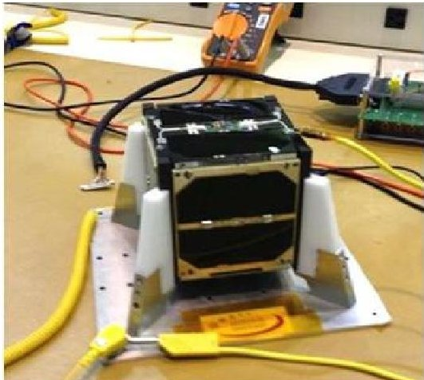

Figure 1 - NANOSATC-BR1

http://www.inpe.br/crs/nanosat/galeria.php

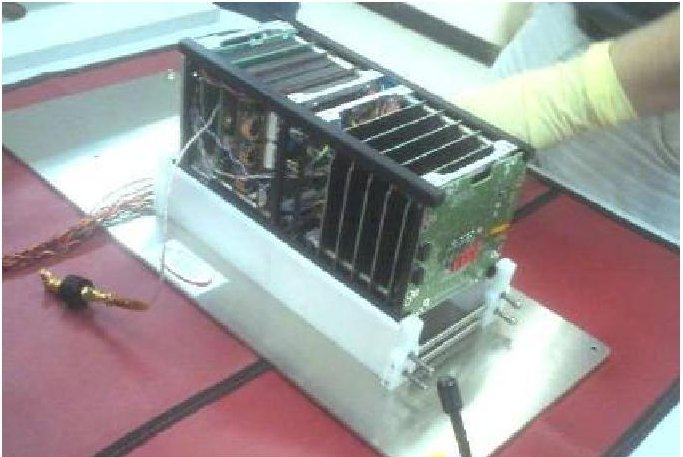

Figure 1 - NANOSATC-BR2 EM

<!-- PDF_PAGE: 4 -->

## NANOSATC-BR3

Currently in its Conceptual Phase of Development;

To study Space Radiation and develop Capacity building;

Constraint: Reuse NANOSATC-BR1 EM;

Stakeholders and their needs:

INPE Scientists need to validate a radiation protective material in space.

UFRN/CRN technologists need to validate their transceiver in space environment.

UFSM and UFRGS technicians and Professors need to validate their integrated circuits against space radiation.

Galileo Mission Scientists need to analyze the dynamics of trapped particles in radiation belts and their influence on embedded electronics.

Figure 2 - NASA / SOHO

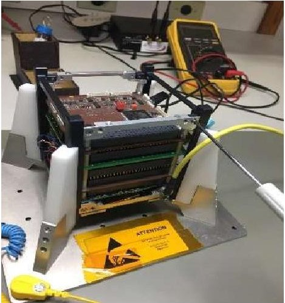

Figure 3 - NCBR3 EM

<!-- PDF_PAGE: 5 -->

## OBJECTIVE

- Use an MBSE software with an embedded Systems Engineering method to:

Identify Mission needs and their interrelation;

Identify high level system functions;

Develop a mission concept;

Capture requirements;

Build the first NCBR3 Model;

Introduce the use of MBSE in the Program.

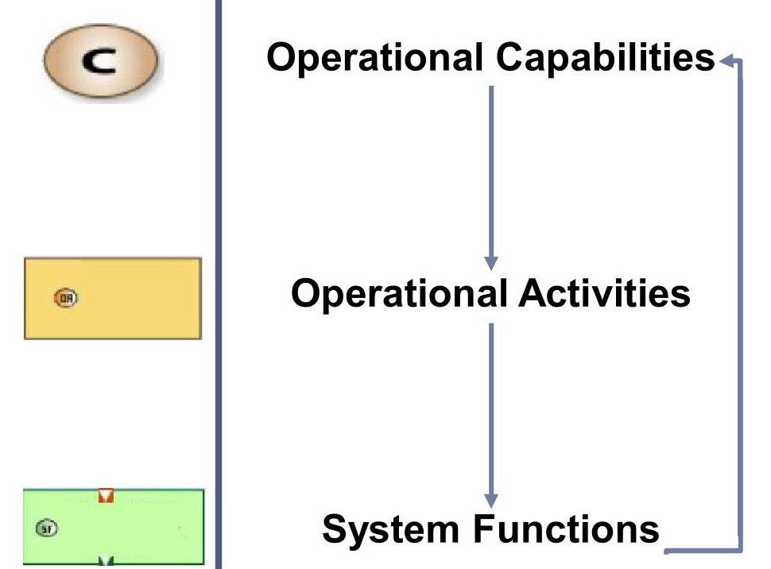

<!-- PDF_PAGE: 6 -->

## MODEL-BASED SYSTEM ENGINEERING

"Formalized application of modeling to support requirements definition, design, analysis, verification and validation activities"

One of the main Goals: Integrate information, communication and the analysis of systems engineering products.

Modeling is based on three pillars:

Tool: Concerns to the instrument (usually software) that will be used to develop the work;

Language: Method of communication between the user and the tool (similar to a programming language);

Method: process that sometimes is conveniently embedded in the tool.

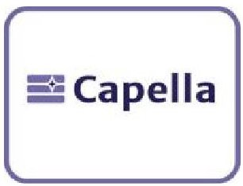

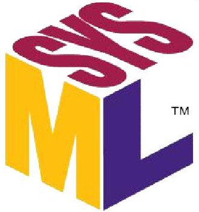

<!-- PDF_PAGE: 7 -->

## CAPELLA - ARCADIA

Integration of all model views;

Open source;

Largely used by space industry;

Meets all three pillars;

Four steps of development;

Interactive and recursive

method.

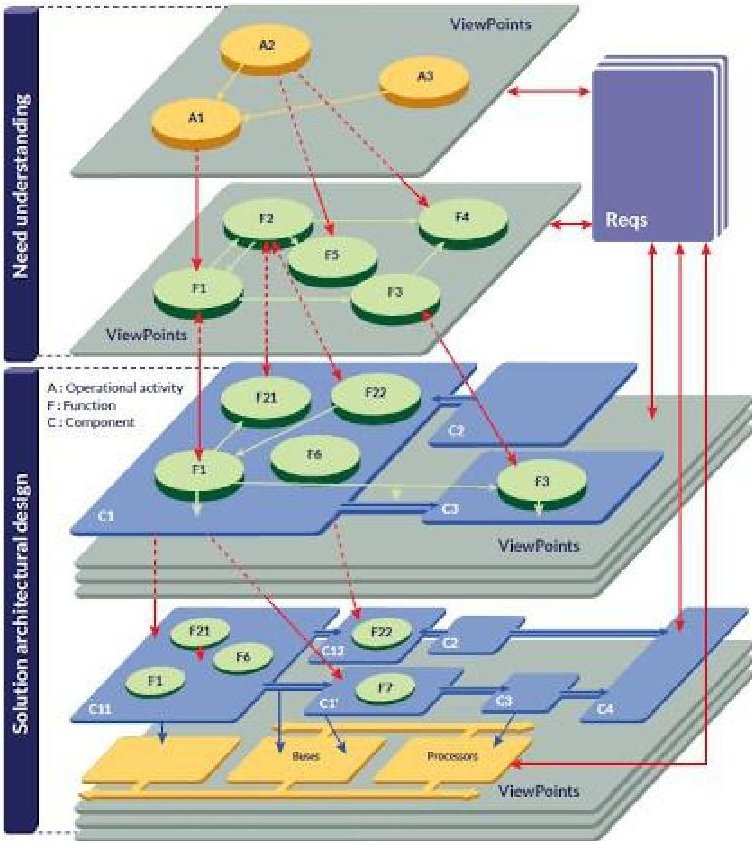

Figure 5: The Arcadia Method

Operational Analysis What the users of the system need to accomplish

Functional & Non Functional Need What the system has to accomplish for the users

Logical Architecture How the system will work to fulfill expectations

Source: https://www.eclipse.org/capella/arcadia.html

Physical Architecture How the system will be developed and built

<!-- PDF_PAGE: 8 -->

## NCBR3 CONCEPT DESIGN WITH MBSE

## Operational Capabilities:

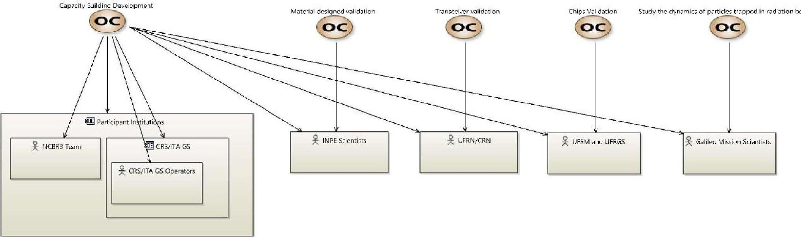

Figure 4: Operational Capabilities

Operational Capabilities (Needs);

Actors (Stakeholders).

<!-- PDF_PAGE: 9 -->

## NCBR3 CONCEPT DESIGN WITH MBSE

## Operational Activities Interaction:

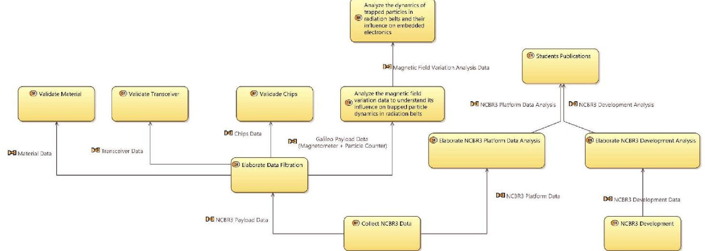

Operational Activities;

Figure 6: Operational Activities Interaction

<!-- PDF_PAGE: 10 -->

## NCBR3 CONCEPT DESIGN WITH MBSE

## Operational Architecture:

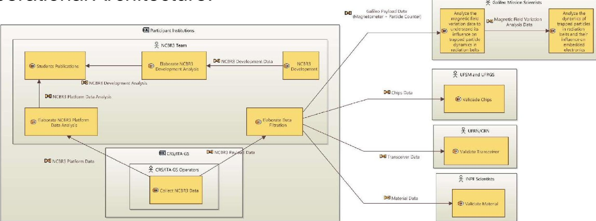

Operational Activities;

Actors.

Figure 7: Operational Architecture

<!-- PDF_PAGE: 11 -->

## NCBR3 CONCEPT DESIGN WITH MBSE

## System Architecture:

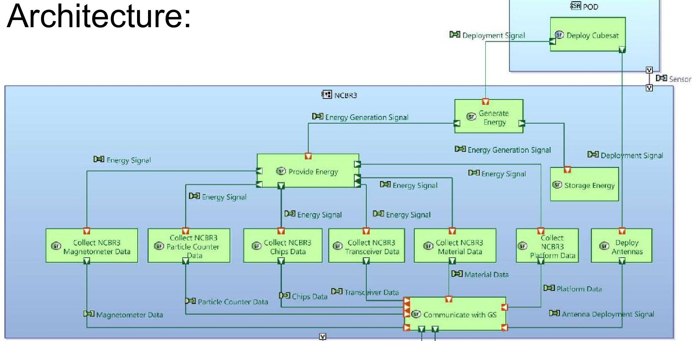

Actors;

System;

System High-Level Functions.

Figure 8: System Architecture

<!-- PDF_PAGE: 12 -->

## NCBR3 CONCEPT DESIGN WITH MBSE

## System Architecture:

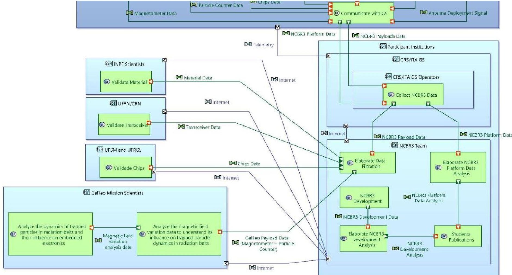

Figure 9: System Architecture

<!-- PDF_PAGE: 13 -->

## NCBR3 MISSION CONCEPT

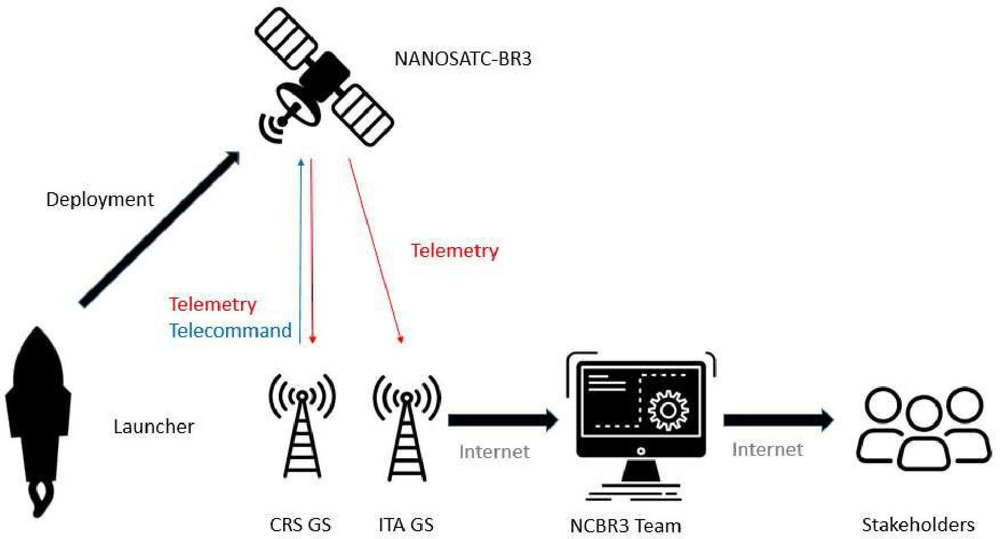

Figure 10: NCBR3 Mission Concept

<!-- PDF_PAGE: 14 -->

## DISCUSSION

## MBSE main contributions:

Hidden requirements;

> Improve communication;

Visual tool-unify system understanding;

System boundaries and basic functions;

Viable system concept;

Reduced project paper work;

Traceability raises reliability.

<!-- PDF_PAGE: 15 -->

## CONCLUSIONS

## MBSE:

Made possible a much more structured mission Phase 0;

Has educational purposes competence;

Consolidates and unifies understanding;

Very useful to Project Reviews.

## Future Works:

Further modeling through next steps;

Encourage MBSE culture within NANOSATC-BR Program.

<!-- PDF_PAGE: 16 -->

## ACKNOWLEDGMENTS

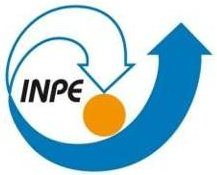

The authors thank the Brazilian Space Agency - AEB, SEXEC/MCTIC, COCRE/INPE MCTIC, UFSM-FATEC for the support, opportunity and grants for the Brazilian INPE-UFSM NANOSATC-BR Cubesat Development Program, with its CubeSats: the NANOSATC-BR1, NANOSATC-BR2 & the NANOSATC-BR3 Projects.

The authors thank and acknowledge to Eng. Abe Bonnema and the ISIS's Board of Directors for the support to the Brazilian students and for the NANOSATC-BR, CubeSats Development Program, the NANOSATC-BR1, NANOSATC-BR2 & the NANOSATC-BR3 Projects.

Dr. Nelson Jorge Schuch thanks the National Council for Scientific and Technological Development (CNPq) for the fellowship under the number 300886/2016-0. The authors thank to MCTIC-CNPq/(INPE/PCI-PIBIC-PIBIT) and to FATEC Programs for fellowships.

<!-- PDF_PAGE: 17 -->

## Muito Obrigado

ARTUR GUSTAVO SLONGO

arturgustavoslongo@gmail.com

## Grazie

International Academy of Astronautics - IAA 5th IAA Conference on University Satellite Missions and CubeSat

## Thanks

$$
2 8 ^ {\mathrm {t h}} - 3 1 ^ {\mathrm {t h}}
$$

