<!-- PDF_PAGE: 1 -->

# Numerical Predictions for On-Orbit Ionospheric Aerodynamics Torque Experiment

Author: Capon, CJ; Lorrain, P; Smith, B; Brown, M; Kurtz, J; Boyce, RR

## Publication details:

Publication details: IEEE Aerospace Conference Proceedings v.00 pp.1-12 9781728127347 (ISBN) 1095-323X (ISSN)

## Event details:

2020 IEEE Aerospace Conference MT, Big Sky 2020-03-06-2020-03-13

Publication Date: 2020-03-01

Publisher DOI: https://doi.org/10.1109/AERO47225.2020.9172256

## License:

https://creativecommons.org/licenses/by-nc-nd/4.0/ Link to license to see what you are allowed to do with this resource.

Downloaded from http://hdl.handle.net/1959.4/unsworks_76281 in https:// unsworks.unsw.edu.au on 2026-09-05

<!-- PDF_PAGE: 2 -->

# Numerical Predictions for On-Orbit Ionospheric Aerodynamics Torque Experiment

C. J. Capon

P. Lorrain

B. Smith

M. Brown

J. Kurtz

R. R. Boyce

University of New South Wales Canberra Northcott Dr, Campbell ACT 2612

Abstract- Accurate modelling of the aerodynamic interaction between the space environment and Low Earth Orbit (LEO) objects improves our ability to understand, predict and control their motion. A neglected aspect of the LEO aerodynamics problem is the charged aerodynamic interaction of these objects with the ionosphere, i.e. ionospheric aerodynamics. This work describes a prospective on-orbit ionospheric aerodynamic experiment (IEX) that aims to improve our fundamental understanding of ionospheric aerodynamics and provide in-situ data to support ground-based experiment and numerical efforts. IEX involves the charged aerodynamic control of a formation of two 6U CubeSats. Through the establishment of an optical inter-satellite link (ISL), ionospheric torques induced through the asymmetric charging of High Voltage Panels (HVP) will be measured via the integrated buildup in reaction wheel (RW) speed required to maintain ISL quality. The purpose of this work is to provide preliminary estimates of RW speed buildups to establish measurement detection threshold and ISL control loop feedback rate requirements for the experiment. Here, induced torque estimates are made using the Particle-in-Cell (PIC)/Direction Simulation Monte Carlo (DSMC) simulations using the PIC-DSMC code, pdFOAM. These torque predictions are applied to a digital twin simulation of the satellite formation featuring couple dynamics, space environment and flight software models using the astrodynamics framework, Basilisk, and in-house space environment interaction analysis tool, rayMAN. Given a 500 km altitude circular orbit with a $ 4 2^{o} $ inclination with ion number densities $ (n_{i}) $ ranging between $ \mathcal{O}\left(1 0^{1 1}-1 0^{1 2}\right) $ $ m^{-3} $ , pdFOAM simulations predicted an induced torque of $ \mathcal{O}(-0.2 5)\ \mu N m $ given a HVP surface potential $ (\phi_{P}) $ of $ -1 0 0 $ V for both the high and low density cases. An unexpected result was a net thrust prediction for the low-density cases caused by indirect thrust forces that arise from plasma sheath driven ion acceleration. Uncertainties surrounding appropriate boundary conditions for wake surface are hypothesised to have contributed to this result and are a key focus for future work. Considering an induced torque of $ -0.2 5\ \mu N m $ and accounting for aerodynamic, solar radiation pressure and gravity-gradient torques, Basilisk simulations predicted an integrated buildup of 25-50 RPM over a 10 minute period. Future work discussed includes: attitude determination errors resulting from uncertainties in the ISL, controller errors from discrete-time effects and magnetically induced torques in the digital twin simulation.

## TABLE OF CONTENTS

1. INTRODUCTION...1

2. IEX CONCEPT OF OPERATIONS ...3

3. IONOSPHERIC AERODYNAMIC MODEL ...4

4. MEASUREMENT PREDICTIONS:

REACTION WHEELS ...7

5. CONCLUSION ...10

ACKNOWLEDGMENTS ...11

REFERENCES ...11

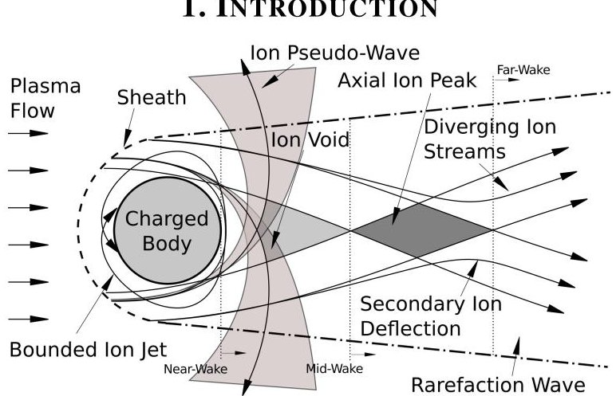

Figure 1. Illustration of the relationship between collective phenomena observed in mesothermal plasma-body interactions and ion trajectories [11].

Miniaturised satellite platforms are disrupting models for space innovation and research. Beyond providing an attractive platform for the rapid and iterative development of new technologies, the proliferation of miniaturised satellite platforms has the potential to revolutionise space research by dramatically increasing the availability of on-orbit data in a complex, time-varying environment that has historically been studied by a sparse number of measurements [1,2]. This is of particular importance to space situational awareness and space traffic management fields, which rely on an accurate understanding of the space environment and its interaction with space systems to provide accurate and timely conjunction assessments to mitigate conjunction risks. Improving this understanding will be essential looking forward, where congestion caused by the growth in the number of space systems and associated debris will require improvements in orbit prediction and de-orbit capabilities [3]. While our understanding of the aerodynamic interaction of LEO objects with the thermosphere has seen significant improvements in the past decade [1,4-6], our understanding of the forces on LEO objects resulting from their direct interaction with the ionosphere (ionospheric aerodynamics) has received comparatively little attention. Recent work by the authors [7], however, found that there exists regions in LEO where ionospheric aerodynamic perturbations may become significant relative to neutral (thermospheric) aerodynamics, and that smaller objects are more sensitive to ionospheric perturbation e.g. debris. The purpose of this work is to introduce and provide preliminary predictions to scope out requirements for a prospective on-orbit ionospheric aerodynamics experiment (IEX) involving the charged aerodynamic control of two 6U CubeSats that would provide essential in situ measurements of ionospheric aerodynamics induced forces and torques to support existing (and future) ground-based experimental [8,9] and numerical work [7,10-14].

<!-- PDF_PAGE: 3 -->

## NOMENCLATURE

## Constants:

$ \epsilon_{0} $ permittivity of free-space $ \mu_{0} $ permeability of free-space $ k_{B} $ Boltzmann constant

## Symbols

$ C_{x} $ dimensionless coefficients of x

$ \alpha_{x} $ dimensionless ion energy ratio for species x

$ S_{x} $ speed ratio for species x

$ \chi $ shielding ratio

$ \hat{\mathbf{n}} $ outward pointing unit vector

$ \mathbf{v} $ velocity vector

$ \mathbf{F}_{x} $ force vector x

$ \mathbf{M}_{x} $ moment vector x

$ T_{x} $ temperature of x

$ n_{x} $ number density of x

$ m_{x} $ mass of x

$ \mathbf{E} $ electric field

$ \mathbf{B} $ magnetic field

$ \bar{\mathbf{T}} $ Maxwell stress tensor

$ \lambda_{\phi} $ shielding length of disturbance $ \phi $

$ \phi_{x} $ electric potential of x

$ q_{x} $ electrical charge of x

$ r_{x} $ reference length x

$ A_{x} $ cross-sectional area of x

$ I_{xy} $ moment of inertia component xy

F10.7 solar radiation indices

$ a_{p} $ geomagnetic index

## Subscripts

C charged aerodynamic term

N neutral aerodynamic term

D drag (along-track) component

m indirect charged aerodynamic property

d direct charged aerodynamic property

B body property/frame

N inertia frame

R target frame

i ion species

e electrons species

## Abbreviations

LEO Low Earth Orbit

PIC Particle-in-Cell

DSMC Direct Simulation Monte Carlo

IEX Ionospheric Aerodynamics Experiment

ISL Inter-Satellite Link

HVP High Voltage Panel

RW Reaction Wheel

OTA Optical Telescope Assembly

IPA Image Processing Assembly

GPS Global Positioning System

ADCS Attitude Determination and Control System

The study of plasma-body interactions in LEO has historically been focused on characterizing plasma wake structures, where numerical [15-20] and experimental [21,22] predictions have been supported by a limited number onorbit missions in LEO e.g. CHAWS [23-25]. There exist several reviews on the subject [26-28], the primary impetus focused around better understand spacecraft charging and related electrostatic discharge/arcing events, with recent work considering multi-body charging problems and LEO charging [18,29-32]. There has also been interest in the applications of the Lorentz force resulting from a charged satellite moving through the Earth's magnetic field for satellite control [33,34] and the application of Coulomb forces in geostationary Earth orbit (GEO) for touchless actuation [35].

To date, there exist no on-orbit missions directly investigating ionospheric aerodynamic forces in LEO. Worth noting is the LAGEOS I and II missions in mid Earth orbit (MEO), the analysis of which has considered charged aerodynamic effects [36]. Unfortunately, MEO plasma-body interactions are phenomenologically different from LEO plasma interactions due to their orbital velocity $ \left(\mathbf{v}_{B}\right) $ . Specifically, unlike in MEO, plasma-body interactions in LEO may generally be described as "mesothermal", where $ \mathbf{v}_{B} $ is much greater than the ion thermal velocity and much less than the electron thermal velocity, and "unmagnetised", where the ion gyration radii is much larger than body size [11] - though recent work has shown considering magnetised electron dynamics may introduce sheath asymmetries [20].

Figure 1 provides a general illustration of the characteristic features of LEO plasma-body interactions, where the directed ion velocity in the body frame B results in a deformation of the plasma sheath that naturally occurs around a body immersed in a plasma, compressing the fore-body plasma sheath and extending the wake sheath about a negative space-charge ion void. The study of ionospheric aerodynamics, or more generally charged aerodynamics, extends LEO plasma-body interaction works to consider the resulting momentum exchange between plasma and body [37] - note that charged aerodynamics studies also exist in the dusty (complex) plasma literature, which considers the transport of particles in dense plasmas [38,39].

Charged aerodynamic forces can be formalised by considering a fixed volume of plasma surrounding an immersed body B with surface S. Applying a control surface approach and neglecting electron pressure terms, the charged aerodynamic force vector $ \mathbf{F}_{C} $ can then be written as [12,40],

$$
\mathbf {F} _ {C} = - \underbrace {\int_ {S} n _ {i} m _ {i} \left(\mathbf {v} _ {B} \cdot \hat {\mathbf {n}}\right) \mathbf {v} _ {B} d S} _ {\mathrm {d i r e c t f o r c e}} + \underbrace {\int_ {S} \bar {\mathbf {T}} \cdot \hat {\mathbf {n}} d S} _ {\mathrm {i n d i r e c t f o r c e}}
$$

where $ n_{i} $ and $ m_{i} $ are the ion number density and molecular mass of species i, $ \mathbf{v}_{B} $ is the relative velocity vector between plasma and body, $ \hat{\mathbf{n}} $ is an outward pointing unit vector on S, and $ \bar{\mathbf{T}} $ is the Maxwell stress tensor,

$$
\bar {\mathbf {T}} _ {k j} = \epsilon_ {0} \left(E _ {k} E _ {j} - \frac {1}{2} \delta_ {k j} E ^ {2}\right) + \frac {1}{\mu_ {0}} \left(B _ {k} B _ {j} - \frac {1}{2} \delta_ {k j} B ^ {2}\right)
$$

where B and E are magnetic and electric field vectors.

<!-- PDF_PAGE: 4 -->

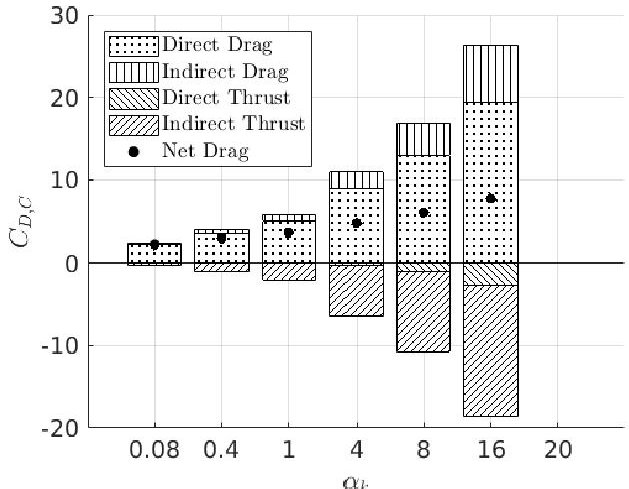

Figure 2. Influence of $ \alpha $ on the integrated direct and indirect drag and thrust contributions. $ \chi=2. 5 5 $ [12].

Eqn. 1 shows that plasmas may exchange momentum with an immersed body through direct ion/surface interactions and indirectly through field effects. While the former term is fairly standard in LEO aerodynamic studies, the latter term represents an important (and complex) contribution. This is particularly true in LEO where the anisotropic sheath structure characteristic of mesothermal plasma-body interactions may result in non-negligible indirect charged aerodynamic forces. To illustrate this point, Figure 2 shows the variation of the charged drag coefficient $ C_{D,C} $ (eqn. 3) about a cylindrical body with a negative uniform charged distribution with the plasma scaling parameter $ \alpha $ (ion energy ratio) [11].

$$
C _ {D, C} = F _ {D, C} / \left(0. 5 m _ {i} n _ {i} A _ {B} v _ {D, B} ^ {2}\right)
$$

where drag is defined as anti-parallel to $ v_{D,B}, $ $ F_{D,C} $ is the charged drag force and $ A_{B} $ is a reference cross-sectional area.

Figure 2 shows that indirect forces are both non-negligible relative to direct forces and may appear both as a drag force caused by the deflection of non-colliding ions in the body wake, and as a thrust, to account for the acceleration through the fore-body sheath.

The following three sections provide a general outline of the IEX concept of operations and presents preliminary predictions for induced RW speed buildup to scope system requirements. Section 2 begins by outlining the general concept of operations for IEX. Section 3 presents preliminary 2D PIC/DSMC simulations for a range of expected conditions to provide bounds on induced charged moment $ C_{M,C} $ and drag $ C_{D,C} $ coefficients. Section 4 applies these moments to digital twin simulations of the experiment built using the astrodynamics code, Basilisk [41,42], to provide preliminary predictions for integrated RW speeds buildup.

## 2. IEX CONCEPT OF OPERATIONS

IEX aims to improve our fundamental understanding of ionospheric aerodynamic forces by providing precise measurements of forces and torques induced through the asymmetric charging of satellite surfaces. This may be achieved using a formation of two 6U CubeSats that we shall refer to here as SC-A and SC-B. Figure 3 shows a representative image of SC-A, the double-deployable panels required to provide

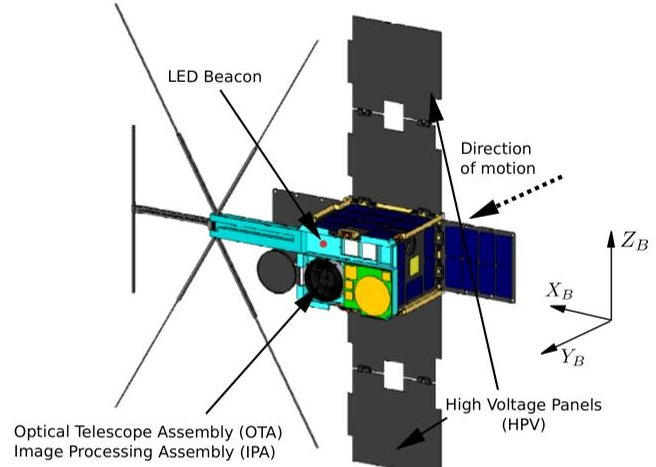

Figure 3. Illustration of primary SC-A and SC-B systems employed during IEX.

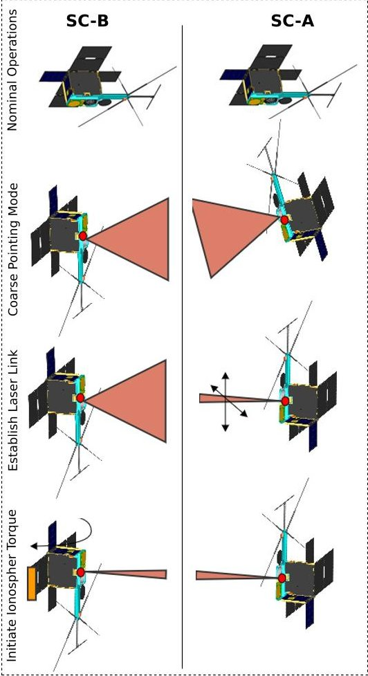

Figure 4. IEX procedure for SC-B test. HVP orientation to $ Y_{B} $ the primary difference between SC-A and SC-B.

sufficient neutral aerodynamic control for establishing and maintaining a formation with an along-track separation less than 200 km with a nominal separation of 50 km to meet the ISL LED and laser beacon requirements. Figure 3 also illustrates the body-fixed coordinate system B and key systems employed by IEX. Under standard operating conditions for SC-A and SC-B, $ + Y_{B} $ is nadir pointing and $ + X_{B} $ is aligned with the orbital velocity vector. SC-A and SC-B are identical except for the HVP setup, SC-A's HVP facing in the $ - Y_{B} $ direction and SC-B's HVP facing in the $ + Y_{B} $ direction, allowing investigation of a key uncertainty discussed later in this work - the coupling between of HVP surface charge and chassis floating potential.

<!-- PDF_PAGE: 5 -->

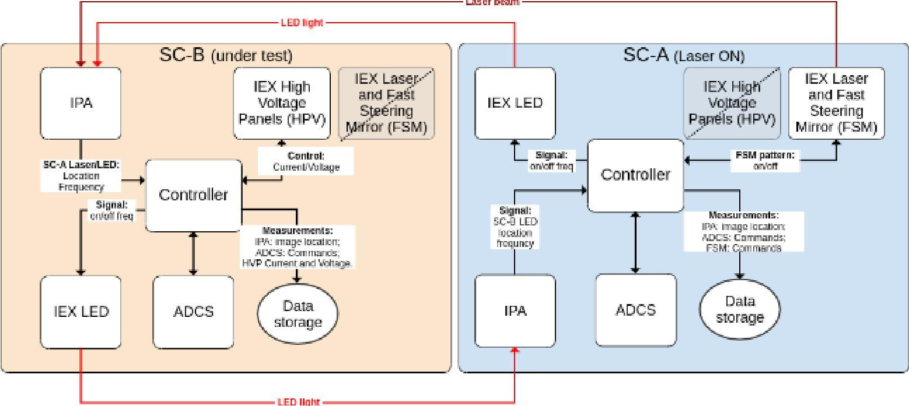

Figure 5. IEX functional block diagram.

SC-B IPA Pixel Array

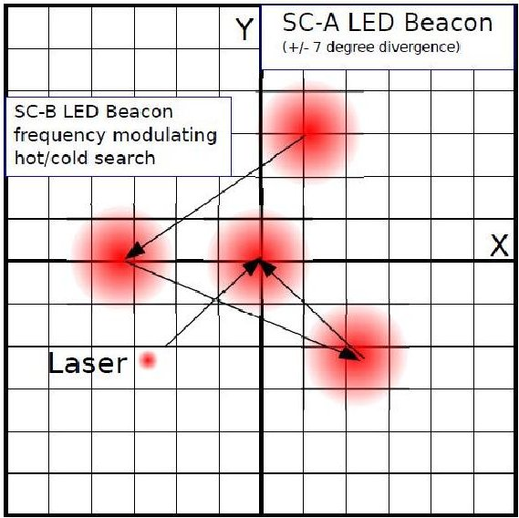

Figure 6. General illustration of IPA beacon search. The LED/Laser frequency of SC-A and SC-B providing the feedback pathway for the control loop.

Figure 4 shows a general schematic of the primary phases of IEX, Figure 6 shows an illustration of the IPA beacon search, and Figure 5 provides a functional block diagram of the systems involved. The experimental procedure can be summarized as follows:

Establish Coarse Pointing: Using the OBC coarse orbit knowledge (and/or GPS position), SC-A and SC-B OTAs are aligned with each other. Alignment is verified through optical detection of on-board LED beacons by the IPA. A coarse steering search mode centres the LED beacon light of SC-A on SC-B IPA's and vice-a-versa. LED beacon light is modulated at a known frequency to differentiate from the background starfield. Alignment is monitored through modulation of the SC-A and SC-B LED frequency using a hot/cold search, e.g. as SC-A's beacon centers on SC-B's IPA, SC-B's beacon frequency increases.

Establish laser link: SC-A's laser is activated and put in scan mode to search for SC-B's IPA. Confirmation of laser detection from SC-B is established through a change in SC-A LED beacon modulation pattern. The laser's intensity is centred on IPA and is modulated to enable differentiation from the background.

Generate Ionospheric Torque: One HVP on SC-B is activated at a specified voltage relative to the chassis to induced an ionospheric torque. Drift of SC-A's laser on SC-B's IPA caused by induced torques is counteracted by SC-B's ADCS system to maintain SC-A laser on SC-B IPA centre. Experiment measurements include position and flash rate of SC-A's laser image on SC-B's IPA, HVP voltage/current vs time and ADCS commands.

This experiment may be run on SC-A or SC-B and panels on SC-A and SC-B may be run independently or together. The ISL enables high accuracy torque measurements over small geospatial regions, allowing IEX to focus on studying particular ionospheric regions, e.g. the afternoon electron bulge. In the event ISL link is not established, system startrackers my provide coarse pointing knowledge. SC-A (or SC-B) may then be used as a control and the experiment performed on SC-B over an extended period at the expense of additional uncertainty in space environment perturbations. Extended missions involving the HVP system may include investigating differential charged aerodynamic control for formation flying and charged accelerated high altitude deorbit, e.g. [14].

## 3. IONOSPHERIC AERODYNAMIC MODEL

This section applies the PIC portion of the PIC/DSMC code, pdFOAM [43], to provide preliminary predictions for induced torques achievable on IEX. See [43] for a description of the implementation and validation of pdFOAM. The following sections describe the numerical setup of the system considered in this work and presents preliminary predictions of induced ionospheric torques and drag.

<!-- PDF_PAGE: 6 -->

Table 1. Map between dimensioned parameters $ \phi_{P} $ and $ n_{O^{+}} $ and scaling parameters $ \alpha_{k} $ and $ \chi^{-1}. $

<table border="1"><tr><td rowspan="2">$\phi_{\mathrm{P}}[\mathrm{V}]$</td><td colspan="3">$\mathrm{n}_{\mathrm{O}^{+}}[\mathrm{m}^{-3}]$</td></tr><tr><td>$2.67\times10^{11}$</td><td>$2.67\times10^{12}$</td><td></td></tr><tr><td></td><td>$\alpha_{O^{+}}$</td><td>$\chi^{-1}$</td><td>$\chi^{-1}$</td></tr><tr><td>0</td><td>0.0</td><td>0.0</td><td>0.0</td></tr><tr><td>-25</td><td>2.5</td><td>0.36</td><td>0.11</td></tr><tr><td>-50</td><td>5.0</td><td>0.51</td><td>0.16</td></tr><tr><td>-75</td><td>7.6</td><td>0.62</td><td>0.20</td></tr><tr><td>-100</td><td>10.2</td><td>0.72</td><td>0.23</td></tr></table>

## Simulation Parameters

Given the complex structure of the ionosphere and its sensitivity to space weather phenomena [44,45]. IEX will initially focus on the region of maximum density corresponding to the afternoon electron bulge. Two bounds on ion density are considered here, $ 2. 6 7 \times1 0^{1 1} \ m^{-3} $ and $ 2. 6 7 \times1 0^{1 2} \ m^{-3}. $ HVP surface potentials $ (\phi_{P}) $ considered range between 0 to $ -1 0 0 \mathrm{~V} $ w.r.t a quasi-neutral freestream plasma. Additional important flow parameters include: an ion temperature $ (T_{i}) $ of 1531 K, an electron temperature $ (T_{e}) $ of 1997 K, ion mass $ (m_{i}) $ of $ 2 6. 5 5 \times1 0^{-2 7} \mathrm{~k g} $ $ (O+) $ and an orbital/flow velocity $ (v_{B}) $ of 7700 m/s. The characteristic lengths are taken as the HVP length of 0.2 m $ (r_{P}) $ and the distance from the HVP centre to the system centre of mass in $ X_{B} $ $ (r_{B}) $ of 0.436 m.

To place these conditions in perspective with prior work, Table 1 maps test conditions with plasma scaling parameters $ \alpha $ (ion energy ratio) and $ \chi^{-1} $ (sheath expansion ratio) [11],

$$
\alpha = \left(\frac {Z _ {i} q _ {e} \phi_ {P}}{m _ {i} | \mathbf {v} _ {\mathbf {B}} | ^ {2}}\right)
$$

$$
\chi^ {- 1} = \frac {\lambda_ {\phi}}{r _ {P}}, \quad \lambda_ {\phi} = \sqrt {\frac {\epsilon_ {0} \phi_ {P}}{q _ {e} \sum_ {k} ^ {K} Z _ {k} n _ {k , \infty}}}
$$

Here electron charge is defined as $ q_{e}=-1. 6 0 2 \times1 0^{-1 9} \mathrm{C} $ and $ Z k=-q_{k}/q_{e} $ , e.g. $ Z_{O^{+}}=1. $

In words, $ \alpha $ is the ratio of body potential energy to ion kinetic energy, and it describes the susceptibility of ions to be deflected by potential disturbances. Ion kinetic effects dominate $ \alpha\ll1 $ systems, while $ \alpha\ll1 $ systems are potential dominated where ions are deflected through large angles [12]. $ \chi^{-1} $ is a measure of the relative size of the sheath to a characteristic length in the system, e.g. $ \chi^{-1}\ll1 $ corresponds to a thin sheath, $ \chi^{-1}\gg1 $ to a thick sheath. Table 1 shows that the range of conditions considered in this work are primarily potential dominated with thin to intermediate sheath thickness relative to the HVP.

## Numerical Setup

In brief, the PIC method is a kinetic particle method that determines solutions to the Vlasov-Maxwell system of equations by directly simulating the evolution of macro-particles that represent clouds of real particles. pdFOAM is a nonrelativistic, electrostatic, PIC code that propagators macroparticles based on Newtonian forces using a Leapfrog method coupled with Maxwell's equations.

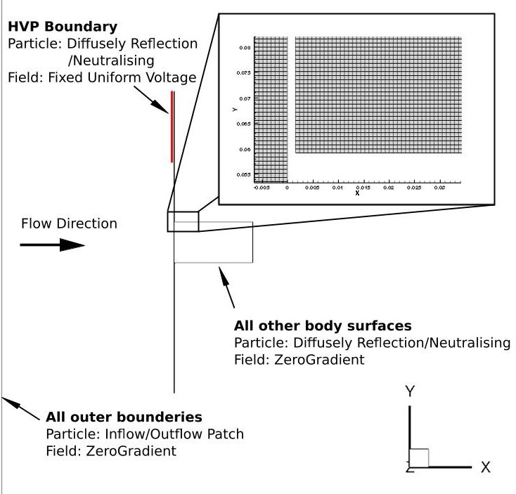

Figure 7. Illustration of computational setup.

As illustrated in Figure 7, simulations in this work are of a 2D box-wing model representative of SC-A and SC-B and employ a hybrid fluid-kinetic approach where a Boltzmann fluid models the electron distribution. The cutout in Figure 7 is indicative of the mesh structure, where cells have been uniformly distributed with a maximum cell side length $ \Delta x $ of 0.8 mm such that electron Debye length $ \lambda_{D,e} $ satisfies the spatial discretization requirement $ \Delta x < \lambda_{D,e}/2 $ for all test conditions - the mesh contains 2431710 cells in total. Gassurface interactions are diffusely reflecting and neutralising with complete thermal accommodation to a 350 K wall while this reflection model is consistent with standard neutral aerodynamic assumptions [46,47], it has not been verified for ion/surface interactions where effects such as sputtering and secondary electron emission may be worth considering. Note that the simulation frame is are not aligned with B.

Direct force modelling is based on calculated changes in momentum of macro-particles that interact directly with object surfaces. Indirect force modelling is based off calculated Maxwell stress's on the boundary surfaces as described in eqn. 1. The simulation time step is $ 1\times 1 0^{-8} $ s and was chosen to resolve ion oscillations and ensure that simulated ions spend multiple time-steps within a single cell - the latter being the limiting requirement. Simulations were run until the total linear kinetic energy and charge contained in the system reached dynamic equilibrium. Simulations reached equilibrium at $ \approx $ 0.002 s and were then averaged over an additional 10000 steps to reduce statistical fluctuations in measured fields - no time-varying fluctuations in systems properties was observed. At initialization, simulations contained $ \mathcal{O} ( 6. 6 \times1 0^{6} ) $ simulated particles to ensure a statistically significant representation of particles and multiple particles are distributed in each cell. At equilibrium simulations contained $ \mathcal{O} ( 5. 6 \times1 0^{6} ) $ simulated particles as a consequence of the ion void formation in the wake flow.

## Results

Figure 8 plots the variation in direct and indirect charged drag in terms of thrust and drag contributions along with the resulting net force and moment about the simulation Z

<!-- PDF_PAGE: 7 -->

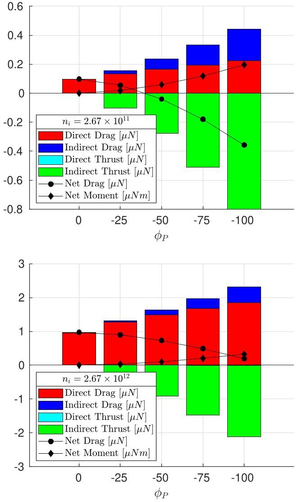

Figure 8. Effect of $ \phi_{P} $ on induced drag and moments.

axis $ ( X_{B} ) $ . Consistent with prior work [12], Figure 8 shows that for increasingly negative surface charges, both direct and indirect forces increase, and that net direct forces primarily contributed a net drag while indirect forces contribute a net thrust. Physically, indirect thrust forces are generated in response to the acceleration of ions through the plasma sheath and indirect drag are caused by the fields reducing the drag component of ion velocity in the wake - phenomenologically similar to Chandrasekhar friction. Similarly, Figure 8 shows that reductions in ion number density make systems more sensitive to potential disturbances and that this translates to higher indirect charged forces. Again this is consistent with prior observations [12], a decrease in number density causing a corresponding expansion of sheath thickness (increase in $ \chi^{-1} $ ) given a common surface potential that in turn causes an increase in the volume of space where ions may be deflected (increased indirect forces). The net result is an increase in the number of ion deflections and the angle of direction (increased $ \alpha_{k} $ ), which translates into significant increases in indirect forces.

These observations are supported by Figure 9, which shows an expansion in sheath thickness about the HVP between the top and middle plots for the same $ \phi_{P} $ with different $ n_{i} $ . Note also the further expansion of the sheath with $ \phi_{P} $ between the middle and bottom cases with a common $ n_{i} $ . This is consistent with $ \chi^{-1} $ where the general shielding length $ \lambda_{\phi} $ varies with both $ n_{i} $ and $ \phi_{P} $ . Figure 9 also clearly shows flow asymmetries induced in the wake structure, the flow past the bottom panels showing a constant rarefaction wave while ion

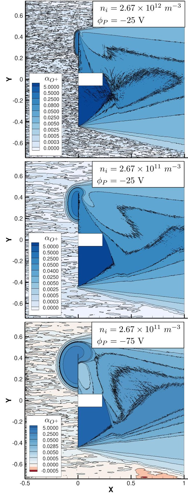

Figure 9. Effect of $ \phi_{P} $ and $ n_{i} $ on flow structure. Flowfields are of local $ \alpha_{O^{+}}. $

<!-- PDF_PAGE: 8 -->

deflections driven by the flow past the top plate shift the axial ion peak in the simulation $ Y \left( X_{B} \right) $ frame compared to that illustrated previously in Figure 1. Figure 9 also shows that the chassis obstructs the flow deflected around the plate such that the ion void is primarily below the bottom panel.

Unlike prior ionospheric aerodynamic work, however, which has focused on uniformly charged bodies, indirect forces dominate the lower density case in Figure 8 such that the system experiences a net thrust. As discussed, while indirect thrusts are a consequence of sheath accelerated ions, as previously shown in Figure 2, direct drag forces have negated this thrust force in prior work such that the net force on the system has been a drag. The chosen boundary conditions, however, are a simplification of a more realistic self-consistent charging scenario, where the wake material on the panels will develop a self-consistent charge based on material properties and current flow paths. There is evidence that wake surfaces on non-conducting spacecraft elements may achieve substantial surface charge differentials, such as [48], which predicted voltage differentials on the order of -5 V for passive charging in LEO. For such a charging scenario, indirect drag effects would dominate the system and may contribute to induced torques instead of reducing them as seen in this work, while also resulting in a net drag.

To address the uncertainties in surface charge distribution and resulting induced torques, let us first consider torques induced through purely direct aerodynamic sources, which range from 0.04 $ \mu $ Nm to 0.3 $ \mu $ Nm at $ -100 $ V for the low and high-density case respectively. Including indirect forces based on the surface charge distribution used in this work changes both results, increasing the low-density case by an order of magnitude and reversing the net torque direction for both systems giving values between $ -0.2 $ $ \mu $ Nm and $ -0.33 $ $ \mu $ Nm at $ -100V $ respectively. Considering a system where wake surfaces behind the HVP charge to substantive voltages, as seen in prior works, indirect drag forces would dominate and tend to increase induced torques, while increases in surface charge of wake surfaces behind the uncharged HVP would tend to mitigate induced torques. Therefore, this work shall consider an induced torque of $ -0.25 $ $ \mu $ Nm in the following section as a conservative estimate of induced torques. Addressing uncertainties in surface charge distribution is a key recommendation for future work and may be achieved through loosely coupled simulations that incorporate PIC simulations with the spacecraft charging framework, SPENVIS, or through self-consistent charging simulations using codes such as PICLas [49].

## 4. MEASUREMENT PREDICTIONS: REACTION WHEELS

This section presents preliminary predictions for Reaction Wheel (RW) speed buildup arising from an induced torque about $ X_{B} $ of $ -0.25 \mu \mathrm{N m} $ . This is achieved using the open-source astrodynamics framework, Basilisk (BSK) [42], and an in-house ray-tracing code, rayMAN, that provides rapid neutral aerodynamic and solar radiation pressure calculations.

## Basilisk

BSK is a flexible, scalable and modular astrodynamics framework for the simulation of complex space systems in the space environment. Its core architecture is written using an object-oriented framework in C++ but allows for the integration of Python, C, and Fortran [42]. Simulation scenarios are built using Python, which interface with the underlying

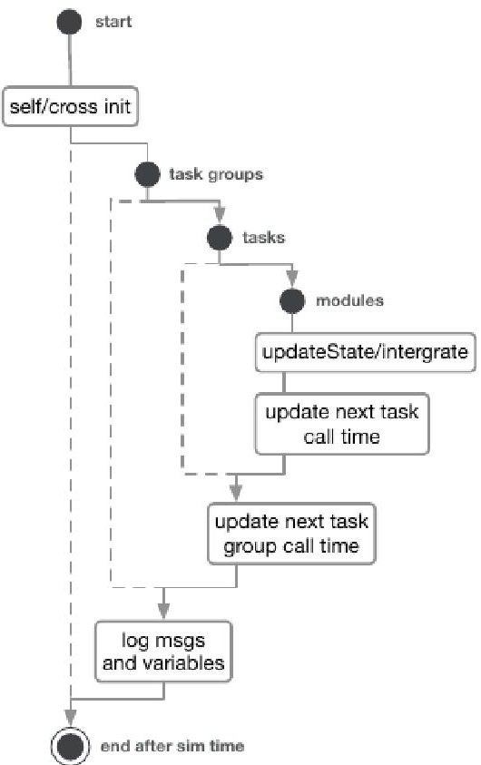

Figure 10. High level BSK simulation flow [48].

C/C++ architecture. Simulations are broken into three separate parts: Modules, Tasks and Task Groups. Figure 10 shows a high-level breakdown of flow control for BSK simulations.

Modules are stand-alone code that implements specific models (e.g. RWs) or self-contained logic (e.g. translate control torque to an RW command voltage). Modules receive data depending on Modules whose messages they have subscribed to and send data as messages. Tasks are then groups of modules, that may be updated at a given frequency that may be different from other Tasks and may either be enabled or disabled as desired. Task Groups, as the name suggests, are groups of Tasks used to resolve messaging dependencies. The reader is referred to [42] for a more detailed discussion of the implementation of BSK. The version of BSK used in this work is a modified version of version 0.7.2 available from [50]. Modifications are primarily the implementation of an aerodynamic lookup table method templated from the solar radiation pressure lookup method, and an azimuth/elevation grid with local minima search to speed-up simulations containing large lookup tables.

## rayMAN

rayMAN (ray Modelling and ANalysis), is an in-house GPUaccelerated ray-tracing code built using NVIDIA's OptiX API [51] to leverage NVIDIA's RTX units optimised for ray-tracing calculations. A detailed description of rayMAN is the subject of another work. Briefly, rayMAN employs a recursive path tracing method modelled off the "photon mapping" approach used in rendering, e.g. [52]. Simulations contain sources casting two principle ray types: aerodynamic and solar radiation pressure flux rays. Complex CAD objects are imported and stored on GPU devices (devices) in logical space. Objects are then instanced from these stored geometries and dynamically assigned an instanced material program (also stored device side). Ray interactions are rapidly calculated using an RTX accelerated Bounding Volume Hierarchy

<!-- PDF_PAGE: 9 -->

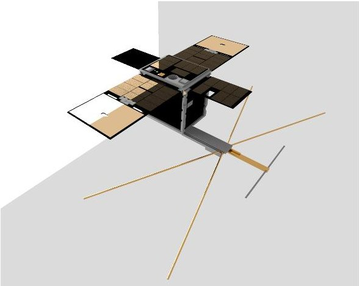

Figure 11. rayMAN visualisation of SC-A.

(BVH) method inside this logical space, where physical rays in world space are rotated into logical space instead of rotating objects [51]. This approach allows complex scenes of moving geometries with high levels of detail with low memory overheads and no mesh group transforms. Upon an intersection of a ray with an object, the associated material program linked with the object is called based on the incident ray type. Material programs update ray properties based on particular interaction models.

rayMAN handles an arbitrary number of different material types with variable interaction properties for different ray types, e.g. diffuse reflection for aerodynamic rays and specular reflection for solar radiation pressure rays. This allows rapid investigations of gas/surface interactions with complex variation in surface properties. Unlike other ray-tracing based approaches to solar radiation pressure modelling that employ a pixel array to track forces [53], rayMAN fills a preallocated device-side hash table of ray interactions which is then copied to the host machine after each cast to minimise copy operations. The copied ray path table is then accumulated on an object mesh, providing a robust link between ray interactions and object geometry. Aside from reducing copy overheads, this approach enables multi-object simulations and the interaction of multiple ray types, e.g. solar heat flux modifying local surface temperature and therefore forces from re-emitted gas particles. rayMAN also includes a ray-tracing based visualisation mode using OpenGL with interactive controls built using imgui that allows dynamic reassignment of material programs to surfaces, aerodynamic and solar radiation pressure source profiles and object position and attitude. Additional capabilities include detail modelling of power availability. An example render is shown in Figure 11. Contact the authors regarding code availability.

## Numerical Setup

Table 2 provides a summary of representative body parameters used for SC-A and SC-B in this work. RW models are based off SatBus 4RW0s [54] commonly used on CubeSat platforms. rayMAN and BSK are loosely coupled here, rayMAN providing aerodynamic and solar radiation pressure lookup tables of forces and moments that are evaluated during BSK the dynamics simulations. A constant reference area of 0.2 $ m^{2} $ and reference length of 0.436 m is used for the aerodynamic and solar radiation pressure calculations. Figure 12 then shows a breakdown of BSK Task Groups, Tasks and Modules including message and interface paths used here.

The scenario outlined in Figure 12 follows that in Section 2. Given some initial position and attitude, and assuming

Table 2. Summary of Dynamic Simulation Properties.

<table border="1"><tr><td></td><td>Properties</td></tr><tr><td>Orbit</td><td>Classical Elements:a=6878kme=0.0001i=420$\Omega$=48.20$\omega$=347.80SC-A:f=0SC-B:f=1.660</td></tr><tr><td>Third Body Effects</td><td>Spice:Sun/Earth/MoonEpoch:04/05/2020</td></tr><tr><td>ThermosphereFlags:</td><td>Model:NRLMSISEDefaultF10.7=150F10.7A=83.356$a_{p}$=5</td></tr><tr><td>Body</td><td>SC-A and SC-B:$m_{B}$=9kg$I_{xx}$=0.072kgm2$I_{yy}$=0.085kgm2$I_{zz}$=0.104kgm2</td></tr><tr><td>Reaction WheelsMass:</td><td>0.137kg(per wheel)</td></tr><tr><td>RPM:</td><td>6500RPM(max)</td></tr><tr><td>Torque:</td><td>0.0032Nm(max)</td></tr><tr><td>Momentum capacity:</td><td>0.02Nms(max)</td></tr><tr><td>Static imbalance:</td><td>$5.0\times10^{-8}$ (measured)</td></tr><tr><td>Dynamic imbalance:</td><td>$3.75\times10^{-10}$ (measured)</td></tr><tr><td>ElevationAzimuth:Position:</td><td>$67.13^{o}$[$45^{o},135^{o},225^{o},315^{o}$[$0.092,0.092,0.1]m[$0.092,-0.092,0.1]m[$-0.092,-0.092,0.1]m[$-0.092,0.092,0.1]m</td></tr><tr><td>Neutral AerodynamicsInteraction Model:Wall Temperature:</td><td>Model:LookupDiffusely Reflecting350K</td></tr><tr><td>Solar Radiation PressureInteraction Model:Absorption Coefficient:Specular ReflectionCoefficient:</td><td>Model:LookupClassical Radiation01</td></tr></table>

SC-B has knowledge of SC-A's position, SC-B builds a reference frame R such that $ X_{R} $ is pointing toward SC-A using the spacecraftPointing() module. An alignment vector is specified such that $ Y_{B} $ is driven toward $ X_{R} $ and the error between the desired alignment and current state is passed to the feedback controller, mrpFeedbackControl(), which calculates ADCS commands required to align B with R.

These commands are passed through a torque to RW speed converter that is in turn transferred from the flight software task group to the dynamics task group. The dynamics group then attempts to drive the wheels to the input speed while accounting for dynamics limitations (e.g. wheel saturation). RW speed is then passed back to the feedback control loop while the generated moment is passed to the spacecraft state object. The state of SC-B is passed back to the pointing algorithm to close the loop.

<!-- PDF_PAGE: 10 -->

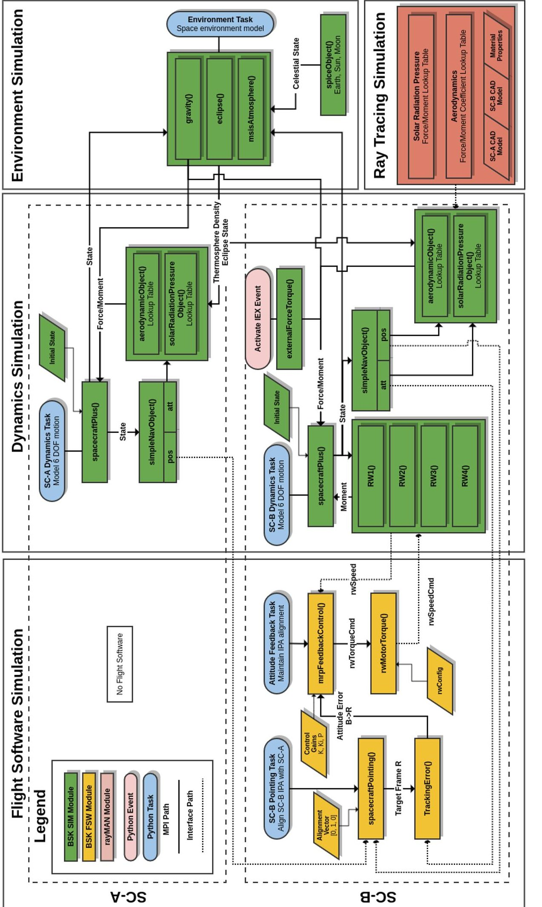

Figure 12. Block diagram of IEX dynamics simulation combining Basilisk (dynamics, flight software) and rayMAN (space environment interactions).

<!-- PDF_PAGE: 11 -->

## Results

Given a random initial body rate and attitude, Figure 14 plots the relative error between B and the desired pointing configuration where $ Y_{B} $ is aligned with $ X_{R} $ in terms of the modified Rodrigues parameters $ \sigma_{\mathrm{B / R}} $ . Orbits are setup such that there is a 200 km along-track separation as shown in Figure 13. From initialisation, the simulation is given 10 minutes for SC-B to establish pointing authority at which point IEX is activated for an additional 10 minutes and then deactivated and allowed to continue for another 10 minutes. Reaction wheels are initialised with zero velocity.

Figure 15 shows the corresponding RW speeds driven by the mrpFeedbackControl() module to establish pointing and the integrated buildup in wheel speed caused by IEX torque. Figure 15 shows that the integrated buildup in RW speed ranges between 25-50 RPM over a 10 minute period given a $ -0.25 \mu \mathrm{N m} $ disturbance torque. This provides an initial indication for detection thresholds that this system must achieve. An important source of noise not considered here is the ISL used to maintain pointing accuracy. An attempt to simulate this through adding a random jitter to the apparent position of SC-A in the spacecraftPointing() module did not affect reaction wheel speeds, the hypothesis being that the spacecraft dynamics acted as a low pass filter. In future work, full ISL simulation will be added to understand better and characterise system noise caused by sensor drift and to corroborate IPA measurements.

## 5. CONCLUSION

This work outlined a prospective on-orbit experiment involving a formation of two 6U CubeSats that aims to improve our fundamental understanding of ionospheric aerodynamics by providing precise measurements of torques induced through the asymmetric charging of satellite surfaces. Through the establishment of an optical ISL, induced torques will be measured through the integrated buildup in reaction wheel speed required to maintain link quality. The ISL enables high accuracy measurements of induced torques over geographically localised regions, e.g. through the afternoon electron bulge. In the absence of a laser link connection, centroiding of LED beacons may be used to provide coarse measurements of induced torques in the same manner, while star-tracker attitude determination may be used for long period measurements where one satellite acts as a control.

Ionospheric aerodynamic simulations made using PIC/DSMC code, pdFOAM, verified induced plasma-sheath asymmetries and predicted maximum torques on the order of $ - 0. 2 5 \ \mu \mathrm{N m} $ for ion densities between $ 1 0^{1 1} \ m^{-3} $ and $ 1 0^{1 2} \ m^{-3} $ . An unexpected result was a predicted net thrust force for the low density. This is hypothesised to be primarily related to the simulation boundary conditions not accounting for selfconsistent charging of wake surfaces, however, further work is needed to verify this hypothesis. Future work proposed to address this uncertainty includes self-consistent charging simulations to determine surface charges that develop on wake surfaces.

Taking an induced torque of $ - 0. 2 5 \ \mu \mathrm {N m} $ as a preliminary estimate, the astrodynamics framework, Basilisk, loosely coupled with the space environment interaction modelling tool, rayMAN, was used to provided preliminary predictions for reaction wheel (RW) speed buildup. Results indicated that an induced torque on the order of $ - 0. 2 5 \ \mu \mathrm {N m} $ would cause

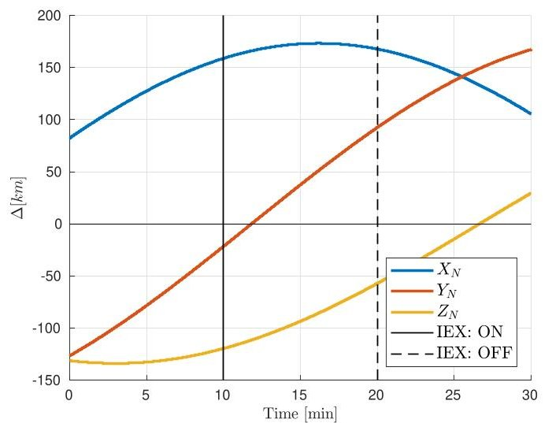

Figure 13. Relative position between SC-A and SC-B in inertia co-ordinates.

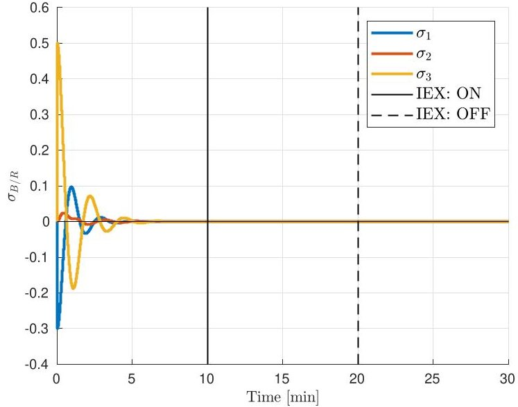

Figure 14. Attitude error between B and R over time.

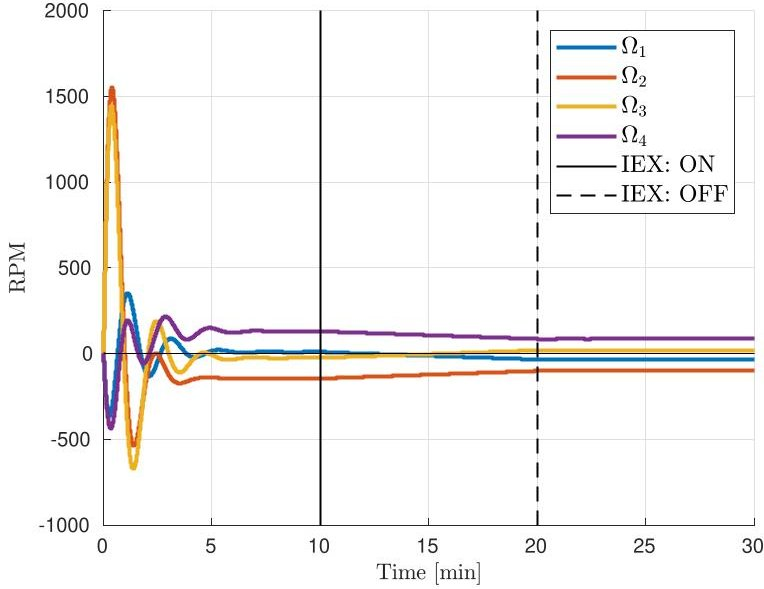

Figure 15. Change in reaction wheel speed with time.

<!-- PDF_PAGE: 12 -->

an integrated buildup in RW speed between 25-50 RPM. This sets the noise threshold that would be required by IEX to be detectable and helps establishes system requirements for control loop feedback rates.

## ACKNOWLEDGMENTS

This research was undertaken with the assistance of resources from the National Computational Infrastructure, which is supported by the Australian Government. This work also acknowledges the help of Prof. Hanspeter Schaub at the University of Colorado Boulder in debugging Basilisk simulations.

## REFERENCES

[1] D. A. Vallado and D. Finkleman, "A critical assessment of satellite drag and atmospheric density modeling," Acta Astronautica, vol. 95, pp. 141-165, 2014. [Online]. Available: dx.doi.org/10.1016/j.actaastro.2013.10.005

[2] J. T. Emmert, "Thermospheric mass density: A review," Advances in Space Research, vol. 56, no. 5, pp. 773-824, 2015. [Online]. Available: http://dx.doi.org/10.1016/j.asr.2015.05.038

[3] J. N. Pelton, "A path forward to better space security: Finding new solutions to space debris, space situational awareness and space traffic management," Journal of Space Safety Engineering, vol. 6, no. 2, pp. 92-100, 2019. [Online]. Available: https://doi.org/10.1016/j.jsse.2019.04.005

[4] P. M. Mehta, C. A. Mclaughlin, and E. K. Sutton, "Drag coefficient modeling for grace using Direct Simulation Monte Carlo," Advances in Space Research, vol. 52, pp. 2035-2051, 2013. [Online]. Available: http://dx.doi.org/10.1016/j.asr.2013.08.033

[5] D. M. Prieto, B. P. Graziano, and P. C. E. Roberts, "Spacecraft drag modelling," Progress in Aerospace Sciences, vol. 64, pp. 56-65, 2013. [Online]. Available: http://dx.doi.org/10.1016/j.paerosci.2013.09.001

[6] T. Visser, E. N. Doornbos, C. C. de Visser, P. N. Visser, and B. Fritsche, "Torque model verification for the GOCE satellite," Advances in Space Research, vol. 62, no. 5, pp. 1114-1136, 2018. [Online]. Available: https://doi.org/10.1016/j.asr.2018.06.025

[7] C. J. Capon, B. Smith, M. Brown, R. Abay, and R. R. Boyce, "Effect of ionospheric drag on atmospheric density estimation and orbit prediction," Advances in Space Research, vol. 63, no. 8, pp. 2495-2505, 2019. [Online]. Available: https://doi.org/10.1016/j.asr.2019.01.013

[8] D. Knechtel and W. C. Pitts, "Experimental Investigation of Electric Drag on Satellites," AIAA Aerospace Sciences Meeting, vol. 2, no. 6, pp. 1148-1151, 1965. [Online]. Available: dx.doi.org/10.2514/3.2515

[9] P. Lorrain, C. J. Capon, R. R. Boyce, C. A. Maldonado, and A. D. Ketsdever, "Experimental investigation of ionospheric aerodynamics effects," 31St International Symposium on Rarefied Gas Dynamics: Rgd31, vol. 2132, no. August, p. 110003, 2019.

[10] C. J. Capon, "Ionospheric Aerodynamics in Low Earth Orbit," Ph.D. dissertation, University of New South Wales Canberra, 2017.

[11] C. J. Capon, M. Brown, and R. R. Boyce, "Scaling of plasma-body interactions in low Earth orbit," Physics of Plasmas, vol. 24, no. 4, 2017. [Online]. Available: dx.doi.org/10.1063/1.4979191

[12] ——, "Direct and indirect charged aerodynamic mechanisms in the ionosphere," Advances in Space Research, vol. 62, no. 5, pp. 1090-1101, sep 2018.

[13] C. J. Capon, P. Lorrain, M. Brown, and R. R. Boyce, "Early experimental ionosphere drag measurements compared with numerical predictions using pdFOAM," 31St International Symposium on Rarefied Gas Dynamics: Rgd31, vol. 2132, no. August, p. 110002, 2019.

[14] B. Smith, C. Capon, and M. Brown, "Ionospheric Drag for Satellite Formation Control," Journal of Guidance, Control, and Dynamics, pp. 1-31, 2019.

[15] E. C. Whipple, "Potentials of surfaces in space," Reports on Progress in Physics, vol. 44, no. 11, pp. 1197-1250, 1981. [Online]. Available: http://iopscience.iop.org/0034-4885/44/11/002

[16] J. G. Laframboise and J. Luo, "High-voltage polar-orbit and beam-induced charging of a dielectric spacecraft: A wake-induced barrier effect mechanism," Journal of Geophysical Research, vol. 94, no. A7, p. 9033, 1989. [Online]. Available: http://doi.wiley.com/10.1029/JA094iA07p09033

[17] J. Wang, "Electrodynamic Interactions Between Charged Space Systems and the Ionospheric Plasma Environment," Ph.D. dissertation, Massachusetts Institute of Technology, 1991.

[18] J. Wang and D. E. Hastings, "Ionospheric plasma flow over large high-voltage space platforms. II: The formation and structure of plasma wake," Physics of Fluids B: Plasma Physics, vol. 4, no. 6, pp. 1597-1614, 1992. [Online]. Available: dx.doi.org/10.1063/1.860069

[19] M. Martinez-Sanchez, "Data Analysis for CHAWS Modeling," Massachusetts Institute of Technology, Tech. Rep., 2000.

[20] H. Usui, Y. Miyake, W. J. Miloch, and K. Ito, "Numerical Study of Plasma Depletion Region in a Satellite Wake," IEEE Transactions on Plasma Science, vol. 47, no. 8, pp. 3717-3723, 2019.

[21] S. D. Hester and A. A. Sonin, "A laboratory study of the electrodynamic influences on the wakes of ionospheric satellites," 2nd Fluid and Plasma Dynamics Conference, vol. 8, no. 6, pp. 1090-1098, 1969. [Online]. Available: http://dx.doi.org/10.2514/6.1969-673

[22] N. H. N. Stone, "The Aerodynamics of Bodies in a Rearefied Ionized Gas with Applications to Spacecraft Environmental Dynamics," Ph.D. dissertation, Marshall Space Flight Center, Alabama, 1981.

[23] A. Sanchez-Torres, "Drag and propulsive forces in electric sails with negative polarity," Advances in Space Research, vol. 57, no. 4, pp. 1065-1071, 2016. [Online]. Available: http://dx.doi.org/10.1016/j.asr.2015.12.013

[24] V. Davis, M. Mandell, D. L. Cooke, and C. L. Enloe, "High-voltage interactions in plasma wakes: Simulation and flight measurements from the Charge Hazards and Wake Studies (CHAWS) experiment," Journal of Geophysical Research, vol. 104, no. A6, pp. 12,445-12,459, 1999. [Online]. Available: dx.doi.org/10.1029/1998JA900071

<!-- PDF_PAGE: 13 -->

[25] C. L. Enloe, J. T. Bell, D. L. Cooke, D. A. Hardy, J. W. R. Lloyd, and M. D. Violet, "The Charging Hazards and Wake Studies ( CHAWS ) Experiment," in 33rd Aerospace Sciences Meeting and Exhibit, 1995.

[26] D. E. Hastings, "A review of plasma interactions with spacecraft in low Earth orbit," Journal of Geophysical Research, vol. 100, no. A8, pp. 14457-14483, 1995. [Online]. Available: dx.doi.org/10.1029/94JA03358

[27] H. B. Garrett, "The charging of spacecraft surfaces," Reviews of Geophysics and Space Physics, vol. 19, no. 4, pp. 577-616, 1981.

[28] H. B. Garrett and A. C. Whittlesey, "Spacecraft charging, an update," IEEE Transactions on Plasma Science, vol. 28, no. 6, pp. 2017-2028, 2000. [Online]. Available: dx.doi.org/10.1109/27.902229

[29] J. Wang, P. Leung, H. B. Garrett, and G. Murphy, "Multibody-Plasma Interactions : Charging in the Wake," Journal of Spacecraft and Rockets, vol. 31, no. 5, pp. 5-10, 1994.

[30] G. McHarg, P. Neal, N. Taormina, A. Strom, and R. Balthazor, "USAFA Integrated Miniaturized Electrostatic Analyzer (iMESA) - An Undergraduate Space Weather Constellation," Space Weather, vol. 13, no. 12, pp. 827-830, 2015.

[31] A. Barrie, "Modeling Differential Charging of Composite Spacecraft Bodies Using the Coliseum Framework," Ph.D. dissertation, Virginia Polytechnic Institute, 2006.

[32] G. Bonin, N. Orr, R. E. Zee, and J. Cain, "Solar Array Arcing Mitigation for Polar Low-Earth Orbit Spacecraft," in 24th Annual AIAA/USU Conference on Small Satellites, 2018.

[33] R. Hoyt, "Terminator Tape: A Cost-Effective De-Orbit Module for End-of-Life Disposal of LEO Satellites," AIAA SPACE 2009 Conference & Exposition, no September, pp. 1-9, 2009. [Online]. Available: http://arc.aiaa.org/doi/10.2514/6.2009-6733

[34] B. Streetman and M. A. Peck, "New synchronous orbits using the geomagnetic lorentz force," Journal of Guidance, Control, and Dynamics, vol. 30, no. 6, pp. 1677-1690, 2007. [Online]. Available: http://dx.doi.org/10.2514/1.29080

[35] H. Schaub, G. G. Parker, and L. B. King, "Coulomb Thrusting Application Study," Defence Advanced Research Projects Agency, Tech. Rep., 2006.

[36] J. Andrés de la Fuente, Enhanced Modelling of LAGEOS Non-Gravitational Perturbations. Turbineweg, Delft: Sieca Repro, 2007.

[37] C. L. Brundin, "Effects of Charged Particles on the Motion of an Earth Satellite," AIAA Journal, vol. 1, no. 11, pp. 2529-2538, 1963. [Online]. Available: dx.doi.org/10.2514/3.2105

[38] I. H. Hutchinson, "Ion collection by a sphere in a flowing plasma: 3. Floating potential and drag force," Plasma Physics and Controlled Fusion, vol. 47, no. 1, pp. 71-87, 2004.

[39] S. Bose, M. Kaur, P. K. Chattopadhyay, J. Ghosh, E. Thomas, and Y. C. Saxena, "Dust vortices in a direct current glow discharge plasma: a delicate balance between ion drag and Coulomb force," Journal of Plasma Physics, vol. 85, no. 1, pp. 1-14, 2019.

[40] J. E. Allen, "On the drag on an object immersed in a flowing plasma: The control surface

approach," Journal of Plasma Physics, vol. 73 no. 5, pp. 773-783, 2007. [Online]. Available: dx.doi.org/10.1017/S0022377806006246

[41] J. Alcorn, H. Schaub, S. Piggott, and D. Kubitschek, "Simulating attitude actuation options using the basilisk astrodynamics software architecture," Proceedings of the International Astronautical Congress, IAC, 2016.

[42] P. W. Kenneally, S. Piggott, and H. Schaub, "Basilisk: A Flexible, Scalable and Modular Astrodynamics Simulation Framework," International Conference on Astrodynamics Tools and Techniques, 2018.

[43] C. J. Capon, M. Brown, C. White, T. J. Scanlon, R. Boyce, and R., "pdFOAM: A PIC-DSMC code for near-Earth plasma-body interactions," Computers and Fluids, vol. 149, pp. 160-171, 2017. [Online]. Available: dx.doi.org/10.1016/j.compfluid.2017.03.020

[44] D. Bilitza, D. Altadill, Y. Zhang, C. Mertens, V. Truhlik, P. Richards, L.-A. McKinnell, and B. Reinisch, "The International Reference Ionosphere 2012 - a model of international collaboration," Journal of Space Weather and Space Climate, vol. 4, p. A07, 2014. [Online]. Available: dx.doi.org/10.1051/swsc/2014004

[45] A. J. Ridley, Y. Deng, and G. To, "The global ionosphere - thermosphere model," Journal of Atmospheric and Solar-Terrestrial Physics, vol. 68, pp. 839-864, 2006. [Online]. Available: dx.doi.org/10.1016/j.jastp.2006.01.008

[46] K. Moe and M. M. Moe, "Gas-surface interactions and satellite drag coefficients," Planetary and Space Science, vol. 53, no. 8, pp. 793-801, 2005.

[47] M. D. Pilinski and B. M. Argrow, "Aerodynamic Analysis Based on Challenging Minisatellite Payload Satellite Lift-to-Drag Measurements," Journal of Spacecraft and Rockets, vol. 50, no. 6, 2013. [Online]. Available: dx.doi.org/10.2514/1.A32394

[48] L. W. Parker, "Differential Charging and Sheath Asymmetry of Non-conduction Spacecraft Due to Plasma Flows," Journal of Geophysical Research: Space Physics, vol. 83, no. A10, pp. 4873-4876, 1978.

[49] M. Auweter-Kurtz, M. Fertig, D. Petkow, T. Stindl, M. Quadt, C.-D. Munz, P. Adamidis, M. Resch, S. Roller, D. D'Andrea, and R. Schneider, "Development of a hybrid PIC/DSMC Code," October, pp. 1-15, 2005.

[50] H. Schaub, "Basilisk Repository," 2019. [Online]. Available: https://bitbucket.org/avslab/basilisk/src/develop/

[51] S. G. Parker, J. Bigler, A. Dietrich, H. Friedrich, J. Hoberock, D. Luebke, D. McAllister, M. McGuire, K. Morley, A. Robison, and M. Stich, "OptiX: A general purpose ray tracing engine," ACM SIGGRAPH, vol. 29, no. 4, 2010.

[52] S. Gupte, "Real-Time Photon Mapping on GPU," Tech. Rep., 2009. [Online]. Available: http://www.cs.umbc.edu/ olano/491/sgupte1.pdf

[53] Z. Li, M. Ziebart, S. Bhattarai, D. Harrison, and S. Grey, "Fast solar radiation pressure modelling with ray tracing and multiple reflections," Advances in Space Research, vol. 61, no. 9, pp. 2352-2365, 2018. [Online]. Available: https://doi.org/10.1016/j.asr.2018.02.019

[54] NanoAvionics, "Reaction Wheels NA-4RW0-G0-R0," Tech. Rep., 2018.