<!-- PDF_PAGE: 1 -->

Copyright 2018 by the American Institute of Aeronautics and Astronautics, Inc. All rights reserved. All requests for copying and permission to reprint should be submitted to CCC at www.copyright.com; employ the ISSN 0022-4650 (print) or 1533-6794 (online) to initiate your request. See also AIAA Rights and Permissions www.aiaa.org/randp.

Carles Araguz, David Llaveria, Estefany Lancheros, Elisenda Bou-Balust, Adriano Camps, Eduard Alarcón, Stefania Tonetti, Stefania Cornara, Gonzalo Vicario, Ignasi Lluch, Hripsime Matevosyan, Alessandro Golkar, Judith Cote, Stephane Pierotti, Pedro Rodriguez, Angel Alvaro, Mateusz Sochacki, and Janusz Narkiewicz. "Architectural Optimization Framework for Earth- Observing Heterogeneous Constellations: Marine Weather Forecast Case"

https://doi.org/10.2514/1.A34182

<!-- PDF_PAGE: 2 -->

# An Architectural Optimization Framework for Earth-Observing, Heterogeneous Constellations: Application to a Marine Weather Forecast Mission.

Carles Araguz $ ^{*} $ , David Llaveria $ ^{\dagger} $ , Estefany Lancheros $ ^{\ddagger} $ , Elisenda Bou-Balust $ ^{\S} $ , Adriano Camps $ ^{\#} $ and Eduard Alarcón $ ^{\S} $ Technical University of Catalonia-UPC BarcelonaTech, Barcelona, Spain.

Stefania Tonetti $ ^{\parallel} $ , Stefania Cornara $ ^{**} $ and Gonzalo Vicario $ ^{\dagger\dagger} $ Deimos Space, S.L.U., Tres Cantos, Madrid, Spain

Ignasi Lluch $ ^{ \ddagger\ddagger} $ , Hripsime Matevosyan $ ^{ \ddagger\ddagger} $ and Alessandro Golkar $ ^{ \ddagger\ddagger} $ $ Skolkovo Institute of Science and Technology, Skolkovo, Moscow Region, Russia

Judith Cote $ ^{\mathbb{P}} $ , Stephane Pierotti $ ^{***} $ , Pedro Rodriguez $ ^{***} $ and Angel Alvaro $ ^{\dagger\dagger} $ Thales Alenia Space

Mateusz Sochacki $ ^{ \ddagger\ddagger} $ and Janusz Narkiewicz $ ^{\S\S\S} $ Warsaw University of Technology, Warsaw, Poland

Earth observation satellite programs are currently facing, for some applications, the need to deliver hourly revisit times, sub-kilometric spatial resolutions and near-real-time data access times. These stringent requirements, combined with the consolidation of small-satellite platforms and novel distributed architecture approaches, are stressing the need to study the design of new, heterogeneous and heavily networked satellite systems that can potentially replace or complement traditional space assets. In this context, this paper presents partial results from ONION, a research project devoted to studying distributed satellite systems and their architecting characteristics. A design-oriented framework that allows selecting optimal architectures for a given user needs is presented in this paper. The framework has been used in the study of a strategic use-case and its results are hereby presented. From an initial design space of 5586 potential architectures, the framework has been able to pre-select 28 candidate designs by an exhaustive analysis of their performance and by quantifying their quality attributes. This very

<!-- PDF_PAGE: 3 -->

exploration of architectures and the characteristics of the solution space, are presented in this paper along with the selected solution and the results of a detailed performance analysis.

## I. Nomenclature

$ \Gamma_{ij} $ = Aggregated figure of merit for architecture $ i $ generated from constellation $ j $ (unit-less, normalized.)

$ \Gamma_{ij}^{\prime} $ = Aggregation of measurement-specific figures of merit (i.e. aggregated architectural performance.)

$ \Gamma_{ijk} $ = Measurement-specific figure of merit for architecture $ ij $ and use-case parameter $ K_{k} $ (unit-less, normalized.)

$ C_{ij} $ = Normalized launch and development costs for architecture $ ij $ (unit-less.)

$ K_{n} $ = $ n $ -th remotely-sensed parameter (or “measurement”) of the use-case.

$ N_{K} $ = Number of remote sensing parameters defined in a use-case.

$ A_{ij} $ = Aggregation of qualitative modifiers for architecture $ ij $ (unit-less, normalized.)

$ \alpha_{n} $ = Weighted architectural quality modifier for “ility” $ n $ (unit-less, normalized.)

$ b_{n} $ = Normalized quality modifier weight for “ility” $ n $ (unit-less, normalized.)

$ a_{n} $ = Quantitative evaluation of “ility” $ n $ (unit-less, normalized.)

Subscripts

$ i $ = architecture identifier.

$ j $ = constellation configuration.

$ k $ = identifier of a use-case measurement, remotely sensed parameter.

Abbreviations

DSS = Distributed satellite system.

DoD = Depth of discharge.

EO = Earth observation.

EU = European Union.

GS = Ground station.

GNSS-R = Global Navigation Satellite System Reflectometer.

ISL = Inter-satellite link.

LTAN = Local Time of Ascending Node.

ONION = Operational Network of Individual Observation Nodes (EU-funded research project).

OSCAR = Observing Systems Capability Analysis and Review Tool.

SAR = Synthetic Aperture Radar.

SoS = System-of-systems.

TRL = Technology Readiness Level.

<!-- PDF_PAGE: 4 -->

## II. Introduction

The urge for remotely sensed data of our planet is nowadays more palpable than ever. Studying the evolution and state of our climate is crucial for the current environmental situation, which is demanding constant monitoring of multiple parameters of interest. In parallel to that, several socio-economic needs and geopolitical interests are also requiring versatile Earth observation capabilities to improve the global knowledge about oceans, forests and coasts, to improve crop monitoring or to detect natural disasters quicker. These and many other needs have pushed the industry and research community to pursue new technological advancements that should be capable of tackling today's stringent Earth observation requirements. While several research activities are focused on delivering better models or improved sensing techniques, others are also suggesting the adoption of new architectural paradigms, justified and motivated by the reduction of costs, mitigation of risks and improvement of development times. These systemic changes propose to explore distributed satellite missions (so-called Distributed Satellite Systems) as a means to provide financially and technologically feasible solutions that are capable of delivering better spatial, temporal and spectral resolutions.

Distributed Satellite Systems (DSS), in this context, are envisioned as heavily interconnected multi-satellite architectures, where potentially heterogeneous platforms orbiting at different planes capture and download data in a networked manner. Inspired by muti-core computing processors or the Internet of Things, these new satellite architectures are envisioned to exchange data and processing resources to fulfill the missions for which they are designed. In line with the current trends in the aerospace industry, small spacecraft platforms and miniaturized instrument technologies are deemed essential enablers for these innovative architectures. Several studies [1-3] endorsed the science return capabilities of small spacecraft and have posed their compelling role in space-based scientific and engineering programs. Similarly, ventures like the one started by Planet (former Planet Labs) or Spire Global have demonstrated the commercial value in deploying medium-resolution constellations of small spacecraft (i.e. large number of units providing daily revisit times at lower development and launch costs.)

Nevertheless, the design of fully-fledged DSS still poses multiple technological and fundamental challenges [4] (e.g. formation flying, on-board processing and data fusion, inter-satellite networks, autonomous mission management, etc.) and is one of the core subjects of several research endeavors. As a critical aspect, it is still unclear how this type of systems-of-systems have to be optimally architected in order to satisfy the requirements of new applications while also achieving most of their promised qualities: low data-access latencies, system resiliency, structural flexibility and adaptability, or the ability to deploy these systems incrementally. In this sense, this paper presents partial results of a research project aimed at exploring this new type of mission architectures. Entitled "Operational Network of Individual Observation Nodes" (ONION) and funded by the European Commission under a Horizon-2020 program, the project intends to contribute to the study of Federated and Fractionated Earth observation architectures. ONION is studying distributed satellite architectures that are conceived as complementary assets to existing European programs (e.g. Copernicus) and is aimed at reviewing new potential applications and user requirements. Likewise, one of the goals of the project is to identify critical design aspects that still represent a technological barrier for the realization of DSS. In line with these goals, the ONION project has focused in the exploration of architectures for four strategic use-cases, and has optimized architectures for them. The selected architectures in ONION have served as an illustration

<!-- PDF_PAGE: 5 -->

of new DSS concepts for Earth observation and have triggered further studies in this field. This paper unveils the results of this architectural optimization (for one of the identified use-cases) and analyzes the design trends observed during the design optimization process.

## III. Methodologies and Tools for Architecting Satellite Systems

Optimizing the design of systems-of-systems (SoS) with computational tools is a common and well-known practice in systems engineering [5] and has yielded several quantitative tools specifically tailored to the satellite systems domain, e.g. [6-9]. These automated frameworks have assisted the architecting and analysis process by describing, quantifying or optimizing multiple system attributes. A fruitful landscape of academic studies has applied multi-attribute tradespace exploration methodologies [10] to find optimal design solutions and capture the values and weaknesses of space systems. The available works have not only been concerned with the design of traditional imaging constellations [7,8,11], but also opportunistic satellite federations [12], missions requiring formation flying and near-simultaneous measurements [13,14]. In general, early design decisions are encoded by computational tools to allow for the generation of a complete solution space. These automatically-enumerated architectural candidates are then traded by modeling their functional traits in the context of a given target application and/or the requirements of the system. In multiple occasions, Model-Based System Engineering (MBSE) frameworks have been closely coupled with simulation tools [8,9,14] in order to feed the optimization process with system-level performance metrics such as revisit time, coverage, latency, capacity, or specific indicators related to the system's function. Integral tools tailored to the design and detailed simulation of satellite constellations have been proposed: for Earth observing systems [9,15]; as well as for space communication networks [7]. Similarly, a Rule-Based Expert System has been proposed in [8], which assesses architectures under both quantitative and qualitative stakeholders needs. Science-driven scores in [8] are combined with satisfaction metrics in order to maximize the value delivery to stakeholders.

In effect, including qualitative attributes in tradespace studies has been considered as a critical factor to the design of space systems. Modeling ilities as part of the architecture evaluation criteria has been explored during the past decade, e.g. [5, 16, 17]. The authors of [18], proposed to factor in a single qualitative metric, survivability, to illustrate how the design optimization process for a space tug could also be influenced by such kinds of properties. Similarly, [19] combined multi-epoch analysis with conventional tradespace exploration to architect satellite constellations that maximized the delivered value regardless of future context changes. The latter study integrated value-robustness in the tradespace process, thus enhancing the decision process with qualitative attributes. Considering qualitative attributes can also be done at different design levels, including the behavioral layer of a system. The work presented in [14], for instance, achieves resilient, risk-aware space architectures through the design of an activity planning executive, while trading-off multiple complementary qualities. In the context of distributed Earth observing systems, suitable system ilities for the assessment of DSS have been reviewed in [20], where the authors suggest their evaluation methods to be integrated into new DSS design tools.

<!-- PDF_PAGE: 6 -->

## IV. ONION Architecture Selection Framework

In line with the recommendation in [20], the work presented in this paper proposes a design framework oriented to EO satellite constellations that integrates modeling and evaluation of qualitative system properties as part of the architecture evaluation and optimization methodology. Thus, this work leverages on previous tradespace exploration methodologies and identifies a compendium of ilities tailored to the project needs and stakeholders interests. The ONION Architecture Selection Framework (OSAF) identifies optimal architectural decisions and allows the studying of relative improvements between candidate designs and coupling between design variables. Like Selva put it, the tool has targeted the ability to understand the shape of the trade space, to localize interesting and detrimental design regions or to compute sensitivities to design decisions [8]. With this purpose, the framework presented herein has elaborated means of graphically representing architectural trends that are particular of the methodology and the system characteristics (i.e. platform heterogeneity), and which ultimately rely on an all-encompassing aggregated figure of merit. This merit factor compresses traditional performance metrics (i.e. similar to utility representations), cost estimates and multiple qualitative attributes into a single value. Therefore, the results presented in this paper explore multi-attribute trade spaces where several of their dimensions correspond to qualitative attributes. Albeit this was previously explored and incorporated in the optimization methodology of [18] for a single quality, the methodology presented herein is, to the best of our knowledge, the first to explore multi-dimensional qualitative spaces and to modulate their influence in the design through weights in their aggregation function.

In addition, the aggregation of attributes into a single figure has also allowed for a comparison environment that can quantify the relative distance between solutions. A derivative application of the framework could encode strategic non-optimal decisions and compare the results with their optimal counterparts. Although not addressed in this paper, the presented framework is also being considered for a technology gap analysis, where currently unavailable technologies or assets would be assumed during the architecture enumeration process and would allow the quantification of their relevance and importance.

Problems with high dimensionality often force the reduction of complexity in architecture evaluation functions. This is especially the case for full-factorial explorations coupled with simulation tools that require moderate computational resources to complete (i.e. CPU time). Reducing simulation complexity may translate to limited fidelity metrics, like in the case of revisit times that would be computed without a careful energy and storage analysis. In traditional space systems design, often sized to ensure power availability, these performance figures have been considered reliable and present low uncertainty. Nonetheless, the design of systems with small-satellite platforms, inherently much more constrained in power, may compromise the results of the optimization process when internal spacecraft states are not considered in simulation. Implementing efficient search heuristics can cope with this situation and can allow detailed simulations to feed the decision process. However, these approaches would not allow the analysis of the trade space as a whole. Instead, the work presented in this paper proposes to cope with high dimensionality by splitting the optimization in a two-step, coarse-fine process, as depicted in Fig. 1.

The proposed architecting process starts with the definition of user needs and performance requirements. This initial enumeration of requirements allows to identify instrument alternatives and to generate an initial set of constellation

<!-- PDF_PAGE: 7 -->

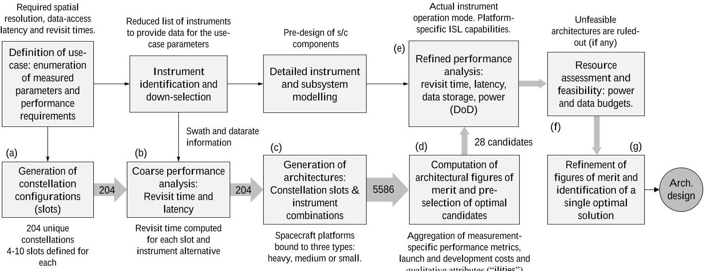

Fig.1 OASF study logic and workflow

configurations (a). Constellation configurations are partially-enumerated solutions that do not bind specific instruments to each spacecraft in the DSS. For each constellation, coarse data-access latencies and maximum revisit times are computed for every potential instrument (b). With constellation configurations defined and analyzed individually, the generation of architectures is performed by combining instrument alternatives in each satellite of a constellation (c). This essentially results in a large set of architectures for which coarse performance metrics are already computed. The results presented in this paper consider a design-space of more than five thousand architectural candidates and explore their commonalities and qualitative characteristics. Aggregated scores are then computed for each architecture (d), allowing to pre-select the reduced set of solutions with the highest scores. This smaller set of candidate architectures can then be analyzed in detail using refined subsystem and payload models (e). Such analysis, derives accurate revisit times and latencies for each measurement, and studies the feasibility and availability of power and on-board data storage (f). Finally, the OASF concludes the optimization process by selecting the final design based on refined metrics and a resource feasibility study (g).

The sections that follow, briefly introduce the case study (Section IV.A), the OASF methodology (Sections IV.B and IV.C) and the simulation tool that has been used to provide refined performance metrics and resource budgets (Section V.) The paper then disseminates the results of the overall optimization framework (in Section VI) and concludes in a short discussion that proposed future improvements (Section VII.)

## A. Use-case Definition and System Requirements

The optimization process for DSS architectures begins with the definition of end users and their requirements. The ONION project aims at exploring DSS approaches that would fulfill unsatisfied demands in the EU Copernicus program [21]. Coordinated by the European Commission (EC), Copernicus is EU's Earth observation program, offering information services based on satellite data (i.e. Sentinel missions) and in-situ data (airborne and ground-based monitoring networks). A study conducted during the ONION project [22] pointed out that most Copernicus services would benefit from higher temporal resolutions. The study also implemented a structured database to capture value-chain

<!-- PDF_PAGE: 8 -->

Table 1 Decision variables for the architecture generation process

<table border="1"><tr><td>Variable</td><td>Possible values</td></tr><tr><td>Altitude</td><td>510km，657km，807km</td></tr><tr><td>Walker pattern</td><td>Delta，Star</td></tr><tr><td># of planes</td><td>2，3，4，6，8</td></tr><tr><td># of nodes</td><td>4，6，8，10，12，16，20，24，32，40，48</td></tr><tr><td>Node platform sizes</td><td>H: heavy(600kg. dry mass；200kg. payload)，M: medium(166kg. dry mass；50kg. payload)，S: small(3U-6U CubeSat)</td></tr><tr><td>Node instruments</td><td>Instrument archetypes generated from user needs and their feasible combinations.</td></tr></table>

data related to Copernicus services, needs, users, products, measurements, instruments, and missions. Based on that relational knowledge base, the authors of [22] proposed a scoring methodology to identify critical use-cases. The ranking yielded ten critical use-cases where Copernicus services were not covering most user needs. This owed to the need to improve data-access latencies (near-real-time), update frequency and coverage. Distributed observation systems are advantageous approaches to attaining these three product (and system) attributes and, as such, these properties have partially been reflected in the choice of performance metrics in OASF. Among the list of critical use-cases for ONION [22], the measuring of marine weather parameters in the Arctic and Subarctic regions emerged as the most critical one. Beneficiaries of the identified data products include the fishing and shipping industries, environmental, pollution and climate research community, oil and gas, security, and commercial transportation. Its detailed definition comprehends up to seven marine weather parameters, namely:

1) Ocean surface currents $ ( K_{1} ) $: water flow on ocean surface (in cm/s.)

2) Wind-speed and vector over sea surface, horizontal $ \left(K_{2}\right) $: 2D wind vector conventionally measured at 10 m height.

3) Significant wave height $ ( K_{3} ) $ : average amplitude (in meters) of the highest 30 of 100 waves.

4) Dominant wave direction $ ( K_{4} ) $ : the direction of the most energetic wave in the ocean wave spectrum (in degrees.)

5) Sea surface temperature $ \left( K_{5} \right) $ : measured in Kelvin, for surface of up to 2 meter depth.

6) Atmospheric pressure $ \left(K_{6}\right) $ : air pressure at the sea level (in hPa.)

7) Sea ice cover $ ( K_{7} ) $ : fraction of a given area (in %) that is covered by ice.

Each measured parameter $ K_{n} $ is defined along with its expected performance. Use-case performance needs are given in the form of valid intervals for three system metrics: 3h to 24h of maximum revisit time for latitudes above $ 60^{\circ} $ less than 1h of data-access latency, and specific horizontal spatial resolutions (varying from 10 meters to 25 kilometers, depending on the parameter.) The results presented in this paper are focused on the application of OASF to the above-mentioned use-case. Additionally, the ONION project architected and analyzed different use-cases from [22] as a mean to demonstrate the validity of the overall approach for other applications.

<!-- PDF_PAGE: 9 -->

Table 2 Instrument archetypes for the use-case. Values are taken from OSCAR and [23]

<table border="1"><tr><td>#</td><td>Name</td><td>Reference mission</td><td>Mass(kg)</td><td>Power(W)</td><td>Datarate(kbps)</td><td>Swaths(km)</td><td>Horiz. spatial resolutions(km)</td><td>Measures use-case param.</td><td>Final selection</td></tr><tr><td>1</td><td>GNSS-R</td><td>CYGNSS,DDMI</td><td>2</td><td>12</td><td>200</td><td>7309461170</td><td>25/1.6(a)32/2(a)39.5/2.5(a)</td><td>K2,K3,K7</td><td>yes</td></tr><tr><td>2</td><td>Optical Imager</td><td>MetopC,AVHRR/3</td><td>31</td><td>27</td><td>515</td><td>163621862812</td><td>0.640.821.01</td><td>K5,K6,K7</td><td>yes</td></tr><tr><td>3</td><td>Radar Altimeter</td><td>AltiKa,SARAL</td><td>40</td><td>85</td><td>43</td><td>6.58.210.1</td><td>6.388.1710.08</td><td>K1,K2,K3,K4</td><td>no</td></tr><tr><td>4</td><td>Millimeter-wave radiometer(small)</td><td>TEMPEST-D</td><td>3</td><td>8</td><td>20</td><td>106613921739</td><td>7.659.7912.09</td><td>K6</td><td>no</td></tr><tr><td>5</td><td>Microwave radiometer(medium)</td><td>SSM/I</td><td>48.5</td><td>45</td><td>5</td><td>92511591367</td><td>91214.2</td><td>K2,K7</td><td>no</td></tr><tr><td>6</td><td>Microwave radiometer(heavy)</td><td>TRMM,TMI</td><td>65</td><td>50</td><td>8.8</td><td>106513251576</td><td>9/15.6(b)12/20.1(b)14.2/25(b)</td><td>K2,K5,K7</td><td>no</td></tr><tr><td>7</td><td>SAR Altimeter</td><td>Sentinel-3,SRAL</td><td>70</td><td>149</td><td>12k</td><td>12.5316.1319.6</td><td>0.30.30.3</td><td>K1,K2,K3,K4,K7</td><td>no</td></tr><tr><td>8</td><td>SAR-X</td><td>Severjanin-M</td><td>150</td><td>1k</td><td>10k</td><td>289358425</td><td>1.01.01.0</td><td>K1,K2,K3,K4,K7</td><td>yes</td></tr></table>

$ ^{(a)} $ The second value corresponds only to the sea-ice cover parameter $ ( K_{7} ) $ .

(b) The second value corresponds only to the sea surface temperature parameter $ ( K_{5} ) $

## B. Decision variables and coarse performance analysis

An architecture is considered to encompass a number of spacecraft platforms orbiting in different planes (i.e. satellite constellation). Each platform (or "node") embarks a given combination of instruments depending on the available payload mass (i.e. spacecraft class). The OASF enumeration process gathers the use-case requirements and produces specific satellite constellations by assigning the decision variables in Table 1.

The first five decision variables in Table 1, are fixed when constellation configurations are initially generated. The definition of each constellation configuration is complemented by a number of slots. A constellation slot identifies a group of spacecraft which share some orbital parameters and provides simulated performance metrics for the nodes in the group. This allows to have revisit times for fractions of a constellation a priori, without having platform sizes and instrument combinations bound in the design. These constellation configuration slots, are then used to generate as many unique architectures as possible, by assigning the actual instruments on-board.

Eight instrument archetypes are identified for this use-case, as shown in Table 2. The list of instruments has been prepared taking into account two factors: (1) spatial resolution and (2) revisit time requirements. The list comprehends suitable instrument technologies that could be used to measure multiple marine weather parameters $ \left(K_{n}\right) $ . In addition to providing distinct sensing technologies, the list of instrument archetypes has tried to simplify the number of alternatives while still providing options of different sizes. The latter is done to allow small spacecraft to measure parameters of

<!-- PDF_PAGE: 10 -->

interest and to demonstrate whether these platforms are suitable components in the actual use-case context. Instrument combinations that can be embarked in each platform have been assessed in a preliminary analysis. The selected ones are then combined to fit in either of the three platform classes, trying to minimize design inconsistencies. This constitutes an input to the architecture enumeration process.

The size of the complete combinatorial set and its simulation is, without doubt, computationally unfeasible. Hence the generation process of both constellation configurations and architectures has been limited by constraining a finite number of slots and by assigning the same instruments and platform classes to all the spacecrafts in a same slot. Likewise, preliminary iterations of the OASF revealed that instruments #1 (GNSS-R), #2 (optical imager) and #7 (SAR-X) were the only present ones in optimal solutions. Given that the remaining instrument archetypes were effectively ruled-out during the optimization process, the results of OASF presented in this paper have actually removed them from the list of alternatives. That notwithstanding, the generation of architectures still allowed for a large number of alternatives encompassing all platform sizes and capable of measuring most or all the use-case parameters simultaneously. For further details on the generation process and the enumeration of slots in a constellation, the reader is directed to [24].

Despite the constraints above, platform homogeneity within an architecture is not forced. The generated set includes architectures with both small, medium and heavy platforms orbiting together and exchanging information through their Inter-Satellite Links. This tries to represent the idea of DSS in which the functionality of a monolithic, heavy, multi-instrument satellite is divided into multiple, single-instrument, smaller satellites. Platforms of the same size are, however, forced to embark the same instruments. This is also consistent with the idea that producing several identical nodes can minimize development costs.

## C. Aggregated Figure-of-Merit and System "Ilties"

Once architectures are enumerated and their performance is evaluated, a single figure of merit $ (\Gamma) $ is computed for each of them. This figure of merit, computed with the expression in (1), encompasses launch and development costs (C, normalized) and aggregated system ilities (A, also normalized). Cost Estimating Relationships (CER) have been taken from [25] to compute development expenses with spacecraft masses (Table 3). A learning curve has been applied and is shown in (2) to account for reduction of expenses in repeated units. Launch costs, on the other hand, are computed by optimizing launcher vehicle selection per orbital plane with an ad-hoc tool [24]. The third term in (1), $ \Gamma^{\prime} $ , represents the aggregated performance metrics of an architecture, for all the remotely-sensed parameters defined in the use-case. Subscripts ij indicate that the architecture identified with i has been generated from constellation configuration j and, thus, computes its performance $ (\Gamma_{ij}^{\prime}) $ based on the simulations performed for j.

$ N_{K} $ corresponds to the number of remotely-sensed parameters required by this use-case $ (N_{K}=7 $ types of measurements in the marine weather forecast use-case) and $ \Gamma_{ijk} $ is the aggregation of weighted metrics (i.e. revisit time, spatial resolution and latency) for each measurement k . Thus, the figure of merit for an architecture ij is influenced by the intrinsic performance of the constellation and is then modified by cost and the assessment of qualitative attributes. The final figure of merit $ (\Gamma) $ will be used to relatively rank architectures and compare solutions.

<!-- PDF_PAGE: 11 -->

Table 3 Development cost models.

<table border="1"><tr><td>S/c mass range</td><td>Model(MUSD)，from[25]</td></tr><tr><td>10-100</td><td>C=0.0008x2.2459</td></tr><tr><td>100-500</td><td>C=1.2899x0.6395</td></tr></table>

$$
\Gamma_ {i j} = A _ {i j} C _ {i j} \Gamma_ {i j} ^ {\prime} = A _ {i j} C _ {i j} \sqrt {\frac {1}{N _ {K}} \sum_ {k} \Gamma_ {i j k} ^ {2}}
$$

$$
C _ {\mathrm {T o t a l}} = C _ {\mathrm {u n i t}} N _ {\mathrm {u n i t s}} ^ {1 - L _ {c}} \quad \mathrm {w i t h} \quad L _ {c} = \frac {\ln (1 . 2 5)}{\ln (2)}
$$

The term $ A_{ij} $ alters the value of figures of merit based on an assessment of their qualitative attributes; the so-calledilities of a system. The ONION Architectural Selection Framework proposed up to 9 ilities to assess relevant system characteristics. Five of these qualitative modifiers were finally modeled and used in the optimization process. The list below summarizes the qualitative modifiers, their meaning and how their values can be obtained during an architecture evaluation. For more details, the reader is directed to a publication of the authors which expands on the methodology and modeling of attributes [24].

- Criticality $ (\alpha_{C}) $ : given that the use-case definition identifies four high-priority parameters, namely $ K_{1}, $ $ K_{2}, $ $ K_{3} $ and $ K_{4} $ the number and quality of the provided data for this four critical measurement will determine the criticality of an architecture.

- Practicality $ (\alpha_{P}) $ : the need to process large volumes of data can be detrimental (or even unfeasible in a timely manner) at some point. This attribute assesses the aggregated throughput generated by constellations and reduces their figures of merit if the data volume and their processing at the ground segment is deemed impractical. This modifier essentially aims at quantifying the data-efficiency of the system and to account for the performance degradation that large volumes of data would incur on the system (especially in the case of unprocessed SAR data.) Practicality is computed with the aggregated throughput of an architecture, normalized with global minimum and maximum values.

- Data relevance $ \left( \alpha_{R} \right) $ : The World Meteorological Organization's Observing Systems Capability Analysis and Review (OSCAR) database $ ^{*} $ provides expert assessments on the availability and relevance of the various instruments to fulfill particular missions, or for measuring particular variables. This is given in the form of a relevance index $ R \in \{1,2,3,4,5\} $ that is used in OASF to compute the relevance of an architecture. While the data from some instruments allows to infer the measured parameters directly $ \left( R=5 \right) $ , other parameters may be indirectly inferred or estimated through models of limited reliability $ \left( R=1 \right) $ . Essentially, the relevance index gives an indication of the quality of the measurement when its computed with the data generated by a given instrument. In addition to that, OSCAR also defines operational constraints (e.g. lighting conditions and cloud coverage are critical factors for optical imagers) that can limit the actual performance of instruments. Leveraging on these two characteristics,

<!-- PDF_PAGE: 12 -->

the factor $ \alpha_{R} $ of an architecture is computed by averaging the relevance indexes of its embarked instruments.

- Versatility $ (\alpha_{V}) $ : highly versatile architectures are those presenting high instrument- and platform-agnostic scores. Given that a constellation configuration (i.e. number of planes and orbital slots per plane) may be shared across some architectures, versatility is computed by aggregating figures of merit of architectures that belong to the same constellation configuration. Thus, versatility is assigned to families of architectures, rather than on an individual basis.

- Maturity $ (\alpha_{M}) $ : assessed based on the number of emerging sensing technologies (e.g. GNSS-R) embarked in the nodes of each architecture.

The aggregation of qualitative attributes shown in (4) is performed after the application of the exponential weighting function in (3). This weighting function takes as inputs the normalized value for a given ility a, and its weight b. For all the modeled ilities, their resulting normalized value $ a_{n} $ takes 1 for the best case, and 0 for the worst case. Likewise, ilities for which their weight $ b_{n} $ takes lower values (i.e. closer to 0) will hardly influence the value of the figure-of-merit, whereas ilities with higher weights (i.e. closer to 1) are strongly affecting the final score of architectures.

$$
\alpha = f (a, b) = (1 - b) ^ {(1 - a)} \quad \mathrm {w i t h} b \in (0, 1 ]
$$

$$
A = \prod_ {n} \alpha_ {n}
$$

Assigning different weights for each qualitative attribute, allows ranking architectures based on subjective or strategic criteria. While several weighting vectors have been studied and presented in [24], the results presented below correspond to the weighting vector $ \mathbf{b}=\{b_{C}, b_{D}, b_{V}, b_{P}, b_{M}\} $ , the values of which are explained below:

- Architectures are forced to measure the four critical parameters (i.e. criticality is very high, $ b_{c}=0.5 $);

- Solutions need to be capable of producing data of very high quality (i.e. very high relevance, $ b_{r}=0.5 $);

- Versatile architectures are prioritized (i.e. high versatility, $ b_{v}=0.35 $);

- The generation of impractical volumes of data is considered but does not have a strong effect in architectural scores (i.e. moderate practicality, $ b_{p}=0.25 $); and

- The use of emerging technologies (i.e. GNSS-R) is possible and hardly affects the scores (i.e. very low maturity, $ b_{m}=0.05). $

## V. Detailed Analysis for Pre-selected Architectures

Once the ranking of architectures based on coarse performance analysis is completed, a set of candidate architectures are pre-selected and analyzed in detail. These best-ranked architectures have been subject to a comprehensive chain of analyses that employ refined models and re-evaluate their performance metrics. In addition to this, on-board memory evolution and power budget for each individual satellite in the constellation is simulated and assessed for feasibility. The workflow followed for this detailed analysis is summarized in Fig. 2, where the analyses are represented by red circles, the inputs are in blue and the most important outputs are depicted in green.

<!-- PDF_PAGE: 13 -->

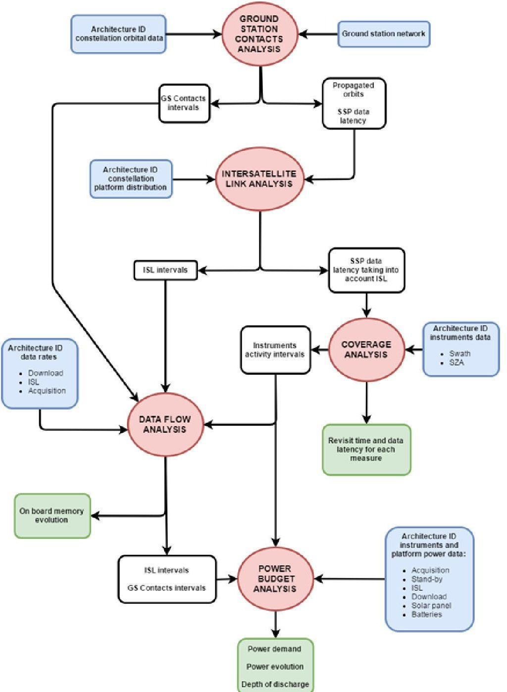

Fig. 2 Detailed Analysis for Pre-Selected Architecture Workflow.

The first stage of the detailed analysis is the ground station contact. In order to minimize the data latency, the ground station (GS) network, composed for this use-case of Svalbard and Inuvik GS's, has been chosen to guarantee one contact per orbit for all the considered orbital altitudes. This analysis defines the ground station contact intervals used in inter-satellite links (ISL), data flow and power budget analyses, and Sub-Satellite Point (SSP) data latency. ISL analysis is devoted to establish unidirectional communications between pairs of platforms in order to reduce the data latency of the sending satellite when the receiving one is in contact with a ground station. In addition to that temporal restriction, the inter-satellite link is also constrained by visibility (considering maximum distance constraints for each platform type and minimum grazing altitude) and platform restrictions (the two platforms must have compatible and available links). The ISL analysis produces as output the ISL sending and receiving time events, used in the data flow analysis, and the SSP latency with ISL, used to estimate the overall data latency. The coverage analysis computes the

<!-- PDF_PAGE: 14 -->

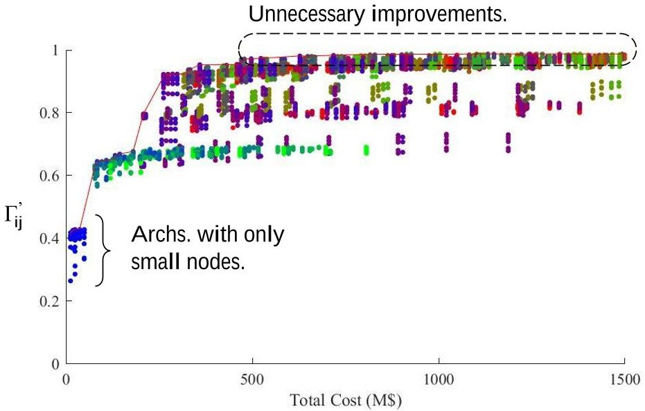

Fig. 3 Pareto front with Unmodified Figure-of-Merit vs. Cost.

revisit time and the data latency for each measurement. This computation is based on the instrument's characteristics and on the area of interest.

Knowing the intervals of instrument activity coming from the coverage analysis, the ground station contacts and ISL connections, it becomes possible to estimate the mass-memory evolution profile for each platform and to assess its feasibility in terms of data accumulation and maximum memory needed. Finally, the last stage of the detailed analysis is the power budget, which computes the platform power demand profile considering stand-by consumption, payloads acquisition intervals, GS contact and ISL communications in order to compare it with the power production profile and retrieve the battery depth of discharge (DoD) evolution.

## VI. Results

The complete design-space for the marine weather forecast use-case resulted in a set of 5586 architectures generated from 204 archetypal constellation configurations. The remainder of this paper is devoted to the analysis of results, both the ones obtained from coarse simulations and from high-fidelity performance analyses. All the plots presented below compare the architectures using their computed figures-of-merit, which encapsulate information about the architecture performances as well as high-level qualities and cost. Aside from the domains in which those figures of merit are represented in the plots, the color of each point in the series provides additional information about a certain characteristic: the distribution of small-, medium- and heavy-platforms within the architecture. Platform distribution is encoded with the three primary colors: red for heavy platforms, green for medium ones, and blue for small spacecraft. The additive combination of these, in the exact same proportion that is present in the architectures, will yield a particular color code. Thus, red-shaded points correspond to platforms with a large number of heavy platforms, while blue and green ones will correspond to higher percentage of small and medium platforms, respectively.

<!-- PDF_PAGE: 15 -->

## A. Results based on coarse performance analysis

Exploring the results, the Pareto front in Fig. 3 shows the relative score of each architecture with respect to the cost. The Y-axis corresponds to the unmodified figure-of-merit $ (\Gamma_{ij}) $ , i.e. the aggregation of weighted performance metrics. Costs in the scoring methodology are mostly affected by the number of nodes, and the platform class (with heavy platforms presenting notoriously higher development and launch costs.) If one only looks at performance metrics, many ONION architectures are scarcely improved by adding more nodes. The increase in costs does not seem to translate into meaningful improvements in score as long as the architectures satisfy the minimum use-case requirements. This insensibility to costs is actually justified by the metric normalization function, which assigns the same maximum value to those performance metrics that are equal or exceed the optimal requirements [24]. However, when qualitative modifiers are also considered, the ranking changes and clusters data into two separate groups. Figure 4a shows the same solution space and Pareto front and plots the overall score that does include the above-mentioned aggregated architectural qualities $ (A_{ij}\cdot\Gamma_{ij}^{\prime}) $ . In this case, architectures that do not encompass a SAR-X instrument (i.e. do not have heavy nodes) are not capable of providing data for all the use-case measurements (points labeled "A" in Fig. 4a). Although this effect was also reflected in their unmodified score, it is here emphasized due to the fact that some of their unsatisfied measurements are identified as critical in the use-case specification. As a result, the criticality of these architectures is much more reduced and their scores decrease dramatically.

On the other hand, Fig. 4b shows the relative ranking for the architectures with highest scores. The plot sorts architectures with their overall figures of merit (i.e. including the effects of cost, qualitative modifiers and performance metrics), and displays the best 100 solutions (labeled "B" in Fig. 4a.) In this case, one can observe that, while the number of nodes is not always constant, the distribution of platforms only presents three cases. These three platform distributions are identified in Fig. 4b with three distinctive colors. Constellations for the most optimal architectures are

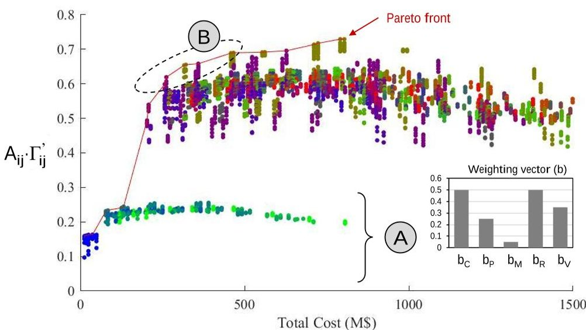

(a) Pareto front with Figure-of-Merit (with qualitative modifiers) vs. Cost.

Fig.4 Architecture scores.

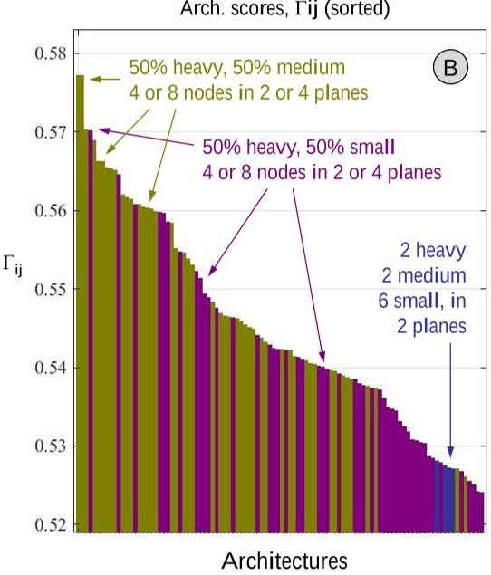

(b) Architecture ranking (best 100). Color indicates platform distribution.

<!-- PDF_PAGE: 16 -->

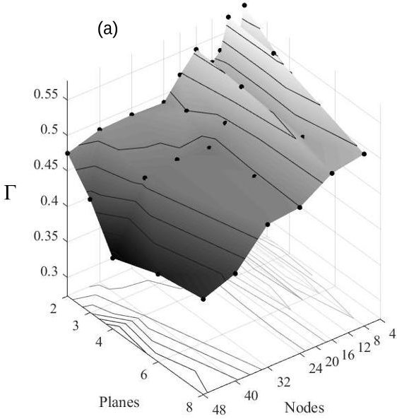

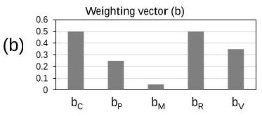

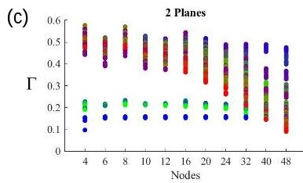

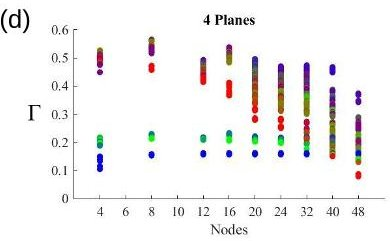

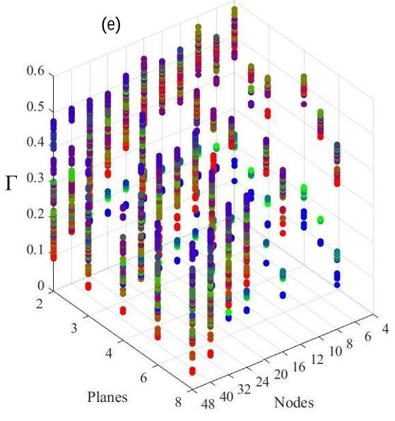

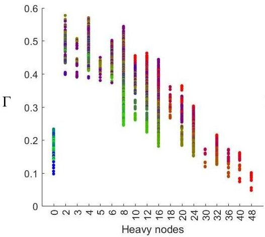

Fig. 5 Performance trends in the space Nodes-Planes.

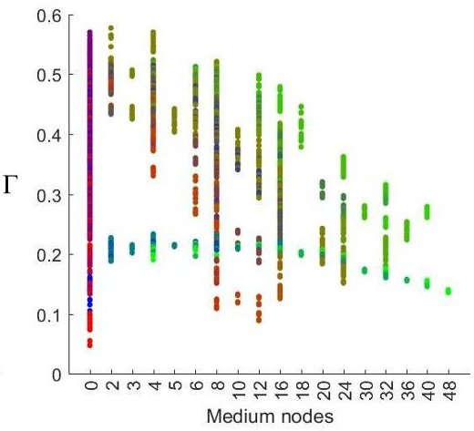

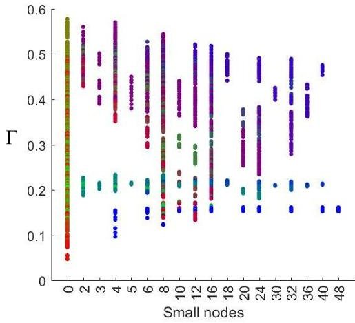

Fig. 6 Influence to the number of platforms of a given class.

designed with 2 or 4 heavy nodes plus 2 or 4 medium nodes. Their size is always 4 or 8 nodes and are distributed in 2 or 4 planes (points colored in ochre). However, architectures that replace medium nodes by small, CubeSat-like ones also constitute highly optimal solutions in this scenario (displayed in violet). These two configuration options dominate most of the architectures in the ranking in Fig. 4b. Designs lacking medium nodes are possible owing to the payload mass capacity of heavy nodes, which can host both the SAR-X instrument and the optical imager at the same time. When medium platforms (which host optical imagers and GNSS-R instruments) are replaced by small platforms, the optical imager tends to be allocated to the heavy platforms. This notwithstanding, within the first hundred solutions, one can also observe the presence of designs with 2 heavy nodes, 2 medium nodes and 6 small nodes. Distributed in 2 planes, these architectures could still be considered optimal, since they are within the best 1.8% design solutions.

Observing the performance trends in the space Nodes-Planes also provides additional insight about the design-space for this use-case. Fig. 5a depicts figure of merit values in the Z-axis as a surface generated from the maximum values of each point. Contour curves for this surface have been superimposed in the 2D plane (at z=0) to identify regions with similar scores. In the plot, one can find valleys in constellation configurations that yield poorer performance (i.e. 6 or

<!-- PDF_PAGE: 17 -->

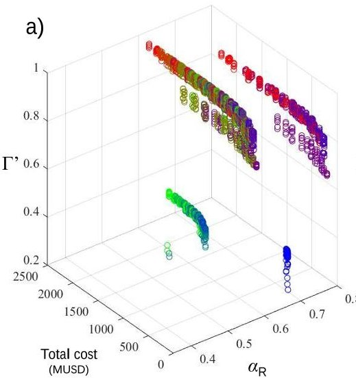

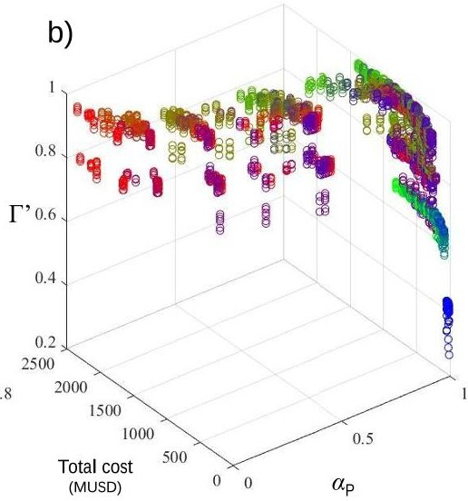

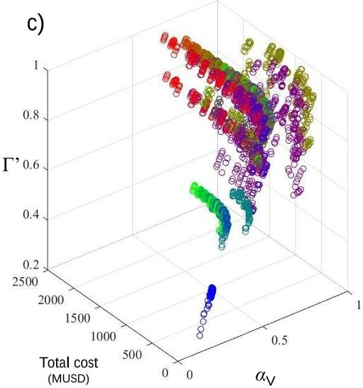

Fig. 7 Pareto frontier for partial trade spaces comprising cost, unmodified figures of merit $ (\Gamma^{\prime}) $ and a single qualitative attribute: a) data relevance, $ \alpha_{R} $ ; b) practicality, $ \alpha_{P} $ ; and c) versatility, $ \alpha_{V}. $

16 nodes seem to be a detrimental design choice). Counterintuitively, adding more nodes is not always a good choice, highlighting that, apart from the orbital configuration (either Walker Delta or Star patterns), constellation sizes and plane distribution do influence revisit times and latencies. Ultimately, it is also worth noting that the scores of architectures that are largely populated by heavy nodes (red-shaded points) tend to fall to lower parts of the plot as the number of nodes increases (Figs. 5c and 5d.) This effect of the cost model, which is much less intense in architectures with medium nodes and almost imperceptible in small nodes, causes large architectures (e.g. 40 or 48 nodes) to be effectively impractical, given that SAR-X nodes are essential for the use-case and they cannot be hosted in smaller platforms.

It is also worth pointing out how the number of nodes of a given platform class affects the figures of merit of architectures. Fig. 6 shows the overall figure of merit (i.e. with cost and qualitative modifiers applied) and displays the solutions with respect to the number of heavy (6a), medium (6b) and small (6c) platforms. The same conclusions observed at the beginning of this section can be clearly observed in Fig. 6a: architectures need at least 2 SAR-X instruments to become valuable solutions. Regardless of the fact that having a single heavy platform is not possible (because the minimum number of planes is 2, and they are forced to be homogeneous in number and type of their nodes), a specific revisit time analysis also confirmed that at least 2 SAR-X instruments were required to fulfill the requirements of the use-case.

## B. Values from qualitative evaluation

Section IV.C briefly introduced the list of qualitative modifiers implemented for the architecture evaluation process. These can be understood as attributes of the tradespace exploration (i.e. optimization variables) and can also be represented in Pareto plots. Three quality attributes are plotted independently in Fig. 7 to illustrate the assessment of some of the considered ilities. The evaluation of data relevance, practicality and versatility are shown along architectural costs and unmodified figures of merit in Fig. 7a, 7b, and 7c, respectively. Note that, since the vertical axis only corresponds to the aggregation of performance metrics $ (\Gamma^{\prime}) $ , it is easy to compare qualitative attributes (i.e. $ \alpha $ -values) with the two quantitative ones (i.e. cost and aggregated metrics). Like in [18], a Joint Pareto Set of designs exists along a

<!-- PDF_PAGE: 18 -->

surface that only includes Pareto-optimal designs (with trade-offs for three attributes rather than just two.) The complete tradespace simply cannot be represented for all the attributes at the same time, yet the individual representations in Fig. 7 still provide insight of qualitative trends for this use-case.

Arguably, three-dimensional data structures are difficult to appreciate in two-dimensional projections. The authors of [18] also proposed alternative two-dimensional representations for the same type of plots. In their case, plots showed utility, survivability, and cost. The former attribute could, in their case, be represented with a color code to allow for an easier interpretation of the results. This practice has not been applied in this case given that color codes are already indicative of some of the design decisions (i.e. platform size, instruments embarked) in this case. Noteworthy, plotting independent quality attributes allowed to understand their coupling both to quantitative attributes and to other ilities. Take for example the values of practicality and versatility $ (\alpha_{P}) $ : while an increase in cost seems to yield architectures with worse practicality, the designs presenting lower costs are also those with lower versatility. At the same time, these representations allow to identify different sensitivities to design choices: marker bands forming in Fig. 7a are indicative of an insensitivity to cost for data relevances, which is not the case for the other two qualities.

## C. Results from detailed architectural analysis

The first assessment of architecture performances and their ilities allowed to select a small set of 28 candidate architectures. It is important to note that this selection process was very much influenced by the weights assigned to each of the ilities and that different needs would have triggered the selection of a completely different set. Fig. 8 compares the actual value given to each ility (in blue) with the resulting figure when the weighting function (3) is applied (in orange).

Preliminary analyses yielded a reduced solution space. A final detailed analysis of architecture capabilities provided new performance metrics for the architectures, computed from refined spacecraft and payload models. This latter performance assessment did consider power and storage constraints in spacecraft, modeled inter-satellite links with platform-specific consumptions, datarates and antenna visibility constraints. For each platform type, the solar array areas and battery capacities were designed such that all the architectures could operate in nominal conditions (i.e.

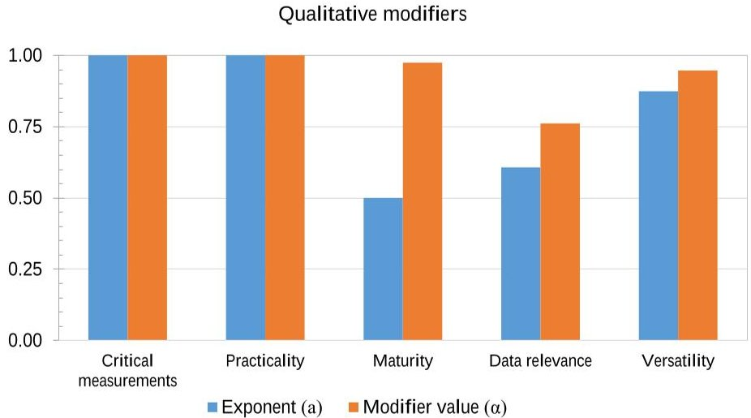

Fig. 8 Evaluation of quality attributes for the optimal architecture. Value from model (blue, a) and result after weighting function (orange, $ \alpha $.)

<!-- PDF_PAGE: 19 -->

Table 4 Results of the coarse performance analysis, for the optimal architecture.

<table border="1"><tr><td>Coarse performance metrics</td><td>Value</td></tr><tr><td>Revisit time(GNSS-R)[h]</td><td>3.917</td></tr><tr><td>Revisit time(Optical imager)[h]</td><td>3.050</td></tr><tr><td>Revisit time(SAR-X)[h]</td><td>1.417</td></tr><tr><td>Latency[min]</td><td>31.866</td></tr><tr><td>Initial unmodified figure of merit</td><td>0.94801</td></tr></table>

positive power budgets for each node). Similarly, the local time of the ascending node (LTAN) for each plane in the constellation was computed such that it maintained the configuration imposed by the decision variables and it provided the best power generation scenario. Noteworthy, selecting LTAN for each plane was not trivial in architectures in which heavy nodes encompassed, simultaneously, both the SAR-X instrument and the optical imager. This situation owed to the fact that optical instruments require specific lighting conditions that, in some cases, conflicted with the power requirements of SAR-X instruments.

While the coarse performance analysis provided revisit times for each individual instrument type, the refined simulation and analysis tool produced individual metrics for each measurement of the use-case. For both the revisit time and latency, both the maximum value and the mean one were computed by the analysis tool. Finally, the use of resources of each architecture was also reported in the form of battery depth-of-discharge (DoD) and data storage requirements (Table 4). While the latter was unconstrained and was not deemed critical for the selection, battery DoD was an important parameter to take into account. Also in this case, two figures were generated: the maximum DoD found all nodes (i.e. the global maximum DoD) and the average of all the individual DoD's. With all these figures, the most optimal architecture could ultimately be selected.

In general, the data flow and on-board data handling is not a critical point in any of the ONION pre-selected architectures because the area of interest is not very vast, the ground station contacts are frequent enough (once per orbit) and the platform's download data rates guarantee that no data is accumulated on-board. Due to ISL range limitations on small platforms (set to 400 km distance between the communicating platforms) and to the reduced available time to perform it (the receiving platform must be in contact with a ground station), the connectivity of the constellations is poor most of the time. Due to these communication constraints, the ISL does not improve the maximum data latency, which is around one orbital period, but the average data latency does benefit from it.

The coverage analysis has shown that when the required maximum revisit time goes below few hours, few architectures are able to fulfill it. In order to improve it, the number of instruments able to provide data for the more demanding measures should be increased. Nevertheless, the most critical aspect is the power budget, due to the varying illumination conditions along the different orbital planes of the same constellation, which highlights that a single design for the power subsystem is, most of the time, unable to provide enough power to all the spacecraft.

The selected architecture was configured in a Walker delta constellation orbiting at 807 km. It was composed of 16 nodes, distributed in 8 planes equally spaced in LTAN around $ 3 6 0^{\circ} $ (Fig. 9). Four of these planes encompassed heavy

<!-- PDF_PAGE: 20 -->

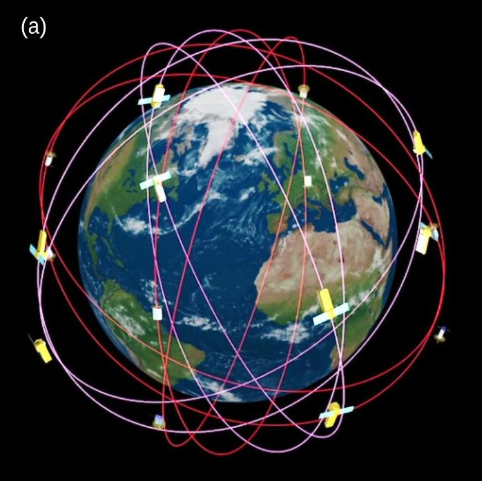

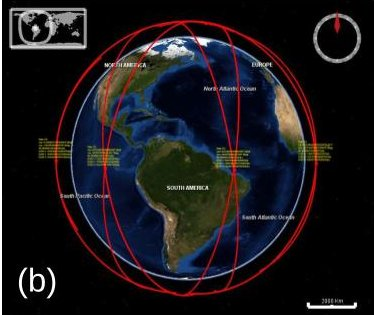

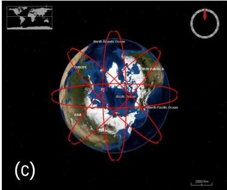

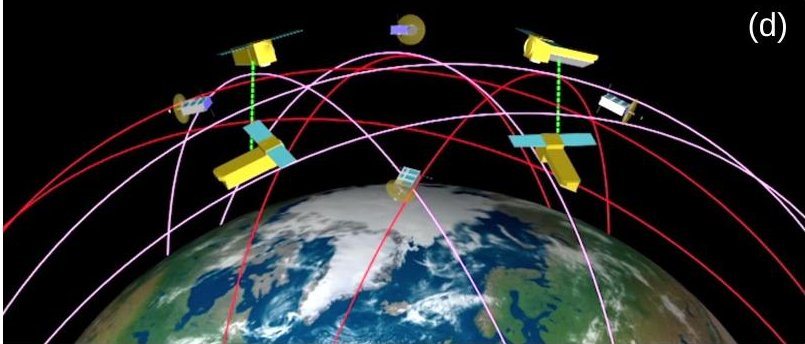

Fig. 9 Graphical representation of the optimal architecture.

Table 5 Resource assessment for the optimal architecture.

<table border="1"><tr><td>Resource</td><td>Variable</td><td>Value</td></tr><tr><td rowspan="2">Power(Depth of Discharge)</td><td>Max. global[%]</td><td>10.1%</td></tr><tr><td>Avg.of max.values[%]</td><td>4.9%</td></tr><tr><td rowspan="2">Data storage</td><td>Max. global[MB]</td><td>1009</td></tr><tr><td>Avg.of max.values[MB]</td><td>516</td></tr></table>

platforms with both SAR-X and optical imager, while the other four allocated small nodes with GNSS-R instruments. These two types of planes were alternatively distributed in the constellation. Inevitably, the design of this architecture is similar to that of the other candidates, given that they had been pre-selected from an initial analysis that already yielded a narrow solution space. For this architecture, the remainder of this section details the values of this final performance analysis.

Table 5 starts by gathering the computed metrics from the coarse analysis. These figures can be compared with those of Table 6, which encompasses mean and maximum figures for the same metrics, albeit the latter are individually computed for each measurement. Noteworthy, some of them differ (e.g. revisit times are actually higher) due to all the constraints enforced during the simulation and as a result of accurate payload modeling. The rightmost column in Table 6 (titled "W") corresponds to the normalized value, after the weighting function is applied to metrics. These same values are graphically represented in Figs. 10a and 10b, showing that this architecture is capable of satisfying revisit times for all measurements. However, data access latencies are only guaranteed for two measurements of this use-case. This situation is, for this use-case, strongly influenced by the use-case specifications and the location of ground stations. On the one hand, this use-case is focused on data products for Polar Regions, forcing datatakes to be performed in higher latitudes. In order to minimize latency, and with the constellation deployed as a set of polar orbits, the network of ground

<!-- PDF_PAGE: 21 -->

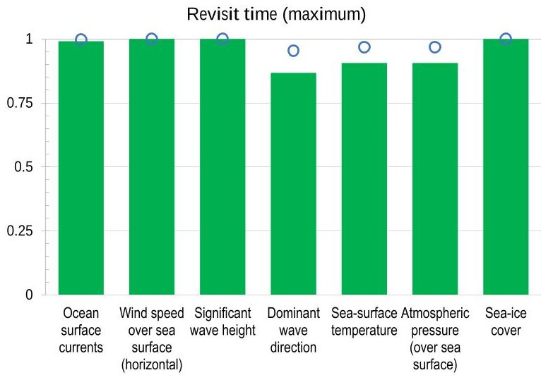

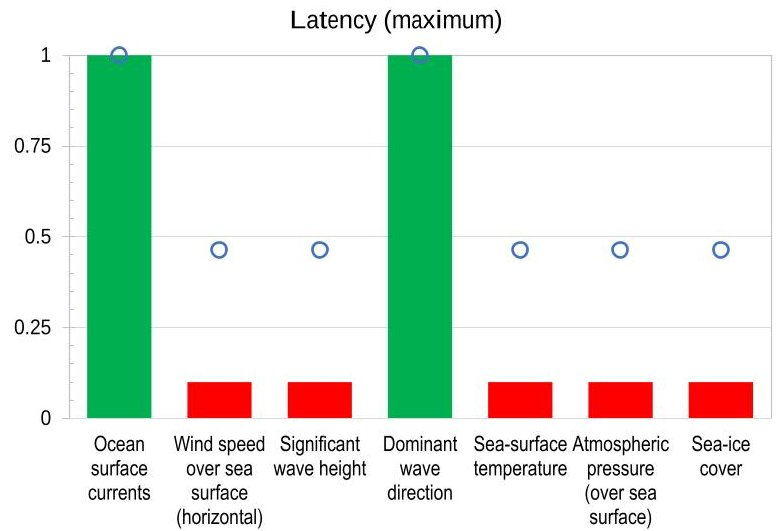

Fig.10 Refined performance metrics for the optimal architecture. Bars correspond to the normalized values; blue circle markers represent values after the weighting process.

stations is located also at higher latitudes. This forces data capture processes to be done while satellites are also in contact with ground segment. Thus, if inter-satellite links are only enabled when the receiver has established a link with ground, architectures either download their data at the Earth poles (directly or indirectly through ISL), or need to wait an orbital period until their ISL's can be enabled again. In the second case, the latency increases and is approximately 87 min. Certainly, this situation can only be observed in maximum figures of latency, while average latencies are always satisfied. Regardless of this situation, which is also reproduced in all the other candidate architectures, the selected design exhibited high scores in its worst-case figure-of-merit (computed with maximum values instead of average ones).

## VII. Next steps

OASF has been presented as a methodology to explore design trends and optimize architecture selection for distributed Earth-observing satellite systems. The results have shown how the application of this methodology can yield a selection based on both qualitative and quantitative criteria. This selection process is coupled to several simulation and estimation tools, namely: a simulator to obtain coarse performance metrics; a launch cost estimator (not addressed in this paper); and a tool to obtain refined performance metrics and carry out analysis of resource budgets. Similarly, the methodology instance applied to marine weather use-case was tied to five models to evaluate qualitative properties. Some of the next steps of OASF concern improvements on the tool suite, and others suggest future strands of work in the modeling of qualitative modifiers.

A set of five ilities were required for the study conducted under the ONION project. One of such ilities was maturity, which quantified the presence of emergent instrument techniques among early design decisions. The model essentially aggregated binary labels that were assigned to each instrument (i.e. either mature or not.) This simplification was supported by the assumption that platforms or spacecraft technologies should not contribute to this assessment, implying that maturity only referred to the system's functional capacities. However, this assumption could preclude OASF from generating meaningful designs at short term (i.e. because immature technologies have been assumed but are not currently plausible at an acceptable risk.) One of such technologies is related to inter-satellite communications in small

<!-- PDF_PAGE: 22 -->

Table 6 Refined performance metrics for the optimal architecture.

<table border="1"><tr><td>Use-case parameter</td><td>Performance metrics</td><td>Value</td><td>Norm.</td><td>W</td><td>Use-case parameter</td><td>Performance metrics</td><td>Value</td><td>Norm.</td><td>W</td></tr><tr><td rowspan="4">Ocean surface currents</td><td>Max. Revisit time [h]</td><td>7.017</td><td>0.991</td><td>0.997</td><td rowspan="4">Surface temperature</td><td>Max. Revisit time [h]</td><td>10.672</td><td>0.906</td><td>0.968</td></tr><tr><td>Avg. Revisit time [h]</td><td>2.110</td><td>1.000</td><td>1.000</td><td>Avg. Revisit time [h]</td><td>0.454</td><td>1.000</td><td>1.000</td></tr><tr><td>Max. Latency [min]</td><td>0.000</td><td>1.000</td><td>1.000</td><td>Max. Latency [min]</td><td>83.050</td><td>0.100</td><td>0.464</td></tr><tr><td>Avg. Latency [min]</td><td>2.10^{-5}$</td><td>1.000</td><td>1.000</td><td>Avg. Latency [min]</td><td>3.7.10^{-4}$</td><td>1.000</td><td>1.000</td></tr><tr><td rowspan="4">Wind speed over sea surface</td><td>Max. Revisit time [h]</td><td>2.533</td><td>1.000</td><td>1.000</td><td rowspan="4">Atmospheric pressure</td><td>Max. Revisit time [h]</td><td>10.672</td><td>0.906</td><td>0.968</td></tr><tr><td>Avg. Revisit time [h]</td><td>0.670</td><td>1.000</td><td>1.000</td><td>Avg. Revisit time [h]</td><td>0.454</td><td>1.000</td><td>1.000</td></tr><tr><td>Max. Latency [min]</td><td>87.820</td><td>0.100</td><td>0.464</td><td>Max. Latency [min]</td><td>83.050</td><td>0.100</td><td>0.464</td></tr><tr><td>Avg. Latency [min]</td><td>1.083</td><td>1.000</td><td>1.000</td><td>Avg. Latency [min]</td><td>3.7.10^{-4}$</td><td>1.000</td><td>1.000</td></tr><tr><td rowspan="4">Significant wave height</td><td>Max. Revisit time [h]</td><td>2.533</td><td>1.000</td><td>1.000</td><td rowspan="4">Sea-ice cover</td><td>Max. Revisit time [h]</td><td>2.533</td><td>1.000</td><td>1.000</td></tr><tr><td>Avg. Revisit time [h]</td><td>0.670</td><td>1.000</td><td>1.000</td><td>Avg. Revisit time [h]</td><td>0.414</td><td>1.000</td><td>1.000</td></tr><tr><td>Max. Latency [min]</td><td>87.820</td><td>0.100</td><td>0.464</td><td>Max. Latency [min]</td><td>87.820</td><td>0.100</td><td>0.464</td></tr><tr><td>Avg. Latency [min]</td><td>1.083</td><td>1.000</td><td>1.000</td><td>Avg. Latency [min]</td><td>0.481</td><td>1.000</td><td>1.000</td></tr><tr><td rowspan="4">Dominant wave direction</td><td>Max. Revisit time [h]</td><td>7.017</td><td>0.867</td><td>0.954</td><td rowspan="4"></td><td rowspan="4"></td><td rowspan="4"></td><td rowspan="4"></td><td rowspan="4"></td></tr><tr><td>Avg. Revisit time [h]</td><td>2.110</td><td>1.000</td><td>1.000</td></tr><tr><td>Max. Latency [min]</td><td>0.000</td><td>1.000</td><td>1.000</td></tr><tr><td>Avg. Latency [min]</td><td>2.10^{-5}$</td><td>1.000</td><td>1.000</td></tr></table>

spacecraft. Recent advances seem to suggest the feasibility of ISL between small-spacecraft $ ^{\dagger} $ . Similarly, the feasibility of optical inter-satellite links for small spacecraft has been partially demonstrated in a recent experimental setup [26]. The work presents a practical implementation of an adaptive, high-speed, optical link that could be suitable for small satellite applications. Nevertheless, as promising as the results are, this technology still presents a design uncertainty that can be modeled through the maturity modifier. In addition to consider such design characteristics in the maturity model, their evaluation would also benefit from the use of TRL descriptors. Relying upon TRL would improve the granularity of the attribute and would allow for a forward-looking assessment in which estimated TRL levels could be considered for systems planned for future horizons.

In addition to that, further qualitative aspects could be modeled which have not been addressed in the current application of the OASF methodology. Modifiers concerned with life-cycle perturbations, such as design robustness (i.e. sensitivity to changes in context or needs) or functional robustness (i.e. performance degradation) would be beneficial to some case studies. Moreover, optimizing architectures based on the dynamic nature of the design can also be interesting in DSS, given the obvious likelihood of incremental deployment schemes. Incorporating evolvability in the vector of quality attributes, could enhance the design decisions by finding systems that either maximize early value (i.e. as the system is deployed) or maintain an acceptable merit as the system is decommissioned (i.e. graceful degradation.)

In regards to the tool suite, further strands of work are considering the development of an integral architecting analysis and simulation tool that implements OASF in its core but which is also capable of automatically identifying suitable instrument technologies and design rules. This very aspect should enhance the applicability of OASF to

<!-- PDF_PAGE: 23 -->

general-purpose cases or future user needs. Despite OASF has also been tested under different EO uses-cases that required distributed satellite constellations in ONION, the instrument selection and the set of feasible combinations and their constrains has been solved during preliminary analyses. Deriving suitable and optimal instruments by considering densely populated knowledge bases (e.g. OSCAR) is a complex endeavor that needs further exploration beyond the current state-of-the-art.

Finally, the authors also acknowledge the lack of a CER capable of delivering reliable costs for small spacecraft platforms. Albeit the purpose of this work was not to derive new and improved CERs, future applications of this or similar frameworks should be aware of the need of improvements in these regards.

## VIII. Conclusions

This paper presented the results of an architectural selection framework that was specifically designed to return the most optimal DSS architecture for a given Earth observation application. Based on an exhaustive exploration of the design space, this design-oriented methodology has been able to find the optimal constellation configuration that satisfies the user requirements and presents some qualities. Architecture designs are characterized by their altitude, number of nodes, distribution in planes and a given Walker pattern. In addition, the architecture generation process also assigns a set of relevant instruments to each node (i.e. satellite in the network). Based on the required mass capacity, each node is implemented with a platform of a different class: heavy, medium or small (CubeSat-like). Thus, the architecture optimization not only deals with architectures with constellations of heterogeneous instrument technologies, but it also considers architectures composed of heterogeneous satellite platforms that share the same mission goals and engage in a distributed and networked data acquisition process. Finally, the methodology summarized in this paper assesses the goodness of solutions based upon an aggregated figure of merit that encompasses architecture performances, development and launch costs and system-wide quality attributes (i.e. ilities)

The results of this methodology and assessment have been explored in this paper from two different standpoints. On the one hand, the exploration of the design space has been analyzed in its completeness to understand the effects of some decision variables. In order to understand their influence, all the solutions have been studied by comparing their individual figures of merit. The design space showed a clear improvement in architecture scores for those architectures composed mainly of 2, 4 or 8 heavy platforms and complemented by a similar number of medium or small platforms. The ilities of the generated architectures have been quantified and their strong influence in the scores has been emphasized in this paper. Ultimately, this optimization framework has been capable of narrowing the solution space to a small set of architectures not only by selecting designs with higher performances and lowest costs, but also by adjusting the impact of some ilities over the others.

On the other hand, this paper also presented the results of a detailed performance analysis that was performed for the reduced set of candidate architectures, pre-selected in the previous exploration. This second analysis provided finer metrics and an insight on the resource consumption for the candidate architectures (i.e. battery Depth-of-Discharge and accumulated data storage on-board), and ultimately allowed to choose the most optimal design.

<!-- PDF_PAGE: 24 -->

## Funding Sources

The framework and study presented in this paper was carried out in the frame of the Operational Network of Individual Observation Nodes (ONION) project, and it has received funding from the European Union's Horizon 2020 research and innovation program under grant agreement 687490, coordinated by Thales Alenia Space France.

## References

[1] Selva, D., and Krejci, D., "A survey and assessment of the capabilities of Cubesats for Earth observation," Acta Astronautica, Vol. 74, 2012, pp. 50-68.

[2] Poghosyan, A., and Golkar, A., "CubeSat evolution: Analyzing CubeSat capabilities for conducting science missions," Progress in Aerospace Sciences, Vol. 88, 2017, pp. 59-83. doi:10.1016/j.paerosci.2016.11.002.

[3] Woellert, K., Ehrenfreund, P., Ricco, A. J., and Hertzfeld, H., "Cubesats: Cost-effective science and technology platforms for emerging and developing nations," Advances in Space Research, Vol. 47, No. 4, 2011, pp. 663-684.

[4] Selva, D., Golkar, A., Korobova, O., Lluch, I., Collopy, P., and de Weck, O., "Distributed Earth Satellite Systems: What Is Needed to Move Forward?" Journal of Aerospace Information Systems, Vol. 14, No. 8, 2017, pp. 412-438.

[5] Ross, A. M., Hastings, D. E., Warmkessel, J. M., and Diller, N. P., "Multi-Attribute Tradespace Exploration as Front End for Effective Space System Design," Journal of Spacecraft and Rockets, , No. 1, 2004. doi:10.2514/1.9204.

[6] de Weck, O., de Neufville, R., and Chaize, M., "Staged deployment of communications satellite constellations in low earth orbit," Journal of Aerospace Computing, Information, and Communication, Vol. 1, No. 3, 2004, pp. 119-136.

[7] Sanchez-Net, M., del Portillo, I., Cameron, B., Crawley, E. F., and Selva, D., "Integrated Tradespace Analysis of Space Network Architectures," Journal of Aerospace Information Systems, , No. 8, 2015. doi:10.2514/1.I010356.

[8] Selva, D., and Crawley, E. F., "VASSAR: Value assessment of system architectures using rules," 2013 IEEE Aerospace Conference, 2013, pp. 1-21.

[9] Nag, S., Gatebe, C. K., and Hilker, T., "Simulation of multiangular remote sensing products using small satellite formations," IEEE Journal of Selected Topics in Applied Earth Observations and Remote Sensing, Vol. 10, No. 2, 2017, pp. 638-653.

[10] Ross, A. M., and Hastings, D. E., "The Tradespace Exploration Paradigm," INCOSE International Symposium, Vol. 15, No. 1, 2005, pp. 1706-1718. doi:10.1002/j.2334-5837.2005.tb00783.x.

[11] Le Moigne, J., Dabney, P., de Weck, O., Foreman, V., Gorgan, P., Holland, M., Hughes, S., and Nag, S., "Tradespace Analysis Tool for designing Constellations (TAT-C)," 2017 IEEE International Geoscience and Remote Sensing Symposium, 2017.

[12] Lluch, I., and Golkar, A., "Design Implications for Missions Participating in Federated Satellite Systems," Journal of Spacecraft and Rockets, Vol. 52, 2015, pp. 1361-1374. doi:10.2514/1.A33172.

[13] Nag, S., Gatebe, C. K., Miller, D. W., and de Weck, O. L., "Effect of satellite formations and imaging modes on global albedo estimation," Acta Astronautica, Vol. 126, 2016, pp. 77-97.

<!-- PDF_PAGE: 25 -->

[14] McGhan, C. L., Vaquero, T., Subrahmanya, A. R., Arslan, O., Murray, R., Ingham, M. D., Ono, M., Estlin, T., Williams, B., and Elaasar, M., "The Resilient Spacecraft Executive: An Architecture for Risk-Aware Operations in Uncertain Environments," AIAA SPACE 2016, 2016, p. 5541.

[15] Nag, S., Hughes, S. P., and Le Moigne, J., "Streamlining the Design Tradespace for Earth Imaging Constellations," AIAA SPACE Conferences and Exposition, 2016.

[16] Ross, A. M., and Hastings, D. E., "Assessing Changeability in Aerospace Systems Architecting and Design Using Dynamic Multi-Attribute Tradespace Exploration," AIAA SPACE Conferences and Exposition, 2006.

[17] Ricci, N., Fitzgerald, M. E., Ross, A. M., and Rhodes, D. H., "Architecting Systems of Systems with Ilties: an Overview of the SAI Method," Procedia Computer Science, Vol. 28, 2014, pp. 322-331. Part of special issue: 2014 Conference on Systems Engineering Research.

[18] McManus, H., Richards, M., Ross, A., and Hastings, D., "A Framework for Incorporating "ilities" in Tradespace Studies," AIAA SPACE 2007 Conference & Exposition, 2007, pp. 941-954.

[19] Rader, A. A., Ross, A., and Fitzgerald, M. E., "Multi-Epoch Analysis of a Satellite Constellation to Identify Value Robust Deployment across Uncertain Futures," AIAA SPACE 2014 Conference & Exposition, 2014, pp. 941-954.

[20] Lluch, I., and Golkar, A., "The Value Proposition of Novel Distributed Space Systems: A Literature Survey on Ilties," $ 3^{rd} $ Federated Satellite Systems Workshop, 2015.

[21] Aschbacher, J., and Milagro-Perez, M. P., "The European Earth monitoring (GMES) programme: Status and perspectives," Remote Sensing of Environment, Vol. 120, 2012, pp. 3-8.

[22] Matevosyan, H., Lluch, I., Poghosyan, A., and Golkar, A., "A Value-Chain Analysis for the Copernicus Earth Observation Infrastructure Evolution: A Knowledgebase of Users, Needs, Services, and Products," IEEE Geoscience and Remote Sensing Magazine, Vol. 5, No. 3, 2017, pp. 19-35. doi:10.1109/MGRS.2017.2720263.

[23] Reising, S. C., Gaier, T. C., Kummerow, C. D., Chandrasekar, V., Brown, S. T., Padmanabhan, S., Lim, B. H., van den Heever, S. C., L'Ecuyer, T. S., Ruf, C. S., Haddad, Z. S., Luo, Z. J., Munchak, S. J., Koch, T. C., and Boukabara, S. A., "Temporal Experiment for Storms and Tropical Systems Technology Demonstration (TEMPEST-D)," NASA Earth Science Technology Forum, 2015.

[24] Araguz, C., Llaveria, D., Lancheros, E., Bou-Balust, E., Camps, A., Alarcón, E., Lluch, I., Matevosyan, H., Golkar, A., Tonetti, S., Cornara, S., Cote, J., Pierotti, S., Rodríguez, P., Alvaro, A., Sochacki, M., and Narkiewicz, J., "Optimized model-based design space exploration of distributed multi-orbit multi-platform Earth observation spacecraft architectures," 2018 IEEE Aerospace Conference, 2018.

[25] Mirshams, M., Samani, M., and Darabi, A., "Cost and mass estimation model of small satellites at system design level," 5th IAA Symposium on Small Satellites for Earth Observation, 2005.

[26] Briatore, S., Akhtyamov, R., and Golkar, A., "Design and flight test results of high speed optical bidirectional link between stratospheric platforms for aerospace applications," Proceedings of SPIE, Laser Communication and Propagation through the Atmosphere and Oceans VI, Vol. 10408, 2017. doi:10.1117/12.2273808.