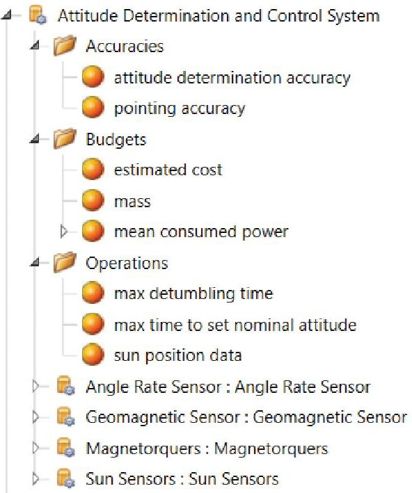
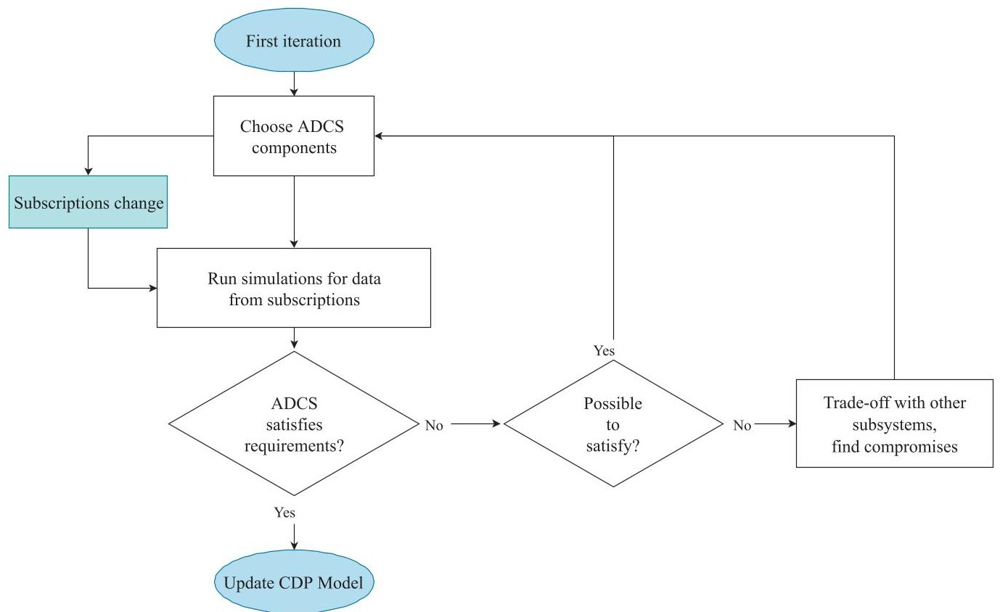
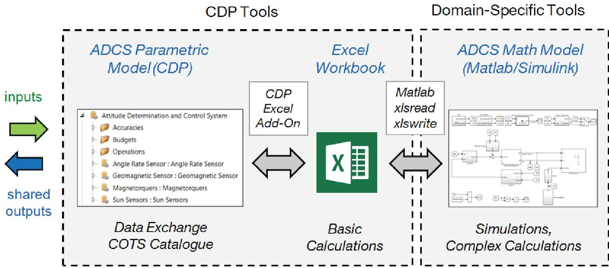
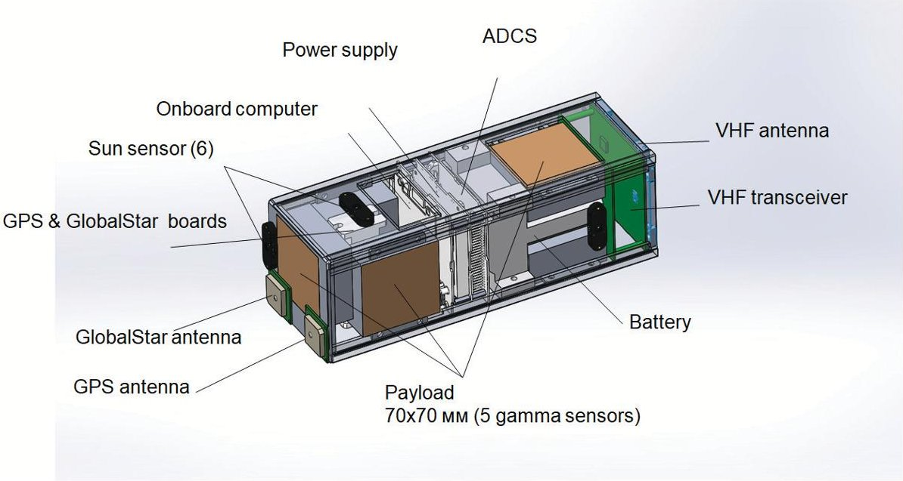
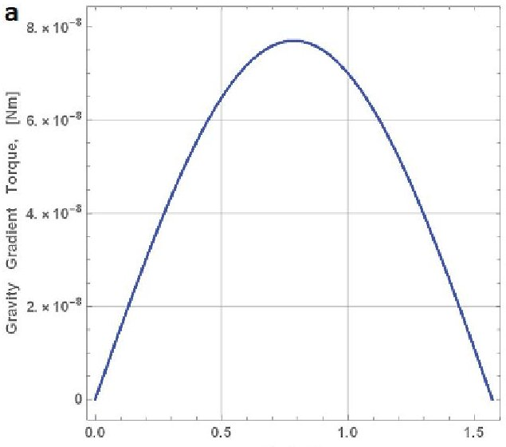
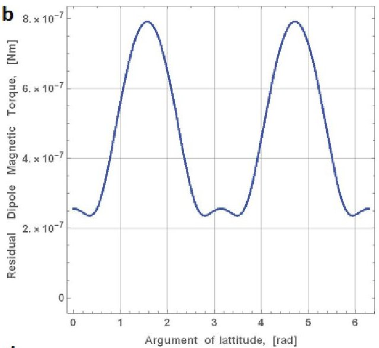
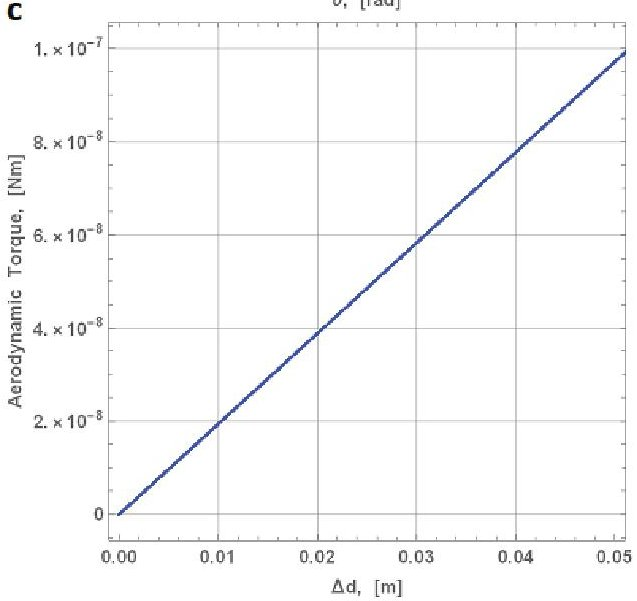
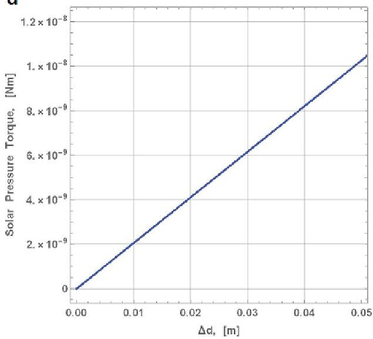
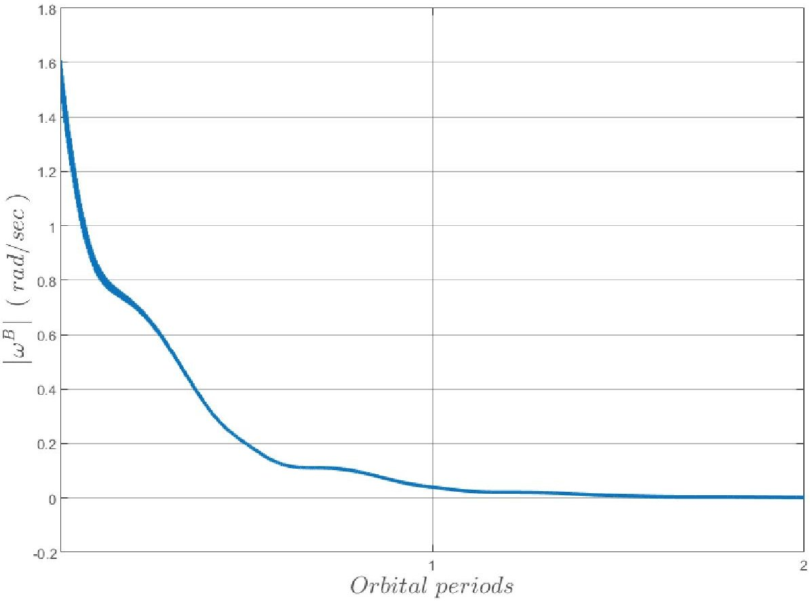
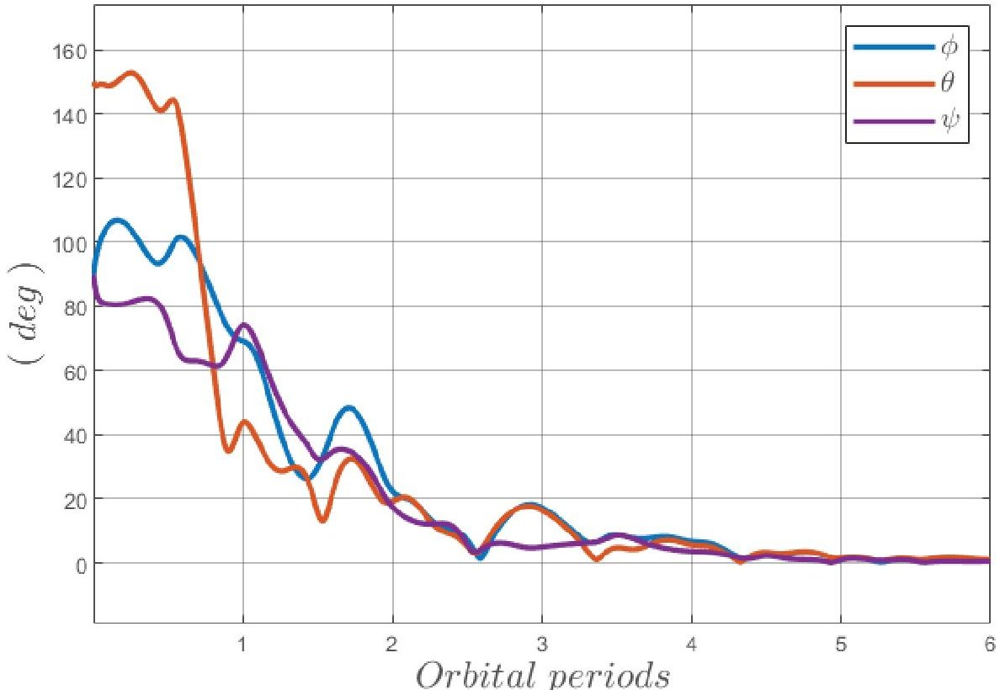

<!-- PDF_PAGE: 1 -->

RESEARCH ARTICLE | NOVEMBER 15 2019

# Cubesat ADCS model for preliminary design procedures within a concurrent design approach

A. Annenkova ; S. Biktimirov; K. Latyshev; A. Mahfouz; P. Mukhachev; D. Pritykin

AIP Conf. Proc. 2171, 140005 (2019)

https://doi.org/10.1063/1.5133295

## Articles You May Be Interested In

Land classification with color features and super pixels using drone and cube sat images

AIP Conf. Proc. (April 2025)

Snezhinka (snowflake) student stratospheric flying vehicle

AIP Conf. Proc. (November 2019)

Building trans-national and multi-disciplinary academic curricula through adaptation of a project-based approach

AIP Conf. Proc. (November 2019)

<!-- PDF_PAGE: 2 -->

# Cubesat ADCS Model For Preliminary Design Procedures Within a Concurrent Design Approach

A. Annenkova $ ^{1,2,\mathrm{a}} $), S. Biktimirov $ ^{1} $, K. Latyshev $ ^{1} $, A. Mahfouz $ ^{1} $, P. Mukhachev $ ^{1} $ and D. Pritykin $ ^{1} $

$ ^{1} $Space Center, Skolkovo Institute of Science and Technology, 30 bld.1 Bolshoy Boulevard, Moscow, Russia 121205, Russian Federation

$ ^{2} $Moscow Institute of Physics and Technology, 9 Institutskiy per., Dolgoprudny, Moscow Region, 141701, Russian Federation

a) Corresponding author: annenkova.ayu@phystech.edu

Abstract. An attitude determination and control system (ADCS) model is presented, which is used for CubeSat preliminary design stages in accordance with the European Space Agency (ESA) concurrent design approach. The model is implemented in Matlab/Simulink and integrated into the Concurrent Design Platform. The model's performance is exemplified by a mission preliminary design conducted in the Concurrent Engineering Lab at Skoltech.

## INTRODUCTION

Product design always has to deal with its complexity as well as high-level requirements of cost, quality and time to market. Traditionally these problems are addressed by maintaining documents that make the requirements and architecture explicit. However, more often than not, requirements and design change and the documents need to be rewritten and reviewed. Tracking the changes, keeping the documents consistent and up to date appeared to be quite expensive and error-prone. As a result, it is increasingly difficult to capture and trace the requirements from all the stages in system lifecycle during the development.

It has been speculated that 75% of the manufacturing cost is committed early in the design process [1]. So capturing and evaluating the requirements as early as possible is essential in order to correctly estimate compliance with and fulfillment of high-level requirements. Unfortunately, traditional systems engineering practices frequently led to many changes on later stages of product development. Such changes often require major subsystem redesign and sometimes influence other subsystems. That makes any late corrections very expensive in terms of time and costs.

The term "concurrent engineering" (CE) has first appeared in 80's to denote the design principles to meet consumer needs in shorter time, lower costs and fewer errors. The main idea of concurrent engineering was to design downstream processes along with the system itself as early as possible in the system's lifecycle.

In the last two decades this approach was adopted by aerospace industry. ESA [2] and NASA [3] have begun to conduct preliminary mission design using CE approach in multidisciplinary teams that involved different specialists as well as customers. Many NASA divisions [4], ESA [5], Airbus [6] as well as some universities (see [7] and [8]) built Concurrent Design Facilities and equipped them with software to support information exchange during the design process. The approach has proven to be successful in aerospace engineering throughout the world's leading agencies by significantly shortening the design time and effort.

Concurrent design is usually performed with the use of software that enables efficient information sharing between the team members. One of the critical features of that software is the ability to interact with different development environments. In this paper we will describe a model of satellite ADCS and the way it is integrated into the collaborative software. In section one we outline the concurrent design approach. In section two we recall the trade-offs the ADCS team makes with the other subsystems during the concurrent design iterations. Section three briefly describes the Simulink model used to make the estimates necessary during the concurrent design sessions.

<!-- PDF_PAGE: 3 -->

Finally, section four showcases an example of the model's usage in a project conducted in the Skoltech Space Center Concurrent Engineering Lab.

## THE CONCURRENT DESIGN APPROACH

The main idea of concurrent design is to introduce as much relevant information as possible into the design process, which is essential for early stages of development. Project leader gathers a multidisciplinary team for the session to build a common model of the product or to provide a particular insight by refining the model. Because of a great number of decisions made, the CD studies are usually performed in specially designed facilities with the aid of computer software.

So, there are five main pillars of concurrent engineering [9]:

1. Multidisciplinary team;

2. Sessions, conducted by a team leader with the participation of different stakeholders;

3. Integrated design model;

4. Facility;

5. Software and hardware.

During the process of CE, teams of different domains meet together to discuss possibilities and constraints from many points of view [10] in order to increase model precision and capture all the requirements. The team members for CD study shall include all the relevant professionals and stakeholders representatives to achieve a particular goal for the session. The team is expected to prepare in advance a model of their subsystem which will allow to recalculate the parameters and provide the feedback on a design proposal as quickly as possible.

The software ensures rapid information exchange between the participants of the study and gives the control of mission parameters to a systems engineer. Therefore, it enables systems engineer to influence the decision process in case of conflicts between subsystems or interference with mission performance parameters. This way concurrent engineering approach balances and widely distributes tasks across team members and enables their simultaneous involvement into the process.

Concurrent design process is iterative in its nature. The team starts with rough models and rough parameter estimates and elaborates them from session to session in order to confirm or deny a particular hypothesis or to provide more accurate parameter estimate. Usually a goal for a particular session is announced in advance to increase the collaboration efficiency. Studies [11] show that concurrent design is more productive in comparison with a traditional design approach.

One of the most important goals for concurrent design sessions is the preparation of budget sheet, which shows whether the system is balanced properly, where additional attention may be required, etc. The most important budget sheets are mass, power, link and cost, as they significantly influence end-user service satisfaction.

Since any project requires engineering modeling and team interaction, concurrent design is the main approach used in Skoltech Space Center, which helps to assess different metrics of a project. Thus, preliminary design comes to models refinement in order to produce more accurate budget sheets as well as interface control specifications, where necessary. To facilitate the process it was chosen to use CDP4[12] software, which is generally a database of labeled parameters based on [13]. The standard defines data storage and communication ways for European space agencies. The software allows to define different roles and groups of users with different permissions that allow much flexibility in team structure. Generally, systems engineer has the control over all the parameters and has to approve all the changes to the model.

The software supports the interaction with different modeling software and programming languages, such as Excel and MatLab, which are readily available at universities. Our input presented in this work is an implementation of ADCS model integrated into the CDP and thus made an instrument for the concurrent design procedure.

## CONCURRENT DESIGN PROCEDURE: SATELLITE ADCS TEAM VIEWPOINT

This work exemplifies the concurrent design approach from the viewpoint of a team responsible for designing the ADCS subsystem of a CubeSat. As it was stated earlier, the objective of the concurrent design procedure is to develop a consistent parametric model which would effectively capture the most crucial parameters defining the overall system

<!-- PDF_PAGE: 4 -->

design. Refining the model through the concurrent design iterations, the design team comes from the top-level requirements to more or less accurate estimates of the system's most important budgets, defines its concept of operation and establishes its feasibility.

In CD software, the parametric model of the system is usually represented as a tree of parameters populated with values. Each subsystem is encoded by the corresponding subset of parameters (a branch of the tree). An example of the ADCS representation modeled in the CDP as part of this project is shown in Fig.1.

The ADCS design process is clearly delineated in classical textbooks on space mission analysis and design [14] and includes the following steps:

- define control modes;

- define or derive system-level requirements by control mode;

- select type of spacecraft control by attitude control mode;

- quantify disturbance environment;

- select and size ADCS hardware (sensors and actuators);

- define determination and control algorithms;

- iterate and document.

FIGURE 1. ADCS representation in CDP

Within the concurrent design approach, these steps are implemented by the ADCS team each time the corresponding inputs from other subsystems are changed (see Fig. 2). To track the changes in other subsystems' parameters influencing the ADCS design (the inputs), the CDP uses the mechanisms of subscriptions. A subscription is tied to the parameter of interest (which is a part of the overall system model) and automatically informs the ADCS team whenever this parameter has been changed. The list of subscriptions established by the ADCS team in the beginning of the design process basically connects the ADCS parametric model to the parametric models of other subsystems and coordinates the data exchange.

With every new hypothesis or a principal parameter update, the ADCS team goes through every design step, checking whether any changes should be made to the previous solution and whether the selected solution allows meeting the mission's requirements. Along with the higher level requirements that come from the mission design team or from the payload team, there are also certain trade-offs that the ADCS makes with other subsystems. These trade-offs are summarized in the Table 1 and include some very common dependencies [14] as well as certain data exchange routines that the authors encountered in their practice. For instance, Power-ADCS data exchange list contains the "bus voltage" parameter, whose value is communicated to the ADCS subsystem by the power subsystem. Vice versa, the ADCS subsystem notifies the power subsystem of the power consumption for each of the defined modes. This

<!-- PDF_PAGE: 5 -->

FIGURE 2. ADCS team operations

exchange is straightforward, and relatively accurate estimates can be obtained based on the specifications of the chosen hardware. However, in case of other parameters, the data exchange may not be as simple. For example, an estimation of the average time each of the solar panels is lit by the Sun as the satellite is orbiting the Earth is hardly obtained merely through an expert's opinion and usually requires multiple simulations. Nevertheless, this particular estimate is important in the early design stages, as it may determine such critical structure design decision as whether the satellite must have deployable solar panels, which, in turn, substantially affects other subsystems.

Furthermore, adequate estimates of the ADCS own performance characteristics that can be achieved for different sets of sensors and actuators require running simulations as well. Hence, an additional means which would allow such simulations is needed to support the concurrent design procedures. In order to provide this computational capability, we developed a Matlab/Simulink ADCS model and integrated it with the parametric CDP ADCS model. The Matlab/Simulink model allows testing multiple hypotheses and examining multiple sets of parameters coming from the CDP model. The integration of the models allows automatic data exchange between them.

## ADCS SIMULINK MODEL AND ITS INTEGRATION WITH CDP

The model is essentially subdivided into the following five blocks.

The Spacecraft Dynamics block, which is responsible for the integration of the orbital and rotational dynamics differential equations. The orbital motion model is reduced to the propagation of the Keplerian motion with the possible inclusion of the nodal precession due to the second harmonics of the geopotential. All other factors that influence the orbit evolution are neglected here, because the time, which it takes for this evolution to become significant, is much greater than the characteristic time sufficient to estimate the ADCS performance. The rotational dynamics model includes the Euler equations for the rigid body dynamics and the quaternion Poisson equation:

$$
\mathbb {J} \dot {\omega} + \omega \times \mathbb {J} \omega = T ^ {e x t} + T ^ {c t r l}, \quad \dot {q} = \frac {1}{2} q \circ \omega ,
$$

where q is the spacecraft attitude quaternion and $ \omega $ is its angular velocity. The $ T^{ext} $ and $ T^{ctrl} $ in the right-hand side of

<!-- PDF_PAGE: 6 -->

TABLE 1. Subsystems and Mission requirements interaction with ADCS

<table border="1"><tr><td>Subsystem</td><td>ADCS Input</td><td>ADCS Output</td></tr><tr><td>Mission</td><td>OrbitLifetimeNavigation data requiredModes of operationDetermination accuracyPointing accuracySlewing requirements</td><td>Active or passive controlDetumbling timeDetermination accuracyPointing accuracySlewing requirements are met</td></tr><tr><td>Payload</td><td>Modes of operationAttitude zone avoidance</td><td>Requirements are met</td></tr><tr><td>Structure</td><td>Center of massInertia tensorDeployable solar panelsStructure&#x27;s magnetic dipoleActuators&#x27; locationSensors&#x27; mounting</td><td>Center of mass constraintsInertia tensor constraintsFlexibility constraintsMagnetic dipole constraintsActuators&#x27; location constraintsSensors&#x27; mounting constraints</td></tr><tr><td>Telecom</td><td>Antennas&#x27; locationsAntennas&#x27; pointing accuracy</td><td>Data budget</td></tr><tr><td>Power</td><td>Bus voltageSolar array pointing required</td><td>ADCS consumption modesTime solar panels are lit by the Sun</td></tr><tr><td>Thermal</td><td>Thermal maneuvers required</td><td>Time satellites&#x27; sides are lit by the Sun</td></tr><tr><td>On-board computer</td><td>Computation load constraintAvailable interfaces</td><td>Algorithms to be programmedData exchange</td></tr></table>

the Euler equations are the external torque and control torque respectively, which are calculated in the corresponding blocks of the model.

The Environment block includes the models of environmental factors crucial for ADCS operation, such as the Sun position, geomagnetic field model, atmospheric density model. As our primary goal in using this model is to provide estimates for the ADCS performance, by default the most simple models are used to save the computation time, e.g. direct or tilted dipole model for the magnetic field, piecewise exponential approximation for the atmospheric density, constant Sun direction (determined by the start date), when only two or three orbital periods are simulated. If the need to make a refined analysis arises, these crude models can be substituted by more the complex ones, such as IGRF-12 for the geomagnetic field or NRLMSISE-00 for the atmospheric density.

Using the environment models is important to emulate the sensor's signals and calculate the torques acting upon the satellite. The torques taken into account are the gravity-gradient torque, magnetic torque, atmospheric drag torque, and solar radiation pressure torque, although some of these may be neglected depending on the chosen satellite and orbit design. The model includes a stand-alone matlab script to quantify the disturbances given certain input on the structure of the spacecraft and the orbit it is deployed at.

The Sensors block emulates the work of the sensors, such as magnetometers, gyroscopes, Sun sensors, star trackers. The characteristics of the sensors come from the COTs database. The sensors modeling takes into account the characteristic accuracy (including SNR specified in the documentation, sensitivity, and zero drift models), number and positions of the sensors (proceeding from the structure design subsystem), and the environmental factors (e.g.

<!-- PDF_PAGE: 7 -->

the Sun sensor's signal depends on the spacecraft's attitude and position). The choice of the sensors from the CDP database results in automatic estimate of their consumption for all the regimes, in which the chosen sensors are active.

The Attitude Determination block is to model the sensors' signals processing. It is based on the standard attitude determination algorithms, such as TRIAD, combined with filtering techniques (different Kalman filter implementations for different sets of sensors).

The Controller block implements algorithms for the two principal modes of operation - detumbling (which uses a modification [15] of the well-known Bdot algorithm) and the nominal pointing regime (which uses a modification of the three-axial magnetic attitude control algorithm proposed in [16]). This block also contains the actuators' model, which is presently limited to the use of magnetorquers (air-core, embedded coil or torquerods), because the requirements to the pointing accuracy have not been very stringent in the considered missions. It is, however, one of the plans for the future to incorporate into our model a possibility to run simulations with reaction wheels as well.

FIGURE 3. Interaction of the ADCS model with the CDP software

The model is implemented in Matlab/Simulink and is initialized directly from CDP. Thus, every time another subsystem undergoes any changes or a new hypothesis needs to be checked, the ADCS subsystem is informed of this, and the model is initialized with the up-to-date parameters' values. The model's output can also be imported into CDP and made known to other subsystems, which ensures the correct concurrent engineering procedures. The model's output is ADCS mass, ADCS attitude determination accuracy, characteristic detumbling time, characteristic pointing accuracy, characteristic power consumption in different regimes.

## A USE CASE STUDY

As a case study for preliminary ADCS design, we shall use one of the missions that was recently studied in the Skoltech Concurrent Enginering Lab. This is a technology demonstration mission involving a swarm of CubeSats. Each of the CubeSats is equipped with several gamma-ray detectors to register gamma-ray bursts (GRB) accompanying such events as mergers of neutron stars. The swarm includes four identical spacecraft, whose simultaneous observations of the sky from different positions should allow precise determination of a detected GRB direction.

In order to estimate key parameters of the mission and come up with a preliminary design of the satellites the following teams were formed:

- Mission design;

- Payload and on-board data processing;

- Electrical power;

- Telecom system;

<!-- PDF_PAGE: 8 -->

- Attitude determination and control;

- Structure and thermal analysis.

The swarm is to be deployed from the International Space Station which defines the orbit and the environmental conditions used in the simulations. The spacecraft are not to be equipped with any kind of thrusters, so the guidance and navigation subsystem is missing from the list of teams, and its functions are partially given to the ADCS team.

It was established during the concurrent design sessions that all the hardware needed (including 5 gamma ray sensors and all the subsystems) can be fit into a 3U CubeSat with non-deployable solar panels covering all the "large" sides and one "small" side (see Fig 4).

FIGURE 4. 3U CubeSat structure preliminary design

Let us proceed now with the ADCS design considerations.

## Defining control modes and system-level requirements

- Detumbling mode Immediately after the deployment, the satellite's spin rate usually has to be reduced. The operational satellite angular velocity as required by other subsystems (payload, essentially) is under 1 deg/s. Estimates of the satellites initial spin rates vary in different sources and basically there is no reliable information on the initial conditions especially in the case of manual deployment (which is one of the considered options). There are evidences of the initial angular velocity being as high as 200 deg/s [17], in which case the gyroscope saturated and the mission had to be paused for nearly one year, while the angular velocity decreased for natural reasons (eddy-current torque). However, with the use of the special deployment mechanisms (such as P_POD) the initial spin rate does not exceed 20 deg/s [18].

Req1: The ADCS shall reduce the initial angular velocity below 1 deg/s.

- Nominal mode (zenith pointing mode) The important functions to be maintained in the nominal mode is the operation of the payload gamma-detectors covering the sky, and the operation of the telecom subsystem, which implies information exchange with ground stations and/or other CubeSats in the swarm. By iterating with the structure, payload, and telecom teams through a few baseline designs it was agreed that in the nominal mode the satellite shall be close to the gravity-gradient orientation (pointing to zenith), which allows appropriate mounting of all the payload and telecom hardware. One other option that was considered was assuming the nominal orientation with the long axis alined with the velocity vector. The advantage of such setup is, for instance greater mission lifetime (because of the smaller cross-section). However, the final decision was made in favor of the zenith pointing, because of another trade-off with the structure team, which is described below.

<!-- PDF_PAGE: 9 -->

The system-level requirements for the nominal mode as formulated by the payload team are:

Req2: The ADCS shall maintain zenith-pointing with the accuracy of $ \pm 1 5 $ deg.

Req3: The ADCS shall provide attitude determination with the accuracy of 1 deg.

- Thermal mode This mode was suggested by the structure team as an extension of the nominal mode. In this mode, the spacecraft, while being in the gravity-gradient orientation that corresponds to the nominal mode, must slowly rotate around the local vertical. This slow rotation prevents any of the side panels to be constantly exposed to the Sun, which had been shown unsatisfactory from the thermal analysis point of view. The operational capabilities of all the subsystems are invariant under the rotation around the local vertical, this being one of the reasons why the zenith pointing mode was preferred to the "velocity" orientation.

Req4: The ADCS shall prevent any of the large sides of the spacecraft to be exposed to the Sun for longer than one half of the orbital period.

- Safe mode The non-deployable solar panels are just barely enough to sustain the energy balance. This entailed the design of a safe-mode, in which only essential subsystems remain active for power saving, while the payload is shut down. The ADCS in this mode is allocated limited power resources and takes care of detumbling the spacecraft whenever its angular velocity grows greater than 1 deg/s. Going into this mode also requires coordination between the swarm members as it can be activated only in one of the four swarming satellites at a time and last for one orbital period. Thus, at any given time three of the four satellites in the swarm operate in the nominal mode with payload fully functioning, which should be enough to triangulate the detected GRB direction.

Req5: The ADCS uses minimum resources and goes into the detumbling mode if the value of the spacecraft's angular velocity becomes greater than 1 deg/s.

## Disturbance environment quantification

Fig. 5 shows the upper bound estimates of the four environmental torques acting upon the spacecraft at the orbit with altitude of 400 km and the inclination of $ 5 2^{\circ} $

The gravity-gradient torque (Fig. 5a) is given for the inertia tensor provided by the structure team, $ \theta $ being the angle that the long axis of the spacecraft makes with the local vertical.

The torque due to the structure's residual magnetic dipole (Fig. 5b) is calculated as the spacecraft makes one full orbit (horizontal axis is the argument of latitude from 0 to $ 2 \pi $ ). The value of the spacecraft's residual magnetic dipole is estimated as $ 0.01 \mathrm{~A} \cdot \mathrm{m}^{2} $ according to [19]. It is seen from the graphs that the magnetic torque may be one of the major factors influencing the spacecraft, which might make it necessary to estimate it on-board in the loop of the Kalman filter algorithm.

Subplots Fig. 5c and Fig. 5d show the atmospheric drag torque and the solar radiation pressure torque respectively. The horizontal axes in both plots are the displacement between the center of mass and the center of pressure. It must be noted that the chosen nominal regime of the gravity-gradient orientation suggests that this distance must be minimized, because otherwise the drag torque will dominate over the gravity-gradient torque. Hence, the center of mass constraint issued to the structure team.

## ADCS hardware

The detumbling mode usually requires only magnetic actuation. The controller must also receive the information about the geomagnetic field direction and magnitude, which certainly calls for a magnetometer. Knowledge of the spacecraft's angular velocity is not indispensable, however, it is acknowledgedly improves the controller's performance. Thus, the detumbling phase requires a magnetometer and a gyroscope as sensors and magnetorquers as actuators. Let us note that the same hardware is used in the safe mode.

For the nominal mode the pointing accuracy requirement (Req2) is not very stringent, and from the very first iteration it was supposed that the magnetic control system should be adequate to the task. This assumption was later corroborated by simulations. The attitude determination requirement (Req3) is more demanding, and the choice had

<!-- PDF_PAGE: 10 -->

FIGURE 5. Disturbing torques estimates

to be made between an array of sun sensors and a star tracker. The latter is known to be more accurate but more expensive. As for the former, our simulations showed that the required accuracy is attained when the spacecraft is not in the eclipse. The attitude determination performance is degraded, when in the Earth's shadow and only the magnetometer and the gyroscope are available so that the accuracy becomes as bad as 5-6 $ ^{\circ} $ . However, the requirement Req3 is violated only 5% of the whole time the spacecraft spends in the nominal mode, so as another trade-off between the performance and the budget the choice was made in favor of the sun sensors.

The thermal mode is actuated by the same magnetorquers and serviced by the same set of sensors as the nominal mode with one exception. It was decided instead of the constant slow rotation to rotate the spacecraft around the local vertical through $ \pi/4 $ as soon as one of the temperature sensors indicates the need to do so.

It was also decided that the on-board computer shall be in charge of reading all sensors data and sending commands to the actuators, while all the computation-intensive algorithms will be run on the ADCS own computer.

Thus, the complete list of hardware comprises three magnetorquers, two magnetometers (one for redundancy), one gyroscope, and the array of six sun sensors. All chosen hardware is flight-heritage COTs except for the magnetorquers, which are produced in-house.

## Determination and control algorithms

It was shown earlier that we have two pairs of modes detumbling&safe and nominal&thermal, which basically use two algorithms - one for each pair - with different constraints and objectives.

<!-- PDF_PAGE: 11 -->

The detumbling&safe mode algorithm is the well-known Bdot, that uses the measurements from the magnetometer B and the gyroscope $ \omega $ , to compute and then produce via the magnetorquers the magnetic moment

$$
\boldsymbol {m} = k \left(\omega \times \boldsymbol {B}\right),
$$

where k is the scalar coefficient computed with account of the power consumption constraints according to [15]. It should be taken into account that one cannot measure the geomagnetic field, while the magnetorquers are producing the magnetic moment. Thus, another parameter of the algorithm is the ratio of the measurement-to-control time within one control loop. The example simulation of the Bdot-controller performance is presented in Fig. 6, which shows how the angular rate of the spacecraft decreases to the values of the order of the mean motion. The whole detumbling process, as per this simulation, takes about two orbital periods. This ADCS performance characteristic is dependent on the power consumption regime, and can also become a point of compromise with the other subsystems.

FIGURE 6. Example simulation of detumbling

The nominal&thermal modes also use the magnetorquers to produce the magnetic moment according to the PD-controller formula [16]

$$
\boldsymbol {m} = - k _ {\omega} \left(\boldsymbol {B} \times \Delta \omega\right) - k _ {q} \left(\boldsymbol {B} \times \Delta q\right),
$$

where $ \Delta\omega $ and $ \Delta q $ are control errors in angular velocity and attitude quaternion (vector part) respectively, $ k_{\omega} $ and $ k_{q} $ are the scalar control gains. The example simulation of this regime is presented in Fig. ??, showing the Euler angles with respect to the orbital reference frame. In this simulation it takes approximately four orbital periods for the controller to achieve the desired attitude in the orbital reference frame. Having achieved it, the controller maintains the desired attitude as per Req3. Unlike Bdot this algorithm requires attitude determination routines to be run in order to compute the $ \Delta\omega $ and $ \Delta q $ errors. To this end the extended Kalman filter [16] is used with initial conditions obtained by the TRIAD algorithm.

Finally, having conducted multiple simulations of the three-axial controller, one can estimate the attitude and the angular velocity determination accuracy either through the Kalman filter covariance matrix.

<!-- PDF_PAGE: 12 -->

FIGURE 7. Example simulation of three-axial magnetic control

## CONCLUSION

In this paper, a methodology has been described that Skoltech uses to evaluate and assess space-based projects in given time limits and other constraints. Our practice is to view the system as a single model connecting initial parameters (which in some cases might be insufficient or arbitrary) to definite parameters of the system, the concept of its operation, and price tag.

An example of the concurrent design procedure was demonstrated as seen by a single team involved in space mission preliminary design and responsible for the ADCS. The iterative process of coming to a final solution was demonstrated, and some of the trade-offs that took place along the way pointed out.

We showcased the use of CDP4 software to aid in the preliminary design procedures and in view of the necessity of providing additional means for fast modeling and simulation proposed our model to produce fast and reliable estimates of all the outputs expected of the ADCS team at the stage of the preliminary design.

## REFERENCES

[1] D. G. Ullman, The Mechanical Design Process (McGraw-Hill, 2002).

[2] M. Bandecchi, "Concurrent engineering applied to space mission assessment and design," Tech. Rep. (ESA, 1999).

[3] M. McGuire, S. Oleson, M. Babula, and T. Sarver-verhey, "Concurrent Mission and Systems Design at NASA Glenn Research Center: The origins of the COMPASS Team," in AIAA SPACE 2011 Conference & Exposition (American Institute of Aeronautics and Astronautics, 2011).

[4] C. Iwata, S. Infeld, J. M. Bracken, M. McGuire, C. McQuirck, A. Kisdi, J. Murphy, B. Cole, and P. Zarifian, "Model-Based Systems Engineering in Concurrent Engineering Centers," in AIAA SPACE 2015 Conference and Exposition (American Institute of Aeronautics and Astronautics, 2015).

[5] S. Gerene and M. Bandecchi, "The ESA data model for concurrent design of space systems," (2010), pp. 3551-3557.

<!-- PDF_PAGE: 13 -->

[6] T. Pardessus, "Concurrent engineering development and practices for aircraft design at airbus," in 24th International Congress of the Aeronautical Sciences (ICAS, 2004).

[7] J. Smith, "Concurrent engineering in the jet propulsion laboratory project design center," in SAE Technical Papers (1998).

[8] A. Kharlan, A. Ivanov, N. Veliev, N. Mullin, and S. Biktimirov, "A university-based facility for evaluation and assessment of space projects," in Proceedings of the 69th International Astronautical Congress (IAC, 2018).

[9] ESA, What is concurrent engineering? https://www.esa.int/Our_Activities/Space_ Engineering_Technology/CDF/What_is_concurrent_engineering ( Accessed: April 2019).

[10] J. Stjepandic, N. Wognum, and W. J. C. Verhagen, Concurrent Engineering in the 21st Century: Foundations, Developments and Challenges (Springer International Publishing, 2015).

[11] R. Radharamanan and A. Ansuj, "Effective Use Of Concurrent Engineering Tools In Engineering Education," in Proceedings of the 2016 International Conference on Industrial Engineering and Operations Management (2016), pp. 6.405.1-6.405.8.

[12] RHEA Group, Concurrent design platform, https://www.rheagroup.com/news/cdp4-open-source-community-edition ( Accessed: April 2019).

[13] ECSS, Engineering design model data exchange, http://ecss.nl/hbstms/ ecss-e-tm-10-25a-engineering-design-model-data-exchange-cdf-20-october-2010/ Accessed: April 2019).

[14] J. R. Wertz, D. F. Everett, and J. J. Puschell, Space Mission Engineering: The New SMAD (Microcosm Press, 2011).

[15] R. Fonod and E. K. A. Gill, "Magnetic Detumbling of Fast-tumbling Picosatellites," in 69th International Astronautical Congress (2018).

[16] D. S. Ivanov, M. Y. Ovchinnikov, V. I. Penkov, D. S. Roldugin, D. M. Doronin, and A. V. Ovchinnikov, "Advanced numerical study of the three-axis magnetic attitude control and determination with uncertainties," in Acta Astronautica, Vol. 132 (2017), pp. 103-110.

[17] Ecole polytechnique federale de Lausanne, Swisscube, http://swisscube.epfl.ch/ ( Accessed: April, 2019).

[18] California Polytechnic State University, The cubesat project, http://www.cubesat.org/ ( Accessed: April 2019).

[19] J. Springmann, J. Cutler, and H. Bahcivan, in AIAA/AAS Astrodynamics Specialist Conference (American Institute of Aeronautics and Astronautics, 2010).