<!-- PDF_PAGE: 1 -->

# DESIGN OF A RESILIENT RIDESHARE-BASED SMALL SATELLITE CONSTELLATION USING A GENETIC ALGORITHM

Katherine E. Mott $ ^{*} $ Dr. Jonathan T. Black $ ^{\dagger} $

Responsive and resilient space-based systems are needed to satisfy changing mission requirements and react to unforeseen challenges. This paper studies the ability of a constellation constructed from commercial-off-the-shelf parts and launched using rideshare to provide imaging coverage over a small region in the event of a disaster, such as an outbreak of wildfires. A genetic algorithm and model-based systems engineering techniques are used to evaluate rideshare constellations in both the nominal case and the case in which some satellites have failed. Novel methods for determining reachability between two orbits and for determining revisit metrics for degraded constellations are presented.

## INTRODUCTION

The use of small satellites in both industry and academia is increasing as a result of both the miniaturization of satellite components and the availability of commercial off-the-shelf (COTS) components. According to a study published by Bryce Space and Technology, the number of nanosatellites (1-10kg), picosatellites (0.1-1kg), and femtosatellites (0.01-0.1kg) has increased tenfold between 2012 and 2017, with about 300 satellites launched in 2017 that fall into these classes. For comparison, the number of satellites weighing more the 500kg remained nearly constant between 2012 and 2017 with about 60 satellites launched per year [1]. As the number of nanosatellites and other small satellites continues to increase, new tools and methodologies are needed to accommodate the unique challenges and capabilities of these systems. The benefits of nanosatellites include the availability of a standard form factor (the CubeSat), low cost, COTS components, and short build times. The disadvantages of nanosatellites include reduced capability, shorter lifetimes, higher failure rates, and a lack of cost-effective launch opportunities.

The disadvantages outlined above can be mitigated through intelligent design that keeps the limits of nanosatellites in mind. For example, the capabilities of a large satellite can be replicated by launching several nanosatellites with different payloads, a process known as disaggregation. Short satellite lifetimes require replenishing the constellation as time passes if the mission lifetime exceeds the satellite lifetime. The low cost of each nanosatellite can make such a method more cost effective than a single satellite with a long lifetime, in some cases. Furthermore, nanosatellites are appropriate for missions of short duration or for providing a temporary solution while a more permanent system is designed and manufactured. The final two issues, high failure rates and launch limitations, are the focus of this paper.

<!-- PDF_PAGE: 2 -->

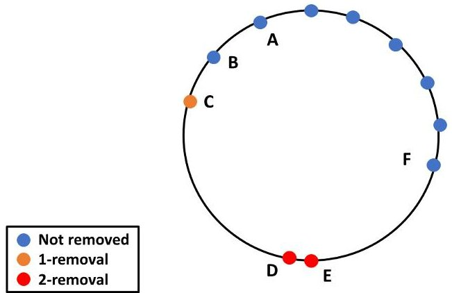

Figure 1: Representative nonuniform satellite distribution in an orbital plane.

## BACKGROUND

Spacecraft can fail for a variety of reasons, including launch failures, radiation, thermal stresses, and electronics failures [2]. The small form factor, low-cost satellites known as CubeSats are particularly susceptible to failure due to their use of COTS parts, low budgets, and high risk tolerance. A 2017 study by the Aerospace Corporation found that academic CubeSat missions failed 55% of the time, while commercial CubeSat endeavors failed 23% of the time [3]. Despite their failure rate, CubeSat constellations can enable critical space missions by providing rapid response due to their short build times. Additionally, their small size allows them to be launched as secondary payloads when their mission has some flexibility in the required orbital configuration.

However, the effect of the failure of one or more satellites on the ability of the constellation to perform its mission must be assessed. Previous work has measured constellation resilience based on the predicted failure rate [4] and the predicted number of satellites on orbit [5]. Stenger performed network analysis for a degraded Iridium constellation, selecting the worst-case removals in batches of 12 by finding the satellites that appeared most often in the packet paths and removing them [6]. However, this method is not mathematically rigorous for nonuniform constellations because the problem of satellite access cannot be solved recursively. To illustrate, consider a case in which satellites are spaced unevenly in an orbital plane, as shown in Fig. 1. Assume the satellites are placed in an equatorial orbit, with ground stations also on the equator. The largest gap in coverage occurs between satellites with the largest spacing. In the nominal case, the largest gap occurs between satellites C and D. If a single failure occurs, the satellite whose removal would most increase the largest gap is satellite C, denoted by an orange dot. In this 1-removal case, the largest possible gap would occur between satellites B and D after the removal of satellite C. If the 2-removal case continues from the 1-removal case by assuming C has already been removed, the next most damaging satellite to remove is B. Using recursion results in the largest gap being between A and D, with B and C removed. However, considering the 2-removal problem independently from the 1-removal problem shows that the best two satellites to remove are D and E, denoted in red. In this case, the largest gap is between C and F after the removal of D and E. Because the C-F gap is larger than the A-D gap, it has been shown that relying on recursion to determine the worst-case removals yields an incorrect answer. It is therefore beneficial to develop a rigorous methodology for determining the satellites whose removal is most damaging to the constellation performance.

<!-- PDF_PAGE: 3 -->

Another issue in the deployment of nanosatellite constellations is getting all of the assets into orbit. In traditional spacecraft constellations, the launch costs are a relatively small portion of the overall budget—an example scenario in Ref. [7] predicts a 14% launch cost. In the case of nanosatellites, however, the cost of the spacecraft itself is much smaller, a couple million dollars at most. Some nanosatellites are as cheap as a couple hundred thousand dollars [8]. Because launch vehicles cost tens to hundreds of millions of dollars, the use of dedicated launches for low cost missions is infeasible unless hundreds of satellites are going to the same plane [9]. However, small satellites can be launched as secondary payloads via rideshare programs for about $30,000 per kilogram [8]. Additionally, academic groups may qualify for free launch services through the Educational Launch of Nanosatellite (ELaNa) missions [10]. The downside of constellations built using rideshare alone, sometimes called ad hoc constellations, is that the irregular distribution of satellites results in large gaps in coverage compared to a symmetric constellation like a Walker constellation. Previous studies have quantified these differences, but have shown that performance can be improved through optimization of the rideshare selection. One such study used a Monte Carlo analysis to characterize the range of performance for ad hoc constellations providing global coverage [11]. Another study used a multi-objective genetic algorithm to determine an optimal rideshare manifest for providing global coverage [12]. That paper also discussed resiliency of ad hoc constellations, though only for a specific solution produced by the genetic algorithm and not as an optimization criterion.

## METHODOLOGY

The Disaggregated Integral Systems Concept Optimization Technology (DISCO-Tech) methodology was used to formulate and solve a rideshare reconfiguration constellation optimization problem. The DISCO-Tech algorithm is modular, with each module performing a different task of the optimization. Key modules are described below and in previous works [13,14].

## Optimization

DISCO-Tech uses a modified version of the epsilon nondominated sorting genetic algorithm II (eNSGA-II) to solve multiobjective optimization problems [15]. It combines the epsilon dominance feature of eNSGA-II with the archive feature of the BORG genetic algorithm but maintains the use of generations to facilitate ease in parallelization [16]. It differs from BORG and eNSGA-II in that it uses a variable length crossover operation, as described in Ref. [13].

## Reachability

Previous papers on constellation reconfiguration have restricted analysis to specific sets of maneuvers. One study restricted reconfiguration to in-plane maneuvers, then used a genetic algorithm to solve for the two-burn transfers yielding the best coverage in the final configuration [15]. Other studies restrict the initial and final constellations to known sets of orbits, presolving for the fuel needed to go between each combination of orbits then solving the assignment problem to find the optimal set of transfers [17-19].

A general framework was desired to determine the reachability of one orbit from another when neither the orbits are known a priori nor are the initial and final orbits confined to the same plane. Although methods exist for generating the reachable set [20-23], they rely on numerical simulation and are too computationally expensive to call for each solution during the optimization, since the reachable set will change as the initial orbit changes.

<!-- PDF_PAGE: 4 -->

Instead, an estimation of the fuel used is generated using a linearized version of Gauss's Variational Equations (GVE). Previous research linearized GVE about the final orbit and used the resulting equations with model predictive control (MPC) to calculate the required controls to maneuver from one orbit to another [24]. This linearization serves as the basis for our approach, though the MPC process was deemed unnecessarily costly. We need only the total fuel expenditure, not the entire control history. Furthermore, the linearization presented in Ref. [24] is improved upon through the use of the modified equinoctial orbital elements, by treating the true longitude as an independent parameter, and by improved analysis of the validity of the linearization. It is assumed that the final value of the true longitude is irrelevant, as it can be set afterward by temporarily raising or lowering the orbit using a comparatively small amount of fuel or by holding the satellite at an intermediate stage in its orbit until the desired phasing has been reached. It is also assumed that the maximum acceleration of the spacecraft does not change over time despite the change in the spacecraft's mass.

GVE are of the form

$$
\frac {d \mathbf {x}}{d t} = \mathbf {f} (\mathbf {x}) + B (\mathbf {x}) \mathbf {u}
$$

where $ \mathbf{x} $ is the vector of orbital elements and $ \mathbf{u}=[u_{r},u_{\theta},u_{h}]^{T} $ are the control accelerations in the local vertical local horizontal (LVLH) frame. This formulation uses the set of modified equinoctial orbital elements (MEOE), a set of nonsingular elements defined in Ref. [25]. The MEOE are denoted by $ \mathbf{x}=[p,f,g,h,k,L]^{T} $ , where the true longitude L is the only rapidly changing variable. p is the semiparameter of the orbit. The remaining four elements lack obvious physical meaning but are defined as $ f=e\cos(\omega+\Omega),g=e\sin(\omega+\Omega),h=\tan(\frac{i}{2})\cos(\Omega), $ and $ k=\tan(\frac{i}{2})\sin(\Omega), $ where e is the eccentricity, i is the inclination, $ \omega $ is the argument of periapsis (AOP), and $ \Omega $ is the right ascension of the ascending node (RAAN). $ \mathbf{f}(\mathbf{x})\in\mathbb{R}^{6} $ shows the growth of the elements in the absence of control, and $ B(\mathbf{x})\in\mathbb{R}^{6\times 3} $ is the input effect matrix. These matrices, defining $ q=1+f\cos(L)+g\sin(L) $ to simplify notation, are

$$
\mathbf {f} = \left[ \begin{array}{c c c} 0 & \sqrt {\frac {p}{\mu}} \frac {2 p}{q} & 0 \\ 0 & \sqrt {\frac {p}{\mu}} \sin (L) & - \sqrt {\frac {p}{\mu}} \frac {g (h \sin (L) - k \cos (L))}{q} \\ - \sqrt {\frac {p}{\mu}} \cos (L) & \sqrt {\frac {p}{\mu}} \frac {(q + 1) \cos (L) + g}{q} & \sqrt {\frac {p}{\mu}} \frac {f (h \sin (L) - k \cos (L))}{q} \\ 0 & 0 & \sqrt {\frac {p}{\mu}} \frac {(1 + h ^ {2} + k ^ {2}) \cos (L)}{2 q} \\ 0 & 0 & \sqrt {\frac {p}{\mu}} \frac {(1 + h ^ {2} + k ^ {2}) \sin (L)}{2 q} \\ 0 & 0 & \sqrt {\frac {p}{\mu}} \frac {h \sin (L) - k \cos (L)}{q} \end{array} \right],
$$

With the exception of true longitude, the orbital elements are constant in the absence of perturbations like oblateness effects. Form a reduced set of elements $ \mathbf{z}=[ p,f,g,h,k]^{T}. $ Eq. (1) can be rewritten as

$$
\frac {d}{d t} \left[ \begin{array}{c} \mathbf {z} \\ L \end{array} \right] = \mathbf {f} (\mathbf {z}, L) + B (\mathbf {z}, L) \mathbf {u}
$$

Since the first five elements of f(x) are zero for the two body problem, the growth of these elements can be written as

$$
\frac {d \mathbf {z}}{d t} = \overline {{B}} (\mathbf {z}, L) \mathbf {u}
$$

<!-- PDF_PAGE: 5 -->

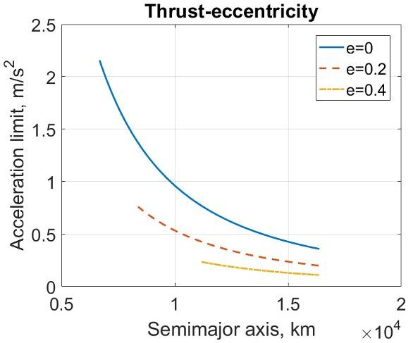

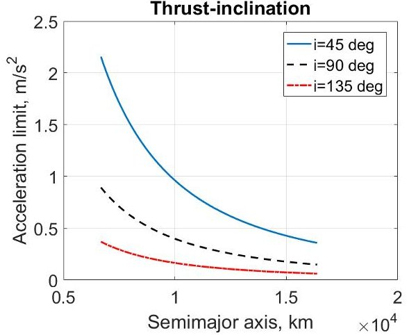

Figure 2: Thrust acceleration limit for $ 4 5^{\circ} $ inclined orbits at various eccentricities (left) and for circular orbits at various inclinations (right).

where $ \overline{B} ( \mathbf{z}, L) $ is the first five rows of $ B ( \mathbf{z}, L) $ . Note that the equation is affine in u but nonlinear in z due to the dependence of $ \overline{B} $ on z.

It is advantageous to treat the true longitude L as an independent parameter. The growth of L over time is $ d L / d t=\sqrt{\mu p} q^{2} /(p^{2})+\sqrt{p / \mu}(h \sin(L)-k \cos(L)) u_{h} / q $ , which can be rewritten as

$$
\frac {d L}{d t} = \sqrt {\frac {\mu}{p ^ {3}}} (1 + e \cos (\nu)) ^ {2} + \sqrt {\frac {p}{\mu}} \frac {\tan (0 . 5 i) \sin (\nu + \omega)}{1 + e \cos (\nu)} u _ {h}
$$

The classical orbital elements are used to provide a sense of physical understanding, with $ \nu $ being the true anomaly. The influence of the control on the growth of L is maximized when the second term of the previous equation is maximized. $ \tan(0.5i) $ and $ 1+e\cos(\nu) $ are nonnegative for all admissible values $ i\in[0,\pi], $ $ e\in[0,1) $ , and $ \nu\in[0,\infty) $ , the control's impact on L is maximized if $ u_{h}=u_{max}\mathrm{sign}(\sin(\nu+\omega)) $ . The upper value on the product $ \sin(\nu+\omega)u_{h} $ is $ u_{max} $ and occurs when $ \nu=\pi/2-\omega $ . Use this upper value when forming the ratio R of the maximum possible control growth to the secular growth,

$$
R = \frac {u _ {m a x} a ^ {2} \left(1 - e ^ {2}\right) ^ {2} \tan (0 . 5 i)}{\mu \left(1 + e \cos (\nu)\right) ^ {3}}
$$

Eq. (6) shows that the highest possible impact of the control comes at apoapsis when assuming maximum thrust, though this value can only truly be reached if $ \omega=3 \pi/2 $ due to phasing with the sine term that was set to its maximum. By setting an upper limit on the instantaneous value of the ratio, a maximum allowable thrust acceleration for various combinations of a, i, and e can be calculated. Note that the equation is singular for an inclination of zero, since thrusting in the angular momentum direction at this inclination will not affect the true longitude. Fig. 2 shows the maximum allowable thrust acceleration such that the ratio R at apoapsis will not exceed 0.1. When eccentricity is nonzero, only semimajor axes producing a periapsis altitude above 300km are included. When the control accelerations are smaller than those described in the plot for a given combination of semimajor axis, eccentricity, and inclination, the impact of the control on the growth of the true longitude can be ignored.

The bound on R of 0.1 is conservative because Eq. (6) assumes a thrust profile designed to maximize the control's impact on the true longitude and neglects the impact of the sinusoid on

<!-- PDF_PAGE: 6 -->

the instantaneous ratio. Because the goal of a maneuver is generally to change one of the other parameters, the optimal thrust profile is unlikely to match $ u_{h}=u_{max}\mathrm{sign}(\sin(\nu+\omega)) $

Nanosatellites tend to employ micropropulsion systems with low thrusts on the order of millinewtons [26]. The control influence on L can be safely ignored for these cases. High-thrust cubeSat propulsion systems with up to 1.25N of thrust are in development [27]. Assuming that these systems would be used exclusively with larger CubeSats with a dry mass of at least 5kg, the corresponding acceleration would be at most $ 0. 2 5 m / s^{2} $ . From the plots, it can be seen that low Earth orbits (LEO) with eccentricity less that 0.4 and inclinations less than $ 1 3 5^{\circ} $ will satisfy this constraint. Because these are the orbits primarily used by nanosatellites due to power and instrument limits, the assumption that the control does not significantly affect the true longitude will hold. The rate of change of L is then $ d L / d t=\sqrt{\mu p} q^{2} /(p^{2}) $ . The values of L can be approximated either by holding the MEOE fixed at either the initial or final values or by linearly interpolating between the initial and final values and calculating the growth of L at each time step. The approximation of the secular growth rate distorts the relationship between time steps and steps of L. This distortion can cause gaps or overlaps in L between time steps. For example, assume $ L_{0}=0 $ at $ t_{0}=0 $ . If the predicted value of L at $ t_{1}=1 0 0 $ is $ L_{1 p}=\pi/2 $ but the actual value is $ L_{1 a}=\pi/2-0. 0 1 $ , the 0.01 that forms the gap between the actual and predicted values will not be used. The impact of this approximation is difficult to quantify, but the verification shows that the effect does not invalidate the results. The effect can be mitigated by using smaller timesteps or by forcing the semimajor axis and eccentricity to take certain values at certain times. For example, because out-of-plane maneuvers are less costly at high altitudes, it may be appropriate to restrict the semimajor axis to a linear increase with some error margin if an altitude increase is desired with the out of plane maneuver. The current formulation merely linearly interpolates values of a and e between the initial and final values over the analysis period, then uses those values to calculate the true longitude. Using this process, true longitude can be treated as a function of time alone and can be precalculated, allowing it to be treated as an independent parameter in the linear program.

Linearization of Eq. (4) about some stationary orbit $ \mathbf{z}_{s} $ gives

$$
\frac {d \mathbf {z}}{d t} = \left(\bar {B} \left(\mathbf {z} _ {s}, L\right) + \frac {\partial \bar {B}}{\partial \mathbf {z}} \Bigg | _ {\mathbf {z} = \mathbf {z} _ {s}} \Delta \mathbf {z}\right) \mathbf {u} + H O T
$$

where $ \Delta\mathbf{z}=\mathbf{z}-\mathbf{z}_{s}. $ $ \partial \overline{B} / \partial\mathbf{z} $ in the second term is a tensor of rank three. Neglect the higher order terms. The equation for a single element $ z_{i} $ is given below for clarity, with $ b_{ij} $ being the element of B in the i-th row and the j-th column.

$$
\begin{array}{l} \frac {d z _ {i}}{d t} = \left[ b _ {i 1} b _ {i 2} b _ {i 3} \right] \mathbf {u} + \left[ \begin{array}{l} \Delta p \\ \Delta f \\ \Delta g \\ \Delta h \\ \Delta k \end{array} \right] ^ {T} \left[ \begin{array}{l l l} \partial b _ {i 1} / \partial p & \partial b _ {i 2} / \partial p & \partial b _ {i 3} / \partial p \\ \partial b _ {i 1} / \partial f & \partial b _ {i 2} / \partial f & \partial b _ {i 3} / \partial f \\ \partial b _ {i 1} / \partial g & \partial b _ {i 2} / \partial g & \partial b _ {i 3} / \partial g \\ \partial b _ {i 1} / \partial h & \partial b _ {i 2} / \partial h & \partial b _ {i 3} / \partial h \\ \partial b _ {i 1} / \partial k & \partial b _ {i 2} / \partial k & \partial b _ {i 3} / \partial k \end{array} \right] \Bigg | _ {\mathbf {z} = \mathbf {z} _ {s}} \mathbf {u} \\ = \left(\mathbf {b} _ {i} + \left(J _ {i} \Delta \mathbf {z}\right) ^ {T}\right) \mathbf {u} \\ \end{array}
$$

The second term results in a nonlinear equation, since the term contains a product of $ \Delta\mathbf{z} $ and $ \mathbf{u} $ Because this formulation is only an approximation of the total fuel used, we drop this term to maintain the linearity of the system. This simplification is valid if the magnitude of the derivatives of $ \overline{B} $ are small compared to the values of $ \overline{B} $ itself. We shall examine the ranges over which this assumption is valid.

<!-- PDF_PAGE: 7 -->

Both $ \overline{B} $ and $ \partial \overline{B} /\partial\mathbf{z} $ vary with L, so it is necessary to examine the relative behavior of the two terms over an entire orbit. Furthermore, due to the differences in magnitude of the rates of change of the various orbital elements, it is prudent to examine each one separately. To determine the allowable extent of the nonlinearity due to a variation in one of the MEOE, set a bound on the ratio of the magnitudes of the nonlinear and linear terms causing a change in element i due to the difference in element j from the stationary orbit,

$$
R _ {i j} = \frac {\left| \Delta z _ {j} \right| \left\| \mathbf {j} _ {i j} \right\|}{\left\| \mathbf {b} _ {i} \right\|} = \frac {\left| \Delta z _ {j} \right| \sqrt {\left(\partial b _ {i 1} / \partial z _ {j}\right) ^ {2} + \left(\partial b _ {i 2} / \partial z _ {j}\right) ^ {2} + \left(\partial b _ {i 3} / \partial z _ {j}\right) ^ {2}}}{\sqrt {b _ {i 1} ^ {2} + b _ {i 2} ^ {2} + b _ {i 3} ^ {2}}}
$$

$ \mathbf{j}_{ij} $ is the j-th column of the $ J_{i} $ matrix. By setting an upper limit on the value of $ R_{ij} $ , we can develop bounds on each of the orbital elements. Since the bounds on $ \Delta z_{j} $ must satisfy the imposed limits on $ R_{ij} $ $ \forall i \in[1,5] $ , we select the smallest value of $ \Delta z_{j} $ calculated by the five equations. This limit should be satisfied for all values of L. However, some elements of $ \overline{B} $ , such as $ b_{21} $ , go to zero at certain values of L. As a result, the ratio near these points is poorly defined. Furthermore, a large $ R_{ij} $ value occurring when $ \mathbf{b}_{i} $ is small still results in a small magnitude change in $ \mathbf{b}_{i} $ . In order to avoid these singularities, the denominator used in Eq. (10) is not the instantaneous value for a given L but the average value calculated by averaging $ \| \mathbf{b}_{i}\| $ over L. Call this average value $ \| \mathbf{b}_{i}\|_{avg} $ . Since all terms in the numerator of Eq. (10) are a function of L, select the L value that gives the largest ratio R to ensure the most conservative bounds. Mathematically, this can be written by inverting the Eq. (10) to obtain

$$
| \Delta z _ {j} | \leq \min _ {i \in [ 1, 5 ]} \left(\min _ {L \in [ 0, 2 \pi ]} \left(R _ {m a x} \frac {\| \mathbf {b} _ {i} \| _ {a v g}}{\| \mathbf {j} _ {i j} (L) \|}\right)\right)
$$

Using the process described above, bounds on the linearization are generated for an orbit with nominal values of a=7000km, e=0.1, i= $ \pi/4 $ $ \Omega=\pi/6 $ , and $ \omega=\pi/12 $ . In order to determine the impact of the initial value of each orbital element on the bounds, the initial orbital elements are varied one at a time while holding the others fixed. a is varied from 6678km to 16378km, e is varied from 0 to 0.8, i is varied from 0 to $ 1 8 0^{\circ} $ $ \Omega $ is varied from 0 to $ 3 6 0^{\circ} $ , and $ \omega $ is varied from 0 to $ 3 6 0^{\circ} $ Fig. 3 shows the results for the most interesting relationships. The upper bound is shown in blue, the nominal value in yellow, and the lower bound in red.

The main determining factor in the semimajor axis bounds is the semimajor axis, with larger semimajor axes having larger bounds. For a low Earth orbit, a limit of $ |\Delta a|=500\mathrm{km} $ ensures the bounds on the linearization are satisfied. Similarly, eccentricity is the main determining factor on the eccentricity bounds with larger eccentricities having smaller bounds, though RAAN, AOP, and high inclination influence the eccentricity bounds as well. For an orbit with low eccentricity, bounds of about 0.1 are acceptable. The inclination bounds decrease with increasing inclination and eccentricity. However, the bounds are so large and the fuel required to enact a change in inclination so great that it is unlikely that a satellite would maneuver more than a couple of degrees in inclination, rendering the linearization valid for all practical cases barring a retrograde orbit with inclination greater than $ 120^{\circ} $ . Likewise, the bounds on RAAN and AOP are large and unlikely to be exceeded, so these plots are not included.

Overall, the linearization will hold when the semimajor axis error is kept below 500km, the eccentricity error kept below 0.1 for low eccentricities and below 0.05 for eccentricities near 0.5, the eccentricity kept below 0.5, the inclination kept below $ 1 2 0^{\circ} $ , changes in AOP kept below $ 5 0^{\circ} $

<!-- PDF_PAGE: 8 -->

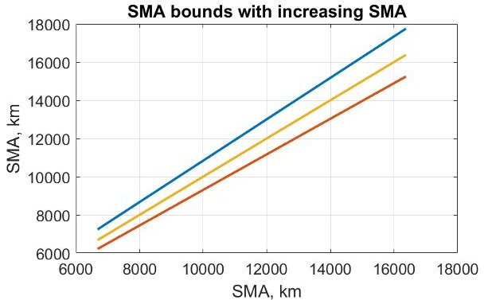

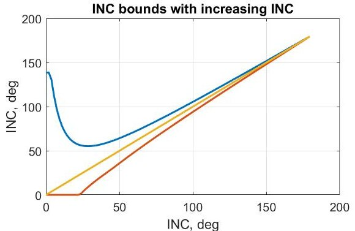

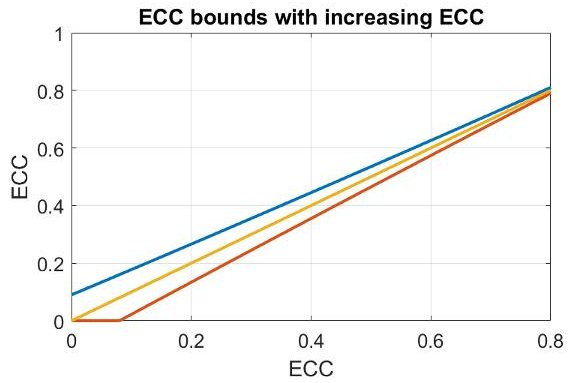

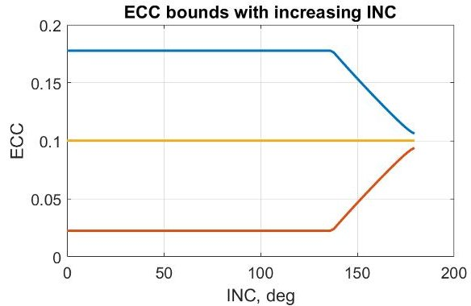

Figure 3: Element limits for valid linearization under changing initial element values.

and changes in RAAN and inclination kept below $ 1 0^{\circ} $ for prograde orbits and $ 5^{\circ} $ for retrograde orbits.

Now that it has been shown that the nonlinear term in Eq. (7) can be neglected in the cases described above, we can use the linear equation

$$
\frac {d \mathbf {z}}{d t} = \bar {B} \left(\mathbf {z} _ {s}, L\right) \mathbf {u}
$$

to approximate the change in the orbital elements over time.

Applying the variation of constants formula to the above equation gives

$$
\mathbf {z} (t) = \mathbf {z} _ {0} + \int_ {t _ {0}} ^ {t} \bar {B} \left(\mathbf {z} _ {s}, L (v)\right) \mathbf {u} (v) d v
$$

If we discretize the system by setting $ t=k \Delta t $ , using it to calculate $ L_{k}=L(k \Delta t) $ , and treating $ \overline{B} $ and u as being fixed at each time step, the equation becomes

$$
\mathbf {z} _ {k + 1} = \mathbf {z} _ {0} + \Delta t \sum_ {j = 0} ^ {k} \bar {B} _ {j} \mathbf {u} _ {j}
$$

With this equation, the problem of reachability can now be formulated as a linear program (LP). To enforce the upper and lower bounds on u, create separate variables $ u^{+} $ and $ u^{-} $ , both in $ [0,u_{max}] $ such that $ u=u^{+}-u^{-} $ . The LP formulation can be written as

Minimize

$$
\sum_ {k} \sum_ {i} u _ {i k} ^ {+} + u _ {i k} ^ {-}
$$

<!-- PDF_PAGE: 9 -->

with decision variables :

$$
u _ {i k} ^ {+} \quad \in [ 0, u _ {m a x} ] \quad \forall k = 0, 1, \dots , k _ {f}, i \in \{r, \theta , h \}
$$

$$
u _ {i k} ^ {-} \quad \in [ 0, u _ {m a x} ] \quad \forall k = 0, 1, \dots , k _ {f}, i \in \{r, \theta , h \}
$$

such that :

$$
\mathbf {z} _ {f d} - \zeta_ {f} \leq \mathbf {z} _ {0} + \Delta f \sum_ {j = 0} ^ {n _ {f}} \bar {B} _ {j} \mathbf {u} _ {j} \leq \mathbf {z} _ {f d} + \zeta_ {f}
$$

where $ \zeta_{f} $ is the allowable error in the final state, and the desired final state is $ \mathbf{z}_{fd} $ . Due to the fact that the control is held constant during each step, reaching an exact state may be impossible, requiring the inclusion of error bounds. Once the optimal solution is known, the orbital elements at each step k can be calculated using Eq. (14). The total fuel required can be approximated as the value of the objective function times $ \Delta t $

Two simple scenarios are used to test the problem formulation. First, the problem of raising a circular orbit from 1000km in altitude to 1500km in altitude using a maximum acceleration of $ 0. 0 1 \mathrm{m} / \mathrm{s}^{2} $ is considered. According to Ref. [28], the optimal low thrust orbit raise for a circular orbit is a continuous thrust in the velocity vector direction and consumes a total delta-v of $ \Delta v=\left| \sqrt{\mu / a_{0}}-\sqrt{\mu / a_{f}} \right| $ . The time needed to complete the maneuver is $ t_{f}-t_{0}=(\mu / u_{max})\left| a_{0}^{-1 / 2}-a_{f}^{-1 / 2} \right| $ . For the given problem, the required $ \Delta v $ according to the equation is 237.1m/s.

The linear program was solved using the YALMIP Matlab toolbox interfacing with Gurobi and CPLEX [29-31]. The scenario was permitted to run for 1.05 times the predicted time needed to complete the maneuver. The semimajor axis was assumed to vary linearly between the initial and final values, with these interpolated values being used in the $ B_{k} $ matrices at each time step. The estimated velocity required for the orbit raise is 235.4m/s, resulting in a deviation from the analytical solution of less than 1%.

The second scenario requires an inclination change of two degrees within ten orbits. The orbit is circular and has an altitude of 1000km. The $ \Delta v $ required for an impulsive transfer is $ \Delta v= 2 v \sin \frac{\Delta i}{2} $ . If multiple small impulsive manuevers are performed rather than a single large maneuver, the required velocity change is $ \Delta v=2 n v \sin \frac{\Delta i}{2 n} $ , where n is the number of maneuvers. Assuming the maneuver is conducted using a max acceleration of $ 0.01 \mathrm{m} / \mathrm{s}^{2} $ over the course of forty orbits (eighty maneuvers), the required $ \Delta v=2 5 6. 6 \mathrm{m} / \mathrm{s} $ . Since only about three m/s is required per maneuver, it is sufficient to assume the $ \Delta v $ required for an instantaneous small inclination change is approximately equal to that required for an inclination change maneuver spread over a couple of minutes using low thrust. The result from the equation should be comparable to that provided by the linear program. Indeed, the linear program predicts a $ \Delta v $ of 253.9m/s, yielding an error of 1%. These simple examples, when combined with the mathematical validation provided above, bound the accuracy of the linearization approach in predicting the $ \Delta v $ required for a low Earth orbit transfer. The predicted $ \Delta v $ can then be used to determine the reachability of one orbit from another.

## Dynamics

The scenario is divided into periods during which no maneuvers occur. During such a period, the orbital elements of the satellites over time are found using the mean anomaly, since $ M-M_{0}=nt $ where n is the mean motion. The mean anomaly is then used with Kepler's equation, $ M=E- $

<!-- PDF_PAGE: 10 -->

e $ \sin(E) $ , to obtain the eccentric anomaly E. Since Kepler's equation is transcendental in E, bicubic interpolation is used to solve for E. E can then be used to obtain $ \nu $ . The change in the other classical orbital elements over time is calculated using the secular growth caused by $ J_{2} $ and $ J_{4} $ , as described in Ref. [32]. All maneuvers are assumed to be instantaneous. The scenario is propagated until a maneuver time is reached. The change in orbital elements or in velocity is then added to the current state. Propagation then continues until the next maneuver is reached.

## Coverage

Because the calculation of satellite revisit metrics is nonlinear and computationally expensive, we compute the rise and set times for the nominal constellation, the satellite constellation from which no assets have been removed. The method used for calculating the rise and set times is adapted from the methods developed by Alfano [33]. Alfano uses a coarse time step to find the satellite positions over time, then uses quintic interpolation to approximate the rise-set times of the satellites between the steps of the propagation. Alfano developed equations describing constraints on the maximum range, minimum and maximum elevation angles, and minimum and maximum azimuthal angles. For the purposes of this paper, we will concern ourselves with only the maximum range and minimum elevation equations,

$$
f _ {R} (t) = R (t) - R _ {L I M}
$$

$$
f _ {\phi} (t) = \left(\cos^ {- 1} \left\{\frac {\cos [ \phi (t) ]}{R (t)} \right\} - \phi (t)\right) - \left\{\cos^ {- 1} \left[ \frac {\cos \left(\phi_ {L I M}\right)}{R (t)} \right] - \phi_ {L I M} \right\}
$$

where $ R ( t ) $ is the range from a satellite to a ground station at time t, $ \phi ( t ) $ is the elevation angle from the ground station to the satellite, $ R_{LIM} $ is the maximum allowable range, and $ \phi_{LIM} $ is the minimum allowable elevation angle. Additionally, we develop an equation for a constraint on the maximum off-boresight angle of the ground station with respect to the satellite. The off-boresight angle $ \theta ( t ) $ can be calculated as

$$
\theta (t) = \cos^ {- 1} \left[ \frac {\mathbf {R} (t) \cdot \mathbf {p} (t)}{\| \mathbf {R} (t) \|} \right]
$$

where $ \mathbf{R} ( t ) $ is the vector from the satellite to the ground station and $ \mathbf{p} ( t ) $ is the unit vector in the direction of the boresight axis of the sensor.

Since the off-boresight angle is analogous to an elevation angle from the satellites perspective, the equation is a slight modification of Eq. (16),

$$
f _ {\theta} (t) = \left(\cos^ {- 1} \left\{\frac {\cos [ \theta (t) ]}{R (t)} \right\} - \theta (t)\right) - \left\{\cos^ {- 1} \left[ \frac {\cos \left(\theta_ {L I M}\right)}{R (t)} \right] - \theta_ {L I M} \right\}
$$

where $ \theta_{LIM} $ is the maximum allowable off-boresight angle.

In order to find the intervals that contain rise and set times without interpolating through every time step, find the time steps in the coarse propagation for each satellite-station combination for which $ f_{R}(t)\leq0 $ $ f_{\phi}(t)\leq0 $ , and $ f_{\theta}(t)\geq0 $ . During these times, the satellite can access the ground station. Of these time steps, find the times that are near the beginning interval of access by finding points that are more than one time step away from the previous point satisfying the constraints. Likewise, find the times that are near the end of an interval by finding points that are more than

<!-- PDF_PAGE: 11 -->

one time step away from the next point satisfying the constraints. Use either $ f_{R}(t), f_{\phi}(t) $ , or $ f_{\theta}(t) $ whichever is most restrictive at each point, for the quintic interpolation as described by Alfano to get the rise and set times [33]. The rise/set time occurs when the most restrictive function is equal to zero.

For each ground station, a matrix is constructed to describe the access to that station over time. The rows correspond to the sorted rise and set times, while the columns correspond to the satellites. The matrix is binary such that a one in the $ (i,j) $ place indicates that the j-th satellite can access the ground station from the i-th time until the $ (i+1) $ -th time. There is a corresponding vector of times, $ T_{k} $ , to match the rows of the matrix. For instance, assume the k-th station is accessible by three satellites. The scenario starts at time zero. Satellite 1 can access the station from 5 minutes to 12 minutes. Satellite 2 can access the station from 10 minutes to 20 minutes. Satellite 3 can access the station from 30 minutes to 35 minutes. The scenario ends at 60 minutes. The resulting time vector $ T_{k} $ and access matrix $ A_{k} $ would be

$$
T = \left[ \begin{array}{l} 0 \\ 5 \\ 1 0 \\ 1 2 \\ 2 0 \\ 3 0 \\ 3 5 \\ 6 0 \end{array} \right], A = \left[ \begin{array}{l l l} 0 & 0 & 0 \\ 1 & 0 & 0 \\ 1 & 1 & 0 \\ 0 & 1 & 0 \\ 0 & 0 & 0 \\ 0 & 0 & 1 \\ 0 & 0 & 0 \\ 0 & 0 & 0 \end{array} \right]
$$

Form an access array A by concatenating the accesses for each station and a time matrix $ T. $ $ T_{ik} $ is the i-th rise or set time for the k-th station. $ A_{ijk} $ is one if the j-th satellite can access the k-th ground station between $ T_{ik} $ and $ T_{(i+1)k} $ . Also calculate the length of each time step, $ \Delta T_{ik}= $ $ T_{(i+1)k}-T_{ik} $ . The access array and time matrix can be used to calculate revisit metrics and in the resilience calculations outlined in the following section.

## Resilience

This section discusses a method for formulating the problem of finding the combination of losses of assets most damaging to the constellation performance as a linear program. The access array described in the previous section can be used in examining the performance of the degraded constellation. If the number of satellites is small and the number of predicted removals/failures is small, it is simple to check every combination of removals to determine the most damaging case. Simply remove the columns of the access array corresponding to the removed satellites and calculate the resilience metrics. However, because the problem grows combinatorially, evaluating all combinations directly for large problems quickly becomes infeasible. For example, Stenger considered 12-removal, 24-removal, and 36-removal cases for the 66 satellite Iridium constellation [6]. The smallest of these cases has $ 4.92\times10^{12} $ combinations that would need to be evaluated.

We therefore turn to mathematical programming to solve the problem of finding the worst combination of satellite removals, which can be formulated as a mixed integer linear program (MILP). The exact formulation will depend on the metric used in the optimization, but here we treat only the problem of finding the combination of removals that maximizes the longest gap in coverage seen by any of the ground stations (maximum revisit time over all points). Call the number of satellites in the nominal constellation $ n_{s} $ , the number of removals $ n_{r} $ , and the number of ground stations $ n_{g} $ .

<!-- PDF_PAGE: 12 -->

Define the decision variable $ x_{j}\in\{0,1\} \forall j=1,2,\ldots,n_{s} $ , a binary satellite inclusion variable that is one if the j-th satellite is active and zero otherwise. To produce the correct number of removals, we define the constraint

$$
\sum_ {j = 1} ^ {n _ {s}} x _ {j} = n _ {s} - n _ {r}
$$

It is then necessary to determine how many satellites are available to each station at any given time. The access sum, $ \overline{A}_{ik} $ , gives the number of satellites available to ground station k at its i-th time step,

$$
\bar {A} _ {i k} = \sum_ {j = 1} ^ {n _ {s}} A _ {i j k} x _ {j}
$$

We can then calculate whether a sufficient number of assets are available for access at each period. Define $ n_{c} $ as the number of assets required to be in view of the ground station simultaneously for successful access. The calculation of this access requires the introduction of a new binary variable, $ Y_{ik}\in\{0,1\} $ . $ Y_{ik} $ is one if the required number of assets are accessible by station k at time i and zero otherwise. In order to force $ Y_{ik} $ to take the appropriate value, we introduce the following constraints. Note that the second is a big-M constraint. Set $ M=n_{s}-n_{c}+1. $

$$
Y _ {i k} \leq \frac {\bar {A} _ {i k}}{n _ {c}} \quad \forall i = 1, 2, \dots , n _ {t} - 1, k = 1, 2, \dots , n _ {g}
$$

$$
M Y _ {i k} \geq \bar {A} _ {i k} - n _ {c} + 1 \quad \forall i = 1, 2, \dots , n _ {t} - 1, k = 1, 2, \dots , n _ {g}
$$

Eq. (22) ensures that $ Y_{ik} $ is zero if insufficient satellites are available. Eq. (23) ensures that $ Y_{ik} $ is one if at least $ n_{c} $ satellites are available.

The maximum revisit time of a ground station is the longest period for which that station is without coverage. The maximum of the maximum revisit times is the largest gap in coverage for any station in the scenario. The formulation begins with the definition of an accumulator variable $ a_{ik}\in \mathbb{R}_{\geq0} $ . The accumulator variable counts the amount of time at each step since the end of the previous pass. During a pass and immediately after the pass ends, the accumulator should be zero. The constraints below are big-M constraints. To distinguish from the big-M value used in Eq. (22), the big-M value in these constraints will be referred to as $ M_{2} $ . The most conservative value for $ M_{2} $ is the length of the scenario plus a small constant. However, using smaller values to aid convergence is encouraged if it is guaranteed that no gap will ever exceed the value chosen for $ M_{2} $ .

The constraints needed to force $ a_{ik} $ to take the appropriate value are slightly different for the first time step than for the rest of the scenario. $ a_{1k} $ has the constraints

$$
a _ {1 k} \geq \Delta T _ {1 k} - M _ {2} Y _ {1 k} \forall k = 1, 2, \dots , n _ {g}
$$

$$
a _ {1 k} \leq \Delta T _ {1 k} + M _ {2} Y 1 k \forall k = 1, 2, \dots , n _ {g}
$$

These constraints ensure that $ a_{1k} $ will be equal to the length of the first time step if there is no access when the scenario begins. The constraints for the rest of the time period are

$$
a _ {i k} \geq a _ {(i - 1) k} + \Delta T _ {i k} - M _ {2} Y _ {i k} \forall i = 2, 3, \dots , n _ {t} - 1, k = 1, 2, \dots , n _ {g}
$$

$$
a _ {i k} \leq a _ {(i - 1) k} + \Delta T _ {i k} + M _ {2} Y _ {i k} \forall i = 2, 3, \dots , n _ {t} - 1, k = 1, 2, \dots , n _ {g}
$$

<!-- PDF_PAGE: 13 -->

Likewise, these constraints ensure that $ a_{ik} $ will be equal to the previous accumulator value plus the time step if there is no access at the current time. Finally, $ a_{ik} $ must be zero if there is access at the current time, so

$$
a _ {i k} \leq M _ {2} \left(1 - Y _ {i k}\right) \forall i = 1, 2, \dots , n _ {t} - 1, k = 1, 2, \dots , n _ {g}
$$

The length of the largest gap is equal to the largest value of $ a_{ik} $ . To find this value, introduce a variable $ a_{max}\in \mathbb{R}_{\geq 0} $ . Because the goal is to maximize $ a_{max} $ , there must be an upper bound on $ a_{max} $ to prevent it growing unbounded. Therefore, it is required that $ a_{max} $ is less than or equal to exactly one of the values of a . To this end, introduce additional binary variables $ \delta_{ik}\in \mathbb{R}^{(n_{t}-1)\times n_{g}} $ This formulation will drive $ a_{max} $ to the largest value of a and can be enforced with the constraints

$$
a _ {m a x} \leq a _ {i k} + \left(1 - \delta_ {i k}\right) M _ {2} \forall i = 1, 2, \dots , n _ {t} - 1, k = 1, 2, \dots , n _ {g}
$$

$$
\sum_ {i = 1} ^ {n _ {t} - 1} \sum_ {k = 1} ^ {n _ {g}} \delta_ {i k} = 1
$$

## The full formulation for the maximization problem is

$$
\begin{array}{l} \mathrm {M i n i m i z e} - a _ {m a x} \\ w i t h d e c i s i o n v a r i a b l e s: \\ x _ {j} \in \{0, 1 \} \quad \forall j = 1, 2, \dots , n _ {s} \\ Y _ {i k} \in \{0, 1 \} \quad \forall i = 1, 2, \dots , n _ {t}, k = 1, 2, \dots , n _ {g} \\ a _ {i k} \in \mathbb {R} _ {\geq 0} \quad \forall i = 1, 2, \dots , n _ {t} - 1, k = 1, 2, \dots , n _ {g} \\ a _ {m a x} \in \mathbb {R} _ {\geq 0} \\ \delta_ {i k} \in \{0, 1 \} \quad \forall i = 1, 2, \dots , n _ {t} - 1, k = 1, 2, \dots , n _ {g} \\ \mathrm {s u c h t h a t :} \\ \sum_ {j = 1} ^ {n _ {s}} x _ {j} = n _ {s} - n _ {r} \\ Y _ {i k} \leq \frac {\sum_ {j = 1} ^ {n _ {s}} A _ {i j k} x _ {j}}{n _ {c}} \quad \forall i = 1, 2, \dots , n _ {t}, k = 1, 2, \dots , n _ {g} \\ M Y _ {i k} \geq \sum_ {j = 1} ^ {n _ {s}} A _ {i j k} x _ {j} - n _ {c} + 1 \quad \forall i = 1, 2, \dots , n _ {t}, k = 1, 2, \dots , n _ {g} \\ a _ {1 k} \geq \Delta T _ {1 k} - M _ {2} Y _ {1 k} \quad \forall k = 1, 2, \dots , n _ {g} \\ a _ {1 k} \leq \Delta T _ {1 k} + M _ {2} Y _ {1 k} \quad \forall k = 1, 2, \dots , n _ {g} \\ a _ {i k} \geq a _ {(i - 1) k} + \Delta T _ {i k} - M _ {2} Y _ {i k} \forall i = 2, 3, \dots , n _ {t} - 1, k = 1, 2, \dots , n _ {g} \\ a _ {i k} \leq a _ {(i - 1) k} + \Delta T _ {i k} + M _ {2} Y _ {i k} \forall i = 2, 3, \dots , n _ {t} - 1, k = 1, 2, \dots , n _ {g} \\ a _ {i k} \leq M _ {2} \left(1 - Y _ {i k}\right) \quad \forall i = 1, 2, \dots , n _ {t} - 1, k = 1, 2, \dots , n _ {g} \\ a _ {m a x} \leq a _ {i k} + \left(1 - \delta_ {i k}\right) M _ {2} \quad \forall i = 1, 2, \dots , n _ {t} - 1, k = 1, 2, \dots , n _ {g} \\ \sum_ {i = 1} ^ {n _ {t} - 1} \sum_ {k = 1} ^ {n _ {g}} \delta_ {i k} = 1 \\ \end{array}
$$

<!-- PDF_PAGE: 14 -->

Problem size This formulation has a total of $ ( 2 n_{t}-1 ) \times n_{g}+n_{s} $ binary variables and $ ( n_{t}-1 ) \times n_{g}+1 $ continuous variables. State-of-the-art MILP solvers can handle hundreds of thousands of variables, but the ability of a solver to find a solution is dependent on more factors than simply the number of variables [34]. The distance between the relaxed and actual solutions, the number of constraints, and the ability of the solver to quickly find a feasible solution are only some of the factors that affect solve time. Some decision variables can be set a priori, reducing solve time. For example, any interval where the nominal case did not have access to a sufficient number of assets will preclude the reduced case from having a sufficient number of assets, allowing the corresponding values of $ Y_{ik} $ to be set to zero. Similarly, if the nominal case had sufficient assets such that removing the maximum number of assets would not affect access during that period, the corresponding values of $ Y_{ik} $ can be set to one. Another method for decreasing runtime is to consider each ground station separately. Because the runtime of an MILP solver will increase in a nonpolynomial fashion with number of variables, it may be faster to run several small programs than one large one, depending on the solver overhead and the solve times for the two problem sizes. Meaning, one program with 100,000 variables will generally be slower than one hundred programs with one thousand variables each. The results can then be combined by choosing the highest maximum revisit time from among all the ground stations.

The number of ground stations and time steps both have a more significant direct impact on the number of variables, though the number of times is a function of the number of satellites. It is possible to reduce the size of the problem by limiting the number of ground stations or the total duration of the scenario. Constellations with repeating ground tracks or whose formulations permit short analysis times will benefit most from this formulation due to the smaller number of variables required for such problems. The formulation is only beneficial in large combinatorial cases, as small cases can be handled more rapidly by full enumeration of all removal possibilities.

## SCENARIO DESCRIPTION

One benefit of both nanosatellites and rideshare launches is the ability to use them on short notice. This feature is especially beneficial in the event of an emergency, when there is insufficient time to build and deploy a traditional satellite constellation. To simulate such a scenario, consider the case of fire detection over California. The goal is to deploy a constellation of nanosatellites constructed of COTS parts using rideshare opportunities in a timely manner. The nanosatellites are identical and have the following subsystems:

- Propulsion: MPS-130 2U propulsion module by Aerojet Rocketdyne with a thrust of 1.25N, a specific impulse of 235s and a fuel mass of 1.4kg [27]

- Antenna: Helios deployable helical antenna [35]

- TXRX: ISIS VHF downlink/UHF uplink full duplex transceiver [36]

- Battery: BAox high energy density battery array [37]

- EPS: Crystalspace P1U Vasik [38]

- Solar panels: CubeSat Solar panel DHV-CS-10 [39]

- ADCS: CubeADCS 3-Axis with medium wheels [40]

<!-- PDF_PAGE: 15 -->

- Imager: Chameleon multispectral imager with a ground sample distance of 9.6m at 500km [41]

With the exception of the propulsion system and the imager, the components listed above serve only to estimate the cost and mass required for the satellite and do not represent a finalized design. The propulsion system dictates the maneuvers that can be performed by the satellite, while the imager dictates the image resolution, limiting the maximum altitude of the satellites.

A set of rideshare options was simulated by taking the two line elements (TLEs) of satellites launched over a thirty day period from CelesTrak [42]. This sampling is meant to be an example set of launches and is not indicative of the launches that would be available for an actual mission. The results will vary based on the particular set of launches available. The orbital elements corresponding to the TLEs are shown in Table 1, where each row represents a different launch with the angles are in degrees and the semimajor axis in kilometers.

Table 1: Rideshare orbital elements

<table border="1"><tr><td>Launch</td><td>a</td><td>e</td><td>i</td><td>ω</td><td>Ω</td><td>ν</td></tr><tr><td>1</td><td>6823.022412</td><td>0.001786</td><td>92.926</td><td>118.341</td><td>253.494</td><td>159.764</td></tr><tr><td>2</td><td>6823.027313</td><td>0.001787</td><td>92.927</td><td>118.593</td><td>253.496</td><td>159.934</td></tr><tr><td>3</td><td>6823.120130</td><td>0.001694</td><td>92.922</td><td>124.211</td><td>253.482</td><td>156.234</td></tr><tr><td>4</td><td>6823.147009</td><td>0.001802</td><td>92.926</td><td>124.645</td><td>253.500</td><td>156.363</td></tr><tr><td>5</td><td>6965.904940</td><td>0.001422</td><td>97.852</td><td>153.239</td><td>158.268</td><td>10.775</td></tr><tr><td>6</td><td>6965.508578</td><td>0.001364</td><td>97.854</td><td>151.101</td><td>158.269</td><td>8.811</td></tr><tr><td>7</td><td>28240.632554</td><td>0.011723</td><td>55.036</td><td>176.279</td><td>156.866</td><td>125.480</td></tr><tr><td>8</td><td>28243.220407</td><td>0.011631</td><td>55.037</td><td>176.374</td><td>156.866</td><td>124.841</td></tr><tr><td>9</td><td>7090.054923</td><td>0.009126</td><td>98.564</td><td>337.412</td><td>340.248</td><td>241.471</td></tr><tr><td>10</td><td>15699.721098</td><td>0.580781</td><td>55.040</td><td>172.480</td><td>153.738</td><td>221.090</td></tr><tr><td>11</td><td>15531.095671</td><td>0.572284</td><td>26.935</td><td>195.921</td><td>240.373</td><td>154.915</td></tr><tr><td>12</td><td>7160.850292</td><td>0.001113</td><td>98.563</td><td>165.345</td><td>339.683</td><td>177.020</td></tr><tr><td>13</td><td>6673.408249</td><td>0.002082</td><td>51.572</td><td>340.257</td><td>237.863</td><td>19.745</td></tr><tr><td>14</td><td>6837.409742</td><td>0.001926</td><td>91.905</td><td>59.592</td><td>251.141</td><td>163.637</td></tr><tr><td>15</td><td>6974.981875</td><td>0.003213</td><td>97.742</td><td>174.993</td><td>157.961</td><td>216.571</td></tr><tr><td>16</td><td>6784.097759</td><td>0.000848</td><td>51.580</td><td>35.934</td><td>237.112</td><td>315.785</td></tr><tr><td>17</td><td>42133.484524</td><td>0.000957</td><td>0.038</td><td>96.386</td><td>95.943</td><td>188.302</td></tr><tr><td>18</td><td>28819.893645</td><td>0.008936</td><td>54.854</td><td>4.595</td><td>156.791</td><td>179.464</td></tr></table>

The optimization selects a set of launches, assigns satellites to each selected launch, and sets a reconfiguration for each launch by setting the change in orbital elements. The satellites' orbital elements will be the orbital elements of the launch plus the change in orbital elements. The satellites will be evenly distributed in true anomaly around the orbit. The transfer is considered feasible if the final orbit can be reached from the initial orbit, as described in the previous section, within ten orbits using the available fuel and thrust. A segment of the genome produced by the genetic algorithm would have the form $ \mathbf{x}_{i}=[\mathrm{launch~assignment,~number~of~satellites},\Delta a,\Delta e,\Delta i,\Delta \omega, $ $ \Delta \Omega, \Delta \nu]. $ The genome is permitted to have between one and twenty segments. It is possible that multiple planes of satellites may be deployed from a single launch by assigning multiple orbital element changes to one launch. In a simulation of a real-life scenario, it would be beneficial to

<!-- PDF_PAGE: 16 -->

introduce a constraint ensuring that the mass capacity for rideshare of a vehicle is not exceeded. The total number of satellites launched is not to exceed fifty.

Because the goal of the scenario is to maximize coverage over the state of California, a set of points evenly spaced with 100 miles between them was generated within the state. A minimum elevation limit for access of five degrees was imposed. A maximum ground sample distance (GSD) of 25m is also required for access. The satellites are assumed to be able to slew sufficiently to cover the area of interest, so no constraint is imposed on the off-boresight angle of the satellite. Some of the launch opportunities, such as launch 17, are incompatible with the mission requirements due to their high altitude, which would result in a GSD that violated the access requirements. These launches are still included in the optimization to test the algorithm's ability to avoid infeasible solutions.

The quality of access provided by a given solution is evaluated using two metrics: the average time average gap (TAG) of the ground points and the maximum revisit time over all points. The TAG of a ground point is defined as [43]:

$$
\bar {G} = \frac {\sum^ {g a p s} \left(G a p D u r a t i o n\right) ^ {2}}{C o v e r a g e I n t e r v a l}
$$

TAG provides the average time until next coverage for a given ground point when starting from an arbitrary time in the scenario. The maximum revisit time over all points calculates the longest time that each point is without coverage, then takes the largest of these values. The total number of satellites is minimized in order to survey the entire solution space and to determine the coverage possible at varying asset levels.

Due to the relatively high failure rate of nanosatellites, it is necessary to consider the possibility that some of the satellites may fail prematurely. The impact of this possibility is measured by determining the worst-case maximum revisit time over all points when twenty percent of the satellites are removed from the scenario. The linear programming approach discussed in the previous section is applied in order to get this worst-case objective value. The optimization problem therefore has four objectives: minimize average TAG, minimize maximum revisit time over all points, minimize degraded maximum revisit time over all points, and minimize number of satellites.

A scenario time of ninety days is used when calculating the nominal objectives. The degraded analysis uses a ten day scenario time to limit the size of the linear programming problem. The simulation is run until ten successive generations produce no improvement in the archive. A new population is then generated using the archive and randomly generated members, as described in Ref. [16]. An initial population of 200 candidates is used, with the population being scaled each run to be four times the archive size. This process is repeated for ten runs. For comparison purposes, optimization is performed on a Walker delta constellation with up to fifty satellites and up to twenty planes. The Walker formulation does not undergo reconfiguration. It seeks to minimize the total number of planes in addition to the objectives stated for the rideshare scenario.

## RESULTS

The rideshare simulation produced a Pareto frontier with 31 results. The Pareto frontier is shown in Fig. 4. The TAG of the Pareto-optimal solutions ranges from 52 minutes for the larger constellations to 11.2 hours for a single satellite. The maximum revisit time over all points takes values

<!-- PDF_PAGE: 17 -->

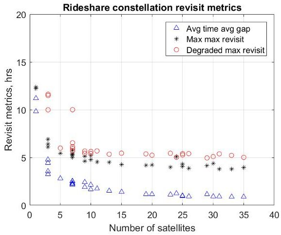

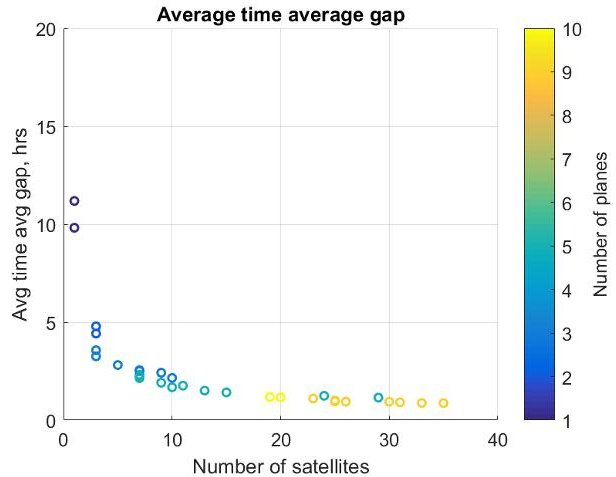

Figure 4: Pareto frontier for rideshare- Figure 5: Average time average gap for launched constellation. rideshare-launched constellation.

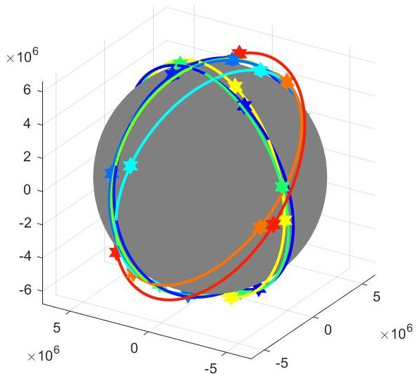

Figure 6: Pareto-optimal constellation of 30 satellites

between 3.8 and 12.4 hours. The degraded maximum revisit time over all points takes values between 5.0 and 11.6 hours, discounting the single-satellite case. Note the diminishing returns gained by adding satellites beyond the tenth. Indeed, the objective values change very slightly between 20 and 35 satellites. Fig. 5 shows the number of launches used by each solution. The theoretical FireSat-II example in Ref. [7] requires a revisit time of eight hours to identify nascent forest fires. The imaging capability provided by the rideshare constellations is sufficient for detection on such a timeline. The rideshare constellation performance is inferior to proposed constellation designs such as the FUEGO program, which achieves 25 minute revisit times using dedicated launches [44].

An example rideshare constellation using 30 satellites is shown in Fig. 6. The constellation consists of two sets of near-polar orbits spaced about ninety degrees apart in RAAN, plus a pair of orbits near 50 degrees in inclination. During the ninety day simulation time, the polar orbits maintain similar relative positions, but the relative position of the 50 degree orbit with respect to the polar orbits varies.

The stagnation of the values with increasing numbers of satellites highlights the critical flaw in

<!-- PDF_PAGE: 18 -->

rideshare constellations. Because the initial launch values are fixed in such a way that may not be beneficial to the rideshare mission, the resulting constellation can have large gaps in coverage when the rideshare orbits do not overlap in a fortuitous manner. The ability to maneuver the satellites helps to mitigate the problem, but the high $ \Delta v $ cost to enact a change in orbital plane impedes the constellation's ability to achieve the uniform formation often used in constellation design.

There are two ways to increase the performance of the rideshare constellation. The first is to have a greater number of rideshare opportunities available. This simulation used only one month's worth of launches. By permitting the satellites to be launched over a longer time period, more rideshares become available, increasing available orbit diversity. However, spreading the launch of the constellation over a longer period of time decreases the overall life of the constellation, since the time from when to constellation is fully population to when the first satellite reaches the end of its life is decreased. The other method for increasing constellation performance and spacing between orbits is to increase the maneuvering capability of the satellites. Manuevering can be improved by either increasing the amount of fuel onboard the satellites or by using a low-thrust, high $ I_{sp} $ electric propulsion system. The latter case increases the overall $ \Delta v $ , but requires more time to get the constellation to its final configuration.

Compare the performance of the rideshare constellations to the Walker constellations optimized using the genetic algorithm. The Pareto frontier for the Walker case is shown in Fig. 7. Clearly, the Walker constellations offer superior performance over the rideshare constellations. A Walker constellation of four satellites has comparable performance to a rideshare constellation of 15-20 satellites. Furthermore, satellites can be added to the Walker constellation to improve coverage until continuous coverage is reached, whereas the rideshare constellation has unfillable gaps due to the relative placement of the rideshare orbits. However, the cost of launching four satellites on dedicated rides is likely greater than the cost of the additional satellites needed for the rideshare constellation. The cost for the components listed in the previous section is $283K for everything except the propulsion system, which is still in development and does not have a published price. If the total cost is approximately $400K with the propulsion system, the satellite cost would be $6M for the rideshare constellation and $1.6M for the Walker constellation. Neither price includes the cost of testing or software development. The Walker constellation would require two to four launches to LEO, a cost of $36.8M-73.6M using Pegasus XL rockets [7]. Conversely, with a $30K per kilogram rideshare launch cost and a spacecraft weighing about 10kg, the rideshare launch cost is only $4.5M. Therefore, if the performance limitations of the rideshare constellation are acceptable, a constellation can be developed for about a quarter of the cost of a traditional Walker constellation. Fires in the state of California cause billions of dollars in damage each year, so the low cost of a fire detection constellation has the potential to pay for itself many times over.

## CONCLUSIONS

This paper outlines new methodologies for reachability and resilience analyses for constellations of nanosatellites. These methods leverage linear programming techniques and offer savings in computation time over other methods. It also analyzes the ability of a constellation built using only rideshare opportunities to provide coverage over California to perform fire detection. An average time average gap of less than one hour is achievable, as is a maximum revisit time over all points of less than four hours. The rideshare performance is compared to the performance of a Walker constellation. Although the Walker constellation can achieve arbitrary levels of coverage through the addition of further satellites, rideshare constellations are capable of meeting the capabilities of

<!-- PDF_PAGE: 19 -->

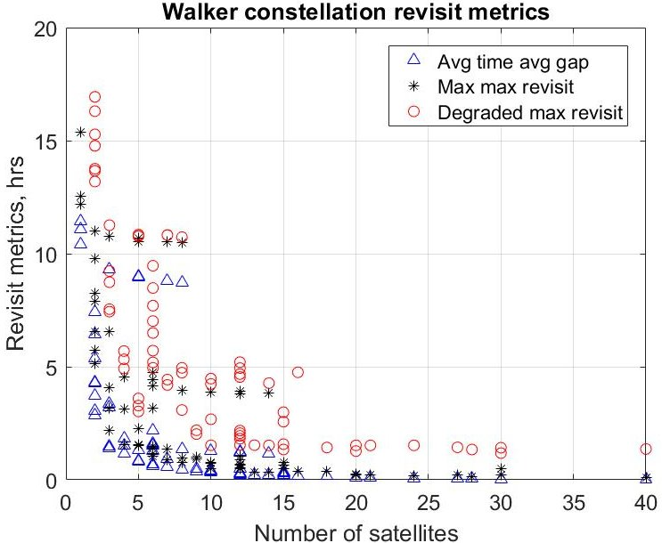

Figure 7: Pareto frontier for Walker constellation.

small Walker constellations at greatly reduced cost.

## ACKNOWLEDGMENTS

This material is based upon work supported by the National Science Foundation Graduate Research Fellowship Program under Grant No. DGE-1651272. Any opinions, findings, and conclusions or recommendations expressed in this material are those of the author(s) and do not necessarily reflect the views of the National Science Foundation. Support for this work was also provided by the Virginia Tech Institute for Critical Technology and Applied Science, the Ted and Karyn Hume Center for National Security and Technology, and the Virginia Space Grant Consortium.

## REFERENCES

[1] B. Space and Technology, "Smallsats by the Numbers 2018," tech. rep., Bryce Space and Technology, 2018.

[2] K. L. Bedingfield, R. D. Leach, and M. B. Alexander, "Spacecraft System Failures and Anomalies Attributed to the Natural Space Environment," Tech. Rep. 1390, NASA, 1996.

[3] C. C. Venturini, "Improving Mission Success of CubeSats," Tech. Rep. TOR-2017-01689, The Aerospace Corporation, 2017.

[4] Z. Peng and S. Kohani, "The performance of the constellations satellites based on reliability," Journal of Space Safety Engineering, Vol. 4, No. 2, 2017, pp. 112-116, 10.1016/j.jsse.2017.07.003.

[5] D. E. Hastings and P. A. L. Tour, "An economic analysis of disaggregation of space assets: Application to GPS," Acta Astronautica, Vol. 134, May 2017, pp. 244-264, 10.1016/j.actaastro.2017.02.008.

[6] D. K. Stenger, "Survivability Analysis of The Iridium Low Earth Orbit Satellite Network," Master's thesis, Air Force Institute of Technology, Wright-Patterson Air Force Base, Ohio, 1996.

[7] J. Wertz, D. Everett, and J. Puschell, Space Mission Engineering: The New SMAD, pp. 298,299,316,486. Space technology library, Hawthorne, CA: Microcosm Press, first ed., 2011.

[8] J. Berk, J. Straub, and D. Whalen, "The open prototype for educational NanoSats: Fixing the other side of the small satellite cost equation," 2013 IEEE Aerospace Conference, March 2013, pp. 1-16, 10.1109/AERO.2013.6497393.

[9] W. J. Larson and J. R. Wertz, eds., Space Mission Analysis and Design, ch. Communications Architecture, pp. 533-586. Space technology library, El Segundo, CA: Microcosm Press and Kluwer Academic Publishers, third ed., 1999.

[10] NASA, "ELaNa XII CubeSat Launch on NROL-55 Mission," tech. rep., NASA, 2015.

<!-- PDF_PAGE: 20 -->

[11] A. Ellis, M. Mercury, and S. Brown, "Global coverage from ad-hoc constellations in rideshare orbits," Proceedings of the 26th Annual AIAA/USU Conference on Small Satellites, Logan, UT, The American Institute of Aeronautics and Astronautics, 2012.

[12] J. W. Gangestad, J. R. Wilson, K. L. Gates, and J. V. Langer, "Rideshare-initiated constellations: Future CubeSat architectures with the current launch manifest," Proceedings of the 31st Space Symposium Colorado Springs, CO, Space Foundation, Space Foundation, 2015.

[13] K. E. Mott and J. T. Black, "Model-based heterogeneous optimal space constellation design," 2018 21st International Conference on Information Fusion (FUSION), Institute of Electrical and Electronics Engineers, Jul 2018, pp. 602-609, 10.23919/ICIF.2018.8455222.

[14] K. E. Mott and J. T. Black, "Heterogeneous Constellation Design Methodology Applied to a Mars-orbiting Communications and Positioning Constellation," AAS/AIAA Astrodynamics Conference, 2017, Vol. 162 of Advances in the Astronautical Sciences Series, Stevenson, WA, Univelt, 2017, pp. 23832396.

[15] M. P. Ferringer, D. B. Spencer, and P. Reed, "Many-objective reconfiguration of operational satellite constellations with the Large-Cluster Epsilon Non-dominated Sorting Genetic Algorithm-II," 2009 IEEE Congress on Evolutionary Computation, Trondheim, Norway, Institute of Electrical and Electronics Engineers, May 2009, pp. 340-349, 10.1109/CEC.2009.4982967.

[16] D. Hadka and P. Reed, "Borg: An Auto-Adaptive Many-Objective Evolutionary Computing Framework," Evolutionary Computing, Vol. 21, No. 2, 2013, pp. 231-259, 10.1162/EVCO $ _{a0} $ 0075.

[17] R. S. Legge, Jr and D. W. Miller, Optimization and Valuation of Reconfigurable Satellite Constellations Under Uncertainty. PhD thesis, Massachusetts Institute of Technology, Cambridge, MA, 2014.

[18] L. Appel, M. Guelman, and D. Mishne, "Optimization of satellite constellation reconfiguration maneuvers," Acta Astronautica, Vol. 99, Jun 2014, pp. 166-174, 10.1016/j.actaastro.2014.02.016.

[19] M. Fakoor, M. Bakhtiari, and M. Soleymani, "Optimal design of the satellite constellation arrangement reconfiguration process," Advances in Space Research, Vol. 58, No. 3, 2016, pp. 372-386, 10.1016/j.asr.2016.04.031.

[20] D. Xue, J. Li, H. Baoyin, and F. Jiang, "Reachable Domain for Spacecraft with a Single Impulse," Journal of Guidance, Control, and Dynamics, Vol. 33, No. 3, 2010, pp. 934-942, 10.2514/1.43963.

[21] M. J. Holzinger, D. J. Scheeres, and R. S. Erwin, "On-Orbit Operational Range Computation Using Gauss's Variational Equations with J2 Perturbations," Journal of Guidance, Control, and Dynamics, Vol. 37, No. 2, 2014, pp. 608-622, 10.2514/1.53861.

[22] B. HomChaudhuri, M. Oishi, M. Shubert, M. Baldwin, and R. S. Erwin, "Computing Reach-Avoid Sets for Space Vehicle Docking Under Continuous Thrust," 2016 IEEE 55th Conference on Decision and Control, Las Vegas, NV, Institute of Electrical and Electronics Engineers, 2016, pp. 3312-3318, 10.1109/CDC.2016.7798767.

[23] C. Zagaris and M. Romano, "Applied Reachability Analysis for Spacecraft Rendezvous and Docking with a Tumbling Object," 2018 Space Flight Mechanics Meeting, Kissimmee, FL, The American Institute of Aeronautics and Astronautics, 2018, 10.2514/6.2018-2220.

[24] L. Breger and J. P. How, "GVE-Based Dynamics and Control for Formation Flying Spacecraft," Proceedings of the 2nd International Symposium on Formation Flying Missions & Technologies, Washington, D.C., NASA, 2004.

[25] M. J. H. Walker, B. Ireland, and J. Owens, "A set of modified equinoctial orbital elements," Celestial Mechanics, Vol. 36, No. 4, 1985, pp. 409-419, 10.1007/BF01227493.

[26] S. Marcuccio, P. Pergola, S. Gregucci, and M. Andrenucci, "Low-thrust propulsion systems for small satellites," Proceedings of the 66th International Astronautical Congress, Jerusalem, Israel, International Astronautical Federation, 2015.

[27] "MPS-130: Innovative Propulsion Solutions for SmallSats," http://www.rocket.com/files/aerojet/documents/CubeSat/MPS-130%20data%20sheet%20crop.pdf, 2018.

[28] W. E. Weisel, Spaceflight Dynamics. Scotts Valley, CA: CreateSpace, third ed., 2010.

[29] J. Lofberg, "YALMIP : A Toolbox for Modeling and Optimization in MATLAB," 2004 IEEE International Conference on Robotics and Automation, Taipei, Taiwan, Institute of Electrical and Electronics Engineers, 2004, pp. 284-289, 10.1109/CACSD.2004.1393890.

[30] L. Gurobi Optimization, "Gurobi Optimizer Reference Manual," 2018.

[31] IBM, "CPLEX Optimizer," 2018.

[32] D. A. Vallado, Fundamentals of Astrodynamics and Applications, ch. General Perturbation Techniques, pp. 609-654. Hawthorne, CA: Microcosm Press, fourth ed., 2013.

[33] S. Alfano, "Rapid Generation of Site/Satellite Timetables," Journal of Spacecraft and Rockets, Vol. 30, No. 6, 1993, pp. 760-764, 10.2514/3.26383.

<!-- PDF_PAGE: 21 -->

[34] T. Koch, T. Achterberg, E. Andersen, O. Bastert, T. Berthold, R. E. Bixby, E. Danna, G. Gamrath, A. M. Gleixner, S. Heinz, A. Lodi, H. Mittelmann, T. Ralphs, D. Salvagnin, D. E. Steffy, and K. Wolter, "MIPLIB 2010," Mathematical Programming Computation, Vol. 3, Jun 2011, p. 103, 10.1007/s12532-011-0025-9.

[35] "Helios deployable antenna," 2018.

[36] "VHF downlink/UHF uplink Full Duplex Transceiver," 2018.

[37] "BAox High Energy Density Battery Array," 2018.

[38] "Crystalspace P1U Vasik," https://www.cubesatshop.com/product/ crystalspace-p1u-vasik/, 2018.

[39] "CubeSat Solar panel DHV-CS-10," 2018.

[40] C. Space, "CubeADCS 3-Axis," http://41.185.8.177/~cubespac/ClientDownloads/ CubeADCS_3Axis_Specsheet_V1.1.pdf, 2018.

[41] "Chameleon imager," 2018.

[42] T. S. Kelso, "CelesTrak," http://celestrak.com/, 2018.

[43] STK, "Measuring the Average Length of the Coverage Gap," Online, 2018. http://help.agi.com/stk/index.htm#cov/fom-10.htm.

[44] D. Escorial, I. F. Tourne, F. J. Reina, and J. Gonzalo, "FUEGO: A dedicated constellation of small satellites to detect and monitor forest fires," Acta Astronautica, Vol. 53, No. 9-12, 2003, pp. 765-775, 10.1016/S0094-5765(03)00052-3.