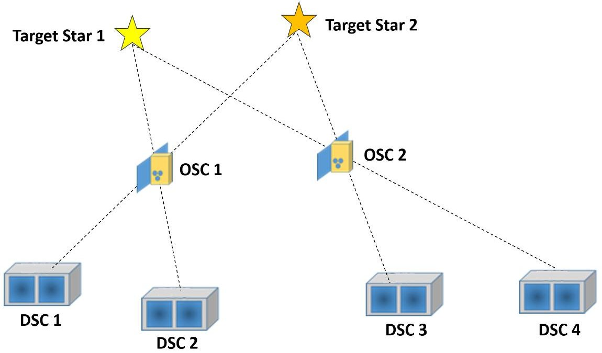
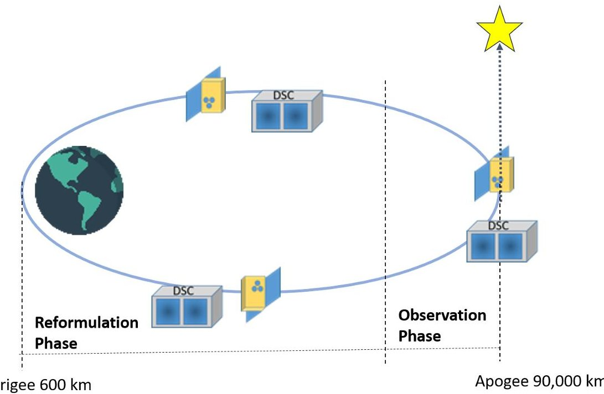
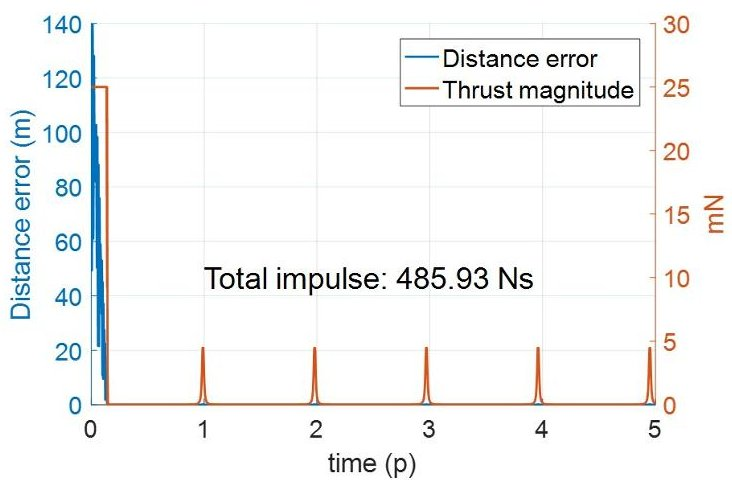
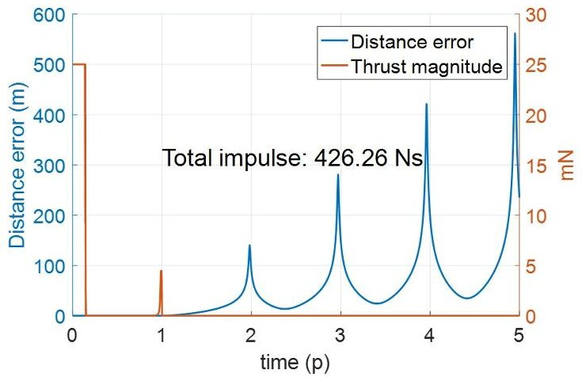
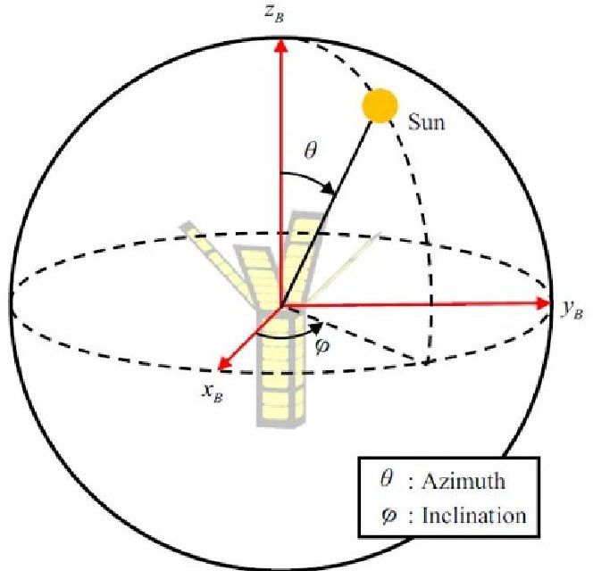
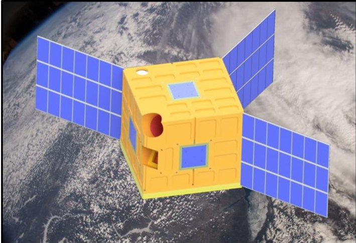
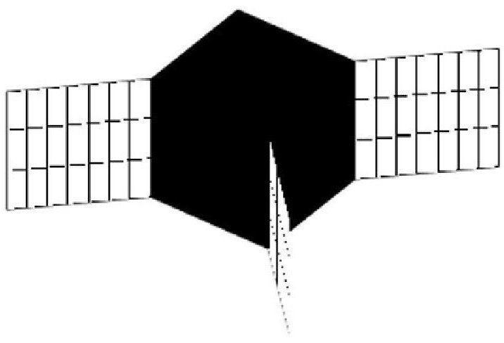
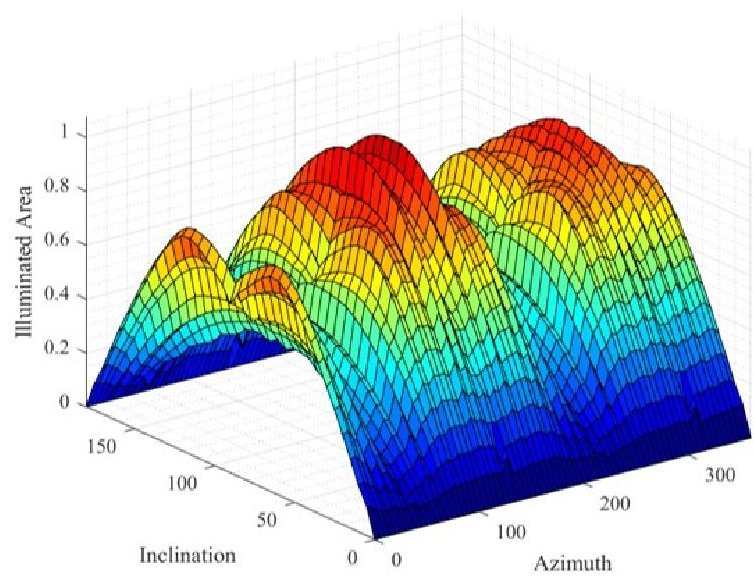

<!-- PDF_PAGE: 1 -->

IAC-19-D1.2.3x51578D

DESIGN OPTIMIZATION OF A SPACE VIRTUAL TELESCOPE MISSION USING A CUBESAT SWARM

Hyeongjun Park Department of Mechanical and Aerospace Engineering, New Mexico State University, USA hjpark@nmsu.edu

Dae Young Lee, Youngro Lee Department of Aerospace Engineering, Iowa State University, USA daylee@iastate.edu; youngro@iastate.edu

## Kyle Rankin

Department of Mechanical and Aerospace Engineering, New Mexico State University, USA, krankii@nmsu.edu

## Steven Stochaj

Klipsch School of Electrical and Computer Engineering, New Mexico State University, USA, sstochaj@nmsu.edu

Space-based virtual telescopes use multiple satellites to acquire images from the sun and stars. For example, the Virtual Telescope for X-ray Observations (VTXO) mission utilizes two small satellites to form a virtual telescope. By aligning an optics satellite and a detector satellite, a focal length within the range from hundreds of meters to a few kilometers can be achieved. One of the main challenges for these virtual telescope missions is to align the optics satellite and the detector satellite precisely for fine imaging. The detector satellite must maneuver to hold the alignment whenever the optics satellites attitude changes. This frequent maneuvering for adjusting the position and the attitude of the detector satellite exhausts resources and therefore shortens the mission lifetime of the virtual telescope system. In this paper, we propose developing the architecture of a space virtual telescope mission using a CubeSat swarm to enhance mission capability and increase mission lifetime. The main characteristic of the proposed architecture is to increase possible combinations between detecting and observing satellites. For instance, one or two optics satellites with ten to twenty small detector satellites could achieve better performance by covering a larger observation area with reduced maneuvering, better reliability, and longer life span of the virtual telescope system. Towards this goal, we first study the models and optimizations in the disciplines of the virtual telescope systems to use multidisciplinary design optimization technologies. The obtained optimization models in the architecture include observation duration, fuel consumption, and power generation. Finally, the discipline models are applied to the simulating satellite data from the VTXO mission.

keywords: Virtual Telescope, CubeSats, Mission Design, Design Optimization, Modeling, Architecture

## 1. Introduction

There is a growing trend to develop virtual telescopes in space (VTS) using multiple small satellites. A virtual telescope is designed to acquire images by aligning two or more satellites such as optics satellites and detector satellites. Using the virtual telescopes long focal length can be obtained in the range of hundreds of meters to a few kilometers. The multiple spacecraft flying in a formation approximate a single rigid telescope.

There are several missions using the virtual telescope system architecture. For example, the New

Worlds Observer (NWO) mission $ ^{2} $ requires the VTS to discover potential earth-like planets. The Xray Milli-Arc-Second Structure Imager (MASSIM) $ ^{18} $ uses the VTS for X-ray imaging with precision astrometric alignment control. Similarly, the Virtual Telescope for X-ray Observations (VTXO) $ ^{10,15-17} $ is a space-based observation mission with two small satellites being developed by NASA Goddard Space Flight Center (GSFC). The VTXO mission's goal is to perform X-ray observations with an angular resolution around 50 milli-arcseconds. The Project for On-Board Autonomy-3 (PROBA-3) mission $ ^{14} $ uses

<!-- PDF_PAGE: 2 -->

Fig. 1: Illustration of the VTS mission architecture using multiple CubeSats.

two spacecraft to test and validate formation keeping on a high eccentricity orbit for sun's corona observation. The Miniaturized Distributed Occulter/Telescope (mDOT) mission uses a large freeflying occulter spacecraft and a telescope spacecraft to enable exoplanet imaging. $ ^{4,6} $ The CubeSat Astronomy by NASA and Yonsei using Virtual Telescope Alignment eXperiment (CANYVAL-X) mission requires flight formation of two CubeSats to enable a solar coronagraph. $ ^{11-13} $

One of the main challenges for these virtual telescope missions is to align the optics satellite and the detector satellite precisely for fine imaging. To form a virtual telescope with a focal length within the range from hundreds of meters to a few kilometers, the detector satellite must maneuver to hold the formation, i.e., relative position and attitude, whenever the optics satellites attitude changes. This frequent maneuvering for adjusting the position and attitude of the detector satellite exhausts resources and therefore shortens the mission lifetime of the VTS. To achieve precision alignment, analysis of the relative dynamics has been mainly studied. $ ^{1,9,14} $ Various methods on relative navigation and control of satellites have been also proposed. $ ^{5,8,10} $

To enhance the mission capability of VTS, a virtual telescope mission using a CubeSat swarm can be useful architecture for advanced science missions. The main characteristic of the virtual telescope architecture is using possible combinations of observations between multiple optics and multiple detecting spacecraft for multiple targets as illustrated in Fig. 1. For instance, one or two optics satellites with ten to twenty small detector satellites could achieve better performance by covering a larger observation area with reduced maneuvering, better reliability, and longer life span of the virtual telescope system. However, the design of multiple satellites and their operation for virtual telescope systems is a complex task that involves multiple engineering disciplines such as orbit dynamics, communication, solar power, energy storage, etc.

Since the design and operation of virtual telescope systems involves a large number of variables, design optimization is an important area of research to help improvement of the whole telescope system's performance. Thus, multidisciplinary design optimization (MDO) $ ^{3} $ is applicable and beneficial to the design and operation of VTS using multiple CubeSats. In this paper we investigate related models and optimization problems in VTS design and operation towards using available MDO methods for VTS design and operation.

The remainder of the paper is organized as follows. Important optimization problems in developing a virtual telescope are described in Section 2. In Section 3, a model for maximizing observation time is discussed to achieve successful science missions by increasing the possible observation period. A minimum fuel consumption problem is presented in Section 4. A study on solar panel design is presented in Section 5, followed by conclusions in Section 6.

<!-- PDF_PAGE: 3 -->

## 2. Optimization problems of VTS design

The design problem of satellites has various disciplines, such as orbit dynamics, attitude dynamics, cell illumination, temperature, solar power, energy storage, communication, etc. The modeled disciplines have been studied for a 3U CubeSat mission by Hwang et al. $ ^{3} $

For a VTS mission using multiple small satellites, we can find common important design and operation disciplines to achieve the mission objectives and requirements. First, most VTS missions are to obtain images from the sun or stars. Maximizing observation time in the designed orbit is important to conducting successful science missions. Second, minimizing fuel consumption by spacecraft is critical to increasing the lifetime of the mission with the limited amount of propellant in space. Next, maximizing power generation from solar panels on the spacecraft is also considerable during the observation phase since the detector satellites will consume power for guidance, navigation, and control (GN&C), inter-satellite communication, and observation equipment operation. Many small satellites are power constrained and use deployable power arrays to increase power production. This presents a design opportunity related to energy management and methods for design optimization.

In this paper, we investigate the models in the proposed disciplines for observation duration, fuel consumption, and power generation in the following sections. As a case study, we apply the models and optimization problems to the VTXO mission that includes a 6U CubeSat for the optics satellite (leader) and a 27U CubeSat for the detector satellite (follower). We investigate for a highly elliptical super synchronous transfer orbit which has the apogee altitude of 90,000 km and the perigee altitude of 600 km. Figure 2 illustrates the VTXO mission concept.

## 3. Observation time

The observation mission will be conducted while the spacecraft are near the apogee of the orbit since the gravity gradient is minimal. Hence, we can obtain the maximum observation duration that requires precision alignment between the spacecraft. The maximum observation time for orbits has been approximately obtained by Koenig et al. $ ^{5} $ assuming that the precision formation can be allowed to passively drift within a formation window. The relative position vector $ \vec{r} $ of the follower spacecraft to the leader spacecraft in the Earth Centered Inertial (ECI) frame

is given by

$$
\vec {r} = \vec {r} _ {f} - \vec {r} _ {l}
$$

where $ \vec{r}_{l} $ and $ \vec{r}_{f} $ are the position vectors of the leader and follower spacecraft, respectively. The observation duration $ \Delta t_{o} $ is obtained as

$$
\Delta t _ {o} = 4 \sqrt {\frac {r _ {l} ^ {3} \Delta r}{\mu \bar {r}}}
$$

where $ \bar{r} $ denotes the baseline separation between two spacecraft and $ \Delta r $ is a specified margin of the baseline separation. $ ^{5} $ The advantage of this approach is that the approximated time period to maximize observation without using propellant can be obtained quickly from Eq. 2. Then, the obtained value can be used as an initial guess for the high-level design optimization problem considering all the disciplines.

In the VTXO mission, the maximum observation time using Eq. [1] can be obtained in the following cases: (i) baseline separation: 0.1 km, margin of the baseline separation: $ \pm0.1 $ m, maximum observation time: 2.35 hours (ii) baseline separation: 0.5 km, margin of the baseline separation: $ \pm1 $ m, maximum observation time: 3.33 hours (iii) baseline separation: 1 km, margin of the baseline separation: $ \pm5 $ m, maximum observation time: 5.27 hours.

## 4. Fuel consumption

In the virtual telescope missions, we have mainly two maneuvering phases, i.e., the observation phase and the reformulation phase. In the observation phase one spacecraft can be on a natural orbit while the other maneuvers on a non-natural orbit. We assume that the following detector spacecraft maneuvers on the non-natural orbit so that the follower must compensate the small gravity gradient difference between two spacecraft. The desired formation between the leader and follower spacecraft in the observation phase has been investigated by Perea et al. $ ^{14} $ The position relationship is expressed in the ECI frame as

$$
\vec {r} _ {f, r e f} = \vec {r} _ {l} + l \left(\frac {\vec {r} _ {f} - \vec {r} _ {t}}{| | \vec {r} _ {f} - \vec {r} _ {t} | |}\right)
$$

where $ \vec{r}_{r,ref} $ denotes the reference trajectory of the follower, l is a required distance between two spacecraft. Then, the equations of the relative motion of the follower with respect to the reference trajectory is given by

$$
\ddot {\vec {r}} _ {f} - \ddot {\vec {r}} _ {f, r e f} = f \left(\vec {r} _ {f}\right) - f \left(\vec {r} _ {l}\right) - l \left(\frac {\vec {r} _ {f} - \vec {r} _ {t}}{| | \vec {r} _ {f} - \vec {r} _ {t} | |}\right) ^ {\prime \prime} + \vec {u}. [ 4 ]
$$

<!-- PDF_PAGE: 4 -->

Fig. 2: Illustration of the VTXO mission.

Optimal fuel consumption is generally important to VTS missions to maximize the mission lifetime. It is intuitive that considering observation formation keeping in the entire orbit is not fuel-efficient. An analysis of fuel consumption of the VTXO mission is implemented in Fig. 3 for 100 m separation where the observation period is assumed $ \pm2 $ hours from the apogee. The detector spacecraft (follower) performs orbit maneuvering while the optics spacecraft (leader) flies the natural orbit. In this simulation, the target is the Polaris as an example and the desired relative position vector is

$$
\vec {r} _ {d} = \left[ \begin{array}{c c c c c c} 0 & 0 & - 0. 1 & 0 & 0 & 0 \end{array} \right] ^ {T}.
$$

It shows the result of the thrust required to maintain the observation formation in the orbit for the VTXO mission. One can see that fuel consumption around the perigee is much larger than that around the apogee as shown in Fig. 3. Therefore, minimizing fuel consumption when the detector spacecraft passes the perigee is critical. On the other hand, if we don't consider any thrust generation in the reformulation phase, then the relative distance is unstable as shown in Fig. 4, so it cannot manage the observation formulation in the next orbit period. Since there are much more room in minimizing fuel consumption in the reformulation phase, we focus on the optimal control problem in the reformulation phase to save

Fig. 3: Thrust required to maintain the formation over five orbits in VTXO.

Fig. 4: Distance error without control in the reformulation phase.

<!-- PDF_PAGE: 5 -->

propellant.

An optimization problem to minimize fuel consumption in the reformulation phase can be formulated as follows.

Minimize:

$$
J = \int_ {t _ {i}} ^ {t _ {f}} | | \vec {u} (t) | |
$$

subject to,

$$
\ddot {\vec {r}} (t) = - \frac {\mu}{| | \vec {r} _ {l} | | ^ {3}} \vec {r} _ {l} (t),
$$

$$
\ddot {\vec {r}} _ {f} (t) = - \frac {\mu}{| | \vec {r} _ {f} | |} \vec {r} _ {f} (t) + \vec {u} (t),
$$

$$
| | \vec {u} (t) | | \leq u _ {m a x},
$$

$$
\left| \left| \vec {r} _ {f} (t) - \vec {r} _ {l} (t) \right| \right| \geq r _ {m},
$$

$$
\vec {r} _ {f} \left(t _ {i}\right) - \vec {r} _ {l} \left(t _ {i}\right) = \vec {r} _ {i},
$$

$$
\vec {r} _ {f} \left(t _ {f}\right) - \vec {r} _ {l} \left(t _ {f}\right) = \vec {r} _ {d},
$$

where $ u_{max} $ is the maximum thrust of the follower spacecraft, $ r_{m} $ is the keep-out zone radius to avoid collision, $ \vec{r}_{i} $ is the initial relative position when the reformulation phase starts at time $ t_{i} $ , and $ \vec{r}_{d} $ is the desired relative position of the observation formulation when the observation phase starts at time $ t_{f} $ Here, collision avoidance between the leader and the follower, and the initial and final conditions of the reformulation phase are considered. Note that we don't need to consider the observation formation, but the initial and final conditions of the reformulation phase are the same as the final and initial conditions of the observation phase, respectively. We assume that perturbations are negligible as the magnitude of perturbations are much smaller.

The optimization problem 5 is a challenging problem to solve since it has the nonlinear dynamics and the non-convex constraint for collision avoidance. For the high-level design optimization problem, relaxation of the optimization problem 5 may be considered. By using the relative dynamics, we propose the following simplified optimization problem as Minimize:

$$
J = \int_ {t _ {i}} ^ {t _ {f}} | | \vec {u} (t) | |
$$

Fig. 5: Example of the spacecraft-body-fixed shpherical coordinate system with the sun's location. $ ^{7} $

subject to,

$$
\ddot {\vec {r}} (t) = - \frac {\mu}{| | \vec {r} _ {f} | |} \left(I - 3 \hat {r} _ {f} \hat {r} _ {f} ^ {T}\right) \vec {r} (t) + \vec {u} (t),
$$

$$
\ddot {\vec {r}} _ {f} (t) = - \frac {\mu}{| | \vec {r} _ {f} | |} \vec {r} _ {f} (t) + \vec {u} (t),
$$

$$
| | \vec {u} (t) | | \leq u _ {m a x},
$$

$$
| | \vec {r} (t) | | \geq r _ {m},
$$

$$
\vec {r} \left(t _ {i}\right) = \vec {r} _ {i},
$$

$$
\vec {r} \left(t _ {f}\right) = \vec {r} _ {d}.
$$

The approximated equations [5b] and [5c] can be found in the references. $ ^{1,8,9} $

## 5. Power generation

In this section, we discuss on maximum power generation of the VTS for the observation phase. A power generation model has been created by Lee et al. to evaluate various objective functions describing energy management for complex satellite designs. Using a spacecraft-body-fixed spherical coordinate system, the model analyzes the complex geometry of a satellite's self-induced shadowing with computation provided by the Open Graphics Library as shown in Fig. 5. The power generation model is applied to the follower spacecraft (a 27U CubeSat) as illustrated in Fig. 6 and Fig. 7.

The solar panels of VTXO are partially covered by the self-induced shadows and require panel angle optimization to reduce these type of shadows. To

<!-- PDF_PAGE: 6 -->

Fig. 6: Detector Spacecraft of VTXO. $ ^{1 6} $

Fig. 7: Generation of the solar panel exposure model of VTXO using MATLAB/Simulink.

optimize the panel angle, the self-induced shadow is calculated using a CAD model of the system and OpenGL. Orbital and attitude dynamics configuration are required to calculate the angles between the satellite and the sun. This information is mapped to the attitude sphere and weighted according to occurrence during the mission lifetime. Based on the shadow mapping and sun angle directions, fast calculations of power and energy generation capabilities of the satellite could be evaluated. Fig. 8 shows the preliminary result of power generation for the current design of the solar panel in Fig. 6. As orbital parameters change, we can obtain the corresponding maximum power. This mapping will be implemented for different angles for the solar panel installation and different shape designs for the panels.

Fig. 8: Power generation of the current design of the solar panels.

## 6. Conclusions

This paper aims to address modeling and discipline optimizations towards design optimization of a space virtual telescope mission using multiple CubeSats. There are common important design and operation disciplines to achieve virtual telescope missions such as maximum observation duration, minimum fuel consumption during the reformulation phase, and solar panel angle design for maximizing power generation. We investigated the models in the proposed disciplines and implemented a case study based on the Virtual Telescope for X-ray Observations (VTXO) mission which uses a 6U CubeSat and a 27U CubeSat for the optics satellite and the detect satellite, respectively. The main contribution of this paper is to apply possible models and optimizations for important disciplines in the architecture of the virtual telescope systems using multiple CubeSats. In the future work, we will study other disciplines such as the total data downloaded, inter-satellite communication, energy storage, temperature, etc. Furthermore, we will solve the high-level multidisciplinary design optimization (MDO) by using the gradient-based MDO approach.

## References

<!-- PDF_PAGE: 7 -->

[2] W. Cash, P. Oakley, M. Turnbull, T. Glassman, A. Lo, R. Polidan, S. Kilston, and C. Noecker. The New Worlds Observer: Scientific and technical advantages of external occulters. Space Telescopes and Instrumentation, 2008.

[3] J. Hwang, D. Lee, J. Cutler, and J. Martins. Large-scale multidisciplinary optimization of a small satellites design and operation. Journal of Spacecraft and Rockets, 51(5):1648-1663, 2014.

[4] A. Koenig, S. D'Amico, B. Macintosh, and C. Titus. Formation design analysis for a miniaturized distributed occulter/telescope in earth orbit. International Symposium on Space Flight Dynamics (ISSFD), 2015.

[5] A. Koenig, B. Macintosh, and S. D'Amico. Formation design of distributed telescopes in earth orbit for astrophysics applications. Journal of Spacecraft and Rockets, pages 1-16, 2019, published online, doi.org/10.2514/1.A34420.

[6] J. Kolmas, P. Banazadeh, A. Koenig, B. Macintosh, and S. D'Amico. System design of a miniaturized distributed occulter/telescope for direct imaging of star vicinity. 2016 IEEE Aerospace Conference, 2016.

[7] D. Lee, J. Cutler, J. Mancewicz, and A. Ridley. Maximizing photovoltaic power generation of a space-dart configured satellite. Acta Astronautica, 111:283-299, 2015.

[8] R. Luquette. Nonlinear control design techniques for precision formation flying at Lagrange points. PhD thesis, University of Maryland, College Park, 2006.

[9] R. Luquette and Robert S. Spacecraft formation control: Managing line-of-sight drift based on the dynamics of relative motion. International Symposium on Formation Flying Missions and Technologies, 2008.

[10] A. Naseri, R. Pirayesh, R. Adcock, S. Stochaj, N. Shah, and J. Krizmanic. Formation flying of a two-CubeSat virtual telescope in a highly elliptical orbit. SpaceOps Conference, 2018.

[11] J. Park, S-Y. Park, K. Lee, H. Oh, K. Choi, Y. Song, J. Yim, E. Lee, S. Hwang, and S. Kim. Mission analysis and CubeSat design for CANYVAL-X mission. International Conference on Space Operations, 2016.

[12] J. Park, S-Y. Park, Y. Song, G. Kim, K. Lee, H. Oh, J. Yim, E. Lee, S. Hwang, and S. Kim. CubeSat development for CANYVAL-X mission. International Conference on Space Operations, 2016.

[13] S-Y. Park. Orbit design and control of technology validation mission for refractive space telescope in formation flying. AIAA Guidance, Navigation, and Control Conference, 2014.

[14] L. Perea, S. D'Amico, and P. Elosegui. Relative formation flying dynamics and control of a two-element virtual telescope on a HEO. International Symposium on Space Flight Dynamics (ISSFD), 2009.

[15] K. Rankin, J. Krizmanic, N. Shah, S. Stochaj, and A. Naseri. Virtual telescope for X-ray observations. Small Satellite Conference, 2019.

[16] K. Rankin, N. Shah, J. Krizmanic, S. Stochaj, and A. Naseri. Formation flying techniques for the virtual telescope for X-ray observations. International Astronautical Congress, 2018.

[17] K. Rankin, S. Stochaj, N. Shah, J. Krizmanic, and A. Naseri. VTXO: Virtual telescope for X-ray observations. Small Satellite Conference, 2018.

[18] G. Skinner, Z. Arzoumanian, W. Cash, N. Gehrels, K. Gendreau, P. Gorenstein, J. Krizmanic, M. Miller, J. Phillips, and R. Reasenberg. The Milli-Arc-Second Structure Imager (MASSIM): A new concept for a high angular resolution X-ray telescope. Space Telescopes and Instrumentation, 2008.