<!-- PDF_PAGE: 1 -->

IAC-19,B4,IP,12,x50318

# IRAS: Progress in Development of the Digital Concurrent Engineering Platform, Software Tools and Innovative Technologies

Manfred Ehresmann $ ^{a,*} $ , Martin Fugmann $ ^{a} $ , Jonathan Skalden $ ^{a} $ , Daniel Galla $ ^{a} $ Christoph Montag $ ^{a} $ , Georg Herdrich $ ^{a} $ , Stefanos Fasoulas $ ^{a} $ , Sabine Klinkner $ ^{a} $

$ ^{a} $ Institute of Space Systems, University of Stuttgart, Pfaffenwaldring 29, 70569 Stuttgart, Germany, ehresmann@irs.uni-stuttgart.de , fugmann@irs.uni-stuttgart.de , skalden@irs.uni-stuttgart.de , galla@irs.uni-stuttgart.de , montag@irs.uni-stuttgart.de, herdrich@irs.uni-stuttgart.de , fasoulas@irs.uni-stuttgart.de , klinkner@irs.uni-stuttgart.de

* Corresponding Author

## Abstract

Progress of the Digital Concurrent Engineering Platform (DCEP), the respective software tools and technologies for satellite cost reduction in development at the Institute of Space Systems of the University of Stuttgart (IRS) as part of the Integrated Research Platform for Affordable Satellite (IRAS) is presented.

The DCEP is a collaborative engineering platform that protects stakeholder intellectual property. The IRS is supplying two design tools for the platform.

First, the Evolutionary System Design Converger is a systems engineering software tool, that considers selection and scaling of (sub-)system components to generate optimal spacecraft configurations. This is achieved through an evolutionary algorithm. Random mutation of permitted design degrees of freedom is defined in a generic model. Scaling is derived from a database containing hardware performance data. Non-random selection is implemented by defining optimizing criteria such as minimal or maximum system masses.

Second, a software tool for constellation design and evaluation is being development. Here worst-case design criteria of the individual constellation satellite are produced. Determining an overall best solution of constellation orbital parameters, while considering optimal constellation satellite design to achieve cost effectivity.

Additive manufacturing is an innovative technology with significant potential for cost and mass reduction in spacecraft. To this end, the utilization of additively manufactured tungsten nozzles with integrated cooling channels is evaluated with advantages to conventionally cooled arcjet nozzles. Further, the utilization of alternative nozzle inserts to assess the work function and potential anode fall reach and voltage relationship is assessed. A similar strategy is followed with the development of a CubeSat compliant pulsed plasma thruster called PETRUS, where low-cost additive manufactured components with increased efficiency are applied.

Two technology demonstration missions are currently in development: The CubeSat SOURCE as a precursor mission, and a small satellite to demonstrate enhanced on-board autonomy and data processing, while also featuring novel propulsion systems. The second mission is the small satellite OREUS, with the aims of observation of re-entry events, verification of novel technologies in orbit, and application of the IRAS development tool chain.

Keywords: Concurrent Engineering, Automated Design, Additive Manufacturing, technology demonstration, IRAS

<table border="1"><tr><td>Nomenclature</td><td></td><td>CPSCS</td><td>Common Parametric Satellite Configuration Scheme</td></tr><tr><td>m- mass</td><td></td><td>DCEP</td><td>Digital Concurrent Engineering Platform</td></tr><tr><td>P- power</td><td></td><td>DLR</td><td>German Aerospace Center</td></tr><tr><td>$\Delta v$- velocity increment</td><td></td><td>DRAMA</td><td>Debris Risk Assessment and Mitigation Analysis</td></tr><tr><td>AM- Additive Manufacturing</td><td></td><td>ESDC</td><td>Evolutionary System Design Converger</td></tr><tr><td>ARES- Assessment of Risk Event Statistics</td><td></td><td>EP</td><td>Electric Propulsion</td></tr><tr><td>ASTOS- Analysis, Simulation and Trajectory Optimization Software for Space Applications</td><td></td><td>IRAS</td><td>Integrated Research platform for Affordable Satellite</td></tr><tr><td>CROC- CROss Section of Complex Bodies</td><td></td><td>IRS</td><td>Institute of Space Systems University of Stuttgart</td></tr><tr><td>CPACS- Common Parametric Aircraft Configuration Schema</td><td></td><td></td><td></td></tr></table>

<!-- PDF_PAGE: 2 -->

IPA – Fraunhofer Institute for Manufacturing Engineering and Automation

KSat e.V. - Small Satellite Student Society University of Stuttgart

OREUS - Observation of Re-entry Events Using Space 4.0

OSCAR - Orbital Spacecraft Active Removal

PPT - Pulsed Plasma Thruster

PPU - Power Processing Unit

PTFE - Polytetrafluoroethylene

SOURCE - Stuttgart Operated University Research CubeSat for Evaluation and Education

U - CubeSat Unit

XML - Extensible Markup Language

## 1. Introduction

The Integrated Research Platform for Affordable satellites (IRAS) is a research programme of the DLR that aims for competitive capability building for spacecraft development and design. This shall be achieved by a digital collaboration platform, which maintains stakeholders IP, low-cost function integrated components, innovative production methods and automated spacecraft design.

The IRS is the designated supplier of an optimized satellite and constellation design tools for application in the DCEP, a dedicated propulsion system that implements additive manufacturing, as well as the design of technology demonstration missions [1, 2].

## 2титит 2. Expert tools for the DCEP

The DCEP will provide a decentralized engineering platform to support fast and flexible satellite design. This platform incorporates data and software tools of different stakeholders. The number of DCEP stakeholders shall be extended in future application. A central node serves as the interface between integrated software and allows a user accessing stakeholder contributions for spacecraft design. The basis of the process is the Common Parametric Satellite Configuration Scheme (CPSCS), which is based on the aviation variant CPACS. The CPSCS data set stores relevant information of spacecraft/mission and is interface able with tools and databases. Two tools are currently in development at the IRS for extending the DCEP functionality.

## 2.1 Evolutionary System Design Converger

Constellations are deployed by launching batches of individual similar satellites. The actual design, selection of components and operation parameters drives the cost effectiveness of a single spacecraft. This cost effectiveness is amplified by the constellation size. A generic satellite design tool, that can automatically yield

optimal configurations and operation parameters is highly relevant for a cost-effective constellation.

Within the IRAS DCEP the IRS provides the Evolutionary System Design Converger (ESDC), a software tool with a holistic spacecraft design approach based on evolutionary algorithms that derive subsystem scaling from real world hardware (performance) data [2, 3, 4]. The code of the ESDC is open-source and a recent version is publicly available on the version-control platform

GitHub under a MIT license [5]. The code was initially written in MATLAB, but has been overhauled and adapted to work with the free open-source alternative Octave, in version 4.4.1.

Designing an ideal spacecraft is a nearly infinite challenge, with many trade-offs of system configurations to be performed. Experienced engineers often fall back to common solutions, which might not be objectively optimal. To circumvent the subjective human element as well as the complexity of design loops, allow objective trade-off generation and fast system design, an evolutionary algorithm is implemented for optimizing spacecraft mass as the currently utilized proxy for main costs.

The. The evolutionary algorithm considers user given constraints (e.g. maximum total mass, required velocity change...） as well as requirements, for example

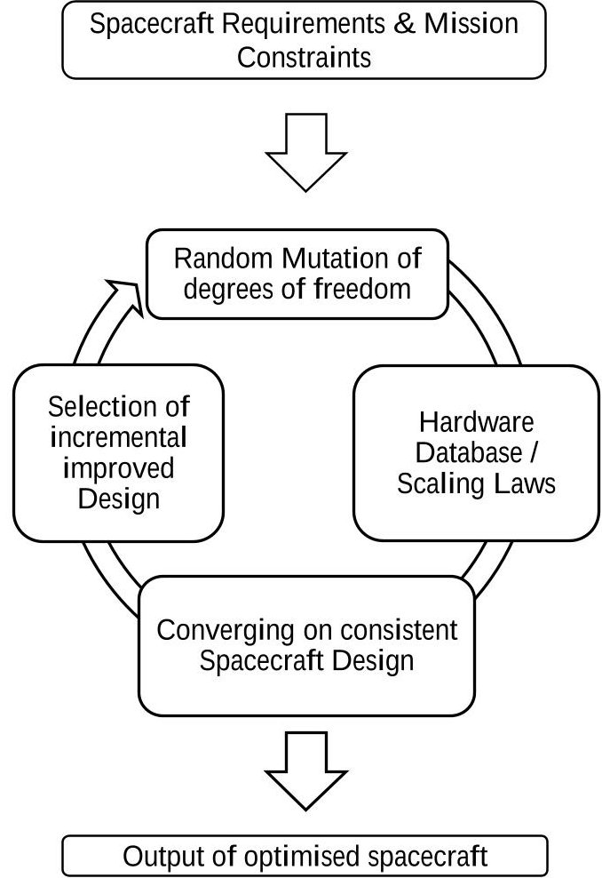

Figure 1: Evolutionary System Design Converger basic workflow [4]

<!-- PDF_PAGE: 3 -->

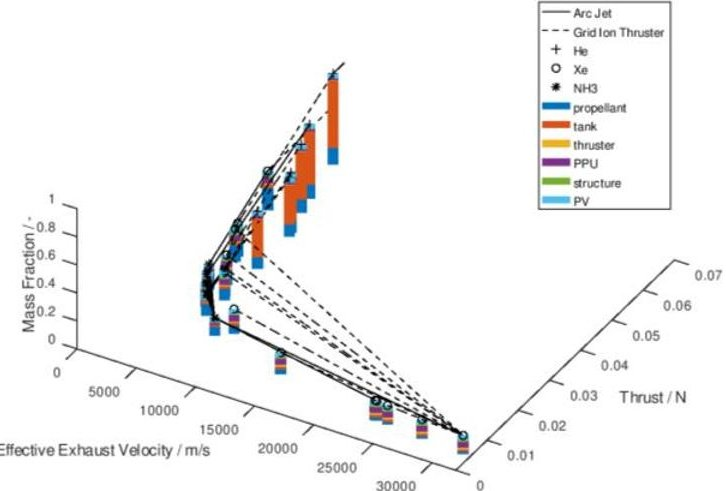

Figure 2: Evolutionary System Design Converger example output of a multidimensional design space including thrust, effective exhaust velocity, propellants, propulsion technologies and subsystem mass estimations.

maximum manoeuvre time, which limit the possible design space. The basic workflow is given in Fig.1.

Within this design space, random system designs are generated from an XML-database from which possible configurations are derived in a generic way. Additions to the database with new technologies or hardware examples are handled automatically.

## 2.1.1 Spacecraft design process within ESDC

The design process starts with a randomly generated design point, called the seed design. A seed design is then randomly mutated within the permitted design space, considering permitted degrees of freedom. The newly generated design is evaluated in comparison to a design of a previous generation and the more advantageous solution is kept for further iteration. This combination of random mutation and non-random selection makes this an effective algorithm that allows determining solutions for nearly arbitrary complex optimisation problems.

Convergence of a design is reached in the current ESDC implementation, when a predetermined number of successive non-advantageous mutations occurs.

A user defined quantity of seed points, and therefore lineages to be mutated simultaneously, allows to determine the likely global optimal solution. A single or low number of lineages comes with the risk of converging at only local optimal solutions.

Currently a common desktop computer calculates approximately 100 generations per second, while many options for performance improvements are still untapped.

## 2.1.2 Productive features of ESDC

As a main system driver and significant heritage with electric propulsion systems at the IRS the current version of the ESDC focusing on designing the EP system and power related components.

Continuous (e.g. thrust and power) and discrete (e.g. thruster and propellant type) degrees of freedom are considered equally by the ESDC [1,4].

In accordance with the DCEP approach the ESDC is capable to produce human and machine readable output alike. As optimally determined system configurations with all subsystem masses and relevant performance parameters as well as operation conditions in the form of an XML-file are generated.

A visualisation module has been implemented, which can help a (systems) engineer to understand the progress of generations during an ESDC cycle or explain the performed trade-offs to a third party in a more illustrative manner. Fig. 2 is given as an example of the visual output.

The XML-data might be of direct relevance to a human user of the DCEP. More likely this data can be directly used for a design loop. For example, the results of the ESDC might conclude that the total system mass needs to be adapted and an iteration with another loop of the ESDC can begin. This is of high relevance to design an optimal constellation or fine tune the configuration of individual members of a mega constellation.

## 2.1.3 Example output of ESDC

A simple example of the ESDC is given here to demonstrate the output and how it can be interpreted [4].

Within the scope of the IRAS project a small satellite constellation is envisioned. For the individual constellation members a s mass of $ m_{\mathrm{total}}=150 $ kg shall not be exceeded. Furthermore, a $ \Delta v $ of 526 m/s was deemed sufficient for the transfer from an insertion to an operational orbit [2, 3]. The continuous power supplied to the electric propulsion system is limited to $ P_{EP}= 2 0 2. 9 $ W. With these inputs, a simulation is started for the ESDC. An example output is given in Fig. 2, where the three lineages are displayed, which conclude to the most ideal design for these boundary conditions.

Eleven dimensions of the design space are displayed, where seven dimensions are packed into the z-axis, as these are concerned with mass or mass fractions of all implemented subsystems.

Mass fraction is defined as the ratio between total satellite mass and mass required to operate the electric propulsion system. One displayed bar makes up the total mass fraction. The relation of each individual bar size shows the dominant part of each system.

For example, helium based arcjets, marked by a "+" on top, all require a large tank mass indicated by large orange bars, as the required helium necessitates a large volume. On the other hand, ammonia based arcjets marked by a " \* " , require fairly small propellant volumes marked by their blue bars in comparison to their total mass. Grid ion thrusters based on xenon are marked by a "o", which have a fairly even distribution among the systems, as propellant is utilized very efficiently.

<!-- PDF_PAGE: 4 -->

Figure 2 clearly shows the evolutionary aspects of the algorithm of the ESDC. Successive changes in configuration and incremental steps allow to converge to an optimal solution. Consequently, the XML data output yields the following data. An ammonia based arcjet thruster will require a total mass of approximately 19.5 kg, of which 10.1 kg are ammonia propellant, 2.0 kg are required as tank mass, 0.3 kg as thruster mass, 1.9 kg for the power processing unit, 0.5 kg for additional structure and 3.2 kg for respective solar panels. Thus, this system requires approximately 12.6 % of the total permitted mass of the satellite.

## 2.2 Constellation Design Tool

Satellite constellations are a major source of growth in today's space business. Several large constellations, containing hundreds or thousands of satellites, are now being deployed or developed [6]. In order to enable DCEP users to participate in this trend, an automated constellation design and optimization tool is being developed. By identifying a quantity of suitable constellations, generating top-level requirements for the satellite design tool ESDC and evaluating the resulting system, it can identify the cheapest overall solution.

The constellation design process is shown in Fig. 3: After a suitable constellation is identified, satellite requirements are generated and sent to the satellite design tool ESDC to generate a preliminary optimized satellite

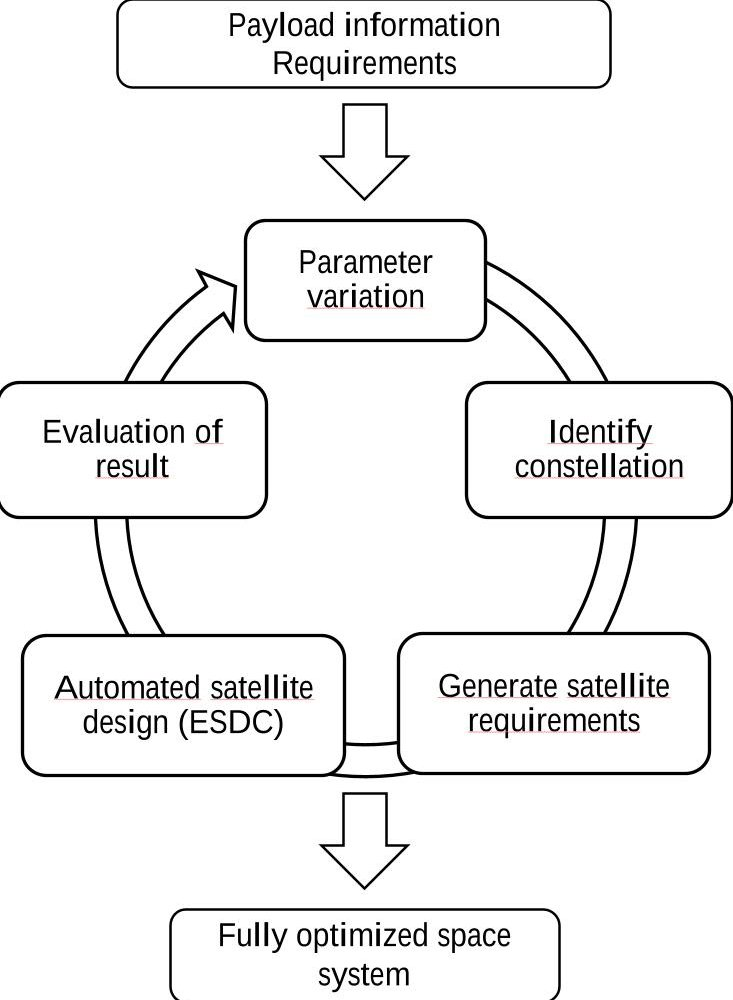

Figure 3: Constellation Design tool workflow [7]

design. The result is then evaluated. By iteration with changing input parameters, a large trade space can be covered. The process is further explained below.

The tool receives a set of input parameters from the DCEP central server that define the space mission to be designed. These can include constrains, such as mission launch date or ground stations to be used, as well as requirements, e.g. coverage or payload requirements. For an earth observation mission, this might be a camera field-of-view and ground resolution. For a communications mission, half-power beam width or minimum elevation should be specified.

It can also include payload power and mass, as well as constellation parameters. This includes altitude, inclination, number of orbital planes, number of satellites per plane, and others. Not all have to be defined, as unspecified parameters will either be used for iteration, or will be identified based on given requirements.

As a first step, the remaining parameters will be determined. For example, if payload information is given, the software will calculate the altitude, number of orbital planes, and number of satellites per plane required. If a fully defined constellation is given, it will derive the necessary swath width or antenna half-cone angle, depending on the type of payload. Both Walker-Star and Walker-Delta type constellations are supported.

Thereafter, a basic mission analysis is performed, calculating high-level satellite design requirements such as eclipse phases or contact times to the specified ground stations utilizing analytical methods and the simulation software ASTOS. Draft mass and power budgets are calculated using literature data. A propulsion budget is established considering several different manoeuvres using the ESA-DRAMA toolset.

The most important manoeuvre is the end-of-life deorbit manoeuvre. Within DRAMA, the OSCAR tool can be used to estimate the orbital lifetime and the critical altitude below which the satellite will deorbit naturally within 25 years as required by the European Code of Conduct for Space Debris mitigation [9]. The $ \Delta v $ required to reach the critical altitude, or to perform a direct deorbit, e.g. lowering the perigee to 80 km, can be considered. Drag augmentation devices or tethers can be evaluated, but constellations will most likely rely on thrusters to keep the operational orbit as clean as possible.

The ARES tool is part of DRAMA as well, and is used to estimate the annual collision probability in the given orbit. It can also derive the $ \Delta v $ required for collision avoidance manoeuvres. The Accepted Collision Probability Level can be specified by the user. This probability determines when a collision avoidance manoeuvre should be performed.

Both tools require some geometrical information about the satellite: OSCAR requires a cross section, and ARES requires a spacecraft radius, as the satellite is represented as a sphere. A third tool from DRAMA called

<!-- PDF_PAGE: 5 -->

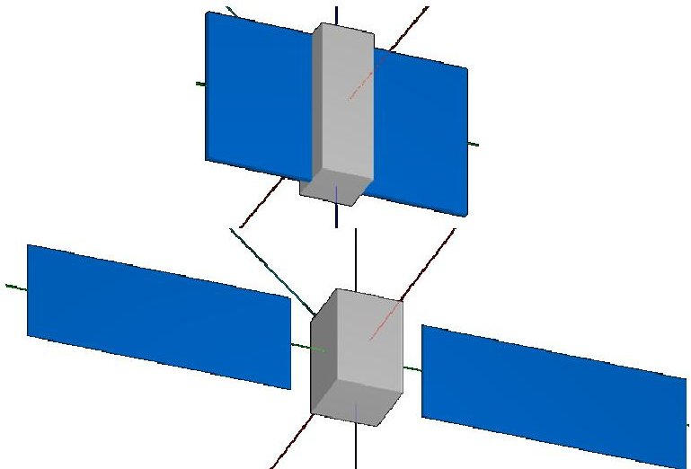

Figure 4: Generic satellite used in CROC for cross section calculation. 3U CubeSat (top), larger satellite (bottom). Satellites not to scale

CROC is used to calculate the average cross section for a generic satellite consisting of a main body and two solar arrays (see Fig. 4). The main body's dimensions are estimated using the draft mass budget established previously as well as an average satellite density. The solar array's dimensions are estimated using the draft power budget and eclipse times. This serves as a first guess, and enables establishment of the $ \Delta v $ budget. The results, which are estimated satellite mass and power, $ \Delta v $ required, ground station contact times, as well as eclipse and sun phase durations, are then given to the satellite design tool ESDC.

Finally, this design is further evaluated with a userspecified method, e.g. cost estimation software. If a commercial tool such as TruePlanning should be used, the software and license has to be procured by the user.

As launch cost still is a major cost factor, a launcher selection tool is being developed together with the constellation design tool. The goal is to identify the overall cheapest launch vehicle considering satellite mass and the launch-vehicle specific payload mass to the constellation orbit. The number of satellites per launch is limited to the number of satellites per plane, and the mass of a satellite dispenser is taken into consideration.

Deriving the launch vehicle's payload mass to arbitrary constellation orbits from publicly available data leads to large uncertainties. However, small changes in satellite mass can change the amount of launches needed per plane, which has the potential to drastically increase or decrease the total launch cost of a constellation. This effect should be taken into account, even if the result is prone to errors.

The full process is iterated to identify the most favourable overall solution out of many possibilities. As mentioned before, unspecified input parameters are used for iteration.

Designing satellite constellations using the DCEP constellation design tool has several significant advantages [1, 7]: For mission designers, it allows to

evaluate more possible solutions in less time. For nonexpert users, it enables them to understand and evaluate consequences of design or requirement changes quickly. Optimizing the entire system for cost, instead of optimizing only the constellation and designing the satellites later can potentially reduce the overall cost significantly. Additionally, considering space debris avoidance and mitigation early in the design phase is important not only for constellation operators who need to keep their operational orbits clean, but for all members of the space community.

## 3. Additive Manufacturing

The satellite market is expected to transition from single large satellites to low-cost constellations with up to hundreds of spacecraft. This leads to the demand for propulsion systems that can fulfill necessary orbital maneuvers at a reasonable price. Depending on the launcher concept, fast positioning of several satellites launched at the same time or supporting the capabilities of micro launchers are envisioned.

Especially for multiple satellites deployed simultaneously, the need for collision avoidance arises to prevent the generation of additional space debris. However, the most important argument for a propulsion system is the capability to fast deorbit the spacecraft, which becomes mandatory at orbit altitudes above about 600km to comply with the European Code of Conduct for Space Debris [9]. Even for lower operating altitudes, where the natural orbit decay would lead to fulfill the requirement of deorbiting within 25 years, active removal of decommissioned satellites should be considered, to allow faster and safer replacement. This is considered crucial to maintain the satellite constellation over a longer period of time [10].

## 3.1 Tungsten printed arcjet nozzle

Within the IRAS project, the focus is set on electric propulsion systems, as they feature significantly lower propellant mass fractions, due to higher exhaust velocities compared to chemical propulsion systems and comparable lower propellant toxicity. At IRS,

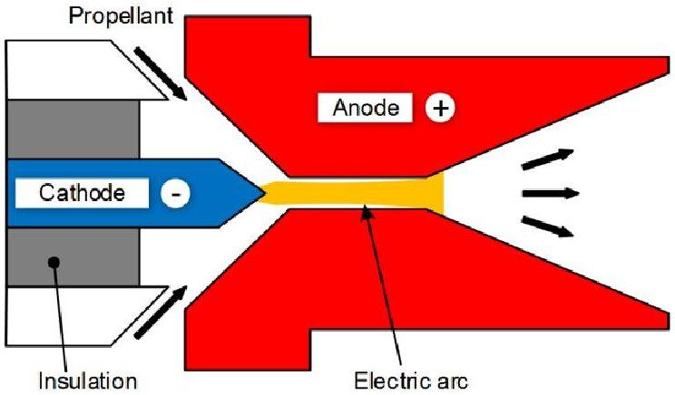

Figure 5. Operational principle of an arcjet thruster

<!-- PDF_PAGE: 6 -->

development efforts are focusing on a thermal arcjet system to serve as deorbit module. An arcjet provides relatively high thrust compared to other electric propulsion systems, combined with up to 1000 s of weight-specific impulse and a simple operational principle. This results in reduced deorbit periods, lowering the end-of-life operations complexity and hence, saving costs. The same applies for faster orbit raising. Furthermore, the simple principle and lower power processing unit (PPU) requirements compared to e.g. electrostatic propulsion systems promise further cost savings.

In this section a brief overview of the arcjet operational principle is given, followed by the additive manufacturing approach, preliminary findings, and an outlook on further experimental activities.

## Thermal Arcjet System Principle

An arcjet thruster generates thrust by electrically heating a propellant and expanding it through a nozzle. As seen in Fig. 5, an electric arc is being created by applying a high voltage between cathode and anode, which serves as the systems nozzle. The arc mainly consists of ionized propellant and is sustained by electrons emitted by the cathode. To reduce erosion of the electrodes, material selection is limited to conducting high temperature elements like tungsten.

## Additive Manufacturing Approach

The need to use tungsten or tungsten alloys for the nozzle heavily limits the design options when relying on conventional manufacturing. Optimized, bell-shaped nozzle geometries are not cost-efficient and advanced cooling methods like integrated cooling channels are simply not possible. Here additive manufacturing is a promising technology to overcome these restrictions and allow highly function integrated parts.

The Austrian company Plansee developed a selective laser melting process to allow production with tungsten at densities up to 96% , at the moment, which is expected to be further increased in the near future. Although the porosity does not allow ensuring perfect air tightness at this point, it is low enough to allow for conducting experimental campaigns on material and performance behavior. Furthermore, a controlled porosity could even contribute to the overall cooling concept.

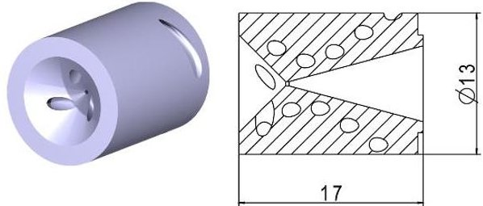

Figure 6. Design of a regeneratively cooled arcjet nozzle made by AM with tungsten [12]

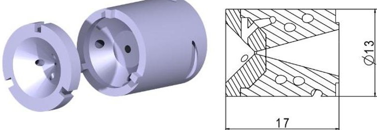

Figure 7 Design of an additively manufactured nozzle with a tungsten alloy insert

Based on earlier arcjet developments at IRS including the flight model thruster ATOS [11], a first design of an ammonia fed arcjet nozzle was made. This design is given in Fig. 6. Ammonia is considered as the most promising propellant for a low-cost arcjet systems, since it can be stored liquid at common space environment conditions, is self-pressurizing, and contains a large fraction of hydrogen. The latter is important for electrothermal thrusters. As these allow for better introduction of thermal energy into the propellant.

The nozzle design prototype is utilized as test sample to characterize the AM material behavior in an arc environment and the efficiency of the cooling channels.

Furthermore, the heat transfer inside the cooling channels will be analyzed to support the development of using the channels also as an integrated gas generator. In micro gravity it cannot always be ensured that the gas phase of the stored ammonia is collected and fed to the thruster. Therefore, a gas generator is usually part of the feeding system. The power necessary to operate it can be reduced, once stable operation is reached, which lowers the power requirements of the propulsion system. The feasibility of such an approach was in general already proven by a previous study at IRS [13].

A current restriction of applying AM tungsten is the absence of alloys, like thoriated tungsten (WT20) or tungsten lanthanum oxide (WL10). These are preferred

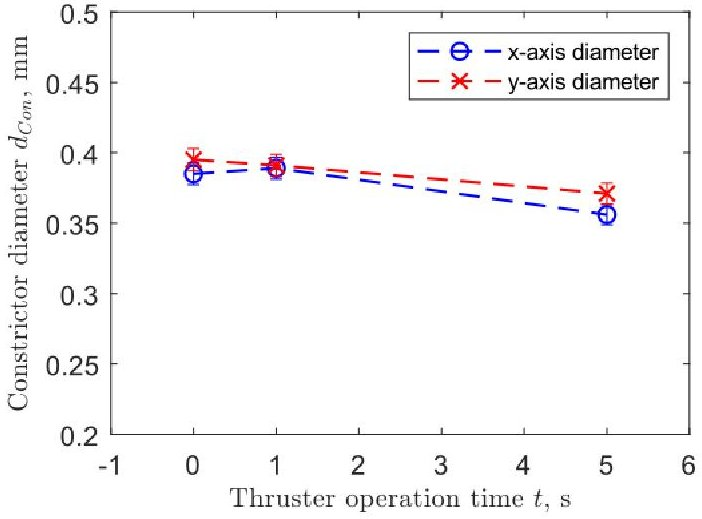

Figure 8 Progression of the arcjet constrictor over a long time test

<!-- PDF_PAGE: 7 -->

for arc applications, as they feature lower work functions resulting in less electrode heating and, hence, longer life times. The advantages of AM and tungsten alloys could be combined by installing a conventionally manufactured insert into an AM nozzle. An early design approach is shown in Fig 7. Furthermore, this design can be used to evaluate different tungsten alloys and their work functions in terms of performance impact, voltage-current characteristics, and how life time is affected.

## Preliminary Results

The first part of the material test campaign was successfully conducted and the AM tungsten's general feasibility for arcjet operation demonstrated. Argon was used as propellant to reduce influences of chemical reactions on the results. The focus was set on the surface quality and changes of the constrictor, which is the arcjets nozzle throat. Fig. 8 shows the behavior of the constrictor measured prior and after a 5 hours test run with an intermediate break after the first hour.

Operation was stable over the whole time and no sputtering was observed. The constrictor is subject to shrinking process, reducing the diameter by about 6 %. This was also observed previously at IRS for conventionally manufactured nozzles showing a similar behavior [14]. A prior concern was that encapsulated gas in cavities might cause cracks or even delamination, due to thermal expansion. Neither occurred during the test and the AM nozzle does not show more wear and tear compared to conventional ones. This particular sample was measured to be airtight. As previously stated this cannot be always ensured yet [8].

In a first test campaign, the general suitability of the AM material in an arcjet environment has been demonstrated. During a 5 hours test run, the nozzle did not show increased wear and tear compared to a conventional nozzle.

This marks an important milestone and allows taking the next steps. These are characterizing the performance gains and the transfer of heat from the nozzle into the propellant inside the cooling channels. This data will then be fed into a thermal model of the thruster to simulate operation of the regenerative gas generator for ammonia operation.

## Outlook

Developing an AM arcjet nozzle is the first achievement milestone. The focus can now be set on performance characterization. The thruster will be fed with hydrogen to better analyze the heat transfer in the cooling channels, as it provides the highest heat capacity leading to results that are more accurate. Once the nozzle has been characterized during experiments, the data will be fed into an arcjet scaling tool, which has been previously developed at IRS and is now being extended [15]. The idea is to add a nozzle geometry function to the

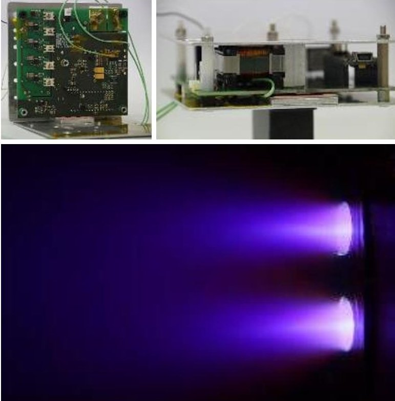

Figure 9: Top left and top right, laboratory PPU model for PETRUS. Lower, a cluster of two PETRUS thrusters while pulsing [16].

tool to allow an optimal design solution depending on the mission and available power. This scaling tool will then be linked to the ESDC as well as the DCEP.

## 3.2 Additive Manufacturing Design of Pulsed Plasma Thruster PETRUS

At the IRS, a miniaturized Pulsed Plasma Thruster (PPT), named PETRUS, is currently under development [16]. PETRUS is a coaxial, breech fed PPT nominally operated at an energy of 5 J. As most PPTs, PETRUS consist of a capacitor bank, a pair of electrodes, an ignition electrode, an insulator and the propellant, e.g. Polytetrafluoroethylene (PTFE) also known as Teflon $ ^{\circ} $

The overall propulsion system, which includes the thruster itself and the Power Processing Unit (PPU), shall have a mass of less than 400 g with a maximum build volume of 0.5 U. This makes it applicable for a future CubeSat mission. Currently, the thruster and a first CubeSat-size PPU are tested, see Fig. 9. detailed description regarding the operating principle and the status of development of PETRUS and its PPU can be found in literature [16, 17].

When designing and optimizing a PPT the electrode geometries, which also form the discharge channel, are a major aspect. Typically, the duration of a pulse takes 12 $ \mu s $ to 20 $ \mu s $ depending on the design of the PPT [17-19]. The characteristic discharge curve of an optimized PPT aims towards a critical damped behaviour [18,19], which can be achieved by the right choice of capacitor bank, but further by the discharge channel design and the connection to the capacitor bank. In previous designs of PETRUS, the electrodes and the connections to the

<!-- PDF_PAGE: 8 -->

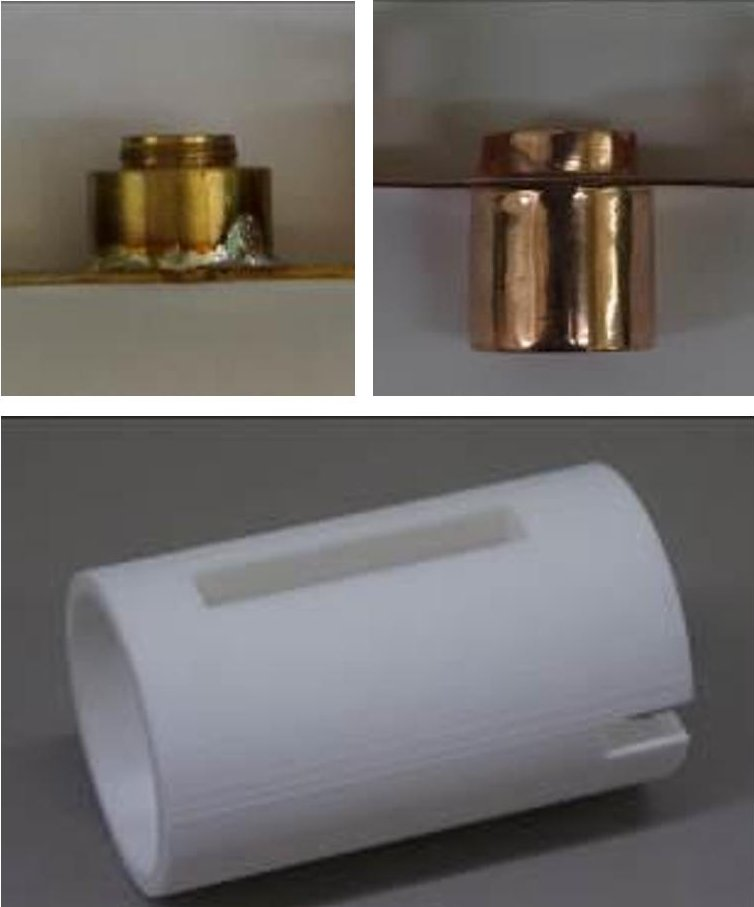

Figure 10: Top left, conventionally manufactured and soldered anode of PETRUS. Top right, ALM anode of PETRUS. Right, SLS manufactured casing of PETRUS.

In other words, losses by ohmic heating and perturbations of the energy coupling into the plasma might reduce the overall thruster efficiency.

capacitor bank were either screwed or soldered. Both solutions cause an inhomogeneity of the current flow and parasitic effects, which lower the electrical efficiency of the thruster.

For mitigating this effect, the influence of state-of the-art additive electrode manufacturing is currently investigated. By using 3D printed copper electrodes a homogeneous material characteristic is achieved minimizing the above-mentioned disturbances. Fig. 10 depicts the conventional manufactured and soldered anode of PETRUS with the 3D printed version.

In previous investigations, the influence of the anode's expansion ratio to the thrust efficiency was tested [16]. Here, conventional manufacturing processes were used to produce the electrodes. If the mentioned 3D printed electrodes show promising results, future test campaigns, will be performed using different nozzle shapes, for example parabolic and other. Additive manufacturing will produce these electrodes.

After completing performance investigations, it is envisioned to produce a fully 3D printed thruster including, e.g. the casing, insulating tubes and the propellant feed mechanism. Partly, these 3D printed components are already in use. Once a fully 3D printed thruster is set up and tested, further optimization

processes in terms of mass reduction and a more compact design are planned to be realised by using 3D printing technologies.

## 4. Technology Demonstration Missions

The IRAS Project does not only attempt to reduce the future of cost-efficient and digital satellite development, but also demonstrates its feasibility with two technology demonstration missions. The satellites "Stuttgart Operated University Research CubeSat for Evaluation and Education" (SOURCE) and ,Observation of Reentry Events Using Space 4.0" (OREUS) apply and qualify technologies which are currently in development. Both missions are briefly introduced below with focus on their IRAS payloads.

## 4.1 SOURCE

The development of the CubeSat SOURCE is a joint project of the IRS, the Small Satellite Student Society of the University of Stuttgart (KSat e.V.), the DLR and the Fraunhofer Institute for Manufacturing Engineering and Automation (IPA).

One goal is the technology demonstration of IRAS developed components. Furthermore, the CubeSat platform will be used for investigation of man-made and natural re-entry objects [20], atmospheric research, and for training a young generation of space engineers [21].

The development of the 3U （10 x 10 x 30 $ cm^{3} $ ）CubeSat started in 2018 and is currently in the detailed design phase (Phase C) [22]. The CubeSat is expected to be launched NET 2021 into a sun-synchronous 500 km orbit or alternatively from the International Space Station.

In early October 2019, the project just passed its Intermediate Critical Design Review and respective component tests are on-going. An overview CAD image of the current state of the development is given in Fig. 11 and 12.

Over 40 active students participate in the project either by taking part in a dedicated university lecture, or by voluntarily work in the respective subsystem groups.

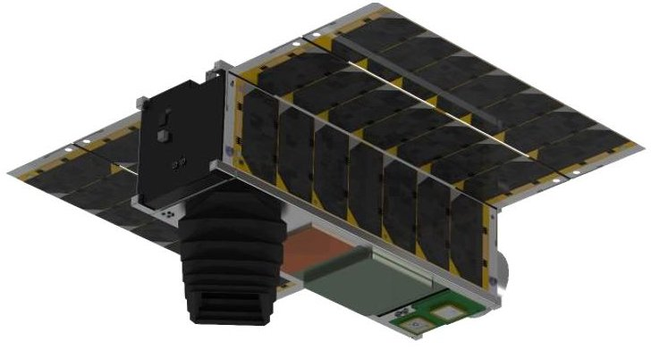

Figure 11: CAD model of CubeSat SOURCE. Rear view with integrated sandwich panel.

<!-- PDF_PAGE: 9 -->

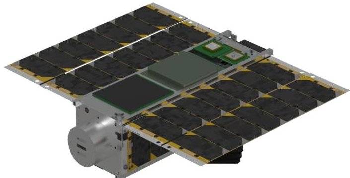

Figure 12: CAD model of CubeSat SOURCE. Front view with tuna can.

There are three IRAS payloads on-board of SOURCE:

The first one is an AM sandwich structure developed by DLR and Fraunhofer IPA with integrated automotive electronics. This structure shall be monitored during satellite operation in space. It includes radiation protection with tungsten-doped polymers. The sandwich structure is located on the rear outer wall of the satellite with direct contact to space environment, as depicted in Fig.11.

Second, Airbus Defence and Space is investigating Smart Heaters (Minco) on the outer shell of the SOURCE satellite for space qualification as second IRAS payload. These Smart Heaters can maintain a defined temperature range without external control and only require a power connection. Degradation over the mission duration is of interest and will be analysed with temperature measurements.

The third IRAS technology demonstration is a newly developed deployment mechanism for solar modules by the component manufacturer SpaceTech. It is combined with an innovative carrier structure for photovoltaic cells to use the limited volume efficiently.

## 4.2 OREUS

OREUS is the second small satellite mission in the IRAS project. Together with SOURCE, it will advance the qualification of automotive parts and the digitization of satellite missions to reduce costs for future space projects. The OREUS mission has three main objectives: Observation of re-entry events, verification of novel technologies in orbit, and application of the IRAS development chain. The ~80kg small satellite will be launched as a secondary payload in a near Earth orbit with frequent coverage of the South Pacific Ocean Uninhabited Area. This will allow the observation of controlled re-entries of large objects, e.g. supply vehicles of space stations, as well as the ISS itself. The development will start early 2020 with a launch NET 2023. However, a phase 0 study is currently done to determine the mission frame for OREUS.

One focus of the IRAS technology demonstration on OREUS is additive manufacturing. It enables the use of

topology optimization to reduce structural mass, but also the integration of functions such as cable harnesses and sensors into the structure itself. OREUS uses these multifunctional lightweight structures as primary structure, which significantly reduces production time and costs. Moreover, an increasing automation on board the satellite and in the ground segment offers considerable savings in operational costs.

Additionally, several electric green propulsion systems, which are suitable for small satellites, will also be qualified and deployed on board to achieve greater flexibility in observing re-entry of objects. The OREUS development itself will be based on the IRAS Digital Concurrent Engineering Platform, a new satellite design environment using a digital twin and multiple automated tools for more flexible and faster development and verification

## 5. Conclusions

In this paper the contributions of the IRS to the Integrated Research Platform for Affordable Satellite (IRAS) have been presented. For fast and automated spacecraft design within the digital concurrent engineering platform (DCEP) expert tools are supplied. These are the evolutionary system design converger (ESDC) and a constellation design tool. These tools have a standardized XML interface, which allows human and machine interaction alike and can be called automatically by a user of the DCEP.

Innovative production methods for faster, higher performance and less costly designs are in development. A tungsten printed arcjet nozzle as well as copper printed PPT components have been presented. Operation of these additive manufactured components show promising performance.

The state of development and planning for the technology demonstration missions SOURCE and OREUS have been detailed. Both the CubeSat SOURCE and the small satellite OREUS aim to achieve in-space technology demonstration of various payloads that are developed within IRAS.

## 6. Acknowledgement

This work is funded by the state ministry of BadenWurttemberg for Wirtschaft, Arbeit und Wohnungsbau grant numbers 3-4332.62-DLR/49 (IRAS) and 3- 4332.62-DLR/56 (IRAS II).

## References

<!-- PDF_PAGE: 10 -->

[2] M. Ehresmann, J. Skalden, F. Fugmann, N. Harmansa, G. Herdrich, S. Fasoulas, S. Klinkner, T. Stäbler, S. Humbert, O. Refle: IRAS: Low-cost Constellation Satellite Design, Electric Propulsion and Concurrent Engineering, 18,B4,6A,12,x44499, 69th International Astronautical Congress, Bremen, Germany, 2018

[3] M. Ehresmann, J. Skalden, G. Herdrich, S. Fasoulas: Automated System Analysis and Design for Electric Propulsion Systems, 344, Space Propulsion 2018, Seville, Spain, 2018

[4] M. Ehresmann, T. Spanoudis, J. Skalden, G. Herdrich, S. Fasoulas: Progress in Automated System Design by Evolutionary Algorithms, IEPC-2019-A-456, $ 36^{\mathrm{th}} $ International Electric Propulsion Conference, Vienna, Austria, 2019.

[5] M. Ehresmann, T. Spanoudis: Evolutionary System Design Converger, GitHub Repository https://github.com/aerospaceresearch/ESDC last accessed 11.09.2019

[6] Kulu, E., "NewSpace Index", 2019. [Online]. Available: https://www.newspace.im, last accessed 11.09.2019

[7] M. Fugmann, M. Ehresmann, J. Skalden, G. Herdrich, S. Fasoulas, S. Klinkner, M. Heck, T. Stindl, T. Stabler: IRAS DCEP: Automated and Distributed Satellite and Constellation Design, SSC19-WP2-03, in $ 32^{\mathrm{nd}} $ Annual AIAA/USU Conference on Small Satellites, Logan, Utah, USA, 2019

[8] J. Skalden, G. Herdrich, M. Ehresmann, S. Fasoulas: Development Progress of an Adaptable Deorbit System for Satellite Constellations, IEPC-2019-225, $ 36^{th} $ International Electric Propulsion Conference, Vienna, Austria, 2019.

[9] L. Anselmo, C. Portelli, R. Crowther, R. TremayneSmith, F. Alby, H. Baccini, C. Bonnal, D. Alwes, W. Flury, R. Jehn,, H. Klinkrad: European Code of Conduct for Space Debris Mitigation, Issue 1.0, 2004.

[10] J. R. Wertz, W. J. Larson: Space mission analysis and design, 3rd ed., Torrance, Calif.: Microcosm; Dordrecht; London: Kluwer Academic, 1999.

[11] B. Wollenhaupt, Q. H. Le, G. Herdrich: Overview of Thermal Arcjet Thruster development, Aircraft Eng. & Aerospace Tech, vol. 90, no. 2, pp. 280-301, 2018.

[12] J. Skalden, M. Ehresmann, G: Herdrich, S. Fasoulas: Development of an Arcjet Deorbit Module for Low-Cost Constellations", 32st International Symposium on Space Technology and Science, Fukui, Japan, 2019.

[13] B. Wollenhaupt, "Die Entwicklung Thermischer Lichtbogentriebwerksysteme," Ph.D. Dissertation Institute of Space Systems, University of Stuttgart, Stuttgart, Germany, 2017.

[14] D. Bock: Untersuchung eines thermischen Lichtbogentriebwerksystems für die Lunar Mission BW1, Ph.D. Dissertation, Institute of Space Systems, University of Stuttgart, Stuttgart, Germany, 2009.

[15] A. Rupalla,: Investigation and implementation of a Model to calculate and scale thermal Arcjets, IRS-15-S- 34, Bachelor Thesis, Institute of Space Systems, University of Stuttgart, Stuttgart, Germany, 2015.

[16] C. Montag, G. Herdrich, J. Gonzalez del Amo, P. Bauer, and D. Feyhl, "PETRUS 2.0 PPT and its CubeSatsize PPU: Testing and Characterization," International Electric Propulsion Conference, no. IEPC-2019-476, 2019.

[17] C. Montag, G. Herdrich, and T. Schonherr, "Modifications and Experimental Analysis towards an Update of the Pulsed Plasma Thruster PETRUS," International Electric Propulsion Conference, no. IEPC 2017-484, pp. 1-16, 2017.

[18] M. Lau, S. Manna, G. Herdrich, T. Schonherr, and K. Komurasaki, "Investigation of the Plasma Current Density of a Pulsed Plasma Thruster," Journal of Propulsion and Power, vol. 30, no. 6, pp. 1459-1470, 2014.

[19] G. Popov and N. Antropov, "Development of Next Generation APPT at RIAME," International Electric Propulsion Conference, p. 134, 2007.

[20] D. Galla, S. Klinkner, G. Herdrich, S. Fasoulas, P. Nizenkov, M. Pfeiffer, A. S. Pagan, K. Boltenhagen, H. Kuhm, A. Stier, R. Schweigert: The Educational Platform SOURCE - A CubeSat Mission on Demise Investigation Using In-Situ Heat Flux Measurements, IAC-19,E1,IP,24,x53779, 70th International Astronautical Congress, Washington D.C., USA, 2019

[21] A. Stier, R. Schweigert, D. Galla, M. Lengowski, S. Klinkner: Combination of Interdisciplinary Training in Space Technology with Project-Related Work through the CubeSat SOURCE, #69, 3rd Symposium on Space Educational Activities, Leicester, United Kingdom, 2019.

[22] R. Schweigert, A. Stiert, M. Lengowski, D. Galla, S. Klinkner: Phase A Study for the Earth Observation and Technology Demonstration CubeSat SOURCE, 12th IAA Symposium on Small Satellites for Earth Observation, Berlin, Germany, 2019