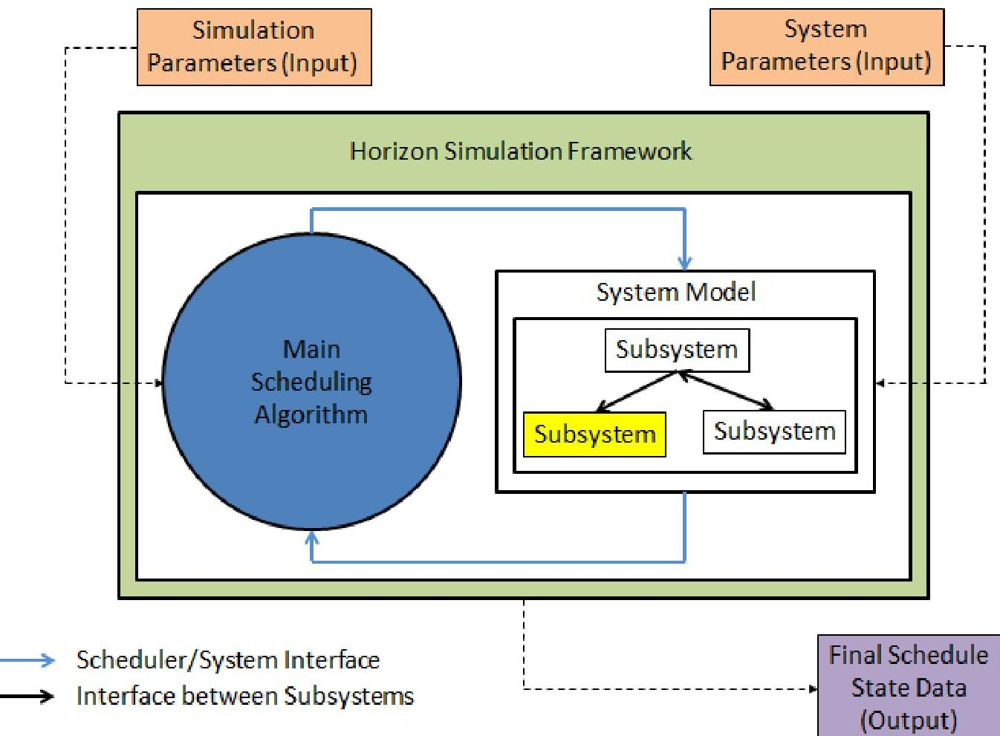
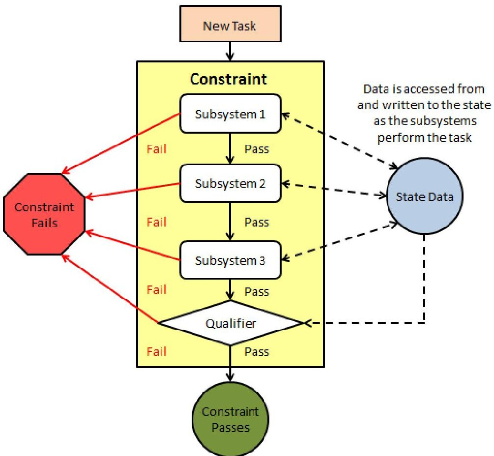
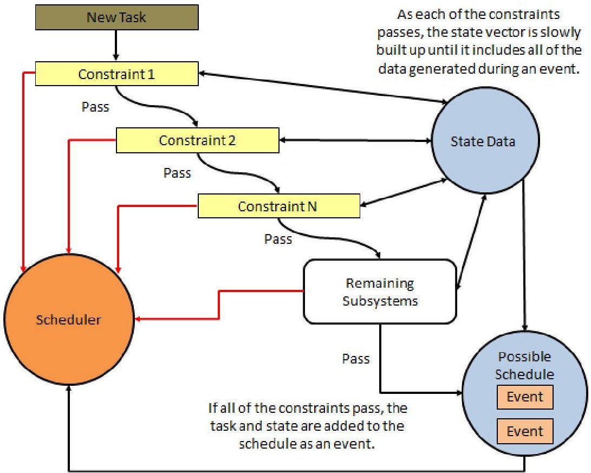
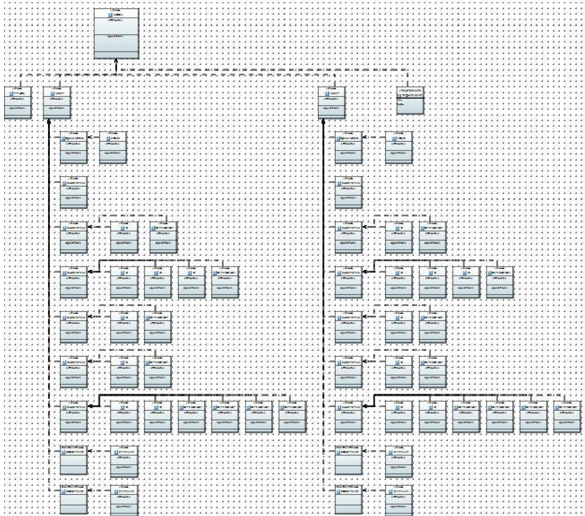
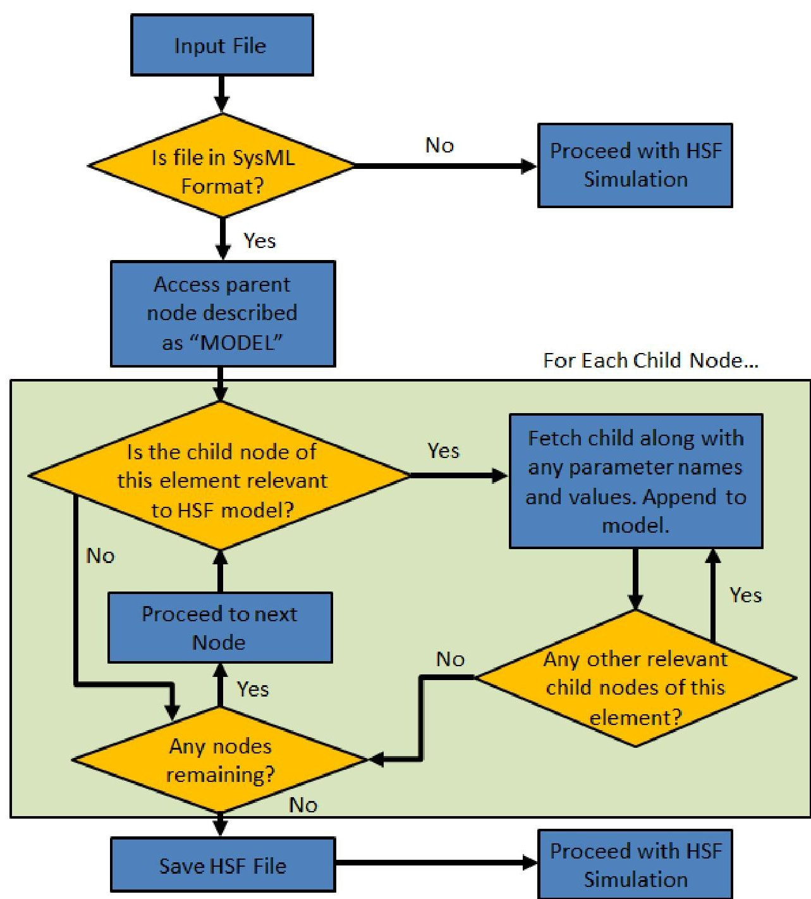
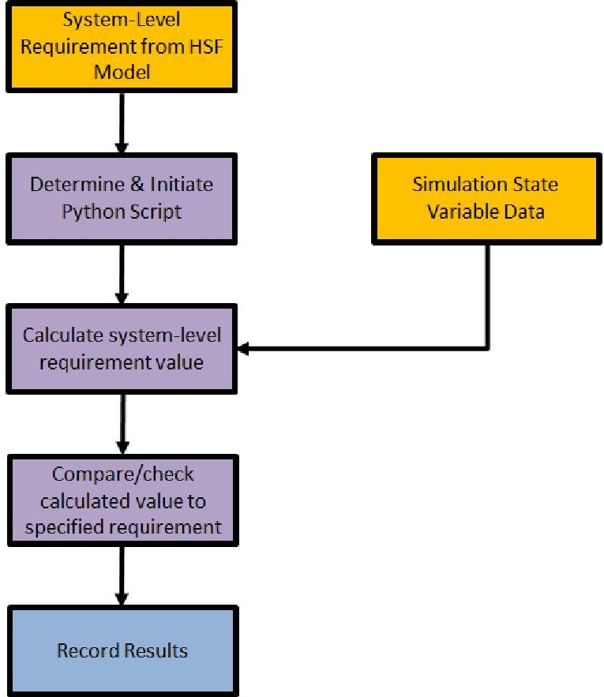
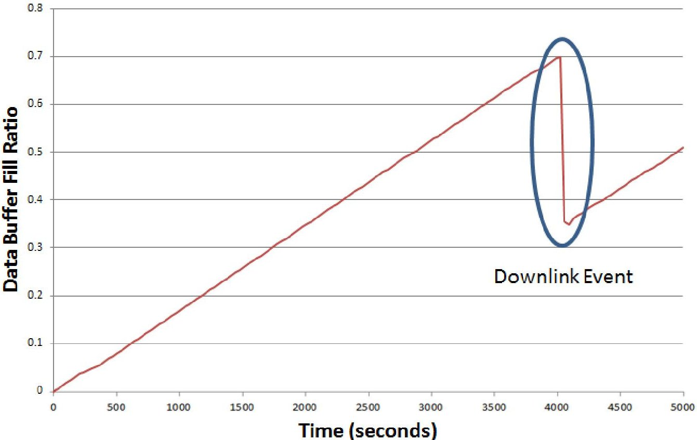

<!-- PDF_PAGE: 1 -->


<div align="center">

# Preparation of Papers for AIAA Technical Conferences

</div>

Viren Patel, $ ^{1} $ and Eric A. Mehiel $ ^{2} $

California Polytechnic State University, San Luis Obispo, CA, 93402, USA

Model-Based Systems Engineering in industry has been constantly increasing its presence within the aerospace industry. SysML is one such MBSE tool that shows complex system organization and relationships. The Horizon Simulation Framework is another MBSE tool, created by Cal Poly researcher, that gives users the ability to run "day-in-the-life" simulations of systems. Finding a way to link these two tools could allow systems engineers to reap the benefits of both.

This paper investigates the background and design process involved with developing the code that can convert an output file generated in SysML, into a format specifically made for the Horizon Simulation Framework. The goal was to create an interface that can allow users to model a system in SysML, and analyze the model and verify system requirements using HSF. Another goal was to expand the capabilities of the Horizon Simulation Framework by designing and develop a module that would allow users to define and analyze system-level requirements. To evaluate the effectiveness of both codes, the Aeolus example case was used. A SysML model of the system was created as the product of other work; SysML based CubeSat Model Design and Integration with the Horizon Simulation Framework. The Aeolus SysML model was converted and used as input in an HSF simulation. The SysML model simulation data was compared against those of the original test case. To test the requirement module, system level requirements were formulated within the Aeolus system and run in simulation, providing an analysis of the results. The results of the analysis confirmed a successful conversion of the SysML model into an equivalent HSF model and a successful analysis of system-level requirements.

## I. Introduction

Engineered systems are ever rapidly increasing in complexity. This increased complexity has spawned a demand for tools that can model these multi-faceted systems. The demand for such tools has arisen from the growing study of model-based systems engineering, or MBSE. These new modeling tools have empowered systems engineers to represent and develop systems in countless ways for every step of the design and build life cycle.

Despite the advent of new and advanced modeling tools, the fundamental concepts of systems engineering still remain. Elements like system validation are still an integral step in ensuring that the system operates per established specifications. The requirements verification process has even become even more crucial to prove that a system can perform within given constraints and satisfy customer needs.

<!-- PDF_PAGE: 2 -->

Implementation of document-based systems engineering alone cannot keep up the demands of today's ever-increasingly complex systems.

One prominent MBSE resource, Systems Modeling Language, or SysML, has proven to be a powerful tool for modeling complex systems in the aerospace industry. SysML users can visualize a system and its components while specifying features, requirements, relationships, and actions. Even with its myriad of capabilities, SysML is lacking in simulating system behavior and verifying requirements. The Cal Polycreated Horizon Simulation Framework is another MBSE tool used to model systems, but its specialty differs from SysML. HSF can simulate modeled systems through existing, student-created software. However, HSF can expand its capabilities to work with such programs as SysML to increase its functionality. Creating a channel of connectivity from SysML to the Horizon Simulation Framework could allow engineers to model systems without being pigeon-holed into using a single tool. These new modelbased systems engineering tools stand to benefit from one another, resulting in a call for interconnectivity.

HSF lacks in the ability to analyze systems as a whole. SysML cannot grant HSF this proficiency, but furnishing HSF with the power to investigate operations at the system level would better balance the program. Currently, HSF individually looks at each of these part of a system individually. What HSF needs is a way to verify requirements that concern the entire system. Doing so would allow HSF to provide more realistic results to its users.

The focus of this paper centers on two major sections of HSF code. The first section entails converting systems modeled in SysML into a file format readable by the Horizon Simulation Framework. HSF will then be able to use this reformatted file to verify that that the modeled system meets the stated objectives. This code will act as the link between system modeling and simulation. The second section of code will analyze user-defined system-level requirements. The program will read in an HSF model with specified system-level requirements. By accessing and processing post-simulation data, the code will determine whether or not the requirements have been met. Upon verification, the code will produce a file indicating the results of its analysis. The purpose of this code is to expand the requirement analysis capabilities of HSF beyond the subsystem level and offer HSF users insight into higher-level system operations and statuses during the entire simulation.

## A. Model Based Systems Engineering

In order to better understand model-based systems engineering, it is crucial to first have a grasp of systems engineering. Systems engineering is a design process which many areas of expertise are utilized to develop an efficient solution that fulfills the needs of different stakeholders to resolve a complex problem. The process necessitates the synergy of knowledge between technical and managerial processes in order to formulate a solution that can handle complexity but retain balance among its subsystems. [2]

In systems engineering, knowledge of management skills and processes are needed to oversee that system development is on schedule, within budget, and meets the customer's needs. Tasks relating to these management responsibilities include, but are not limited to allocating technical resources, mitigating risk, and overseeing system performance and requirements. The role of technical skills and processes within systems engineering is to establish system requirements and performance parameters, design the system, and verify that the system meets the established requirements. This is just a simplification of the roles and responsibilities of systems engineering and in no way is a limiting definition. As the demand for system capability and performance increases, so must systems engineering improve and evolve [2]. With model-based systems engineering, model use and manipulation is a responsibility which falls under managerial and technical roles alike.

<!-- PDF_PAGE: 3 -->

Model-Based Systems Engineering, or MBSE, is the use of models and/or modeling resources to facilitate systems engineering tasks. Such tasks include verifying requirements, validating system specifications, and analyzing system performance. [2] These are only a few examples of MBSE application as the practice can be applied for the entire duration of the system's life cycle. [2]

As opposed to document-based systems engineering, MBSE enlists the aid of models to delineate the systems development process. The practice combines different modeling fields and aspects of the system throughout the systems life cycle. MBSE covers development at all hierarchical levels, from a system of systems (SoS) all the way down to the component level. [6]

To effectively grasp the concepts behind Model-Based Systems Engineering, the role of the model must be understood. A model is the manifestation of a system that that allows the user to visualize or interpret the system with respect to at least one of its aspects. Models can be used to exhibit at least one specific concept of the system, but are not meant to show every single feature within the system. [2] There are no limits to the types of models and the characteristics they can communicate to users as well as the purposes they serve.

Models are extremely versatile in their uses. System models give users a medium to effectively record and organize subsystems and components. They can also be used for defining systems of all types, be it a completely new system, a previously established system, or even a system modified from a pre-existing one. The utility of models is constant throughout the entire system development cycle. Early on in the design process, they can act as retainers for validating and specifying requirements. They can also act at preliminary representations of conceptual designs. Models can be compiled to encompass multiple system aspects, especially when subsystem relationships and their requirements generate a need for interconnectivity. Models can also allow for engineers to trace the flow of requirements from componentlevel, all the way up to system-level as well as a top-to-bottom approach. [2]

In addition to providing a visual representation, models can also provide a means of evaluation. System development teams can utilize combined models to conduct high fidelity simulations and analyses. [2] Engineers can utilize models to perform tradeoffs between various system designs. System attributes and performance requirements can be analyzed through the use of models. Engineers can also take advantage of models in the verification process to ensure the system fulfills specified requirements and meets stakeholder needs. Even in the case of changes to the design or requirements, models can act as a visual representation of the affect the changes have on the system. [2]

MBSE is an evolutionary change in the systems engineering process. Instead of design specifications and requirements being maintained through documentation, maintenance is conducted through the development and use of a working, cohesive model that effectively represents the system. Engineers can gain numerous advantages from MBSE implementation. Using models can allow for system and requirement complexity management while effectively disseminating information among the team and stakeholders. Simultaneously, models can reduce the time needed for system development and increase the quality of the system design. Duties that have historically been conducted through documentation have become much easier through the use of MBSE. Consequently, model-based solutions to systems engineering are rapidly overtaking the traditional process of documentation tracking. This is hypercritical, especially in this swiftly-changing engineering landscape of progressively intricate systems. [2]

## B. The Horizon Simulation Framework

<!-- PDF_PAGE: 4 -->

The Horizon Simulation Framework, or HSF, was the result of ongoing research at Cal Poly dealing with model-based systems engineering [1], [3], [4], [5]. HSF is a code base used for system simulation and subsystem constraint verification. With the framework, a user can model a system, an amalgamation of its subsystems, parameters, initial conditions, constraints, and dependencies along with inputs for environment and simulation parameters. Once executed, HSF handles these inputs to conduct an analysis, searching for working schedules that satisfy constraints given the quantified parameters and initial conditions. These schedules are a compilation of an initial system state and events that follow it, as generated in a simulation, showing system performance over a specified period of time. HSF ensures that each state must fall within the specified system constraints.

A series of potential working schedules for the specified system is HSF's main output. The framework performs the simulation by employing an exhaustive search algorithm and cropping the amount of schedules per the user's direction. HSF can generate multiple schedules if the user defines it in the simulation parameters. Each schedule is an original "day-in-the-life" simulation of the system depicted via state data. One can track the values of defined parameters, or state variables, over the course of the simulation. The Horizon Simulation Framework is the critical source that connects constraint verification, system modeling, and scheduling all in one location. [5] Once executed, HSF will comprehensively search for a solution, until the number of working schedules is reached, or until a preset amount of time. Upon completion of the simulation, HSF will provide data for a working solution; otherwise the program will notify the user that no working solutions were found. This found solution is not the optimal solution, only a working one. [5]

The main scheduling algorithm and the system model are the two main components of HSF. These two parts are independent of each other so that their interaction does not influence the effectiveness of the simulation. For example, if desired, the current Main Scheduling Algorithm (exhaustive search) could be replaced with a different scheduling algorithm. The effectiveness of the new scheduling algorithm could then be tested with the system model being the constant. The other main component, the system model, is made up of smaller subsystem models, all of which are independent of one another, maintaining another level of modularity. Modularity enables the user to swap out current subsystems for ones with different parameters or operational functions. The figure below visually depicts this modularity and interaction between the various HSF components. [5]

<!-- PDF_PAGE: 5 -->





<div align="center">

Figure 1: Major Modules and Interfaces Implemented in HSF [5]

</div>

When generating a schedule, HSF must decide whether a task is acceptable for the schedule by submitting it to three tests. The series of tests essentially asks the following questions:

1. Has the first task been completed by the system?

2. Can the same task be repeated?

3. Given the current state and parameter values, can the system operate within the specified subsystem constrains and execute the task?

If the task successfully passes the tests, the schedule adds the new task and begins the task-testing procedure anew. [5]

One part of HSF's functionality is ensuring that the modeled system satisfies user-defined constraints, which are limitations that have been enforced on subsystems and state values. In order for a schedule to be saved, all constraints must be satisfied at every step, and there must be viable tasks until the simulation end time. Currently, HSF uses the constraint checking cascade as its method of choice in deciding if a defined system is capable of performing a task or action that the system executes during a time step in the simulation. This algorithm first amasses the subsystems that generate data for the constraint in question. Each subsystem is executed, adding the relevant state data in the process. This state data is the means of data storage for the simulation, acting as a vector that stores all system parameter information for the series of time steps that occur during the simulation. The constraint qualifier is then evaluated after the execution of all relevant subsystems. Upon meeting qualifications, the constraint passes and starts again with the next constraint. Figure 2 below shows the process HSF undergoes when checking a constraint. This continues until all of the system constraints have been checked. Upon completion of all

<!-- PDF_PAGE: 6 -->

constraint checks, the scheduler executes the remaining unconstrained subsystems. Passing all defined constraints permits the addition of the task and state variable data to the schedule, making it an event, the simplest unit in a schedule. The next potential task is then analyzed for possible addition to the schedule. Figure 3 shows a diagram of the constraint checking cascade process. [5]





<div align="center">

Figure 2: Internal Constraint Functionality [5]

</div>

<!-- PDF_PAGE: 7 -->





<div align="center">

Figure 3: Constraint Checking Cascade Diagram [5]

</div>

## C. SysML

In order to understand the inner workings of the HSF Translator Plugin, some background about SysML must be established. SysML, or Systems Modeling language, is an outlet of MBSE that can be used to represent and develop systems at various stages of the system development process. [2] SysML finds its origins in the second version of UML, or Unified Modeling Language, which is the usual the standard of modeling language for software. UML was selected for SysML support because of its robustness and the fact that it fulfilled many of the needs of the systems engineering community. [2] UML 2 was also supported by a wide range of industry tools. SysML is utilized in helping design and specify systems. It can also be used in calling out hardware and software components which can be flowed down to be designed in VHDL and UML respectively. [2] SysML lets users to define systems of all types. SysML allows for models a variety of systems including, but not limited to software, hardware, facilities and procedures. It 's applications in industry knows no bounds. [2]

Incorporating SysML into the system design process brings forth many capabilities. A variety of items within the system can be represented. SysML can be used to model a variety of system entities. Examples of such entities include models of system structure, requirements, constraints, and behavior. The possibilities are endless when it comes to the system modeling capabilities of SysML. What makes SysML a powerful tool is the ability to model relationships between all of these system aspects through the use of diagrams. [2] HSF and SysML are both mediums through which users can implement MBSE methods, but they possess their own unique sets of strengths and weaknesses. Their outputs vary as do their uses. MBSE is useful in visualizing relationships between subsystems, components, parameters, constraints, and requirements. HSF is ideal for simulating system performance and verifying satisfaction of system

<!-- PDF_PAGE: 8 -->

requirements. Knowing when to use either tool is critical in MBSE, making it even more useful to create a means of connection between the two. A breakdown of differences between SysML and HSF is shown in the table below.

<div align="center">

Table 1: Breakdown Between SysML and HSF

</div>

<table border="1"><tr><td>SysML</td><td>HSF</td></tr><tr><td>Visually represents a model and their relations</td><td>Capable of providing system data to be graphically represented</td></tr><tr><td>Output is a series block diagrams</td><td>Output is a series of data</td></tr><tr><td>Generates a static representation of a system</td><td>Generates a series of schedules that represent system state and operation for a specified period of time</td></tr><tr><td>Model allows for free flow of system representation</td><td>Model is restricted by cascade structure of subsystem dependencies, constraints, parameters, and state variables.</td></tr><tr><td>Stores requirements, parameters, constraints</td><td>Verifies whether or not system can meet stated requirements given system parameters.</td></tr></table>

## D. Problem Statement

The SysML Based Cubesat Model Design and Integration with the Horizon Simulation Framework thesis by Shaun Luther[4] demonstrated a new means of model representation, but the block diagram representation of the system was the extent of its capabilities. A means of analyzing the system was still needed. The SysML model could display subsystems and their parameters but it did not give enough insight to the user on an operations level. It lacked the ability to simulate system performance. The Horizon Simulation Framework was needed to give the user a better idea of system behavior. In order to do this, a link needed to be made.

Another similar area in which SysML lacks is system-level requirement verification. Because of its inability to simulate, there is no way to mathematically confirm that a system adheres to specified requirements. HSF is also currently weak in this aspect since its focus is on state data and ensuring subsystem constraints are met. This leads to the question: "How can a model-based engineering tool be used to assess system-level requirements?"

## II. Horizon Simulation Framework Translator Plugin

The objectives of this plugin were to read in a SysML file that represents a system, locate and fetch the necessary parameters and their respective values, and reformat the data into an arrangement readable by the Horizon Simulation Framework. Though it seemed as if the code had a simple objective, the means of accomplishing this objective would require complex work and logic.

One established requirement was that the code would only deal with the system model aspect. The plugin would not process any inputs pertaining to target data or simulation parameters. This would only make it necessary for users to model the system in SysML and adjust simulation and target parameters

<!-- PDF_PAGE: 9 -->

separately. Leaving the target and simulation parameters alone created a control for testing the original and converted cases in which both systems could be simulated under the exact same conditions.

Originally, the provided SysML file was generated as a result of SysML Based Cubesat Model Design and Integration with the Horizon Simulation Framework[4]. The system model was represented in the form of a block definition diagram. While this was a well-constructed SysML model of the Aeolus mission, evolution of the Horizon Simulation Framework's inner workings dictated that the model needed additional development.

One update to HSF was the addition of Python Scripting. This tool enabled HSF to encode subsystems using the Python programming language while running the simulation. HSF input files exploit this instrument as a callout and parameter. HSF had been updated to recognize this callout and execute simulations accordingly. Within subsystem dependency declarations, parameters were also established to direct HSF as to which Python function files were necessary to access during simulation.

Another update requiring the SysML model to be updated resulted from this work was the addition of system-level requirements. Because of the implementation of the system-level requirements analysis tool, another callout was added to the SysML model. The new node defined system level requirements that instructed HSF to process post-simulation data and indicate whether or not the system adhered to the specified requirements. With the addition of these two new nodes and parameters, and the change formatting of the HSF model flow, the SysML model necessitated revision. A zoomed out view of the revised block diagram is shown in the figure below.





<!-- PDF_PAGE: 10 -->

## Figure 4: Revised Aeolus System SysML Block Diagram (Zoomed Out)

As discussed above, the SysML file is full of information, some of which is irrelevant to the operation of HSF. Two elements are necessary in order to sift through such mountains of information: an understanding of the SysML file format, and the LINQ function library. The HSF translator plugin uses both to effectively process the SysML file.

The process of the translator plugin code begins by fetching the SysML output file. Knowing that the all-encompassing parent of the HSF model is the MODEL tag, the plugin immediately searches for the "packagedElement" tag using the literal "GetElementsByTagName" function and saves the XML node. This node contains a tree of all the information that is pertinent to producing the HSF model.

Another note to be made is that whenever a new node or attribute is detected, the related name and parameter information is immediately retrieved, saved, and appended to the HSF file under construction. This "build-as-you-go" method helps ensure the HSF file structure remains suitable for reading during simulation and that all data is stored in the appropriate location with respect to its parent node. After the XML node data has been obtained and organized for use in HSF simulation, the new XML file is saved to the same directory and HSF is directed to use the newly generated file. The flowchart below depicts the procedure that the HSF translator plugin follows.

<!-- PDF_PAGE: 11 -->





<div align="center">

Figure 5: Flowchart of HSF Translator Plugin

</div>

## III. System-Level Requirement Analysis Code

The current state of the Horizon Simulation Framework analyzes a system based on requirements placed at the subsystem level. A constraint is placed on a subsystem and HSF selects schedules in which these subsystem constraints are obeyed. It is easy for HSF to quickly conduct a subsystem constraint check since a value comparison can be made at each time step. One thing that HSF lacks, however, is the ability to analyze requirements at the system level. System-level requirements often require an investigation of the system as a summation of its parts. HSF, however, looks at the system one time step at a time. One of HSF's philosophies is that any state variable value at any given time step is independent of the value at any other time step. [4]

So how can an application that looks at subsystem state data at each time step analyze a scenario at the system level? In order to accomplish this, HSF must access data from the entire simulation. System-level requirements must be checked after simulation and schedule creation has completed. This also means

<!-- PDF_PAGE: 12 -->

that HSF cannot eliminate a schedule if the simulation fails to meet system-level requirements. Instead, when the post-simulation analysis is complete, HSF must generate an output indicating whether or not the requirements have been met.

To test the code, new variables had to be conceptualized that would be considered system-level parameters for the Aeolus simulation. The established criteria for a system-level parameter were that the parameter calculation must either depend on multiple time steps or rely on data from multiple subsystems. As a result, the image capture quantity and data latency variables were created. Image capture quantity would represent the total number of targets captured in a schedule. Data latency would represent the average difference between the time an image was captured and when it was downlinked to the ground station. Both of these parameters required system-level analysis as they rely on data from multiple states within the simulation.

Adding system-level requirements into a model involved simple manipulation of the system input file. The <REQUIREMENT> XML node type was created. This node defines the parameter name, limiting value, and comparison argument for the requirement. The table below describes what each parameter signifies.

<div align="center">

Table 2: Requirement Parameters and Descriptions

</div>

<table border="1"><tr><td>XML Parameter</td><td>Definition</td></tr><tr><td>Name</td><td>Parameter name. Helps HSF determine what calculations are required to analyze the requirement.</td></tr><tr><td>Type</td><td>Comparison argument. Indicates how to compare the simulation data calculation to defined requirement value. Can be any one of the following values:LESS_THAN,GREATER_THAN,LESS_THAN_OR_EQUAL,GREATER_THAN_OR_EQUAL,EQUAL,NOT_EQUAL.</td></tr><tr><td>Value</td><td>Limiting value. Represents the value to which HSF compares its simulation data calculation.</td></tr></table>

Because the analysis is conducted at the system level, requirement is defined at the same level as the assets. The requirement verification check is executed for all assets within the system, as there is the possibility that some assets within the system may fail to meet requirements, while others may succeed. An example of a <REQUIREMENT> node is shown in the figure below.

## ```html

<REQUIREMENT value="20.0" type="LESS_THAN" name="imgcapqty"> </REQUIREMENT>

```

## Figure 6: Aeolus Example of the HSF Model Requirement Node

With the system-level requirements analyzer, the Horizon Simulation Framework runs a simulation as usual: analyzing the scenario, checking state data against subsystem constraints, and generating schedules. There are a few exceptions though. At the beginning of the simulation a requirement class is instantiated, which allows for system-level requirements to be analyzed later. During the XML model parsing process, HSF has also been updated to recognize the <REQUIREMENT> node. Each requirement node and its corresponding parameters are saved to a designated list. Upon completion of the simulation, HSF processes each requirement in the list. A function in the requirement class then parses the XML requirement node to fetch the requirement parameters and put them into a data structure of strings. The

<!-- PDF_PAGE: 13 -->

data structure is then run through another function in the class to execute the requirement analysis for the given inputs.

Throughout HSF, Python is used as a tool for scripting various components of the system, including the scheduler and subsystems. Since the capacity for utilizing Python already existed within the Horizon Simulation Framework, its implementation as a means for requirement analysis would be relatively simple. The requirement class, just like the other HSF scripting classes, calls on scripting class libraries to access the capability to run Python.

When the class in HSF executes the function, it instantiates and accesses a function within the Python class coded specifically for analyzing the requirement. The inputs for the function are the same parameters defined in the <REQUIREMENT> node. There is an additional parameter included, which is the total number of assets. This is done so that the requirement verification can be conducted for each asset individually.

Upon execution, the Python function begins by fetching the relevant state variable output files. These csv files have been created as a result of the simulation and saved to the local drive. The files are processed and the data is consolidated into arrays. The arrays are then used in calculations to find the simulation's parameter value. Referring back to the Aeolus case shows examples of how the values are calculated for the two parameters.

Once calculation has completed, the value is checked against the comparison value provided in the input file. The comparison method is set from a series of if statements that will translate the comparison argument string into a symbol. Then the comparison analysis is executed, providing a true or false value depending on whether or not the comparison is correct. Upon completion of the check, the parameter name and comparison are printed to the generated text file. In addition, a statement is made on the validity of the comparison, indicating whether or not the system-level requirements were met. The entire process is then repeated for each asset within the system. After all requirement analysis has completed, the file is closed and the program ends its run.





<!-- PDF_PAGE: 14 -->

<div align="center">

Figure 7: System -Level Requirement Analyzer Flowchart

</div>

## IV. Results

## A. HSF Translator Plugin

Once the SysML file was processed within the HSF plugin, the resulting output file was compared to its HSF input counterpart. From a simple, visual comparison, it could be concluded that both files are very similar with minimal differences between them. All of the subsystems are properly ordered and have all of the correct parameters.

Despite the successful visual comparison between the two files, this alone could not provide adequate confirmation that the plugin output file can function as an acceptable HSF model. The file required further analysis via simulation in the Horizon Simulation Framework. With all other inputs being equal, the plugin output was processed in HSF as a replacement for the original HSF input file. After running the simulation, the data was analyzed and compared to the original Aeolus system simulation data.

After running the simulation for the plugin-created system and comparing it to the original test case, it was apparent that all of the data output generated by HSF matched the data for the original Aeolus simulation. The simulation put out a series of files, providing state data for different parameters for the course of the simulation's time span. The data was compared by plotting the original Aeolus data against that generated from the SysML file translation. Because the simulation parameters called for the generation of two schedules, the state data of each original asset was compared to those belonging to its corresponding converted asset. From a visual analysis of each plot, it could be seen that both cases matched one another exactly. Upon further investigation of the raw data files, all of the data points matched, down to the time steps. This confirmed that the SysML translation was an accurate 1 to 1 portrayal of the original Aeolus system. This meant the HSF plugin had successfully translated the SysML into an HSF-readable format. Based on simple numerical analysis of the data generated with from the SysML model of the new Aeolus Scenario, results exactly matched the data from the previous Aeolus Scenario.

## B. System-Level Requirement Analysis

Two test cases were created to test the effectiveness of the system-level requirement analyzer. The first case was a single system-level requirement. It involved a simple calculation to find the total number of images captured during the course of the simulation. The <REQUIREMENT> node of the HSF input file can be seen in the image in below.

$$
< \mathrm {R E Q U I R E M E N T} \mathrm {v a l u e} = " 2 0. 0 " \mathrm {t y p e} = " \mathrm {G R E A T E R _ T H A N} " \mathrm {n a m e} = " \mathrm {i m g c a p q t y} " > < / \mathrm {R E Q U I R E M E N T} >
$$

## Figure 8: HSF Requirement Node - Image Capture Quantity (Greater Than)

For the quantity of images captured, the "EOSensor" state data was used. Whenever the Earth- observing sensor was on, a Boolean value of 1 was provided, indicating an instance when an image was captured. The number of instances was tallied up to calculate the total number of images captured. The equation below exhibits the calculation involved, where $ x_{c} $ is Boolean value indicating if the sensor was on, n is the total number of data points collected, and $ y_{c} $ represents the total number of images captured.

$$
y _ {c} = \sum_ {i = 1} ^ {n} x _ {c} \tag {2}
$$

<!-- PDF_PAGE: 15 -->

After running HSF, the output in the form of a text file was created. The text file shows a four-line breakdown of the system-level requirement analysis as shown in the image below. Each requirement verification is organized by asset, as indicated by the first line. The second line shows the result of the calculation from the simulation data, which indicates that the first Aeolus asset captured 33 images. The third line is a statement of whether or not the system-level requirement was met. In this case, the requirement was satisfied, showing a success. The fourth line displays the comparison of the calculated parameter value to the user-defined value. The breakdown repeats a second time to show the analysis conducted for the second Aeolus asset.

ASSET 1

33 images captured

SUCCESS: SYSTEM-LEVEL REQUIREMENTS HAVE BEEN MET:

33 > 20

ASSET 2

33 images captured

SUCCESS: SYSTEM-LEVEL REQUIREMENTS HAVE BEEN MET: 33 > 20

## Figure 9: Requirement Analysis Results - Image Capture Quantity (Success Case)

To confirm the accuracy of the simulation results, the analysis was conducted manually. The same calculation was made by manually accessing the state variable data file for "numimgcapture". This state variable would store a true Boolean value every time the Earth-observing sensor turned on to capture an image. The total number of true Boolean values equaled thirty-three, confirming the accuracy of calculated value from the Python code. Comparing the calculated value to the "20" stated in the HSF file, the number of images captured during the simulation (33) was greater. This confirmed that the new module successfully validated the requirement.

This test only confirmed that the module correctly analyzed a case for successful requirement adherence. To test an unsuccessful case, the model input file had to be edited. The requirement type was changed from "GREATER_THAN" to "LESS_THAN". The <REQUIREMENT> tag was updated as shown below. If the requirement analyzer was coded properly, an adjustment to the type parameter would guarantee a failure statement.

```html

<REQUIREMENT value="20.0" type="LESS_THAN" name="imgcapqty"> </REQUIREMENT>

```

## Figure 10: HSF Requirement Node - Image Capture Quantity (Less Than)

HSF was run again, creating a new set of simulation data and an updated analysis of the requirement. The resulting text file is displayed in the figure below.

<!-- PDF_PAGE: 16 -->

ASSET 1

33 images captured

FAILURE: SYSTEM-LEVEL REQUIREMENTS HAVE NOT BEEN MET:

33 is not < 20

ASSET 2

33 images captured

FAILURE: SYSTEM-LEVEL REQUIREMENTS HAVE NOT BEEN MET:

33 is not < 20

## Figure 11: Requirement Analysis Results - Image Capture Quantity (Failure Case)

As expected, the output file indicated that the system did not meet the defined requirements. This can be seen on the third and fourth lines of each asset analysis. The third line states "FAILURE: SYSTEM-LEVEL REQUIREMENTS HAVE NOT BEEN MET" while the fourth line explains why. These two tests showed the operability of the system-level requirements analysis module in the success and failure cases.

The image capture quantity requirement proved that the module could successfully process requirements at the system level. This definition was quite simple in the sense that minimal calculation was involved. To examine the module's capability of handling complexity, a test requirement had to be formulated such that the relevant state variables resided in different subsystems and the calculations involved additional processing than just a simple summation. The result was a data latency requirement, measuring the average time between image capture and downlink to the ground station. The requirement callout in the HSF input file is shown in the figure below.

$$
< \mathrm {R E Q U I R E M E N T} \mathrm {v a l u e} = " 1 0 0. 0 " \mathrm {t y p e} = " \mathrm {G R E A T E R _ T H A N} " \mathrm {n a m e} = " \mathrm {d a t a l a t} > < / \mathrm {R E Q U I R E M E N T} >
$$

## Figure 12: HSF Requirement Node - Data Latency

Calculating the data latency involved more complex calculations than the previous parameter. Investigating this requirement required accessing two state variable output files: the "databufferfillratio" state variable from the SSDR subsystem and the "numpixels" state variable from the EOSensor subsystem. After fetching the data from these two csv files, they were consolidated into arrays. Both datasets were then converted into bytes so that they could be processed equivalent using units. The array for the data buffer fill ratio was converted into the number of bytes by multiplying it by the size of the SSDR. The number of pixels was converted into bytes by multiplying the array by the conversion factor. Equations 3a and 3b explain the conversions where $ x_{d} $ represents the array of data buffer fill ratio values and $ x_{p} $ represents the array of number of pixels captured. The $ n_{SSDR} $ represents the conversion constant of the SSDR size (4098 bytes) and $ n_{pb} $ is the conversion constant of pixels to bytes (0.002 bytes per pixel). The resulting values are measured in bytes: the data buffer filled in $ (y_{d}) $ and data captured $ (y_{p}) $

$$
y _ {d} = n _ {S S D R} x _ {d} \mathrm {(3 a)}
$$

$$
y _ {p} = n _ {p b} x _ {p} (3 b)
$$

After the conversion, the total number of downlinked bytes was determined. A downlink was detected by searching the data buffer array for instances of decrease in value. The total amount of downlinked bytes was recorded.

<!-- PDF_PAGE: 17 -->





<div align="center">

Figure 13: Data Downlink Detection

</div>

Working from the first time step in the simulation, the byte value was then used to determine how many captured images were downlinked. The data latency for each downlinked image was calculated by finding the difference between the times of image capture and the downlink times, as shown in Equation 4. Time of downlink and time of capture are represented by $ t_{d} $ and $ t_{c} $ , respectively, while $ \Delta t $ represents data latency.

$$
\Delta t = t _ {d} - t _ {c}
$$

The final value was achieved by averaging the array of data latency values, which in turn was compared to the requirement parameter definition. The formula for the calculation is shown in equation 4, where p is the number of data points and $ \Delta t $ is the average data latency.

$$
\overline {{\Delta t}} = \frac {\sum_ {i = 1} ^ {p} \Delta t}{p}
$$

In order to test the data latency requirement, a modification had to be made to the existing system model. The original Aeolus simulation had a time span that was too short to manifest any downlink event. Consequently, the simulation time span needed to be extended until a downlink was noticed. The result was updating a simulation input file by extending the simulation time from 1000 seconds to 5000 seconds.

The result of the simulation was approximately 800 and 731 seconds data latency for each asset respectively, which was greater than the stated value. Adherence to the requirement was confirmed, and the simulation provided the following output:

<!-- PDF_PAGE: 18 -->

ASSET 1

Average Data Latency of 3447.541 seconds with 49 images downlinked

SUCCESS: SYSTEM-LEVEL REQUIREMENTS HAVE BEEN MET:

3447.541 > 100.000

ASSET 2

Average Data Latency of 3387.713 seconds with 47 images downlinked

SUCCESS: SYSTEM-LEVEL REQUIREMENTS HAVE BEEN MET:

3387.713 > 100.000

## Figure 14: Results of Data Latency Requirement Analysis

After performing hand calculations for both Asset 1 and Asset 2 datasets, the final values were 3447.541 and 3387.713 seconds, respectively. Comparing the hand calculations to the HSF calculated values, authenticated an accurate analysis. Ultimately, the results of the test demonstrated that complex, crosssubsystem requirements could be analyzed. This success ultimately opened up a multitude of possibilities for the system-level requirements verification capabilities of the Horizon Simulation Framework.

## V. Conclusion

The HSF Translator Plugin was proven to effectively convert a SysML model written in UML into a format catered to operate as an input for the Horizon Simulation Framework. With the help of a library of C# programming tools like LINQ to XML, the plugin code was able to extract simulation-pertinent data about the system. The plugin result further confirmed its success when it was entered as an HSF input and produced the same values as the original model. The first objective of creating a means of transforming a SysML model into an HSF model was accomplished.

The second objective was to provide the Horizon Simulation Framework a means of verifying requirements at the system level. Using the existing accommodations for Python scripting within HSF, a module was designed to parse in system-level requirements that were defined in the HSF model. The module processed the parsed requirement parameters, analyzed simulation data, and determined requirement adherence success or failure. Sample requirements had to be created to test the system, but the final result indicated the modules design and implementation were a success.

As the Model Based Systems Engineering construct becomes more widely adopted, new and better tools will be capable of analyzing complex systems during the entire program life-cycle. The HSF is designed to interface with other MBSE tools with simple plugins and adaptors. While building HSF and other associated tools, we subscribe to the philosophy of software modularity. The HSF provides unique capability for engineers working at the system analysis level.

## References

[1] Butler, Brian, "Dynamic Model Creation and Scripting Support in the Horizon Simulation Framework" California Polytechnic State University, San Luis Obispo, 2012.

[2] S. Friedenthal, A. Moore and R. Steiner, "A Practical Guide to SysML: The Systems Modeling Language," Burlington, MA: Morgan Kaufmann Publishers, 2008.

[3] Kirkpatrick, Brian, "Picasso' Interface for Horizon Simulation Framework," California Polytechnic State University, San Luis Obispo, 2010.

[4] Luther, Shaun, SysML Based CubeSat Model Design and Integration with the Horizon Simulation Framework, California Polytechnic State University, San Luis Obispo, 2016.

<!-- PDF_PAGE: 19 -->

[5] O'Connor, Cory M., "Horizon: A System Modeling and Simulation Framework for Systems Engineering Utility Analysis," California Polytechnic State University, San Luis Obispo, 2009.

[6] J. Wolfrom, "Model-Based Systems Engineering (MBSE) Overview," Applied Physics Lab.