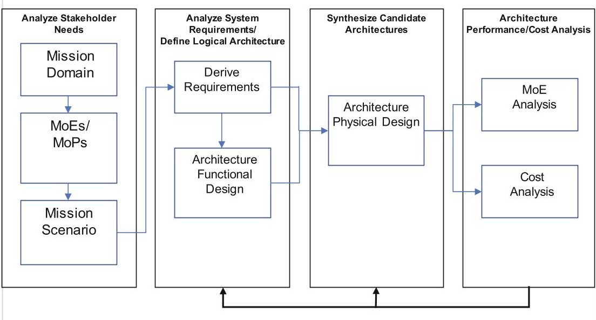
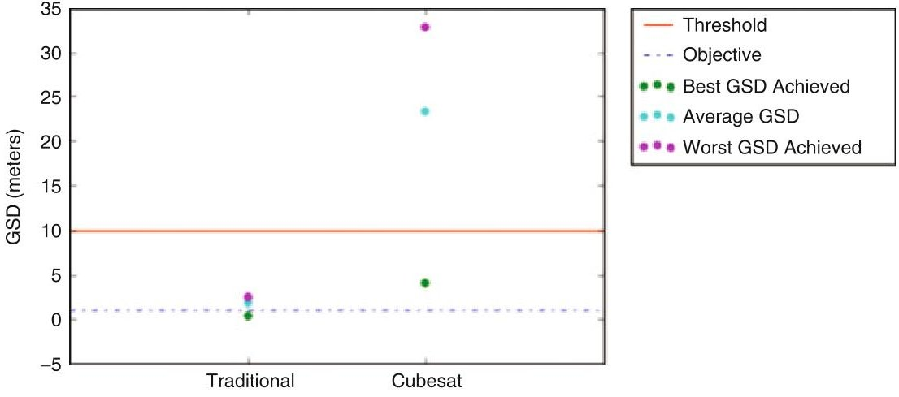
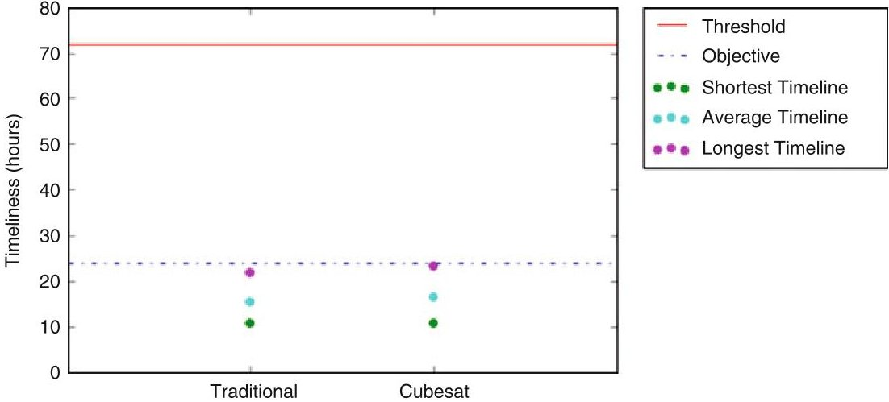
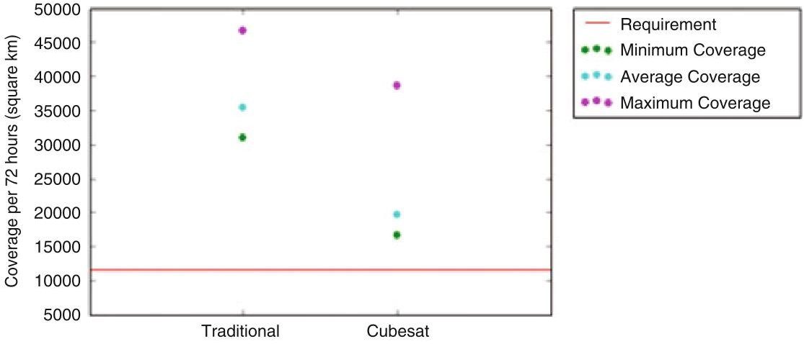
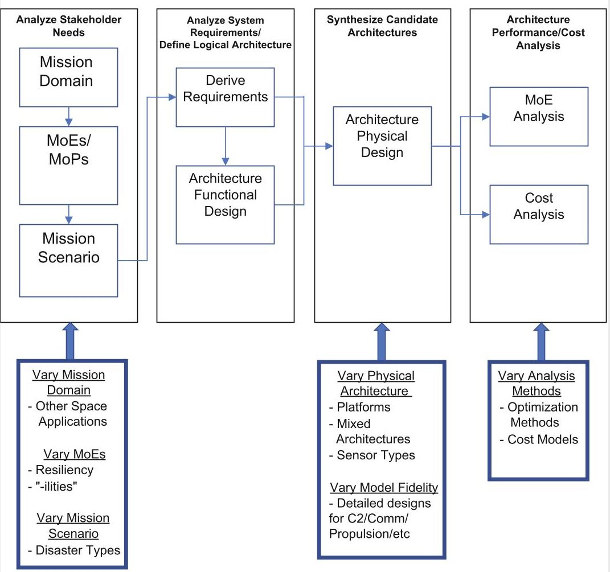

<!-- PDF_PAGE: 1 -->

# Chapter 43 Using MBSE in Satellite Architecture Trade Studies: A Practical Example

Daniel Cipera, David Jacques, and Thomas Ford

## 43.1 Introduction

Historically, operational space missions have been performed by large, highly capable satellite systems. While these traditional satellite designs meet or exceed very demanding performance and reliability requirements, their drawbacks of expense and potential vulnerability have incentivized consideration of alternative architecture types. The trade space for alternative architectures is limited only by creativity; architectures for a given mission could vary by satellite size, number, orbit, payload types, design life, or any other number of parameters or concepts. Evaluation of concepts and options within this trade space is helped by a structured and systematic approach; model-based systems engineering provides such an approach.

This paper explores the practical usage of model-based systems engineering to assess a possible alternative to traditional satellite architectures. Since the inception of the concept in 1999, CubeSats have been used for education and technology demonstration [1]. More recently, commercial companies have begun to deploy constellations of CubeSats for Earth imaging and other purposes [2]. CubeSats have the potential for being both cheaper and potentially less vulnerable, though with sacrifices in capability or performance. As an example of how MBSE can be used to assess solutions from a vast space architecture design trade space, this paper will step through the setup and results of a recent Master's thesis simulating traditional and CubeSat architecture performance in a disaster response imagery scenario. Given the size of this project, it was helpful to break the setup into four basic questions: what to design, what to analyze, how to design, and how to analyze.

<!-- PDF_PAGE: 2 -->

This paper concludes with suggestions on how this example can scale toward analyzing other architecture solutions as well.

## 43.2 The "Whats": What to Design and What to Analyze

This project required constructing two conceptual models of electro-optical (EO) imagery satellite architectures: one "traditional" and one CubeSat. In this project, a "traditional" satellite architecture refers to satellites exceeding 1000 kg the upper limit being the capacity of modern launch vehicles [3]. A CubeSat architecture refers to a satellite design solution that conforms to the CubeSat standard developed in 1999 [4]. Performance analysis to compare the two architectures required identifying a mission and a scenario to simulate. EO imagery in support of disaster response was chosen as a mission, with 2017s Hurricane Maria providing a realistic setting for the scenario. In such a disaster response scenario, responders require information that is high-quality and timely and addresses the entire affected area [5, 6]. Attributes of an imagery system that address these needs include spatial resolution, timeliness, and geographic coverage. These attributes form the basis for the measures of effectiveness (MOEs) used to quantitatively compare architecture performance.

Spatial resolution is a measure of whether an object of a given size is distinguishable from other nearby objects. It helps answers the question, "how useful is this image to an analyst?" A spatial resolution of 10-m ground sample distance (GSD) is sufficient for building identification and location, while discerning building damage requires a GSD on the order of 1 m [7]. Timeliness, for this scenario, refers to the amount of time between the natural disaster event (i.e., a hurricane making landfall) and the time a given image collected by the system is available for an analyst to exploit. Coverage refers to the amount of affected area that can be imaged at a nominal spatial resolution in a given timeline. In addition to MOEs, a set of notional performance requirements were established. These requirements are shown in Table 43.1.

Table 43.1 Mission requirements

<table border="1"><tr><td>Attribute</td><td>Threshold</td><td>Objective</td><td>Units</td></tr><tr><td>Spatial resolution</td><td>10</td><td>1</td><td>Meters</td></tr><tr><td>Timeliness</td><td>72</td><td>24</td><td>Hours</td></tr><tr><td>Coverage</td><td>11,522</td><td>Same</td><td>Square kilometers in a 72-h period</td></tr><tr><td>Access</td><td>37°</td><td>All</td><td>Degrees latitude</td></tr><tr><td>Change detection</td><td>Must be capable</td><td>N/A</td><td>N/A</td></tr></table>

<!-- PDF_PAGE: 3 -->

## 43.3 The "Hows": How to Design and How to Analyze

A comparison of architectures could be as straightforward as manually creating and executing a simulation in STK. However, an MBSE approach provides a structured and disciplined, yet flexible, means of architecture development. Models provide a centralized source of traceability from scenario and mission requirements, to system requirements, and finally to physical designs themselves. Setting up an MBSE project requires three up-front decisions: choice of a modeling language, choice of method, and choice of a modeling tool [8]. Systems Modeling Language (SysML) was chosen as the language. The modeling method followed the system specification and design process from the Object-Oriented System Engineering Method (OOSEM). Described by Friedenthal, Moore, and Steiner [9], this method had a pedigree in space system modeling, having been used by Thompson [10]. This method outlines a design process of four steps:

1. Analyze stakeholder needs

2. Analyze system requirements

3. Define logical architecture

4. Synthesize candidate physical architectures

Figure 43.1 shows a mapping of steps taken for this project to Thompson's modified OOSEM process [10]. The bottom arrow from the "Architecture Performance/Cost Analysis" block back to the "Analyze System Requirements" block and "Synthesize Candidate Architecture" block illustrates the iterative nature of this process. This method was modified as needed; for example, the process in Fig. 43.1 does not describe the development of a "logical architecture" but rather

Fig. 43.1 Project steps mapped to OOSEM system specification and design process

<!-- PDF_PAGE: 4 -->

describes the identification and analysis of functions to synthesize physical architectures.

The modeling tool for the project was Cameo Systems Modeler, version 18.5, by No Magic MagicDraw, from which Cameo is based and has been used for CubeSat modeling by Kaslow et al. [11]. Cameo was used to generate models consisting primarily of three SysML diagram types: use case diagrams, requirement diagrams, and block diagrams. These three diagrams enabled the designs to go from a general solution trade space to a model of sufficient fidelity for analysis. Details of the models developed for this project are described in depth in Cipera [12]. For architecture performance modeling and simulation, Systems Toolkit (STK) was used.

Comparing the system models requires development of measures of effectiveness (MOEs) from the relevant system attributes of spatial resolution, timeliness, and geographic coverage. In disaster response literature, spatial resolution is often measured by ground sample distance (GSD). GSD is the instantaneous field of view in one linear dimension for one pixel for a given sensor [13]. GSD depends on range and elevation, as well as the design parameters of focal length and detector pitch. The equation used by STK [14] to determine GSD is defined in Eq. 43.1.

$$
\mathrm {G S D} = \frac {\mathrm {D e t e c t o r P i t c h} \times \mathrm {R a n g e}}{\mathrm {F o c a l L e n g t h} \times \sqrt {\sin (\mathrm {e l e v a t i o n})}}.
$$

Slant range and elevation describe the geometry between the satellite and target at a certain point in time; these variables are outputs of the STK simulation for a given image collect.

Overall timeliness is a combination of the length of time $ (\Delta T) $ of each contributing function of the architecture, from the time a target is affected to the time the imagery is available to an analyst. This relationship is defined in Eq. 43.2.

$$
\text{Timeliness} = \Delta T_{\text{Target}} + \Delta T_{\text{Ground}} + \Delta T_{\text{Process}}
$$

where:

$ \Delta T_{\mathrm{Target}}= $ time between hurricane landfall and image collect, with target access windows occurring at night disregarded.

$ \Delta T_{\mathrm{Ground}}= $ time between image collect and downlink to ground station.

$ \Delta T_{\mathrm{Process}}= $ time to process an image, from data download until a softcopy image is available to a user.

The two dominant terms in this equation are $ \Delta T_{\mathrm{Target}} $ and $ \Delta T_{\mathrm{Ground}} $ $ \Delta T_{\mathrm{Target}} $ is a function of event timing and orbital mechanics. Event timing is a random variable accounted for by sampling 360 possible satellite locations at a given event start time. $ \Delta T_{\mathrm{Ground}} $ is a function of ground station placement and orbital mechanics. Ground station placement, including number of stations and their locations, is a design parameter; careful consideration of ground station placement in a regional scenario can help minimize $ \Delta T_{\mathrm{Ground}} $ . The time of ground station access for each satellite pass

<!-- PDF_PAGE: 5 -->

is an output of the STK simulation. In this scenario, $ \Delta T_{\mathrm{Process}} $ is assumed to have only minor variation between architectures and is assumed to be negligible compared to $ \Delta T_{\mathrm{Target}} $ and $ \Delta T_{\mathrm{Ground}} $ ; this term was not calculated as part of the analysis.

Coverage, the overall amount of area imaged, for a simulated scenario is defined in Eq. 43.3.

$$
\mathrm {C o v e r a g e} = \mathrm {A} \times \mathrm {I} \times \mathrm {P} \times \Delta T _ {\mathrm {s c e n a r i o}} \times N _ {\mathrm {s a t}}
$$

where:

$$
\mathrm {A} = \mathrm {a r e a / i m a g e}
$$

$$
\mathrm {I} = \mathrm {i m a g e s / s a t e l l i t e p a s s}
$$

$$
\mathrm {P} = \mathrm {s a t e l l i t e p a s s e s / u n i t t i m e}
$$

$ \Delta T_{\mathrm{scenario}}= $ time of interest between hurricane landfall and scenario end

$$
N _ {\mathrm {s a t}} = \mathrm {n u m b e r o f s a t e l l i t e s}.
$$

With the assumption of a scanning sensor, the area imaged A is equal to swath width times the distance scanned on the ground. Images per pass are equal to the available target access time in a given pass divided by the amount of imaging time for a single image. This equation assumes no overlap between consecutive images.

Performance modeling and analysis were accomplished using a loosely integrated combination of Cameo, Python scripts, and Systems Toolkit (STK). Relevant model design parameters were transferred either manually or via Excel table into a Python script, which generated and ran the scenario in STK via STK's Connect interface. Outputs of the STK simulation, including target and ground station access, azimuth/ elevation/range during each access, and target lighting time reports, were exported in Excel tables and ingested by post-simulation Python scripts, which calculated the measures of effectiveness. Modeling assumptions included:

- No cloud cover

- Nighttime satellite passes over target area do not count toward requirement satisfaction

- Regional scenario with no competing targets

- No real-time data relay

## 43.4 Performance Simulation Results

Performance simulation results for each architecture are in Table 43.2. Green indicates a value that meets an objective requirement. Yellow indicates a value that meets a threshold requirement but not the objective requirement. Red indicates a value that fails to meet the threshold requirement.

<!-- PDF_PAGE: 6 -->

Table 43.2 Performance simulation results

<table border="1"><tr><td></td><td colspan="2">GSD(Meters)</td><td colspan="2">Timeliness(Hours)</td><td colspan="2">Coverage(SqKm)</td></tr><tr><td></td><td>Traditional</td><td>CubeSat</td><td>Traditional</td><td>CubeSat</td><td>Traditional</td><td>CubeSat</td></tr><tr><td>Minimum Value</td><td>0.31</td><td>4.11</td><td>10.73</td><td>10.73</td><td>30938</td><td>16692</td></tr><tr><td>Maximum Value</td><td>2.51</td><td>32.74</td><td>21.78</td><td>23.34</td><td>46751</td><td>38601</td></tr><tr><td>Mean</td><td>1.78</td><td>23.21</td><td>15.44</td><td>16.59</td><td>35451</td><td>19697</td></tr><tr><td>Standard Deviation</td><td>0.63</td><td>8.26</td><td>3.28</td><td>3.50</td><td>3373</td><td>3580</td></tr><tr><td>% of Images Meeting Threshold</td><td>100%</td><td>10.21%</td><td></td><td></td><td></td><td></td></tr><tr><td>% of Images Meeting Objective</td><td>14.44%</td><td>0%</td><td></td><td></td><td></td><td></td></tr></table>

Fig. 43.2 GSD performance comparison

## 43.4.1 Spatial Resolution

Both architectures are capable of meeting the threshold GSD requirement of 10 m indicating that both architectures would provide at least some useful imagery in response to a hurricane disaster scenario. The objective requirement of 1-m GSD is more challenging; only the traditional architecture is capable of meeting this value and only 14.44% of the time. A visual comparison of the best, worst, and average resolution of both architectures is provided in Fig. 43.3.

Compared to the traditional architecture, the CubeSat architecture has a much greater range of GSD values. As both the average value and Fig. 43.2 show, much of this range is above the 10-m threshold; most collects from the CubeSat design do not meet resolution requirements. In this simulation, 10.21% of collects meet the threshold requirement, and 0% meet the objective. The fact that most CubeSat collects would not meet the threshold requirement is accounted for when calculating timeliness and coverage.

<!-- PDF_PAGE: 7 -->

Fig. 43.3 Timeliness performance comparison: maximum, minimum, and mean

## 43.4.2 Timeliness

Timeliness is measured from the time of the event to the time the first collect is downlinked to a ground station. Both architectures meet the 24-h timeliness objective requirement, meaning that both architectures can provide imagery on a timeline relevant to users. Performance of both architectures is similar, with the average values being within 8% of each other. A visual comparison of these values is provided in Fig. 43.3.

## 43.4.3 Coverage

Both architectures meet the coverage requirement of 11,522 square km within 72 h of the disaster event, with some margin; this is visible in Fig. 43.4, where the solid line is the requirement and the lowest dots are the minimum achieved coverage values.

The results for coverage show that both architectures are capable of providing users with images of any location in this given affected area on a meaningful timeline. Recall that only collects meeting the threshold GSD requirement were counted toward meeting this requirement; this means that for the CubeSat architecture, even with only 10% of geometries/accesses yielding usable imagery, given enough satellites, this design solution is viable. Once again, however, the traditional architecture has more favorable performance, owing to a much higher percentage of images meeting threshold GSD requirements.

<!-- PDF_PAGE: 8 -->

Fig. 43.4 Coverage performance comparison: maximum, minimum, and mean

## 43.5 Conclusions and Suggestions for Future Research

While it is intuitive that CubeSat-sized satellites would not directly match the performance of a larger traditional satellite architecture, this project demonstrated that the utility of CubeSats is not all that diminished compared to traditional architectures. Ground resolution is the most significant disparity between the two solutions in this simulation. A CubeSat architecture can provide useful EO imagery in the sub-10-m range for a portion of collects, but cannot meet a sub-meter requirement; a traditional architecture easily meets a sub-10-m GSD requirement and can meet a sub-meter requirement for a portion of collects. In terms of user needs in a disaster scenario, these results mean that CubeSat architecture imagery would be useful for identifying broader phenomena such as areas of flooding, but could not identify features such as individual structure damage. Imagery from the traditional architecture would be useful in addressing all user needs, but higher-resolution imagery would be less frequent.

For coverage, both architectures are capable of providing sub-10-m GSD imagery covering the entire island within 72 h. For the traditional architecture, this requires one satellite. The CubeSat architecture requires three satellites, owing partially to the fact that only a percentage of CubeSat collects meet the sub-10-m GSD threshold. For this scenario and set of design solutions, timeliness between architectures is comparable, with timelines meeting user needs for both architectures.

In using MBSE for this trade study, rather than a domain-specific, stand-alone analysis method, several advantages emerged:

- The OOSEM system specification and design process provided a structured and traceable means of defining and constraining trade space based on realistic user needs.

- After the initial work of developing one model instance, it was relatively easy to modify that base model to represent a different architecture.

<!-- PDF_PAGE: 9 -->

Fig. 43.5 Ideas for variation and further investigation in a traditional vs CubeSat trade study

- Using MBSE, along with system modeling tools like Cameo, prevents unnecessarily limited focus; Cameo enabled the modeling of all segments of the system, including ground functions such as command and control and image processing.

- Where more domain-specific analysis was desired, it was not difficult to export key model parameters for integration with a more domain-specific analysis tool such as STK.

The model developed for the traditional architecture, and its derivative CubeSat model, was used for one limited application. As alluded to in the introduction, these or similar models could be used to do much more. Figure 43.5 illustrates where "tap points" for varying trade space exist in the four steps of the OOSEM system specification and design process. It would be relatively straightforward to incorporate SysML models of other design solutions for this scenario, such as UAVs or a mixture of different sensors and satellites. Specific to the CubeSat/traditional architecture comparison, this paper focused solely on performance, without addressing measures of cost or vulnerability. As a result, this paper highlighted CubeSat

<!-- PDF_PAGE: 10 -->

limitations, leaving investigation of quantified advantages such as lower cost, launch flexibility, or increased resiliency for future research. Work is ongoing to integrate SysML-based models with cost modeling tools such as COSYSMO [15]; future investigation could involve tailoring this approach to space systems. Comparison of vulnerability, and its related concept of resiliency, requires the development of quantifiable measures of effectiveness/measures of performance.

## References

1. National Academy of Sciences. (2016). Achieving science with cubesats: Thinking inside the box. Washington DC: The National Academies Press.

2. Boshuizen, C. R., Mason, J., Klupar, P., & Spanhake, S. (2014). Results from the planet labs flock constellation. In 28th Annual AIAA/USU Conference on Small Satellites. Reston, VA: AIAA.

3. Konecny, G. (2004). Small satellites - A tool for earth observation? In XXth ISPRS Congress Technical Commission IV (pp. 580-582). Istanbul: International Society for Photogrammetry and Remote Sensing (ISPRS).

4. European Space Agency. (n.d.). CubeSat concept. Retrieved from eoPortal Directory: https:// directory.eoportal.org/web/satellite-missions/c-missions/cubesat-concept

5. Battersby, S. E., Hodgson, M. E., & Wang, J. (2012). Spatial resolution imagery requirements for identifying structure damage in a Hurricane disaster: A cognitive approach. In Photogrammetric engineering & remote sensing (pp. 625-635). Fairfax, VA: American Society for Photogrammetry and Remote Sensing.

6. Department of Homeland Security. (2013, February 22). Remote sensing and incident support. 32. Retrieved from www.napsgfoundation.org/wp-content/uploads/2013/02/NAPSG-Remote Sensing-Webcast-022213.pdf

7. Womble, J., Ghosh, S., Adams, B. J., & Friedland, C. J. (2006). Advanced damage detection for Hurricane Katrina: Integrating remote sensing and VIEWS field reconnaissance. Buffalo, NY: MCEER.

8. Delligatti, L. (2014). SysML distilled. London: Pearson Education.

9. Friedenthal, S., Moore, A., & Steiner, R. (2015). A practical guide to SysML (3rd ed.). Waltham, MA: Elsevier.

10. Thompson, R. E. (2015). A methodology for the optimization of disaggregated space system conceptual designs. PhD Dissertation, Air Force Institute of Technology, Department of Systems Engineering and Management, Wright-Patterson AFB.

11. Kaslow, D., Soremuken, G., Hongman, K., & Spangelo, S. (2014). Integrated Model-Based Systems Engineering (MBSE) applied to the simulation of a CubeSat mission. In IEEE Aerospace Conference (pp. 1-14). Big Sky, MT: IEEE Service Center.

12. Cipera, D. (2018). Comparison of traditional versus cubeSat remote sensing: A model-based systems engineering approach. Master's Thesis, Air Force Institute of Technology, Department of Systems Engineering and Management, Wright-Patterson AFB.

13. Evans, H., Lange, J., & Schmitz, J. (2014). The phenomenology of intelligence-focused remote sensing. New York: Riverside Research.

14. Analytical Graphics Incorporated. (2017, March). Sensor resolution. Retrieved from STK Programming Help: help.agi.com/stk/11.1/#stk/sn-13.htm?Highlight=GSD.

15. Edwards, D. J. (2016). Exploring the integration of COSYSMO with a model-based systems engineering methodology in early tradespace analytics and decisions. Masters Thesis, Naval Postgraduate School, Monterey, CA.