<!-- PDF_PAGE: 1 -->

# WATER ELECTROLYSIS PROPULSION: SYSTEMS ARCHITECTURE AND TECHNOLOGY DEVELOPMENT

# A Dissertation Presented to the Faculty of the Graduate School of Cornell University In Partial Fulfillment of the Requirements for the Degree of Doctor of Philosophy

by

Kyle Patrick Doyle

August 2019

<!-- PDF_PAGE: 2 -->

$ \textcircled{c} $ 2019 Kyle Patrick Doyle

<!-- PDF_PAGE: 3 -->

# WATER PROPELLED SPACECRAFT

Kyle Patrick Doyle, Ph. D.

Cornell University 2019

In Situ Resource Utilization (ISRU), the use of materials available on-site to replenish supplies or manufacture components, is vital to sustaining human presence in space. In recent years, the abundance of water in the Solar System has been made increasingly clear. Extraterrestrial water, liquid water especially, is of great scientific interest, as targets where water is available are often desirable for future exploration. ISRU with water is therefore a particularly high priority. Water is a vital and versatile resource. It is useable as a working fluid, for propulsion, oxygen production, radiation shielding, irrigation, human consumption, and more.

This research explores and develops the systems architecture implications of water as a central spacecraft resource for applications ranging from cislunar nanosatellites to human missions to Mars. Water-electrolysis propulsion provides simple, dense storage of inert propellant to create a safe and reliable means of delivering high $ \Delta V $ within standard CubeSat specifications. Separation of liquid propellant and electrolyzed gases in microgravity can be achieved with a spinning spacecraft design, saving considerable mass in tankage and valves. Such spacecraft take advantage of damping provided by sloshing liquid water in the propellant tank to provide passive spin stabilization for attitude control purposes. Simulations of the spinning architecture are compared with spinning air bearing tests performed on a mass mockup of waterpropelled CubeSats, showing that such stabilization is both feasible and advantageous.

<!-- PDF_PAGE: 4 -->

The use of water for multiple purposes on those CubeSats, the Cislunar Explorers lunar mission, is presented as a case study in resource-based systems architecture. Water onboard the Cislunar Explorers is used in multiple subsystems: as propellant, for slosh-damping, as a heat sink, and as a radiation shield. The Cislunar Explorers spacecraft do not collect water in-situ but, instead, serve as a pathfinder for demonstrating the utility and versatility of water for future ISRU. If a spacecraft can be propelled with water from Earth, it can be propelled with water from anywhere. The prevalence of water in the Solar System means in-situ resource utilization capability decouples spacecraft from reliance on Earth resources for extended missions.

Future mission concepts are explored, including asteroid sample returns and, more extensively, a human mission to Mars utilizing water sourced from cislunar space in propellant depots. Compared to NASA's Mars Design Reference Architecture, the concept presented achieves a more flexible launch cadence, eliminates the handling and extended storage of cryogenic fluids, and reduces the number of super-heavy lift launch vehicles required for the mission from five to two.

The architectures presented benefit from the possibility of public-private partnerships to develop cislunar infrastructure supporting sustained missions beyond Earth orbit with in-situ resource utilization and exploitation. The conclusion considers these possibilities. The result is synergy between the commercial space sector, planned cislunar developments such as the Lunar Orbiting Platform Gateway, and Mars human exploration architectures.

<!-- PDF_PAGE: 5 -->

## BIOGRAPHICAL SKETCH

Kyle Doyle grew up in Mendham, New Jersey and Narragansett, Rhode Island. His interest in space exploration began with library late fees and star-charts lit by dim flashlights on warm summer nights. It has become a life-long mission. He moved to New York City in 2011 to study mechanical engineering at Columbia University. There, he worked in Professor Jeffrey Kysar's Small Scale Research Lab, joined the model airplane club, and fenced on the university's Division I team. He spent his summers in New York teaching at a high school STEM camp in the city to encourage future engineers. He received his B.S. from Columbia in 2014. He then moved to Ithaca, New York and enrolled at Cornell University studying aerospace engineering with a concentration in dynamics, systems, and controls, as well as a minor in systems engineering. There, he received a NASA Space Technology Research Fellowship to support his research on electropermanent magnet end effectors. He received his M.S. in 2017 and is pursuing his Ph.D. at the university's Space Systems Design Studio under Professor Mason Peck.

<!-- PDF_PAGE: 6 -->

To my family.

<!-- PDF_PAGE: 7 -->

# ACKNOWLEDGEMENTS

I would like to thank my committee, especially my advisor, Mason Peck, who has provided me with equal parts insight and inspiration. The other members of my committee, Albert George, Daniel Selva, and Steven Squyres, have taught me in the classroom, offered advice, and lent guidance at critical points. Thank you also to Marcia Sawyer and Patti Wojcik, whose work keeps the entire department running smoothly. Thanks also to my fellow graduate students with whom I have found solidarity in late nights at our desks and in our labs.

Thank you to Dr. Rodrigo Zeledon for introducing me to electrolysis propulsion and thank you to the dozens of members of the Cislunar Explorers team over the years. The project owes its success to your collective efforts. It would not have been possible without the outreach, fundraising, and advice of the National Space Society, especially Projects Committee Chairman Dean Larson. Thank you also to the Emerson machine shop manager, Joe Sullivan. And our ephemeral link to the spacecraft would be severed if not for the work of the Cornell radio club, especially its advisor, Mike Hojnowski.

The spacecraft docking mechanism project was a product of collaboration with Erik Komendera, John Dorsey, and William Doggett at NASA's Langley Research Center (LaRC). This work was supported by a NASA Space Technology Research Fellowship, grant number NNX15AP61H. It was greatly influenced by the publications of and conversations with the Pathfinder for Autonomous Navigation team at Cornell.

Thanks most of all to those who I hope to see much more of post-graduation. My sister, whose diverse talents continue to amaze and impress me. My parents and grandparents for their endless love and support. My friends from childhood through college and beyond, whom I saw too infrequently these past years. Finally, Rachel, for putting up with Ithaca winters to visit me. And, of course, for insisting that we should be friends one spring evening years ago.

<!-- PDF_PAGE: 8 -->

## TABLE OF CONTENTS

Biographical Sketch...v

Dedication...vi

Acknowledgements...vii

Table of Contents...viii

List of Figures...xiii

List of Tables...xvi

List of Abbreviations...i

List of Symbols...ii

Introduction...1

1.1. Motivation...1

1.2. Background...4

1.3. Dissertation Contributions and Organization...8

Water-Propelled Lunar CubeSat...14

2.1. Introduction...14

2.2. Water Electrolysis Propulsion Background...16

2.3. Cislunar Explorers Mission Overview...18

2.3.1. Deployment and Spin-Up...21

2.3.2. Primary Mission...22

<!-- PDF_PAGE: 9 -->

2.4. Water Electrolysis Propulsion Subsystem ...24

2.4.1. Thruster ...24

2.4.2. Passive Spin Stabilization ...27

2.4.3. Passive Thermal Balancing ...29

2.5. Other Subsystems ...33

2.5.1. Structures ...33

2.5.2. Communications ...34

2.5.3. Optical Navigation ...36

2.5.4. Power ...40

2.6. Water ISRU Potential ...41

2.6.1. Utility ...41

2.6.2. Abundance ...43

2.6.3. Handling ...44

2.7. Water ISRU Impact ...46

2.7.1. Model ...46

2.7.2. Example: The World Is Not Enough ...49

2.7.3. Example: Mars Design Reference Mission 5.0 ...50

2.8. Conclusion ...53

Water Electrolysis for Propulsion of a Crewed Mars Mission ...56

3.1. Introduction ...56

<!-- PDF_PAGE: 10 -->

3.1.1. Overview of Propulsion in Mars Design Reference Architecture 5.0 57

3.1.2. Mars Design Reference Architecture 5.0 In-Space Propulsion Challenges 59

3.1.3. Electrolysis Propulsion Overview ...62

3.2. Mars Design Reference Architecture 5.0 Proposed Pre-positioning Propellant Architecture...67

3.2.1. Thruster...67

3.2.2. Refueling Depot Design...70

3.2.3. Electrolysis Power Tradeoff...74

3.2.4. Trajectory Options...82

3.2.5. Refueling Mass Savings...87

3.3. Options for Pre-Positioning Architectures...90

3.3.1. Mars Design Reference Architecture 5.0, LEO Departure, Cryogenic Storage, High Thrust Trajectory: 5x SLS and 1xF9...92

3.3.2. Pre-positioning H2O, LL2 Departure, Temporary Cryogenic Storage, High Thrust Trajectory: 3xSLS and 1x FH Launches or 2xSLS and 3xFH 94

3.3.3. Pre-positioning H2O, HEO Departure, Temporary Cryogenic Storage, High Thrust Trajectory: 3xSLS and 1x FH Launches or 2xSLS and 2xFH

<!-- PDF_PAGE: 11 -->

3.3.4. Pre-positioning H2O, LL2 Departure, Temporary Gaseous Storage, Hybrid High/Low Thrust Trajectory: 5xSLS ... 98

3.4. Comparison of Architectures ... 101

3.4.1. Launches and Launch Costs ... 101

3.4.2. Launch Cadence ... 103

3.4.3. Propellant Storage ... 105

3.5. Conclusion ... 107

Spinning CubeSats With Liquid Propellant ... 111

4.1. Introduction ... 111

4.2. Modeling Approaches ... 114

4.2.1. System Dynamics ... 114

4.2.2. Simulink Model ... 116

4.2.3. Changes in Damping Time Constant During Mission ... 118

4.3. Experimental Setup ... 128

4.4. Experimental Results ... 130

4.5. Discussion ... 132

4.5.1. Hypothesis for Unexpected Behavior ... 132

4.5.2. Mission Planning Considerations ... 135

4.6. Conclusion ... 141

Conclusion ... 144

<!-- PDF_PAGE: 12 -->

5.1. Summary ... 144

5.2. Future Work ... 148

References ... 151

Appendix A: Safe, Failure-Tolerant CubeSat Docking Using Passive Magnetic Mechanisms ... 160

I. Introduction ... 162

II. Use Cases and Metrics ... 167

III. Trade Space ... 175

IV. Trade Results ... 184

V. TALISMAN Experiment ... 186

VI. Magnetic Characterization ... 193

VII. Conclusion ... 204

<!-- PDF_PAGE: 13 -->

## LIST OF FIGURES

Figure 2-1: Cislunar Explorers mission concept of operations. ...20

Figure 2-2: Cislunar Explorers spacecraft separation. ...22

Figure 2-3: Water electrolysis propulsion concept of operations. ...24

Figure 2-4: ANSYS modeling of coldest steady-state scenario. ...32

Figure 2-5: ANSYS modeling of hottest steady-state scenario. ...32

Figure 2-6: Communications flow between spacecraft and ground. ...36

Figure 2-7: Cislunar Explorers optical navigation hardware. ...39

Figure 2-8: Earth at simulated distances. ...39

Figure 2-9: Recognition of Sun, Earth, and Moon ...40

Figure 3-1: Baseline Mars transportation system architecture ...57

Figure 3-2: Electrolysis Propulsion Operation. ...66

Figure 3-3: Relative Impulse Density Comparison. ...66

Figure 3-4: Electrolysis thruster design. ...69

Figure 3-5: Water and time required for electrolysis at Earth for maneuvers..81

Figure 3-6: Water and time required for electrolysis at Mars ...81

Figure 3-7: 2035 trajectory from the Mars DRA-5. ...83

Figure 3-8: Departure from lunar libration point 2 from the Mars DRA-5...84

Figure 3-9: Baseline chemical propulsion Mars transportation system ...93

Figure 4-1: 3U CubeSat Application. ...112

Figure 4-2: 6U CubeSat Separation. ...113

Figure 4-3: Simulink Model of Kane Damper Approximation. ...116

Figure 4-4: Exponential Decay of Nutation. ...118

<!-- PDF_PAGE: 14 -->

Figure 4-5: Angular Impulse Relationship. 120

Figure 4-6: Nutation Decay Change. 122

Figure 4-7: Nutation Peaks Decay versus Fill Fraction. 122

Figure 4-8: Nutation Decay Change. 123

Figure 4-9: Water Transfer. 124

Figure 4-10: Cold Gas Thruster Misalignment. 127

Figure 4-11: Drop Tower Diagram. 129

Figure 4-12: Effect of Gravity. 129

Figure 4-13: Angular velocity data from 700 ml test trial 10. 131

Figure 4-14: Filtered X-axis angular velocity data from 700 ml test trial 10. 131

Figure 4-15: Slosh Damping Results. 132

Figure 4-16: Propellant Tank Cross-Section. 133

Figure 4-17: Exponential Decay of Nutation, Single Pulse. 138

Figure 4-18: Exponential Decay of Nutation, Seven Consecutive Pulses. 139

Figure 4-19: Exponential Decay of Nutation, Seven Pulses With Delay. 140

Figure A-1: Spektr solar array damage after Progress-Mir Collision. 162

Figure A-2: 3U+ CubeSat schematic. 171

Figure A-3: Electropermanent magnet. 179

Figure A-4: Hysteresis loops. 179

Figure A-5: Electropermanent magnet operation. 180

Figure A-6: Unimpeded acceleration. 183

Figure A-7: Switching magnet acceleration. 184

<!-- PDF_PAGE: 15 -->

Figure A-8: TALISMAN concept. 188

Figure A-9: TALISMAN. 188

Figure A-10: Electropermanent magnet prototype. 190

Figure A-11: Left-hand TALISMAN end effector. 190

Figure A-12: 3D magnetometer. 195

Figure A-13: Change in magnetic field when activating. 203

<!-- PDF_PAGE: 16 -->

## LIST OF TABLES

Table 3-1: SLS Water Propellant Depot Delivery Capacities ... 73

Table 3-2: FH Water Propellant Depot Delivery Capacities ... 73

Table 3-3: SLS Water Propulsion Module Delivery Capacities ... 73

Table 3-4: FH Water Propulsion Module Delivery Capacities ... 73

Table 3-5: Solar Arrays for Earth Maneuvers ... 80

Table 3-6: Solar Arrays for Mars Maneuvers ... 80

Table 3-7: Undersized 1 t Solar Array for Earth Maneuvers ... 80

Table 3-8: Undersized 1 t Solar Array for Mars Maneuvers ... 80

Table 3-9: Oversized 5 t Solar Array for Earth Maneuvers ... 80

Table 3-10: Oversized 5 t Solar Array for Mars Maneuvers ... 80

Table 3-11: Propellant Required for Different Staging Strategies ... 90

Table 3-12: DRA-5 Baseline Vehicle Summary ... 93

Table 3-13: DRA-5 Baseline Launch Manifests ... 93

Table 3-14: LL2, 3xSLS 1xFH Vehicle Summary ... 95

Table 3-15: LL2, 3xSLS 1xFH Launch Manifests ... 95

Table 3-16: LL2, 2xSLS 3xFH Launch Manifests ... 96

Table 3-17: HEO, 3xSLS 1xFH Vehicle Summary ... 97

Table 3-18: HEO, 3xSLS 1xFH Launch Manifests ... 98

Table 3-19: HEO, 2xSLS 2xFH Launch Manifests ... 98

Table 3-20: LL2, 5xSLS Vehicle Summary ... 100

Table 3-21: LL2, 5xSLS Launch Manifests ... 100

<!-- PDF_PAGE: 17 -->

Table 3-22: Launches Required...102

Table 3-23: Launch Costs...102

Table 3-24: Absolute Comparison of Launch Costs. ...102

Table 3-25: Relative Comparison of Launch Costs. ...103

Table 3-26: Maximum Propellant Storage Required...106

Table 4-1: Principal Moments, Empty ...116

Table 4-2: Principal Moments, Full...116

Table A-1: Control complexity scoring...169

Table A-2: Constraints of metrics for 3U CubeSat. ...174

Table A-3: Constraints of docking system. ...174

Table A-4: Metric scaling...174

Table A-5: Weighting of metrics...175

Table A-6: Base scores for magnetic options...185

Table A-7: Scaled scores for magnetic options...185

Table A-8: Weighted scores for CubeSat symmetric docking. ...185

Table A-9: Weighted scores for CubeSat asymmetric docking. ...186

Table A-10: Weighted scores for berthing. ...186

Table A-11: Weighted scores for grappling. ...186

Table A-12: Procedure #1 ...198

Table A-13: Procedure #2 ...199

Table A-14: Procedure #3 ...199

Table A-15: Procedure #4 ...200

Table A-16: Procedure #5 ...200

<!-- PDF_PAGE: 18 -->

Table A-17: Procedure #6 ...200

Table A-18: Procedure #7 ...201

Table A-19: Procedure #8 ...201

Table A-20: Procedure #9 ...201

Table A-21: Procedure #10: ...202

Table A-22: Absolute comparison of results ...202

Table A-23: Relative comparison of results ...202

<!-- PDF_PAGE: 19 -->

## LIST OF ABBREVIATIONS

DAV = Descent/Ascent Vehicle

HAB = Habitat

MTV = Mars Transport Vehicle

SLS = Space Launch System

FH = Falcon Heavy

F9 = Falcon 9

TMI = Trans-Mars Injection

TEI = Trans-Earth Injection

MOI = Mars Orbit Injection

LEO = Low Earth Orbit

GTO = Geostationary Transfer Orbit

HEO = Highly Elliptical Orbit

EML2 = Earth-Moon Lagrange Point 2

DRA = Design Reference Architecture

ISRU = In-Situ Resource Utilization

MPCV = Multi-Purpose Crew Vehicle

<!-- PDF_PAGE: 20 -->

LIST OF SYMBOLS

$\Delta V$ = Change in orbital velocity

$I_{sp}$ = Specific impulse

$V_{e}$ = Exhaust velocity

$\omega$ = Spacecraft angular velocity

$I$ = Spacecraft inertia dyadic

$\theta_{n}$ = Spacecraft nutation angle

$\theta_{z}$ = Final angular displacement of the spacecraft’s principal axis after a reorientation

$H$ = Spacecraft angular momentum

$\beta$: $\hat{x}, \hat{y}, \hat{z}$ = Spacecraft body frame and its unit vectors

$F$: $\hat{e}_{1}, \hat{e}_{2}, \hat{e}_{3}$ = Spacecraft-centered fixed frame and its unit vectors

$I_{xx}, I_{yy}, I_{zz}$ = Spacecraft principal moments of inertia

$E_{c}, E_{e}$ = Thrust force vector of the cold-gas attitude thruster and electrolysis thruster, respectively

$r_{c}, r_{e}, r_{w}$ = Thruster and water surface position vectors from the spacecraft center of mass

$T_{c}, T_{e}$ = Thruster torques about the center of mass

$B_{0}$ = Bond number

$\sigma$ = Surface tension

$a$ = Acceleration

$\Delta \rho$ = Density difference

$L$ = Characteristic length

$\tau_{d}$ = Disturbance torque

$\tau_{ab}$ = Magnetic torque of dipole a on dipole b

$m$ = Magnetic dipole moment with unit vector $\hat{m}$ with magnitude m

$r$ = Relative position vector of two spacecraft from each other with unit vector $\hat{r}$

$d$ = Distance between spacecraft also written as $|r|$

$\mu_{0}$ = Permeability of vacuum

$B$ = Magnetic field of Earth

<!-- PDF_PAGE: 21 -->

M = Mass

$ M_{c} $ = Constraint on mass

V = Volume

$ V_{c} $ = Constraint on volume

P = Power

$ P_{c} $ = Constraint on power

$ P_{m} $ = Maximum power draw

$ F_{ab} $ = Magnetic force of dipole a on dipole b

U = Potential energy

E = Kinetic energy

$ E_{m} $ = Maximum kinetic energy

$ E_{p} $ = Kinetic energy converted from potential energy

$ E_{0} $ = Initial kinetic energy

ds = Infinitesimal distance

$ \Theta $ = State-space volume

$ \Theta_{m} $ = Maximum state space volume

<!-- PDF_PAGE: 22 -->

## CHAPTER 1:

## INTRODUCTION

## 1.1. Motivation

In Situ Resource Utilization (ISRU), the use of materials available on-site to replenish supplies or manufacture components during a mission, is vital to sustaining human presence in space. ISRU has been identified by NASA as one of the key technologies in the Human Exploration Destination Systems Technology Area. $ ^{[40]][41]][43] [79] $ In recent years, the abundance of water in the solar system has been made increasingly clear. Extraterrestrial water, liquid water especially, is of great scientific interest, as targets where water is available are often desirable for future exploration. Water is also a versatile resource with many uses in spacecraft systems architecture. ISRU with water is therefore a particularly high priority.

This research develops the systems architecture of water electrolysis propulsion, a key use case for ISRU of water, at small and large scales. The electrolysis propulsion concept stores propellant in the form of liquid water, taking advantage of its high density, inert nature, and indefinite shelf-life. Propellant is electrolyzed on-demand into gaseous hydrogen and oxygen, which are then combusted together to produce thrust in the form of expelled water vapor. Electrolysis propulsion enables dense storage of propellant that conforms to CubeSat specifications, allowing for high performance propulsion systems that are available to nanosatellites. The first interplanetary CubeSat missions have only recently been flown in 2018, $ ^{[21]} $ and nanosatellite propulsion systems are still in their infancy. Water electrolysis propulsion enables low-cost interplanetary propulsion systems, lowering the barriers to entry of deep space exploration.

<!-- PDF_PAGE: 23 -->

Water electrolysis propulsion also facilitates the use of ISRU water to replenish spacecraft resources. $ ^{[38]} $ Currently, finite supplies such as propellant limit mission duration. Examples of recent missions ending due to propellant exhaustion include NASA's Cassini, Galileo, and Dawn spacecraft, which were otherwise capable of continued operations at mission end. Spacecraft which do not require significant propellant for their extended missions have in some cases been able to continue for decades. The Voyager probes are a clear example; while there has been occasional use of the trajectory correction maneuver thrusters since the primary mission ended, the spacecraft do not require continuous station-keeping. As a result, they are planned to be in use until their radioisotope thermoelectric generators decay to a point when they can no longer produce the minimum power required, in the mid-2020's or almost 50 years after their launch in 1977.

Resource constraints also affect the feasibility of certain mission profiles as a consequence of the logarithmic nature of the rocket equation:

$$
\Delta V = v _ {e} \ln \left(\frac {m _ {0} + m _ {p}}{m _ {0}}\right)
$$

Where the available change in velocity $ \Delta \mathrm{V} $ is a function of thruster exhaust velocity $ v_{e} $ , spacecraft propellant mass $ m_{p} $ , and the spacecraft dry mass $ m_{0} $ . The rocket equation can be re-expressed in terms of the spacecraft propellant required to produce a desired change in velocity based on the spacecraft dry mass and exhaust velocity:

$$
m _ {p} = m _ {0} \left(e ^ {\frac {\Delta V}{v _ {e}}} - 1\right)
$$

This well-known result indicates that the propellant required to achieve a given $ \Delta\mathrm{V} $ depends exponentially on that $ \Delta\mathrm{V} $ and linearly on the payload mass to be delivered.

<!-- PDF_PAGE: 24 -->

So, doubling the required $ \Delta V $—such as for a round trip—more than doubles the propellant required. Therefore, if a spacecraft is able to gather propellant at its destination for the return to Earth, substantial mass savings can be made. Otherwise, certain mission profiles, such as sample returns or human exploration, where at least part of the spacecraft is required to return to Earth, become significantly more resourceintensive and expensive to implement. No missions have utilized in-situ resources to date; however, a successful demonstration of water electrolysis propulsion will be a pathfinder for multiple ISRU mission architectures.

This research presents mission concepts enabled by water electrolysis propulsion at small and large scales. It enumerates the advantages of water electrolysis propulsion and compares it to other propulsion systems available at the nanosatellite scale. It considers the Cislunar Explorers Lunar CubeSat mission, a mature water electrolysis propulsion nanosatellite design that has been selected as a secondary payload for NASA's first launch of the Space Launch System vehicle, as a case study in resource-based systems architecture. It also investigates the systems architecture implications of the use of water as propellant, including the symbiosis of multiple subsystems utilizing the same onboard tank of water for different purposes. Particular attention is given to the synergy between attitude control and propulsion for the spinning design of the Cislunar Explorers. Additional use cases for water electrolysis propulsion are proposed and discussed, including a modification of NASA's human Mars Design Reference Architecture. Utilizing water for propellant circumvents major technical challenges with NASA's in-space propulsion baseline and permits the pre-positioning of propellant to improve mission flexibility and margins.

<!-- PDF_PAGE: 25 -->

## 1.2. Background

Electrolysis propulsion makes water available as a green propellant with inert, dense, storage capability and in-situ resource potential. $ ^{[1]][4]][5]][17] $ This technology could make use of water that has been discovered on multiple Solar System moons including our own, in the rings of gas giants, on the planet Mars, as well dwarf planets and asteroids such as Pluto, Vesta, and Ceres. $ ^{[3]} $ The abundance of water in the Solar System motivates interest in a "water economy" sustaining robotic and human exploration. Reusable water-propelled spacecraft are often envisioned as playing a key part in expanding interplanetary human spaceflight. $ ^{[4]} $ Electrolysis propulsion is one mechanism for achieving this goal, by enabling high-performance chemical propulsion with indefinite storage and refueling capability using a plentiful Solar System resource.

Electrolysis propulsion has been identified as a propulsion concept at least as far back as 1965. $ ^{[13]][16]} $ However, electrolysis propulsion is not the only means of utilizing water as a propellant. Plasma thrusters, $ ^{[18]} $ resistojets, $ ^{[19]} $ and thermal propulsion (steam rockets) substituting water for liquid hydrogen $ ^{[20]} $ are among the alternatives. Each has advantages and disadvantages when compared to electrolysis propulsion. Electric and electrothermal thrusters can have higher specific impulse, but much lower thrust and lower thrust per unit power. $ ^{[17]} $ Electrolysis propulsion has a specific thrust at 80% efficiency of 222 mN/kW. Other electric thrusters have much lower thrust per unit power; Hall effect thrusters achieve 68 mN/kW. $ ^{[66]} $ In contrast, thermal propulsion utilizing water as propellant can have a very high thrust and power efficiency. However, even nuclear thermal propulsion achieves less than 200 seconds specific impulse, $ ^{[20]} $ while electrolysis propulsion can potentially achieve 450 seconds. $ ^{[17]} $

<!-- PDF_PAGE: 26 -->

Electrolysis propulsion has its own disadvantages and technical challenges. Power must be dedicated to electrolysis to render stored propellant suitable for combustion, and mission planning needs to reflect the need for propellant production in advance. For large thrusters, the power requirements are considerable, although favorable compared to other electric thrusters. The challenges do not end with electrolysis itself. Although water storage tanks can be much more mass efficient than cryogenic storage systems for liquid hydrogen and liquid oxygen, gaseous hydrogen storage tanks especially are very mass inefficient. Therefore, storage of enough electrolyzed propellant for large impulsive maneuvers can be challenging. Avoiding large impulsive maneuvers during mission planning helps, but the tradeoff is increased total propellant requirements due to higher $ \Delta\mathrm{V} $ requirements for low-thrust maneuvers.

Technological advancements have addressed some of these challenges. Gaseous storage tanks for liquid hydrogen have improved with research and development from the automotive industry, increasing stored hydrogen mass fraction and decreasing permeation rates. Recent automotive hydrogen tanks permeate hydrogen as slowly as 0.05 grams per kilogram per hour, or about 0.1% of electrolyzed propellant per day. $ ^{[24]} $ The time propellant must be stored has been reduced as well, because water can be electrolyzed more quickly with more efficient solar panels. Modern solar arrays have specific power as high as 100 W/kg in Earth orbit. $ ^{[23]} $ Improved electrolysis efficiency, as high as 90%, compares favorably to the efficiency of other electric thrusters, especially at low power levels. $ ^{[13]} $ With these improvements, as well as increased motivation from additional discoveries of water in the Solar System, electrolysis propulsion is an appealing thruster concept at the nanosatellite scale and beyond.

<!-- PDF_PAGE: 27 -->

Nanosatellites have proliferated in recent years; however, relatively few have flown with propulsion systems. The nanosatellite form factor limits the available power, mass, and volume, while the CubeSat Design Specifications impose constraints on pyrotechnics, stored chemical energy, and the use of hazardous materials such as hydrazine.[22] Due to these factors, cold gas thrusters are the most-used propulsion system for nanosatellites, both for attitude control thrusters as well as primary propulsion systems. While mature and often reliable, cold gas thrusters have poor performance in terms of specific impulse and $ \Delta V $ available compared to other propulsion systems.[22] In order for interplanetary CubeSat missions to become more achievable, higher performance propulsion systems will need to mature and become more available.

Interest in interplanetary CubeSat missions is not new, but the first—and so far, the only—nanosatellites to operate beyond Earth orbit are the MarCO-A and MarCO-B secondary payloads of the InSight Mars lander mission in 2018. $ ^{[21]} $ Multiple interplanetary CubeSats will launch as secondary payloads on NASA's Artemis 1 mission in 2020 or 2021, including the Cislunar Explorers mission detailed in the next chapter of this dissertation. There are thirteen secondary payloads in total for Artemis 1; some will escape into heliocentric orbits, while others will remain in cislunar space and eventually enter lunar orbit. The Cislunar Explorers are part of the latter group and will utilize a water electrolysis propulsion system to demonstrate the technology as suitable for use on interplanetary missions. Success will be a pathfinder for future electrolysis propulsion spacecraft with the potential for refueling using abundant Solar System water resources.

<!-- PDF_PAGE: 28 -->

At the time of writing, no electrolysis propulsion thruster has been flown in space. However, this will change soon. In addition to the Cislunar Explorers mission, the Tethers Unlimited HYDROS system has been selected as part of NASA's Pathfinder Technology Demonstrator project (PTD). $ ^{[77]} $ The PTD spacecraft will launch as part of the ride-share ELaNa Mission 28. $ ^{[78]} $ Other water-based propulsion systems have flown in space. The first, to the author's knowledge, is a micropropulsion resistojet experiment on the UK-DMC microsatellite, launched in 2003. $ ^{[80]} $ As additional water-based propulsion systems become flight-proven, an important next step will be the development of in-situ resource utilization capabilities to refuel them. The potential for refueling and the ease of propellant handling is one of the principal advantages of water-based propulsion; other propulsion systems can achieve greater performance in terms of thrust (chemical rockets), specific impulse (ion thrusters), or both (nuclear thermal propulsion). Developing an ISRU infrastructure to supply water for propellant loading and other purposes is key to making the most of electrolysis propulsion technology.

No missions have incorporated ISRU to date. Closing the ISRU technology gap is a goal listed in NASA's Human Exploration Destination Systems Technology Area. $ ^{[79]} $ Multiple planned ISRU demonstrators have been conceived. Not all have been about extracting water; the canceled Mars Surveyor 2001 lander was to include an experiment demonstrating the production of oxygen from the Martian atmosphere. $ ^{[81]} $ A similar payload will be included on the Mars 2020 rover. $ ^{[82]} $ As for water collection, the Lunar Resource Prospector rover was to include an ISRU demonstration baking water out of a collected sample of lunar regolith. $ ^{[83]} $ The rover was canceled, but the payloads will be delivered to the Moon via the Commercial Lunar Payload Services program. $ ^{[84]} $

<!-- PDF_PAGE: 29 -->

Although there have been no ISRU missions yet, successful demonstrations have been made in relevant environments. The World Is Not Enough (WINE) project is an example, a steam-propelled design for sustained exploration of asteroids or other celestial bodies with suitable ice deposits, incorporating a drill for extracting water ice from the surface. $ ^{[28]} $ However, as a non-nuclear steam propulsion system, the WINE thruster design has a specific impulse of only 160 s. $ ^{[33]} $ The WINE team themselves suggest water electrolysis propulsion as a possible addition for better performance. This dissertation contributes developments towards a systems architecture of water electrolysis propulsion, with the goal of enabling new mission concepts and demonstrating this key use case for water ISRU.

## 1.3. Dissertation Contributions and Organization

The objective of this dissertation is to incorporate the unique advantages of water electrolysis propulsion into a mature spacecraft system architecture that serves as a pathfinder for potential sustained and sustainable human exploration of the Solar System. The versatility of water as a spacecraft resource is established, and synergy between multiple subsystems on a spacecraft utilizing water is investigated, especially attitude control and propulsion. The possibility of replenishing water supplies using insitu resources enables mission concepts such as sustained asteroid exploration campaigns and human missions to Mars benefitting from cislunar mining infrastructure. The key contributions of this dissertation include:

- Development of a mature electrolysis propulsion spacecraft design for the Cislunar Explorers, a pair of 3U CubeSat nanosatellites currently in fabrication and assembly.

- Experimental validation of simulations for a slosh-damped, spin-stabilized

<!-- PDF_PAGE: 30 -->

nanosatellite architecture providing synergy between the propulsion and attitude control subsystems of the Cislunar Explorers design.

- A systems engineering case study on the use of water as the central aspect of a resource-based spacecraft architecture. This is a pathfinder for future spacecraft utilizing in-situ water for refueling, lowering the costs and barriers to access interplanetary space in a sustained and sustainable way.

- Maturation of the water electrolysis propulsion technology that is the centerpiece of the above technology demonstration mission, enabling dense, inert propellant storage providing for high $ \Delta\mathrm{V} $ at the nanosatellite scale.

- Developing an alternative approach to NASA's Mars Design Reference Architecture that incorporates water electrolysis propulsion, circumventing a technology gap in the cryogenic chemical propulsion baseline.

- Proposing a future human space exploration strategy as part of the Mars electrolysis propulsion architecture that ties together NASA's goals for cislunar infrastructure, crewed Mars exploration, and development of the commercial space sector.

- (In the appendix) the development and experimental validation of an electropermanent magnet interface for spacecraft interactivity at all scales.

The dissertation comprises five chapters and an appendix. This chapter contains the introductory material, including background and motivation, review of relevant research and the state of the art, a summary of contributions, and an overview of the dissertation organization. The middle three chapters and the appendix each correspond to a journal publication produced in the course of this research.

Chapter 2: Water-Propelled Lunar CubeSat presents a mature spacecraft design

<!-- PDF_PAGE: 31 -->

for a pair of 3U CubeSat nanosatellites utilizing water electrolysis propulsion. The Cislunar Explorers mission has been selected for a launch opportunity on NASA's Space Launch System as a secondary payload on Exploration Mission 1, now renamed to Artemis 1. The spacecraft serve as technology demonstrators for electrolysis propulsion as well as interplanetary optical navigation utilizing off-the-shelf cameras and estimation techniques. Water onboard the Cislunar Explorers is used in every subsystem: as propellant, for slosh-damping, as a heat sink, and as a radiation shield. The use of water as the central resource is a central design tenet of the Cislunar Explorers architecture and enables symbiotic relationships between subsystems. For example, the spinning spacecraft design is used to centrifugally separate stored water propellant from the electrolyzed gas mixture, and the sloshing of that same water stabilizes the spin after any reorientation or thruster pulse. The spinning also enables the use of only one cold gas thruster for reorientation, as well as allowing only three cameras to cover a complete $ 4 \pi $ steradian field of regard around the spacecraft for optical navigation.

This paper also presents a comparison of water electrolysis propulsion with other propulsion technologies and highlights a key advantage: the potential for in-situ resource utilization for refueling. The use of water for multiple purposes on the Cislunar Explorers is used as a case study to examine the potential implications of in situ water on the design of space systems. The Cislunar Explorers spacecraft do not collect water in situ but, instead, serve as a pathfinder for demonstrating the utility and versatility of water for future ISRU. Other water propulsion concepts such as steam propulsion are considered and compared, and potential future use cases for water electrolysis

<!-- PDF_PAGE: 32 -->

propulsion are identified. One of these use cases, a human mission to Mars, is developed extensively in the next chapter.

Chapter 3: Water Electrolysis for Propulsion of a Crewed Mars Mission compares the cryogenic chemical propulsion baseline of NASA's Mars Design Reference Architecture with the use of water electrolysis propulsion as an alternative. This change addresses one of concerns expressed in the reference architecture: the storage life of cryogenic propellant and engines. Water is inert, stable, and low-pressure during storage, providing indefinite storage life and reducing the required dry mass of the propulsion system. In this concept, the crew vehicle refuels at key points in the mission from pre-positioned tanks of water, significantly reducing the mass of the vehicle for most of the mission. Propellant is pre-positioned at a lunar libration point, where the crew vehicle stages before departure from Earth, and in Mars orbit. Low thrust transfers between Earth escape, Mars encounter, and vice versa are employed to reduce the need to store gas for impulsive maneuvers. Only relatively small impulsive maneuvers are used for orbit injection, escape, and plane changes.

The result is an alternative propulsion and trajectory concept that achieves the same mission with at most the same number of launch vehicles and without any cryogenic propellant storage. Both the NASA reference architecture and the alternative presented in Chapter 3 use five super-heavy lift launch vehicles; however, the reference architecture uses all five launches within a period of 120 days, while the alternative presented is more flexible. The pre-positioning of propellant can take place well ahead of time for a less demanding launch cadence. Potential in-situ resource utilization of water from the Moon, Mars, or elsewhere reduces the number of launches from five to

<!-- PDF_PAGE: 33 -->

as few as two. This possibility builds on the Cislunar Explorers mission that serves as a pathfinder for electrolysis propulsion and its suitability for ISRU refueling as established in Chapter 2.

Chapter 4: Spinning CubeSats With Liquid Propellant examines the synergy between water electrolysis propulsion and other spacecraft subsystems, particularly attitude control. Separation of liquid propellant and electrolyzed gases in microgravity can be achieved with a spinning spacecraft design, saving considerable mass in tankage and valves. Such spacecraft can take advantage of damping provided by sloshing liquid water in the propellant tank to provide passive spin stabilization for attitude control purposes. This paper builds on prior research developing this passively spin-stabilized electrolysis propulsion CubeSat architecture, providing simulations and experimental evidence that such stabilization is both feasible and advantageous. Simulations of the spinning architecture are compared with spinning air-bearing tests performed on a mass mockup of the Cislunar Explorers CubeSat design. The results are used to inform revised simulations and increase confidence in this design, which leverages aspects of the propulsion and attitude control subsystems to solve key requirements of both.

Chapter 5 concludes the dissertation by discussing prospects of future work. Further assessment of the availability of water in the Solar System is key to unlocking the true potential of water electrolysis propulsion, as is the development of technology demonstrations for the extraction of water from celestial bodies where it is known to be present. An investigation into the logistics and economics of supporting a cislunar space station for use as a propellant depot is also warranted. Not all the challenges involved are technical in nature.

<!-- PDF_PAGE: 34 -->

The appendix presents unrelated research funded by a NASA Space Technology Research Fellowship (NSTRF), grant number NNX15AP61H. The investigation studies electropermanent magnets, which utilize a combination of multiple permanent and electromagnets to create a magnetic end effector that can be permanently turned on and off without drawing steady-state power. The NSTRF research developed multiple electropermanent magnet applications for spacecraft interactivity in close proximity and at different scales. Examples include nanosatellite docking, free-flying robots aboard the International Space Station, grappling arms for satellite inspection and maintenance, and truss assembly devices for jigging of in-progress construction on orbit. The research develops prototypes of electropermanent magnet end effectors are developed and incorporates them in existing NASA prototypes of the above applications, and successfully demonstrates their use. It also investigates the physics of electropermanent magnets and the way they affix to targets when activated.

<!-- PDF_PAGE: 35 -->

## CHAPTER 2:

## WATER-PROPELLED LUNAR CUBESAT

## 2.1. Introduction

The ability to replenish expendables fundamentally changes the paradigm of spacecraft design. One of the most significant impacts derives from the rocket equation, which motivates the use of high specific-impulse propellant when there is no prospect for in-orbit refueling. The situation is quite different when a plentiful resource, such as water, is available. Water in particular can be used as a green propellant either in a thermal rocket, or in an electrolysis propulsion system, as proposed in this paper. $ ^{[1]151[4][5][17]} $ Electrolysis propulsion can be thought of as a hybrid between electric and chemical propulsion. Power, typically from solar cells, is used to decompose water into its constituent elements, producing hydrogen and oxygen gas. These products can be combusted together on demand to produce thrust. Rather than being converted directly into kinetic energy as in ion thrusters, the electrical energy is converted to chemical energy as an intermediate step.

Although the specific impulse of electrolysis propulsion is only about a tenth that of ion thrusters, its $ \Delta\mathrm{V} $ can be competitive with most other forms of propulsion. Advantages include greater thrust per unit power than ion thrusters because of the high efficiency of electrolysis, chemical energy storage capability inherent to the propulsion system, and dense propellant storage compared to storage of hydrogen and oxygen separately in cryogenic liquid form. The result is green, non-toxic, dense storage of a propellant capable of providing substantial $ \Delta\mathrm{V} $ , without the additional cryogenic tankage and complex pumping apparatus required for LH2/LOX.

<!-- PDF_PAGE: 36 -->

This paper considers the process by which to design a spacecraft around the availability of a certain resource. Water electrolysis propulsion is the chosen example, considered both as a subsystem technology and in terms of secondary benefits that the presence of water can have for spacecraft architecture. Many opportunities to save mass result from using the same water for multiple purposes, such as for crew consumption and oxygen production, in addition to use as propellant.

In the future, even more mass could be saved through ISRU of water collected from propellant depots or celestial bodies. Due to the exponential nature of the rocket equation, doubling the $ \Delta V $ for a trajectory—such as for a round trip—more than doubles the propellant required for the same payload. Therefore, gathering propellant for the return trip in situ reduces the amount of propellant to be launched from Earth by more than half. ISRU for propulsion leads to substantial mass savings for any round-trip mission, such as a sample return from a near-Earth asteroid, or NASA's Mars Design Reference Architecture.

This paper summarizes the design of the two Cislunar Explorers 3U CubeSats, a technology demonstration mission for water-electrolysis propulsion, among other technologies. The design centers on the use of water, leveraging it for attitude stabilization of a spinning spacecraft design, sinking waste heat, and radiation shielding. The water propellant tank itself forms the structural core of the spacecraft. Other subsystems include optical navigation and a CO2 cold gas thruster for attitude control. We use the example of the Cislunar Explorers design to develop a framework for designing future spacecraft around ISRU in general and water in particular.

<!-- PDF_PAGE: 37 -->

## 2.2. Water Electrolysis Propulsion Background

Although there are several innovative technologies on board, the Cislunar Explorers mission primarily serves as a technology demonstration for water electrolysis propulsion. Some of the advantages of the electrolysis propulsion concept are identified in the introduction and given further detail in later subsections. These include dense and simple propellant storage, absence of cryogenic tankage and plumbing, and the abundance of water as a potential source of ISRU propellant.

Water can be used as propellant by other means than electrolysis propulsion. Examples include pulsed plasma thrusters, $ ^{[18]} $ electrothermal thrusters such as resistojets, $ ^{[19]} $ and nuclear thermal propulsion using water instead of liquid hydrogen. $ ^{[20]} $ All have their own advantages and disadvantages compared to electrolysis propulsion. Disadvantages include the lower thrust of electric and electrothermal thrusters $ ^{[17]} $ and the lower specific impulse of nuclear thermal propulsion with water as the propellant, less than 200 seconds $ ^{[20]} $ compared to the potential 450 s of electrolysis propulsion. $ ^{[17]} $

Electrolysis propulsion technology has been identified as a potential in-space thruster concept for several decades, as far back as 1965. $ ^{[13]][16]} $ In addition to its advantages as a propulsion technology, an electrolysis propulsion system can synergize well with other subsystems, such as by doubling as a fuel cell $ ^{[55]} $ or using the pressure vessels as structural components. $ ^{[25]} $ However, at the time of writing, no electrolysis propulsion thruster has been flown in space. Challenges facing the use of electrolysis propulsion in space include the power and mission planning required for propellant production in advance, the mass inefficiency of storage tanks for gaseous hydrogen and oxygen, and the need to separate the electrolyzed gas products from each other and from

<!-- PDF_PAGE: 38 -->

the water propellant, while continuing to feed the electrolyzers with water. $ ^{[13]} $

Technological advancements have addressed some of these challenges, even as other factors have created increased motivation to pursue the use of water as propellant. Gaseous storage tanks have improved in mass fraction and reduced permeation rates. Gaseous hydrogen storage tanks in the automotive industry permeate hydrogen as slowly as 0.05 grams per kilogram per hour stored, $ ^{[24]} $ a rate of approximately 0.1% of stored electrolyzed propellant per day. Propellant can be produced more quickly, as well, because the efficiency of solar panels continues to increase. Modern solar arrays can have a specific power as high as 100 W/kg in Earth orbit, benefiting electric thrusters of all kinds. $ ^{[23]} $ Electrolysis power efficiency has improved as well, up to as much as 90% of ideal, comparing favorably to the efficiency of other electric thrusters, especially at lower power levels. $ ^{[13]} $

The advantages of dense, inert propellant storage and high efficiency at low power scales makes electrolysis propulsion well suited to small spacecraft such as nanosatellites. In recent years, the use of nanosatellites has proliferated with the CubeSat platform and rideshare launches. Recent interest in interplanetary CubeSat missions the MarCO spacecraft launched with the InSight Mars lander in 2018 are the first ever $ ^{[21]} $ has motivated the issue of nanosatellite propulsion.

Relatively few CubeSats have flown with propulsion systems. The constraints imposed by the nanosatellite scale and CubeSat Design Specifications (CDS) restrict the propulsion options that are available. Restrictions on pyrotechnics and stored chemical energy, as well as requirements to have multiple inhibits and avoid the use of hazardous materials, preclude many propulsion options such as the use of hydrazine or

<!-- PDF_PAGE: 39 -->

solid chemical rockets. $ ^{[22]} $ The inherent challenges of the nanosatellite scale also limit the available power and storage space onboard the spacecraft, posing challenges to electric thrusters and chemical thrusters, respectively. Because of these and other constraints, cold gas thrusters are the most mature propulsion system at the nanosatellite scale; however, they have lower specific impulse and provide less $ \Delta\mathrm{V} $ for the same spacecraft compared to other propulsion options. $ ^{[22]} $

Water electrolysis propulsion provides a high $ \Delta\mathrm{V} $ option for CubeSats because it allows for dense storage of chemical propellant in an inert form at low pressures, $ ^{[17]} $ thereby complying with the CDS. Electrolyzers have no moving parts, and the Cislunar Explorers design minimizes the use of valves and moving parts in the rest of the propulsion system as well. Electrolysis propulsion can operate with high efficiency at low power, with our design consuming approximately 6 W for propellant production. Other nanosatellite-scale electrolysis propulsion prototypes and engineering units exist, such as HYDROS, developed by Tethers Unlimited. HYDROS has a 1U form factor, consumes 2.25 W for propellant production, and produces thrust up to 0.8 N at 300 s of specific impulse. $ ^{[5]} $ $ ^{[17]} $ At the time of writing, neither HYDROS nor any other electrolysis propulsion system has flown in space.

## 2.3. Cislunar Explorers Mission Overview

The Cislunar Explorers are a pair of 3U CubeSats developed at Cornell University. They will be launched stowed together as a 6U unit on NASA's Space Launch System Exploration Mission 1 in 2020. Their mission is to demonstrate novel technologies, including water electrolysis propulsion and multi-body optical navigation, as they achieve lunar orbit as part of NASA's CubeQuest Challenge Lunar Derby. Each

<!-- PDF_PAGE: 40 -->

spacecraft has two thrusters: an electrolysis propulsion system as its main thruster, and a separate CO2 cold gas thruster for attitude control. The electrolysis propulsion system carries approximately 1 kg of water and provides over 500 m/s of $ \Delta V $ .

The two 3U spacecraft are designed to separate from each other by a spring- loaded mechanism that also induces a 6 rad/s major-axis spin in each. The spin serves several purposes, including separating water from electrolyzed gas in the propulsion system, providing attitude stabilization, allowing the single cold gas thruster to be used for attitude control, and allowing the optical navigation system to cover a 360-degree view around the spacecraft using only three cameras.

The optical navigation cameras and the spacecraft avionics are off-the-shelf, including a Raspberry Pi flight computer and GomSpace NanoPower P31u power system. Other sensors onboard include an accelerometer, gyroscope, magnetometer, pressure transducer in the propellant tank, and temperature sensors in multiple locations including the propellant tank. The spacecraft body-mounted solar cells are purchased from SolAero and integrated into solar panels with the help of a local electronics manufacturer, BSU Inc. The electrolysis propulsion system propellant tank, combustion chamber, and nozzle are made of 3D printed Ti-6Al-4V, produced by Moog Inc. and Incodema Inc. Incodema also machined the rest of the spacecraft bus, made from Al- 7075-T7. The rest of the spacecraft plumbing is off-the-shelf, including check valves, flame arresters, electrolyzers, and electrolyzer power feedthroughs for the electrolysis propulsion thruster, CO2 cartridges for the cold gas thruster, and tubing for both thrusters.

<!-- PDF_PAGE: 41 -->

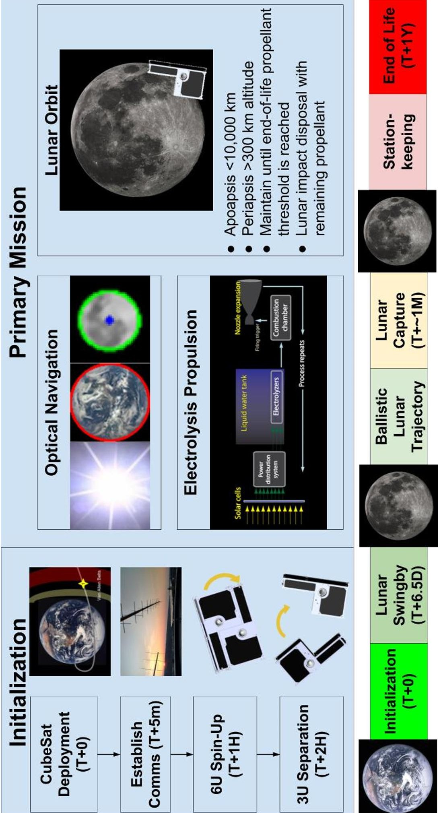

Figure 2-1: Cislunar Explorers mission concept of operations.

<!-- PDF_PAGE: 42 -->

## 2.3.1. Deployment and Spin-Up

The spacecraft are deployed from the interim cryogenic propulsion stage (ICPS) soon after Orion has separated and after the ICPS disposal maneuver is complete. Deployment is currently scheduled for T+3H 34M after launch. Immediately after deployment and boot-up, the spacecraft deploy their antennae and attempt to make contact with the ground segment. All spacecraft communications are in the 70 cm amateur radio band. The two spacecraft temporarily remain physically joined together even as they communicate and act independently.

After acquisition of signal and some key health and status checks, the ground commands the 6U to spin-up. One of the two 3U spacecraft pulses its cold-gas attitude thruster to add a small amount of angular momentum to the system. Although the thruster applies a torque perpendicular to the desired spin axis, the combined 6U unit is designed to be a major-axis spinner. So, it eventually settles into a major-axis spin due to substantial nutation damping from the water on board.

When the nutation has damped sufficiently, the ground commands the spacecraft to perform a reorientation maneuver—a rhumb-line precession—that consists of firing the cold-gas thruster once per revolution at a specific time after receipt of a sun pulse. The resulting attitude aligns the spin axis and main electrolysis thruster with the $ \Delta\mathrm{V} $ direction required for subsequent maneuvers. Once again, nutation damps passively.

Upon confirmation from spacecraft telemetry that the 6U unit has settled into the desired spin, the ground commands the two 3U spacecraft to separate from one another. A spring-loaded separation mechanism at one end of the seam between spacecraft has, until now, been restrained by a latch held in place by loop of vectran and

<!-- PDF_PAGE: 43 -->

nichrome burn wire. When the command is verified, the nichrome wire burns though the vectran cord, releasing the latch and allowing the springs to push the spacecraft apart. A hinge mechanism at the other end of the two spacecraft enables the spacecraft to spin as their mass centers translate, until one is fully released from the other. Figure 2-2 shows the splitting motion. Each spacecraft on its own is also a major-axis spinner. So, the 3U separation causes both spacecraft to enter a major-axis spin passively, as a much higher speed than the initial 6U spin: up to 6 radians per second. (As propellant is consumed and the spacecraft moment of inertia decrease, the spin rate increases to approximately 7.5 radians per second.) Once the two have successfully separated, the ground operates them as independent spacecraft.

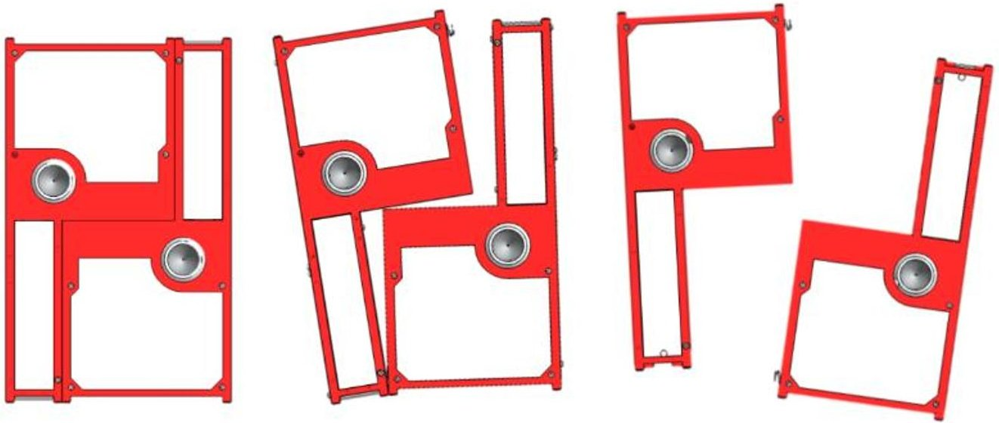

Figure 2-2: Cislunar Explorers spacecraft separation. $ ^{[1]} $ 2.3.2. Primary Mission

As soon as the spacecraft separate from each other, they commence electrolysis, splitting their onboard water into hydrogen and oxygen gas. The spin centrifugally separates the water in the propellant tank from the electrolyzed gas that is combusted downstream to produce thrust.

<!-- PDF_PAGE: 44 -->

This spin-stabilization also ensures very simple, stable attitude control and provides an unlimited field of regard for the cameras that enable optical navigation. With initialization and separation complete, the optical navigation system continually images the Earth, Sun, and Moon, distinguishing among them and computing their apparent size and angular separation from each other with computer vision. This data and an on-board ephemeris table combine in an extended Kalman filter to provide an onboard position and attitude estimate. These results—but not the raw data—are telemetered to the ground, where they are used in planning open-loop reorientation maneuvers for each spacecraft to align its electrolysis thruster with the direction required for each burn during the mission.

After separation, each spacecraft has approximately 6 days to prepare for its first lunar flyby. Its electrolysis propulsion thruster provides the thrust that slows the spacecraft to the point where this imminent flyby sets up a second lunar encounter. An interval of approximately one month between the initial flyby and the second encounter provides ample time for the spacecraft to reorient as necessary and continue to adjust its trajectory to facilitate the eventual, ballistic lunar capture.

Once captured into orbit around the Moon, the ground adjusts the spacecraft's orbit to conform to CubeQuest requirements: at least 300 km altitude at periapsis and no greater than 10,000 km apoapsis. That orbit is maintained with station-keeping burns until 1 year has passed or the spacecraft reaches its end-of-life propellant threshold, whichever comes first. Remaining propellant then lowers the orbit until the spacecraft undergoes a controlled impact for disposal on the lunar surface.

<!-- PDF_PAGE: 45 -->

## 2.4. Water Electrolysis Propulsion Subsystem

## 2.4.1. Thruster

Such a system carries a tank of liquid water, which 6W electrolyzers separate into a mixture of hydrogen and oxygen gas. Small amounts of this gas mixture are ignited on demand to produce thruster pulses. Our implementation uses no active mechanisms, only two one-way passive valves: a flame arrester between the propellant tank and the combustion chamber, and a check valve between the combustion chamber and the thruster nozzle. Figure 2-3 shows the arrangement. The flame arrester opens from the tank to the chamber, allowing the electrolyzed gas to fill the combustion chamber as it is produced. A check valve downstream of the combustion chamber prevents the gas from escaping through the nozzle before it ignites. After the combustion chamber fills to just under the upstream valve's 10 atm cracking pressure, a glow plug ignites the gas mixture on demand. The resulting detonation increases the pressure in the combustion chamber to approximately 100 atm. Because the hot gas cannot escape backwards through the flame arrester, it is forced out the check valve, producing thrust.

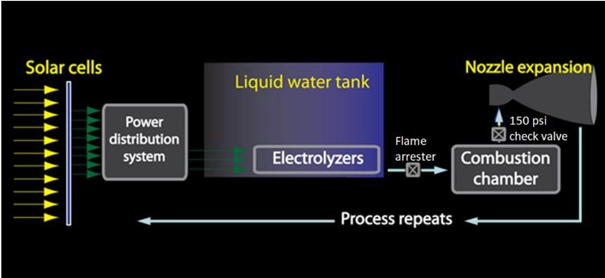

Figure 2-3: Water electrolysis propulsion concept of operations. $ ^{12} $

<!-- PDF_PAGE: 46 -->

Vacuum chamber tests confirm that this electrolysis propulsion implementation can achieve 286 s specific impulse, an average value for each complete pulse. The peak specific impulse during a single pulse may exceed 400s. These results are competitive with other electrolysis propulsion thrusters in development. $ ^{[5]} $ The specific impulse of LH2/LOX bipropellant in quasi-steady combustion is greater, up to 450 s. However, LH2/LOX propellant requires cryogenic storage at high pressures and other bulky, complex apparatus, such as cryogenic turbopumps, to function.

One way to compare propellants is using relative impulse density, defined as the ratio of the product of specific impulse and density of a given propellant to the product of specific impulse and density of gaseous nitrogen used in cold gas thrusters: $ ( I_{sp}\rho) / ( I_{sp}\rho)_{GN2} $ Nitrogen cold gas thrusters have a specific impulse of approximately 70 s with a propellant storage density of $ 0.28 \mathrm{~g/cm}^{3}. $ $ ^{[32]} $ At current performance of approximately 300 s specific impulse with a density of $ 1 \mathrm{~g/cm}^{3} $ , the relative impulse density of water for electrolysis propulsion is approximately 15; this compares favorably with other near-term CubeSat propulsion options such as cold gas thrusters (1) and hydrazine (8). $ ^{[29]} $ Electrolysis propulsion also compares favorably with the relative impulse density of LH2/LOX—which, based on an average density of the combined fuel and oxidizer of $ 0.36 \mathrm{~g/cm}^{3} $ and an ideal specific impulse of 450 s, is approximately 8. With the ideal performance of electrolysis propulsion also being 450 s, its ideal relative impulse density is as high as 23.

Electric thruster propellants—for example, xenon and iodine—have a greater relative impulse density. Xenon can be stored supercritical at a density greater than water, $ 1. 6 \mathrm{~ g / c m^{3}} $ and allows a much greater specific impulse than electrolysis

<!-- PDF_PAGE: 47 -->

propulsion; however, it must be stored at about 140 atm to achieve this density, $ ^{[30]} $ while water can be stored at low pressures suitable for CubeSats. Iodine stored as a solid has a density of approximately 5 g/cm $ ^{3} $ and a specific impulse of 1375 s, $ ^{[31]} $ providing a relative impulse density of over 350. However, at the time of writing, no iodine thruster has flown in space. NASA's Glenn Research Center has developed an iodine thruster technology demonstration CubeSat, iSat, which was planned for launch in mid-2018 but has been delayed because the propulsion system still needs time to mature. $ ^{[31]} $

Electrolysis propulsion represents a hybrid between chemical and electric propulsion. Therefore, it can be compared in some ways to other electric propulsion technologies, such as ion thrusters. Although the specific impulse and relative impulse density is much less than that of ion thrusters, its thrust-per-unit-power is much higher. An electrolysis propulsion thruster requires 4.5 kW per N at 80% efficiency; contrast with the NSTAR ion thruster which requires 23 kW per N of continuous thrust. This is beneficial at very low-power scales, where ion thrusters do not scale down as efficiently.[13] The net $ \Delta\mathrm{V} $ for the mission can also be considerably higher than that of electric propulsion because of system-level mass savings. For example, the iodine thruster demonstration iSat has a theoretical lifetime $ \Delta\mathrm{V} $ of 300 m/s, significantly less than our water propelled CubeSats with 500 m/s, despite the much lower specific impulse and specific impulse density of the propellant.[31]

The higher thrust per unit power can also be beneficial at very high-power scales, where the solar arrays required for electric propulsion are very large. Additionally, an electrolysis propulsion system is capable of small impulsive maneuvers depending on the size of its combustion chamber or temporary gas storage tanks, while an electric

<!-- PDF_PAGE: 48 -->

thruster is not. An example of a high-power use case is in a crewed Mars mission with a solar electric propulsion component, where solar arrays producing on the order of 800 kW are needed along with a separate chemical propulsion system for impulsive maneuvers. $ ^{[11]} $ An electrolysis propulsion system could achieve the same thrust with 250 kW, and also achieve the required impulsive maneuvers by itself. The use case of water electrolysis propulsion for a crewed Mars mission is examined further in Section 2.7.3, including the possibility of refueling using water that is pre-positioned from Earth or sourced from elsewhere.

One key advantage of electrolysis propulsion is that the propellant is stored as liquid water instead of as separate cryogenic fuel and oxidizer. This water is inert and can be safely stored at low pressure indefinitely. Therefore, the propellant can be loaded well in advance of launch, and even stored on-orbit in propellant depots for long periods of time. This feature enables on-orbit refueling operations which could reduce the total launch mass required for a mission.[2] Refueling can be accomplished with tanks of water sent in advance of the mission, or water gathered in situ, which is discussed further in Section 2.7.

## 2.4.2. Passive Spin Stabilization

This electrolysis propulsion system requires a means of separating the electrolyzed gases from the liquid water in the propellant tank. In this case, the spacecraft spins with the propellant tank off-center so that the water and gas are centrifugally separated. This architecture has the added benefit of providing passive spin-stabilization for the spacecraft, maintaining its attitude much like a top or gyroscope does, without the need for reaction wheels or multiple attitude thrusters.

<!-- PDF_PAGE: 49 -->

The two Cislunar Explorers spacecraft are major-axis spinners with each spacecraft's principal axis aligned closely to the axis of symmetry of the electrolysis propulsion thruster nozzle. The mass center shifts as propellant is expended during the mission. Any such misalignment causes an overturning torque that the spin stabilization resists to some extent. To mitigate this shift as much as possible, each spacecraft has been designed so that its mass center begins slightly offset from the nozzle center, on the near side of the nozzle relative to the propellant tank. Then, as propellant is consumed and the mass center moves away from the propellant tank, the mass center tracks across the nozzle, eventually crossing its centerline at approximately 50% fill fraction. Thus, throughout the mission, the thrust axis is as close as possible to the center of mass, minimizing the disturbance torque created by electrolysis propulsion thruster pulses.

The moment of inertia of the spacecraft is reduced as propellant is expended. However, the total angular momentum remains approximately constant because before the gaseous products of water electrolysis are combusted, they move from the propellant tank to the combustion chamber, and therefore closer to the spin axis. This movement decreases the moment of inertia of the spacecraft as mass is transferred closer to the center of mass. Yet, the spacecraft angular momentum remains constant prior to each thruster pulse because no external impulse has been applied yet. Therefore, the spin rate increases as the moment of inertia decreases. The effect is called jetdamping and is similar to an ice skater drawing in their arms as they spin. Eventually, the gas products are combusted and then expelled. The decrease in angular momentum at this point is very small because the combustion products are expelled through a nozzle throat ideally

<!-- PDF_PAGE: 50 -->

centered on the spin axis. Therefore, over the course of the mission, the spacecraft spin rate increases, from an initial 6 rad/s after deployment and splitting, to a final value of approximately 7.5 rad/s when propellant is depleted.

Spin-stabilization requires no active attitude control, but reorientation is occasionally necessary. A single cold gas thruster is all that is necessary to accomplish such maneuvers. On each Cislunar Explorer, the cold gas thruster is located in the arm of the spacecraft, with its nozzle parallel to and as far away from the principal axis as possible. This location maximizes the torque that the attitude thruster exerts about the center of mass. This reorientation torque does not significantly change as the center of mass shifts because that shift is only a few percent of the total distance between the thrust axis and principal axis.

Liquid propellant in a spinning spacecraft sloshes when the spin is disturbed, such as by a pulse from the electrolysis propulsion or attitude control thrusters. Any resulting nutation dissipates due to viscous effects in the moving fluid. $ ^{[1]} $ There is an intentional symbiosis between the attitude control and propulsion subsystems: the same spin that is required to separate the water from the electrolyzed gases is stabilized by the sloshing of the water in the propellant tank.

## 2.4.3. Passive Thermal Balancing

The water in the spacecraft propellant tank must remain liquid throughout the mission. This requirement derives from the simple fact that the electrolyzers cannot electrolyze ice but also because the sloshing of liquid water speeds up nutation damping to achieve a simple, stable spin about the thrust axis. In principle, the expansion of water upon freezing can damage the tank, but the tank here is designed with sufficient ullage

<!-- PDF_PAGE: 51 -->

volume to accommodate this expansion. Because of the importance of keeping the water in the propellant tank a liquid, the propellant must be kept in an acceptable temperature range, which nominally depends on the pressure in the tank. However, the freezing point of water is only negligibly different from 1 to 10 atm. Water boils at temperatures far above what the spacecraft electronics can survive (at maximum pressure, over $ 1 8 0 \mathrm{~} ^ {\circ} \mathrm{C} $ ). So, the propellant boiling is not a concern.

Likewise, the spacecraft electronics, particularly the lithium-ion batteries, also have acceptable temperature ranges, although these are both narrower and colder than that of the water. For example, the batteries can be safely discharged between -20 to 60 $ ^{\circ} \mathrm{C} $ . In an eclipse, the spacecraft electronics can be kept warm enough to function by their own waste heat; however, this waste heat can become dangerous when the spacecraft is in sunlight and oriented for maximum irradiance. Because the spacecraft electronics overheat well before the water boils, and the water freezes well before the electronics fail, the desired temperature range throughout the spacecraft is above the freezing point of water $ (0^{\circ} \mathrm{C}) $ and below the battery maximum temperature $ (60^{\circ} \mathrm{C}) $ . The spacecraft achieve thermal survivability through a passive design, heat sinking most of the spacecraft electronics to the propellant tank so that their waste heat is conducted away and keeps the water from freezing. The smaller sides of the spacecraft, parallel to the spin axis, are 20% covered in GSFC Dark Mirror black paint to improve heat absorption in the minimum-solar orientation.

The avionics dissipate approximately 1 W of power in their quiescent mode. Several functions dissipate much more heat, including the propulsion system's glow plug (4 W), the attitude thruster's solenoid valve (7.3 W), and the communications

<!-- PDF_PAGE: 52 -->

system when transmitting (7.5 W). These heat sources provide adequate thermal input to the water tank. There are also active heating elements on the spacecraft batteries, with the ability to dissipate up to 7 W of additional heating. The heat produced during an electrolysis-propulsion burn is not particularly useful for raising the water temperature because these burns take place infrequently, separated by at least 20 minutes. Subsequently, the overall energy produced is low.

The passive heat provided by the spacecraft electronics during the course of their operational life during the mission keeps the water from freezing by a margin of at least 5 C even in the spacecraft's minimum-solar orientation with minimal power dissipation from the spacecraft electronics. The battery heaters are unnecessary except in the rare case when the sun is eclipsed by the Earth or the Moon. Simultaneously, the water serves as a heat sink to keep the spacecraft batteries below their maximum temperature by a margin of at least 13 C, even in the spacecraft's maximum-solar orientation and when the communications system is transmitting. Figure 2-4 and Figure 2-5 show ANSYS finite-element model results for the coldest and hottest steady-state modes, respectively.

Should the water freeze due to a low-power anomaly, this prevents any propulsion and reorientation operations until the anomaly resolves and the water can be thawed. The propulsion system cannot electrolyze until the water is liquid again. Also, frozen water does not provide slosh-damping for spin-stabilization after any reorientation, so reorientation is to be avoided until the water is liquid again. As previously mentioned, the propellant tank is designed with sufficient ullage to avoid structural damage in the event that the water freezes, so the impact on mission operations is only be temporary.

<!-- PDF_PAGE: 53 -->

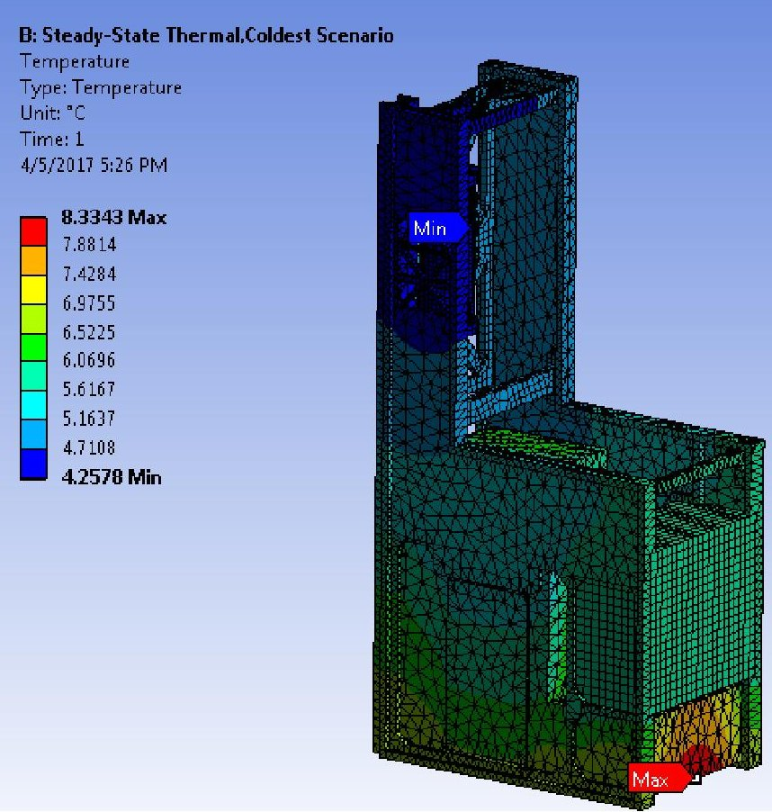

Figure 2-4: ANSYS modeling of coldest steady-state scenario.

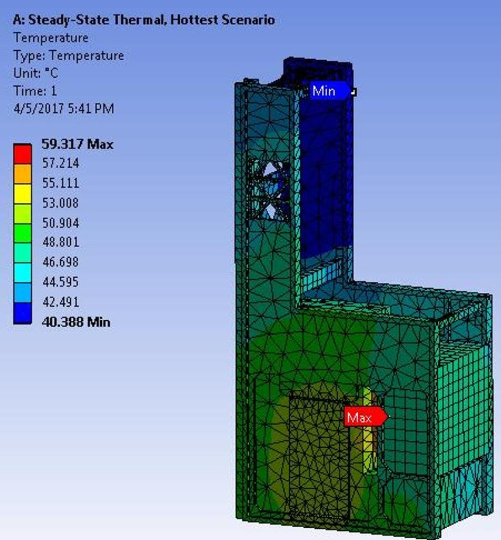

Figure 2-5: ANSYS modeling of hottest steady-state scenario.

<!-- PDF_PAGE: 54 -->

## 2.5. Other Subsystems

A primary goal of the mission is to serve as a pathfinder for the future ISRU of water to refuel spacecraft propellant and replenish other supplies. The Cislunar Explorers spacecraft are not capable of ISRU, but their choice of propellant does demonstrate the utility and versatility of water for spacecraft applications. The spacecraft architecture centers on the use of water as propellant, and the spinning architecture chosen to separate the water from the electrolyzed propellant mixture. Multiple subsystems benefit from the presence of water propellant in some way:

- Propulsion: The water is used as propellant.

- Attitude control: The spinning architecture is stabilized by water sloshing.

- Structures: The propellant tank is a vital structural component of the spacecraft.

- Attitude determination and navigation: The spinning architecture allows only three cameras to provide a completely omnidirectional field of regard.

- Thermal, Avionics, Communications, Power: The water serves as a heat sink to keep it liquid and the electronics cool. It also serves as a partial radiation shield for the electronics, which are adjacent to it.

## 2.5.1. Structures

The spacecraft structure is built around the water propellant tank. The tank is made from an additively manufactured titanium alloy, Ti-6Al-4V. During flight, the tank can be pressurized up to 10 atm. However, during storage and launch, the tank is only pressurized to 1 atm because the water propellant is not electrolyzed until after deployment. As a result, the propellant tank has large factors of safety, at least 20, for its internal pressure while stowed, meaning that it can also serve as the structural basis

<!-- PDF_PAGE: 55 -->

for the spacecraft during launch.

Most other elements of the spacecraft bus are made from milled Al-7075-T7. The spacecraft avionics box is made from Al-6061-T6. The spacecraft structure also includes the separation mechanism, the operation of which is described in Section 2.3.1, Deployment and Spin-Up. The latching mechanism is made from titanium and aluminum, with a vectran cord securing it and a nichrome burn wire to sever the cord. The burn wire and separation are commanded by the ground segment only after both 3U units have gone through boot-up and health checks, followed by the initial 6U spin-up maneuver.

## 2.5.2. Communications

The spacecraft communicates on the 437 MHz, 70 cm UHF amateur radio band. The ground segment uses a single, large, 19 dB gain Yagi antenna at the primary ground station at Cornell University. There is a backup ground station elsewhere at Cornell with 15 dB gain; this lower-gain antenna is sufficient to communicate with the spacecraft for the majority of the mission, including while in lunar orbit, but not while at the maximum distance from Earth. Figure 2-6 shows the communications architecture. For most of the mission, the spacecraft are at or farther than the distance of the Moon to the Earth. They are in view of the primary ground station approximately 12 hours per day depending on the season.

All uplinks and downlinks are encoded via phase-shift keying, specifically PSK125/250, an open-source digital modulation scheme. Because the spacecraft communications are entirely on an amateur radio band using open-source amateur radio encoding, any suitably equipped amateur radio operator could serve as a backup ground

<!-- PDF_PAGE: 56 -->

station if necessary. The spacecraft continue to make regular downlinks even when out of view of the Cornell ground stations. Any interested members of the amateur radio community could attempt to receive these packets and forward them to the team; they would be useful for continued mission planning and spacecraft health checks while it is out of view. The team is also reaching out to suitably equipped universities in locations distant from the Cornell ground station—e.g., in Australia—to potentially transmit commands from the team to the spacecraft when it is out of view as well. The mission plan benefits from, but does not assume, the use of either downlink or uplink when the spacecraft is out of view.

Spacecraft downlinks include a preamble, sync word, time stamp, checksum, and telemetry data. The telemetry includes Earth-centered inertial coordinates and attitude quaternion as computed by the onboard optical navigation system, internal temperature measurements, power production and consumption (current and voltage from each of the solar panels, current battery charge, and output current being used), and propellant tank pressure.

Because the spacecraft telemetry includes position data computed by the onboard optical navigation system, no Doppler tracking or other use of the radio signal is needed to track the spacecraft's position for most of the mission. This architecture eliminates the need for the Deep Space Network and may serve as a pathfinder for future commercial missions beyond the range of GPS. However, to claim the Achieve Lunar Orbit prize in the CubeQuest Challenge, a third party must verify the orbit of one of the Cislunar Explorer spacecraft. Therefore, once either spacecraft has achieved a lunar orbit within the required parameters, Wallops Flight Facility's 18-meter, UHF capable

<!-- PDF_PAGE: 57 -->

dish will provide Doppler tracking. Wallops will report the collected astrometric data directly to NASA for the purposes of verifying mission success.

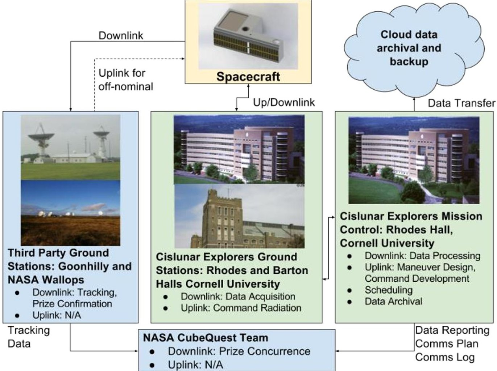

Figure 2-6: Communications flow between spacecraft and ground. 2.5.3. Optical Navigation

The spacecraft uses an optical navigation system based on three cameras and a Raspberry Pi computer to perform onboard image processing; prototype hardware is shown in Figure 2-7. At frequent intervals throughout the mission, images are captured of the Sun, Earth, and Moon by the onboard cameras. By computing the apparent size and angular separation of these bodies, and with reference to their ephemerides, the spacecraft is able to estimate its attitude and position independently and autonomously. A rolling archive of 1 GB of images is kept in the datalogger, representing hundreds of images or dozens of panoramas, depending on image resolution. None of these images

<!-- PDF_PAGE: 58 -->

are sent to the ground; they are used exclusively for navigation on board.

The optical navigation system provides additional synergy with the spin-stabilized architecture. The three cameras onboard each spacecraft have a field of view of $ 6 2. 2^{\circ} $ x $ 4 8. 8^{\circ} $ . These cameras are positioned with a small amount of overlap; combined, their field of view covers a $ 1 8 0^{\circ} $ by $ 4 8. 8^{\circ} $ sector of space. The combined spacecraft spin and camera orientation are such that the collective field of view of the cameras sweeps over a $ 4 \pi $ steradian field of regard around the spacecraft once per rotation period. Each camera takes a panorama of images covering its field of regard during this rotation. An onboard 3-axis gyroscope provides angular velocity data used to compute the appropriate timing between images, so that the cameras each cover a complete panorama with no gaps. Thus, the combined field of regard of the system provides omnidirectional coverage for navigation.

Machine vision identifies the Sun, Earth, and Moon and distinguishes them from one another in the images. The desired output of this image-processing step is the angular separation of the three bodies from each other and the apparent diameter of the Earth and Moon. The distance of the spacecraft from both bodies can be computed from their apparent size in pixels. The sun's diameter does not change appreciably during this mission; so, measurements of its diameter are not helpful. Examples of the machinevision fitting step are shown in Figure 2-8.

The cameras and algorithms are robust to glare-filled images of the Sun and partial, even overlapping, images of the Moon and Earth. They have been tested with many real images of all three bodies at different phases, both images taken with the cameras (for the Sun and Moon) and images from existing and past spacecraft (for all

<!-- PDF_PAGE: 59 -->

three bodies). Examples of image recognition under different conditions for all three bodies using NASA images are shown in Figure 2-9. For complete mission simulations, computer-generated images from the point of view of the spinning spacecraft are created based on the planned spacecraft trajectory using the AGI Systems Toolkit software. Optical flow and pixel smear effects from the spinning spacecraft architecture are simulated and applied to the generated images before image recognition.

Based on the output of the image recognition data, the optical navigation implementation uses a Gauss-Newton solver with an extended Kalman filter (EKF) to estimate the spacecraft position, attitude, and velocity. The algorithm can to achieve position accuracy of up to tens of kilometers. $ ^{[6]} $ However, when one body is fully eclipsed by another, the mathematical relationships become singular because only incomplete information about the celestial bodies is available. Position accuracy suffers, although the EKF is able to propagate past the singularities, keeping position accuracy within hundreds of kilometers. This performance is acceptable for the brief time during eclipses.

The optical navigation system is able to solve the so-called lost-in-space problem if the EKF diverges or following a failure—for example, if the flight software fails or the avionics reboot unexpectedly due to e.g. a single-upset event caused by an energetic particle. The lost-in-space solution initiates a particle filter that recovers the current position in space and time. Thereafter, the spacecraft returns to its EKF for trajectory determination. $ ^{[10]} $

The Raspberry Pi computer used for the optical navigation computations is also the flight computer for the spacecraft. The Raspberry Pi series, despite being consumer-

<!-- PDF_PAGE: 60 -->

grade hardware, is radiation-tolerant up to 40 krad(Si). $ ^{[8]} $ Its specifications indicate that it is qualified for temperatures ranging up to $ 70^{\circ} \mathrm{C} $ , and the Cislunar Explorers program has verified the thermal survivability in a thermal vacuum chamber up to $ 85^{\circ} \mathrm{C} $ .

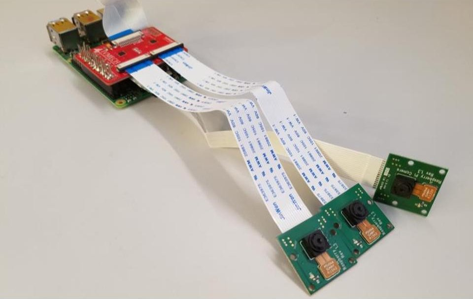

Figure 2-7: Cislunar Explorers optical navigation hardware.

Figure 2-8: Earth at simulated distances. Clockwise from top left: 28,034 km, 368,982 km, 594,600 km, 1,100,017 km. Original image: NASA.

<!-- PDF_PAGE: 61 -->

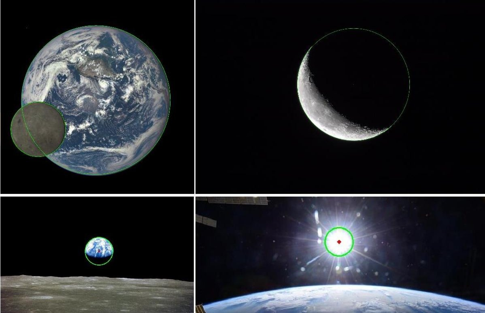

Figure 2-9: Recognition of Sun, Earth, and Moon in partial, overlapping, and glare-filled images. Top left: Full Moon and Earth. Top right: Crescent moon. Bottom left: Gibbous Earth rising over Moon. Bottom right: Sun view from ISS. Original images: NASA.

## 2.5.4. Power

The spacecraft uses a GomSpace P31u power module with two 18650 lithium ion batteries. Power is provided by SolAero ZTJM solar cells with monolithically integrated bypass diodes, through the MPPT power conditioner on the P31u. The instantaneous power available to the spacecraft varies depending on orientation but is typically an average of about 8 W. During occasional, brief eclipses, no power is produced; in these situations, the batteries provide the bus power.

Spacecraft power consumption in normal mode is approximately 1 W, mostly for the Raspberry Pi and sensors. The spacecraft requires 7.5W to transmit and 7.3 W to pulse its attitude thruster and therefore dips into the batteries for these purposes. However, it does not need to rely on the batteries to electrolyze (5 W) or fire the electrolysis propulsion thruster by activating its glow plug (4 W).

During eclipse the spacecraft not only produces no power but also must heat

<!-- PDF_PAGE: 62 -->

itself to keep the onboard water and electronics at safe temperatures. The use of onboard heaters (7W) and to the baseline power consumption (1 W) means the spacecraft has an 8 W power deficit during eclipses, greater than at any other time. The battery capacity and depth-of-discharge design are meant to accommodate this situation.

Because of the spinning spacecraft architecture, the use of bypass and blocking diodes is an essential part of the solar panel design to help prevent damage from rapid switching of power coming from different faces. $ ^{[23]}^{[27]} $ Diodes have been included for all cells but are especially important for the panels on the side faces of the spacecraft.

## 2.6. Water ISRU Potential

The Cislunar Explorers mission is designed as a pathfinder for water electrolysis propulsion technology and to demonstrate the potential utility of ISRU resources such as water when used in multiple subsystems of a spacecraft. The previous sections described the subsystems of the Cislunar Explorers spacecraft and the ways in which multiple subsystems leveraged the presence of water onboard the spacecraft. This section identifies broader advantages of the use of water as a multirole ISRU material and gives two examples of existing mission concepts that could benefit from utilizing water electrolysis propulsion technology. The next section expands on those examples and quantifies the mass-saving benefits of water ISRU when used in multiple aspects of a mission design.

## 2.6.1. Utility

Water is an excellent ISRU material, especially for future crewed missions. Human crew require water for drinking, cleaning, and irrigation of crops. Astronauts on the International Space Station use 3 L of water per day for drinking, food, and hygiene,

<!-- PDF_PAGE: 63 -->

and an additional 1 L per day for oxygen production. $ ^{[7]} $ Reclaiming and recycling water and oxygen can reduce the net use per day. However, water supplies will still be depleted albeit at a lower rate. Resupplying using water gathered in situ will reduce the total launch mass required to supply any crew with water for their needs.

Water electrolysis propulsion, described previously, can provide commonality between crew supplies and propellant reserves. This propulsion technology allows for impulsive maneuvers, unlike electric thrusters, and can achieve a specific impulse of up to 450 s, a significant improvement over the less than 200 s of steam propulsion, another impulsive water propulsion concept.[20] An example use case for water electrolysis propulsion with refueling by ISRU would be the World Is Not Enough (WINE) mission concept, developed as a collaboration between the University of Central Florida, Embry-Riddle Aeronautical University, and Honeybee Robotics.[28] WINE uses CubeSats, and possibly a larger mothership, to explore small bodies such as asteroids, heating ISRU water into steam for propulsion to leave the surface of each. The WINE team notes that for bodies with significant gravity or where a separate mothership is not present, alternative propulsion technologies with higher specific impulse than steam propulsion may be needed to perform the relatively high $ \Delta V $ transfers between bodies. They suggest electrolysis propulsion as an option for this.[28] The use of water electrolysis propulsion as an alternative or a supplement to the WINE mission propulsion concept is discussed further in the next section.

Other uses are passive and do not consume water supplies. Water can be used as a working fluid, as a heat sink, and for slosh damping of a spinning spacecraft architecture. Water is also suitable for use as a radiation shield and because it can be

<!-- PDF_PAGE: 64 -->

stored safely at low pressure and temperatures comfortable for human crew, the water tank can enclose the crew compartment in a way that a liquid hydrogen or liquid oxygen tank could not, providing radiation protection from all directions.

Water tanks surrounding the crew compartment will have a large surface area exposed to space; such a design will need to account for heating to keep the water from freezing. Waste heat from crew life support—which requires up to 30 kW of power in NASA's Mars Design Reference Architecture $ ^{[11]} $ and from electrolysis will help with this. Another concern with a large exposed surface area is protecting the water tanks from micrometeoroids. At least one proposed concept for a deep space habitat has suggested utilizing radiator panels as micrometeoroid shields. $ ^{[26]} $

## 2.6.2. Abundance

Besides water's versatility, it is increasingly apparent than water is abundant throughout the solar system. Water has been discovered, in various forms, on our own Moon as well as multiple moons and the rings of multiple gas giants, the planet Mars, and dwarf planets such as Pluto and Charon, Vesta, and Ceres. $ ^{[3]} $ Water is more accessible on some worlds than on others; for example, Europa has an icy surface from which water can be directly collected, while water on Mars is more difficult to access, except at the poles.

Water is also present on smaller bodies in the solar system. Asteroids, such as Vesta, contain buried deposits of ice and water dissolved into minerals. Comets, of course, are icy bodies where water is much more accessible than it is on asteroids. The low gravity of comets makes them well suited to landing on to gather water to replenish a propulsion system, such as to return a large sample back to Earth.

<!-- PDF_PAGE: 65 -->

All of these are targets of great scientific value; in fact, the water itself is of scientific interest. Gathering ice from the surface of Europa, for example, could simultaneously achieve scientific objectives and replenish the spacecraft supplies. After gathering water from the surface of a target, the spacecraft could use electrolysis propulsion to hop to another location on the same body, transfer to another body, or make a sample return.

## 2.6.3. Handling

Extraction may be difficult depending on the form of water. Gathering water from the surface of an icy moon such as Europa or Enceladus would be simple. Reclaiming water from an arid environment such as the surface of Mars would be more laborious. Water on Mars is not present above ground in large quantities except at the poles. Elsewhere, drilling or adsorption from the atmosphere is required.[9]

Once gathered, regardless of the ISRU technology, water is easy to handle and store. Liquid water is denser than the same volume of hydrogen and oxygen stored in their cryogenic liquid forms and can be contained at low pressure from 0 to $ 1 0 0 \mathrm{~ o C} $ . Water also does not boil off at ambient temperatures $ (\sim 2 0^{\circ} \mathrm{C}) $ as, for example, liquid hydrogen does. Therefore, water can be stored indefinitely in lightweight tanks. The same is not true for cryogenic hydrogen and oxygen, both of which require high pressures and cryogenic insulation for storage and cannot be easily stored for long periods. NASA's Mars Design Reference Architecture 5 (DRA-5) study identifies this as a critical challenge for one of the in-space propulsion concepts it considers: staged cryogenic chemical propulsion, with the trans-Earth injection stage needing to store propellant for two years before the crew return trip from Mars begins:

<!-- PDF_PAGE: 66 -->

"Cryogenic fluid management (CFM) is a critical technical area that is needed for the successful development of the Mars architectures. The first and foremost challenge is the storability of LH2, CH4, and O2 propellants for long durations. Note that the longest flight of stored cryogens is Titan Centaur-5, where the propellants were stored in orbit for a 9 hours." $ ^{[11]} $

This is an example use case where the ease of handling water for long durations is an advantage over the use of cryogenic propellant. The use of water electrolysis propulsion as an alternative for the DRA-5 chemical propulsion mission concept is discussed further in the next section.

Before the hydrogen and oxygen in water can be used separately, they must be electrolyzed to split the $ \mathrm{H_{2}O} $ molecules. This process requires both power and time, factors which must be considered in mission design. Water electrolysis requires 237 kJ per mole of water to be electrolyzed. Oxygen production requires only 1 L of water per day per crewmember, thus requiring just 3.65 kWh per person per day. However, production of hydrogen and oxygen propellant out of water works with much greater quantities for a crewed mission and requires 3.65 GWh per metric ton of propellant to be produced.

While the Cislunar Explorers mission presented in this paper utilizes a spinning spacecraft design to separate the water and electrolyzed gas propellant, alternative means of doing so exist. The spacecraft could spin only its propellant tanks or separate the propellant a different way. Electrochemical systems for achieving this separation in microgravity have been designed. $ ^{[14]} $ Both proton-exchange membrane and alkaline electrolysis systems inherently separate the product gases from each other. $ ^{[15]} $ Therefore, water electrolysis propelled spacecraft need not necessarily be spinners.

<!-- PDF_PAGE: 67 -->

## 2.7. Water ISRU Impact

## 2.7.1. Model

The ISRU of water for propulsion will have a dramatic impact on mission planning. The nature of the rocket equation is such that the available $ \Delta\mathrm{V} $ is a function of thruster exhaust velocity $ v_{e} $ , spacecraft propellant mass $ m_{p} $ , and the spacecraft dry mass $ m_{0} $ :

$$
\Delta V = v _ {e} \ln \left(\frac {m _ {0} + m _ {p}}{m _ {0}}\right)
$$

In terms of the spacecraft propellant required:

$$
m _ {p} = m _ {0} \left(e ^ {\frac {\Delta V}{v _ {e}}} - 1\right)
$$

This well-known result indicates that the propellant required to achieve a given $ \Delta\mathrm{V} $ depends exponentially on that $ \Delta\mathrm{V} $ and linearly on the payload mass to be delivered. So, doubling the required $ \Delta\mathrm{V} $ such as for a round trip—more than doubles the propellant required. Therefore, if a spacecraft is able to gather propellant at its destination for the return to Earth, substantial mass savings can be made.

Additional mass savings are possible if the water onboard serves multiple purposes. For example, in our Cislunar Explorers spacecraft, the presence of water for spin-slosh damping eliminates the need to carry multiple RCS thrusters or other attitude control devices. On a crewed mission, gathering water can replenish human consumables as well. Even assuming a very efficient water reclaiming system where only 0.5 L per day is depleted per person, for a trip to Mars or Deimos with a 360 day round trip time in space and 500 day time at the destination, a mission with a crew of 6 can save over 3 metric tons of water from the supply mass launched by producing the

<!-- PDF_PAGE: 68 -->

necessary water for the primary mission in situ.

If the mission is designed with a free-return trajectory prior to Mars orbit insertion, it may not be desirable to rely on ISRU water for crew supplies on the return trip. This is because if the mission needs to abort for a return to Earth, the ISRU water would not be able to be collected. This is unlike the water used for the surface mission, which could be produced in advance as a pre-condition for the crew departure from Earth and would not be needed in the event of a free-return abort. Water for use as propellant for the return trip could still be produced in situ, because it would only be needed in the event of a successful insertion.

Whether ISRU is used or not, it is possible to reduce the mass requirements in another way by taking advantage of the versatility of water. Because the same material serves multiple purposes, we can reduce the required mass margin as compared to having separate supplies for propulsion, oxygen production, and crew consumption. In a system with separate contingency and margin for propellant, crew water, and oxygen supplies, each requires its own independent bookkeeping. For example, if, during the course of the mission, not all of the propellant reserves are needed, the remainder cannot be redirected for other purposes, such as to refill crew oxygen in the event of a leak. In contrast, when the same resource serves multiple purposes, the same margin of reserves can guard against multiple supply overruns. Returning to the propellant/oxygen example, if an oxygen leak occurs but the propellant margins have not been fully drained, the remainder of propellant reserves can be repurposed to replenish the oxygen. The probability that all subsystems drawing on a collective resource will use a given percentage of their margins is less than the probability that any one subsystem will.

<!-- PDF_PAGE: 69 -->

For independent margins, we have:

$$
m _ {t s} = m _ {p} + m _ {w} + m _ {o}
$$

where $ m_{ts} $ is the total mass of separate reserves required for each of the several independent uses of water onboard: propellant $ (m_{p}) $ , water for the crew $ (m_{w}) $ , and water as feedstock for oxygen production $ (m_{o}) $ . In the general form:

$$
m _ {t s} = \sum_ {i = 1} ^ {n} m _ {i}
$$

where $ m_{i} $ is the margin for each of the n individual supplies on the spacecraft.

If these supplies all draw from a common source, we have:

$$
m _ {t c} = \sqrt {m _ {p} ^ {2} + m _ {w} ^ {2} + m _ {o} ^ {2}}
$$

where $ m_{tc} $ is the total mass of combined reserves required. In the general form:

$$
m _ {t c} = \sqrt {\sum_ {i = 1} ^ {n} m _ {i} ^ {2}}
$$

Because $ m_{tc}<m_{ts} $ except for trivial cases where the two are equal, this approach always results in a mass savings:

$$
\Delta m _ {t} = m _ {t s} - m _ {t c}
$$

An architecture can then reduce the propellant mass required for the mission by accounting for the reduced mass of supply margins that must be carried. By substituting (7) into (2), the propellant mass savings and then the total combined mass savings $ \Delta m $ are

$$
\Delta m _ {p} = \Delta m _ {t} \left(e ^ {\frac {\Delta V}{v _ {e}}} - 1\right)
$$

$$
\Delta m = \Delta m _ {t} + \Delta m _ {p} = \Delta m _ {t} e ^ {\frac {\Delta V}{v _ {e}}}
$$

If propellant is among the resources being combined by the RSS method, this approach becomes recursive. It also becomes more complex if multiple stages are used.

<!-- PDF_PAGE: 70 -->

## 2.7.2. Example: The World Is Not Enough

This subsection considers the World Is Not Enough (WINE) mission concept, a steam-propelled design which collects water in situ to replenish propellant supplies as part of a sustained campaign of exploration of asteroids, icy moons, or other suitable Solar System bodies. $ ^{[28]} $ We consider the application of electrolysis propulsion as a higher-efficiency addition to or replacement for the steam thruster used in the WINE design, an idea suggested by the WINE team themselves.

As mentioned in the previous section, the WINE mission concept is a collaboration between the University of Central Florida, Embry-Riddle Aeronautical University, and Honeybee Robotics. One disadvantage of the WINE steam engine is a low specific impulse. The design used for WINE has a specific impulse of 160 s $ ^{[33]} $ and even nuclear thermal steam propulsion designs have a low specific impulse of less than 200 s. $ ^{[20]} $ This is significantly better than cold gas thrusters, but significantly worse than demonstrated electrolysis propulsion performance of close to 300 s and the potential for performance as high as 450 s, close to the ideal for chemical propulsion. $ ^{[5]} $ $ ^{[17]} $ The relative impulse density of steam propulsion is therefore approximately 8-10, compared to the 15 of present electrolysis propulsion performance, and the 23 of ideal electrolysis propulsion performance.

The WINE team recognizes this. They suggest electrolysis propulsion as a possible addition to the mission concept that would have better performance for the relatively high $ \Delta\mathrm{V} $ transfers between bodies. $ ^{[28]} $ The 6U version of WINE proposed for asteroid prospecting has a mass of 7 kg and baselines a 3U volume for the propellant tank. A full propellant load of 3 kg would therefore produce 560 m/s $ \Delta\mathrm{V} $ using steam

<!-- PDF_PAGE: 71 -->

propulsion. Electrolysis propulsion almost doubles the available $ \Delta\mathrm{V} $ per propellant load, providing 1050 m/s $ \Delta\mathrm{V} $ at present day electrolysis propulsion performance of approximately 300 s specific impulse. At the ideal electrolysis propulsion performance of 450 s, the available $ \Delta\mathrm{V} $ almost triples, to 1574 m/s per propellant load.

## 2.7.3. Example: Mars Design Reference Mission 5.0

This subsection considers NASA's Mars Design Reference Architecture 5.0 (DRA-5), with the key change made that the propellant is stored as liquid water instead of LH2 or LH2/LOX, providing commonality between propellant, oxygen generation stock, and water supplies for the crew.[2] The DRA-5 study proposes several propulsion options; some use only impulsive maneuvers while others use low-thrust maneuvers or a combination of both. Impulsive propulsion concepts considered include nuclear thermal and cryogenic chemical bipropellant. Low-thrust concepts considered in the DRA-5 include nuclear electric propulsion and a combination of solar electric and chemical propulsion. Electrolysis propulsion compares most favorably to the cryogenic chemical propulsion option, because it can achieve the same specific impulse but without the need for long duration cryogenic propellant storage.

The DRA-5 chemical propulsion mission concept budgets five super-heavy lift launches and 347.6 metric tons of propellant for the crewed vehicle including margin. $ ^{[11]} $ For the purposes of this example, we assume liquid water is used for propellant storage instead of LH2/LOX and ignore the possibility for dry mass savings based on the easier handling of water. For the transit habitat, 2.65 mt of consumables are budgeted for the outgoing trip as well as for the returning trip, with an additional 7.94 mt of contingency in case the crew must remain in orbit and cannot reach the surface habitat and supplies.

<!-- PDF_PAGE: 72 -->

In addition to these consumables, 0.687 mt is budgeted for contingency water and oxygen for crew use. This optimistic design decision is based on the assumption that "recovery of water from urine is assumed at 85% whereas all other water sources are recovered at 100%... Water is not required for the transit or surface habitats because of the amount of water assumed in the food recovered by the ECLSS." $ ^{[11]} $ Based on a 2035 launch window, there is additionally a 31.6 mt total propellant margin across all interplanetary maneuvers: trans-Mars injection, Mars orbit injection, and trans-Earth injection. Combined, a total contingency of 32.287 mt of water is carried.

Due to the shared resource of water between propulsion and crew supplies, the total contingency mass required is reduced using the RSS method described above. The new result is 31.607 mt, saving 0.68 mt. This mass reduction is modest, because the RSS is dominated by the large propellant term. However, this initial reduction cascades into additional mass savings, because with the reduced mass carried as contingency, less propellant is needed to achieve the same $ \Delta\mathrm{V} $ for each maneuver. We save an additional 2.68 mt of water in this way, for a total of 3.36 mt.

More importantly, technical and logistical gaps in the DRA-5 may be bridged if water electrolysis propulsion technology is baselined in place of an extreme duration propellant-storage solution that currently does not exist. Both the nuclear thermal and chemical propulsion options for the DRA-5 require storage of cryogenic fluids for long periods of time, approximately two years. As noted in the previous section, the study considers this a "critical technical area" and the longest endurance of stored cryogens on-orbit is nine hours.[11] Electrolysis propulsion allows propellant to be stored indefinitely in the form of inert liquid water, with conversion into cryogenic fluids or

<!-- PDF_PAGE: 73 -->

hydrogen and oxygen gas to take place shortly before each maneuver. $ ^{[2]} $ This circumvents a key technical gap in the DRA-5.

Additionally, the ease of handling water as propellant means lightweight tanks of water kept liquid with solar-powered heaters can be pre-positioned in Mars orbit ahead of the crewed mission. These tanks can be used for refueling operations, reducing the amount of propellant needed for the round-trip crew mission. The total amount of launches for the mission can be reduced, as well, if the water to be used is sourced from Solar System resources instead of being sent from Earth. Even if the water must be sent from Earth, pre-positioning propellant before the crew mission increases the allowable timespan between the super-heavy-lift launches required. The baseline DRA-5 uses five Ares V (equivalent to the SLS Block 2) launches within 120 days. Estimates of the launch cadence of SLS include projections of one launch per year or even less, $ ^{[34]} $ posing a logistical challenge. With water propellant for the return trip pre-positioned at Mars, as few as two launches are needed for the actual crew vehicle prior to its initial departure. $ ^{[2]} $

Electrolysis propulsion also offers an alternative to the combined solar electric and chemical propulsion option in the DRA-5, because electrolyzed propellant can be stored to achieve the impulsive maneuvers, while also being produced on-demand for the low-thrust maneuvers. This streamlines the crew vehicle design by combining two propulsion concepts into one. Because of the high thrust per unit power of electrolysis propulsion, it also reduces the necessary size of the solar array to $ 2 5 0 \mathrm{k W} $ $ ^{[3 5]} $ less than a third of the 800 kW array chosen in the DRA-5 addendum that considers solar electric propulsion. $ ^{[1 1]} $ However, the lower specific impulse of electrolysis propulsion compared

<!-- PDF_PAGE: 74 -->

to electric thrusters requires more propellant for the same trajectory, making in situ resource utilization a necessity in order to accomplish the mission with the same number of super-heavy lift launches for the crew vehicle. Without ISRU, the mission can be accomplished by pre-positioning propellant at a lunar libration point and in Mars orbit using a total of three super-heavy lift launches, followed by two more to deliver the crew vehicle.[35] With ISRU, the mission can be accomplished with only the last two launches. This mission architecture leverages both NASA's planned Deep Space Gateway and the proposed Lunar COTS infrastructure for creating economical and sustainable cislunar propellant depots.[36]

## 2.8. Conclusion

The Cislunar Explorers spacecraft demonstrate the utility and versatility of water as a basis for spacecraft architecture. The entire spacecraft centers on the use of water and the spin required to separate the inert liquid from the electrolyzed propellant. Every subsystem leverages the presence of water onboard in some way, and the performance of the water electrolysis thruster can provide enough $ \Delta\mathrm{V} $ to achieve lunar orbit. Additionally, the spacecraft demonstrate a novel multibody optical navigation approach, capable of providing autonomous interplanetary navigation with accuracy to within tens of kilometers.

Future work could extend these technologies to other planetary systems. Multibody optical navigation can function in any planetary system with at least two bodies and is especially beneficial when communication is taxing to the spacecraft or ground segment. Therefore, gas giants, with their many moons and great distance from Earth, are an appealing target for this technology. The moons of gas giants are also

<!-- PDF_PAGE: 75 -->

attractive for electrolysis propulsion, because many, such as Europa and Enceladus, have icy surfaces from which water can be readily gathered for in situ resource utilization.

Electrolysis propulsion is just one of many uses for water gathered in situ. On the Cislunar Explorers, water is also used for attitude control, as a heat sink, and a radiation shield, with the propellant tank also providing the main structural element of the spacecraft themselves. On crewed missions, water is also necessary for crew consumption and useful for oxygen production and irrigation of crops. By using onboard water for multiple purposes, the overall mass of supply margins needed can be cut, reducing the amount of water that must be launched or produced in situ to support the mission.

Multiple mission use cases for electrolysis propulsion with in-situ resource utilization for refueling exist. One example is the sustained exploration of asteroids using water produced in situ for steam-powered hops along the surface to gather resources and electrolysis propulsion for transfers from one body to the next. Another use case is for crewed Mars missions, where electrolysis propulsion circumvents technical and logistical gaps in the DRA-5 chemical propulsion concept. Electrolysis propulsion can also leverage future cislunar infrastructure, including the Deep Space Gateway and proposed cislunar propellant depots.

While the Cislunar Explorers do not perform ISRU themselves, they serve as pathfinders for future spacecraft that could. The successful demonstration of a waterpropelled spacecraft provides an inexpensive, green, dense propellant storage method with an indefinite shelf life and low power consumption per unit thrust. Electrolysis

<!-- PDF_PAGE: 76 -->

propulsion offers significantly greater efficiency than the use of water in steam rockets and is capable of small impulsive maneuvers, unlike other electric thrusters. The ideal specific impulse of electrolysis propulsion is similar to that of cryogenic chemical propellants, while completely circumventing the issue of handling cryogenic fluids in orbit for long periods of time. Coupled with the increasingly apparent abundance of water in the solar system, future missions will be able to replenish their propellant supplies and free mission designers from the tyranny of the infamous rocket equation.

<!-- PDF_PAGE: 77 -->

## WATER ELECTROLYSIS FOR PROPULSION OF A CREWED MARS MISSION

## 3.1. Introduction

The Mars Design Reference Architecture 5.0 (DRA-5) is a 2007 study guided by NASA's Mars Architecture Steering Group. $ ^{[11]} $ It is the latest in a series of Reference Architectures and presents several options for key trades in the mission architecture. One of the most significant trades, and the one with which this paper is concerned, is the in-space propulsion design. DRA-5 considers two options in depth: nuclear thermal propulsion and chemical propulsion using liquid hydrogen and liquid oxygen (LH2/LOX). This paper examines the chemical propulsion option and provide alternative mission concepts based on in-flight refueling of liquid water at key points during the mission.

This paper begins with an overview of the Mars DRA-5 propulsion concept, followed by a summary of the particular challenges facing this architecture that the proposed approach addresses, then an overview of the electrolysis propulsion technology, which enables the use of liquid water as propellant. Section 3.3 presents the concepts of operation for several Mars transportation schemes using this technology with tanks of liquid water that are sent ahead of the crew vehicle to anticipate refueling. Section 3.4 compares the launch requirements for each. Section 3.5 concludes and discusses future work.

<!-- PDF_PAGE: 78 -->

## 3.1.1. Overview of Propulsion in Mars Design Reference Architecture 5.0

The DRA-5 chemical propulsion design architecture is depicted in Figure 3-1. This design sends six crew to Mars for an approximately 1.5-year stay using three interplanetary vehicles per mission. Two are cargo vehicles sent ahead of the crew, each with two propulsion modules for trans-Mars injection and an aeroshell for aerocapture at Mars, with one including a Mars surface habitat, while the other contains a descent/ascent vehicle (DAV). The third vehicle transports the crew and consists of a transit habitat and five propulsion modules:

- Three for trans-Mars injection (TMI).

- One for Mars orbit injection (MOI).

- One for trans-Earth injection (TEI).

All three vehicles are assembled in orbit, the cargo vehicles over 170 days, and the crew vehicle over 120 days.

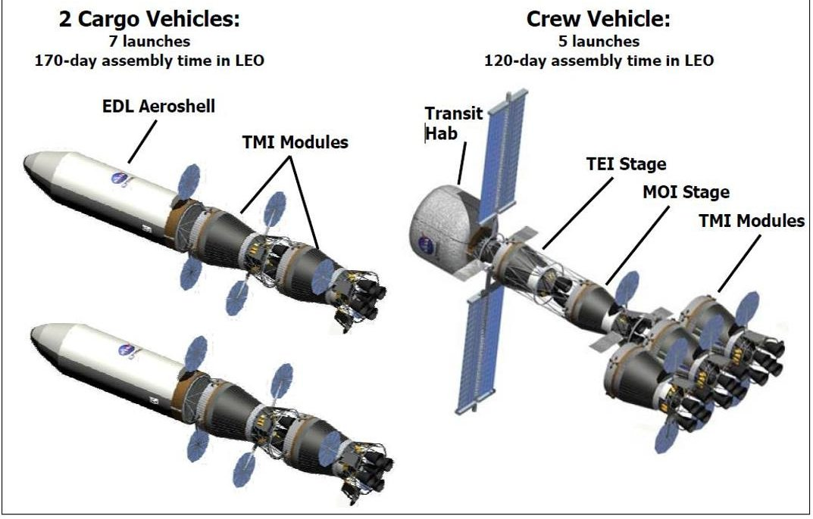

Figure 3-1: Baseline Mars transportation system architecture from the Mars DRA-5. $ ^{[11]} $

<!-- PDF_PAGE: 79 -->

The present study focuses on the crew vehicle because its five-module propulsion staging can be streamlined by the proposed refueling approach. As the next section makes clear, pre-positioning propellant to be collected after departure from Earth can eliminate several of these modules and dramatically reduce the size, mass, and complexity of the crewed vehicle. In the baseline presented here, discussed in more detail in the next section, the propellant being pre-positioned is sent from Earth and requires its own launch vehicles. Utilization of water mined from the Moon, Mars, or asteroids is an alternative which eliminates this need and reduces the number of launches required. Because the propellant tanker launches are separate from the crew vehicle launches, the proposed architecture is flexible with regards to the potential use of water resources in cislunar space, at Mars, both, or neither.

Although the cargo vehicles have a longer combined assembly time than the crew vehicle, they each have only two propulsion modules, because they do not require Mars orbit injection (MOI, aerocapture is used instead) or trans-Earth injection (TEI, the cargo payloads do not return to Earth). Also, the mass of vehicle is lower at about 310 t than the crewed vehicle at 486 t. There is correspondingly less propellant and propulsion dry mass as well, and the propellant is not stored for a prohibitive amount of time because it is all used for trans-Mars injection. Therefore, the cargo vehicles do not benefit from refueling, and this study does not examine them further.

Additionally, because the DRA-5 is based on a 2007 study, it uses the Ares launch vehicles from the since-cancelled Constellation program. Because "the gross [LEO] payload capability of the reference Ares V vehicle was assumed to be 131.4 t" $ ^{[53]} $

<!-- PDF_PAGE: 80 -->

for this study, and the Space Launch System (SLS) Block 2 has a LEO payload capability of 130 t, the two launch vehicles are comparable. Additionally, the Ares I was intended to have a 25 t LEO payload capability, which is comparable to the SpaceX Falcon 9 (F9) at nearly 23 t. $ ^{[45]][46]} $ Although the F9 is not human-rated at the time of this writing, SpaceX is pursuing this goal and intends to use F9 for its Commercial Crew Program launches. $ ^{[47]} $ Therefore, this analysis hereafter substitutes SLS for Ares V, and F9 for Ares I.

Some of the alternatives considered here contemplate the use of the Falcon Heavy (FH) as well. FH is not used to launch any components of the crew transit vehicle itself but is used only for water refueling operations in Earth orbit or at Mars. SLS can deliver 40 t to Mars, $ ^{[44]} $ while FH can deliver 16.8 to Mars and 63.8 t to LEO. $ ^{[52]} $ Although the FH is projected to be considerably less expensive than the SLS, official cost figures for a FH launch with maximum payload are not available, and that maximum payload is significantly less than the SLS, meaning multiple FH launches are required to deliver equivalent payloads. Therefore, FH availability is not assumed to be a cost-effective alternative, although it may very well be, and this study includes architecture options both with and without it.

## 3.1.2. Mars Design Reference Architecture 5.0 In-Space Propulsion Challenges

We address challenges to the DRA-5 mission that stem from its multi-staged propulsion approach. One of the most direct consequences of this approach is that it increases the total dry mass for the crewed vehicle. For example, each of the three TMI modules has five RL10-B2 engines, which combined contribute 1 t per module. $ ^{[48]} $ These and other sources of redundant dry mass and cost could be eliminated by using a

<!-- PDF_PAGE: 81 -->

single propulsion module. Launching a single module with as much propellant as the five propulsion modules in the DRA-5 is impossible for SLS, but it is possible instead to launch an empty or partially empty propellant tank to be filled by another launch, or even a full propellant tank that that is refueled at key points during the mission after being depleted.

A related challenge is that the propulsion modules and their payload are placed into orbit separately on five SLS launches. This architecture requires several months (120 days) of on-orbit assembly time. Due to the long period spent in LEO, a reboost module is also required to perform stationkeeping during this time. $ ^{[11]} $ This module is jettisoned before Earth departure, and therefore does not hamper the Mars transfer directly. However, it masses over 48 t and, thus, fills a significant amount of payload capacity. If the crew vehicle were able to mitigate the need for stationkeeping, or at least avoid the need for a module dedicated to that purpose for the mission, that launch mass could be eliminated or used for other purposes.

While the 120-day assembly period is a long time for the crew vehicle to be in LEO, it is also a very short time to conduct five super-heavy lift launches. Launch cadence estimates for SLS vary, with projections as low as one launch per year or even less often. $ ^{[34]} $ Increasing the assembly time to several years would address the launch cadence gap, but also exacerbate other challenges. For the crew vehicle in the DRA-5, which remains in LEO until it is fully assembled, a multi-year assembly time would require much more reboosting than budgeted for in the reference architecture. Another reboost module or additional propellant for the existing module would be required. In addition, this long assembly time would greatly contribute to the problem of cryogenic

<!-- PDF_PAGE: 82 -->

propellant storage. The most significant challenge the DRA-5 architecture faces with regards to its propulsion concept concerns the shelf life of the engines and propellant in the existing cryogenic chemical propulsion technology. The DRA-5 study identifies this as a critical problem:

"Cryogenic fluid management (CFM) is a critical technical area that is needed for the successful development of the Mars architectures. The first and foremost challenge is the storability of LH2, CH4, and O2 propellants for long durations. Note that the longest flight of stored cryogens is... 9 hours." $ ^{[11]} $

An orders-of-magnitude gap separates the required endurance of cryogenic propulsion modules for the DRA-5 from the longest actual in-flight storage time. It is this disparity that is principally behind the proposed architecture based on waterelectrolysis propulsion with pre-positioned tanks of water for refueling. Such an architecture completely avoids the cryogenic propellant-storage challenge and mitigates others described in this subsection. The storage life of water is virtually indefinite, with no need for cryocoolers or contingency to account for boil-off. In addition, cryogenic fluid management technologies for transfer and refueling are "not considered mature enough for operational use" $ ^{[73]} $ while water-loading operations for the International Space Station have been performed from multiple vehicles, such as the Space Shuttle, Progress, and the Automated Transfer Vehicle. $ ^{[74]} $ $ ^{[75]} $ $ ^{[76]} $

In the proposed architecture, the crew vehicle is assembled in only two segments at the second Earth-Moon libration point (EML2), instead of in five segments at LEO. A lightweight tank of liquid water is pre-positioned at this point for refueling after the initial launch. Stationkeeping is required there, but NASA's proposed cislunar space station, the Deep Space Gateway, may be available to provide it and supervise the pre-

<!-- PDF_PAGE: 83 -->

positioned assets. $ ^{[65]} $ Additional propellant is pre-positioned in Mars orbit for the return trip to Earth. Because of the indefinite storage life of water, propellant can be prepositioned years ahead of time to avoid straining the SLS launch cadence.

Other advantages of this approach include the elimination of redundant dry mass in the form of jettisoned stage engines and propellant tanks. There are several disadvantages, however, including higher dry mass in the form of solar arrays needed to support rapid electrolysis of the stored water propellant. The mass inefficiency of storing large amounts of hydrogen and oxygen gas also limits the electrolysis propulsion system to mostly low-thrust operations, with relatively small impulsive maneuvers used for orbit insertion and escape. Nevertheless, the key distinction is that the proposed water-electrolysis architecture uses lower-risk, higher-TRL technology than the alternatives, making a humans-to-Mars mission possible in the near term. The architecture, and its advantages and disadvantages, are described with more detail in the next section.

## 3.1.3. Electrolysis Propulsion Overview

An electrolysis-propulsion thruster uses hydrogen and oxygen as propellant but stores the propellant as liquid water instead of as separate cryogenic fluids. $ ^{[1]} $ The water is then electrolyzed into hydrogen and oxygen gas, which can be temporarily stored together as a readily combustible mixture, or separately, for later mixture and combustion. This concept of operations is shown in Figure 3-2. In our experiments, this technology has demonstrated a specific impulse of close to 300 s. Other developers have achieved similar performance. $ ^{[5]} $ Though these projects are designed for CubeSats, the technology can scale up with the additional power available from solar panels on larger

<!-- PDF_PAGE: 84 -->

spacecraft.

The current specific impulse of this technology is significantly lower than that of cryogenic LH2/LOX engines, which can reach 450 s. $ ^{[49]} $ In our experiments, the gap in performance is because electrolysis is much slower than the combustion process. Therefore, the thruster must fire in small pulses, when it would be more efficient in a steady state burn of a longer duration. However, liquid water can be stored at lower pressures and with less insulation than cryogenic fluids (or none), and electrolysis propulsion requires no turbopumps or other complex apparatus to operate, saving considerable dry mass.

Storing propellant as liquid water also improves the relative impulse density, the ratio of the product of specific impulse and density of a propellant to the product of the specific impulse and density of nitrogen. Figure 3-3 displays a comparison of the relative impulse density of electrolysis propulsion to multiple chemical propellants and other propulsion options. With a specific impulse of 300 s and a density of $ 1 \mathrm{~g/cm}^{3} $ compared to a specific impulse of 70 s and a storage density of $ 0.28 \mathrm{~g/cm}^{3} $ for nitrogen $ ^{[72]} $ , water used for electrolysis propulsion has a relative impulse density of 15.3. The ideal relative impulse density of electrolysis propulsion is 23, representing an improvement of specific impulse to 450 s. Cryogenic LH2/LOX, with an average propellant density of only $ 0.36 \mathrm{~g/cm}^{3} $ , has a relative impulse density of 8.3. Therefore, water electrolysis propulsion has a significantly greater relative impulse density LH2/LOX, even at current performance of 300 s specific impulse. The relative impulse density of electrolysis propulsion also compares favorably with electric thermal and nuclear thermal steam propulsion. Both concepts store propellant at the same density of

<!-- PDF_PAGE: 85 -->

1 g/cm $ ^{3} $ but have lower specific impulse of 160 s and less than 200 s respectively. $ ^{[20]^{[33]} $ The result is a relative impulse density in the range of 8-10 for steam propulsion. The comparison with nuclear thermal propulsion using LH2 is favorable as well because, despite the high specific impulse of up to 900 s, the low propellant storage density of just 0.07 g/cm $ ^{3} $ results in a relative impulse density of less than 3.3.

Also, as summarized in the previous subsection, this technology addresses several specific concerns with the cryogenic propulsion approach that are present in the crewed Mars mission examined in this paper. Electrolysis propulsion is thus an appealing alternative to cryogenic propulsion for this mission and would be even more so if the specific impulse were improved to similar levels for the Mars application. Improving the specific impulse of electrolysis propulsion thrusters requires burn durations long enough to reach a steady-state for maximum efficiency. This can be done in two ways. The first option is a small thruster with electrolysis rapid enough to sustain its combustion indefinitely. This requires a sizeable solar array to be feasible. With a specific impulse of 450 s, in order to maintain a steady thrust of 1 N, the spacecraft requires 3.6 kW of power for electrolysis, or 4.5 kW of power for an electrolysis propulsion system assuming 80% efficiency. We have measured about 90% efficiency in COTS electrolyzers, so this figure is conservatively low.[12] The specific thrust at 80% efficiency is 222 mN/kW, a significantly greater thrust per unit power than other electric thrusters, such as Hall effect thrusters achieving 68 mN/kW.[66]

The second option is a larger thruster that stores significant amounts of hydrogen and oxygen gas in tanks after electrolysis, to sustain a burn for many seconds or minutes. The CubeSat scale thruster mentioned above has burn durations much shorter than one

<!-- PDF_PAGE: 86 -->

second, but a brief steady state with high specific impulse can be seen even in this case. $ ^{[5]} $ With a longer burn duration pressure-fed by gaseous propellant storage tanks, the average specific impulse can be dramatically improved to be competitive with other chemical propulsion technologies. This also requires a sizeable solar array to be feasible for a crewed spacecraft, because of the large amount of propellant needed to be electrolyzed between burns to fill these tanks.

Each approach has advantages and disadvantages. The continuous approach reduces dry mass due to the smaller thruster and absence of gas tanks. However, continuous operation is also low thrust, with this approach unable to perform impulsive burns for such maneuvers as orbit injection and escape. The second option, in contrast, allows impulsive maneuvers at the expense of increased dry mass, the amount of which can be prohibitive depending on the mass of the vehicle and the $ \Delta V $ of the chosen impulsive maneuvers. In the next section we consider a hybrid of the two, using relatively small gas tanks for small impulsive burns alongside longer low-thrust maneuvers.

<!-- PDF_PAGE: 87 -->

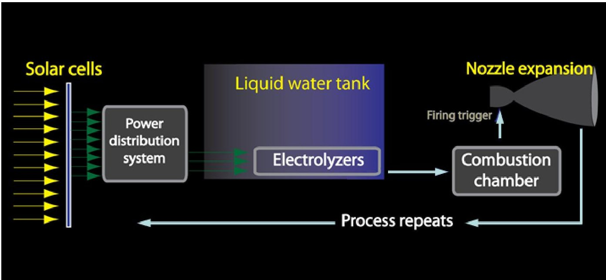

Figure 3-2: Electrolysis Propulsion Operation. $ ^{[12]} $

Relative Impulse Density Comparison

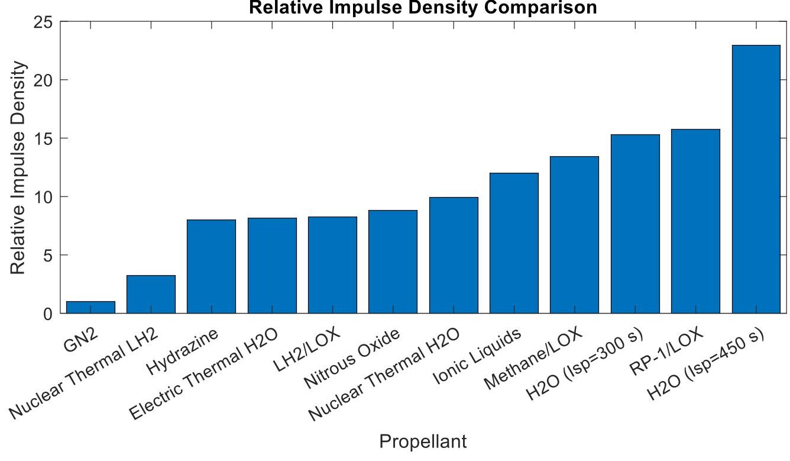

Figure 3-3: Relative Impulse Density Comparison.

<!-- PDF_PAGE: 88 -->

## 3.2. Mars Design Reference Architecture 5.0 Proposed Prepositioning Propellant Architecture

## 3.2.1. Thruster

The use of water for chemical propulsion was described earlier in Section 3.1.3, Electrolysis Propulsion Overview. Liquid water is used to densely and inertly store hydrogen and oxygen for later separation into separate gases or a mixture of the two, which is then combusted to produce thrust. Ideal performance is identical to that of LH2/LOX chemical propulsion, 450 s, while performance of 300 s has been reached in our work and others.[5] Section 3.1 described the advantages and disadvantages of this propulsion method relative to that of LH2/LOX, and the path forward to achieving near-ideal performance. This section considers its use in the Mars DRA-5 mission specifically.

Due to the large specific enthalpy of water (286 kJ/mol), substantial power is required to electrolyze it rapidly enough for use in the propulsion of a massive spacecraft, such as the crewed Mars vehicle considered in this paper. However, the power requirements are not as demanding as they are for other electric thrusters. As described in the previous section, with a conservative 80% electrolysis efficiency assumed, the specific thrust of this technology is 222 mN/kW. This thrust per unit power is significantly greater than other electric thrusters, such as high-performance Hall effect thrusters achieving 68 mN/kW, $ ^{[66]} $ thus requiring a smaller solar array for the same thrust to mass ratio and saving some dry mass.

Operation as a continuous thruster also completely eliminates the need for cryogenic propellant storage. Propellant is produced and consumed on-demand.

<!-- PDF_PAGE: 89 -->

However, with a specific impulse of only 450 s, the $ \Delta V $ required for many low-thrust trajectories is prohibitive, even if the propellant for the return trip is pre-deployed. Storing the propellant temporarily in cryogenic form after electrolysis addresses this issue by allowing impulsive burns but is still undesirable because it forgoes the primary advantage of water electrolysis propulsion. Cryogenic propellant boiloff would become a concern and avoiding that is the principal motivation for choosing the electrolysis propulsion approach to begin with. Instead, the proposed architecture uses gas tanks for temporary storage of relatively small amounts of electrolyzed propellant.

The concept of operations is shown in Figure 3-4. A lightweight tank stores water at low pressure. When the thruster is in use, water continuously passes from the storage tank to a separate electrolysis chamber. The plumbing from the tank to the chamber serves as a heat sink for the nozzle of the thruster, similar to other regeneratively cooled nozzles. Electrolysis produces hydrogen and oxygen gas, which are separated into temporary storage tanks. Most of the time, the gas is not retained in these tanks for very long or at all, passing on to a combustion chamber where the resulting mixture is consumed for thrust as soon as it is produced.

When needed, usable propellant can be stored in the short term for impulsive maneuvers of a few hundred m/s or less. In this case, electrolysis takes place for some time in advance of the maneuver: minutes, hours, or up to several days depending on the amount of propellant needed and the available power for electrolysis. The mass fractions of gaseous hydrogen and oxygen tanks are significantly lower than the mass fractions of cryogenic propellant tanks. Composite overwrapped pressure vessels (COPVs) for oxygen storage in space can have mass fractions as high as 0.74 gas/total

<!-- PDF_PAGE: 90 -->

mass. $ ^{[71]} $ Hydrogen COPVs are less mass-efficient, with state-of-the-art mass fractions of approximately 0.06 gas/total mass for a 2015 Toyota tank with 5.6 kg of hydrogen in a 92.3 kg composite tank. $ ^{[68]} $ With the propellant being approximately 89% oxygen and 11% hydrogen by mass, the overall mass fraction of the gas storage tanks is 0.28 gas/total mass, requiring 2.16 t of tank mass for every 1 t of propellant that needs to be stored in gaseous form at a time. This is significantly heavier than cryogenic tank mass fractions. $ ^{[56]} $ Minimizing the size of the gas tanks is desirable to minimize the impact of the additional dry mass. However, this limits the amount of propellant which can be stored at once, thereby limiting the size of the impulsive maneuvers which can be performed. These tradeoffs are considered in detail in Sections 3.2.3 and 3.2.4.

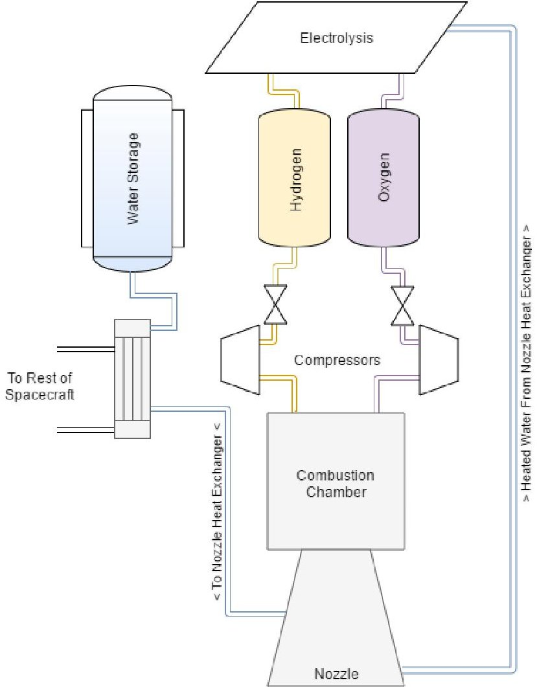

Figure 3-4: Electrolysis thruster design. Reproduced with permission from a course presentation. $ ^{[67]} $

<!-- PDF_PAGE: 91 -->

## 3.2.2. Refueling Depot Design

Our concept pre-positions lightweight tanks of liquid water to strategic locations for the crew vehicle to refuel in between maneuvers. Propellant can be stored as water indefinitely if heated to prevent freezing, in contrast to cryogenic hydrogen and oxygen. An advanced cryogenic propellant storage system could keep boil-off as low as 0.1% per day, while present boil-off is on the order of 1%. $ ^{[61]} $ In either case, if the propellant were stored in cryogenic form for a full synodic period in between launch windows, years would pass before it was used, and an unacceptably high fraction would be lost. Because water does not boil off in the same way, water depots can be delivered to Mars orbit in the same synod as the cargo vehicles in the DRA-5, over two years prior to crew arrival.

Potential propellant destinations include several Earth orbits for integration prior to departure, the Earth-Moon Lagrange point 2 (EML2) to use the Deep Space Gateway as a staging area, and Mars orbit for refueling prior to trans-Earth injection for the return trip. There is also the option of delivering a complete propulsion module, including electrolyzers and thrusters, along with the tank. In this case, the delivered module is integrated into the crew vehicle stack before departure, instead of being drained of propellant for a refueling operation. The propulsion module dry mass of the Mars DRA- 5 trans-Mars injection propulsion modules is 15.1 t. $ ^{[53]} $ This figure includes the dry mass of 5 engines massing 1 t each, as well as the truss to hold them and the dry mass of cryogenic tanks sized for 91.1 t of LH2/LOX. We reduce the propulsion module dry mass for the modules proposed here for three reasons: the water tanks have a higher propellant mass fraction than cryogenic propellant tanks, less propellant is stored at

<!-- PDF_PAGE: 92 -->

once, and an overall lighter vehicle allows for a smaller engine configuration.

The amount of launch mass dedicated to delivering propellant depends on where the propellant is being delivered and how long it remains there before being collected. This analysis uses the previously mentioned payload figures for SLS and FH to compute possible propellant mass delivery for each vehicle, shown in Table 3-1 and Table 3-2, respectively. Table 3-3 and Table 3-4 show the possible propellant mass delivery for each vehicle when a complete propulsion module is delivered instead of just a depot. Because of the density of water, the dimensions of the fairings do not constrain the amount of water propellant either vehicle can deliver, even to LEO where the available mass is greatest. For example, for the smallest, 5 m diameter fairing option for SLS, there are $ 2 5 0 \mathrm{m}^{3} $ of mission volume available. $ ^{[59]} $ Delivering the maximum possible propellant mass of 125 t to LEO fills only half of that volume, leaving plenty for the system dry mass.

SLS mass delivery capabilities are published for LEO and to Mars orbit. Capability to GTO, HEO, and EML2 is estimated from the available charts of useful payload mass deliverable to an orbit with a given characteristic energy. $ ^{[59]} $ FH delivery capabilities are published for LEO, GTO, and to Mars orbit. $ ^{[46]} $ Here, the FH capability to EML2 and HEO is estimated to be 20 t. The greater payload capability of the SLS means that it can also deliver a greater mass fraction of propellant to each destination than the FH can. However, this choice may not be cost effective, and the payload capacity of the SLS is not always required to enable sufficient refueling for the return trip.

Propellant deliveries to LEO take place around the same date as the crew vehicle

<!-- PDF_PAGE: 93 -->

is launched, so as to minimize the stationkeeping needed for drag-makeup. These propellant depots have the highest propellant mass fraction. Depots placed in GTO or HEO are insensitive to launch date relative to crew launch. Propellant deliveries to EML2 are launched ahead of the crew, to take advantage of a slow, low-$\Delta$V transfer trajectory that is unsuitable for a crew vehicle.[62] The EML2 requires active stationkeeping, so propellant deliveries should not be made too far in advance if unsupported. If the Deep Space Gateway is available, as is assumed in Table 3-1 through Table 3-4, depots or modules can be delivered to and then supervised by it instead, eliminating the need for them to have their own RCS and power systems.

The Mars DRA-5 mission architecture includes cargo vehicles sent ahead of the crew at the Mars launch window preceding the crew mission. Any water propellant tanks delivered to Mars orbit are sent during the same launch window, so that they have confirmed successful arrival before the crew departs on the following launch window. This way, the crew will not arrive at Mars orbit only to find their return propellant unusable, leaving them stranded. This is in contrast to propellant tanks delivered to Earth orbit or the Earth-Moon system, where the crew can still abort the mission and return to Earth in the MPCV.

<!-- PDF_PAGE: 94 -->

Table 3-1: SLS Water Propellant Depot Delivery Capacities

<table border="1"><tr><td>Payload Mass, t of:</td><td>LEO</td><td>GTO</td><td>HEO</td><td>EML2</td><td>Mars</td></tr><tr><td>Water</td><td>122</td><td>65</td><td>45</td><td>47</td><td>34</td></tr><tr><td>Tank</td><td>4</td><td>2</td><td>2</td><td>2</td><td>1</td></tr><tr><td>RCS</td><td>1</td><td>1</td><td>1</td><td>0*</td><td>1</td></tr><tr><td>Solar Panels, Avionics</td><td>1</td><td>1</td><td>1</td><td>0*</td><td>1</td></tr><tr><td>Crew Supplies</td><td>0</td><td>0</td><td>0</td><td>0</td><td>3</td></tr><tr><td>Total Mass</td><td>128</td><td>69</td><td>49</td><td>49</td><td>40</td></tr><tr><td>Available Mass</td><td>130</td><td>70</td><td>50</td><td>50</td><td>40</td></tr><tr><td>Propellant Fraction</td><td>95.3%</td><td>94.2%</td><td>91.8%</td><td>95.9%</td><td>85.0%</td></tr></table>

Table 3-2: FH Water Propellant Depot Delivery Capacities

<table border="1"><tr><td>Payload Mass, t of:</td><td>LEO</td><td>GTO</td><td>HEO</td><td>EML2</td><td>Mars</td></tr><tr><td>Water</td><td>60</td><td>24</td><td>17</td><td>18</td><td>13.4</td></tr><tr><td>Tank</td><td>2</td><td>1</td><td>0.5</td><td>0.5</td><td>0.5</td></tr><tr><td>RCS</td><td>0.5</td><td>0.5</td><td>0.5</td><td>0$\cdot$</td><td>0.5</td></tr><tr><td>Solar Panels, Avionics</td><td>0.5</td><td>0.5</td><td>0.5</td><td>0$\cdot$</td><td>0.6</td></tr><tr><td>Crew Supplies</td><td>0</td><td>0</td><td>0</td><td>0</td><td>1</td></tr><tr><td>Total Mass</td><td>63</td><td>26</td><td>18.5</td><td>18.5</td><td>16</td></tr><tr><td>Available Mass</td><td>63.8</td><td>26.7</td><td>20</td><td>20</td><td>16.8</td></tr><tr><td>Propellant Fraction</td><td>95.2%</td><td>92.3%</td><td>91.9%</td><td>97.3%</td><td>98.8%</td></tr></table>

Table 3-3: SLS Water Propulsion Module Delivery Capacities

<table border="1"><tr><td>Payload Mass, t of:</td><td>LEO</td><td>GTO</td><td>HEO</td><td>EML2</td></tr><tr><td>Water</td><td>108</td><td>48</td><td>28</td><td>28</td></tr><tr><td>Water Tank</td><td>4</td><td>4</td><td>4</td><td>4</td></tr><tr><td>Gas Tanks</td><td>10.5</td><td>10.5</td><td>10.5</td><td>10.5</td></tr><tr><td>Engine</td><td>1</td><td>1</td><td>1</td><td>1</td></tr><tr><td>RCS</td><td>4</td><td>4</td><td>4</td><td>4</td></tr><tr><td>Solar Panels, Avionics</td><td>1.6</td><td>1.6</td><td>1.6</td><td>1.6</td></tr><tr><td>Total Mass</td><td>129.1</td><td>69.1</td><td>49.1</td><td>49.1</td></tr><tr><td>Available Mass</td><td>130</td><td>70</td><td>50</td><td>50</td></tr><tr><td>Propellant Fraction</td><td>83.7%</td><td>69.5%</td><td>57.0%</td><td>57.0%</td></tr></table>

Table 3-4: FH Water Propulsion Module Delivery Capacities

<table border="1"><tr><td>Payload Mass, t of:</td><td>LEO</td><td>GTO</td><td>HEO</td><td>EML2</td></tr><tr><td>Water</td><td>55</td><td>19</td><td>12</td><td>0</td></tr><tr><td>Water Tank</td><td>4</td><td>4</td><td>4</td><td>4</td></tr><tr><td>Gas Tanks</td><td>10.5</td><td>10.5</td><td>10.5</td><td>10.5</td></tr><tr><td>Engine</td><td>1</td><td>1</td><td>1</td><td>1</td></tr><tr><td>RCS</td><td>2</td><td>2</td><td>2</td><td>2</td></tr><tr><td>Solar Panels, Avionics</td><td>1.6</td><td>1.6</td><td>1.6</td><td>1.6</td></tr><tr><td>Total Mass</td><td>63.1</td><td>26.1</td><td>19.1</td><td>19.1</td></tr><tr><td>Available Mass</td><td>63.8</td><td>26.7</td><td>20</td><td>20</td></tr><tr><td>Propellant Fraction</td><td>69.7%</td><td>26.8%</td><td>0.0%</td><td>0.0%</td></tr></table>

*Dependent on the Deep Space Gateway for stationkeeping.

<!-- PDF_PAGE: 95 -->

## 3.2.3. Electrolysis Power Tradeoff

## 3.2.3.1. Equations

An important consideration is the tradeoff between the mass of solar panels required for rapid electrolysis, versus the loss of propellant due to leakage during longer storage periods. The Mars DRA-5 transit habitat has its own solar arrays capable of 20 kW end-of-life power. $ ^{[54]} $ This is enough to fulfill the crew life support needs; however, an additional, larger array is required for electrolysis propulsion. In this section, we derive the equations governing the tradeoff of this additional solar panel array.

An approximate propellant mass lost to leakage during electrolysis is a function of leak rate and electrolysis rate. D days of power are required to electrolyze at least N tons of propellant at a rate R determined by the electrolysis power P and power required to electrolyze 1 t of propellant per day $ P_{0} $ (or solar panel mass S and $ S_{0} $ ), and efficiency $ \eta $ :

$$
D = \frac {N}{R}, R = \frac {P \eta}{P _ {0}} = \frac {S \eta}{S _ {0}}
$$

However, some of the propellant is lost during electrolysis. So, the end result is M<N t of propellant at the time of the maneuver. Propellant decays at a rate -LM while new propellant is added at a rate R:

$$
\frac {d M}{d t} = R - L M
$$

Solving the differential equation with $ \mathrm{M}(0)=0 $ , we find the total mass M remaining at time t:

$$
M = \frac {R}{L} \left(1 - e ^ {- L t}\right)
$$

There is a maximum amount $ M_{L}=R/L $ of propellant that can be stored from

<!-- PDF_PAGE: 96 -->

electrolysis, beyond which leakage occurs at the same rate as production, making the net rate of propellant change in Eq. (2) zero. If $ M_{L}<N $ then the propellant goal for the maneuver cannot be reached. Approaching this point, propellant production becomes inefficient as an increasingly significant fraction of propellant produced each day is lost to leakage. If the electrolysis rate is such that a given propellant goal can be reached, Eq. (3) provides the required time t:

$$
t = - \frac {\ln \left(1 - \frac {L M}{R}\right)}{L}
$$

The total propellant that must be electrolyzed to reach this goal is Rt>M. In the process, a certain amount of propellant $ M_{L}=R t-M $ is lost. The propellant that is needed at the end of electrolysis M depends on the payload mass $ M_{0} $ plus the solar panel mass S and the $ \Delta\mathrm{V} $ of the maneuver to be performed:

$$
M = \left(M _ {0} + S\right) \left(e ^ {\frac {\Delta V}{V _ {e}}} - 1\right)
$$

Using Eq. (5) in Eq. (4) provides the electrolysis time and hence the total propellant which must be launched and then electrolyzed, as a function of the $ \Delta\mathrm{V} $ of the maneuver, the specific impulse or exhaust velocity of the engine, the mass of the payload and its solar array, and the leakage rate of the gas storage tanks:

$$
t = - \frac {1}{L} \ln \left(1 - \frac {L}{R} \left(M _ {0} + S\right) \left(e ^ {\frac {\Delta V}{V _ {e}}} - 1\right)\right)
$$

## 3.2.3.2. Results

To compute the tradeoff governed by Equations (1) through (6), we plug in values for the constants $ P_{0}, $ $ S_{0}, $ $ V_{e} $ , and L, then manipulate the variables S, $ \eta $ , and $ \Delta V. $

<!-- PDF_PAGE: 97 -->

The specific power of modern solar arrays can be as high as 100 W/kg in Earth orbit, a specific mass of 10 kg/kW. $ ^{[23]} $ Water has a specific enthalpy of 286 kJ/mol. Therefore, $ P_{0}=184 $ kW electrolyzes 1 t of water per day with 100% efficiency. This takes $ S_{0}=1.84 $ t of solar panel mass. For a specific impulse of 450 s, $ V_{e}=4.4 $ km/s. This leaves the permeation rate as the remaining constant to be determined.

Of the two electrolyzed gases, hydrogen is the more significant concern. Hydrogen permeates out of its containers more quickly than oxygen. Gaseous hydrogen storage tanks in the automotive industry can have hydrogen permeation rates as low as 0.05 grams per kilogram per hour stored, a rate of approximately 0.1% per day. $ ^{[24] [68]} $ This is comparable to the expected LH2 boiloff rate for near-future advanced cryogenic upper stages, which is also 0.1% $ ^{[60]} $

To mitigate the issue of propellant leakage, burns can be performed in smaller pulses instead of a single impulsive burn. For example, raising an orbit apoapsis could be done with less propellant leakage, and no loss in maneuver efficiency, by electrolyzing continuously while pulsing at each periapsis instead of waiting to collect all propellant needed. Maximum propellant efficiency is achieved during continuous operation, when propellant is consumed as fast as it is produced. However, this may introduce its own inefficiency in the form of increased $ \Delta\mathrm{V} $ , and hence, propellant, requirements, for lower thrust maneuvers compared to impulsive ones. This part of the trade is beyond the scope of this paper and will be examined in future work.

This section examines the sizing of a solar panel array as a function of maximum required $ \Delta\mathrm{V} $ in a single maneuver for a 58 t payload—the approximate combined mass of the habitat, engines, and Orion crew vehicle together for all architectures examined

<!-- PDF_PAGE: 98 -->

in this study. A larger, heavier solar panel array contributes to payload mass and requires a greater amount of propellant for the maneuver, while a smaller, lighter solar panel array increases the electrolysis time and allows more propellant to be lost in the process. Figure 3-5 shows propellant and electrolysis time required for maneuvers of 1, 2, 3, and 4 km/s at Earth with 0.1% leakage per day, an electrolysis efficiency of 80%, and a specific impulse of 450 s, as a function of the solar panel mass from 0.5 to 5 t, with a corresponding beginning-of-life power generation of 50 to 500 kW. The optimal solar array mass for each $ \Delta\mathrm{V} $ that minimizes the amount of propellant needed for the maneuver is shown in Table 3-5.

During the mission, solar panels degrade and produce reduced power. Also, at Mars, solar irradiance is 44% that at Earth. $ ^{[64]} $ Figure 3-6 shows the same tradeoff for solar panels at Mars, that have degraded to 90% effectiveness and are receiving 44% of the irradiance they had at Earth, for a net reduction to 39.6% power. Electrolysis takes longer and more propellant is lost to leakage in the process. However, for trans-Earth injection, the payload mass is significantly reduced by approximately 11 t to 47 t. In addition, trans-Earth injection requires less $ \Delta V $ than trans-Mars injection, and maneuvers of 1 and 1.5 km/s are considered here. So, less baseline propellant is needed. The optimal solar array mass for each $ \Delta V $ is shown in Table 3-5 for Earth, and Table 3-6 for Mars. Also listed are the minimum mass of solar panels required to achieve the maneuver, below which the rate of electrolysis cannot overcome leakage.

While some propellant is lost to leakage during electrolysis even with optimum solar panel mass, the results compare favorably to that lost if it were stored cryogenically throughout the mission, even with extremely efficient storage. For

<!-- PDF_PAGE: 99 -->

example, for a 1.5 km/s maneuver and 47 t payload at Mars with 0.1% leakage per day and the optimal 1.69 t of solar panels, 20.4 t of propellant must be electrolyzed over 70 days, with a loss of 3.5% of that propellant over time, for a final total of 19.7 t. For a cryogenic propulsion module that travels with the crew and is stored for 713 days before being used for trans-Earth injection, 76% of the stored propellant is lost. If this cryogenic storage is an order of magnitude more effective than the gas storage for the electrolysis propulsion system, with 0.01% boiloff per day, 13.3% of the propellant is still lost before TEI, so significantly more propellant is needed even with much more efficient cryogenic storage.

In practice, increasing the solar array mass from the optimum allows the thruster to ready for maneuvers faster and with less propellant lost to leakage, at the cost of slightly increasing the total propellant required. Decreasing the solar array mass from the optimum, however, increases both the total amount of propellant required and the amount of propellant lost to leakage, as well as the time needed to electrolyze for a maneuver. There is therefore no advantage to a smaller than optimal solar array compared to larger than optimal from the perspective of mass of electrolyzed propellant. However, cost and launch mass constraints could make one worth considering. Also, the optimal array masses for Mars and Earth are different because of the different payload mass, power production, and maneuvers required. A nearly optimal array for Mars, at 1.7 t, is below optimal for Earth, where the optimal mass is 2.5 t. Since it is worse to have an undersized array than an oversized one, the array should be at least the largest optimal value out of all the maneuvers in the mission.

The optimal solar arrays for electrolysis propulsion are significantly smaller than

<!-- PDF_PAGE: 100 -->

the past solar arrays proposed for crewed Mars missions with solar electric propulsion. The second addendum to the DRA-5 includes a propulsion concept with an 800 kW solar array, $ ^{[54]} $ which would mass 8 t with the 10 kg/kW specific power. This is over three times the optimal mass for a solar array supporting a 4 km/s maneuver at Earth for a 58 t payload.

We now consider solar array masses both above and below optimal. Table 3-7 and Table 3-8 show the performance off a 1 t solar array, while Table 3-9 and Table 3-10 show the performance of a 5 t solar array. The 1 t array performs well in only requiring at most 4.3% more water for electrolysis than optimal; however, it takes up to 164% longer to electrolyze enough propellant for the largest maneuvers, to a prohibitive 223 days for an Earth escape maneuver from LEO of 4 km/s. The 5 t array performs well in both aspects, requiring at most 5.5% more water for electrolysis than optimal. In exchange, the time to electrolyze in preparation for maneuvers is significantly cut, by up to 78.7% depending on the maneuver.

The selection must consider the options of departing from different initial trajectories, such as LEO, HEO, and the Earth-Moon Lagrange point 2 (EML2) in the next subsection. The results of this section—the different trajectory options available, maneuver time and launch vehicle mass constraints for each—lead to different solar array masses as the baseline for each of the architectures discussed in Section 3.3.

<!-- PDF_PAGE: 101 -->

Table 3-5: Solar Arrays for Earth Maneuvers

<table border="1"><tr><td>$\Delta V$km/s</td><td>Minimum Mass,t</td><td>Optimal Mass,t</td><td>Water Needed,t</td><td>Rate,t/day</td><td>Time,days</td><td>Loss,t</td><td>Loss,%</td></tr><tr><td>1</td><td>0.03</td><td>1.01</td><td>15.26</td><td>0.439</td><td>34.7</td><td>0.26</td><td>1.8%</td></tr><tr><td>2</td><td>0.08</td><td>1.54</td><td>35.02</td><td>0.670</td><td>52.3</td><td>0.90</td><td>2.6%</td></tr><tr><td>3</td><td>0.13</td><td>2.03</td><td>60.43</td><td>0.883</td><td>68.5</td><td>2.02</td><td>3.5%</td></tr><tr><td>4</td><td>0.20</td><td>2.53</td><td>93.09</td><td>1.10</td><td>84.6</td><td>3.83</td><td>4.3%</td></tr></table>

Table 3-6: Solar Arrays for Mars Maneuvers

<table border="1"><tr><td>$\Delta V$ km/s</td><td>Minimum Mass,t</td><td>Optimal Mass,t</td><td>Water Needed,t</td><td>Rate,t/day</td><td>Time,days</td><td>Loss,t</td><td>Loss,%</td></tr><tr><td>1</td><td>0.07</td><td>1.33</td><td>12.63</td><td>0.229</td><td>55.15</td><td>0.34</td><td>2.8%</td></tr><tr><td>1.5</td><td>0.11</td><td>1.69</td><td>20.40</td><td>0.291</td><td>70.11</td><td>0.70</td><td>3.5%</td></tr></table>

Table 3-7: Undersized 1 t Solar Array for Earth Maneuvers

<table border="1"><tr><td>$\Delta V$ km/s</td><td>Water Needed,t</td><td>Excess,%</td><td>Rate,t/day</td><td>Time,days</td><td>Slower,%</td><td>Loss,t</td><td>Loss,%</td></tr><tr><td>1</td><td>15.26</td><td>0.0%</td><td>0.435</td><td>35.1</td><td>1.00%</td><td>0.26</td><td>1.8%</td></tr><tr><td>2</td><td>35.20</td><td>0.5%</td><td>0.435</td><td>80.9</td><td>54.7%</td><td>1.39</td><td>4.1%</td></tr><tr><td>3</td><td>61.57</td><td>1.9%</td><td>0.435</td><td>141</td><td>107%</td><td>4.16</td><td>7.2%</td></tr><tr><td>4</td><td>97.08</td><td>4.3%</td><td>0.435</td><td>223</td><td>164%</td><td>10.1</td><td>11%</td></tr></table>

Table 3-8: Undersized 1 t Solar Array for Mars Maneuvers

<table border="1"><tr><td>$\Delta V$ km/s</td><td>Water Needed,t</td><td>Excess,%</td><td>Rate,mt/day</td><td>Time,days</td><td>Slower,%</td><td>Loss,t</td><td>Loss,%</td></tr><tr><td>1</td><td>12.66</td><td>0.2%</td><td>0.172</td><td>73.5</td><td>33.3%</td><td>0.45</td><td>3.7%</td></tr><tr><td>1.5</td><td>20.61</td><td>1.0%</td><td>0.172</td><td>120</td><td>70.7%</td><td>1.19</td><td>6.1%</td></tr></table>

Table 3-9: Oversized 5 t Solar Array for Earth Maneuvers

<table border="1"><tr><td>$\Delta V$ km/s</td><td>Water Needed,t</td><td>Excess,%</td><td>Rate,mt/day</td><td>Time,days</td><td>Faster,%</td><td>Loss,t</td><td>Loss,%</td></tr><tr><td>1</td><td>16.1</td><td>5.3%</td><td>2.17</td><td>7.4</td><td>78.7%</td><td>0.06</td><td>0.4%</td></tr><tr><td>2</td><td>36.4</td><td>4%</td><td>2.17</td><td>16.7</td><td>68%</td><td>0.30</td><td>0.8%</td></tr><tr><td>3</td><td>62.2</td><td>2.9%</td><td>2.17</td><td>28.6</td><td>58.2%</td><td>0.88</td><td>1.4%</td></tr><tr><td>4</td><td>94.9</td><td>2%</td><td>2.17</td><td>43.7</td><td>48.4%</td><td>2.04</td><td>2.2%</td></tr></table>

Table 3-10: Oversized 5 t Solar Array for Mars Maneuvers

<table border="1"><tr><td>$\Delta V$ km/s</td><td>Water Needed,t</td><td>Excess,%</td><td>Rate,mt/day</td><td>Time,days</td><td>Faster,%</td><td>Loss,t</td><td>Loss,%</td></tr><tr><td>1</td><td>13.32</td><td>5.5%</td><td>0.86</td><td>15.5</td><td>71.9%</td><td>0.10</td><td>0.8%</td></tr><tr><td>1.5</td><td>21.30</td><td>4.4%</td><td>0.86</td><td>24.7</td><td>64.5%</td><td>0.26</td><td>1.2%</td></tr></table>

<!-- PDF_PAGE: 102 -->

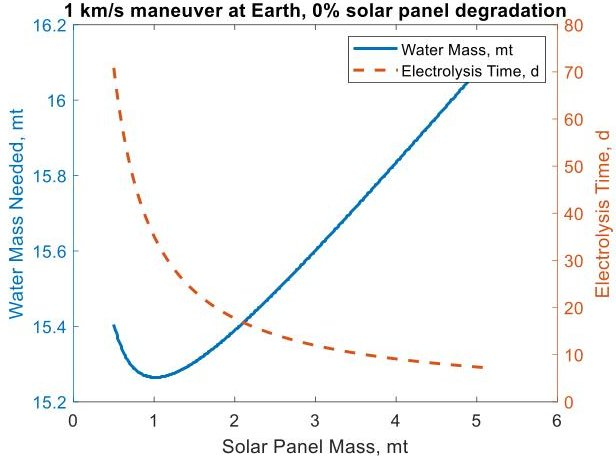

a)

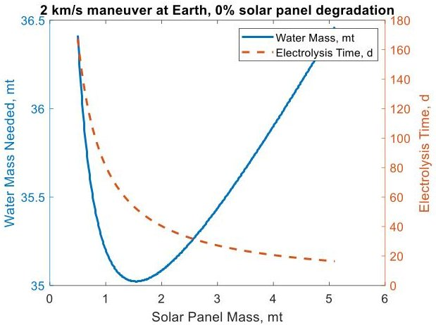

(b)

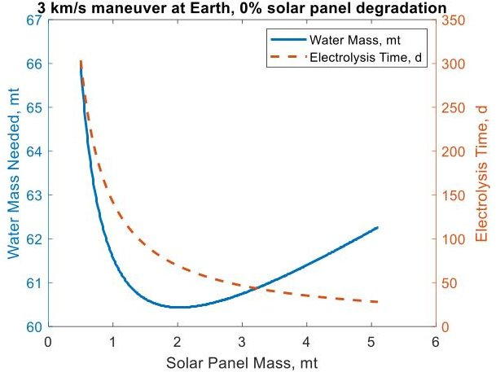

C)

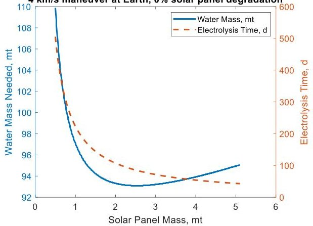

d)

Figure 3-5: Water and time required for electrolysis at Earth for maneuvers of a) 1 km/s, b) 2 km/s, c) 3 km/s, d) 4 km/s for a 58 t payload, 450 s specific impulse, 80% efficiency, and specific solar panel mass of 10 kg/kW.

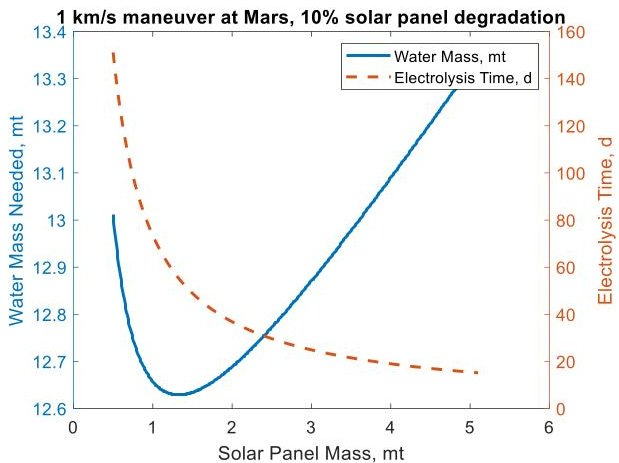

a)

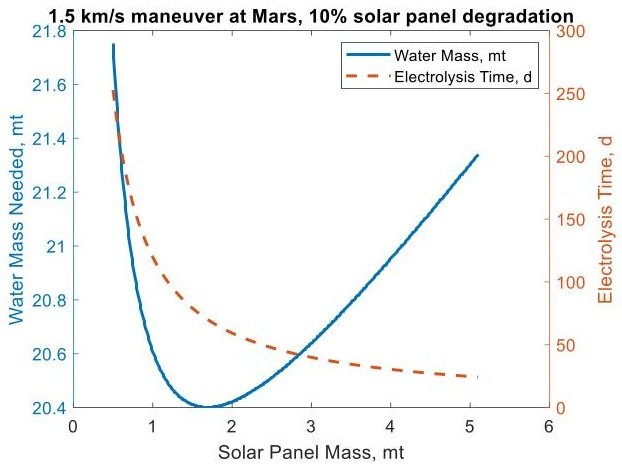

b)

Figure 3-6: Water and time required for electrolysis at Mars for maneuvers of a) 1 km/s, b) 1.5 km/s for a 47 t payload, 450 s specific impulse, 80% efficiency and specific solar panel mass of 10 kg/kW.

<!-- PDF_PAGE: 103 -->

## 3.2.4. Trajectory Options

There are many options for orbits for assembly, staging, and trajectories for departure to trans-Mars injection. This section considers four. First is the LEO assembly and departure baselined in the Mars DRA-5. Second is a highly elliptical Earth orbit (HEO) departure that requires less $ \Delta V $ from the crew vehicle, but more tightly constrains the available payload mass per launch vehicle, because all components must be delivered to HEO for assembly. The same is true for the third and fourth trajectories, which depart from Earth-Moon Lagrange point 2 (EML2). The first three are all based on high-thrust, impulsive maneuvers, while the last is based on a hybrid of high- and low- thrust.

## 3.2.4.1. DRA-5 Baseline (LEO Departure)

In the DRA-5, the baseline crew trajectories are constrained to 180 days. The 2035 launch opportunity departs on 6/26/2035 and arrives at Mars on 12/23/2035. $ ^{[54]} $ The necessary maneuvers are the two parts of a trans-Mars injection from LEO totaling 4 km/s $ \Delta V $ , Mars orbit injection with 1 km/s $ \Delta V $ , and a trans-Earth injection with 1.6 km/s $ \Delta V $ , for a total of 6.6 km/s. In Section 3.3, the electrolysis propulsion architectures that depart from LEO use the same trajectory.

When considering LEO departure for an electrolysis propulsion mission, the propellant loss during electrolysis versus inefficiency of low thrust spiraling orbits, becomes a consideration. With 4 km/s of $ \Delta V $ required for trans-Mars injection, a 58 t payload with a 5.1 t solar array require overs 134 days to electrolyze if the maneuver is to be performed all at once. However, a continuous thrusting transfer involves a spiral out of LEO, which is inefficient. A third possibility is to electrolyze continuously, but

<!-- PDF_PAGE: 104 -->

perform an apoapsis raising burn at each periapsis, to avoid storing cryogenic propellant for longer than a single orbit. While this approach reduces boiloff compared to electrolyzing for 134 days before performing any maneuver, it still requires 134 days. It is possible to avoid this problem entirely with careful trajectory planning. The following subsections examine two possibilities with less $ \Delta\mathrm{V} $ required from the electrolysis propulsion vehicle to reach trans-Mars injection.

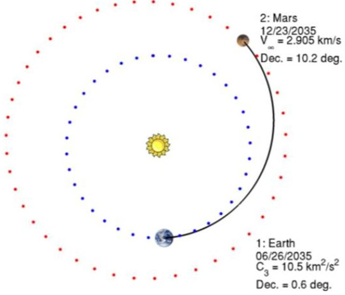

Figure 3-7: 2035 trajectory from the Mars DRA-5. $ ^{25} $

## 3.2.4.2. Highly Elliptical Orbit Departure, High Thrust

An alternative to assembling in and departing from LEO is to do so in a 10-day HEO orbit approximately to the lunar distance. In this case, for the 2035 launch opportunity, the $ \Delta V $ requirement for the trans-Mars injection is reduced from 4 km/s to approximately 0.7 km/s. $ ^{[62]} $ Combined with the same 1 km/s MOI and 1.6 km/s TEI as the previous subsection, the round trip $ \Delta V $ the crew vehicle must achieve under its own power is reduced to 3.6 km/s. This strategy requires slightly less $ \Delta V $ than the L2 departure described next and has similar mass constraints for each launch vehicle.

<!-- PDF_PAGE: 105 -->

## 3.2.4.3. Earth-Moon L2 Departure, High Thrust

Another alternative is to assemble the crew vehicle in cislunar space, specifically, in a halo orbit using the Earth-Moon Lagrange Point 2 (EML2). $ ^{[63]} $ For departure, flybys of the Moon and Earth are used to escape the Earth-Moon system and reach trans-Mars injection as shown in Figure 3-8. In this case, for a 2035 launch opportunity, the $ \Delta V $ requirement for trans-Mars injection is reduced from 4 km/s to 1.1 km/s. $ ^{[62]} $ Combined with the same 1 km/s MOI and 1.6 km/s TEI as the previous subsection, the round trip $ \Delta V $ the crew vehicle must achieve is reduced to 4 km/s.

This strategy requires slightly more $ \Delta V $ than the HEO departure but provides the opportunity to utilize the Deep Space Gateway (DSG), a planned cislunar space station, as a staging area if it is available. The DSG is intended to support buildup of deep space transports for Mars among other missions. $ ^{[65]} $ Its presence to supervise stationkeeping can eliminate the need for independent RCS on propellant depots at EML2 while awaiting the crew, reducing their non-propellant mass and increasing the amount of propellant which can be delivered by each launch vehicle.

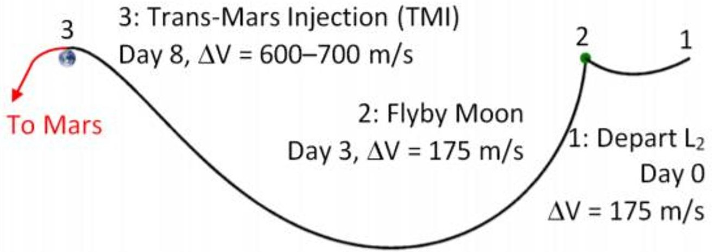

Figure 3-8: Departure from lunar libration point 2 from the Mars DRA-5. $ ^{25} $

<!-- PDF_PAGE: 106 -->

## 3.2.4.4. Earth-Moon L2 Departure, Hybrid Low/High Thrust

Low-thrust trajectories $ ^{[57]}^{[58]}^{[69]} $ have been considered for crewed Mars missions, despite the generally longer travel times, because of the high efficiency of electric thrusters. The second addendum to the DRA-5 considers nuclear electric propulsion (NEP) as an option, with a 2.5 MW reactor powering Xenon Hall effect thrusters with a specific impulse of 5000 s as the primary engines for the crew vehicle. The NEP vehicle is launched into a 400 km Earth orbit in two sections, then spirals out almost to Earth escape before the crew are sent on another launch to rendezvous with it. $ ^{[54]} $

As described in Section 3.2.1., operating an electrolysis propulsion thruster in a low-thrust configuration eliminates the need for intermediate storage of propellant gas. However, a fully low-thrust trajectory for a crewed Mars mission is not feasible with electrolysis propulsion. The specific impulse of electrolysis propulsion can be no greater than that of LH2/LOX chemical thrusters, 450 s. in comparison with other electric thrusters that are an order of magnitude more efficient. Maneuvers with a large $ \Delta V $ , such as spirals from LEO to Earth escape, require prohibitive propellant mass fractions for an electrolysis propulsion thruster.

The same addendum suggests "options for use of Earth-Moon libration points should be explored further" for low-thrust departures from Earth. $ ^{[54]} $ By avoiding a costly spiral from LEO, this modification makes a low-thrust trajectory between Earth and Mars more feasible for an electrolysis propulsion system. In addition, and just like in the previous subsection, the proposed DSG station could be a staging area for prepositioned propellant depots and modules while the vehicle is being assembled.

Previous hybrid trajectory designs for crewed Mars missions exist using a

<!-- PDF_PAGE: 107 -->

combination of electric and chemical thrusters. An electrolysis propulsion system is capable of filling both roles, using a low-thrust profile for the transfers between Earth escape and Mars encounter and vice versa, and using a high-thrust, nearly impulsive profile for orbit injection, escape, and plane changes. The trajectory considered here was proposed by Chai, Merriel, and Qu. $ ^{[70]} $ It begins at an Earth-Moon libration point, with stationkeeping performed by the DSG while the vehicle is assembled and awaiting crew arrival on an Orion MPCV. Then, the vehicle uses small impulsive maneuvers to nudge the crew vehicle into two lunar gravity assists to facilitate Earth escape. In this way, this trajectory is similar to the high-thrust trajectory departing from the EML2 described in the previous subsection. However, it differs after this point because of the use of low-thrust maneuvers.

For the outbound interplanetary trip to Mars, the propulsion system operates in a low-thrust mode, providing a total $ \Delta V $ of 3.1 km/s over a 396-day outbound trip. The crew vehicle arrives at Mars with $ V_{\infty}=1.2 $ km/s and performs a 221 m/s impulsive burn at closest approach of 250 km to capture into orbit. Multiple smaller impulsive maneuvers are performed to enter a 5-sol parking orbit, change planes, and rendezvous with the pre-deployed DAV. When the crew returns to orbit after a 205-day surface stay, the vehicle performs three impulsive burns totaling 296 m/s for departure from Mars. $ ^{[70]} $

For the return trip to Earth, the propulsion system again operates in a low-thrust mode, providing a total $ \Delta V $ of 2.9 km/s over a 360 day return trip. This trajectory leads to a lunar gravity assist inserting the spacecraft into a highly elliptical orbit around the Earth. A new Orion MPCV is launched to rendezvous with the vehicle and bring the crew home. Finally, the vehicle performs a small impulsive maneuver followed by a

<!-- PDF_PAGE: 108 -->

small low-thrust trajectory correction to rendezvous with the DSG again at the same libration point it was initially assembled at. There, it can be refueled to support future missions. $ ^{[70]} $

This hybrid trajectory mitigates the challenges faced by electrolysis propulsion for both fully high- and fully low-thrust trajectories. Reducing the maximum $ \Delta V $ of impulsive maneuvers, from 4 km/s in the DRA-5 baseline to several hundred m/s, reduces the gas storage tank mass for an electrolysis propulsion system from an infeasible amount to only 7 t. Additionally, the hybrid trajectory requires significantly less $ \Delta V $ than a fully low-thrust trajectory and hence is feasible with electrolysis propulsion despite its lower specific impulse when compared to the electric thrusters it is replacing for the interplanetary segments. The possibility of refueling is what makes this option competitive with a hybrid chemical/electric propulsion system in terms of launches per round trip for a crew vehicle to Mars. The mass savings of refueling from pre-positioned propellant depots are considered in the next section.

## 3.2.5. Refueling Mass Savings

The propellant required for a spacecraft mission depends exponentially on the total $ \Delta\mathrm{V} $ required for the mission

$$
m _ {p} = m _ {0} \left(e ^ {\frac {\Delta V}{v _ {e}}} - 1\right)
$$

For n stages, it is convenient to treat each stage as the payload of the stage that precedes it. So, stage 0 is the payload, stage 1 is the last stage used, and so on. In this case, $ m_{0} $ of the vehicle for each stage is $ m_{0} $ of the vehicle at the next stage, plus the expended propellant mass and dropped dry mass $ m_{d} $ of the current stage. Therefore, the

<!-- PDF_PAGE: 109 -->

propellant mass for each stage is:

$$
m _ {p, j} = \left(m _ {0, j - 1} + \sum_ {i = 0} ^ {j} \left(m _ {p, i} + m _ {d, i}\right)\right) \left(e ^ {\frac {\Delta V _ {j}}{v _ {e}}} - 1\right)
$$

Thus, the total propellant required is:

$$
M _ {p} = \sum_ {j = 0} ^ {n} \left(m _ {0} + \sum_ {i = 0} ^ {j} \left(m _ {p, i} + m _ {d, i}\right)\right) \left(e ^ {\frac {\Delta V _ {j}}{v _ {e}}} - 1\right)
$$

Refueling saves mass over staging, because there is no redundant dry mass, e.g. engines, that must be carried by previous stages, driving up the effective payload mass for each. Also, If the spacecraft is refueled prior to each maneuver with only the propellant required for that maneuver, then:

$$
M _ {p} = \sum_ {j = 0} ^ {n} m _ {0} \left(e ^ {\frac {\Delta V _ {j}}{v _ {e}}} - 1\right)
$$

In the limit of n $ \to\infty $ filling operations, the spacecraft approaches continuous refueling, with no propellant mass ever carried, and thus approaches the minimum theoretical propellant mass required to produce a given $ \Delta\mathrm{V} $ . The result is a simple momentum transfer from which the minimum propellant mass for the total $ \Delta\mathrm{V} $ can be found:

$$
M _ {p, m i n} = \frac {\Delta V m _ {0}}{v _ {e}}
$$

The propellant mass found in Eq. (11) cannot be achieved in practice but can serve as a benchmark for comparing the effectiveness of staging and refueling strategies. Consider a 63.1 t vehicle, 58 t payload with a 5.1 t solar array as selected in Section 3.2.3, and a 6 t dry mass for each propulsion stage, making a round trip to and from

<!-- PDF_PAGE: 110 -->

Mars orbit. In the baseline trajectory, it requires 4 km/s $ \Delta V $ LEO to trans-Mars injection, 1 km/s $ \Delta V $ for Mars orbit injection, and 1.6 km/s for trans-Earth injection.

For the case of a single load of propellant at the outset of the mission, and a single 15 t propulsion stage, Eq. 7 determines that 270 t of propellant is required. For three stages with only 5 t of dry mass each, Eq. 9 shows that only 253 t of propellant is required. For refueling for every maneuver with a single 15 t propulsion stage, Eq. 10 allows one to conclude that only 169 t of propellant is required. For the theoretical ideal of continuous refueling and a 15 t propulsion stage, Eq. 11 identifies 116 t of propellant as the requirement. Table 3-11 contains these results with more detail, including the propellant mass required for each maneuver, and the results of refueling only once (for TEI) and for refueling three times (at GTO from LEO, before MOI, and before TEI).

These results show that refueling reduces the required amount of propellant used in the vehicle significantly, compared to the example staging used. Refueling at Mars prior to TEI uses only 69% more propellant than the theoretical minimum, while the example staging in the table uses 117% more. Refueling more often improves this, with refueling at GTO (after transfer from LEO), and then before MOI and TEI reducing to only 24% more propellant than the theoretical minimum. However, this does not account for the task of delivering the refueling propellant to its destination, which requires a separate launch vehicle. In practice, frequent refueling offers diminishing returns or even becomes counterproductive if propellant must be delivered far from Earth.

Section 3.3 considers different architecture options, including the Mars DRA-5, and multiple alternatives that refuel an electrolysis propulsion system at different stages

<!-- PDF_PAGE: 111 -->

in the round trip to Mars. Because the payload being delivered is very similar in all cases, it is possible to compare these architectures in terms of the number of launch vehicles required for each, counting both the launches to assemble the crew vehicle itself, as well as any launches used for propellant delivery.

Table 3-11: Propellant Required for Different Staging Strategies, 63.1 t vehicle.

<table border="1"><tr><td rowspan="2">Strategy</td><td colspan="2">TMI,4km/s</td><td colspan="2">MOI,1km/s</td><td colspan="2">TEI,1.6km/s</td><td>Total</td><td rowspan="2">AboveIdeal</td></tr><tr><td>Mdry,t</td><td>Mprop,t</td><td>Mdry,t</td><td>Mprop,t</td><td>Mdry,t</td><td>Mprop,t</td><td>Mprop,t</td></tr><tr><td>1 stage</td><td>140.7</td><td>207.6</td><td>112.2</td><td>28.5</td><td>78.1</td><td>34.1</td><td>270.2</td><td>131%</td></tr><tr><td>3 stages</td><td>134</td><td>197.6</td><td>102.8</td><td>26.1</td><td>68.1</td><td>29.7</td><td>253.5</td><td>117%</td></tr><tr><td>RefuelTEI</td><td>97.9</td><td>144.5</td><td>78.1</td><td>19.8</td><td>78.1</td><td>34.1</td><td>198.4</td><td>69%</td></tr><tr><td>RefuelMOI,TEI</td><td>78.1</td><td>115.2</td><td>78.1</td><td>19.8</td><td>78.1</td><td>34.1</td><td>169.1</td><td>45%</td></tr><tr><td>RefuelGTO,MOI,TEI</td><td>78.1</td><td>59.5+31.6=91.1</td><td>78.1</td><td>19.8</td><td>78.1</td><td>34.1</td><td>145</td><td>24%</td></tr><tr><td>Ideal</td><td>78.1</td><td>70.8</td><td>78.1</td><td>17.7</td><td>78.1</td><td>28.3</td><td>116.8</td><td>0%</td></tr></table>

## 3.3. Options for Pre-Positioning Architectures

This section presents the high-level crewed MTV architecture for each of several cases. Each subsection summarizes the concept of operations for a given architecture and provide tables of the module masses and launch manifests. The following options are presented in this section, and are compared in Section 3.4:

- Mars DRA-5 chemical propulsion option.

- Our proposed electrolysis propulsion architectures, where water is prepositioned ahead of the MTV

HEO assembly and departure with impulsive maneuvers only.

O EML2 assembly and departure with impulsive maneuvers only.

O EML2 assembly and departure with hybrid of impulsive and low-thrust maneuvers.

In all the new architectures, FH launches are used to substitute for SLS when the

<!-- PDF_PAGE: 112 -->

module being launched is within its capability to deliver. In all cases where FH cannot deliver a module to a certain orbit, it is still capable of delivering the module to LEO, and so the use of a second FH to deliver a boost module is considered. This adds complexity to the assembly process but may significantly reduce launch costs.

All architectures have a number of features in common with the DRA-5 crew vehicle:

- The transit habitat is identical (41.3 t)

- The Orion crew vehicle is identical (10.6 t)

- Crew supplies are consumed at the same rate, and crew life support systems are identical.

- The existing cargo missions remain the same.

- The departure date is the 2035 launch window to Mars, for a conjunction class mission.

- Surface operations and the DAV remain identical.

- The crew vehicle eventually reaches the same Mars orbit for rendezvous with the DAV.

There are also some changes in the new architectures considered:

- With a much less massive vehicle than the DRA-5, only 1 t of engines are needed instead of 5 t.

- RCS propellant loading is reduced, for the same reason.

- Large, lightweight tanks for storage of liquid water are added, as well as more massive tanks for temporary storage of electrolyzed propellant prior to impulsive maneuvers.

<!-- PDF_PAGE: 113 -->

- Additional launches to pre-position water propellant for refueling are added. These launches are counted as part of the crew vehicle, but they could be eliminated with the use of in-situ resource utilization (ISRU) or water propellant depots.

- Up to 5 t of solar panels (500 kW) are added to the crew vehicle depending on the architecture.

- The solar panels will have degraded and, even if the transit habitat is to be reused, should be replaced. Therefore, when impulsive trans-Earth injection maneuvers are used, most of the solar panels are jettisoned after electrolysis for trans-Earth injection is complete, but before the maneuver takes place, to reduce the amount of propellant needed. For low-thrust returns, the panels are jettisoned on arrival back to Earth.

## 3.3.1. Mars Design Reference Architecture 5.0, LEO Departure, Cryogenic Storage, High Thrust Trajectory: 5x SLS and 1xF9

The crewed chemical propulsion architecture for the DRA-5 mission consists of a multiple-stage vehicle that is assembled in LEO over a period of 120 days. $ ^{[11]} $ The individual modules are placed into orbit by five SLS launches, with the crew delivered shortly before departure by a Falcon 9 launch. The assembled crewed system architecture is shown in Figure 3-9. The MTV masses 486 t when departing LEO. Because of the long assembly time, an additional module for reboosting during this process must be launched, bringing the total mass that must be placed into orbit to 534.5 tons. A summary of the vehicle is found in Table 3-12, and a summary of the launch manifests is found in Table 3-13. New TMI, MOI, TEI, and reboost modules must be

<!-- PDF_PAGE: 114 -->

launched for each mission; therefore, supporting two missions requires ten SLS launches and two F9 launches between them for the crew vehicle.

Table 3-12: DRA-5 Baseline Vehicle Summary. $ ^{[11]} $

<table border="1"><tr><td colspan="2">Vehicle Element</td><td>Mass(t)</td></tr><tr><td rowspan="7">TMI Stage1</td><td>Mbo(Module)</td><td>15.1</td></tr><tr><td>M prop(Module)</td><td>91.1</td></tr><tr><td>RCS(Module)</td><td>2.3</td></tr><tr><td>Total Module Mass</td><td>108.5</td></tr><tr><td>Number of Modules</td><td>2.0</td></tr><tr><td>Total Stage Mass</td><td>217.0</td></tr><tr><td rowspan="7">TMI Stage2</td><td>Mbo(Module)</td><td>15.1</td></tr><tr><td>M prop(Module)</td><td>91.1</td></tr><tr><td>RCS(Module)</td><td>2.3</td></tr><tr><td>Total Module Mass</td><td>108.5</td></tr><tr><td>Number of Modules</td><td>1.0</td></tr><tr><td>Total Stage Mass</td><td>108.5</td></tr><tr><td rowspan="4">MOI Stage</td><td>Mbo</td><td>10.3</td></tr><tr><td>M prop</td><td>50.2</td></tr><tr><td>RCS</td><td>5.3</td></tr><tr><td>Total Stage Mass</td><td>65.8</td></tr><tr><td rowspan="4">TEI Stage</td><td>Mbo</td><td>11.4</td></tr><tr><td>M prop</td><td>24.1</td></tr><tr><td>RCS</td><td>7.3</td></tr><tr><td>Total Stage Mass</td><td>42.7</td></tr><tr><td rowspan="2">Payload</td><td>Transit Habitat</td><td>41.3</td></tr><tr><td>CM+Crew</td><td>10.6</td></tr><tr><td colspan="2">Total Vehicle Mass</td><td>486.0</td></tr></table>

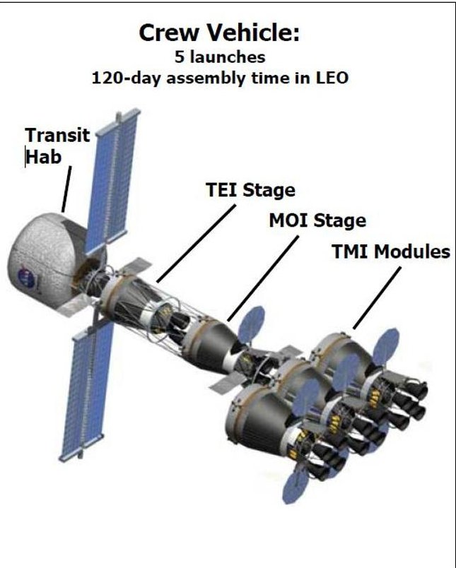

Figure 3-9: Baseline chemical propulsion Mars transportation system crewed architecture from the Mars DRA-5. $ ^{[11]} $

Table 3-13: DRA-5 Baseline Launch Manifests. $ ^{[11]} $

<table border="1"><tr><td>Launch</td><td>Manifest</td><td>Mass(t)</td></tr><tr><td colspan="3">SLS Block2</td></tr><tr><td>1</td><td>Transit Hab,CEV,Reboost Module</td><td>99.9</td></tr><tr><td>2</td><td>MOI&amp;TEI Stages</td><td>108.5</td></tr><tr><td>3</td><td>TMI Module1a</td><td>108.5</td></tr><tr><td>4</td><td>TMI Module1b</td><td>108.5</td></tr><tr><td>5</td><td>TMI Module1c</td><td>108.5</td></tr><tr><td colspan="3">F9</td></tr><tr><td>1</td><td>6 crew</td><td>0.6</td></tr><tr><td colspan="2">Total Mass to Orbit</td><td>534.5</td></tr></table>

<!-- PDF_PAGE: 115 -->

## 3.3.2. Pre-positioning H2O, LL2 Departure, Temporary Cryogenic Storage High Thrust Trajectory: 3xSLS and 1x FH Launches or 2xSLS and 3xFH

The first SLS launch places the transit habitat, 3 t solar array, and crew vehicle RCS to EML2. The second SLS launch delivers an EML2 depot with 47 t of propellant. The crew are delivered in an Orion MPCV by a FH launch, along with the crew vehicle engine. The dedicated reboost module from the baseline architecture is eliminated, because the vehicle is launched in fewer separate pieces, so a 120-day assembly time is not needed. Because the vehicle mass is thus substantially reduced, significantly less RCS propellant is required. A third SLS launch delivers 34 t of water to Mars orbit for the return trip, as well as 3 t of crew supplies which are removed from the baseline transit HAB to reduce its mass at departure. This delivery is performed concurrently with two other cargo vehicles sent during the launch window preceding the crew mission. The crew mission is accomplished with only three SLS launches and a single FH launch. Launch cost savings depend on the cost of an individual SLS launch, as discussed in the next section. A summary of the vehicle at EML2 departure is found in Table 3-14, and a summary of the launches in Table 3-15.

When the propellant for the return trip is finished electrolyzing, the majority of the solar panels can be jettisoned to improve the mass ratio for the trans-Earth injection maneuver because their excess power is no longer needed at this point. This is not necessary to accomplish the maneuver, but it reduces the propellant that must be taken from the Mars depot. The Mars delivery has a glut of propellant for the return trip. When considering the projected remaining propellant from Mars orbit injection, and the possibility of discarding the solar array, under half of this propellant is needed for trans-

<!-- PDF_PAGE: 116 -->

Earth injection. Additionally, the transit habitat does not necessarily need to be replaced and can be resupplied with a FH launch instead before a potential second mission. Therefore, this architecture could support two consecutive Mars missions with only four SLS launches and three FH launches between them for the crew vehicle.

It is possible to replace one of the SLS launches in this architecture with an additional two FH launches. A summary of the launches for this option is in Table 3-16. Instead of the third SLS launch delivering 34 t of water to Mars, a second FH launch delivers a drop tank of water to EML2 containing 18 t of propellant, while a third FH launch delivers 13.4 t of water to Mars orbit for the return trip. The complete mission is accomplished with only two SLS launches and three FH launches. Just as with the 3xSLS 1xFH version of this architecture, the Mars delivery has a glut of propellant for the return trip. Therefore, this architecture could support two consecutive Mars missions with only three SLS launches and five FH launches between them for the crew vehicle.

Table 3-14: LL2, 3xSLS 1xFH Vehicle Summary.

<table border="1"><tr><td colspan="2">Vehicle Element</td><td>Mass(t)</td></tr><tr><td rowspan="7">Propulsion</td><td>Engine</td><td>6</td></tr><tr><td>Tank</td><td>2</td></tr><tr><td>Propellant</td><td>47</td></tr><tr><td>RCS</td><td>3</td></tr><tr><td>Total Module Mass</td><td>58</td></tr><tr><td>Number of Modules</td><td>1.0</td></tr><tr><td>Total Stage Mass</td><td>58</td></tr><tr><td rowspan="3">Payload</td><td>Transit Habitat</td><td>38.3</td></tr><tr><td>CM+Crew</td><td>10.6</td></tr><tr><td>Solar Array</td><td>3.0</td></tr><tr><td colspan="2">Total Vehicle Mass</td><td>109.9</td></tr></table>

Table 3-15: LL2, 3xSLS 1xFH Launch Manifests.

<table border="1"><tr><td>Launch</td><td>Manifest</td><td>Mass(t)</td></tr><tr><td colspan="3">SLS Block2</td></tr><tr><td>1</td><td>34t of H2O,3t consumables delivered to Mars orbit.</td><td>40 to Mars</td></tr><tr><td>2</td><td>Transit Hab,Solar Array,RCS.</td><td>46.4 to EML2</td></tr><tr><td>3</td><td>47t of H2O delivered to EML2.</td><td>49 to EML2</td></tr><tr><td colspan="3">FH</td></tr><tr><td>1</td><td>6 crew in Orion MPCV,plus propulsion engine.</td><td>16.6 to EML2</td></tr></table>

<!-- PDF_PAGE: 117 -->

<table border="1"><tr><td>Total Mass to Orbit</td><td>152</td></tr></table>

Table 3-16: LL2, 2xSLS 3xFH Launch Manifests.

<table border="1"><tr><td>Launch</td><td>Manifest</td><td>Mass(t)</td></tr><tr><td colspan="3">SLS Block2</td></tr><tr><td>1</td><td>47t of H2O delivered to EML2.</td><td>49 to EML2</td></tr><tr><td>2</td><td>Transit Hab,Solar Array,RCS.</td><td>46.4 to EML2</td></tr><tr><td colspan="3">FH</td></tr><tr><td>1</td><td>18t of H2O delivered to EML2.</td><td>18.5 to EML2</td></tr><tr><td>2</td><td>13.4t of H2O delivered to Mars orbit.</td><td>16 to Mars</td></tr><tr><td>3</td><td>6 crew in Orion MPCV,plus propulsion engine.</td><td>16.6 to EML2</td></tr><tr><td colspan="2">Total Mass to Orbit</td><td>146.5</td></tr></table>

## 3.3.3. Pre-positioning H2O, HEO Departure, Temporary Cryogenic Storage High Thrust Trajectory: 3xSLS and 1x FH Launches or 2xSLS and 2xFH

This architecture is similar to architecture B, except that the launches are made to a 10-day HEO orbit instead of EML2. As described in Section 3.2.4, this requires slightly less $ \Delta V $ for trans-Mars injection in the 2035 window but does not provide as easy access to the Deep Space Gateway if it is available. The first SLS launch places the transit habitat, 3 t solar array, and crew vehicle RCS to HEO. The second SLS launch delivers a HEO depot with 45 t of propellant. The crew are delivered in an Orion MPCV by a FH launch, along with the crew vehicle engine. The dedicated reboost module from the baseline architecture is eliminated as it was in architecture B. Because the vehicle mass is thus substantially reduced, significantly less RCS propellant is required. A third SLS launch delivers 34 t of water to Mars orbit for the return trip, as well as 3 t of crew supplies. The crew mission is accomplished with only three SLS launches and a single FH launch. The cost savings of this depends on the cost of an individual SLS launch, as discussed in the next section. A summary of the vehicle at departure from EML2 is found in Table 3-17, and a summary of the launch manifests in Table 3-18.

As in Section 3.3.2, when the propellant for the return trip is finished

<!-- PDF_PAGE: 118 -->

electrolyzing, the majority of the solar panels can be jettisoned to improve the mass ratio for the trans-Earth injection maneuver because their excess power is no longer needed at this point. This is not necessary to accomplish the maneuver, but it reduces the propellant that must be taken from the Mars depot. The Mars delivery has a glut of propellant for the return trip. When considering the projected remaining propellant from Mars orbit injection, and the possibility of discarding the solar array, under half of this propellant is needed for trans-Earth injection. Additionally, the transit habitat does not necessarily need to be replaced and can be resupplied with a FH launch instead before a potential second mission. Therefore, this architecture could support two consecutive Mars missions with only four SLS launches and three FH launches between them for the crew vehicle. Unlike departure from EML2, it can do so even if the solar array is not jettisoned prior to TEI.

It is possible to replace one of the SLS launches in this architecture with an additional FH launch. A summary of the launches for this option is in Table 3-19. Instead of the third SLS launch delivering 34 t of water to Mars, a second FH launch delivers 14.4 t of water to Mars orbit for the return trip. The complete mission is accomplished with only two SLS launches and two FH launches. The cost savings of this again depends on the cost of an individual SLS launch, discussed in the next section. In this case, there is not enough propellant in the FH delivery to Mars to support a second mission. Therefore, this architecture could support two consecutive Mars missions with only three SLS launches and four FH launches between them for the crew vehicle.

Table 3-17: HEO, 3xSLS 1xFH Vehicle Summary.

<table border="1"><tr><td colspan="2">Vehicle Element</td><td>Mass(t)</td></tr><tr><td rowspan="2">Propulsion</td><td>Engine</td><td>6</td></tr><tr><td>Tank</td><td>2</td></tr></table>

<!-- PDF_PAGE: 119 -->

<table border="1"><tr><td rowspan="5"></td><td>Propellant</td><td>47</td></tr><tr><td>RCS</td><td>3</td></tr><tr><td>Total Module Mass</td><td>58</td></tr><tr><td>Number of Modules</td><td>1.0</td></tr><tr><td>Total Stage Mass</td><td>58</td></tr><tr><td rowspan="3">Payload</td><td>Transit Habitat</td><td>38.3</td></tr><tr><td>CM+Crew</td><td>10.6</td></tr><tr><td>Solar Array</td><td>3</td></tr><tr><td colspan="2">Total Vehicle Mass</td><td>106.9</td></tr></table>

Table 3-18: HEO, 3xSLS 1xFH Launch Manifests.

<table border="1"><tr><td>Launch</td><td>Manifest</td><td>Mass(t)</td></tr><tr><td colspan="3">SLS Block2</td></tr><tr><td>1</td><td>34t of H2O,3t consumables delivered to Mars orbit.</td><td>40 to Mars</td></tr><tr><td>2</td><td>Transit Hab,Solar Array,RCS.</td><td>46.4 to HEO</td></tr><tr><td>3</td><td>45t of H2O delivered to EML2.</td><td>49 to HEO</td></tr><tr><td colspan="3">FH</td></tr><tr><td>1</td><td>6 crew in Orion MPCV,plus propulsion engine.</td><td>16.6 to HEO</td></tr><tr><td colspan="2">Total Mass to Orbit</td><td>152</td></tr></table>

Table 3-19: HEO, 2xSLS 2xFH Launch Manifests.

<table border="1"><tr><td>Launch</td><td>Manifest</td><td>Mass(t)</td></tr><tr><td colspan="3">SLS Block2</td></tr><tr><td>1</td><td>Transit Hab,Solar Array,RCS.</td><td>46.4 to HEO</td></tr><tr><td>2</td><td>48.5t of H2O delivered to HEO.</td><td>50 to HEO</td></tr><tr><td colspan="3">FH</td></tr><tr><td>1</td><td>14.4t of H2O delivered to Mars orbit.</td><td>16 to Mars</td></tr><tr><td>2</td><td>6 crew in Orion MPCV,plus propulsion engine.</td><td>16.6 to HEO</td></tr><tr><td colspan="2">Total Mass to Orbit</td><td>129</td></tr></table>

## 3.3.4. Pre-positioning H2O, LL2 Departure, Temporary Gaseous Storage,

## Hybrid High/Low Thrust Trajectory: 5xSLS

As described in Section 3.2.4, a hybrid thrust trajectory departing from EML2 reduces the $ \Delta V $ of the impulsive maneuvers required for the mission to the point where the required propellant can be reasonably stored in gaseous form. This permits an architecture with no cryogenic propellant storage; however, more total propellant is required because of the low-thrust interplanetary transfers. Five SLS launches are required to support this architecture.

<!-- PDF_PAGE: 120 -->

The first two SLS launches pre-position propellant at Mars. One delivers 34 t of water to the planned parking orbit of the crew vehicle after Mars orbit injection, while the other delivers 34 t of water to the planned parking orbit of the crew vehicle prior to Mars orbit escape. Each also delivers 3 t of crew supplies that are removed from the baseline transit HAB to reduce its mass at departure. The third SLS launch pre-positions an EML2 depot with 47 t of propellant. The fourth SLS launch delivers the 5 t solar array, a large empty water tank and gas tanks for propellant storage, a partial load of water propellant, and the crew vehicle engine. The fifth SLS launch delivers the transit habitat, crew consumables, and possibly the MPCV and crew.

A separate FH launch used to deliver the crew in previous architectures is optional, because there is room for them and their MPCV on the fifth SLS launch. If the crew are launched on the fifth SLS, a separate service module for the MPCV is not needed because the transit habitat it is launched with can fill that role.

This mission architecture uses a smaller engine because it requires smaller impulsive maneuvers, and most of the $ \Delta V $ is from low-thrust maneuvers. However, because of the need for more total propellant as well as temporary gaseous storage, the propellant storage tanks are significantly larger and more massive. Compared to the other architectures explored in this paper, it is a more massive vehicle throughout most of the mission and requires more RCS propellant as a result.

Unlike the architectures using impulsive trajectories, the solar panels cannot be discarded prior to the return trip, because they are needed for the low-thrust interplanetary transfer from Earth to Mars. It will still be desirable to replace the solar panels for future missions because of their degradation in performance over time. They

<!-- PDF_PAGE: 121 -->

can be discarded once the crew vehicle has returned to cislunar space.

In this architecture, there is also not enough propellant remaining from the prepositioned Mars depots to support refueling a second mission for its own return trip. All three propellant tank depots will need to be replaced. The transit habitat, however, is reusable, along with potentially water propellant tanks. The RCS propellant, initial propellant load, crew consumable supplies, and solar panels will all need to be replaced. This requires a fourth SLS launch for the second mission; however, after this, the crew could be delivered alone in a FH launch. Therefore, this architecture could support two consecutive Mars missions with nine SLS launches and one FH launch between them for the crew vehicle.

Table 3-20: LL2, 5xSLS Vehicle Summary.

<table border="1"><tr><td colspan="2">Vehicle Element</td><td>Mass(t)</td></tr><tr><td rowspan="7">Propulsion</td><td>Engine</td><td>1</td></tr><tr><td>Tanks(Water+Gas)</td><td>11</td></tr><tr><td>Propellant</td><td>75</td></tr><tr><td>RCS</td><td>4</td></tr><tr><td>Total Module Mass</td><td>91</td></tr><tr><td>Number of Modules</td><td>1.0</td></tr><tr><td>Total Stage Mass</td><td>91</td></tr><tr><td rowspan="3">Payload</td><td>Transit Habitat</td><td>35.3</td></tr><tr><td>CM+Crew</td><td>10.6</td></tr><tr><td>Solar Array</td><td>5</td></tr><tr><td colspan="2">Total Vehicle Mass</td><td>141.9</td></tr></table>

Table 3-21: LL2, 5xSLS Launch Manifests.

<table border="1"><tr><td>Launch</td><td>Manifest</td><td>Mass(t)</td></tr><tr><td colspan="3">SLS Block2</td></tr><tr><td>1</td><td>34t of H2O,3t consumables delivered to Mars orbit.</td><td>40 to Mars</td></tr><tr><td>2</td><td>34t of H2O,3t consumables delivered to Mars orbit.</td><td>40 to Mars</td></tr><tr><td>3</td><td>47t of H2O delivered to EML2.</td><td>49 to EML2</td></tr><tr><td>4</td><td>Water and gas tanks, propulsion engine,RCS.</td><td>45.9 to EML2</td></tr><tr><td>5</td><td>Transit Hab,Solar Array,Crew MPCV.</td><td>49 to EML2</td></tr><tr><td colspan="2">Total Mass to Orbit</td><td>223.9</td></tr></table>

<!-- PDF_PAGE: 122 -->

## 3.4. Comparison of Architectures

The new architectures presented in Section 3.3 share many similarities with each other and the DRA-5. All have the same transit habitat, MPCV, DAV, cargo missions, and surface operations. The new architectures share a key difference with the baseline: that they rely on pre-positioned propellant at Mars for the return trip, but store all propellant in liquid water form, to reduce or eliminate the need for cryogenic storage. The architectures can be compared in a number of ways. The goal of this study is to present architectures closing the key technological gap of long-term propellant storage identified in the DRA-5, $ ^{[11]} $ while also addressing the costs and challenges of committing five super-heavy lift launch vehicles within 120 days. Therefore, we assess three metrics to compare the new architectures to each other and the reference mission: launch costs (a function of number of launches and type of each), required launch cadence, and propellant storage amounts and durations.

## 3.4.1. Launches and Launch Costs

Table 3-22 summarizes the number of launches required by each launch vehicle to support each architecture from Section 3.3. Table 3-23 through Table 3-25 compare total launch costs for each, using the following cost-per-launch figures:

- For SLS Block 2: No recent cost is available and there are a wide range of estimates:

o $500M according to an interview with the SLS deputy project manager in 2012. $ ^{[50]}$

o $1B according to an independent estimation. $ ^{[34]} $ The article mentions a $ 5B estimate, but this includes developmental costs that have already

<!-- PDF_PAGE: 123 -->

been spent on the program as well as the cost of Orion.

- For FH: $90M for up to 8,000 t to GTO according to SpaceX. $ ^{[46]} $ Published figures for LEO and greater GTO payloads are not available. Instead, the FH carries nearly its maximum payload capability for each destination. So, the cost is scaled from the GTO launch capacity (26,700 t, or 3.34 times the 8,000 t for which a price is listed) for a price of approximately $300M.

- For F9: $62M according to SpaceX. $ ^{[46]}$

Table 3-22: Launches Required.

<table border="1"><tr><td>Vehicle</td><td>A: Baseline</td><td>B: Cryo EML2</td><td>Or</td><td>C: Cryo HEO</td><td>Or</td><td>D: Gas EML2</td></tr><tr><td>F9</td><td>1</td><td>0</td><td>0</td><td>0</td><td>0</td><td>0</td></tr><tr><td>FH</td><td>0</td><td>1</td><td>2</td><td>1</td><td>2</td><td>0</td></tr><tr><td>SLS</td><td>5</td><td>3</td><td>2</td><td>3</td><td>2</td><td>5</td></tr></table>

Table 3-23: Launch Costs.

<table border="1"><tr><td>Launch Cost Estimates ($B)</td><td>A: Baseline</td><td>B: Cryo EML2</td><td>Or</td><td>C: Cryo HEO</td><td>Or</td><td>D: Gas EML2</td></tr><tr><td>Min Estimate</td><td>2.562</td><td>1.8</td><td>1.6</td><td>1.8</td><td>1.6</td><td>2.5</td></tr><tr><td>Max Estimate</td><td>5.062</td><td>3.3</td><td>2.6</td><td>3.3</td><td>2.6</td><td>5.0</td></tr></table>

Table 3-24: Absolute Comparison of Launch Costs.

<table border="1"><tr><td>Launch Cost Difference ($B)</td><td>A: Baseline</td><td>B: Cryo EML2</td><td>Or</td><td>C: Cryo HEO</td><td>Or</td><td>D: Gas EML2</td></tr><tr><td>Min Estimate</td><td>0</td><td>-0.762</td><td>-0.962</td><td>-0.762</td><td>-0.962</td><td>-0.062</td></tr></table>

<!-- PDF_PAGE: 124 -->

<table border="1"><tr><td>Max Estimate</td><td>0</td><td>-1.762</td><td>-3.62</td><td>-1.762</td><td>-3.62</td><td>-0.062</td></tr></table>

Table 3-25: Relative Comparison of Launch Costs.

<table border="1"><tr><td>Launch Cost Comparison</td><td>A: Baseline</td><td>B: Cryo EML2</td><td>Or</td><td>C: Cryo HEO</td><td>Or</td><td>D: Gas EML2</td></tr><tr><td>Min Estimate</td><td>100%</td><td>70.2%</td><td>62.4%</td><td>70.2%</td><td>62.4%</td><td>97.6%</td></tr><tr><td>Max Estimate</td><td>100%</td><td>65.2%</td><td>51.4%</td><td>65.2%</td><td>51.4%</td><td>98.8%</td></tr></table>

The comparisons in Table 3-22 through Table 3-25 show that the refueling architectures with temporary cryogenic storage save one SLS launch and can replace an additional one or two SLS launches with FH launches. The results can save nearly half of launch costs. Compare architecture A, with up to $5B in launch costs, to architecture B or C with $2.6B in launch costs when one SLS launch is eliminated and two more replaced by FH launches. The refueling architecture D with temporary gaseous storage does not save any SLS launches over the baseline without the use of ISRU to eliminate launches needed to pre-position propellant. However, both it and the cryogenic storage architectures allow for a more flexible SLS launch cadence. This is addressed in the next subsection.

## 3.4.2. Launch Cadence

Launch cadence estimates for SLS vary, with projections as low as one launch per year or even less often. $ ^{[34]} $ However, the DRA-5 reference architecture requires five SLS launches within 120 days. $ ^{[11]} $ Reducing the required SLS launch cadence is therefore a goal of this study. This can be achieved by replacing SLS launches with FH

<!-- PDF_PAGE: 125 -->

launches that may be able to take place more frequently, as well as by increasing the flexibility of when the launches can occur. The proposed architectures all include launches making propellant deliveries to Mars. These launches are not part of the crew vehicle assembly prior to departure and can be made long in advance of the crew mission.

- Architecture A: DRA-5 Baseline: Requires five SLS launches within 120 days, a pace of one every 24 days.

- Architecture B: Requires three SLS launches and one FH launch. One SLS launch pre-positions propellant at Mars, and can be made far in advance, even one or more launch windows prior. Another SLS launch pre-positions propellant at EML2. The third SLS launch is for the transit habitat vehicle. The FH launch is for the crew to rendezvous with it. Therefore, this architecture requires at most two SLS launches within the same year. If the Deep Space Gateway is used for stationkeeping of the propellant depot, then only one SLS launch is needed per year.

- Alternative: Requires two SLS launches and three FH launches. In this case, one SLS launch pre-positions propellant at Mars, while the other is for the main crew vehicle. These can be launched years apart from each other, with the propellant pre-positioned one or more launch windows prior. One FH launch also pre-positions propellant at Mars, while another pre-positions propellant at EML2. The final FH launch is for the crew to rendezvous with the transit habitat vehicle.

- Architecture C: Identical to Architecture B in total launches, with HEO

<!-- PDF_PAGE: 126 -->

replacing EML2 as the chosen staging orbit. Because of this change, the Deep Space Gateway is not available for station-keeping. This means the SLS launches for the HEO propellant depot and transit habitat vehicle should be made closer together.

Architecture D: Requires five SLS launches. Two SLS launches pre-position propellant at Mars, and can be made far in advance, even one or more launch windows prior. Another SLS launch pre-positions propellant at EML2. The fourth SLS launch is for the propulsion system, while the fifth is for the crew and crew vehicle. If both Mars propellant depots are to be pre-positioned one launch window prior to the crew mission, then two SLS launches are needed that year, followed by three over the next two years to assemble the crew mission at the Deep Space Gateway in EML2.

## 3.4.3. Propellant Storage

Table 3-26 summarizes the maximum amount and duration of propellant storage for each type of architecture considered in this study. Architecture A is the baseline, the design reference mission where all propellant is stored in cryogenic form until used. This means nearly 350 t of propellant at the mission start, with some of it being stored for up to 713 days before the trans-Earth injection maneuver. Architectures B and C are impulsive electrolysis propulsion trajectories, which use temporary cryogenic storage of electrolyzed propellant. However, up to two months of cryogenic propellant storage is required while electrolysis takes place leading up to the largest maneuvers in the mission. This is a much-reduced duration compared to the two years in the baseline, but still orders of magnitude longer than the longest example of cryogenic propellant storage in space.

<!-- PDF_PAGE: 127 -->

Architecture D avoids cryogenic propellant storage completely. This architecture also requires much less temporary propellant storage: only up to 7 t in gaseous form, and for only 8 days instead of months or years. Only the hypothetical of a completely low-thrust mission using water electrolysis propulsion requires no electrolyzed propellant storage.

Table 3-26: Maximum Propellant Storage Required.

<table border="1"><tr><td>Mission Architectures</td><td>Trajectory Type</td><td>Storage t</td><td>Storage Time d</td></tr><tr><td>A: Baseline</td><td>Impulsive</td><td>347.6(cryogenic)</td><td>713</td></tr><tr><td>B: Cryo EML2</td><td>Impulsive</td><td>48.5(cryogenic)</td><td>60</td></tr><tr><td>C: Cryo HEO</td><td>Impulsive</td><td>48.5(cryogenic)</td><td>60</td></tr><tr><td>D: Gas EML2</td><td>Hybrid</td><td>7(gaseous)</td><td>8</td></tr><tr><td>Hypothetical</td><td>Low-thrust</td><td>0</td><td>0</td></tr></table>

<!-- PDF_PAGE: 128 -->

## 3.5. Conclusion

The Mars DRA-5 chemical propulsion reference crew mission is a multi-stage vehicle massing 486 t on departure from LEO. It takes five SLS launches and 120 days to assemble for each Mars mission. This requires an additional LEO module to reboost its orbit during this period and demands a more rapid launch cadence than is expected to be feasible for SLS. There are also concerns about the storage lifetime of cryogenic hydrogen and oxygen as propellant, which have never been used after a period of up to several years in space. This paper focuses on water electrolysis propulsion technology that enables strategic refueling from tanks pre-positioned ahead of the crewed vehicle. This technology enables alternative trajectories that were originally considered in the DRA-5, including HEO or EML2 departure to take advantage of the Deep Space Gateway as a staging area.

For electrolysis propulsion with temporary cryogenic propellant storage, the results show that at least one SLS launch out of the five in the DRA-5 baseline can be eliminated with the use of refueling. An additional one or two SLS launches can be replaced by FH launches. These alternatives reduce the assembly time of the mission and the total mass that must be lifted into orbit. The amount of propellant required to be stored in cryogenic form, as well as the time for which it must be stored, is dramatically reduced, because propellant can be stored in water form indefinitely until it is needed. This results in less boil-off, and a greater fraction of stored propellant mass usable for propulsion. These architectures can support an otherwise baseline Mars DRA-5 mission and do so while significantly reducing launch costs due to fewer launch vehicles needed. Another alternative is electrolysis propulsion with temporary gaseous propellant

<!-- PDF_PAGE: 129 -->

storage. This architecture uses a hybrid high/low thrust trajectory that reduces the size of impulsive maneuvers needed for the mission. By doing this, cryogenic propellant storage can be eliminated from the mission. The DRA-5 study identifies long-duration cryogenic propellant storage as a critical technical area; the proposed architecture circumvents the issue completely. Gaseous storage tanks in the automotive industry are already capable of storing hydrogen for the necessary duration at a feasible mass fraction for this trajectory. The result is a flexible mission architecture that can make use of ISRU if available at mission waypoints. This architecture also bridges key logistical and technological gaps in the reference architecture by reducing the required launch cadence of SLS and circumventing the need for cryogenic propellant storage.

For future work, we will investigate the possibility of fully low-thrust trajectories using electrolysis propulsion. The ideal specific impulse of 450 s is poor compared to that of other electric thrusters, making existing low-thrust Mars trajectories infeasible with this technology. However, the gas storage tanks needed for even small impulsive maneuvers are the most massive component of the electrolysis propulsion modules presented here. As an alternative, the relatively high thrust per unit power of electrolysis propulsion could permit continuous-thrust trajectories that are otherwise impractical with current solar panel performance. If an entirely low-thrust trajectory is designed, it could be possible to take advantage of water as propellant without any gaseous storage needed.

Additionally, we will examine ISRU of water for propellant loading. The DRA- 5 already considers ISRU to load the DAV with propellant for the crew ascent. $ ^{[37]][39]} $ Electrolysis propulsion allows for expanding ISRU to the crew transit vehicle as well.

<!-- PDF_PAGE: 130 -->

Propellant production on the Moon could supply a depot at the Deep Space Gateway to provide the initial propellant loading prior to departure of the crew mission. For architectures departing from EML2, this eliminates one SLS launch. ISRU is also possible for propellant loading of the vehicle for the return trip from Mars. For the electrolysis propulsion alternative with gaseous propellant storage and a hybrid high/low thrust trajectory, this eliminates two SLS launches. With these changes, the hybrid thrust architecture can support one Mars mission with only two SLS launches for the crew transit vehicle, and two consecutive Mars missions with only three.

Both Mars and its moons are possible candidates for gathering ISRU propellant for the return trip, and each has their own advantages and disadvantages. Lifting water from Mars would require an additional ascent vehicle, and it is possible that simply delivering water massing the same as this ascent vehicle to Mars orbit would be a more efficient use of a launch vehicle. However, a visit to one of the moons is not currently planned in the Mars DRA-5. Adding such a visit would increase the scope of the mission, but this would also provide an opportunity to achieve additional scientific objectives. Further alternatives include propellant depots stocked not from resources available at Mars but from asteroid mining or other sources.

Water electrolysis propulsion is a use case for future cislunar and interplanetary infrastructure. Even without exploiting ISRU, this technology mitigates, and even circumvents, key technical issues in the chemical propulsion reference design of the Mars DRA-5 mission architecture. With ISRU, it accomplishes the same mission in fewer launches. Architectures departing from EML2 also utilize the proposed Deep Space Gateway as a propellant depot, staging ground, and rendezvous point. In these

<!-- PDF_PAGE: 131 -->

ways, this technology can tie NASA's proposed cislunar and Mars exploration architectures together by using the former as infrastructure for the latter. Water electrolysis propulsion could therefore contribute to the sustainability of interplanetary exploration by decreasing reliance on supplies from Earth and leveraging an abundant resource in the Solar System.

## Acknowledgements

This work was conducted at Cornell University. We would like to acknowledge the contributions of Cornell undergraduate students who took the MAE 5160 Spacecraft Technology and Systems Architecture course in the spring 2017 semester. Their final project work for the course helped explore different configuration ideas for this paper. The electrolysis propulsion concept and performance has been informed by research and development of a nanosatellite scale thruster for the Cislunar Explorers CubeSat.

<!-- PDF_PAGE: 132 -->

## SPINNING CUBESATS WITH LIQUID PROPELLANT

## 4.1. Introduction

An electrolysis propulsion system uses hydrogen and oxygen as propellant, but unlike typical hydrogen rockets, the fuel and oxidizer are stored together during launch as inert, liquid water instead of separate cryogenic liquids. Once in orbit, the spacecraft uses solar power to separate the oxidizer from the fuel. This compact architecture has the potential to provide high $ \Delta\mathrm{V} $ at the CubeSat scale, $ ^{[12]^{[85]}} $ the lack of which has been identified as a technology gap for CubeSat missions beyond Earth orbit. $ ^{[86]} $ The implementation developed at Cornell University has three primary components. The first is a water tank that stores the propellant. Within that tank are electrolyzers that decompose the water into hydrogen and oxygen gases. The second component is a combustion chamber. The electrolyzed gases are released into this chamber in bursts and are then ignited by a glow plug. As the gases combust, they expand through a nozzle to generate thrust.

Use of water electrolysis instead of LOX/LH2 propellant obviates the need for pressurized, cryogenic tanks on the spacecraft. This approach allows for dense storage of propellant while in compliance with CubeSat specifications that preclude pressure vessels and that make filling cryogenic tanks before launch infeasible. $ ^{[87]} $ This system also retains many of the advantages of LOX/LH2, including non-toxic water vapor as exhaust and the potential for high Isp and $ \Delta V $ . In fact, this ultimate green propellant offers the lowest toxicity of any propulsion technology. Its disadvantage is that the electrolyzed hydrogen/oxygen must be separated from the liquid water so that the

<!-- PDF_PAGE: 133 -->

propellant may be sent to the combustion chamber. This paper describes the systems engineering implications of using spacecraft spin to achieve this goal.

A pair of electrolysis-propelled CubeSats (Figure 4-1) have been developed at Cornell University and selected for launch on NASA's Space Launch System (SLS) as part of the Centennial Challenges CubeQuest competition. $ ^{[88]} $ The mission is a technology demonstration with the goal of achieving lunar orbit after an initial translunar deployment from SLS. A successful demonstration will validate the use of water for dense, safe propellant storage delivering high $ \Delta V $ performance at the nanosatellite scale. The spacecraft design centers around the use of water as the key resource. The propellant tank forms the structural basis of the spacecraft and the water propellant serves as a heat sink and a radiation shield for the spacecraft electronics. The spinning architecture creates synergy between the attitude control and propulsion systems, a symbiosis described and analyzed in this paper.

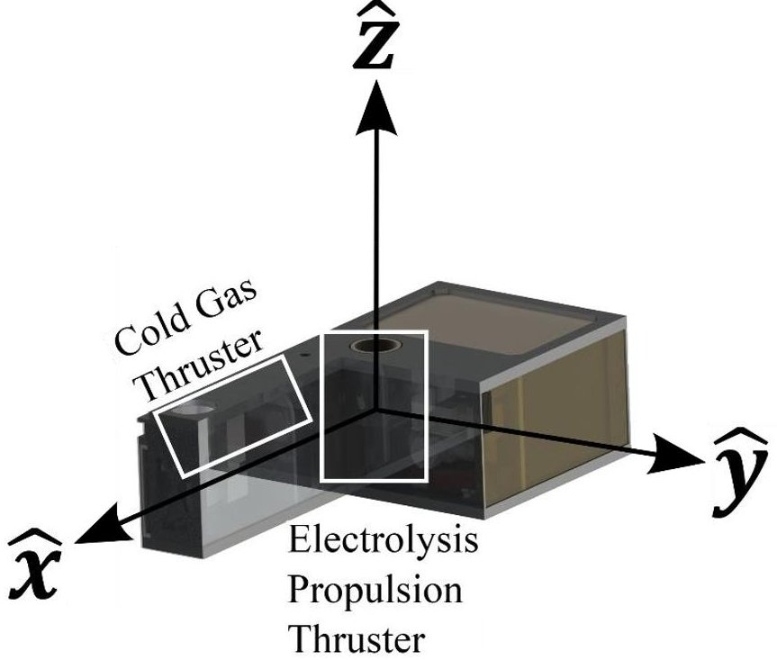

Figure 4-1: 3U CubeSat Application. View of the 3U spacecraft with the two thrusters boxed and the body frame coordinates shown.

<!-- PDF_PAGE: 134 -->

The analysis that follows uses this mission architecture as a case study. In this mission, the two spacecraft are launched together as a single 6U structure (Figure 4-2) and then separate under the action of compressed springs that induce a roughly 60 RPM spin in each spacecraft. As is the case for any triaxial rigid body, the only stable spin axis for each of the two 3U spacecraft is the principal axis of the inertia matrix associated with the maximum moment of inertia. That axis is parallel to the thrust vector, normal to the face shown in Figure 4-2. The liquid propellant dissipates kinetic energy, damping the spacecraft's nutation, making spin about the thrust axis a robustly stable equilibrium.

Figure 4-2: 6U CubeSat Separation. Simplified view of the spring-loaded separation process of the 6U deployment unit (a) into two independent 3U spacecraft (c).

In addition to providing momentum stiffness during rocket-engine firings, the spin serves another important role: it separates the gas from the water by imparting a centripetal acceleration field. $ ^{[14]} $ This centrifugal effect drives the water away from the mass center (CM) of the spacecraft, causing the electrolyzed gas to accumulate inboard, near the thruster side of the propellant tank. From there, it is directed into the evacuated combustion chamber via a solenoid valve when the tank reaches a suitable pressure.

<!-- PDF_PAGE: 135 -->

Immediately after launch the CM lies on the tank side of the thruster, and its location shifts as propellant is expended. The spacecraft has been designed with the thruster's centerline midway between the initial spin axis and the final spin axis to minimize thruster torque about the CM throughout the mission.

## 4.2. Modeling Approaches

## 4.2.1. System Dynamics

This discussion considers two frames of reference. The first is the spacecraft body frame. Basis vectors are fixed in the spacecraft body as shown in Figure 4-1. The second is a spacecraft-centered inertial frame $ \mathcal{F} $ , which does not rotate with the spacecraft. Basis vectors fixed in these respective frames of reference give rise to coordinate systems, also indicated with $ \beta $ and $ \mathcal{F} $ respectively. At $ t=t_{0} $ , the two frames are coincident. Unless otherwise specified, we express vectors in the spacecraft-fixed $ \beta $ coordinate system.

The goal in simulating the dynamics of the satellite is to obtain an estimate of the time constant of this decay and determine the parameters of an analytical model to represent the true fluid motion, such as the Kane damping model. The spacecraft's response to a thruster pulse begins with a major-axis spin, where the principal axes of the inertia matrix are taken to align with the body-fixed basis vectors:

$$
\boldsymbol {\omega} \left(t _ {0}\right) = \boldsymbol {\omega} _ {0} = \left[ \begin{array}{l} \omega_ {x 0} \\ \omega_ {y 0} \\ \omega_ {z 0} \end{array} \right] = \left[ \begin{array}{c} 0 \\ 0 \\ \omega_ {z 0} \end{array} \right]
$$

This spin creates an initial angular momentum vector that is constant in $ \beta $ and in $ \mathcal{F} $ at time $ t_{0} $:

$$
\mathbf {H} \left(t _ {0}\right) = \mathbf {H} _ {0} = \mathbf {I} \boldsymbol {\omega} _ {0}
$$

<!-- PDF_PAGE: 136 -->

A pulse from either the cold-gas thruster or from the electrolysis thruster is modeled as a step that lasts from time $ t_{1} $ to $ t_{2} $ . The thruster force is $ \underline{F_{\mathrm{c}}} $ or $ \underline{F_{\mathrm{e}}} $ depending on the thruster used. As each thruster is in a different location, the torque about the center of mass depends on the moment arm:

$$
\mathrm {T} (t) = \mathbf {r} (t) \times \mathbf {F} (t)
$$

where $ r_{cgt} $ and $ r_{elec} $ , the position vectors from the center of mass to each respective thruster, rotate in the $ \mathcal{F} $ frame as the thrusters move due to spacecraft spin, and change in the $ \beta $ frame as the center of mass shifts due to propellant expenditure. The total angular momentum depends on this torque and the duration of the pulse:

$$
\mathbf {H} \left(t _ {2}\right) = \mathbf {H} _ {0} + \int_ {t _ {1}} ^ {t _ {2}} \mathrm {T} (\mathrm {t}) d t
$$

The spacecraft can fire its thruster to impart $ \Delta V $ with reliable results only when the nutation of the spacecraft is minimal. So, characterizing the nutation is an important objective, part of which is estimating the maximum nutation angle $ \theta_{n} $ immediately after a thruster pulse. This angle describes the separation between the angular-momentum vector and the principal axis nearest the desired spin axis, and angle which exponentially decays as nutation damps following the thruster firing. It is given by:

$$
\theta_ {n} \left(t _ {2}\right) = \cos^ {- 1} \left(\widehat {\mathbf {H}} \left(t _ {2}\right) \cdot \hat {\mathbf {z}}\right)
$$

Because this maximum-axis spin is a minimum-energy state, the spacecraft spin eventually reaches equilibrium, where $ \theta_{n}(t_{f})=0 $ . That is, the angular-momentum vector aligns with the principal axis and there is no nutation.

<!-- PDF_PAGE: 137 -->

## 4.2.2. Simulink Model

Simulink was used to simulate the attitude dynamics of the satellite, a major axis spinner with principal moments of inertia as described in Table 4-1 (empty propellant tank) and Table 4-2 (full). Aside from energy-dissipating processes, the satellite is modeled as a rigid body. The spacecraft begins with a spin of 6 rad/s about the major axis, which is sufficient for the electrolysis separation mechanism to work, including a factor of safety of approximately five. $ ^{[89]} $ After 10 seconds, a thruster applies a torque to the satellite. The torque ramps up to $ 0.1057\mathrm{N}\cdot \mathrm{m} $ about the x axis and $ -0.0610\mathrm{Nm} $ about the y axis, and then down to zero over a period of 0.015 seconds, a realistic time-history of the force from one of the spacecraft's attitude thrusters.

Table 4-1: Principal Moments, Empty

<table border="1"><tr><td>Axis</td><td>Moment of Inertia,kgm2</td></tr><tr><td>Ixx</td><td>0.0097kgm2</td></tr><tr><td>Iyy</td><td>0.0437kgm2</td></tr><tr><td>Izz</td><td>0.0459kgm2</td></tr></table>

Table 4-2: Principal Moments, Full

<table border="1"><tr><td>Axis</td><td>Moment of Inertia,kgm2</td></tr><tr><td>Ixx</td><td>0.0128</td></tr><tr><td>Iyy</td><td>0.0541</td></tr><tr><td>Izz</td><td>0.0580</td></tr></table>

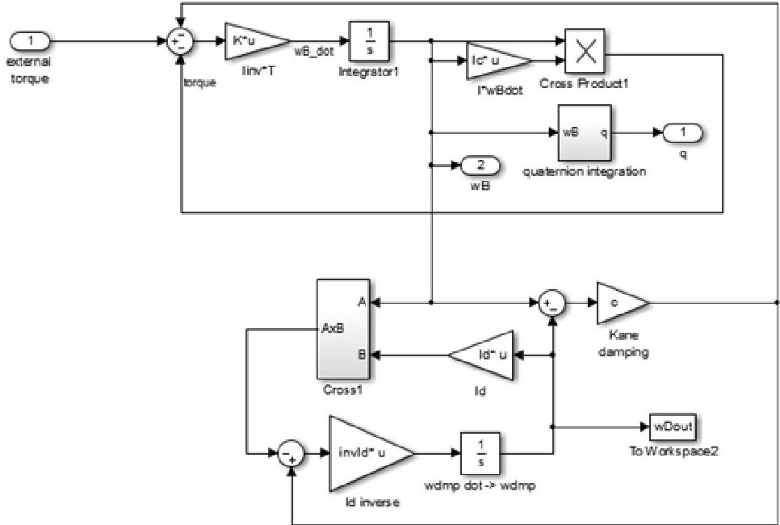

Figure 4-3: Simulink Model of Kane Damper Approximation.

<!-- PDF_PAGE: 138 -->

The nutation damping caused by the tank full of water is approximated as a Kane damper $ ^{[90]} $ of mass 1 kg and spherical radius 5 cm, with a damper constant of 0.00085. This lumped-parameter model streamlines the simulation by avoiding computationally expensive fluid-mechanics simulations and the copious test data that would be needed to validate them, $ ^{[91]} $ $ ^{[93]} $ while retaining the effect of the liquid damping on the overall system spin state. Figure 4-3 shows the Simulink block diagram of the Kane damper approximation of a spinning rigid body with water sloshing inside of it.

Zeledon and Peck performed a Monte Carlo analysis starting from random spin states to simulate uncertainty in spin rates after dispenser deployment. $ ^{[89]} $ It was shown that a 3U CubeSat with this Kane damper approximation would quickly stabilize itself in major axis spin. The present analysis considers the thruster impulse outlined in the previous subsection. When this impulse is applied, the system begins to nutate. Over time, the Kane damper causes the nutation angle to decay to zero, while the spin rate about the z axis eventually returns to its initial condition, conserving momentum. The results of this model are shown in Figure 4-4. Figure 4-4.A shows the angular velocity of the spacecraft. Figure 4-4.B shows the decay of the nutation.

<!-- PDF_PAGE: 139 -->

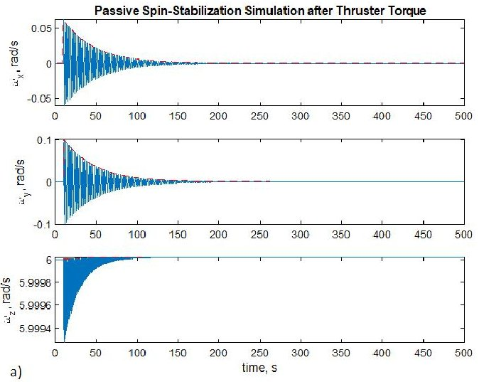

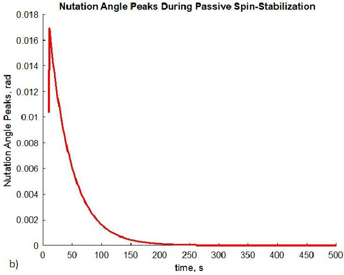

Figure 4-4: Exponential Decay of Nutation. Response due to torque impulse, assuming a full propellant tank. Shown are (a) exponential decay of the disturbed spin to a new equilibrium spinning about the principal axis and (b) the nutation angle.

## 4.2.3. Changes in Damping Time Constant During Mission

This subsection qualitatively assesses the expulsion of propellant mass and its effect on spacecraft inertia and angular momentum, as well as the potential changes in nutation damping due to sloshing of propellant. Several characteristics of the spacecraft change as propellant is expended through primary and attitude thrusters:

- The principal moments of inertia change, as shown in Table 4-1 and Table 4-2.

- The center of mass translates away from the propellant tank.

- Angular momentum decreases as propellant is expended due to jet damping and the loss of mass, although the spin speed increases somewhat as the propellant's inertia moves through the propulsion plumbing.

- Angular momentum may change due to thruster misalignment, which results in some small torque applied about the spin axis.

- The spin and spin rate change depending on all the above factors.

<!-- PDF_PAGE: 140 -->

1. Increased effect of attitude thruster torques as angular momentum decreases.

A given torque impulse causes a greater change in spin speed or angular momentum direction when the spacecraft angular momentum is reduced. While the time constant of damping may remain the same, identical cold-gas thruster torques create greater reorientations as well as higher nutation that take longer to decay to an acceptable level. This effect must be accounted for operationally. The ground calculates the number and length of reorientation thruster pulses to achieve a desired spin-axis correction as the spacecraft's angular momentum changes.

The calculation of these maneuvers is based on a simplifying assumption: these impulsive torques are imparted by a thruster with an on-time considerably shorter than the spin period or the nutation period. The effect of attitude-thruster torques applied as repeated, infinitesimally small pulses can be understood as a cumulative, scalar angular displacement of the principal axis that increases linearly with each infinitesimal angular impulse. $ ^{[92]} $

$$
d \theta_ {z} = \frac {\mathrm {T} d t}{H}
$$

Many such pulses—as frequently as one per spin period—gradually reorient the spin axis while allowing enough time for the spacecraft to settle between pulses. In this case, the total scalar angular displacement is:

$$
\Delta \theta_ {z} = \frac {\Delta H}{H}
$$

For constant, desired reorientation angle $ \Delta \theta_{z} $ , the required angular impulse in terms of the initial angular momentum and the desired reorientation is:

$$
\Delta H = H \Delta \theta_ {z}
$$

<!-- PDF_PAGE: 141 -->

The initial angular momentum (i.e. without nutation) is proportional to the initial principal axis angular velocity and the principal moment of inertia $ I_{\mathrm{z z}} $ . Therefore, in the case of infinitesimally small reorientation pulses, the desired reorientation, the initial angular velocity, and principal moment of inertia all enter the problem linearly.

Figure 4-5 shows this relationship for a range of these values, from 6 rad/s to 8 rad/s spin, and $ I_{zz} $ from full to empty. The figure shows the angular impulse needed to reorient the spin axis by $ \pi $ radians--that is, to flip the spacecraft completely. The relationship is linear only if the reorientation is accomplished with infinitesimally small, impulsive pulses. Correctly modeling finite-duration pulses demands integrating the force and torque over time because the thruster moves in the inertial frame due to the spacecraft spin; also, the thruster's torque projects onto the angular-velocity vector in subtle ways, changing how mechanical work becomes nutation.

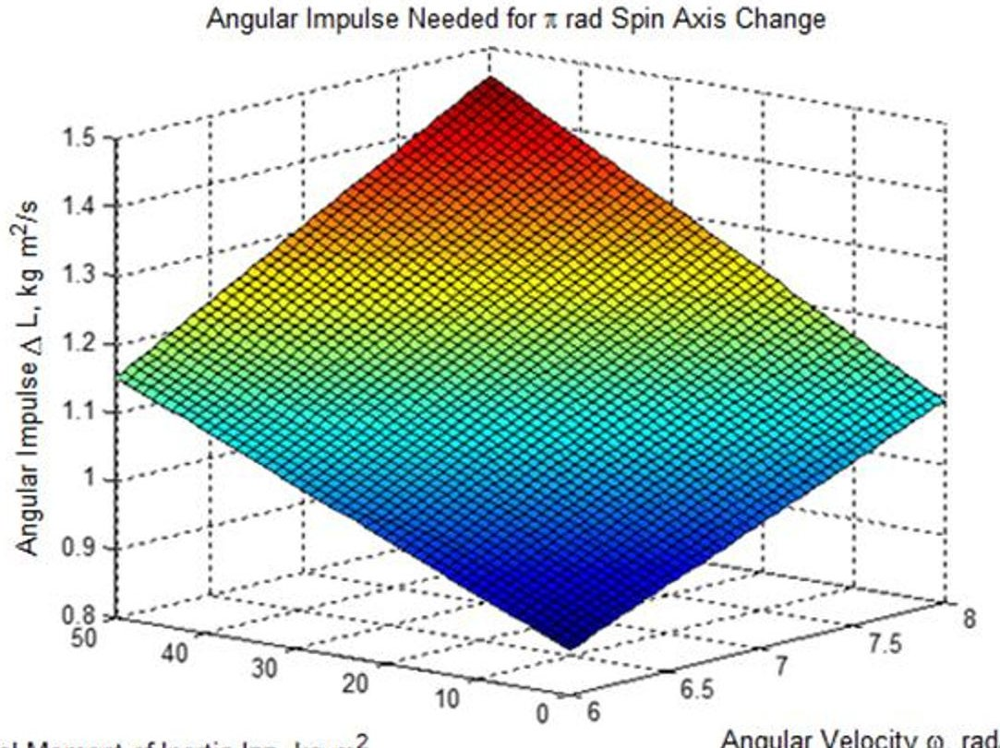

Principal Moment of Inertia lzz, kg $ m^{2} $

Figure 4-5: Angular Impulse Relationship. Linear relationship among the angular impulse needed for the reorientation, principal moment of inertia, and angular velocity of the spacecraft.

<!-- PDF_PAGE: 142 -->

2. Changes in nutation damping with propellant tank fill fraction.

This section examines the role of the changing fluid fill fraction in the propellant tank. The spin damping is due to viscous effects of the water on the propellant tank, gross sloshing motion, surface-tension behaviors, and some subtle interactions with the structure. The propellant tank is never completely full because some ullage volume must be left during preflight fueling to avoid over-pressurization of the tank. Over time, as propellant is electrolyzed and expended, the fill fraction of liquid decreases, and the volume of combustible gas in the propellant tank increases. This change allows for a larger-amplitude slosh.

We implement this relationship with a simple model shown in Figure 4-6. We expect a damping singularity to occur: as the propellant fill fraction approaches zero, so does the damping constant. Therefore, the damping time constant approaches a vertical asymptote at 0% fill, increasing without bound. Spinning air bearing tests, described in the next section, are used to re-calibrate this model with experimental results.

This model has been implemented in MATLAB and Simulink. In it, the moments of inertia, center of mass, and damping coefficients change as described for a range of fill fractions from 0% to 100%. Figure 4-7 shows the results, plotting the nutation angle decay at progressive fill fractions. The magnitude of the angle is not important; it arises from some worst-case assumptions. What matters is the time constant itself, which indicates the operational delay necessary between thruster pulses and/or reorientation maneuvers. Figure 4-8 plots the relationship between fill fraction and nutation decay time constant. Figure 4-8 shows simulation results from this

<!-- PDF_PAGE: 143 -->

Simulink model. A curve of time constant as a function of fill fraction provides crucial information about the increasing operational delays required by the spacecraft as the mission progresses.

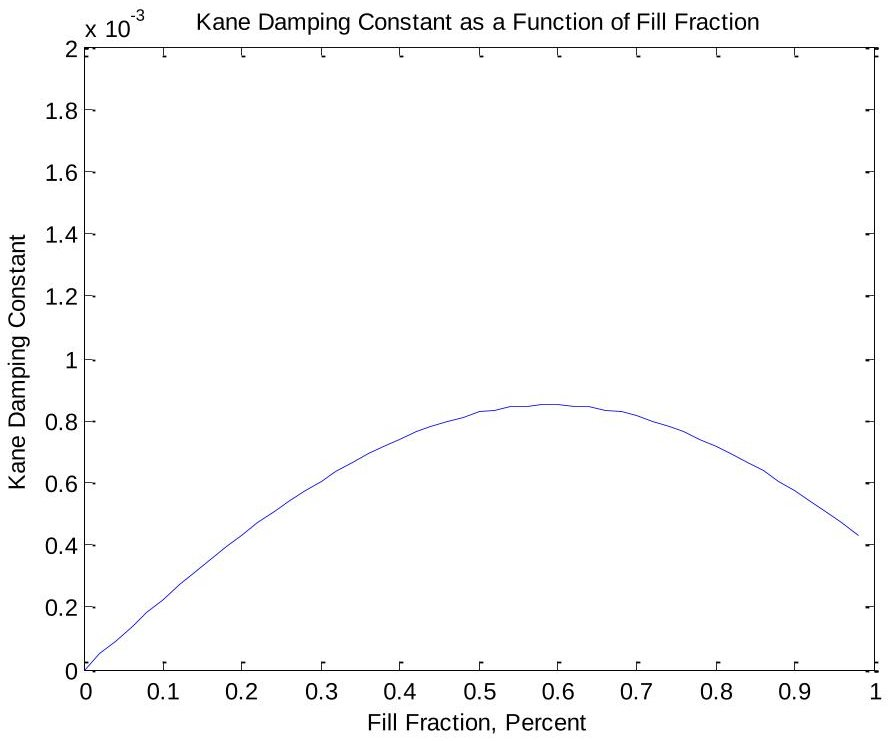

Figure 4-6: Nutation Decay Change. Plot of the changing nutation decay time constant.

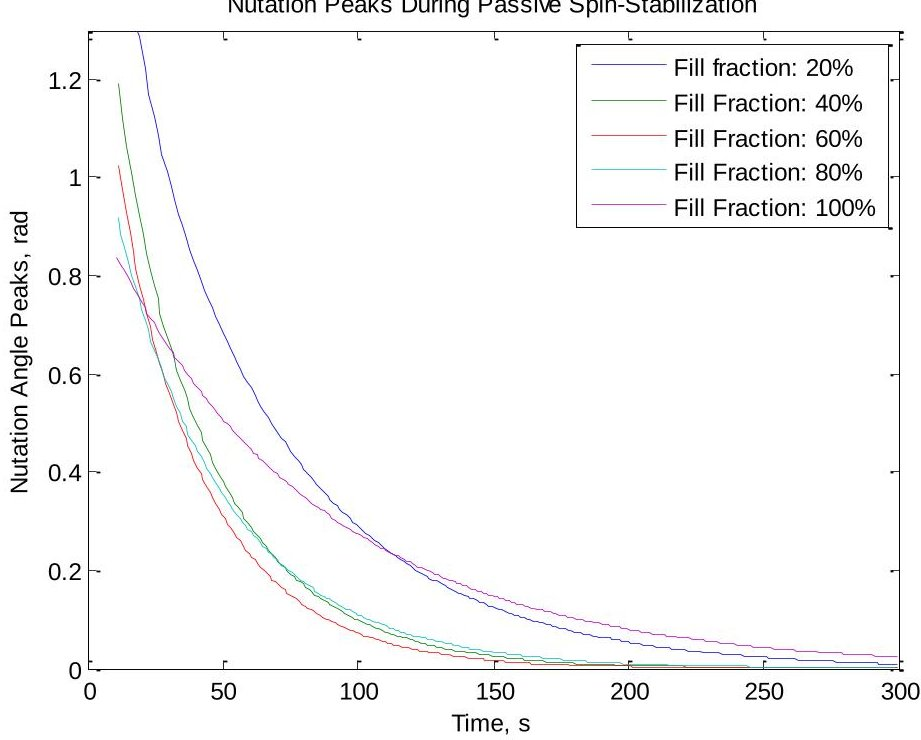

Figure 4-7: Nutation Peaks Decay versus Fill Fraction. The initial nutation angle always decreases with fill fraction, but the time constant is minimum at 60%.

<!-- PDF_PAGE: 144 -->

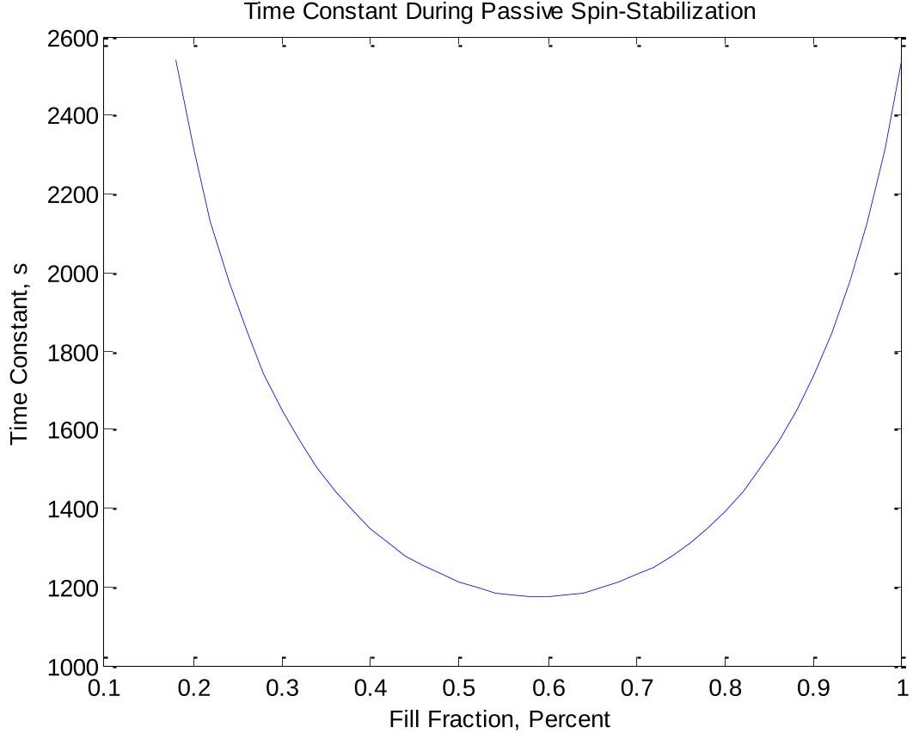

Figure 4-8: Nutation Decay Change. Plot of the changing nutation decay time constant.

3. Reduced change in angular momentum as propellant is expended: jet damping.

Before it is combusted, propellant is electrolyzed in the propellant tank and then vented into the combustion chamber. This transfers mass closer to the spin axis (which ideally runs through the axis of symmetry of the combustion chamber). Water that is in the propellant tank is at a greater distance from the spin axis than water in the combustion chamber, shown in Figure 4-9. However, no external angular impulse has been applied; so, the angular momentum must remain constant. Therefore, the spacecraft spins slightly faster as mass is drawn in towards the major axis.

This is known as jet damping and is related to the ice skater effect: the way ice skaters draw their arms inward, exploiting conservation of momentum to increase their spin rate as their moment of inertia decreases. However, unlike the ice-skater effect, there is still a small decrease in angular momentum as the propellant mass is eventually

<!-- PDF_PAGE: 145 -->

expended. But, much of the propellant's angular momentum is first transferred to the spacecraft bus. Therefore, we expect the change in angular momentum as water propellant is expended to be negligible. The moments of inertia decrease, as shown in Table 4-1 and Table 4-2, and the angular velocity increases to compensate.

In the reference spacecraft design, the water begins at a distance of on the order of 10 cm from the center of mass of the spacecraft. During a burn, the water (now a mixture of hydrogen and oxygen gas) is ejected through a nozzle throat with radius of approximately 0.1 mm. As the moment of inertia of each water molecule (treating them as point masses) about the center of mass of the spacecraft depends on the square of its distance, this reduces the momentum loss to about $ 1 0^{-6} $ times the value that would be calculated without jet damping.

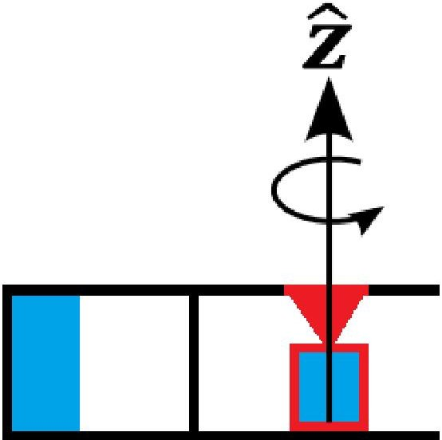

Figure 4-9: Water Transfer. Water is transferred from the propellant tank on the left to the combustion chamber on the right.

## 4. Change in angular velocity due to thruster misalignment.

Ideally, both thrusters are perfectly parallel to the angular momentum vector. For the cold-gas attitude thruster, this alignment means each reorientation pulse

<!-- PDF_PAGE: 146 -->

produces no torque about the spin axis (which is parallel to the angular momentum vector in equilibrium) and therefore does not change the magnitude of the spacecraft's angular momentum. However, this alignment is imperfect, and therefore the applied torque has a small component along the angular momentum vector. Over time, this component of torque increases or decreases the spacecraft's angular velocity about that axis. This effect is independent of the water-propellant expenditure. It must be assessed to understand its significance for spin stabilization during the mission.

For the cold-gas thruster, we consider the case in which its torque reduces the spacecraft's angular momentum. This lower speed could be a problem for the mission because reduced angular momentum increases the nutation from a torque impulse and, therefore, increases the time that the ground must wait before nutation has decayed to an acceptable level for the next maneuver. Reduced angular momentum also makes the spacecraft more vulnerable to accidentally reorienting itself when firing its main, electrolysis thruster. Because the principal axis and center of mass move as propellant is expended, propulsive burns can exert a torque about the center of mass, tending to reorient the spacecraft and perhaps change its spin speed. The moment arm is much shorter than that of the cold-gas thruster, which is deliberately placed far from the center of mass to enable reorientation. But as the spacecraft's angular momentum decreases in this hypothetical case, the effect of unwanted reorientation increases.

Figure 4-10(a) depicts the change in angular momentum created by cold-gas thruster misalignment at the end of the mission, where the entire cold-gas supply has been exhausted. This value is found from the component of the torque about the principal axis, applying it for the entire cold gas supply, for a range of thruster $ \mathrm{I_{sp}} $ and

<!-- PDF_PAGE: 147 -->

misalignment values. It is also important to maintain the spin rate above what is needed for a Bond number of at least 10, in order for the electrolysis propulsion system to function properly. $ ^{[89]} $ The Bond number is a dimensionless parameter that assesses the relative influence of surface tension and inertial effects on the water-gas boundary:

$$
B _ {o} = \frac {\Delta \rho a L ^ {2}}{\sigma}
$$

where $ \Delta \rho $ is the density difference between the water and electrolyzed gas mixture (approximately 998.6 kg), L is a characteristic length (0.1 m, the width of the propellant tank), $ \sigma $ is the surface tension of water (0.0728 N/m), and a is the acceleration magnitude of the water due to spacecraft spin. a is given by:

$$
a = \omega^ {2} r _ {w a t e r}
$$

where $ r_{water} $ , the distance from the center of mass to the water surface, depends on the propellant fill fraction (and is between 0.05 m and 0.15 m), and $ \omega $ is the spacecraft angular velocity. The minimum spin rate to maintain a Bond number of at least 10 is:

$$
\omega = \sqrt {\frac {B _ {o} \sigma}{\Delta \rho r L ^ {2}}}
$$

The resulting spin rate is 1.21 rad/s. $ ^{[89]} $

This spacecraft is designed spins at 6 rad/s, five times this critical value. However, the angular velocity is also important for passive spin-stabilization purposes. Therefore, the thruster misalignments must not cause the spacecraft to drop below 6 rad/s at the end of the mission lifetime. As Figure 4-10(b) shows, this goal is achievable with a starting spin rate of only 6.9 rad/s, assuming the water propellant and the cold gas supply are exhausted at the same proportional rate. The spin rate actually increases for all but the worst misalignment cases, due to jet damping.

<!-- PDF_PAGE: 148 -->

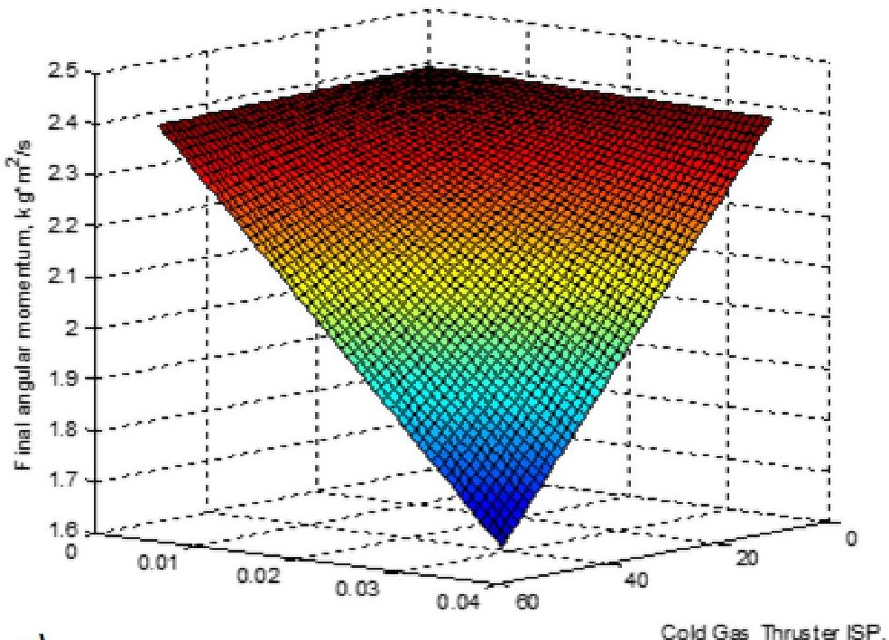

a) Thrust Deviation Angle. rad

Effect of misaligned CGT on final spin rate, $ w_{0}=6.9 $ rad/s

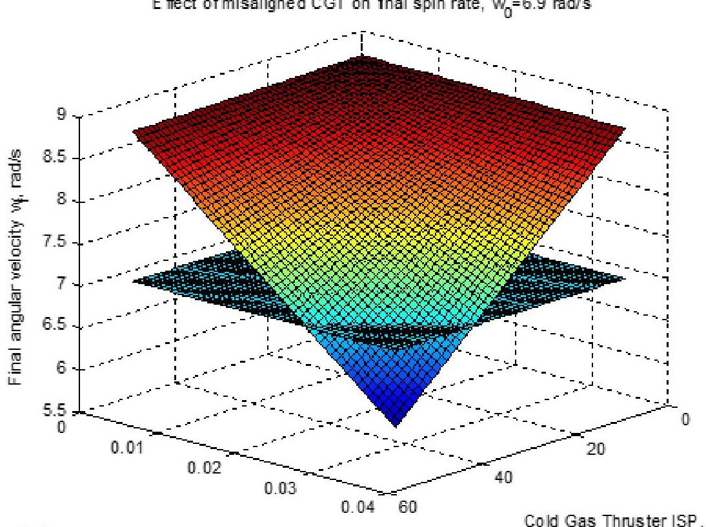

b) Thrust Deviation Angle, rad

Figure 4-10: Cold Gas Thruster Misalignment. (a) The effect on final angular momentum (b) the effect on final spin rate.

<!-- PDF_PAGE: 149 -->

## 4.3. Experimental Setup

In order to verify the Kane damping approximation, a mass mockup of the 3U CubeSat was constructed and subjected to slosh testing. It approximates the mass and moment of inertia and matches the propellant tank geometry of the flight unit. To record the dynamics during the experiment, the mockup is equipped with a three-axis gyroscope, a three-axis accelerometer, and a Wi-Fi-equipped Raspberry Pi computer to record the data. The experimental setup uses a hemispherical air-bearing providing the mass mockup CubeSat with an approximately frictionless rotation environment. The mass mockup has the freedom to rotate indefinitely about the z axis, as well as to pitch and roll (x and y axis) up to approximately 40 degrees from level with the floor. This architecture allows the mass mockup to spin about its major axis at arbitrary angular velocities.

After the mockup has accelerated to a steady-state spin and the initial fluid slosh has settled, an operator disturbs the mass mockup on command to record the decay of the resulting spin nutation. The water's motion within the propellant tank acts to damp nutation. Data recorded during these decaying oscillations can be filtered and fitted with an exponentially decaying sine waveform. Ten trials were recorded at each of ten different fill fractions from an empty (0 ml) to a nearly full tank minus ullage for potential freezing (900 ml). Each trial includes two disturbances after the initial spin up, for a total of forty measured exponential decay envelopes. The parameter of interest is the time constant of the decay for each. The expected time constant of the exponential decay of any nutation after a thruster pulse or reorientation is used to inform mission planning of the required time intervals between each pulse.

<!-- PDF_PAGE: 150 -->

One of the limitations of the air-bearing test environment is the free surface of the water in the propellant tank caused by gravity during steady-state spin as shown in Figure 4-12. This changes the inertia parameters of the CubeSat, which does not occur during microgravity spinning, as the water is forced out to the edge of the tank and remains there. A drop tower test, shown in Figure 4-11, was performed in an attempt to eliminate this factor by measuring the spinning and slosh damping during free-fall. However, the short free-fall duration of approximately 1.3 seconds was not enough for reliable observation of damping even with multiple trials; only one or two nutation periods could be observed depending on initial spin rate.

Even with the air bearing, energy losses from friction and air resistance were still present in the test apparatus. Control trials were performed with an empty propellant tank to measure the effects of friction and air resistance on decay of post-disturbance nutation, which are used to calibrate the trials including water in the propellant tank by subtracting these effects from the results.

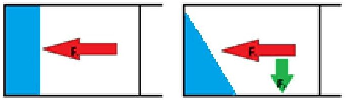

Figure 4-12: Effect of Gravity. This figure shows the difference in water level orientation between the spinning-in-microgravity case (left) and the spinning-in-gravity case (right).

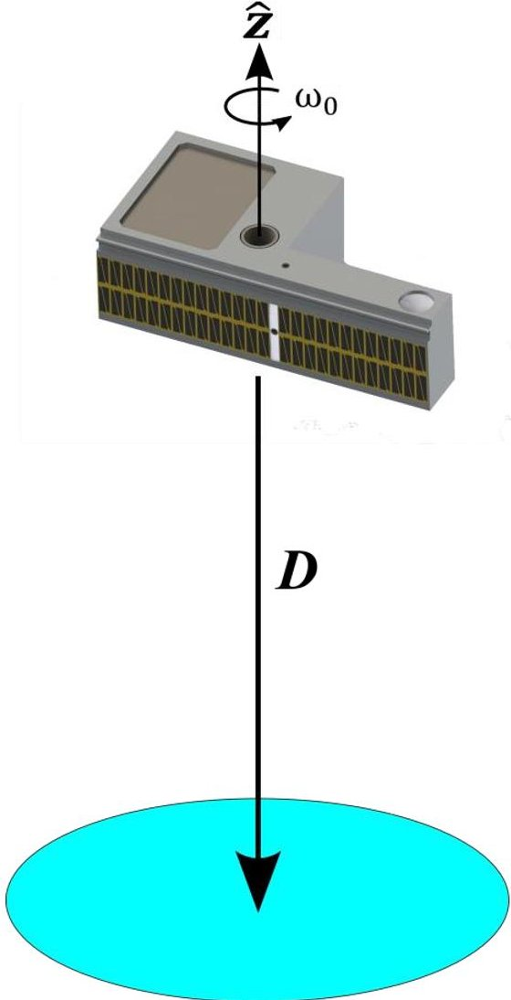

Figure 4-11: Drop Tower Diagram. The spacecraft begins with an angular velocity and is then released to free-fall into a cushioned landing pit.

<!-- PDF_PAGE: 151 -->

## 4.4. Experimental Results

Figure 4-13 and Figure 4-14 show the progression of a typical test trial. These figures show the spacecraft nutation after the initial spin-up is complete at 50 seconds, as well as the disturbances applied at approximately 90 and 190 seconds. We released the mass mockup at the expected post-separation spin rate, approximately 7 rad/s.

The raw data is then automatically filtered in the following ways:

- The initial spin-up is removed.

- Disturbances after initial spin-up are identified and exponentially decaying sine curves are fitted to the regions in between each.

- Overall decay due to air resistance is identified and removed by subtracting an exponential fit curve.

- Disturbances after initial spin-up are re-identified and exponentially decaying sine curves are fitted to the regions in between each, now without the effect of air resistance.

- The results are used to inform the Simulink model developed in Section 4.2. Projections from the adjusted model are used to inform spacecraft mission planning.

Figure 4-15 shows the change in the slosh damping effect with propellant loading by plotting the exponential decay coefficient against fill fraction. Standard error bars are included. The results show an unexpected trend: the greatest slosh damping effect occurs at approximately 10% fill fraction, with 100 ml of water in the 900 ml propellant tank. The effect then decreases for 200 ml and 300 ml fill, then remains steady until the tank is nearly full, when it begins to increase again. These results and a proposed explanation are discussed with more detail in the next section.

<!-- PDF_PAGE: 152 -->

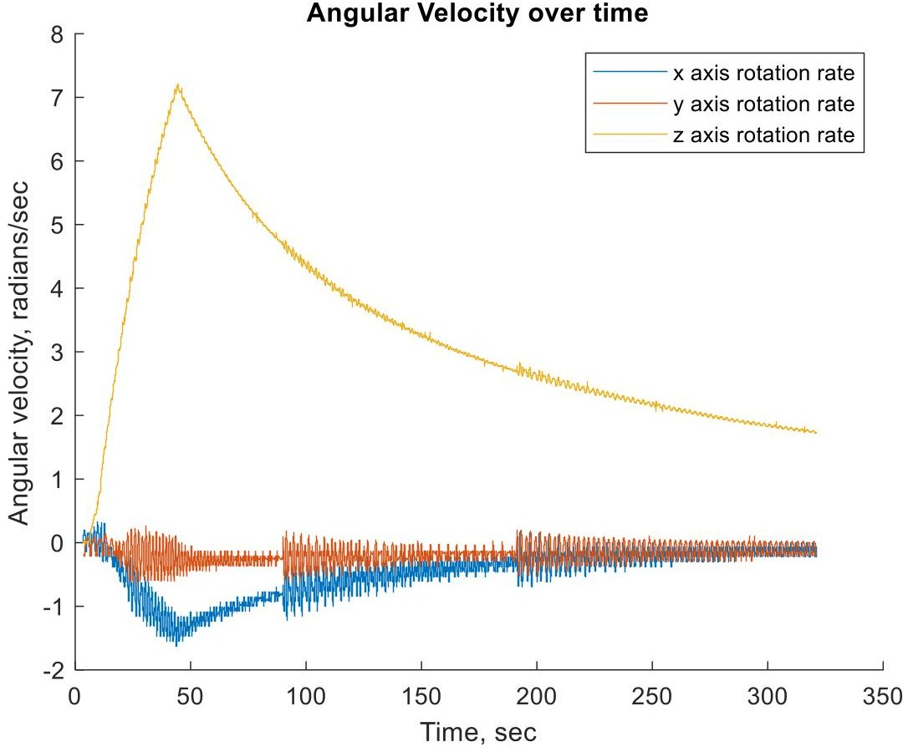

Figure 4-13: Angular velocity data from 700 ml test trial 10.

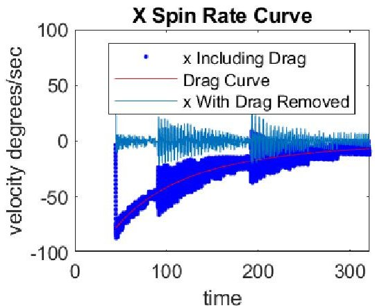

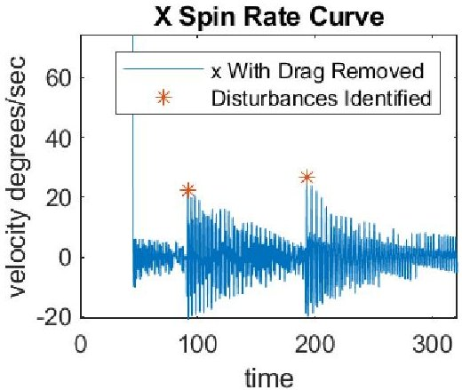

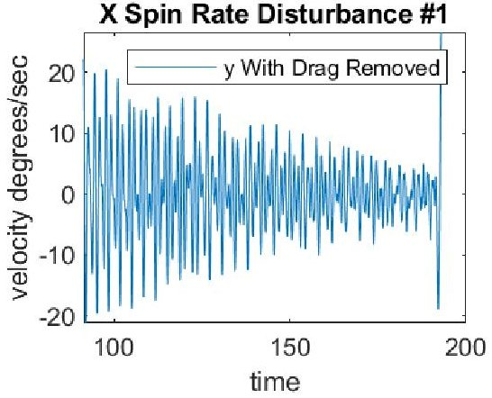

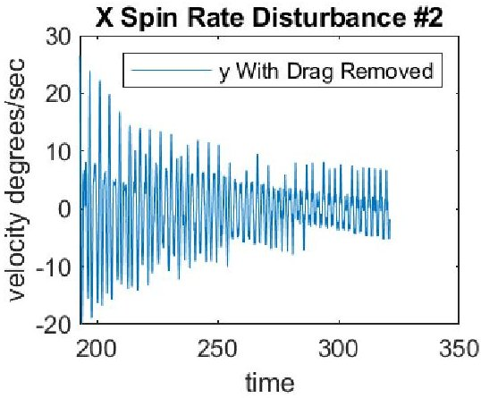

Figure 4-14: Filtered X-axis angular velocity data from 700 ml test trial 10.

<!-- PDF_PAGE: 153 -->

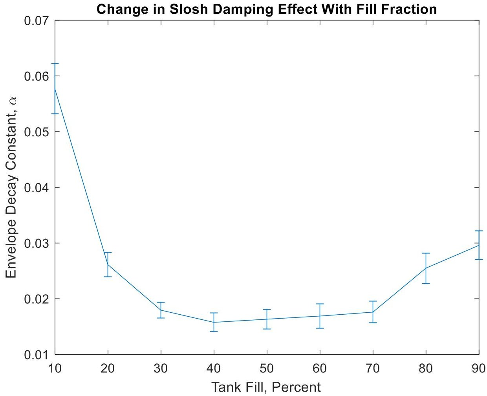

Figure 4-15: Slosh Damping Results.

## 4.5. Discussion

## 4.5.1. Hypothesis for Unexpected Behavior

The results show an unexpected behavior as the fill fraction of the propellant tank changes. The anticipated result, based on prior slosh damping tests utilizing spherical, cylindrical, and rectangular tanks, was that the slosh damping effect would be greatest at approximately 60% fill fraction. Instead, the greatest effect was observed at the 100 ml propellant load, at approximately 10% fill fraction. At this point, the exponential decay constant $ \alpha $ for the envelope of the nutation oscillations is $ 0. 0 5 7 7 \pm0. 0 0 4 5 $ , representing a time constant $ \tau $ of approximately 17 seconds. After this, the effect decreases quickly, then remains steady until the propellant tank is nearly full,

<!-- PDF_PAGE: 154 -->

when it increases again. The smallest $ \alpha=0.0158\pm0.0017 $ is observed at 40% fill fraction with 400 ml in the propellant tank, for which $ \tau\approx 63 $ seconds. At maximum propellant loading, 90% fill fraction with 900 ml in the propellant tank, $ \alpha=0.0296\pm0.0026 $ and $ \tau\approx 34 $ seconds.

The proposed explanation for this unexpected result is the unusual shape of the propellant tank, shown with a cross-section view in Figure 4-16. In the orientation of that figure, the spacecraft spin axis is into the page and above the top of the figure, so that the resulting artificial gravity points towards the bottom of the figure. The large section of missing tank in the upper left is where the spacecraft electronics are located, heat-sinked to the tank for thermal balancing. This creates two sections of the propellant tank: a shallow, broad base holding approximately 150 ml of water propellant—when the volume taken up by electrolyzers mounted to the tank wall is taken into account and a larger, narrower space "above" containing most of the propellant.

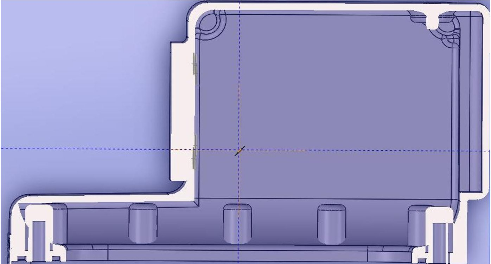

Figure 4-16: Propellant Tank Cross-Section.

<!-- PDF_PAGE: 155 -->

This means that the tank surface area traversed by the water-gas boundary surface as it sloshes is greatly increased when the total propellant is between 100-200 ml volume, because the sloshing water surface is able to reach the top of the broad tank section in addition to its walls, as well as sloshing over the tops of the electrolyzers. The surface area available to the sloshing water surface is then greatly reduced as the propellant loading increases. This is because the sloshing surface of the water is moved above the top of the broad tank section, and the total wall perimeter around it is decreased as well by the narrower tank section. The available surface area for sloshing to cover remains steady after the water surface rises above the broad tank section, until reaching near the top of the entire propellant tank, where the available surface area increases again.

Because the effect of propellant slosh damping is based on the slosh volume and the free surface covered by the propellant as it sloshes, this may explain the unexpected profile of the exponential decay constant versus fill fraction plot in Figure 4-15. After removing the effects of air drag, there was negligible slosh damping with an empty propellant tank (not shown). The remaining effect is maximum at 100 ml fill, when the sloshing surface moves over the electrolyzers, the top of the broad tank section, and the longest perimeter of the tank walls. It is minimum at 400 ml fill, when the sloshing surface moves only over the shorter tank wall perimeter in the upper section. It increases again at 800 and 900 ml, when the sloshing surface reaches the upper tank wall as well. Whether the effect continues to increase from 800 ml to 900 ml is not clear because the standard error from the sets of trials at those fill fractions overlap.

<!-- PDF_PAGE: 156 -->

## 4.5.2. Mission Planning Considerations

The results of this experiment are used to re-work the Simulink model presented in Section 4.2.2 for use in mission planning of the electrolysis propulsion technology demonstration CubeSat. There are two thrusters onboard the spacecraft that cause nutation when they pulse. The primary thruster, the electrolysis propulsion system, thrusts very close to the spin axis and center of mass of the spacecraft, so that it causes little nutation. It also pulses no more than once every 30 minutes, so any nutation that is produced has a long time to dissipate via the slosh damping effect. The attitude control thruster produces more significant nutation because it is mounted as far from the spin axis as possible, and is pulsed more frequently when in use. The experimentally determined time constants at different fill fractions are used together with the re-worked Simulink model to plan the time intervals between groups of attitude control thruster pulses during reorientation maneuvers.

The propellant tank is not loaded fully on the flight model. At least 9% ullage is needed to accommodate potential freezing of the water while the spacecraft is stowed prior to launch and deployment. 11% ullage is planned, for a propellant load of approximately 900 ml. With $ \tau\approx 3 4 $ seconds at this fill level and increasing to $ \tau\approx 6 3 $ seconds for the majority of the mission, the unexpected results mean the spacecraft must allow for more time, rather than less, for nutation damping after reorientation pulses as fill fraction decreases from near-full, until very low fill fractions. The results do improve the end-of-life situation for spacecraft operations, where $ \tau\approx 1 7 $ seconds. Because of the position of the electrolyzers and the nature of the mission, the spacecraft does not ever use all its propellant to the point where the slosh damping ceases entirely.

<!-- PDF_PAGE: 157 -->

To avoid the spacecraft spin destabilizing from excessive nutation, the attitude control maneuvers must be spaced out in time so that a sufficient interval elapses for nutation to substantially decay in between each thruster pulse or group of pulses. Figure 4-17 shows the slosh damping effect after a single thruster pulse out to seven time constants with minimum damping. It takes just under five time constants for an exponential decay function to reach less than 1% of its initial value. After this point, the remaining nutation is considered to be negligible. With the maximum time constant of 63 seconds, ensuring negligible nutation is present for each thruster pulse or group of pulses means they must be spaced no less than 315 seconds apart. At the minimum time constant of 17 seconds, the time interval should be no less than 85 seconds. For the rest of the mission, as the propellant fill fraction changes and the time constant varies between these two extremes, the time interval can be adjusted to match. The time interval can also be reduced if some amount of nutation is permissible going into each thruster pulse or group of pulses. The tradeoff is the reorientation efficiency, which decreases when nutation is present during a thruster pulse, versus the reorientation rate, which decreases when more time is allotted to wait between thruster pulses.

Based on the torque of the cold gas thruster and the spacecraft inertia as described in Section 4.2.1, each thruster pulse adjusts the spacecraft angular momentum by approximately 0.15 degrees. Therefore, reorienting the spacecraft requires about 7 thruster pulses per degree. For most of the mission when the time constant is close to 63, this means over 35 minutes per degree of rotation if the spacecraft is to wait a full five time constants between each pulse in the reorientation sequence. This is a reorientation rate of 0.00045 degrees/second at minimum damping, and 0.00167

<!-- PDF_PAGE: 158 -->

degrees/second at maximum damping. This may be acceptable when a long time is available for reorientation, as it maximizes the efficiency of the cold gas thruster pulses. However, it means even a small reorientation maneuver could take several hours.

More rapid reorientation is possible at the cost of cold gas thruster torque efficiency via larger nutation angles. For example, by waiting five time constants between every degree of reorientation, instead of every single pulse, the spacecraft can reorient at a rate of 0.003 degrees/second at minimum damping, and 0.01 degrees/second at maximum damping. Figure 4-18 shows the slosh damping effect after a group of seven thruster pulses out to seven time constants with minimum damping. The thruster pulses are made once per revolution of the spinning spacecraft, or once per second. The disadvantage of doing this the significant nutation present during the thruster pulses after the first in each group of seven. Over 0.016 radians, or close to 1 degree, of nutation is present for each pulse.

A third possibility is to wait less than five time constants between each thruster pulse, but more than the one second it takes to be in position for another pulse. Figure 4-19 shows the slosh damping effect while waiting one time constant in between each of seven consecutive thruster pulses. In this case, the amount of nutation present during the pulses is approximately 0.005 radians, or close to 0.3 degrees. The spacecraft can reorient at a rate of approximately 0.002 degrees/second at minimum damping, and 0.008 degrees/second at maximum damping. The trade between reorientation modes of operation should be considered for mission planning. The nutation limit should be based on the acceptable pointing uncertainty and cold gas thruster propellant margins, and the maximum time between pulses on how quickly a reorientation must be performed.

<!-- PDF_PAGE: 159 -->

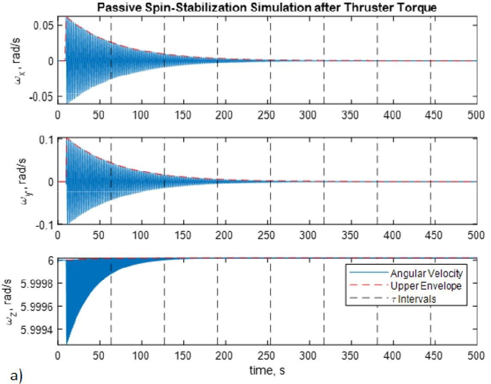

Nutation Angle Peaks During Passive Spin-Stabilization

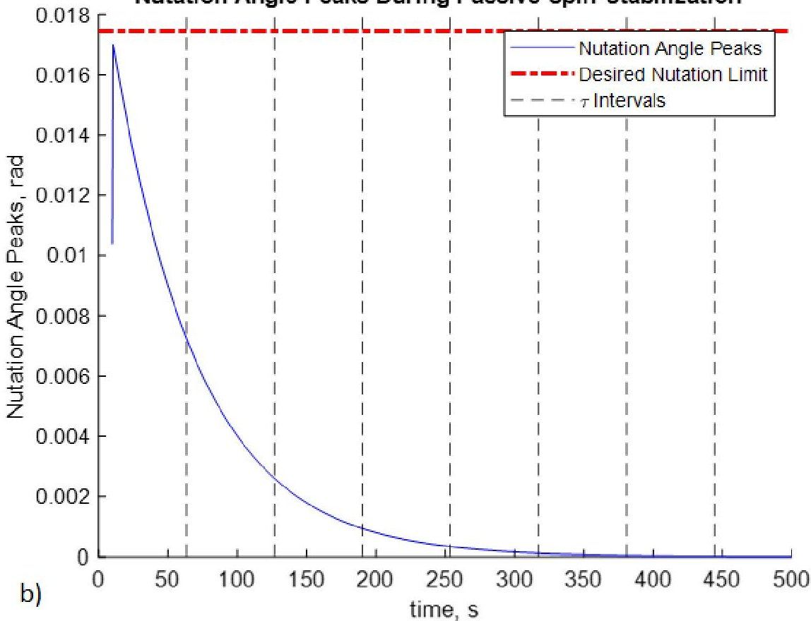

Figure 4-17: Exponential Decay of Nutation, Single Pulse. Response due to single cold gas thruster impulse, assuming minimum damping. Shown are (a) exponential decay of the disturbed spin to a new equilibrium spinning about the principal axis and (b) the nutation angle.

<!-- PDF_PAGE: 160 -->

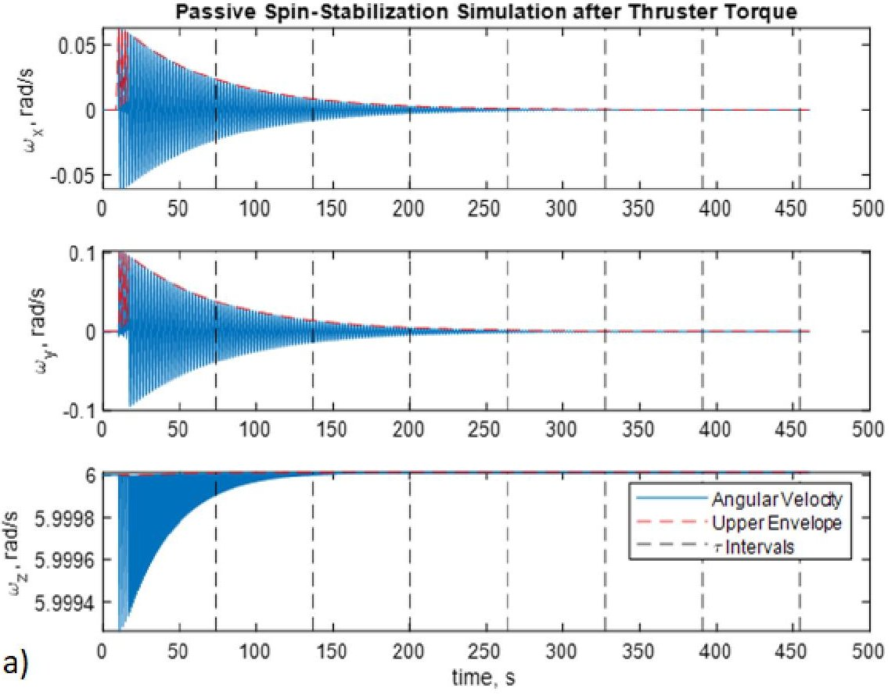

Nutation Angle Peaks During Passive Spin-Stabilization

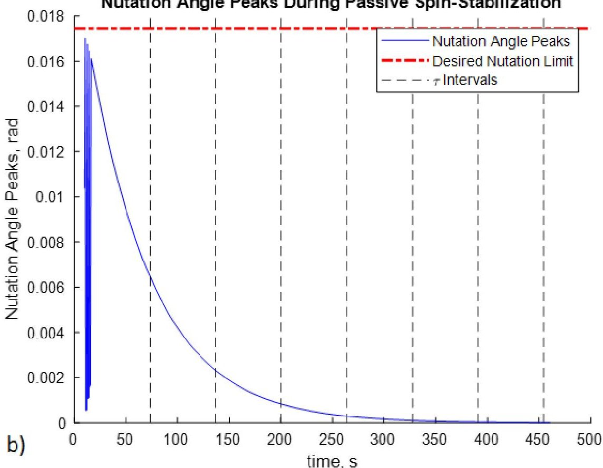

Figure 4-18: Exponential Decay of Nutation, Seven Consecutive Pulses. Response due to seven cold gas thruster impulses with ~1 s spacing, assuming minimum damping. Shown are (a) exponential decay of the disturbed spin to a new equilibrium spinning about the principal axis and (b) the nutation angle.

<!-- PDF_PAGE: 161 -->

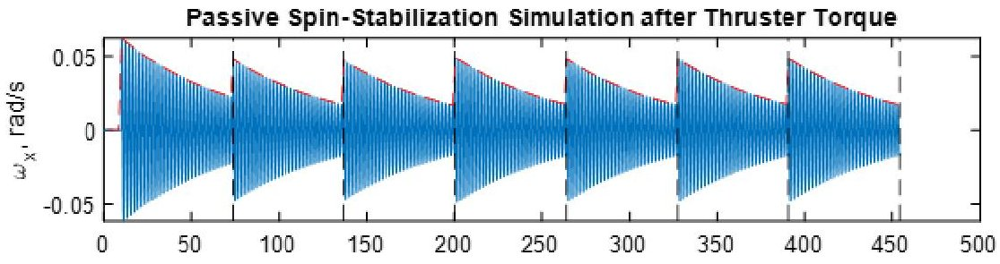

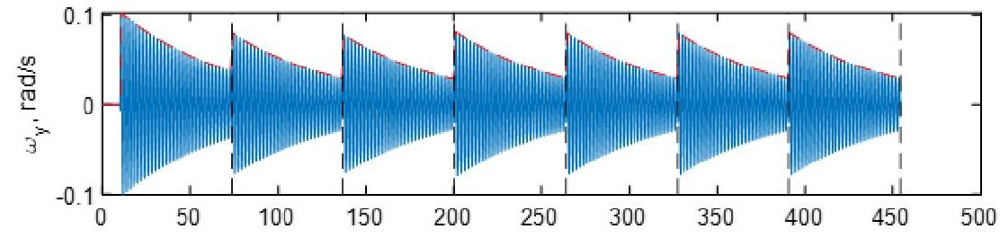

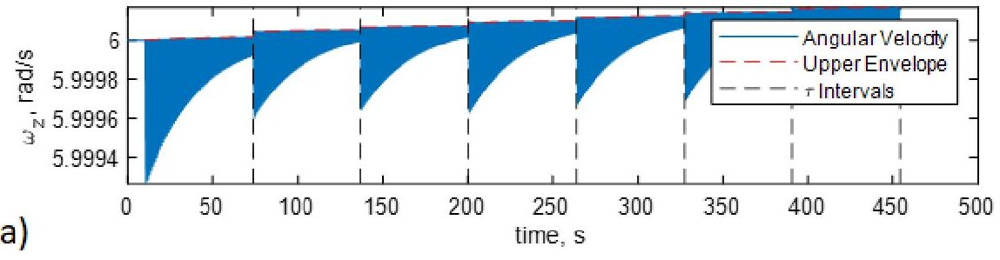

Nutation Angle Peaks During Passive Spin-Stabilization

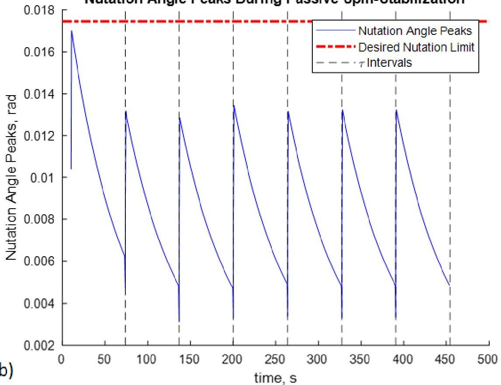

Figure 4-19: Exponential Decay of Nutation, Seven Pulses With Delay. Response due to single cold gas thruster impulse, assuming minimum damping. Shown are (a) exponential decay of the disturbed spin to a new equilibrium spinning about the principal axis and (b) the nutation angle.

<!-- PDF_PAGE: 162 -->

## 4.6. Conclusion

It has been previously demonstrated that electrolysis propulsion systems can provide high $ \Delta V $ within CubeSat specifications. The planned satellite is a major axis spinner about its thrust axis, passively stabilized by liquid in the propellant tank. Therefore, the liquid helps stabilize the satellite spin orientation for GNC purposes, while the spin helps separate the liquid from the electrolyzed gas so that combustion may take place. In prior work, this damping has been approximated as a Kane damper to streamline the simulation. Here, we inform the Simulink model by experimentation with a mass mockup of the planned satellite spinning on a 3DOF air bearing, with nutation from disturbances damped by water sloshing in its propellant tank. The results are compared with the Simulink projections in Section 4.2.2 and confirm the presence of significant propellant-slosh damping but suggest that the relationship between fill fraction and damping for this shape of propellant tank warrants further investigation.

The damping effect is minimum $ (\tau\approx 63 $ seconds), other than for an empty propellant tank, at mid-fill fractions from 40% to 70%, and not maximum as expected. The greatest damping effect $ (\tau\approx 17 $ seconds) was observed at approximately 10% fill fraction. Although unexpected, this relationship between fill fraction and damping effect does alleviate a concern in mission planning that the spacecraft could become uncontrollable at low fill fractions. The hypothesized explanation for this behavior is that the unusual shape of the propellant tank provides the greatest surface area for the liquid/gas propellant boundary to slosh over near the 10% fill fraction. The many faces of the electrolyzers and other protruding tank features partially submerged at this fill fraction act as baffles. $ ^{[95]} $

<!-- PDF_PAGE: 163 -->

Additional trials at intermediate fill fractions would help assess this hypothesis in more detail. So too would repeat experiments with modifications to the tank geometry, both in terms of the overall shape and internal features, such as by adding baffles or removing the electrolyzers. Varying the spin rate will adjust an additional variable, providing a more complete picture of the slosh damping effect. Repeating the attempted drop tower experiment with a taller drop for a longer free-fall period would also be useful. The effects of gravity on the spinning air bearing test are significant. The free-fall environment is more similar to what the spacecraft experiences during flight. However, at an approximately 1 Hz rotation rate, the total drop time will need to be at least several seconds to obtain useful data. The attempted 10-meter drop tower was too short for this; for example, a 3 second fall requires about a 45-meter drop distance. Access to a catapult drop tower system such as the one in place at the University of Bremen $ ^{[94]} $ would double the total time spent in free-fall conditions, allowing for longer trial durations and improved data collection.

The best data will be that collected from the spacecraft itself during its mission by its onboard sensors including an accelerometer and a gyroscope. However, the goal of this investigation is to inform the mission planning of the spacecraft. Therefore, some or all the above extensions of this experiment should be pursued before the launch of the spacecraft. More detailed and realistic simulations may also be of use. Finite-element modeling of sloshing water in a dynamically moving tank can be challenging but could provide a more realistic result than the simple Kane damping approximation in use here. Such a simulation would also allow for rapid changes to the simulated tank geometry to more quickly and easily assess how that impacts the results as well.

<!-- PDF_PAGE: 164 -->

Based on preliminary results, the passively spin-stabilized design is feasible and will provide several advantages to the Cislunar Explorers spacecraft. The results from this experiment inform the spacecraft mission planning, indicating that a spacing of at least one time constant—63 seconds at minimum damping, 17 seconds at maximum—between thruster pulses is enough for the slosh damping effect to keep the nutation angle below 1 degree and below 0.3 degrees going into each successive thruster pulse. At this rate, with 7 pulses per degree of reorientation, the spacecraft can reorient indefinitely at a rate of 0.002 degrees/second at minimum damping, and 0.008 degrees/second at maximum damping. Waiting for longer time intervals in between pulses minimizes the effect of nutation—five time constants are required to damp nutation out to a negligible <1% of its initial value—while waiting after groups of thruster pulses instead of individual pulses allows for faster reorientation at the cost of more nutation effects. This trade must be considered in mission planning and can now be informed by experimental results from this investigation.

The planned mission, the Cislunar Explorers lunar CubeSats, has been selected as a secondary payload for the NASA Artemis 1 mission, the first flight of the Space Launch System with NASA's Orion Multi-Purpose Crew Vehicle as the primary payload. This investigation helps inform the mission planning of reorientation operations for these spacecraft. A successful mission will give flight heritage to this implementation of electrolysis propulsion, demonstrating the high $ \Delta V $ potential of the system and its synergy with other subsystems on the spacecraft, particularly attitude control. This will enable a new class of small-scale spacecraft missions, increasing the reach of future CubeSats beyond low earth orbit.

<!-- PDF_PAGE: 165 -->

## CHAPTER 5:

## CONCLUSION

## 5.1. Summary

This dissertation makes contributions in the systems architecture of resourcebased spacecraft utilizing water electrolysis propulsion. The increasingly apparent abundance of water as a plentiful resource on many celestial bodies motivates its exploitation for the purpose of sustaining robotic and human exploration of the Solar System. Electrolysis propulsion is a key use case for water gathered in-situ. This technology enables new mission architectures and reduces the amount of propellant mass that must be launched from Earth-at great expense-to support round-trip missions such as asteroid sample returns. Electrolysis propulsion closes technology gaps by offering indefinite propellant storage and high performance even at the nanosatellite scale, enabling interplanetary CubeSat missions.

This research builds on the foundation of water electrolysis propulsion technology, developing a complete design for a pair of lunar orbiting water-propelled CubeSat nanosatellites that have been selected for deployment as a secondary payload on NASA's Artemis 1 mission. The mission leverages the onboard water tanks to create synergy between multiple subsystems, especially propulsion and attitude control. The spinning spacecraft architecture utilized to separate the stored water propellant from the electrolyzed gas products is stabilized with slosh damping by that same water propellant. Experimental evidence used to inform simulations shows that this slosh damping is effective and varies with fill fraction. The effect is strongest when slosh volume, not total propellant volume, is maximized. The Cislunar Explorers spacecraft

<!-- PDF_PAGE: 166 -->

design benefits from slosh damping by forgoing the need for reaction wheels and all but one attitude control thruster. This streamlines the system architecture and greatly simplifies the design process in this nanosatellite application, where subsystems are tightly packed, closely interrelated, and difficult to change without affecting each other.

Electrolysis propulsion is well suited to CubeSats because it utilizes green, inert propellant that complies with the CubeSat Design Specifications. The power requirements for electrolysis scale down for nanosatellite applications and are especially favorable at small scales compared to other electric thrusters. Therefore, electrolysis propulsion offers a high $ \Delta V $ capability for CubeSats enabling beyond-LEO missions. Because high-performance nanosatellite propulsion systems are rare, and only two CubeSats have flown beyond Earth orbit to date, electrolysis propulsion addresses a key technology gap for nanosatellites. The Cislunar Explorers will be one of the earliest interplanetary CubeSat missions after the MarCO secondary payloads on the Mars InSight mission. A successful technology demonstration will lower the barriers to interplanetary missions, furthering the democratization of space already encouraged by the CubeSat platform.

Electrolysis propulsion has potential use cases beyond the nanosatellite scale. Key advantages of the propulsion concept, namely the lack of cryogenic fluid handling, enable indefinite storage of a dense, green propellant with minimum supervision. Spacecraft can be refueled using water that is pre-positioned in advance in lightweight tanks. This research presents an example crewed Mars mission architecture based on NASA's Mars Design Reference Architecture, with the key change that it utilizes electrolysis propulsion and pre-positioned water for propellant loading before departure

<!-- PDF_PAGE: 167 -->

and for refueling before the return trip. Propellant depots supporting the mission are located at a lunar libration point and in Mars orbit.

The proposed Mars architecture accomplishes the NASA reference mission in at most the same number of launches and while circumventing critical technical challenges with long duration cryogenic propellant storage. The mass and complexity of the crew vehicle is greatly reduced by eliminating multiple propulsion stages. The mission concept also leverages NASA's planned cislunar infrastructure, the Deep Space Gateway, as a propellant depot and initial staging ground for the Mars crew vehicle. In this way, the proposal ties together NASA's proposed Moon and Mars crewed mission architectures. It also creates a motivation for commercial development of propellant mining operations to provide the water for propellant loading and refueling. If water can be sourced from somewhere other than Earth, the number of super-heavy lift launch vehicles required to support the mission can be reduced from five to as few as two.

Water electrolysis propulsion offers certain advantages over other propulsion options; however, the most significant potential advantage is yet to be realized. The ability to source water from other celestial bodies would decouple spacecraft from their dependence on Earth resources for continued mission operations. The possibility of refueling frees mission design from the constraints of the rocket equation, turning $ \Delta V $ limits into $ \Delta V $ increments. This applies at all scales but is especially true for the most resource intensive missions: human exploration and potential settlement. In-situ resource utilization is critical to sustaining a human presence in the Solar System. Water, because it is both abundant and versatile, will be one of the key volatile resources required to support continued exploration and development of the Solar System.

<!-- PDF_PAGE: 168 -->

Electrolysis propulsion creates a use case for water as an inert, dense, easy to handle and high-performance chemical propellant. This enables new mission architectures and lowers the cost, technical, and logistical barriers to certain existing architectures, such as asteroid sample returns. This dissertation advances systems architectures and analysis of water-propelled spacecraft at small and large scales. The architectures discussed feature symbiotic relationships between subsystems, especially in the Cislunar Explorers slosh-damped, spin-stabilized design, for which experimental evidence is presented. The results highlight multiple benefits of water electrolysis propulsion compared to other propulsion concepts. The most significant potential advantage, the possibility for refueling, is the key motivation for pursuing this research. A successful demonstration of electrolysis propulsion will present both a major use case for water in the Solar System and an incentive for developing access to this abundant resource. The Cislunar Explorers lunar CubeSat mission will prove that spacecraft can be propelled with water from Earth; however, that water can be substituted with water found in-situ anywhere in the Solar System.

The goal of a successful Cislunar Explorers mission is to help democratize access to space and lower the cost and technical barriers to interplanetary CubeSat missions. It is hoped that the systems architecture studies of the Cislunar Explorers and other mission concepts presented in this dissertation contribute towards unshackling future missions from the constraints of Earth resources and the challenging logistics of supplying them to deep space. Success in developing a robust ISRU infrastructure will facilitate the sustained exploration and development of the Solar System by exploitation of its abundant resources to free spacecraft from the tyranny of the rocket equation.

<!-- PDF_PAGE: 169 -->

## 5.2. Future Work

Several avenues of research could build on or complement the results of this dissertation. First, improvements to the electrolysis propulsion system performance are possible. With a theoretical performance of approximately 450 s specific impulse, and a demonstrated performance of approximately 300 s, there is significant room for optimization. In the Cislunar Explorers design, significant performance losses come from transient effects due to a small combustion chamber with a short burn time, as well as losses from forcing open the passive nozzle check valve. A larger system with a scaled-up combustion chamber will, according to finite-element models, improve performance by increasing the fraction of each burn that takes place in a high-performing steady state of combustion. An alternative approach that should create close to optimal performance is to increase the power dedicated to electrolyzers, producing propellant fast enough to sustain continuous thrust.

Additionally, although the spin-stabilized, slosh-damped design of the Cislunar Explorers streamlines the spacecraft architecture, there are other means of separating electrolyzed gases from stored water propellant. Flight demonstrations of other configurations of electrolysis propulsion could enable additional types of CubeSat architectures to take advantage of water as propellant for interplanetary missions. A system that does not require a spinning architecture may be more easily commercialized. Trends in nanosatellite designs towards the use of off-the-shelf components motivates development of turnkey electrolysis propulsion solutions offering high performance at low risk and expense. Then, future CubeSat designers can make use of the advantages enumerated in this dissertation. Taking multiple approaches to the use of water as

<!-- PDF_PAGE: 170 -->

propellant, including flight demonstrations of non-electrolysis water thrusters, will help ensure that the use of water as propellant proliferates by making many options available for doing so.

Water electrolysis propulsion is also only one of many use cases for water gathered in-situ. Other in-situ resources, including volatiles, bulk materials, and valuable minerals, also demand attention. The field of in-situ resource utilization is in its relative infancy; much has been written on the subject, and field tests in relevant environments have been performed, but nothing has been demonstrated in space. ISRU architectures have been proposed for everything from hopping spacecraft refueling themselves using water found on the surface of asteroids to fully self-sustaining human settlements. None have been put into practice. Flight demonstrations of ISRU technologies are necessary to transform proposed architectures from conceptual proposals to plausible future missions. The most valuable demonstrations of all will be those that address supply rather than demand.

Successful demonstrations of in-situ resource use cases are only as valuable as the availability of in-situ resources to supply them with. While it is true that observation and exploration of the Solar System has discovered abundant resources, those resources have only been gathered for relatively few and limited scientific sample returns. Designs for in-situ resource extraction, such as the Resource Prospector and World Is Not Enough projects discussed in this dissertation, are important to the future of the ISRU field. An electrolysis propulsion system has certain advantages on its own, but unlocking its true potential requires the ability to gather propellant to refuel for future mission operations.

<!-- PDF_PAGE: 171 -->

Initial ISRU systems flown will likely be small technology demonstrations showing the possibility of resource extraction. It is important that combined flight projects follow after this showing practical in-situ resource extraction followed by utilization, rather than simply one or the other. On a longer timeframe, as demand for in-situ resources increases, the demonstration of largescale standalone resource production will become important. It may be possible for every round trip human mission to the Moon or Mars to carry its own ISRU equipment, but likely more practical if dedicated facilities can be constructed for the purpose in the long run. The use of NASA's proposed Deep Space Gateway as a propellant depot, discussed in this dissertation, is an example.

Not all challenges involved in advancing in-situ resource utilization are technical. Future ISRU developers will need to comply with planetary protection requirements motivated by preserving sites of scientific interest. $ ^{[42]} $ There are also open questions about the use and ownership of resources found in-situ given the clear prohibition on ownership or sovereignty of celestial bodies in the Outer Space Treaty. Beyond any regulatory concerns, the business case for ISRU inherently suffers from tremendous initial cost barriers. These barriers may be lowered by advances in other fields, such as reusable launch vehicles, and by programs such as NASA's Commercial Crew and Commercial Lunar Payload Services encouraging development of low-cost access to space.

<!-- PDF_PAGE: 172 -->

## REFERENCES

[1] Doyle, K., Peck, M., and Jones, L. (Jan. 2016) Spinning CubeSats With Liquid Propellant. Presented at AIAA SciTech 2016. [Online] Available: https://arc.aiaa.org/doi/abs/10.2514/6.2016-1369

[2] Doyle, K., and Peck, M. (Jan. 2018) "Water Electrolysis for Propulsion of a Crewed Mars Mission." Presented at AIAA SciTech 2018. [Online]

[3] Ojha, L. et al. "Spectral evidence for hydrated salts in recurring slope lineae on Mars." Nature Geoscience vol. 8, no. 11, pp. 829-832. Sep. 2015.

[4] Adamo, D., and Logan J. "Aquarius, a reusable water-based interplanetary human spaceflight transport." Acta Astronautica, 128, pp. 160-179. Nov. 2016.

[5] James, K., Moser, T., Conley, A., Slostead, J. and Hoyt, R.. Performance characterization of the HYDROS $ ^{\mathrm{TM}} $ water electrolysis thruster. Presented at the 29th Annual AIAA/USU Conference on Small Satellites. [Online] Available:http://digitalcommons.usu.edu/cgi/viewcontent.cgi?article=3239&context=smallsat

[6] Adams, V., and Peck, M. "Interplanetary Optical Navigation." Presented at AIAA Guidance, Navigation, and Control Conference 2016. [Online] Available: https://arc.aiaa.org/doi/abs/10.2514/6.2016-2093

[7] Bobe, L., et al. Water Supply of the Crew of a Space Station through water recovery and water delivery: SRV-K and SPK-U system operation on ISS. Presented at International Conference on Environmental Systems. [Online] Available: https://saemobilus.sae.org/content/2005-01-2806

[8] Violette, D.. (Sep. 2014) Arduino-Raspberry Pi: Hobbyist Hardware and Radiation Total Dose Degradation. Presented at Electrical, Electronic and Electromechanical (EEE) Parts for Small Missions. [Online] Available: https://ntrs.nasa.gov/search.jsp?R=20140017620

[9] Hilstad, M., Adan-Plaza, S., et al. (May 1998) Extraction of Atmospheric Water On Mars. Presented at HEDS-UP Mars Exploration Forum, LPI Contribution No, 955. [Online] Available: http://www.lpi.usra.edu/publications/reports/CB- 955/washington.pdf

<!-- PDF_PAGE: 173 -->

[10] Adams, V., and Peck, M. "Lost in Space and Time." Presented at AIAA Guidance, Navigation, and Control Conference 2017. [Online] Available: https://arc.aiaa.org/doi/abs/10.2514/6.2017-1030

[11] Drake, B., Hoffman, J., and Beaty, D. "Human Exploration of Mars, design reference architecture 5.0." Aerospace Conference, 2010. [Online] Available: https://www.nasa.gov/pdf/373665main_NASA-SP-2009-566.pdf

[12] Zeledon, R., and Peck, M. (Jan. 2012) Performance Testing of a CubeSat-scale Electrolysis Propulsion System. Presented at AIAA SciTech 2012. [Online] Available: https://arc.aiaa.org/doi/pdf/10.2514/6.2012-5041

[13] de Groot, W., et al. "Electrolysis propulsion for spacecraft applications." 33rd Joint Propulsion Conference and Exhibit. 1997. https://ntrs.nasa.gov/archive/nasa/casi.ntrs.nasa.gov/19970041522.pdf

[14] McElroy, J. "Electrochemical hydrogen separator system for zero gravity water electrolysis." U.S. Patent No. 4,950,371. 21 Aug. 1990

[15] Carmo, M., et al. "A comprehensive review on PEM water electrolysis." International journal of hydrogen energy 38.12 (2013): 4901-4934.

[16] Newman, D. "Water Electrolysis Reaction Control System." $ 7^{th} $ Liquid Propulsion Symposium, Chemical Propulsion Information Agency Publ. 72, pp105-114. Oct. 1965.

[17] Pothamsetti, R., and Thangavelautham, J. "Photovoltaic electrolysis propulsion system for interplanetary CubeSats." Aerospace Conference, 2016 IEEE. IEEE, 2016.

[18] Scharlemann, C. Investigation of thrust mechanisms in a water fed pulsed plasma thruster. Diss. The Ohio State University, 2003.

[19] Ye, X., et al. "Study of a vaporizing water micro-thruster." Sensors and Actuators A: Physical 89.1-2 (2001): 159-165.

[20] Zuppero, A., et al. "Nuclear-heated steam rocket using lunar ice." AIAA 97-3172 33rd Joint Propulsion Conference and Exhibit. 1997.

[21] Klesh, A., et al. "MarCO: Early Operations of the First CubeSats to Mars." $ 3 2^{\mathrm{nd}} $ AIAA/USU Conference on Small Satellites.

<!-- PDF_PAGE: 174 -->

https://digitalcommons.usu.edu/cgi/viewcontent.cgi?article=4286&context=smalls at

[22] Lemmer, K. "Propulsion for CubeSats." Acta Astronautica 134 (2017): 231-243.

[23] R. Surampudi, et al. "Solar Power Technologies for Future Planetary Science Missions." Jet Propulsion Lab, California Institute of Technology. Pasadena, CA. 2012. https://solarsystem.nasa.gov/resources/548/solar-power-technologies-for future-planetary-science-missions/

[24] Anovitz, L., and Smith, B. Lifecycle Verification of Tank Liner Polymers. No. ORNL/TM-2014/48. Oak Ridge National Lab. (ORNL), Oak Ridge, TN (United States), 2014.

[25] Militksy, F., et al. "Water Rocket - Electrolysis Propulsion and Fuel Cell Power," Technical Report, LLNL. (1999).

[26] Rucker, M., and Simpson, M. "Issues and Design Drivers for Deep Space Habitats." International Astronautical Federation, Global Space Exploration Conference, May 24, 2012.

[27] Jet Propulsion Laboratory SP 43-38. Solar Array Design Handbook, v. 1. October 1976. pp. 5.5-1.

[28] Zacny, K., et al. "The World is Not Enough (WINE): Harvesting Local Resources for Eternal Exploration of Space." AIAA SPACE. Dec. 2016.

[29] Dankanich, J. "Small Satellite Propulsion." AstroRecon. Jan. 2015.

[30] Dankanich, J., and Schumacher, D. "Iodine propulsion advantages for low cost mission applications and the iodine satellite (ISAT) technology demonstration." 66th International Astronautical Congress, Jerusalem, Israel, 2015

[31] Jehle, A. "Iodine Small Satellite Propulsion Demonstration - iSAT." $ 31^{\mathrm{st}} $ AIAA/USU Conference on Small satellites, Logan, UT, 2017.

[32] Anis, A. "Cold gas propulsion system-an ideal choice for remote sensing small satellites." Remote sensing-advanced techniques and platforms. InTech, 2012.

[33] Metzger, P., Zacny, K., Luczek, K., and Hedlund, M. "Analysis of Thermal/Water Propulsion for CubeSats That Refuel in Space," Proceedings of Earth and Space

<!-- PDF_PAGE: 175 -->

2016: Engineering, Science, Construction, and Operations in Challenging Environments. Orlando, FL Apr. 11-15, 2016.

[34] Strickland, J. "Revisiting SLS/Orion launch costs". The Space Review. July 15, 2013. Retrieved 25 May 2017.

[35] Doyle, K., and Peck, M. "Water Electrolysis for Propulsion of a Crewed Mars Mission." Submitted to the AIAA Journal of Spacecraft and Rockets. 2019.

[36] Zuniga, A., et al. "Lunar COTS: An Economical and Sustainable Approach to Reaching Mars." AIAA SPACE 2015 Conference and Exposition. 2015.

[37] Sanders, Gerald. "In Situ Resource Utilization on Mars-Update from DRA 5.0 Study." 48th AIAA Aerospace Sciences Meeting Including the New Horizons Forum and Aerospace Exposition. 2010.

[38] Bienhoff, Dallas. "From Importing to Exporting: The Impact of ISRU on Space Logistics." AIAA SPACE Conference. 2011.

[39] Landis, Geoffrey A., et al. "Design Study of a Mars Ascent Vehicle for Sample Return Using In-Situ Generated Propellant." 10th Symposium on Space Resource Utilization. 2017.

[40] Sanders, Gerald, et al. "NASA ISRU Project: Development and Implementation." AIAA SPACE Conference. 2008.

[41] Shishko, Robert, et al. "An Integrated Economics Model for ISRU in Support of a Mars Colony--Initial Status Report." AIAA SPACE Conference. 2015.

[42] Sanders, G. B., and R. P. Mueller. "Mars Soil-Based Resource Processing and Planetary Protection." (2015).

[43] Salotti, Jean-Marc. "Robust, affordable, semi-direct Mars mission." Acta Astronautica 127 (2016): 235-248.

[44] Smith, David Alan, and Angie Jackman. "SLS Trans Lunar Payload Delivery Capability Overview." 1 November 2016. https://ntrs.nasa.gov/search.jsp?R=20160014577

[45] "Ares I Crew Launch Vehicle". NASA. April 29, 2009. Archived from the original on May 4, 2009. Retrieved May 13, 2009.

<!-- PDF_PAGE: 176 -->

[46] "Capabilities & Services." SpaceX. Retrieved 7 June 2017.

[47] Minutes of the NAC Commercial Space Committee, 26 April 2010.

[48] "RL10 Propulsion System." Aerojet Rocketdyne. 2016. Retrieved 8 June 2017 https://www.rocket.com/files/aerojet/documents/Capabilities/PDFs/RL10%20data %20sheet%20Feb%202016.pdf

[49] Burton, Rodney L., Kevin Brown, and Anthony Jacobi. "Low-cost launch of payloads to low Earth orbit." Journal of spacecraft and rockets 43.3 (2006): 696- 698.

[50] Jody Singer, quoted by Mike Wall. "NASA's huge new rocket may cost $500 million per launch". MSNBC. 12 September, 2012. Retrieved 9 June, 2017.

[51] "Capabilities & Services". SpaceX. Retrieved 28 May 2017.

[52] "Falcon Heavy". SpaceX. Retrieved 28 May 2017.

[53] Drake, B. G. et al. "Mars Design Reference Architecture 5.0 Addendum 1." NASA Johnson Space Center. 2009.

[54] Drake, B. G. et al. "Mars Design Reference Architecture 5.0 Addendum 2." NASA Johnson Space Center. 2009.

[55] Burke, K.A. "Fuel Cells for Space Science Applications." 1st International Energy Conversion Engineering Conference. 2003. https://ntrs.nasa.gov/archive/nasa/casi.ntrs.nasa.gov/20040010319.pdf

[56] Pietrobon, S.S. "Analysis of propellant tank masses." Submitted to Review of US Human Space Flight Plans Committee 6 (2009). https://www.nasa.gov/pdf/382034main_018%20-%2020090706.05.Analysis_of_Propellant_Tank_Masses.pdf

[57] Landau, D. F., and Longuski, J. M., "Trajectories for Human Missions to Mars, Part 2: Low-Thrust Transfers," Journal of Spacecraft and Rockets, Vol. 43, No. 5, 2006, pp. 1043-1047. doi: 10.2514/1.21954

[58] Berend, N., Moreno, E.C., Ruault, J.M., and Epenoy, R. "Feasibility Assessment of Rapid Earth-Mars Transfers Using High-Power Electric Propulsion," Journal of Spacecraft and Rockets, Vol. 51, No. 3, 2014, pp. 946-957. doi:10.2514/1.A32560

<!-- PDF_PAGE: 177 -->

[59] Smith, David Alan, and Angie Jackman. "Space Launch System." (2016) https://ntrs.nasa.gov/archive/nasa/casi.ntrs.nasa.gov/20160014576.pdf

[60] Pappa, Richard, et al. "Solar array structures for 300 kw-class spacecraft." NASA Space Power Workshop. (2013).

[61] Kutter, Bernard, et al. "Distributed Launch-Enabling Beyond LEO Missions." Space (2015).

[62] Landau, Damon. "Comparison of Earth Departure Strategies for Human Missions to Mars." AIAA SPACE 2012 Conference. 2012.

[63] Farquhar, R., Dunham, D., Guo, Y., and McAdams, J., "Utilization of Libration Points for Human Exploration in the Sun-Earth-Moon System and Beyond," Acta Astronautica, Vol. 55, No. 3-9, August-November 2004, pp. 687-700.

[64] Appelbaum, Joseph, and Dennis J. Flood. "Photovoltaic power system operation in the Mars environment." Energy Conversion Engineering Conference, 1989. IECEC-89., Proceedings of the 24th Intersociety. IEEE, 1989.

[65] Gerstenmaier, W. "Progress in Defining the Deep Space Gateway and Transport Plan." NASA Advisory Council Human Exploration and Operations Committee Meeting. 2017.

[66] Kamhawi, Hani, et al. "Performance evaluation of the NASA-300M 20 kW Hall effect thruster." National interest 220.8 (2011): 9.s

[67] Bharadvaj, S., Cristina, G., Hegarty, N., and Wadell, A. "Humans, Mars, and Water Preliminary Design Review." [Course presentation]. Cornell University. 2017.

[68] James, B. D., Houchins, C., Huya-Kouadio, J. M., & DeSantis, D. A. (2016). "Final report: hydrogen storage system cost analysis." Arlington (VA): Strategic Analysis Inc.

[69] Rauwolf, Gerald A., and Victoria L. Coverstone-Carroll. "Near-optimal lowthrust orbit transfers generated by a genetic algorithm." Journal of Spacecraft and Rockets 33.6 (1996): 859-862.

[70] Chai, Patrick R., Merrial, Raymond G., and Qu, Min. "End-to-end Trajectory for Conjunction Class Mars Missions Using Hybrid Solar-Electric/Chemical

<!-- PDF_PAGE: 178 -->

Transportation System." 26th AAS/AIAA Space Flight Mechanics Meeting, 14-18 Feb. 2016, Napa, CA, AIAA, 14 Feb. 2016.

[71] Jones, Harry W. "Oxygen Storage Tanks are Feasible for Mars Transit." 47th International Conference on Environmental Systems, 16-20 July 2017, Charleston, SC.

[72] Anis, Assad. "Cold gas propulsion system-an ideal choice for remote sensing small satellites." Remote sensing-advanced techniques and platforms. InTech, 2012.

[73] Perrin, Thomas M., and James G. Casler. "Architecture Study for a Fuel Depot Supplied From Lunar Resources." AIAA SPACE 2016. 2016. 5306.

[74] Shkedi, Brienne D. "International Space Station (ISS) Water Transfer Hardware Logistics." SAE Transactions (2006): 208-215.

[75] Carter, Donald L., Barry Tobias, and Nicole Y. Orozco. "Status of ISS water management and recovery." 43rd International Conference on Environmental Systems. 2013.

[76] Baize, Lionel, et al. "The ATV" Jules Verne" supplies the ISS." SpaceOps 2008 Conference. 2008.

[77] Elwood F. Agasid, Roger C. Hunter, Christopher E. Baker, John Marmie, Darin Foreman. John Hanson, Mirabel Hill. "NASA's Pathfinder Technology Demonstrator." Small Satellite Conference 2017. SSC17-III-02. https://digitalcommons.usu.edu/cgi/viewcontent.cgi?article=3610&context=smalls at

[78] "Upcoming ELaNa CubeSat Launches." NASA. Retrieved 19 June 2019. https://www.nasa.gov/content/upcoming-elana-cubesat-launches/

[79] Kennedy, Kriss, et al. "NASA Technology Area 07 Human Exploration Destination Systems Roadmap." AIAA SPACE 2011 Conference & Exposition. 2011. https://www.nasa.gov/pdf/501327main_TA07-HEDS-DRAFT-Nov2010-A.pdf

[80] Gibbon, Dave, et al. "The design, development and in-flight operation of a water resistojet micropropulsion system." 40th AIAA/ASME/SAE/ASEE Joint Propulsion Conference and Exhibit. 2004.

<!-- PDF_PAGE: 179 -->

[81] D. Kaplan et al., "The Mars In-Situ Propellant-Production Precursor (MIP) Flight Demonstration." Mars 2001: Integrated Science in Preparation for Sample Return and Human Exploration, Lunar and Planetary Institute, Oct. 2-4 1999, Houston, TX.

[82] Hecht, M. H., J. A. Hoffman, and Moxie Team. "The Mars oxygen ISRU experiment (MOXIE) on the Mars 2020 Rover." 3rd International Workshop on Instrumentation for Planetary Mission. Vol. 1980. 2016.

[83] Andrews, Daniel R., et al. "Introducing the resource prospector (RP) mission." AIAA SPACE 2014 Conference and Exposition. 2014.

[84] "Draft Commercial Lunar Payload Services - CLPS solicitation". Federal Business Opportunities. NASA. Retrieved 4 June 2018. https://www.fbo.gov/index?s=opportunity&mode=form&id=46b23a8f2c06da6ac0 8e1d1d2ae97d35&tab=core&_cview=0

[85] Zeledon, R. A. and Peck, M. A. "Electrolysis Propulsion for CubeSat-Scale Spacecraft," AIAA SPACE 2011 Conference & Exposition, Long Beach, CA, 2011.

[86] Mueller, J., Hofer, R., and Ziemer, J. Survey of Propulsion Technologies Applicable to CubeSats; Jet Propulsion Laboratory, National Aeronautics and Space Administration: Pasadena, CA, 2010.

[87] Mehrvpar, A., Pignatelli, D., Carnahan, J., Munakata, R., Wenschel, L., Toorian, A., et al., "CubeSat Design Specification, rev. 13," The CubeSat Program, California Polytechnic State University, Feb. 2014.

[88] "Cube Quest Challenge Operations and Rules." NASA, 10 Apr. 2015. Web.

[89] Zeledon, R. A. and Peck, M. A. "Attitude Dynamics and Control of a 3U CubeSat with Electrolysis Propulsion." AIAA Guidance, Navigation, and Control Conference, Boston, MA, 2013.

[90] Kane, T. and Barba, P., "Effects of Energy Dissipation on a Spinning Satellite," AIAA Journal, Vol. 4, No. 8, 1966, pp. 1391-1394.

[91] Hubert, C. Behavior of Spinning Space Vehicles With Onboard Liquids; NASA/KSC contract NAS10-02016;, 2003.

[92] Murty, D.V.S. Transducers and Instrumentation. P. 245-250. Asoke K. Ghosh. New Delhi, India.

<!-- PDF_PAGE: 180 -->

[93] Schlee, K., Hubert, C., and Walker, J.S.C. "Modeling and Parameter Estimation of Spacecraft Fuel Slosh Mode," 2005 Winter Simulation Conference, Orlando, FL, 2005.

[94] Von Kampen, Peter, Ulrich Kaczmarczik, and Hans J. Rath. "The new drop tower catapult system." Acta Astronautica 59.1-5 (2006): 278-283.

[95] Liu, Dongming, and Pengzhi Lin. "Three-dimensional liquid sloshing in a tank with baffles." Ocean engineering 36.2 (2009): 202-212.

<!-- PDF_PAGE: 181 -->

# APPENDIX A: SAFE, FAILURE-TOLERANT CUBESAT DOCKING USING PASSIVE MAGNETIC MECHANISMS

Kyle P. Doyle $ ^{*} $ and Mason A. Peck $ ^{\dagger} $ Cornell University, Ithaca, NY, 14853

Erik E. Komendera $ ^{ \ddagger} $

NASA Langley Research Center, Hampton, VA, 23666

Architecture options are evaluated for close-proximity spacecraft operations that benefit from passive magnetic mechanisms to facilitate physical contact, safely and reliably, once the spacecraft are within a capture envelope. Such architectures reduce the need for active control during the final stage of docking, lowering the risk of damage to spacecraft. Metrics for assessing several design options are offered and are applied in a trade study that selects electropermanent magnets for further technology development. The results of a 3DOF satellite servicing demonstration using an electropermanent magnet prototype are presented and confirm that electropermanent magnets are strongest when activated in contact with a target, instead of being activated prior to contact. The reason is that when the electropermanent magnet is activated in contact with the target, the switching coils magnetize the target itself, increasing the holding force. We report the results of an empirical study of this behavior in which the

<!-- PDF_PAGE: 182 -->

magnetic field of the electropermanent magnets were mapped under different conditions, including being activated prior to and after making contact with a ferromagnetic target. In this example, the magnetic field change from activation is nearly four times stronger when the target is present, supporting the proposed explanation of target magnetization.

## Nomenclature

$ \boldsymbol{\tau}_{d} $ = Disturbance torque

$ \boldsymbol{\tau}_{ab} $ = Magnetic torque of dipole a on dipole b

$ \boldsymbol{m} $ = Magnetic dipole moment

$ \hat{\boldsymbol{m}} $ = Unit vector in the direction of the magnetic dipole moment

$ m $ = Magnitude of magnetic dipole moment

$ \boldsymbol{r} $ = Relative position vector of two spacecraft from each other

$ \hat{\boldsymbol{r}} $ = Unit vector in the direction of the relative position vector

$ d $ = Distance between spacecraft also written as $ |\boldsymbol{r}| $

$ \mu_{0} $ = Permeability of vacuum

$ \boldsymbol{B} $ = Magnetic field of Earth

$ C $ = Control complexity score

$ M $ = Mass (kg)

$ M_{c} $ = Constraint on mass (kg)

$ V $ = Volume (L)

$ V_{c} $ = Constraint on volume (L)

$ P $ = Power (W)

$ P_{c} $ = Constraint on power (W)

$ P_{m} $ = Maximum power draw (W)

$ \boldsymbol{F}_{ab} $ = Magnetic force of dipole a on dipole b(N)

$ U $ = Potential energy (J)

$ E $ = Kinetic energy (J)

<!-- PDF_PAGE: 183 -->

$ E_{m} $ = Maximum kinetic energy (J)

$ E_{p} $ = Kinetic energy converted from potential energy (J)

$ E_{0} $ = Initial kinetic energy (J)

$ ds $ = Infinitesimal distance (m)

$ \Theta $ = State-space volume

$ \Theta_{m} $ = Maximum state space volume

## I. Introduction

Close-proximity maneuvers between spacecraft are complex, challenging, and potentially dangerous tasks. These problems are compounded in cases where the target for interaction is noncooperative or does not share the necessary hardware. For the most part, a spacecraft approaches a resident space object (RSO) under active control targets until mechanical contact is made, at which point they are able to dock, berth, or grapple. The most dangerous phase of this operation is the final approach, as it is both failureintolerant and time-sensitive. Any mistake or error at such close proximity jeopardizes the mission.

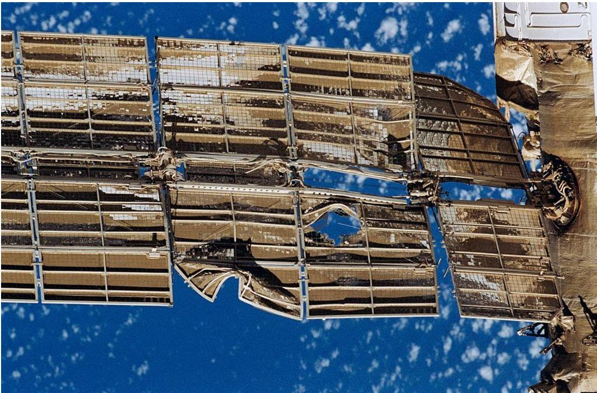

Figure A-1: Spektr solar array damage after Progress-Mir Collision $ ^{1} $ Image courtesy of NASA

<!-- PDF_PAGE: 184 -->

One example is the crippling of the Mir module Spektr when resupply vessel Progress M-34 collided with it during a manual docking test in 1997. Although investigation discovered a number of precipitating events, the proximate cause was that the Progress spacecraft approached the station too quickly due to the crew's inability to see it before it came too close to be slowed down before collision. The impact sent Mir into a tumble, cut a 3" hole in the side of the pressurized Spektr module, and damaged exterior components such as the solar panels shown in Figure A-1. The crew were endangered by the resulting decompression until they sealed off the Spektr module. The station lost over half its power generation along with experiments and personal effects that were never recovered. $ ^{1} $

Automation may eliminate the risk from operator error, which was the proximate cause of the Progress-Mir collision, but it does not guarantee safe docking. An example of unsuccessful automation is the partial failure of DART. This spacecraft was entirely autonomous, with no option even for operators to override autonomous commands. Yet, after a successful rendezvous with the target satellite, DART made an anomalous approach in resulted in a collision instead of the intended close-proximity interaction. Although the target was not damaged, its orbit was altered. $ ^{1} $ These incidents show that active, close-proximity maneuvers and approaches always include the possibility of failure, whether caused by human operators or autonomy. In addition to the risks, the need for active control during final approach has a cost in requiring sophisticated control architectures and/or human participation. That cost can add up significantly in the case of on-orbit assembly of large structures such as space stations, requiring the manipulation of passive components in addition to docking of hardware with some

<!-- PDF_PAGE: 185 -->

inherent autonomy. For example, the ISS required approximately 1,000 hours of EVA to assemble its truss structures and other components. $ ^{3} $ A substantial fraction of this operational cost could have been avoided with a suitable technology for manipulating the truss elements and securing their connection to each other.

A passive, failure-tolerant means of effecting final approach and capture could circumvent many issues associated with close-proximity maneuvers in preparation for docking, berthing, and grappling. The major challenge to overcome is that with minimal or nonexistent active control, the passive mechanics of the system must ensure reliable, safe convergence to the intended final state. Magnetic force and torque are the clear choice for attracting the spacecraft to their targets from a distance of many centimeters. However, other physics can be used to augment the system dynamics to improve performance and robustness. An important metric for measuring success in this endeavor is the size of the capture envelope: the state space volume within which the spacecraft and its target are guaranteed to passively and safely make contact. The capture envelope for the desired configuration must meaningfully reduce the need for close-proximity maneuvers and approaches.

The CubeSat docking use case is also of interest because safe rendezvous and docking is necessary for enabling numerous mission concepts at the nanosatellite scale. Multiple CubeSats could be assembled in orbit to accomplish mission goals impossible for an individual nanosatellite, but a reliable and safe technology for facilitating such assembly must first be developed. To date, no successful attempts to dock CubeSats in orbit have been documented, although some such missions have been designed and even launched. In particular, magnetic approaches to the CubeSat docking problem have been

<!-- PDF_PAGE: 186 -->

studied in the past. Recent collaboration between Cornell University and NASA Langley Research Center has produced a design for a magnetic capture and latching mechanism to facilitate docking between CubeSats without the need for precise thruster use in close proximity. $ ^{4} $ This research identifies problems with the naive approach of placing a single permanent magnet on each CubeSat, primarily the disturbance torques from the Earth's magnetic field, and mitigates them with a dual-magnet approach. However, this approach currently depends on simplifying the general 12 DOF problem (relative position, velocity, attitude, and attitude rates) to a 4 DOF problem (relative position with axial velocity). To achieve this goal, the researchers rely on the simplification that the spacecrafts' relative attitude errors and rates have been nulled out along with radial velocity. This setup produces a capture volume, a physical space within which the CubeSats capture and dock reliably and safely. $ ^{4} $

In this paper, we relax the constraints on initial relative attitude in the problem. This generalization extends the spatial capture volume described in Ref. 4 into a more general state-space envelope. Here, we focus on the use case of two identical CubeSats approaching and docking. The small scale of these spacecraft has implications on performance metrics such as power consumption, mass, and volume, which are more limited at the nanosatellite scale than they are for larger spacecraft. The physics of interest scale with spacecraft size in different ways, such that an option that is favorable for a CubeSat in terms of e.g. capture envelope size per unit mass may be less favorable at a different scale.

What follows is a trade study examining different means of effecting magnetic interaction between spacecraft, together with options for augmenting the passive

<!-- PDF_PAGE: 187 -->

dynamics of the spacecraft to produce safe contact. This augmentation includes means of limiting, damping, or otherwise safety handling the magnetic potential energy being converted to kinetic energy as the spacecraft approach. Section II begins by establishing the metrics by which to evaluate the trade space under consideration. Some of these metrics are easily quantified, but not all. We also enumerate the use cases under consideration, such as spacecraft docking at different scales and orbital assembly of structures. Distinguishing these use cases is important because the desirable characteristics for a solution may differ between use cases. This distinction is reflected in the different weighting of metrics in each case. In Section III we consider the trade space for satisfying these use cases under the given metrics. Section IV summarizes the results of this trade study.

The trade study identifies electropermanent magnets for further investigation. Section V discusses the a 3DOF demonstration of prototype electropermanent-magnet end effectors used in a simulated satellite- servicing mission. The electropermanent end effector turns out to be more effective if activated when already in contact with the target; Section VI discusses magnetic field mapping that characterizes and explains this result. Section VII concludes and discusses ongoing work.

<!-- PDF_PAGE: 188 -->

## II. Use Cases and Metrics

## A. Metrics

This subsection lays out the performance metrics for evaluating trades among magnetic mechanism options. Some options are more straightforward to evaluate than others, and explanations are offered for how to assess those not easily quantified.

## 1. Basic Metrics

The basic metrics include mass, volume, cost, and power consumption. Mass and volume are easily quantified. At first it may appear that power consumption is easily quantified as well. However, a power assessment must consider an actuator's maximum power as well as continuous power required, and these two do not necessarily correlate. Both are measured in Watts, for example, but the former is transient while the latter represents a steady state. A relevant example of this is the difference in power consumption behavior between electromagnets and electropermanent magnets, described briefly here and more thoroughly in Section III.A.

Electromagnets provide a magnetic moment as long as they draw power. In contrast, electropermanent magnets use an electromagnet, referred to hereafter as the switching coil to avoid confusion, to change the magnetization of a dual-material permanent magnet. The switching coil is powered only while switching, instead of continuously. I.e., this architecture provides a permanent magnetic moment in response to temporary power. However, changing the magnetization of an electropermanent magnet requires a stronger, transient magnetic field than the magnet is to produce. That is, if an electromagnet and an electropermanent magnet are to produce equivalent magnetic fields when switched on, the switching coil used to control the

<!-- PDF_PAGE: 189 -->

electropermanent magnet must be stronger than the continuous electromagnet. Therefore, the electropermanent magnet has higher maximum power consumption than the electromagnet but no sustained power consumption.

## 2. Capture Envelope

Capture volume is distinct from capture envelope. In the restricted problem described in Ref. 4, the capture volume is a physical space within which the spacecraft can dock successfully without requiring any control effort. For the case of a single magnetic dipole on each spacecraft, this volume is approximately a cone extending out from each spacecraft. For multiple dipoles, or with other factors involved, the volume becomes less simple to describe as a specification. As an extension of the idea of capture volume, capture envelope as the region of state space within which the spacecraft are in a potential energy basin they cannot escape. The state space consists of relative position, velocity, attitude, and attitude rates, as well as any system states that are part of the docking mechanism. The nadir of the potential energy basin is the desired final state of coupling between the two spacecraft. Because the capture envelope is at least 12 dimensional, it cannot be easily represented in a figure, but it can be quantified in terms of the range of state space it covers.

## 3. Collision Safety

If the spacecraft come together with enough relative velocity, they could sustain damage. Therefore, the robustness of the system in mitigating this possibility is a key design objective. Excess kinetic energy can be prevented or mitigated in several ways, each of which are examined in Section III.B: (1) limiting the magnetic potential energy of the system; (2) constraining the initial kinetic energy of the system; (3) implementing

<!-- PDF_PAGE: 190 -->

an energy-dissipation mechanism; and (4) blocking the state space path down the energy well. A passive magnetic system might implement this fourth approach by recessing the magnets such that when the spacecraft have docked, the magnets are still a small distance from each other rather than directly in contact.

## 4. Control Complexity

The goal of this trade study is to identify a passive mechanical design that implements the desired contact behavior without the need for active control. However, it is possible that by compromising to accept some extent of active control, we can improve the system's performance with regards to other metrics. For example, electropermanent magnets would need to be activated upon entering the desired capture envelope. This represents a requirement for active control, although the feedback aspects are minimal and offer fewer risks than traditional full-state feedback. We quantify control complexity with a score of given as shown in Table A-1.

Table A-1: Control complexity scoring.

<table border="1"><tr><td>Score</td><td>3</td><td>2</td><td>1</td></tr><tr><td>Description</td><td>Totally passive</td><td>Activation required</td><td>P, I, and/or D control</td></tr></table>

## 5. Androgyny

A secondary goal of this research is for the end effector to be androgynous; that is, any spacecraft with identical docking hardware must be able to interface with any other. This androgyny provides added operational flexibility during on-orbit assembly.

## 6. Disturbance Torques

Magnetic hardware on a spacecraft can be responsible for disturbances torques from the interaction of the net dipole moment, m, with the magnetic field of Earth, B, as shown in Eq. (1). $ ^{6} $ The tendency of the system to experience a disturbance torque

<!-- PDF_PAGE: 191 -->

from this net dipole moment not only varies throughout the orbit but may also vary by mission phase.

$$
\boldsymbol {\tau} _ {d} = \boldsymbol {m} \times \boldsymbol {B}
$$

## B. Use Cases

## 1. Symmetric Docking

The symmetric docking use case consists of two spacecraft of similar size and functionality approaching each other and docking. These spacecraft may be identical, with androgynous docking hardware. They may also be merely similar, with docking hardware being the only difference between them. Because two spacecraft are involved, either or both may perform maneuvers during rendezvous in order to enter the capture envelope. This versatility represents a certain level of redundancy, with either spacecraft available to act as leader or follower during rendezvous. This paper focuses on the nanosatellite scale of symmetric docking, CubeSats in particular. Assembly of multiple CubeSat-based components into large structures in orbit could represent a game-changing capability. Even if small-sat based on-orbit assembly is not a long-term goal, CubeSats provide an inexpensive framework for demonstrating new technologies in orbit that may scale to larger systems of interest. So, technology development for satellites at this scale has broad impact.

In the symmetric CubeSat docking use case, we weight the basic metrics defined in Section II.A.1 more heavily than in other use cases. At this scale, the spacecraft bus provides tight constraints. 3U CubeSats are limited to a mass of 4 kg with a volume of approximately 3L. Recently, the 3U+ CubeSat has been defined in the CubeSat Design Specification, allowing designs to exploit an additional cylindrical volume extending

<!-- PDF_PAGE: 192 -->

beyond the original 3U form factor. $ ^{5} $ This additional space, shown in Figure A-2, is an ideal location for end effectors on a 3U CubeSat; docking hardware utilizing this space has been the subject of previous design studies. $ ^{4} $ Its volume is constrained to a 6.4 cm diameter extending 3.6 cm beyond the CubeSat rails. $ ^{5} $

Figure A-2: 3U+ CubeSat schematic.

2. Asymmetric Docking

The asymmetric docking use case considers two significantly different spacecraft. An example is Progress docking with ISS. This use case can also cover on-orbit assembly after the first connection has been made. Successive nanosatellite-scale components in an on-orbit assembly mission form an increasingly large and complex spacecraft. The assembled structure may have limited capability to maneuver or reorient itself, requiring the incoming nanosatellite to enter the capture envelope on its own. The docking problem becomes asymmetric, with the partially assembled structure taking the role of the leader.

<!-- PDF_PAGE: 193 -->

This use case emphasizes the capture envelope more than does the symmetric docking case. A technology suitable for symmetric docking may be unsuitable for asymmetric docking. If the docking hardware is to be androgynous and identical for all stages of assembly, it likely must be designed with the asymmetric case in mind from the beginning.

## 3. Berthing/Grappling

In the berthing use case, one spacecraft attempts to physically manipulate the other to bring both into the desired configuration together. The berthed spacecraft maneuvers into what is referred to as berthing box, where it waits to be grasped by a robotic arm. $ ^{7} $ This concept is similar to the capture volume defined earlier. However, although the robotic arm can grasp the berthed spacecraft within this box, this even does not occur passively as with a magnetic capture envelope. Grappling is similar to berthing, although the grappling target is non-cooperative. The grappling use case includes manipulating truss elements and other objects that have no ability to maneuver on their own.

In the berthing use case, we consider a capture envelope consisting of the capture volume inside of the berthing box. That is, the spacecraft to be berthed enters the berthing box and remains there, as with typical berthing. However, the robotic arm has as an end effector a passive magnetic mechanism providing a capture envelope. As the robotic arm approaches the target, the system state enters the capture envelope, and the berthing-arm end effector passively contacts the spacecraft to be berthed. This use case involves active control of the berthed spacecraft into the berthing box, followed by active control of the berthing arm into the capture envelope, before the passive capture-

<!-- PDF_PAGE: 194 -->

system dynamics take over.

## C. Weighting

The most constrained use cases are the (a)symmetric CubeSat docking use cases, with 3U CubeSats as the building blocks of a structure to be assembled in Earth orbit. The 3U CubeSat specification provides several constraints on the physical system, which are summarized in Table A-2. This analysis is based on a bus architecture with surface-mounted solar panels, leading to an average power availability of 4 W after all other bus power requirements. Furthermore, the docking subsystem as an end effector offers the familiar benefits of modularity, so, the constraints placed on it are tighter, as described in Table A-3.

Quantifying and scaling the metrics leads to specific choices for weights. For scaling, all scores are normalized either by the maximum possible value under the constraints indicated with subscript c or by the maximum value found within the trade space, indicated with subscript m. In some cases, the value of the metric is one minus the normalized score, with the goal of ensuring a larger score represents a more desirable result. For example, taking 1-Mass/M_c means that a system requiring the entire allocated mass earns a score of 0, while taking $ \Theta/ $ $ \Theta_{-m} $ means that the system with the most robust capture envelope earns the greatest score of 1.

Table A-5 displays the weights chosen for different metrics in each of the use cases. The greatest weights in most cases prioritize collision prevention, maximize the extent of the capture envelope, and minimize control complexity. These choices drive the solution toward a safe, passive mechanism with a large capture envelope. At the CubeSat scale, the next greatest weights reflect the fundamental constraints of mass,

<!-- PDF_PAGE: 195 -->

volume, and power; these resources are at a premium for nanosatellites. Mass and volume are less constrained for the berthing and grappling cases than they are for the CubeSat uses cases. Disturbance torque is important at the CubeSat scale because of the disturbance torque from a magnet can saturate the attitude-control system. $ ^{4} $ Maximum power is less important than sustained power in all cases because its transient nature means that as long as the spacecraft batteries can deliver the maximum power required, this value has a low impact on spacecraft performance overall. Sustained power draw can reduce the ability of a spacecraft to provide power for its mission. Androgyny was considered less important for berthing than for other use cases because spacecraft typically are either berthed by or can berth other spacecraft, but not both.

Table A-2: Constraints of metrics for 3U CubeSat.

<table border="1"><tr><td>Constraint</td><td>Value</td></tr><tr><td>Mass,g</td><td>4000</td></tr><tr><td>Volume with 3U+ extra volume cylinder,L</td><td>3.1158</td></tr></table>

Table A-3: Constraints of docking system.

<table border="1"><tr><td>Constraint</td><td>Symbol</td><td>Value</td></tr><tr><td>Mass,kg</td><td>Mc</td><td>1.5</td></tr><tr><td>Volume in a1/2U unit plus the3U+extra volume,L</td><td>Vc</td><td>0.6158</td></tr><tr><td>Sustained Power,W</td><td>Pc</td><td>4</td></tr></table>

Table A-4: Metric scaling.

<table border="1"><tr><td>Metric</td><td>Scaling</td></tr><tr><td>Mass</td><td>1-Mass/Mc</td></tr><tr><td>Volume</td><td>1-Volume/Vc</td></tr><tr><td>Maximum Power</td><td>1-Maximum Power/Pm</td></tr><tr><td>Sustained Power</td><td>1-Average Power/Pc</td></tr><tr><td>Capture Envelope</td><td>$\Theta/\Theta_{m}$</td></tr><tr><td>Collision Prevention</td><td>E/Em</td></tr><tr><td>Disturbance Torque</td><td>1-m/mm</td></tr><tr><td>Control Complexity</td><td>C/3</td></tr><tr><td>Androgyny</td><td>0(yes)1(no)</td></tr></table>

Table A-5: Weighting of metrics.

Based on scaled scores as in Table A-4.

<!-- PDF_PAGE: 196 -->

<table border="1"><tr><td>Metric</td><td>Symmetric CubeSat Docking Weighting</td><td>Asymmetric CubeSat Docking Weighting</td><td>Berthing Weighting</td><td>Grappling Weighting</td></tr><tr><td>Mass</td><td>2</td><td>2</td><td>1</td><td>1</td></tr><tr><td>Volume</td><td>2</td><td>2</td><td>1</td><td>1</td></tr><tr><td>Maximum Power</td><td>1</td><td>1</td><td>1</td><td>1</td></tr><tr><td>Sustained Power</td><td>2</td><td>2</td><td>2</td><td>2</td></tr><tr><td>Capture Envelope</td><td>2</td><td>3</td><td>2</td><td>3</td></tr><tr><td>Collision Prevention</td><td>3</td><td>3</td><td>3</td><td>3</td></tr><tr><td>Disturbance Torque</td><td>2</td><td>2</td><td>1</td><td>1</td></tr><tr><td>Control Complexity</td><td>3</td><td>3</td><td>3</td><td>3</td></tr><tr><td>Androgyny</td><td>2</td><td>1</td><td>0.5</td><td>1</td></tr></table>

## III. Trade Space

## A. Magnetic Options

## 1. Single Permanent Magnet

The naive approach to this design problem is to place one magnetic dipole on each spacecraft, with corresponding orientations such that they attract each other. Such a solution faces practical constraints on the volume and mass of the magnet; however, it offers the benefits that no power is require and that the mass and volume required is only that of this single magnet and no other additional hardware. Here the spacecraft are identical, apart from the orientation of their magnetic dipoles with respect to the spacecraft structure. This similarity precludes androgyny unless the magnets can mechanically flip to achieve either orientation, requiring a mechanism.

The corresponding magnetic dipoles exert both force and torque on each other, according to Eq.(3) and Eq.(4) respectively. $ ^{8,9} $

$$
\begin{array}{l} F _ {a b} = \frac {3 \mu_ {0} m _ {a} m _ {b}}{4 \pi | r | ^ {3}} \left(\hat {r} \left(\hat {\boldsymbol {m}} _ {a} \cdot \hat {\boldsymbol {m}} _ {b}\right) + \hat {\boldsymbol {m}} _ {a} \left(\hat {\boldsymbol {r}} \cdot \hat {\boldsymbol {m}} _ {b}\right) + \hat {\boldsymbol {m}} _ {b} \left(\hat {\boldsymbol {r}} \cdot \hat {\boldsymbol {m}} _ {a}\right) - 5 \hat {r} \left(\hat {\boldsymbol {r}} \cdot \hat {\boldsymbol {m}} _ {a}\right) \left(\hat {\boldsymbol {r}} \cdot \hat {\boldsymbol {m}} _ {b}\right)\right) = - F _ {b a} \\ \tau_ {a b} = \frac {\mu_ {0} m _ {a} m _ {b}}{4 \pi | r | ^ {3}} \left(3 \left(\hat {\boldsymbol {m}} _ {a} \cdot \hat {\boldsymbol {r}}\right) \left(\hat {\boldsymbol {m}} _ {b} \times \hat {\boldsymbol {r}}\right) + \left(\hat {\boldsymbol {m}} _ {a} \times \hat {\boldsymbol {m}} _ {b}\right)\right) \\ \end{array}
$$

The form of Eq. (3) suggests an approximately conical capture volume; the system is robust to relative error in attitude and position when CubeSat b begins at rest within a

<!-- PDF_PAGE: 197 -->

cone in front of the dipole of CubeSat a. In the absence of disturbances, the capture cone extends to infinity, although the attractive force decreases with $ |\boldsymbol{r}|^{4} $ . A disturbance torque is generated by the interaction of the magnet with Earth's magnetic field, as described in Equation 1. Because the docking hardware comprises permanent magnets, this disturbance torque must be countered by the attitude control system if possible. Again, for the sake of modularity, this interdependence between ACS and docking is unappealing; so, a design objective must be to minimize the net magnetic dipole moment.

## 2. Permanent Magnet Pair

This option is a response to the issue of the disturbance torque in the case of the single permanent magnet. In fact, after the two single permanent-magnet CubeSats dock, the disturbance torque is roughly twice, since they have parallel dipole moments separated by a negligible distance with regards to Earth's magnetic field. Eliminating these disturbance torques requires a pair of permanent magnets having antiparallel orientations on each spacecraft. The presence of two dipoles on each spacecraft create a capture volume that is the union of two overlapping cones. $ ^{4} $

## 3. Permanent Magnet Pair

Electromagnets are part of the tradespace, along with electropermanent magnets and permanent magnets. The former offer the advantage that they produce no magnetic field until one is desired, because the electromagnet coils themselves produce no magnetic field unless current is flowing through them. However, electromagnets represent an active means of producing a magnetic field, requiring continuous power to maintain. Unless an additional latching mechanism is used, the electromagnets must

<!-- PDF_PAGE: 198 -->

remain on as long as fixity between spacecraft is desired.

## 4. Electropermanent Magnet

An electropermanent magnet consists of two permanent magnets, a hard magnetic material with a high coercivity such as a rare earth magnet, and a soft magnetic material with a lower coercivity such as an AlNiCo magnet. The two are placed between soft steel pole pieces, and the entire assembly has electromagnetic coils around it as shown in Figure A-3. The latter are known here as switching coils to avoid confusion with an electromagnet. When the switching coils are turned on, they produce a magnetic field that is external to the permanent magnets. If this field is chosen correctly, it changes the magnetization of the softer magnet while leaving the harder magnet essentially unaffected. This result is due to the hysteresis curves of magnets, with the magnet of higher coercivity having a wider hysteresis curve and thus requiring a stronger external field to change it as shown in Figure A-4. $ ^{10} $ The operation of an electropermanent magnet is depicted in Figure A-5. The hard magnet remains magnetized in one direction, but when the switching coils activate to produce an external magnetic field, they magnetize the soft magnet in the same orientation as that field: either parallel or antiparallel to the hard magnet.

When the poles of the two permanent magnets are parallel, they produce a net external magnetic field. When antiparallel, they produce no net external magnetic field; the field lines are predominately contained within the assembly of pole pieces and permanent magnets. This configuration is in effect a magnetic circuit: magnetic flux lines appear to conduct through the low reluctance pole pieces instead of the high reluctance air or vacuum around the permanent magnet. It is the same phenomenon that

<!-- PDF_PAGE: 199 -->

makes a magnet keeper, a ferromagnetic a ferromagnetic bar placed across the poles of a permanent magnet to preserve its strength. This magnetic circuit can be described with analogous equations to an electrical circuit, although magnetic flux does not represent a flow in the same way electrical current does. $ ^{11} $ When left in its activated state, the capture envelope of a single electropermanent magnet is similar to that of a single permanent magnet with the same net strength.

Electropermanent magnets are advantageous for docking, berthing, and grappling for several reasons. They produce no external field when not in use, addressing a concern with the use of a permanent magnet leading to disturbance torque from Earth's magnetic field. They do not consume power continuously, rather only when the switching coils are activated, a transient state. They scale advantageously for small applications, with the magnetic force scaling to surface while the switching energy scales with volume. $ ^{10} $ There are disadvantages, as well.

Electropermanent magnets are not wholly passive; the switching coils must be activated to change the system behavior, although no control scheme is required beyond this. They are binary in operation, as the nature of hysteresis curves makes it difficult to magnetize the electropermanent magnet in any configuration between on and off. This contrasts with electromagnets, which can be continuously varied by a controller to fine tune system behavior.

<!-- PDF_PAGE: 200 -->

Figure A-3: Electropermanent magnet. $ ^{1 0} $ g is the gap between the magnet and its target, a and b are dimensions of the pole pieces, L the length of the magnets, d the diameter of the magnets, and w the thickness of the coils.

Figure A-4: Hysteresis loops. $ ^{10} $ When an external magnetic field, H, is applied to a susceptible material, it may affect the magnetization, M, of that material. A "hard" magnet has a wider hysteresis loop than a "soft" magnet. A greater external magnetic field must be applied to change its magnetization.

<!-- PDF_PAGE: 201 -->

Figure A-5: Electropermanent magnet operation. $ ^{10} $ Applying power to the switching coils creates a magnetic field, H, external to the electropermanent magnet components. This results in a change in magnetic flux in the entire electropermanent magnet assembly, B. Note the vertical offset; this is because the switching coils only affect the softer magnet.

## B. Energy Mitigation

The system has a certain magnetic potential energy according to the integral of the scalar value of the force between them:

$$
U = - \int_ {0} ^ {d} F d s
$$

across the distance d separating the two spacecraft, with F depending on the magnet. Left unchecked, the attractive force between magnets converts this potential energy into kinetic energy. This conversion is desirable because it causes the spacecraft to move towards each other, but they must make the final approach and contact only with a safe limit on relative velocity between them. The force between magnets, and

<!-- PDF_PAGE: 202 -->

hence the acceleration of the spacecraft, is inversely proportional to the fourth power of their relative distance, which makes it challenging to prevent an unsafe acceleration during the final moments as shown in Figure A-6. There are several means of ensuring this safety, which we now consider.

## 1. Limiting Potential Energy

The most straightforward approach is to simply limit the amount of potential energy present in the system. Implementing such a solution requires a tradeoff between reducing the potential energy of the magnets at a certain distance and, consequently, reducing the attractive force at all distances. This lower force reduces the capture envelope and compromises the robustness of the system to disturbances.

## 2. Recessed Magnets

The design can limit the potential energy that can be converted into kinetic energy by recessing the magnets within the spacecraft structure. This standoff distance passively prevents the $ \frac{1}{r^{4}} $ relationship between magnetic force and distance from blowing up; when the spacecraft make contact, the magnets still have some distance separating them. If small enough, this separation does not substantially reduce the far field effects or the capture envelope, because $ \frac{1}{(r+\delta r)^{4}}\approx \frac{1}{r^{4}} $ when $ \delta r\ll r $ . However, the holding force is dramatically reduced from the case where the magnets are in contact when the spacecraft are docked. This reduction can be addressed with an additional latching mechanism if necessary.

## 3. Switching Magnets

Another option is to vary or switch off the magnetic field to reduce the

<!-- PDF_PAGE: 203 -->

acceleration in the final stages. This option has the disadvantage of requiring active intervention during the final approach, contrary to the passive means desired in this research. However, the control needed can be as simple as deactivating an electropermanent magnet, with a control complexity score of 1 as defined in Table A-1. Ideally, an instantaneous cut off of the magnetic field results in behavior like that of Figure A-7, where acceleration stops as the net magnetic field vanishes. This approach is simple, albeit active, preventing excess potential energy from transforming into a dangerous excess of kinetic energy.

## 4. Energy Dissipation

None of the above three methods can mitigate an initial excess of kinetic energy, expanding the capture envelope via the relative velocity states. Energy dissipation methods can do this, and passively. One example is the use of eddy-current damping. Eddy currents are produced in bulk conductive material in the presence of a time-varying magnetic field $ ^{12} $ , commonly from moving magnets. The reaction produced by the eddy currents tends to oppose the motion of the conductor through the magnetic field, or the magnet past the conductor. Eddy currents are most commonly used in terrestrial damping and braking systems and have not yet been considered for docking control. $ ^{12} $

Another method of energy dissipation is the use of viscous fluid dampers. Such an effect cannot exist between the spacecraft as they are in a vacuum, but angular velocity damping can be incorporated as follows. The magnets need not be mounted rigidly to their spacecraft; they could be on a set of gimbals allowing them to rotate within the spacecraft structure. Such a design could be advantageous when integrated

<!-- PDF_PAGE: 204 -->

with a restoring-force mechanism such as torsional springs and viscous damping. A set of gimbals with viscous damping is similar to a rate integrating gyro as described in Ref. 13. Torsional dampers slow the displacement of the magnets from their axially mounted equilibrium position in the spacecraft. This effect encourages the spacecraft to align with each other. Although the spacecraft would do so under the rigid body mounting as described in Eq.(4), the torsion-spring-and-viscous-fluid gimbal assembly adds damping to this behavior.

Figure A-6: Unimpeded acceleration. Two single-magnet 3U CubeSats approaching without any means of acceleration mitigation.

<!-- PDF_PAGE: 205 -->

Figure A-7: Switching magnet acceleration. Comparison of the final moments of the system from Figure 6 with a system where each spacecraft has an equivalent electropermanent magnet that switches off when desired.

## IV. Trade Results

Certain aspects of this trade study, such as the extent of the capture envelope in all state space, are difficult to resolve analytically. In a space application, the capture envelope is a 12-dimensional volume representing all possible position, attitude, velocity, and angular velocity states from which capture is possible. Physically representative numerical simulations are needed to determine the robustness of the capture envelope for each of the options in the trade space.

The remainder of the metrics are assessed based on the criteria from Section II.A. The base values for each metric can be found in Table A-6, and reflect the electropermanent magnet identified earlier, single- or dual- 0.5 in $ ^{3} $ rare earth magnets,

<!-- PDF_PAGE: 206 -->

and a 1 in diameter, 0.78 in length, 4 W electromagnet. Scores are scaled according to Table A-4 in Section II.C and can be found in Table A-7.

The scaled score and weighted score results shown in Table A-8 through Table A-11 motivate assessing the electropermanent magnet. Although the electropermanent magnet requires more maximum power than all other options, it requires no sustained power, produces no disturbance torque, has a low although nonzero control complexity, and is androgynous.

Table A-6: Base scores for magnetic options.

<table border="1"><tr><td></td><td>Single Magnet</td><td>Dual Magnet</td><td>Electromagnet</td><td>Electropermanent</td></tr><tr><td>Mass,g</td><td>61</td><td>122</td><td>59</td><td>65</td></tr><tr><td>Volume,L</td><td>0.0082</td><td>0.0164</td><td>0.01</td><td>0.0288</td></tr><tr><td>Maximum Power,W</td><td>0</td><td>0</td><td>4</td><td>5</td></tr><tr><td>Sustained Power,W</td><td>0</td><td>0</td><td>4</td><td>0</td></tr><tr><td>Collision Prevention</td><td>0</td><td>0</td><td>1(switching)</td><td>1(switching)</td></tr><tr><td>Disturbance Torque</td><td>Present</td><td>Negligible</td><td>Only when active</td><td>Only when active</td></tr><tr><td>Control Complexity</td><td>Passive</td><td>Passive</td><td>Active Control</td><td>Activation Required</td></tr><tr><td>Androgyny</td><td>No</td><td>Yes</td><td>Yes</td><td>Yes</td></tr></table>

Table A-7: Scaled scores for magnetic options.

<table border="1"><tr><td></td><td>Single Magnet</td><td>Dual Magnet</td><td>Electromagnet</td><td>Electropermanent</td></tr><tr><td>Mass</td><td>0.9593</td><td>0.9187</td><td>0.9607</td><td>0.9567</td></tr><tr><td>Volume</td><td>0.9867</td><td>0.9734</td><td>0.9838</td><td>0.9532</td></tr><tr><td>Maximum Power</td><td>1</td><td>1</td><td>0.2</td><td>0</td></tr><tr><td>Sustained Power</td><td>1</td><td>1</td><td>0</td><td>1</td></tr><tr><td>Collision Prevention</td><td>0</td><td>0</td><td>1</td><td>1</td></tr><tr><td>Disturbance Torque</td><td>0</td><td>~1</td><td>~1</td><td>~1</td></tr><tr><td>Control Complexity</td><td>1</td><td>1</td><td>0.33</td><td>0.67</td></tr><tr><td>Androgyny</td><td>0</td><td>1</td><td>1</td><td>1</td></tr></table>

Table A-8: Weighted scores for CubeSat symmetric docking.

<table border="1"><tr><td></td><td>Single Magnet</td><td>Dual Magnet</td><td>Electromagnet</td><td>Electropermanent</td></tr><tr><td>Mass</td><td>1.9186</td><td>1.8374</td><td>1.9214</td><td>1.9134</td></tr><tr><td>Volume</td><td>1.9734</td><td>1.9468</td><td>1.9676</td><td>1.9064</td></tr><tr><td>Maximum Power</td><td>1.0</td><td>1.0</td><td>0.2</td><td>0.0</td></tr><tr><td>Sustained Power</td><td>2.0</td><td>2.0</td><td>0.0</td><td>2.0</td></tr><tr><td>Collision Prevention</td><td>0.0</td><td>0.0</td><td>3.0</td><td>3.0</td></tr><tr><td>Disturbance Torque</td><td>0.0</td><td>3.0</td><td>3.0</td><td>3.0</td></tr><tr><td>Control Complexity</td><td>2.00</td><td>2.00</td><td>0.66</td><td>1.34</td></tr><tr><td>Androgyny</td><td>0.00</td><td>1.00</td><td>1.00</td><td>1.00</td></tr><tr><td>Total</td><td>8.8920</td><td>12.7842</td><td>11.7490</td><td>14.1598</td></tr></table>

<!-- PDF_PAGE: 207 -->

Table A-9: Weighted scores for CubeSat asymmetric docking.

<table border="1"><tr><td></td><td>Single Magnet</td><td>Dual Magnet</td><td>Electromagnet</td><td>Electropermanent</td></tr><tr><td>Mass</td><td>0.9593</td><td>0.9187</td><td>0.9607</td><td>0.9567</td></tr><tr><td>Volume</td><td>0.9867</td><td>0.9734</td><td>0.9838</td><td>0.9532</td></tr><tr><td>Maximum Power</td><td>1.0</td><td>1.0</td><td>0.2</td><td>0.0</td></tr><tr><td>Sustained Power</td><td>2.0</td><td>2.0</td><td>0.0</td><td>2.0</td></tr><tr><td>Collision Prevention</td><td>0.0</td><td>0.0</td><td>3.0</td><td>3.0</td></tr><tr><td>Disturbance Torque</td><td>0.0</td><td>1.0</td><td>1.0</td><td>1.0</td></tr><tr><td>Control Complexity</td><td>3.0</td><td>3.0</td><td>1.0</td><td>2.0</td></tr><tr><td>Androgyny</td><td>0.0</td><td>0.5</td><td>0.5</td><td>0.5</td></tr><tr><td>Total</td><td>7.9460</td><td>9.3921</td><td>7.6345</td><td>10.4199</td></tr></table>

Table A-10: Weighted scores for berthing.

<table border="1"><tr><td></td><td>Single Magnet</td><td>Dual Magnet</td><td>Electromagnet</td><td>Electropermanent</td></tr><tr><td>Mass</td><td>0.9593</td><td>0.9187</td><td>0.9607</td><td>0.9567</td></tr><tr><td>Volume</td><td>0.9867</td><td>0.9734</td><td>0.9838</td><td>0.9532</td></tr><tr><td>Maximum Power</td><td>1.0</td><td>1.0</td><td>0.2</td><td>0.0</td></tr><tr><td>Sustained Power</td><td>2.0</td><td>2.0</td><td>0.0</td><td>2.0</td></tr><tr><td>Collision Prevention</td><td>0.0</td><td>0.0</td><td>3.0</td><td>3.0</td></tr><tr><td>Disturbance Torque</td><td>0.0</td><td>1.0</td><td>1.0</td><td>1.0</td></tr><tr><td>Control Complexity</td><td>3.0</td><td>3.0</td><td>1.0</td><td>2.0</td></tr><tr><td>Androgyny</td><td>0.0</td><td>1.0</td><td>1.0</td><td>1.0</td></tr><tr><td>Total</td><td>7.9460</td><td>9.8921</td><td>8.1345</td><td>10.9199</td></tr></table>

Table A-11: Weighted scores for grappling.

<table border="1"><tr><td></td><td>Single Magnet</td><td>Dual Magnet</td><td>Electromagnet</td><td>Electropermanent</td></tr><tr><td>Mass</td><td>0.9593</td><td>0.9187</td><td>0.9607</td><td>0.9567</td></tr><tr><td>Volume</td><td>0.9867</td><td>0.9734</td><td>0.9838</td><td>0.9532</td></tr><tr><td>Maximum Power</td><td>1.0</td><td>1.0</td><td>0.2</td><td>0.0</td></tr><tr><td>Sustained Power</td><td>2.0</td><td>2.0</td><td>0.0</td><td>2.0</td></tr><tr><td>Collision Prevention</td><td>0.0</td><td>0.0</td><td>3.0</td><td>3.0</td></tr><tr><td>Disturbance Torque</td><td>0.0</td><td>1.0</td><td>1.0</td><td>1.0</td></tr><tr><td>Control Complexity</td><td>3.0</td><td>3.0</td><td>1.0</td><td>2.0</td></tr><tr><td>Androgyny</td><td>0.0</td><td>1.0</td><td>1.0</td><td>1.0</td></tr><tr><td>Total</td><td>7.9460</td><td>9.8921</td><td>8.1345</td><td>10.9199</td></tr></table>

## V. TALISMAN Experiment

The purpose of the simulations and magnetic-field mapping described in previous sections is to provide predictions for empirically testing the performance of a prototype end effector. This section describes the procedures and results of our work integrating a prototype end effector with the TALISMAN robotic arm $ ^{15} $ , for use in a demonstration of satellite servicing capability.

<!-- PDF_PAGE: 208 -->

## A. Apparatus

## 1. TALISMAN Robotic Arm

The Tendon Actuated, Lightweight In-Space MANipulator (TALISMAN) architecture has long reach and high dexterity in a lightweight package. It has been developed for diverse applications ranging from asteroid mining to satellite servicing. $ ^{15} $ The architecture folds and unfolds lightweight truss links using cables wound by motors instead of direct-drive joints.

The tendon-actuated architecture allows the motors to be located in the base of the manipulator instead of at each joint. This location reduces the joint mass and complexity while also adding mechanical advantage for the motors. $ ^{16} $ Lower mass allows the possibility of adding additional links for increased dexterity and a long reach, which can be scaled to over 300 m. $ ^{17} $

The TALISMAN prototype used for this experiment has a 15.3 m reach and is designed for satellite servicing, a concept of operations for which is shown in Figure A-8. It works in three degrees of freedom using air feet and is located at Langley Research Center on one of the flat floor facilities there. Accompanying the TALISMAN in Figure A-9 is a three degree of freedom satellite mockup, used as a target for the satellite servicing demonstration described here.

<!-- PDF_PAGE: 209 -->

Figure A-8: TALISMAN concept. $ ^{1 4} $ TALISMAN arm used for a satellite servicing mission.

Figure A-9: TALISMAN. $ ^{14} $ The left-hand TALISMAN securing a satellite mockup for the right-hand TALISMAN to inspect with a Cyton 1500 dexterous manipulator. The left hand now uses the electropermanent magnet end effector described in this paper.

<!-- PDF_PAGE: 210 -->

## 2. Prototype End Effector

End effectors designed for this manipulator are required to have low mass to retain this advantage of the TALISMAN architecture. An electropermanent magnet end effector has been prototyped for use on the two-dimensional TALISMAN test bed. TALISMAN has previously been fitted with both permanent magnets and electromagnets as end effectors. The permanent magnets were inconvenient as they needed to be manually removed from targets. The electromagnets required more power than could be continuously provided at the end of the manipulator. TALISMAN therefore represents a good test case for an electropermanent magnet end effector, as this solution may resolve the issues with its previous end effectors

A proof of concept of an electropermanent magnet end effector is shown in Fig. 10. It is modeled after the electropermanent magnet architecture depicted in Fig. 3, using two magnets each of 0.25 inches in diameter and 1 inch in length. One was a NdFeB magnet, and the other was an AlNiCo 5 magnet. The coercivity of NdFeB over an order of magnitude greater than that of AlNiCo 5, creating a much wider hysteresis loop. Therefore, the AlNiCo 5 can be magnetized with an external magnetic field without affecting the NdFeB magnet. The two magnets are capped with iron pole pieces and are wrapped in magnet wire.

A proof-of-concept device is able to hold to a ferromagnetic target after power is supplied to the coils in the correct direction to magnetize the AlNiCo magnet in the same direction as the NdFeB magnet. As Figure A-10 shows, the electropermanent magnet remained activated even after power was cut. The electropermanent magnet remains activated until the coils are powered again with the polarity reversed,

<!-- PDF_PAGE: 211 -->

remagnetizing the AlNiCo magnet antiparallel to the NdFeB magnet. Thus, the proof of concept operates exactly as the electropermanent magnet theory shown in Figure A-6.

Figure A-10: Electropermanent magnet prototype. In the background, the power supply to the coils is disconnected with no current flowing. When the power supply is activated such that the magnetic field is antiparallel to that of the permanent magnets, the electropermanent magnet will deactivate as the AlNiCo magnet is remagnetized antiparallel to its previous state.

Figure A-11: Left-hand TALISMAN end effector. Electropermanent magnets mounted on the left-hand TALISMAN for securing satellite mockups as depicted in Figure 10.

<!-- PDF_PAGE: 212 -->

## B. Procedure

We first established a baseline holding force by placing the end effector in contact with a ferromagnetic target and activating the electropermanent magnets, then measuring the force it took to pull the target away. Then, we affixed the end effector to the TALISMAN and attempted to grapple the satellite mockup as part of what was planned to be a 3DOF satellite servicing demonstration.

We intended to use the two TALISMAN arms together as part of a simulated satellite servicing mission. However, one of the joints on the TALISMAN was not functional and neither was the dexterous manipulator at the end of the right arm. This prevented us from a full demonstration. Instead, we activated the end effector and maneuvered the TALISMAN close to the satellite mockup to observe its ability to attract the target. Once contact was made, we measured the force it took to remove the target from the TALISMAN and compared it to the baseline holding force.

## C. Results

## 1. Holding force to a ferromagnetic target

We obtained a baseline holding force of 95 lbf. Because we used two electropermanent magnet modules in the end effector, this is close to the manufacturer specifications of approximately 200 N (44.96 lbf) holding force per magnet.

## 2. Attempted satellite grappling using TALISMAN

We were not able to attract the satellite from any distance greater than the order of several centimeters despite 30 trials attempting to do so. Even when contact was made, the holding force was greatly decreased, by more than an order of magnitude compared to the baseline. We could not move the satellite by maneuvering the

<!-- PDF_PAGE: 213 -->

TALISMAN arm; it broke contact whenever the arm was actuated because the hold was too weak to pull it along. When we instead activated the end effector while already in contact with the target, the holding force returned to the baseline strength. We were then able to move the satellite around the flat floor area by means of the TALISMAN robotic arm.

## D. Discussion

We made the unexpected observation that the maximum holding force of the prototype end effector depended on when the switching coils were activated. When activated with the end effector in contact with the target satellite, the holding force matched our expectations from initial experimentation with stationary ferromagnetic targets. However, the holding force was dramatically reduced when the switching coils were instead activated in the far-field, prior to making contact with the target. This was done with the intent of attracting the target from a distance, the primary goal of this research. Unfortunately, the reduced attractive force in the far-field activation case led to a failure of the end effector to noticeably attract the target from a distance beyond the order of 1 cm. Additionally, the end effector was unable maintain its hold on the target when the TALISMAN arm was moved in an attempt to maneuver the satellite.

It is possible to activate the switching coils repeatedly in the same direction. Therefore, electropermanent magnets can be reactivated without first being deactivated. When we observed the unexpectedly weak far-field performance of the electropermanent magnets after activation, we reactivated the magnets as a troubleshooting step. This was done with the target still in the far-field and did not have any effect. The holding force was still dramatically weaker than the baseline and was

<!-- PDF_PAGE: 214 -->

unchanged from the single-activation case.

However, when we manipulated the TALISMAN to bring the electropermanent magnets close enough to attract the target, and then activated the electropermanent magnets, we observed the expected holding force. This was the case whether the electropermanent magnets were deactivated until contact was made and then activated or activated prior to contact and then reactivated.

Our hypothesis was that the ferromagnetic surface on the target was being magnetized by the switching coils when in close proximity to them as they were used to activate the electropermanent magnets. Because of its low coercivity, the target was presumed susceptible to being magnetized by the coils at its surface even though it was not contained within the coils as the AlNiCo magnet was. This would dramatically increase the holding force and could account for the discrepancy in the results. We decided to proceed by investigating the magnetic field near the end effector and how it changed depending on whether the electropermanent magnets were activated prior to or after making contact with the target. That work is described in the next section and provided evidence in favor of our proposed explanation for the behavior observed in the TALISMAN trials.

## VI. Magnetic Characterization

We decided to map the magnetic field produced by our prototype electropermanent end effector under different conditions. We used a 3D magnetometer to observe the magnetic field and its change depending on whether the end effector was activated prior to or after making contact with the target. In the future, these results will allow us to make more accurate predictions of the end effector's performance by

<!-- PDF_PAGE: 215 -->

simulating the effect of its known magnetic field on planned targets. This section describes the apparatus used for this purpose and the results we obtained.

## A. Apparatus

To map the end effector's magnetic field, we used the 3D magnetometer at Cornell University. It is pictured in Figure A-12. The apparatus consists of three orthogonal magnetometers mounted on a three degree-of-freedom linear stage. In this way, the magnetometers can be moved in three dimensions to make measurements of the magnetic field at arbitrary points in space. It is important to have precise position data for each measurement in order to create a map of the magnetic field being examined. We used ultrasonic sensors to measure the distance of the magnetometer assembly with respect to three orthogonal reference planes. By sweeping the magnetometer assembly through the space around the electropermanent magnets, we were able to find the magnetic field vector at each of many points surrounding the prototype end effector.

<!-- PDF_PAGE: 216 -->

Figure A-12: 3D magnetometer. The 3 DOF linear stage issued to move the magnetometers precisely in space to take measurement sweeps of the magnetic field produced by the test article. B. Procedure

We wanted to observe how the magnetic field changed depending on different ways the target and the electropermanent magnets interacted. We first observed the ambient magnetic field, to account for it in the data to be collected. Then, we performed ten trials for each of ten sequences of events, with actions such as (de)activating the electropermanent magnets and presenting/removing the target taken in a different order for each sequence. The magnetic field was observed at each stage of each sequence for each trial. The closest approach to the magnets was performed at 2 mm over the center of one of the two electropermanent magnets on the end effector. Depending on the stage in the sequence, that 2 mm gap was either an air gap or filled with the ferromagnetic target used for this experiment.

The test sequences were as follows:

<!-- PDF_PAGE: 217 -->

1. Activating before presenting the target, removing the target before deactivating

- Begin with the electropermanent magnet OFF and the target absent

- Turn the electropermanent magnet ON

- Place the target in contact with the electropermanent magnet

- Remove the target from the electropermanent magnet

- Turn the electropermanent magnet OFF

2. Activating before presenting the target, deactivating before removing the target

- Begin with the electropermanent mag net OFF and the target absent

- Turn the electropermanent magnet ON

- Place the target in contact with the electropermanent magnet

- Turn the electropermanent magnet OFF

- Remove the target from the electropermanent magnet

3. Presenting the target before activating, removing the target before deactivating

- Begin with the electropermanent magnet OFF and the target absent

- Place the target in contact with the electropermanent magnet

- Turn the electropermanent magnet ON

- Remove the target from the electropermanent magnet

- Turn the electropermanent magnet OFF

4. Presenting the target before activating, deactivating before removing the target

- Begin with the electropermanent magnet OFF and the target absent

- Place the target in contact with the electropermanent magnet

<!-- PDF_PAGE: 218 -->

- Turn the electropermanent magnet ON

- Turn the electropermanent magnet OFF

- Remove the target from the electropermanent magnet

5. Activating before presenting the target, reactivating with target present, removing the target before deactivating

- Begin with the electropermanent magnet OFF and the target absent

- Turn the electropermanent magnet ON

- Place the target in contact with the electropermanent magnet

- Turn the electropermanent magnet ON (again)

- Remove the target from the electropermanent magnet

- Turn the electropermanent magnet OFF

6. Activating before presenting the target, reactivating with target present, deactivating

before removing the target

- Begin with the electropermanent magnet OFF and the target absent

- Turn the electropermanent magnet ON

- Place the target in contact with the electropermanent magnet

- Turn the electropermanent magnet ON (again)

- Turn the electropermanent magnet OFF

- Remove the target from the electropermanent magnet

7. Activating and deactivating with the target present

- Begin with the electropermanent magnet OFF and the target already present

- Turn the electropermanent magnet ON

<!-- PDF_PAGE: 219 -->

- Turn the electropermanent magnet OFF

8. Activating and deactivating with the target absent

- Begin with the electropermanent magnet OFF and the target absent

- Turn the electropermanent magnet ON

- Turn the electropermanent magnet OFF

9. Presenting and removing the target with the electropermanent magnet activated

- Begin with the electropermanent magnet ON and the target absent

- Place the target in contact with the electropermanent magnet

- Remove the target from the electropermanent magnet

10. Presenting and removing the target with the electropermanent magnet deactivated

- Begin with the electropermanent magnet OFF and the target absent

- Place the target in contact with the electropermanent magnet

## C. Results

- Remove the target from the electropermanent magnet

For each sequence, we present a 99% confidence interval for the maximum magnetic field strength, i.e. that observed at closest approach, 2 mm above the center of the electropermanent magnet. The key results, where applicable, are the changes in magnetic field when the electropermanent magnet is activated or deactivated.

## 1. Tables of Results

Table A-12: Procedure #1:Activating before presenting the target, removing before deactivating.

<table border="1"><tr><td>Sequence</td><td>Mean Field Vector,μT</td><td>Standard Deviation,μT</td><td>99% Confidence Interval,μT</td><td>Magnitude of Change in Field,μT</td></tr><tr><td rowspan="3">EP magnet off, target absent</td><td>X:-19.317</td><td>X:0.141</td><td>X:[-19.329,-19.306]</td><td rowspan="3">N/A</td></tr><tr><td>Y:-13.212</td><td>Y:0.138</td><td>Y:[-7.593,-7.571]</td></tr><tr><td>Z:-9.615</td><td>Z:0.151</td><td>Z:[0.772,0.797]</td></tr></table>

<!-- PDF_PAGE: 220 -->

<table border="1"><tr><td>EP magnet on, target absent</td><td>X:-45.471
Y:-57.888
Z:2.371</td><td>X:0.141
Y:0.147
Z:0.179</td><td>X:[-45.482,-45.459]
Y:[-52.269,-52.246]
Z:[12.756,12.785]</td><td>53.137</td></tr><tr><td>EP magnet on, target presented</td><td>X:-49.812
Y:53.451
Z:-67.991</td><td>X:0.139
Y:0.145
Z:0.151</td><td>X:[-49.823,-49.801]
Y:[59.069,59.093]
Z:[-57.604,-57.580]</td><td>N/A</td></tr><tr><td>EP magnet on, target removed</td><td>X:-43.641
Y:-62.121
Z:-5.350</td><td>X:0.135
Y:0.139
Z:0.151</td><td>X:[-43.652,-43.630]
Y:[-56.503,-56.480]
Z:[5.037,5.062]</td><td>N/A</td></tr><tr><td>EP magnet off, target removed</td><td>X:-19.039
Y:-14.157
Z:-9.548</td><td>X:0.171
Y:0.191
Z:0.155</td><td>X:[-19.053,-19.025]
Y:[-8.542,-8.511]
Z:[0.839,0.865]</td><td>54.070</td></tr></table>

Table A-13: Procedure #2: Activating before presenting the target, deactivating before removing.

<table border="1"><tr><td>Sequence</td><td>Mean Field Vector,μT</td><td>Standard Deviation,μT</td><td>99% Confidence Interval,μT</td><td>Magnitude of Change in Field,μT</td></tr><tr><td>EP magnet off, target absent</td><td>X:-19.510
Y:-8.316
Z:-23.955</td><td>X:0.408
Y:0.394
Z:0.403</td><td>X:[-19.543,-19.476]
Y:[-5.306,-5.242]
Z:[-13.560,-13.495]</td><td>N/A</td></tr><tr><td>EP magnet on, target absent</td><td>X:-43.131
Y:-51.420
Z:2.408</td><td>X:0.471
Y:0.484
Z:0.557</td><td>X:[-43.170,-43.093]
Y:[-48.417,-48.338]
Z:[12.790,12.881]</td><td>55.775</td></tr><tr><td>EP magnet on, target presented</td><td>X:-56.184
Y:73.800
Z:-68.872</td><td>X:0.371
Y:0.382
Z:0.395</td><td>X:[-56.214,-56.153]
Y:[76.812,76.874]
Z:[-58.477,-58.413]</td><td>N/A</td></tr><tr><td>EP magnet off, target present</td><td>X:-36.127
Y:44.006
Z:-59.363</td><td>X:0.386
Y:0.430
Z:0.417</td><td>X:[-36.158,-36.095]
Y:[47.012,47.082]
Z:[-48.969,-48.902]</td><td>37.153</td></tr><tr><td>EP magnet off, target removed</td><td>X:-20.220
Y:-9.130
Z:-25.471</td><td>X:0.381
Y:0.379
Z:0.393</td><td>X:[-20.252,-20.189]
Y:[-6.118,-6.057]
Z:[-15.075,-15.011]</td><td>N/A</td></tr></table>

Table A-14: Procedure #3: Presenting the target before activating, removing before deactivating.

<table border="1"><tr><td>Sequence</td><td>Mean Field Vector,μT</td><td>Standard Deviation,μT</td><td>99% Confidence Interval,μT</td><td>Magnitude of Change in Field,μT</td></tr><tr><td>EP magnet off, target absent</td><td>X:-20.782Y:-3.449Z:-10.853</td><td>X:0.456Y:0.466Z:0.485</td><td>X:[-20.819,-20.745]Y:[11.324,11.400]Z:[-1.216,-1.137]</td><td>N/A</td></tr><tr><td>EP magnet off, target presented</td><td>X:21.263Y:-103.403Z:-164.505</td><td>X:0.461Y:0.469Z:0.484</td><td>X:[21.226,21.301]Y:[-88.629,-88.553]Z:[-154.868,-154.789]</td><td>N/A</td></tr><tr><td>EP magnet on, target present</td><td>X:-102.235Y:114.259Z:-101.143</td><td>X:0.474Y:0.487Z:0.495</td><td>X:[-102.273,-102.196]Y:[129.031,129.111]Z:[-91.507,-91.426]</td><td>258.153</td></tr><tr><td>EP magnet on, target removed</td><td>X:-38.731Y:3.568Z:0.017</td><td>X:0.480Y:0.469Z:1.213</td><td>X:[-38.770,-38.692]Y:[18.343,18.419]Z:[9.595,9.792]</td><td>N/A</td></tr><tr><td>EP magnet off, target absent</td><td>X:-20.927Y:-2.336Z:-10.934</td><td>X:0.473Y:0.472Z:0.499</td><td>X:[-20.965,-20.888]Y:[12.436,12.513]Z:[-1.298,-1.218]</td><td>21.721</td></tr></table>

<!-- PDF_PAGE: 221 -->

Table A-15: Procedure #4: Presenting the target before activating, deactivating before removing.

<table border="1"><tr><td>Sequence</td><td>Mean Field Vector,μT</td><td>Standard Deviation,μT</td><td>99% Confidence Interval,μT</td><td>Magnitude of Change in Field,μT</td></tr><tr><td>EP magnet off, target absent</td><td>X:-35.965Y:49.431Z:-38.074</td><td>X:0.389Y:0.385Z:0.399</td><td>X:[-35.997,-35.934]Y:[59.795,59.858]Z:[-14.173,-14.108]</td><td>N/A</td></tr><tr><td>EP magnet off, target presented</td><td>X:-25.780Y:-3.041Z:-95.000</td><td>X:0.371Y:0.382Z:0.391</td><td>X:[-25.810,-25.750]Y:[7.324,7.387]Z:[-71.097,-71.033]</td><td>N/A</td></tr><tr><td>EP magnet on, target present</td><td>X:-91.865Y:63.684Z:-90.199</td><td>X:0.372Y:0.398Z:0.408</td><td>X:[-91.895,-91.835]Y:[74.046,74.111]Z:[-66.298,-66.231]</td><td>94.034</td></tr><tr><td>EP magnet off, target present</td><td>X:-23.412Y:1.855Z:-61.499</td><td>X:0.407Y:0.550Z:0.484</td><td>X:[-23.445,-23.378]Y:[12.206,12.295]Z:[-37.604,-37.525]</td><td>33.939</td></tr><tr><td>EP magnet off, target removed</td><td>X:-32.048Y:35.935Z:-54.263</td><td>X:0.375Y:0.379Z:0.395</td><td>X:[-32.078,-32.017]Y:[46.300,46.362]Z:[-30.361,-30.297]</td><td>N/A</td></tr></table>

Table A-16: Procedure #5: Activating before presenting the target, reactivating with target present, removing before deactivating.

<table border="1"><tr><td>Sequence</td><td>Mean Field Vector,μT</td><td>Standard Deviation,μT</td><td>99% Confidence Interval,μT</td><td>Magnitude of Change in Field,μT</td></tr><tr><td>EP magnet off, target absent</td><td>X:-21.596Y:6.873Z:-14.831</td><td>X:0.404Y:0.395Z:0.419</td><td>X:[-21.629,-21.563]Y:[-66.672,-66.608]Z:[29.636,29.704]</td><td>N/A</td></tr><tr><td>EP magnet on, target absent</td><td>X:-44.536Y:-44.253Z:2.126</td><td>X:0.410Y:0.423Z:0.595</td><td>X:[-44.570,-44.503]Y:[-117.802,-117.733]Z:[46.578,46.675]</td><td>58.548</td></tr><tr><td>EP magnet on, target presented</td><td>X:-37.297Y:5.369Z:-86.331</td><td>X:0.398Y:0.403Z:0.412</td><td>X:[-37.329,-37.264]Y:[-68.176,-68.111]Z:[-41.864,-41.797]</td><td>N/A</td></tr><tr><td>EP magnet on again, target present</td><td>X:-114.072Y:125.081Z:-117.972</td><td>X:3.187Y:6.044Z:5.592</td><td>X:[-114.331,-113.812]Y:[51.078,52.062]Z:[-73.927,-73.016]</td><td>145.693</td></tr><tr><td>EP magnet on, target removed</td><td>X:-39.997Y:5.212Z:-1.121</td><td>X:0.406Y:0.410Z:0.421</td><td>X:[-40.030,-39.964]Y:[-68.334,-68.268]Z:[43.346,43.414]</td><td>N/A</td></tr><tr><td>EP magnet off, target absent</td><td>X:-18.821Y:-1.502Z:-11.113</td><td>X:0.400Y:0.404Z:0.421</td><td>X:[-18.853,-18.788]Y:[-75.048,-74.982]Z:[33.354,33.422]</td><td>24.359</td></tr></table>

Table A-17: Procedure #6: Activating before presenting the target, reactivating with target present, deactivating before removing.

<table border="1"><tr><td>Sequence</td><td>Mean Field Vector, μT</td><td>Standard Deviation, μT</td><td>99% Confidence Interval, μT</td><td>Magnitude of Change in Field, μT</td></tr><tr><td rowspan="3">EP magnet off, target absent</td><td>X: -40.682</td><td>X:0.375</td><td>X:[-40.713,-40.652]</td><td rowspan="3">N/A</td></tr><tr><td>Y:62.343</td><td>Y:0.376</td><td>Y:[50.543,50.604]</td></tr><tr><td>Z: -37.970</td><td>Z:0.398</td><td>Z:[-7.454,-7.390]</td></tr></table>

<!-- PDF_PAGE: 222 -->

<table border="1"><tr><td>EP magnet on, target absent</td><td>X:-45.605
Y:-5.278
Z:-0.987</td><td>X:0.396
Y:0.414
Z:0.403</td><td>X:[-45.638,-45.573]
Y:[-17.080,-17.012]
Z:[29.529,29.594]</td><td>77.231</td></tr><tr><td>EP magnet on, target presented</td><td>X:-33.521
Y:-0.979
Z:-60.308</td><td>X:0.366
Y:0.370
Z:0.383</td><td>X:[-33.551,-33.492]
Y:[-12.778,-12.718]
Z:[-29.791,-29.729]</td><td>N/A</td></tr><tr><td>EP magnet on again, target present</td><td>X:-101.159
Y:83.047
Z:-111.476</td><td>X:0.369
Y:0.383
Z:0.395</td><td>X:[-101.189,-101.129]
Y:[71.249,71.311]
Z:[-80.960,-80.895]</td><td>119.388</td></tr><tr><td>EP magnet off, target present</td><td>X:-17.661
Y:-20.510
Z:-57.537</td><td>X:0.406
Y:0.508
Z:0.445</td><td>X:[-17.694,-17.627]
Y:[-32.320,-32.237]
Z:[-27.025,-26.953]</td><td>143.546</td></tr><tr><td>EP magnet off, target removed</td><td>X:-42.485
Y:68.583
Z:-39.370</td><td>X:0.368
Y:0.374
Z:0.402</td><td>X:[-42.515,-42.455]
Y:[56.784,56.844]
Z:[-8.854,-8.789]</td><td>N/A</td></tr></table>

Table A-18: Procedure #7: Activating and deactivating with the target present.

<table border="1"><tr><td>Sequence</td><td>Mean Field Vector,μT</td><td>Standard Deviation,μT</td><td>99% Confidence Interval,μT</td><td>Magnitude of Change in Field,μT</td></tr><tr><td rowspan="3">EP magnet off, target present</td><td>X:-41.297</td><td>X:0.371</td><td>X:[-41.328,-41.267]</td><td rowspan="3">N/A</td></tr><tr><td>Y:61.397</td><td>Y:0.371</td><td>Y:[-12.549,-12.488]</td></tr><tr><td>Z:-83.712</td><td>Z:0.387</td><td>Z:[27.761,27.824]</td></tr><tr><td rowspan="3">EP magnet on, target present</td><td>X:-114.965</td><td>X:0.379</td><td>X:[-114.996,-114.935]</td><td rowspan="3">135.729</td></tr><tr><td>Y:144.369</td><td>Y:0.382</td><td>Y:[70.424,70.486]</td></tr><tr><td>Z:-161.885</td><td>Z:0.394</td><td>Z:[-50.413,-50.348]</td></tr></table>

Table A-19: Procedure #8: Activating and deactivating with the target present.

<table border="1"><tr><td>Sequence</td><td>Mean Field Vector,μT</td><td>Standard Deviation,μT</td><td>99% Confidence Interval,μT</td><td>Magnitude of Change in Field,μT</td></tr><tr><td rowspan="3">EP magnet off, target absent</td><td>X:-14.784</td><td>X:0.371</td><td>X:[-14.814,-14.754]</td><td>N/A</td></tr><tr><td>Y:-13.593</td><td>Y:0.371</td><td>Y:[-1.025,-0.965]</td><td></td></tr><tr><td>Z:-6.212</td><td>Z:0.390</td><td>Z:[0.026,0.089]</td><td></td></tr><tr><td rowspan="3">EP magnet on, target absent</td><td>X:-43.174</td><td>X:0.378</td><td>X:[-43.204,-43.143]</td><td>55.728</td></tr><tr><td>Y:-60.439</td><td>Y:0.378</td><td>Y:[-47.872,-47.810]</td><td></td></tr><tr><td>Z:4.038</td><td>Z:0.393</td><td>Z:[10.276,10.340]</td><td></td></tr></table>

Table A-20: Procedure #9

<table border="1"><tr><td>Sequence</td><td>Mean Field Vector,μT</td><td>Standard Deviation,μT</td><td>99% Confidence Interval,μT</td><td>Magnitude of Change in Field,μT</td></tr><tr><td rowspan="3">EP magnet on, target absent</td><td>X:-61.771</td><td>X:2.551</td><td>X:[-61.979,-61.563]</td><td rowspan="3">N/A</td></tr><tr><td>Y:88.434</td><td>Y:6.129</td><td>Y:[91.491,92.489]</td></tr><tr><td>Z:-78.001</td><td>Z:3.263</td><td>Z:[-77.192,-76.660]</td></tr><tr><td rowspan="3">EP magnet on, target present</td><td>X:-44.885</td><td>X:1.224</td><td>X:[-44.985,-44.785]</td><td rowspan="3">116.317</td></tr><tr><td>Y:-1.861</td><td>Y:0.584</td><td>Y:[1.647,1.743]</td></tr><tr><td>Z:-6.648</td><td>Z:0.607</td><td>Z:[-5.622,-5.523]</td></tr></table>

<!-- PDF_PAGE: 223 -->

Table A-21: Procedure #10:

<table border="1"><tr><td>Sequence</td><td>Mean Field Vector,μT</td><td>Standard Deviation,μT</td><td>99% Confidence Interval,μT</td><td>Magnitude of Change in Field,μT</td></tr><tr><td rowspan="3">EP magnet off, target absent</td><td>X:-41.630</td><td>X:0.372</td><td>X:[-41.661,-41.600]</td><td rowspan="3">N/A</td></tr><tr><td>Y:42.972</td><td>Y:0.398</td><td>Y:[-20.153,-20.088]</td></tr><tr><td>Z:-130.342</td><td>Z:0.407</td><td>Z:[-91.504,-91.438]</td></tr><tr><td rowspan="3">EP magnet off, target present</td><td>X:-39.424</td><td>X:0.376</td><td>X:[-39.455,-39.394]</td><td rowspan="3">94.485</td></tr><tr><td>Y:58.252</td><td>Y:0.407</td><td>Y:[-4.874,-4.808]</td></tr><tr><td>Z:-37.127</td><td>Z:0.499</td><td>Z:[1.704,1.785]</td></tr></table>

## 2. Comparison of Key results

The key results to be compared are the magnitudes of the changes in magnetic field when the electropermanent magnets are activated. The mean values for these changes are depicted in Figure A-13 in two groups: the procedures where activation took place with the target absent, and the procedures where activation took place with the target present. Table A-22 and Table A-23 compare the values for each target-present activation to the values for each target-absent activation. Table A-22 displays the magnitude of the difference in $ \mu\mathrm{T} $ , while Table A-23 displays the percentage difference. The greatest and smallest differences are both highlighted.

Table A-22: Absolute comparison of results:

Amount by which [row] changed the magnetic field greater than [column], $ \mu T $ .

<table border="1"><tr><td>Activations</td><td>Procedure #1</td><td>Procedure #2</td><td>Procedure #5 First</td><td>Procedure #6 First</td><td>Procedure #8</td></tr><tr><td>Procedure #3</td><td>205.02</td><td>202.38</td><td>199.61</td><td>180.92</td><td>202.51</td></tr><tr><td>Procedure #4</td><td>40.90</td><td>38.26</td><td>35.49</td><td>16.80</td><td>38.39</td></tr><tr><td>Procedure #5 Second</td><td>92.56</td><td>89.92</td><td>87.15</td><td>68.46</td><td>90.05</td></tr><tr><td>Procedure #6 Second</td><td>66.25</td><td>63.61</td><td>60.84</td><td>42.16</td><td>63.74</td></tr><tr><td>Procedure #7</td><td>82.59</td><td>79.95</td><td>77.18</td><td>58.50</td><td>80.09</td></tr></table>

Table A-23: Relative comparison of results:

Percent by which [row] changed the magnetic field greater than [column], $ \mu T. $

<table border="1"><tr><td>Activations</td><td>Procedure #1</td><td>Procedure #2</td><td>Procedure #5 First</td><td>Procedure #6 First</td><td>Procedure #8</td></tr><tr><td>Procedure #3</td><td>486%</td><td>463%</td><td>441%</td><td>334%</td><td>464%</td></tr><tr><td>Procedure #4</td><td>177%</td><td>169%</td><td>161%</td><td>122%</td><td>169%</td></tr></table>

<!-- PDF_PAGE: 224 -->

<table border="1"><tr><td>Procedure #5 Second</td><td>274%</td><td>261%</td><td>249%</td><td>189%</td><td>262%</td></tr><tr><td>Procedure #6 Second</td><td>225%</td><td>214%</td><td>204%</td><td>155%</td><td>215%</td></tr><tr><td>Procedure #7</td><td>255%</td><td>243%</td><td>232%</td><td>176%</td><td>244%</td></tr></table>

Figure A-13: Change in magnetic field when activating electropermanent magnet. Displayed is the mean magnitude of the change in magnetic field for each stage at which the electropermanent magnets were activated. The changes when the magnet was activated with the target present were significantly greater than those without the target present.

## D. Discussion

We performed this magnetic mapping to better understand the results of the previous section: that the maximum holding force of the prototype end effector used on TALISMAN depended on whether the switching coils were activated before or after making contact with the target. The proposed explanation was that the switching coils used to magnetize the electropermanent magnet were also magnetizing the target when activated with it present. The results of the magnetic mapping appear to support this. For all possible comparisons of activations with the target present and activations with the target absent, the observed magnetic field changed more on average with the target present than with it absent. However, the size of the difference varies significantly

<!-- PDF_PAGE: 225 -->

depending on which procedures are being compared.

We observe that the magnetic field changes caused by activations with the target absent are more consistent, ranging from an average of 53 $ \mu\mathrm{T} $ for procedure #1 to an average of 77 $ \mu\mathrm{T} $ for the first activation of procedure #6. Contrast this with the range of magnetic field changes caused by activations with the target present, from an average of 94 $ \mu\mathrm{T} $ for procedure #4 to 258 $ \mu\mathrm{T} $ for procedure #3. More study is required to determine the cause of this variability; we hypothesize it may be due to the variability in existing magnetization of the target when brought into contact with the magnet. In the future we will control this variable, if possible, by presenting targets that are demagnetized prior to contact.

## VII. Conclusion

Collaboration between Cornell University and NASA Langley Research Center has investigated options for performing this final docking phase passively, with as little human or computer control as possible required. Analytical examination and simulations in a trade study have identified promising candidates for passive relative attitude and position error compensation using simple magnetic mechanisms and contrasted them with active solutions in the form of electromagnets. Electropermanent magnets are particularly attractive at the CubeSat scale as the physics involved scale down very favorably.

During the TALISMAN trials, the holding force of the electropermanent magnets was dramatically improved when the switching coils were activated when in contact with the target, even if they had previously been activated. Unfortunately, the end effector did not perform as well when attempting to attract the target from any

<!-- PDF_PAGE: 226 -->

significant distance >1 cm. This result reduces the value of the current iteration of this design as a docking aid, although it can still be used to establish a strong hold on a target without a mechanical interface.

Next, we sought to explain the discrepancy in holding force observed during the TALISMAN trials. Our hypothesis was that the switching coils magnetize the target in addition to the electropermanent magnet in this case, resulting in a stronger hold. This is supported by the results of our magnetic mapping and field measurements, which showed that the magnetic field produced at 2 mm away from the electropermanent magnet surface was as much as 368% stronger when those 2 mm were filled by a ferromagnetic target while the switching coils were activated, as compared to the field after activation without the target present.

Upcoming work will explore several distinct areas. First, to improve understanding of the behavior of electropermanent magnets under the different conditions observed in this paper. This includes controlling for variability in the existing magnetization of the target when introduced to the magnet and using different materials and thicknesses of targets. Second, to gather more concrete data about the performance of electropermanent magnets in the satellite servicing application. At the time of writing, the broken TALISMAN joint has been repaired and VICON cameras are now available for observing the motion of the arm and satellite target. Third, to create simulations of the full 12 DOF approach problem for electropermanent magnets, based on the more robust 3DOF results from the previous points. These points together will allow future work to proceed in raising the TRL of electropermanent magnets as an option for spacecraft interactivity.

<!-- PDF_PAGE: 227 -->

## Acknowledgments

This work was supported by a NASA Space Technology Research Fellowship. It was conducted at Cornell University and NASA Langley Research Center. Access to and expertise on the robotic arm test apparatus was provided by the Langley TALISMAN team: Will Dogget, John Dorsey, Thomas Jones, Bruce King, and Erik Komendera. The authors would like to extend their gratitude to the On-Orbit Autonomous Assembly of Nanosatellites (OAAN) project at NASA Langley Research Center and Cornell University, who examined the two permanent magnet solution we cite here and provided much insight into magnetic spacecraft interaction.

<!-- PDF_PAGE: 228 -->

## References

$ ^{1} $Tischler, N. "Spektr of Failure," System Failure Case Studies, Vol. 4, No. 11, Nov. 2010.

2 "Overview of the DART Mishap Investigation Results," NASA, May 2006, URL: https://www.nasa.gov/pdf/148072 main_DART_mishap_overview.pdf [Cited 27 May 2016]

3"The ISS to Date," NASA, 9 March 2011, URL: http://www.nasa.gov/mission_pages/station/structure/isstodate.html [Cited 27 May 2016]

$ ^{4} $Pei, J., Murchison, L., BenShabbat, A., Stewart, V., Rosenthal, J., Banchy, M., et al., "Autonomous Rendezvous and Docking of Two 3U Cubesats Using a Novel Permanent-Magnet Docking Mechanism," AIAA Guidance, Navigation, and Control Conference, AIAA, San Diego, CA, Jan. 2016.

$ ^{5} $Mehrvpar, A., Pignatelli, D., Carnahan, J., Munakata, R., Wenschel, L., Toorian, A., et al., "CubeSat Design Specification, rev. 13," The CubeSat Program, California Polytechnic State University, Feb. 2014.

$ ^{6} $Sidi, M.J., Spacecraft Dynamics and Control, Cambridge University Press, 5th ed., 2006.

$ ^{7} $McInnes, C.R., "Autonomous path planning for on-orbit servicing vehicles," Journal of the British Interplanetary Society, Vol. 53, 2000, pp. 26-38.

$ ^{8} $Yung. K, Landecker. P, V. D., "An Analytical Solution for the Force Between Two Magnetic Dipoles," Magnetic and Electrical Separation, Vol. 9, 1998, pp. 39-52.

$ ^{9} $Yung. K, Landecker. P, V. D., "An Analytical Solution for the Torque Between Two Magnetic Dipoles," Magnetic and Electrical Separation, Vol. 10, 1999, pp. 29-33.

$ ^{10} $Knaian, A.N., Electropermanent magnetic connectors and actuators: devices and their application in

programmable matter, Massachusetts Institute of Technology, 2010.

$ ^{11} $Tesche, F., Ianoz, M., Karlsson, T., EMC Analysis Methods and Computational Models, Wiley-IEEE, 1997.

$ ^{12} $Reinhardt, B., Hencey, B., Peck, M., "Characterization of Eddy Currents for Space Actuation," AIAA/AAS Astrodynamics Specialist Conference, 2012.

$ ^{13} $US Dynamics, "The Rate Integrating Gyroscope Revisited (Part I)," USD-AN-006, pp.1, URL: http://usdynamicscorp.com/literature/general/AN-006_USD_RIG_Gyroscope_Brief.pdf [Cited 1 June 2016]

$ ^{1 4} $Dorsey, J.T., "The Tendon-Actuated Lightweight In-Space MANipulator (TALISMAN): An Enabling Capability for In-Space Servicing," ATLASAT Seminar Series, 2015, URL: http://asd.gsfc.nasa.gov/luvoir/seminars/2015/Dorsey_ATLAST_18Nov2015.pdf [Cited 4 August 2016]

$ ^{15} $ King, B.D., "Improvements to the Tendon-Actuated Lightweight In-Space MANipulator (TALISMAN)," AIAA SPACE Conference and Exposition, 2015.

$ ^{1 6} $ Dogget, W.R., Dorsey, J.T., Jones, T.C., King, B.D., "Development of a Tendon- Actuated Lightweight In-Space MANipulator (TALISMAN)," Aerospace Mechanism Symposium, May 2014.

<!-- PDF_PAGE: 229 -->

$ ^{17} $Dorsey, J.T., Dogget, W.R., Komendera, E.E., "Tendon-Actuated Lightweight In-Space MANipulator (TALISMAN)," IEEE International Conference on Robotics and Automation, 2015.

$ ^{18} $James, Richard D. "Materials science: Magnetic alloys break the rules." Nature 521.7552 (2015): 298-299.

$ ^{19} $ NicaDrone. "OpenGrab EPM v3 R4B." URL: http://nicadrone.com/index.php?id_product=66&controller=product [Cited 27 November 2016]