<!-- PDF_PAGE: 1 -->

CHAPTER 2

# Advances in Functional Fault Modeling for the Design and Operation of Space Systems

Kevin J. Melcher $ ^{*} $

NASA Glenn Research Center, Cleveland, Ohio 44135, USA

William A. Maul $ ^{\dagger} $ and Amy K. Chicatelli $ ^{\ddagger} $ Vantage Partners, LLC, Brookpark, Ohio 44142, USA

Gordon Aaseng $ ^{\circ} $ , Eric Barszcz $ ^{\dagger} $ and Ann Patterson-Hine $ ^{**} $ NASA Ames Research Center, Moffet Field, CA 94035, USA

Barton D. Baker $ ^{ \dagger \dagger} $ NASA Marshall Space Flight Center, Huntsville, AL 35808, USA

## NOMENCLATURE

AC Abort Condition

ACAWS Advanced Caution and Warning System

ACU Actuator Control Unit

ADIO Analog to Digital Input/Output

AGSM Advanced Ground Systems Maintenance

AIAA American Institute of Aeronautics and Astronautics

AMO Autonomous Mission Operations

AMPS Advanced Modular Power Supply

AT Abort Trigger

BHS Basic Hydraulic System

C3R Command, Control, Communications, and Range

COTS Commercial-off-the-shelf

cRIO Compact Real-time Input Output

<!-- PDF_PAGE: 2 -->

CSV Comma Separated Variable

C&W Caution and Warning

DMC D-Matrix Comparator

EFFBD Enhanced Functional Flow Block Diagram

EFT-1 Exploration Flight Test 1

EPS Electrical Power System

ETA Extended Testability Analysis

FDIR Fault Detection, Isolation, and Recovery

FFBD Functional Flow Block Diagram

FFM Functional Fault Model or Functional Fault Modeling

FIR Failure Impacts Reasoner

FM Fault Management

FMEA Failure Modes and Effects Analysis

GCM Generic Component Model

GEMINI Generic Model Instantiator

GH2 Gaseous Hydrogen

GHe Gaseous Helium

GSDO Ground Systems Development and Operations

Hz Hertz

ICM Instantiated Component Model

ID Identifier

ISHEM Integrated System Health Engineering and Management

ISHM Integrated System Health Management

IVFM Integrated Vehicle Failure Model

IVHM Integrated Vehicle Health Management

LCC Launch Commit Criteria

LRU Line Replaceable Unit

MBSE Model Based Systems Engineering

MBSU Main Bus Switching Unit

M&FM Mission and Fault Management

NA Not Available

NASA National Aeronautics and Space Administration

PDU Power Distribution Unit

PHM Prognostics and Health Management

PLB Programmable Load Banks

RM Redundancy Management

SBS System Breakdown Structure

SHM System Health Management

SLS Space Launch System

TEAMS Testability Engineering and Maintenance System

TRL Technology Readiness Level

VBA Visual Basic for Applications

VERA Verification Analysis

<!-- PDF_PAGE: 3 -->

VHM Vehicle Health Management V&V Verification and Validation

## SYMBOLS

$ \mathrm{^\circ C} $ Degrees Celsius $ \mathrm{^\circ F} $ Degrees Fahrenheit $ \mathrm{^\circ K} $ Degrees Kelvin $ D_{\mathrm{cov}} $ Detection Coverage (%) $ FM_{\mathrm{miss}} $ Number of Failure Modes not detected during testability analysis $ FM_{\mathrm{total}} $ Total Number of Failure Modes used during testability analysis

## 2.1 INTRODUCTION

An important element of intelligent and autonomous systems is Integrated Systems Health Management (ISHM) and its variations, for example, Integrated System Health Engineering and Management (ISHEM), Integrated Vehicle Health Management (IVHM), System Health Management (SHM), Vehicle Health Management (VHM), and Prognostics and Health Management (PHM). ISHM has been defined as "the capabilities of a system that preserve the system's ability to function as intended" [1]. This means that ISHM protects system function to ensure that system goals are achieved. The ISHM discipline is applicable over the entire system life cycle, from early system design through operation [2], and as such, requires a systems perspective. A recent, more detailed discussion of ISHM [3]—including its scope, its history, and its terminology—is recommended as a foundation for the work described in this chapter. The terminology discussion is likely to be particularly useful to readers as it clarifies the use of ISHM terms and places them in a broad theoretical context.

In intelligent and autonomous systems, ISHM protects a system's functionality by providing a means to self-assess its health state [4], by managing redundancy (and loss thereof), and by informing the system's planning and control functions regarding loss of capability due to internal system failures. An important subset of ISHM is Fault Management (FM)the set of operational capabilities that perform their primary functions when the nominal system design is unable to keep state variables within acceptable bounds [3]. FM operates as a set of metacontrol loops that predict, detect, and respond to existing or prospective failures, maintaining or returning the system to a controllable state [5].

One FM technology that has been gaining acceptance in recent U.S. National Aeronautics and Space Administration (NASA) applications is the Functional Fault Model (FFM). As will be shown, this acceptance is evidenced by the maturation of FFMs from a research topic to a mid-Technology Readiness Level (TRL)

<!-- PDF_PAGE: 4 -->

technology that embodies a number of design analysis and real-time diagnostic assessment capabilities.

An FFM is an abstract failure space representation that defines the effect propagation paths of critical failure modes associated with a given system. These models embody information typically found in a Failure Modes and Effects (FMEA) analysis, in system design diagrams, and in other system design documentation such as Concepts of Operation. Further, because they capture effect propagation paths as well as the failure modes and detection mechanisms, FFMs can provide insight into the safety and reliability characteristics of the systems they model. Examples of FFM applications and demonstrations can be found in the aerospace research community and specifically in references [6-12]. The types of applications vary from ground-based diagnostics and routine maintenance procedures to real-time fault detection, isolation, and recovery. A more in-depth description of FFMs is provided in Section 2.1.1.

This chapter presents advances in FFM technology that have occurred during NASA programs over the period from 2006 through 2016. Throughout this chapter, advances in FFMs will be discussed generically. However, to facilitate the discussion and present tutorial FFM examples, a commercial software product, the Testability Engineering and Maintenance System (TEAMS) [13] from Qualtech Systems, Inc., will be consistently used. This software has been used by a number of recent NASA projects [6-12] to develop FFMs. Further, although the FFM advances described in this chapter are specific to TEAMS-based FFMs, the general objectives, purpose, and "lessons learned" can be translated to other FFM modeling techniques.

The most recent FFM advances included the development of cross-program FFM modeling conventions and practices [14], the expansion of analytical tools [6, 15-18], and library-based modeling approaches [19]. The new analytical tools provide more efficient verification of FFMs and their associated FM requirements, whereas library-based modeling approaches can result in reduced model development time. To achieve these improvements, FFMs must maintain a level of consistency during development that enables efficient revision and integration of the models with external processing and reporting software tools, real-time diagnostic architectures, and other FFMs. Under the Ground System Development and Operations program, the Space Launch System Program, and the Orion Program, a set of cross-program FFM modeling conventions [14] was established to address these issues. The utility of these new capabilities is highlighted by the fact that reporting capabilities of several of them have been integrated by Qualtech Systems, Inc., into the commercial version of their TEAMS software.

The chapter is organized as follows. Throughout the remainder of Section 2.1, fundamental FFM concepts and topics are presented. These topics provide an understanding of FFMs, how NASA is using and advancing FFMs, and some key benefits and limitation of FFMs. The intent in presenting this information is to provide a technical foundation for the FFM novice. In Section 2.2, an

<!-- PDF_PAGE: 5 -->

overview of the TEAMS software is presented along with an introduction to two example FFMs. These discussions provide a basis for many of the examples used to illustrate the FFM advances found in Section 2.3. Section 2.3 describes advances in the development of FFMs in the context of the current NASA FFM development process. Section 2.4 speaks to the future of FFMs, including current challenges, suggestions for future work, and the anticipated impact of FFMs on the development and implementation of future space systems. The chapter closes by discussing conclusions, acknowledging key support for the chapter, and providing a list of relevant references.

## 2.1.1 WHAT IS A FUNCTIONAL FAULT MODEL?

Functional fault models are a subset of functional models. The NASA Systems Engineering Handbook [20] describes the use of Functional Flow Block Diagrams (FFBD) and Enhanced Functional Flow Block Diagrams (EFFBD) for defining system functions and depicting the nominal time sequence of functional events including control flows and data flows.

FFMs complement FFBDs and EFFBDs by representing a system's failure space. An FFM represents the failure effect propagation paths between the origination points of failure modes and the observation points within a system. It can be used to provide a diagnostic of the modeled system. FFMs contain a significant amount of information about the system, including its design, operation, and off-nominal behavior.

In general, models are developed for many purposes and take different forms, ranging from simple spreadsheets to sophisticated physics-based simulations that model complex multi-domain systems. FFMs tend to be in the middle of this spectrum. FFMs are hierarchical models that can represent very complex structures if the system being modeled has many subsystems and components but the failure effects being propagated are represented at a qualitative level. For example, consider a component representing a helium tank that has a leak as one of its failure modes. The failure effect would be represented by propagating a low helium pressure signal, which may be detected downstream by a pressure sensor and a "test" for "low helium pressure." The qualitative nature of the test—a representation of the logic used to detect the failure effect allows various analyses to be performed in the absence of detailed physical characteristics, such as a pipe's inner diameter and length.

The ability to model subsystems and components at various levels of fidelity with a qualitative description of failure effects allows FFMs to mature along with the system design while providing useful analyses of the current design or proposed changes. This primarily involves performing fault isolation to determine whether a proposed sensor suite will be able to isolate faults to a Line Replaceable Unit (LRU). After the design phase, the matured FFM can be used during testing and operations to diagnose systems and help guide troubleshooting, thereby

<!-- PDF_PAGE: 6 -->

utilizing the FFM throughout the life of the system from development (i.e., Phase A) through operations and sustainment (i.e., Phase E) [20].

## 2.1.2 NASA'S ADVANCEMENT OF FUNCTIONAL FAULT MODELS

Two goals in NASA's advancement of FFMs are to benefit system engineering design and development processes and provide diagnostic and decision support for system operations. These goals are motivated by a desire to improve safety and to reduce the life-cycle cost of crewed space systems.

A driving issue is the scale of the FFM [21]. The model scale affects the time and number of modelers required for model development, the time and resources needed to test and verify the model(s), the approach used to present the model and its output to stakeholders, and the location of the resulting diagnostic reasoner (i.e., onboard spacecraft or ground-based). Other issues revolve around FFM support for mission decision processes and the development of frameworks to support onboard and ground-based diagnostic reasoners.

A number of aerospace projects at NASA have used or are using a Commercial Off-The-Shelf (COTS) Functional Fault Modeling tool called TEAMS from Qualtech Systems, Inc. Over the years, NASA modelers have developed a number of in-house software tools to augment the TEAMS software suite. Although some aspects of these tools are specific to TEAMS, the general concepts apply to building, testing, and using any FFM.

As an example of the scale of TEAMS models being developed at NASA, the model of the Electrical Power System (EPS) for the Orion EFT-1 test flight contained approximately 3500 failure modes and 2200 tests [10]. Development of these large models using the TEAMS GUI can be extremely tedious and time consuming. To address that issue, NASA has been developing software tools to reduce the development time and the number of human-touch errors typically associated with large FFMs. One tool [15] provides a means to easily make sweeping changes in the model. It provides techniques for semiautomatically placing and connecting components in an FFM from source material such as channelization spreadsheets. Another tool is a template library tool [19] for often-used components such as valves and cards. These tools are briefly discussed later in the chapter.

To assist in integration, test, and verification processes, NASA developed a set of FFM modeling conventions [14, 22]. NASA also developed a software tool that can be used to check a given model's compliance with these conventions and identify various modeling errors [18]. Further, an analysis and reporting tool [16, 17] is also available to post processes FFM output and generate reports for review by subsystem experts. Additionally, a software tool is currently under construction that uses the FFM model to automate the generation of interface control documentation for subsystem models.

Operationally there is a nontrivial amount of software needed to integrate a diagnostic reasoner into a mission control environment. Typically, the steps

<!-- PDF_PAGE: 7 -->

involve 1) collecting telemetered data required by tests within the FFM; 2) defining and implementing processes for data with different sampling rates, and for missing or bad data; 3) executing code to generate a pass/fail for applicable tests; 4) communicating with the diagnostic reasoner to get a diagnosis; and 5) presenting diagnostic output to users. Additionally, NASA uses the diagnosis as input to a Failure Impacts Reasoner (FIR), to provide information to mission operators. The operational phase typically has real-time requirements on the amount of time allowed to generate a diagnosis or an FIR result. Such a framework, the Advanced Caution and Warning System (ACAWS), has been developed at NASA, and future plans are to implement the ACAWS to support the Exploration Mission 1 and Exploration Mission 2 flights.

## 2.1.3 BENEFITS OF FUNCTIONAL FAULT MODELS

FFMs can provide benefits to intelligent and autonomous systems—both to system operations and to system engineering and design processes used to develop these systems.

The most obvious benefit of FFMs is the ability of FFMs to support the realtime detection and diagnosis of failures, which enables state self-awareness, the autonomous self-determination of a system's state. State self-awareness is required for determination of the achievability of mission goals that require specific onboard capabilities. FFMs provide a computationally efficient and cost-effective means of detecting and isolating system failures during system operation. The associated failure data can then be used by higher-level reasoning algorithms to assess loss of capability and, subsequently, the likelihood that a mission or goal can be achieved.

Another benefit is that FFMs may be used to identify unmet requirements for off-nominal operation (e.g., abort conditions, caution and warning conditions, launch commit criteria, and fault isolation) early in the systems engineering process when the design can be corrected at lower cost [23]. To achieve this benefit, FFMs are developed using qualitative, rather than quantitative, relationships to describe the behavior of a system in its failure space. Properly designed qualitative FFMs are able to perform the same analysis as those with quantitative relationships and, as the system design matures, qualitative models may be converted to quantitative models to support system operations and maintenance.

Current applications of FFMs are targeting human-rated spaceflight systems that are part of the infrastructure required for human crews to travel to the planet Mars. The large communication time delays associated with this mission can reduce the effectiveness of ground-based mission operations teams' ability to support the crew. Automated onboard diagnosis and isolation of critical failures, and response to those failures, should significantly improve crew safety and mission success.

<!-- PDF_PAGE: 8 -->

## 2.2 TEAMS OVERVIEW AND EXAMPLE MODELS

## 2.2.1 TEAMS OVERVIEW

This section briefly introduces TEAMS, a suite of software tools from Qualtech Systems, Inc. [13], as a representative FFM tool. The suite contains four main components that are used to create and analyze FFMs (TEAMS Designer), perform real-time diagnostics (TEAMS-RT), provide guided troubleshooting for maintenance (TEAMATE), and provide a database for collecting and analyzing fleet data (TEAMS-RDS). Here, an overview of the modeling and analysis capabilities provided by TEAMS Designer is presented.

At the heart of TEAMS FFMs is a dependency matrix often called the D-Matrix. Figure 2.1 provides a notional example of this matrix. Rows of the D-Matrix represent failure modes and columns represent tests. If a failure mode has a failure effect that propagates and is detectable by a test, the cell at the intersection of the failure mode row and test column will contain a one (1). Otherwise, the cell will contain a zero (0). The series of ones and zeros in a given row are the detection signature for the failure mode associated with that row.

Analyses of information contained in the D-Matrix provide assessments of the system's diagnostic capabilities. A unique detection signature allows the detected

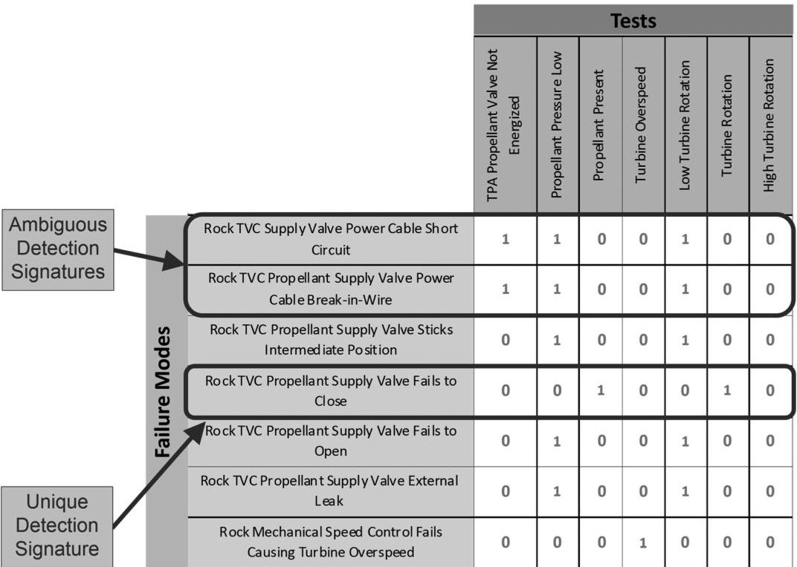

Fig. 2.1 Notional dependency matrix.

<!-- PDF_PAGE: 9 -->

failure effects to be isolated (i.e., tracked back) to a single failure mode. However, nonunique detection signatures result in ambiguity that limits the isolation of detected failure effects to an ambiguity group, where an ambiguity group is a group of failure modes that all have the same detection signature.

As an example of these diagnostic concepts, row 4 in Fig. 2.1 shows that the failure mode Rock TVC Propellant Supply Valve Fails to Close has a unique detection signature. Its failure effects can be detected by the combination of tests Propellant Present and Turbine Rotation. Because no other failure mode can be detected using those two tests in combination, the failure effects can be isolated unambiguously to that failure mode. On the other hand, rows 1 and 2 show that the failure modes Rock TVC Supply Valve Power Cable Short Circuit and Rock TVC Propellant Supply Valve Power Cable Break-in-Wire have matching detection signatures. The failure effects of each of these failure modes is detected by the combination of tests TPA Propellant Valve Not Energized, Propellant Pressure Low, and Low Turbine Rotation. In this case, there is not enough information to isolate the failure effects to a single failure mode.

The lowest level of failure sources are comprised of individual failure modes. However, it is common to perform analyses where the failure sources are at a higher level in the model hierarchy, for example, an LRU—a unit which, should it fail, is designed to be replaced in the field. Determining whether or not a given component meets the criteria for designation as an LRU has to do with the component's accessibility, its interfaces, and the capability to unambiguously isolate critical failure modes originating in the component. FFMs allow system engineers to address the latter concern. Analysis of an FFM's D-Matrix can determine if the test signature associated with each of the component's failure modes can be isolated to the LRU or, instead, has ambiguity with failure modes originating outside the LRU. If any of the test signatures are ambiguous, the component's LRU designation should be questioned.

A simple TEAMS model, Fig. 2.2 is composed of failure sources whose failure effects propagate as "signals" along paths to tests that detect those signals. Failure sources are represented by modules that emit signals representing failure effects. The darker hatched module in Fig. 2.2 represents a broken heating element that emits a signal (failure effect) called "no heat." Tests are collected into groups at "test points," denoted in Fig. 2.2 by the circle labeled Temp-Tests. A test point is typically associated with a sensor. For example, a temperature sensor may have an associated test point with several tests: off-scale low test, low temperature test, high temperature test, and off-scale high test.

Paths are implemented using links, switches, and AND nodes. Links provide the actual connections between nodes in the model. Switches allow for propagation paths to be changed based on the configuration of the system. For example, a spacecraft orbiting the moon may be operating on power from the solar panels most of the time and from batteries when in the moon's shadow. It would be incorrect to identify the solar panels as failed simply because the spacecraft is in the moon's shadow. Changing a switch setting when entering and

<!-- PDF_PAGE: 10 -->

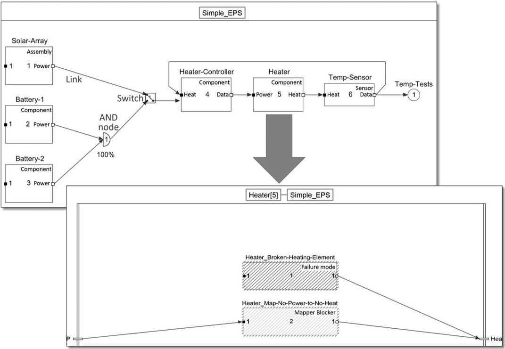

Fig. 2.2 Simple TEAMS model.

exiting the shadow would allow the proper (battery or solar panel) failure effects to propagate. Multiple switch settings, "switch modes," may be collected together as a "system mode." Then the user only has to specify the system mode and all switch states will be set automatically. Used to model system redundancy, AND nodes are characterized by the number of input links and a threshold percentage. If failure effects (signals) exist on a number of input links greater than or equal to the threshold percentage, the signals will be propagated. Otherwise, the signals are blocked and do not propagate further. For example, if the two batteries on the left in Fig. 2.2 operate in parallel and either is sufficient to power the system, then both batteries must be lost before power to the system is lost.

Because a TEAMS model is hierarchical, a module may contain links, switches, AND nodes, test points, and lower-level modules, as shown in the expanded view of the heater in Fig. 2.2. All links are directional. Input ports to a module are on the left-hand side of the module and output ports are on the right-hand side.

TEAMS does not perform physics-based simulation of the failure effects along the paths in the model. However, it does allow the user to transform (i.e., map) one failure effect into another to emulate physical effects at an abstract level. An example is shown in the heater module of Fig. 2.2 where an input failure effect of No Power is transformed into the output failure effect of No Heat by

<!-- PDF_PAGE: 11 -->

the lighter hatched module labeled Heater_Map-No-Power-to-No-Heat. In addition to being able to map one signal into another, the user may also block specified signals at a module.

There are many more features of TEAMS models than can be described in this overview. For more information about the suite of TEAMS tools and TEAMS modeling, see reference [13].

Two relatively simple FFMs are used to facilitate the discussion throughout the remainder of this chapter. The first FFM represents a Basic Hydraulic System (BHS) model, and the second an Advanced Modular Power Supply (AMPS) for a space system. Each of these FFMs has features that make it more suited than the other model for illustrating certain key points.

Assessments of the system's diagnostic capabilities are performed in a process called testability analysis with the FFMs. For this analysis, the user selects the model configuration defining functional flow paths within the model. The user can also restrict the failure modes and sensors tests to be included in the analysis. During the analysis, each failure mode is evaluated individually. The result of the testability analysis is a dependency matrix indicating the tests that detect the functions propagating from each failure mode.

## 2.2.2 BASIC HYDRAULIC SYSTEM FFM

Under NASA's Ares I Project, FFM model developers created a series of supporting tools to assist model development and reporting. To advance and demonstrate FFM tool capabilities, smaller generic systems with minimally required complexity were defined and associated FFMs established. One such model, the BHS, is representative of the actuator portion of a Thrust Vector Control (TVC) system. The BHS model contains two redundant independent hydraulic power sources and two actuators. The actuators work in tandem, gimbaling a rocket engine to direct the thrust. One actuator gimbals the engine along the yaw axis of the vehicle's reference frame and the other along the pitch axis.

This BHS model reflects the FFM approach used for similar models under the Ares I Project. It contains components and features common for dynamic fluid systems and addresses some advanced FFM modeling techniques such as the representation of system-level outcomes as special test points. The model adheres to the most currently employed modeling conventions and practices (Section 2.3.2.3) and will be utilized in Section 2.3 to describe advances in the development, implementation, and application of FFMs that support analytical verification of system design requirements. A brief description of the BHS model follows.

A notional block diagram displaying the fluid flow through the simple hydraulic system represented in the BHS model is shown in Fig. 2.3. The entire system contains two independent hydraulic supply circuits that are cross-strapped to provide primary and backup power to two actuators. Each hydraulic supply circuit is pressurized by a turbine-pump assembly driven by a generic gaseous

<!-- PDF_PAGE: 12 -->

propellant [e.g., gaseous helium (GHe) or gaseous hydrogen (GH2)] , indicated by the dotted flow lines. The pump pressurizes the hydraulic fluid (indicated by double-walled flow lines), which flows through check valve and filter components to a pressure-selector valve and then on to support the actuator load. Each actuator possesses a pressure-selector valve to which the actuator's primary and backup hydraulic supply and return lines are connected. If the primary power circuit to an actuator fails (i.e., loses significant hydraulic pressure) then the selector valve will switch over to the backup hydraulic power source. The hydraulic return portion of the circuit (indicated by solid flow lines) contains a reservoir that provides a low pressurization through mechanical means to support boot-strap power-up of the system. Electric power flow to the propellant supply valve and actuator is represented by the dashed lines.

Figure 2.4 shows the location of sensors in the BHS system. Sensors are indicated by circles and ovals. For each hydraulic circuit, electrical current indicates that the propellant supply valve is energized and the valve's position measurement is available. The BHS also provides a measurement of the inlet propellant pressure to the turbine and the shaft speed of the turbine-pump assembly. Within the hydraulic fluid circuit, the system contains pressure measurements along the supply-side as well as the return-side and a differential pressure across the hydraulic filter. The position of each selector valve, indicating the

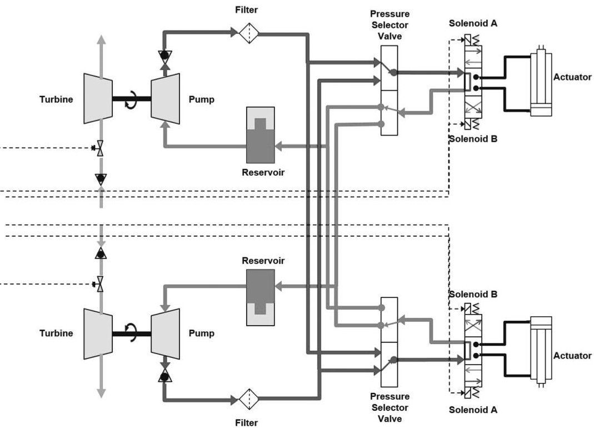

Fig. 2.3 A notional view of the electrical and fluid flows for the basic hydraulic system.

<!-- PDF_PAGE: 13 -->

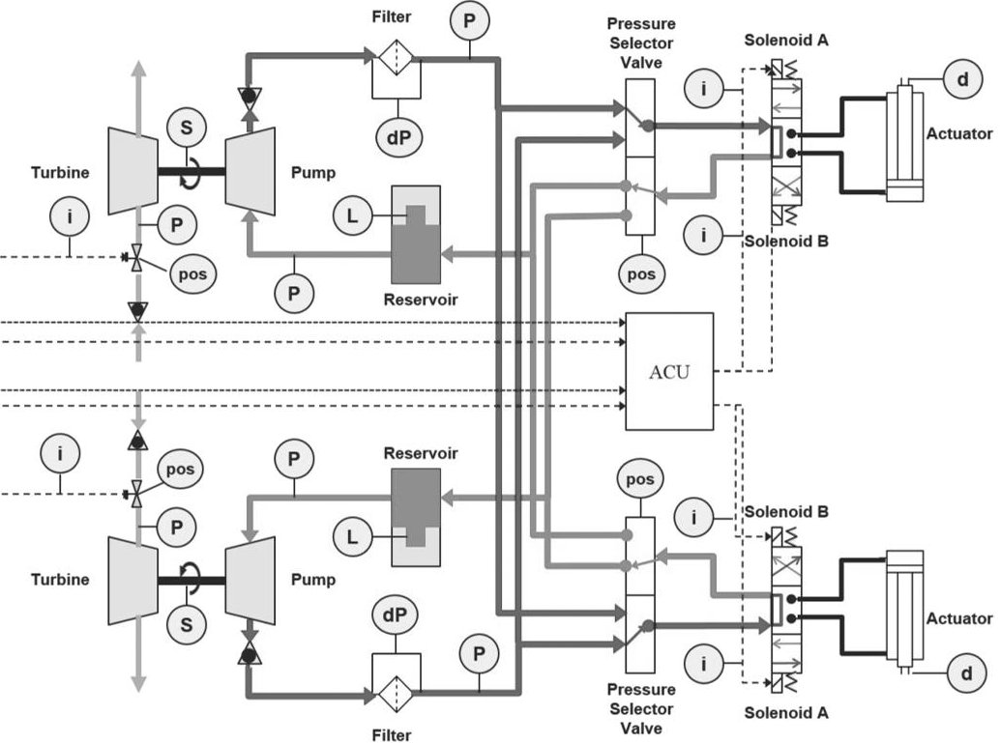

Fig. 2.4 The sensor locations for the basic hydraulic system.

position of primary or backup, is also provided. The redundant electrical power supply to the actuators is distributed through a simple actuator control unit (ACU) to the actuator, driving the actuator in either position. Current measurements for the actuators are provided, as well as the actuator displacement measurement.

There are a number of features within this basic model that make it useful for advancing the development of support tools and analysis processes. The BHS model contains 132 failure modes, including those defining faults for the 34 sensors within the model. Failures indicating loss of propellant supply to the turbine-pump assemblies or loss of electrical power to the valves and actuators are also represented in the BHS FFM. The BHS model utilizes a series of mapper-blocker modules to transition the failure effects of one property (e.g., loss of electrical power) into another property effect (e.g., loss of hydraulic pressure). The BHS model also contains system-level effects defined as test points, intended to enable a combined analysis with low-level sensor detectable effects propagated from failure modes (e.g., low pressure) and higher-level system effects (e.g., loss of actuator function or complete loss of vehicle control). Each of these features is intended to expose the applied tool or process to realistic system representations.

<!-- PDF_PAGE: 14 -->

## 2.2.3 ADVANCED MODULAR POWER SUPPLY FFM

NASA has developed an AMPS as an engineering prototype and analysis system for spacecraft electrical power systems [24]. The AMPS project developed, demonstrated, and evaluated key modular power technologies to minimize nonrecurring development costs and to reduce recurring costs associated with integration, mission operations, and maintenance. To achieve these goals and advance the development of AMPS systems, the project included an FFM-based diagnostic system. The hardware and associated diagnostic capabilities are herein described as a basis for the discussion of advances in FFM for operational support (Section 2.3.4.2).

The AMPS consists of Main Bus Switching Units (MBSUs) and Power Distribution Units (PDUs), with interfaces to power sources and electrical equipment. The MBSUs receive power from a simulated Solar Array or from an actual lithium ion battery. The AMPS is designed so that any electrical equipment can receive power via multiple redundant sources of power. Each of the units contain power sensors, remotely controlled switches, and a Compact Real-time Input Output (cRIO) processor. This processor performs analog to digital conversions and engineering unit conversions of the sensor data and accepts and routes external commands to equipment. An external AMPS Power Controller receives data from each of the component's processors, while operator interface applications display data and accept commands to turn switches on and off, configure setpoints, simulate failures, etc.

The AMPS MBSUs and PDUs contain switches, power supplies, busses, a cRIO processor, sensors, and structural components. The AMPS FFM models these components, their failure modes, and relevant electrical loads. The electrical loads can be simulated with Programmable Load Banks (PLB) or actual electrical equipment can be used if available. An overview of the AMPS system is shown in Fig. 2.5. In the system, an electrical load is connected to each of the PDU output channels. For illustrative purposes only, however, three loads are shown in Fig. 2.5. These loads represent three typical classes of loads that include critical loads, requiring redundant power inputs to a single load; high-power loads, requiring more power than a single power channel can provide; and normal loads, requiring a single power input.

To use the FFM for operational diagnosis, the TEAMS (hereafter referred to generically as the "FFM development software") diagnostic reasoner is used along with interface and data processing software. The reasoner loads the run-time model at initialization and the interface/data processing software obtains data from the system, performs tests on that data, and then packages the data for transmission back to the reasoner. Results are returned from the reasoner and distributed to displays, to other reasoners, to diagnostic logs/databases, to other applications, or to end-users.

Prior to use by the reasoner, sampled real-time data must be analyzed and converted to actionable knowledge that can be used by the diagnostic reasoner.

<!-- PDF_PAGE: 15 -->

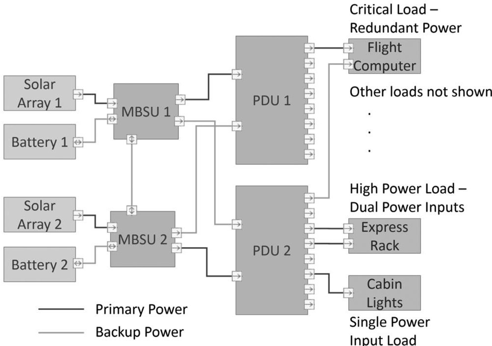

Fig. 2.5 The AMPS architecture indicating the primary components and the electrical power connections between them.

To do this, specialized interface and data processing software is used to apply diagnostic tests embodied in the FFM to the data and classify the result of each test as pass, fail, or unknown. The diagnostic reasoner operates on results of the classification process.

The AMPS model includes failures requiring different approaches to testing and diagnosis. The failure types that have been modeled are:

Component total failures. The MBSU and PDU components could suffer a failure that results in a complete loss of function. Either a failure of the cRIO, or a loss of power to the cRIO, could result in the absence of power or data outputs, that is, a "dead box" failure. These failures are detected by the absence of data from the component, and because no data is available, isolation of the specific fault is not possible without manual testing inside the component.

Switch failures. Both the MBSU and PDU contain power switches that control the power inputs and outputs, and the switches contain sensors that measure the actual state of each power switch. Two common failure modes of a switch are a "fail open" condition, in which the switch fails to provide power when commanded, and a "fail closed" condition, in which the switch fails to turn off when commanded. Switch failures are detected by a discrepancy between the commanded state and the actual measured state of a switch and can be supported by electrical measurements such as current or voltage.

<!-- PDF_PAGE: 16 -->

Short circuits. A short circuit on a line is typically characterized by a current spike followed by the tripping of a circuit breaker. The current spike will be brief, no more than a few milliseconds. Because the current sensors in the AMPS system are only read once per second, it is probable that the current data will look normal—loads can be switched on and off—and the only indication of the short circuit will be an indication that the circuit breaker has tripped. Distinguishing between an actual short circuit and a "false trip," in which a breaker trips due to a switch malfunction, requires sensor sampling rates much higher than available in the AMPS system.

Load overcurrent. An overcurrent of an electrical load is characterized by current rising over a period of time above a peak threshold, and possibly exceeding the circuit's overcurrent trip threshold. For example, a pump with a degrading bearing could require increasing power to overcome friction forces in the pump, and if the degradation is significant enough, could draw more power than the circuit is capable of providing. Operating with more load on a circuit than allowed, such as connecting too much equipment to a power strip, could also induce an overcurrent and a switch trip. For AMPS diagnosis, if current above a load threshold is observed for at least a few seconds prior to a switch trip, a load overcurrent fault is diagnosed.

The sensors and data used to detect and isolate the AMPS failures include:

Loss of data. The failure of a PDU or MBSU results in no data from the component. In the AMPS system, when data is lost, nothing is received from the component. In many systems, however, data will continue to be received but each element may be labeled as static, or processing may need to be performed to detect that none of the data is updating as expected.

Switch states. Sensors provide the actual open or closed states of switches, and component software provides the commanded state of switches. AMPS software includes a mismatch indication when the commanded state and the actual state differ.

Switch trip indications. If a switch has tripped due to an overcurrent, a trip sensor in the switch sets a trip indication.

Voltage sensors. Voltage measurements at the PDU inputs from the MBSUs are used by the diagnostic model to determine if power is being delivered by the individual MBSUs. A voltage of 60 volts and above is understood to indicate normal power, and a voltage below 60 volts is understood to indicate that the MBSU is not delivering power. Normally power is either close to 120 volts, indicating good power, or near 0 volts (allowing for sensor "noise"), indicating no power.

Current sensors. Amperage is measured on each PDU and MBSU output channel and is used to detect over-current faults.

<!-- PDF_PAGE: 17 -->

The AMPS model represents failures typical of operational spacecraft power systems. The model contains about 70 failure modes and uses about 70 data elements. The model was constructed to diagnose failures for which sufficient data is available to isolate the failures, so with a single fault there is no diagnostic ambiguity.

## 2.3 ADVANCES IN FFM DEVELOPMENT, IMPLEMENTATION, AND APPLICATION

Successful FFM applications result from following a proven set of procedures that have systematically evolved and been defined by experienced modelers. In this section, advances in FFM are presented in the context of the FFM development, implementation, and application process [23] shown in Fig. 2.6. The discussion begins with an overview of the FFM development, implementation, and application process. This is followed by a detailed discussion of each step of the process. As part of this discussion, advances in FFM are described where they are first used in the process.

The FFM development process shown in Fig. 2.6 is an iterative process with four primary phases: 1) knowledge acquisition, 2) conceptual design, 3) implementation and verification, and 4) application. Although these phases are shown in series, the phases are inherently coupled. Shown as the initial phase, knowledge acquisition is typically an ongoing activity throughout the entire FFM process. This is especially true if qualitative FFMs are developed early in the system design cycle and evolve with the system design. As this evolution takes place, new or revised design knowledge is periodically generated and must be incorporated into the FFM. Examples of this knowledge are 1) review board approved design changes and 2) enhanced understanding of the system application as a result of verification and validation. The second phase, conceptual design, involves defining the architecture and constructing the FFM. Knowledge gained from Phase 1 is initially flowed into this phase; however, subsequent modifications to the FFM may be required due to evolving requirements, system design data, and results obtained during verification and validation. Under the third phase, implementation and verification, the initial FFM is developed, verified, and validated. As with prior phases, evolving system requirements and knowledge are likely to require that the FFM be periodically revised, reverified, and revalidated. The fourth phase, application, involves using the FFM to conduct analyses supporting the systems engineering development process and online detection and isolation of failures. In an effective systems engineering process, results from this phase will inevitably feed back into the system design. As the system design matures, the FFM will reflect that as well and require fewer revisions and less maintenance.

Although specific aerospace applications may require modification of this generally accepted process, the primary functions outlined here are commonly practiced by the majority of current FFM modelers. The following sections provide more details of these four key steps in the FFM process.

<!-- PDF_PAGE: 18 -->

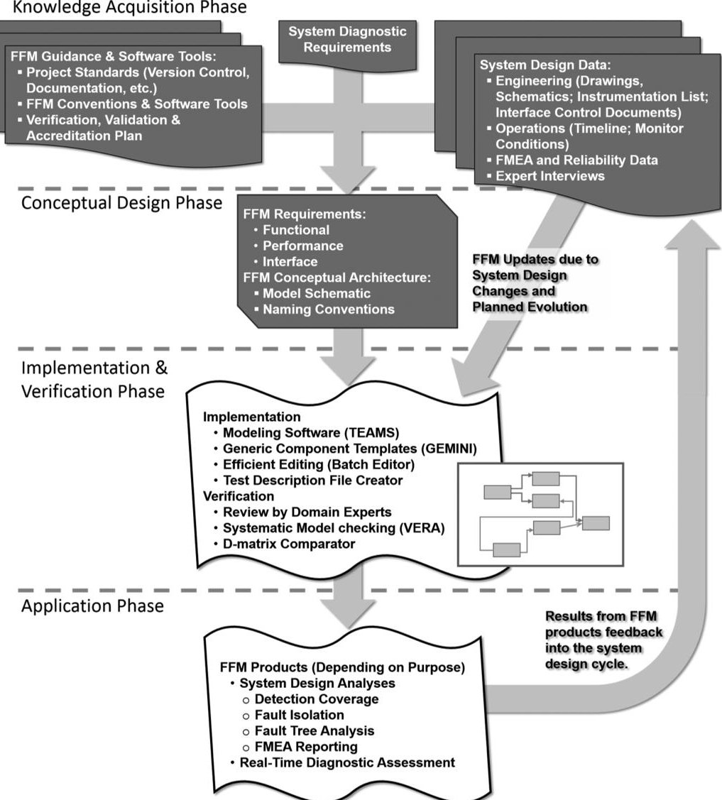

Fig. 2.6 Functional Fault Model development process.

## 2.3.1 KNOWLEDGE ACQUISITION

Note in Fig. 2.6 that the knowledge acquisition phase includes two main components: 1) system design data, and 2) FFM guidance and software tools. Connecting these are the overall system diagnostic requirements that flow down through the whole FFM model development process. As described next, knowledge acquisition for system design pertains to the application that is being modeled, and knowledge acquisition for FFM guidance and software tools pertains to the FFM development process.

System Design Data: For the first phase in the FFM development process, collecting information about the system under consideration for the FFM application

<!-- PDF_PAGE: 19 -->

is obviously an important initial step in the model development process. Documentation that is typically generated for a project can be found in several forms, such as:

- Concept of operations

- FMEA

- Schematics and instrumentation lists

- Interface definition and control

- Ground systems and maintenance procedures

The above items are not intended to be an exhaustive list, but they do illustrate the comprehensive set of information and data that might be needed when building the FFM concerning engineering, operations, and safety and mission assurance knowledge. In addition to written information, domain experts offer a source of information that can be acquired through informal as well as formal project meetings. Each setting offers a different type of opportunity in which to learn and gather information for the FFM application. For example, informal meetings with system designers may provide practical modeling information, whereas project design reviews are responsible for approving changes to the design that will affect the final FFM product. If the FFM is to be applied to hardware, information about the testbed and facilities will be important as these may be incorporated into the model.

If the FFM application is based on new technology or concepts, then there may be a lack of system design information. In this case, research can be performed to obtain the domain information that can support the development of the FFM. The means to gather information can largely be accomplished via the Internet where web-based search engines and data bases may provide usable information. In that same manner, the American Institute of Aeronautics and Astronautics (AIAA), the Institute of Electrical and Electronics Engineers, the National Aeronautics and Space Administration (NASA), and other organizations maintain their own websites that contain information specific to their sponsored activities and research. Even with an exhaustive literature search, there can still be applicable information that is not readily obtainable because it is proprietary. In such cases where the FFM application is similar to a previous one, reusing, modifying, or just examining the previously developed model will provide insight that can be adapted to the current application.

FFM Guidance and Software Tools: In addition to system design information that is collected to model the application under consideration, the FFM development and modeling process will have domain information that needs to be identified as well. Knowledge acquisition for the FFM development and modeling process will involve recognizing domain information, whether it is collected in documentation or informally practiced by established FFM development teams. Conventions and standards that define modeling best practices, as well as plans

<!-- PDF_PAGE: 20 -->

for accreditation and Verification and Validation (V&V) procedures, are needed for successful FFM development and must be established if they are not already defined. In addition, configuration management for the FFM application will track its development, and organization of the associated system design information will facilitate modeling accuracy. Depending on the scope of the project, configuration management may be handled in a formal or informal manner. Software utilities that facilitate modeling, analyzing, and verifying the FFM application will also need to be identified. These tools aid the FFM development team and provide consistency within the modeling environment. From the knowledge acquisition process, the following documentation and software utilities are typically identified for the FFM development process:

- Conventions and standards for modeling

- Standards and plans for accreditation and V&V

- Configuration management plan

- Software utilities for consistent modeling, editing, and verification checking

As before, with the system design domain information, this list is not intended to be all-encompassing, but to provide examples of the typical types of domain information that will be utilized during the FFM development process. When domain information is lacking from the systems engineering design and modeling process perspectives, the FFM development process can lack direction and consequently may not deliver a product that the customer has confidence in. When the FFM development team is experienced, they may already be performing modeling that adheres to recognized standards and conventions, which may or not be captured in documentation. If they are not documented, then it would be prudent to record those best practices so that they are standardized and available to others for reference. Similarly, accreditation and V&V may be performed informally, but when those procedures are documented they become a recognized set of guidelines that, when followed, ensure an FFM product that conforms to project expectations. Software utilities that aid the modeling process create FFMs that can be easily integrated, verified, and validated. As the FFM development team acquires experience and knowledge, the development of software utilities that customize the modeling process, the analyses performed, and the assessment of results are a typical outcome. Whereas these software utilities may be specific to a particular software package, the general concepts and application are relevant to any FFM development.

## 2.3.2 FFM CONCEPTUAL DESIGN

The general architecture of the FFM may be composed of subsystems, individual components, other ancillary hardware, and instrumentation; in addition, connectivity between these elements is established and failure modes are defined.

<!-- PDF_PAGE: 21 -->

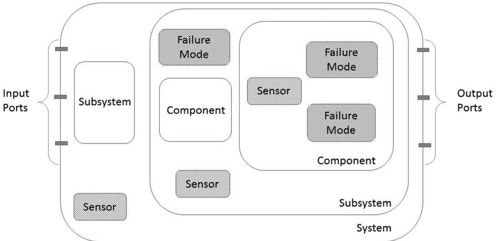

Fig. 2.7 Representative FFM.

Collectively this defines a basic FFM, and a diagram for a representative model is shown in Fig. 2.7.

Here, the representative FFM does not show the interconnections that exist among the system, subsystem, components, sensors, or failure modes because the diagram is only meant to show the basic building blocks of the FFM. In addition, accurate modeling of the flow of information in the FFM can be represented with other advanced modeling elements that are not shown here. More defined and complex FFM diagrams that illustrate the different connections and modeling elements that can be used are shown through the applications in this chapter.

The complexity of a given FFM will depend on the application being modeled, the requirements that need to be satisfied, and the model's intended use by the customer. The customer for the FFM, and the analyses and information it provides, can aid in its construction by interacting with the modeler during all phases of its development, testing, and validation. Likewise, the FFM can be modified and enhanced by the developer based on knowledge obtained through continued collaboration with system designers, the hardware and fabrication processes, and all phases of testing.

The remainder of this section provides a description of these three items: 1) system design and diagnostic requirements traceability, 2) FFM architecture, and 3) modeling conventions and best practices. These three items build the foundation for a well-developed FFM. Effective FFM applications cover the needed system and diagnostic requirements, build a structured architecture that supports the needs of the system designers and the project, and employ appropriate best practices that produce useful models and analyses results for all stakeholders.

<!-- PDF_PAGE: 22 -->

## 2.3.2.1 SYSTEM DESIGN AND DIAGNOSTIC REQUIREMENTS TRACEABILITY

During the knowledge acquisition phase, system design and diagnostic requirements are collected that guide the FFM developer with specifications that must be modeled and analyses that must be performed to ensure that required objectives are achieved. The FFM product may be used for a variety of purposes, such as supporting design development, analytical verification of diagnostic coverage, and real-time monitoring and assessment during operations. These functions are often related to supporting formal project-level reviews and documentation, as well as informal analyses requested from system designers. As such, the FFM provides a systematic way for tracing the propagation of failures in the system design and exposes where requirements are not met or may not be needed. Essentially, the FFM can be used for analyzing the defined system and assessing diagnostic results, and it can also be used as an experimental tool for answering questions and interrogating the system.

FFM requirements should include functional requirements, performance requirements, and interface requirements; these are often defined by the system designers with influence from the project level regarding feasibility and implementation. For example, a requirement from a system designer may not be feasible due to cost or schedule impacts. In that case, the project management and system designers must work together to determine a resolution. Functional requirements define the failure modes the model must detect, the mechanisms available to detect them, and the level of isolation (e.g., component, subsystem, system) required for each failure mode. Functional requirements also include the analyses the model will be required to perform. Under NASA's Constellation and Space Launch System (SLS) Programs, advances in FFMs have resulted in a number of new analytical approaches to support verification of system diagnostic requirements and algorithms. Examples of these new approaches include the verification of fault isolation requirements for proposed line replaceable units, the verification of algorithms to detect launch commit criteria, and sensor sensitivity studies designed to assess the impact of sensor loss to diagnostic capability. Performance requirements describe how well the FFM must function and typically include quantitative bounds for metrics like the time required to detect a failure mode and the accuracy of the diagnoses, the latter being quantified by false positive and false negative rates. Interface requirements may specify the nature of the interface between FFM subsystems that will eventually be integrated into a system-level FFM; or, in the case of real-time assessment, the interface between a data bus and the FFM.

## 2.3.2.2 FFM ARCHITECTURE

The FFM architecture is primarily based on the model schematic for the system where the subsystems, components, instrumentation, and connectivity are defined. FFM development software usually supports a hierarchical model structure, where a given model element can contain other model elements. In this structure, the lowest model elements represent either failure modes or mapping functions that define the transition of failure effects through nominal

<!-- PDF_PAGE: 23 -->

components. This hierarchical structure allows the model developer to trace failure modes and other functions through the system. For small FFMs, a flat hierarchical structure—a structure in which the entire system structure can be displayed on a single level—may be sufficient. For larger models, the system may need to be decomposed into subsystems, and then into assemblies, modules, components, and parts, until the required model fidelity is obtained. If required for analysis, system elements that have special designations, such as line replaceable units, can also be easily defined in the FMM.

Component selection criteria should be based on requirements levied on the FFM by the program. In general, the FFM should only include components that are relevant and could, therefore, influence model configuration or contain credible failure modes. Credible failure modes are usually ones that have been categorized as critical and defined as such in formal requirements and system design documentation. It is recommended that the depth of the FFM hierarchy be somewhat consistent across the various subsystems included in the top-level system FFM. The fidelity of data in FMEAs, historically used to provide failure mode data to FFMs, can vary widely from component to component. This has an effect of biasing assessment metrics. FFM developers should be aware of this possibility and strive to balance model fidelity across components and subsystems.

When defining the system elements, it is useful to organize information into a System Breakdown Structure (SBS). This structure ideally captures the breadth and depth of the decomposed system (i.e., hardware and software elements), provides a mapping of other element data that will be used in the FFM (e.g., element and failure modes named to defined conventions), and initiates an understanding of failure-propagation pathways. Here, the breadth of the model is represented by the list of components that must be modeled, while the depth is represented by the various hierarchical levels. Identifying the overall structure of the FFM, both breadth and depth, is an important part of the conceptual design. Using the SBS to explicitly identify components that are to be included in the FFM, to identify components that should be excluded from the FFM, and to define the representation of included components will confirm the expectations of the customers and consumers of the FFM and results of associated diagnostic assessments. For large models, this decomposition of the FFM can facilitate the parsing of model development work to various members of a modeling team.

Standardizing and documenting element names prior to implementation provides for more efficient modeling. This is especially true during the integration of FFM partitions that were previously delegated to different modelers. In addition, making names succinct and consistent aids in readability of both FFM diagrams and reports. One of the challenges to FFM development is that the same failure for a component can be described in numerous, sometimes ambiguous, ways (e.g., a valve can fail open vs fail full open, or fail part open vs fail part closed). And the same name can be interpreted differently by each developer. Providing a failure mode dictionary that consistently names the failures provides continuity among the same elements in different subsystems and catalogs the same failure mode across a large FFM.

<!-- PDF_PAGE: 24 -->

The FFM architecture also needs to take into account the mission timeline for the modeled application. The establishment of an operational profile for the system is essential in determining the complexity of the modeling required to represent the various configurations; this is especially important for an FFM that is used for real-time diagnostics. For the FFM, a system mode typically defines a unique model configuration that establishes specific failure mode propagation paths and determines the subset of active failure modes and available tests. In realtime applications, consideration of system mode definition must be made when test thresholds are changed due to the operational profile, even though the model configuration remains the same. Some systems may have very simplistic operational modes (e.g., on or off), whereas other systems may have complex operational modes that are not easily represented.

## 2.3.2.3 MODELING CONVENTIONS AND BEST PRACTICES

Representing a system's failure space can be done in a number of ways. Each developer will envision that representation differently depending on their domain expertise and modeling experience. Often, a large system model may have multiple developers or be developed over an extended period of time. Inconsistencies in the way model elements are represented or the location of system data within the model can result in modeling errors that are difficult to find and resolve. In addition, inconsistent representation can make interfacing with other supporting software tools and real-time diagnostic applications impossible. The key to minimizing these model development issues is to establish a set of modeling conventions and best practices.

The objectives of the modeling conventions and best practices are to provide a guide for developers to follow that will 1) provide a consistent look and feel to the model, 2) facilitate integration of the model with other functional fault models, 3) enhance diagnostic reporting and model verification by providing traceability to source documents within the model, 4) standardize the interface with external processing tools and real-time diagnostics, 5) allow reusable component libraries to be developed, and 6) accelerate model development and verification through the use of automated or semi-automated tools. In addition, best practices provide modeling solutions to various implementation and development issues. Overall, modeling conventions and practices will reduce the overall model development costs and should result in a model that better supports the intended application.

For the past two to three decades, NASA has been developing and evolving FFM technologies for application to space flight systems. Requirements and expectations for these models have expanded as well. An important advance in FFMs resulted as model development teams identified the need to establish a common and consistent set of modeling conventions. Early drafts of conventions for launch vehicle and ground operations FFM applications [22] appeared in 2008 under the NASA Constellation Program. These conventions and practices were eventually expanded and documented in Report K0000190582-GEN NASA

<!-- PDF_PAGE: 25 -->

Ground Systems and Launch Vehicles Testability Engineering and Maintenance System (TEAMS) Modeling Conventions and Practices [14].

This report specifically supports or has supported the model development for the SLS Mission and Fault Management (M&FM) Integrated Vehicle Failure Model (IVFM) team; the Command, Control, Communications & Range (C3R) Project Advanced Ground Systems Maintenance (AGSM) Element-Fault Isolation and Functional Fault Modeling team; and the Autonomous Mission Operations (AMO) EFT-1 ACAWS team. The document covers basic model development concepts, such as the level of model fidelity and how to represent failure modes, as well as specific modeling best practices, such as representing test point elements locally within the model or at a remote location external to the modeled system and the issues to consider with either approach. In some cases, these modeling practices can be directly tied to conventions that can further facilitate and support the development approaches. The conventions address the location of key system information in model element names and labels as well as the elements' appearance, such as color and style.

To illustrate the impact that these conventions and practices can have on a model, we review portions of the Basic FFM described in Section 2.2.2. Fig. 2.8 shows how following the conventional appearance requirements enables immediate distinction of the general component modules that are a blue-no-fill style

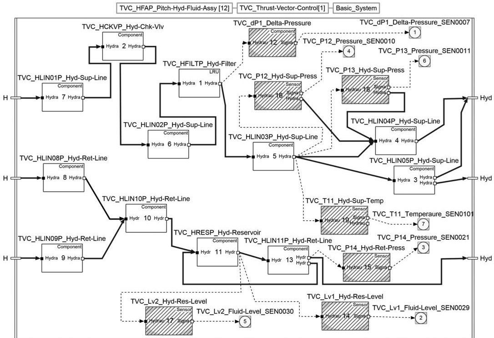

Fig. 2.8 Modeling conventions and best practices [14] applied to example FFM displays distinction between types of components represented.

<!-- PDF_PAGE: 26 -->

(shown as no-fill style in Fig. 2.8) with the sensor modules that are a blue-hatched style (shown as hatched style in Fig. 2.8). Similarly, in Fig. 2.9, failure modes modules in a red-hatched (i.e., modules 1 and 2) style are distinguishable from mapping modules in the green-hatched (i.e., modules 3 and 4) style. Maintaining these appearance conventions throughout the model development creates that common look-and-feel environment that facilitates not only developer peer reviews of the models, but also reviews conducted with domain experts where this common appearance increases the credibility level with the expert.

Defining conventions that require that the location and content of the system design information be specified within the FFM allows modelers and stakeholders to trace model elements to their source documentation. Model element names, property labels, and internal fields can contain key pieces of data that support analysis reporting. Structured, defined content facilitates integration of the models with other independently developed models and interfacing within realtime diagnostic applications. For example, the current FFM convention [14] for the failure mode module name is,

<Subsystem ID>_<Schematic ID>_<Description>_<FMEA ID> where

<Subsystem ID> is an identifier (ID) of the highest-level subsystem module where the failure mode originates

<Schematic ID> is a unique ID for the module containing the modeled failure mode, taken from the reference schematics used to develop the system model

<Description> is a text description, short and concise, of the failure mode where words are separated by dashes " -"

<FMEA ID> is an ID for this failure mode from the FMEA of the modeled system, if available (if the FMEA ID is not available either because there is no FMEA of the modeled system, or this particular failure mode was not included in the system's FMEA, then "NA" will be entered, indicating the ID is not available)

By formalizing what system design information will be included in the model and where it will be included, interfaces with supporting software can be more easily created and supported. In addition, the conventions facilitate traceability between the system design and the FFM, which supports overall verification and accreditation. For example, having specific formats for model inputs enables automatic verification and checking of the FFM.

## 2.3.3 FFM IMPLEMENTATION

Over the past five to seven years, the implementation of FFMs has advanced from being an art form with few documented standards and practices to a reasonably

<!-- PDF_PAGE: 27 -->

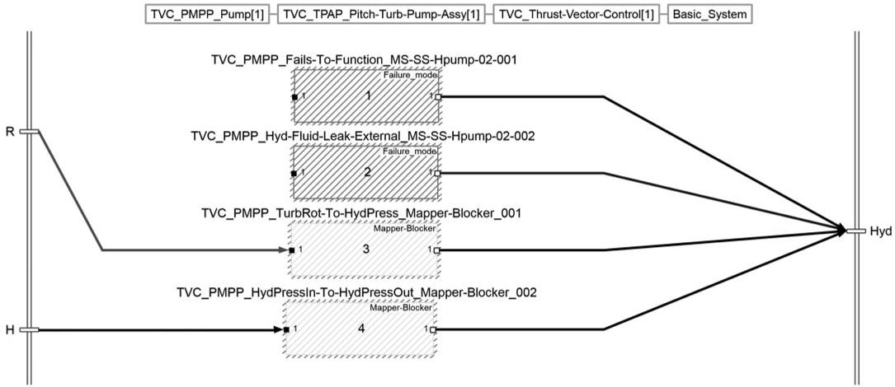

Fig. 2.9 Modeling conventions and best practices [14] applied to example FFM model displays the low-level distinction between failure mode modules and mapping modules.

proficient modeling technology with well-documented guidelines. Still, individual modelers working independently will typically represent the failure space of a given subsystem or component using inconsistent nomenclature and modeling constructs. This can lead to incompatibilities, confusion, and verification issues during the integration of these models into a system-level FFM. Hence, it is important that individual modelers adhere to the modeling conventions and guidelines established during the conceptual design phase. Once the components to be modeled (breadth) and the hierarchical structure (depth) are defined, the FFM development team can begin the process of building the model with FFM COTS development software and in-house software tools.

For example, during much of the time this work was being performed, the COTS software did not provide a user-friendly global find-and-replace capability. Consequently, NASA developed the Batch Editor [15] as a standalone software tool to fill that void. The Batch Editor provides a user with a means to extract data from, and make broad changes to, a model. For example, the user can query an FFM for the names of failure modes, review the resulting CSV (Comma Separated Variable) file to identify and globally correct misspelled or incorrect names, and then use the Batch Editor to impose changes embodied in the revised CSV file on the FFM. The Batch Editor currently supports over 100 editing commands, ranging from simple "get" and "set" commands to complete model creation from a sequence of commands. It is being used by FFM modelers within NASA's SLS and Orion programs.

## 2.3.3.1 GENERAL MODELING APPROACH

The architecture and construction of the FFM will depend on the purpose of the model, the scope and complexity required, the establishment and organization of the modeling environment, and the preparation and planning to support its

<!-- PDF_PAGE: 28 -->

intended use. In general, the FFM is expected to provide analyses related to systems health management that pertain to fault detection and isolation. In particular, requirements for analyses, such as those needed to support ground-based diagnostics and maintenance or real-time capabilities, can be specific to the system being modeled. These and other considerations will affect the architecture and how the modeling elements are defined because, if they are not part of the initial model implementation, it may be difficult to include them later.

The scope and complexity required of the FFM will depend on the type and number of physical domains being modeled. For example, an FFM that is being used to model the operation of a battery will be very different than one being used to model an entire electrical power system. In addition, the model may need to include more than one type of physical domain, such as when applied to a main propulsion system that includes systems for the fuel, oxidizer, hydraulic actuation, and electrical power. More complexity must be managed when the application is a space vehicle where there are systems that include the electrical power system, engine, main propulsion system, avionics, and control and actuation systems. Consequently, using the SBS to partition the system into subsystems, which can be modeled independently, should simplify the implementation of the system-level FFM.

The establishment and organization of the modeling environment facilitates FFM best practices and will result in a model that is based on well-defined and agreed upon guidelines. Following the modeling conventions and practices, previously discussed in Section 2.3.2, ensures that the FFM is built with special consideration given to naming components and other ancillary modeling elements, so that it is familiar to users with knowledge of the system design. Furthermore, using a predefined set of rules will ease modifications and automatic updating of the model because it is based on a structured framework. Along with using approved guidelines, the modeling environment can also benefit from using generic components as shown in [19]. Generic components provide a means to create models that have a commonality for like components; these can assist in easing the development of the FFM, especially for inexperienced modelers. In addition, generic components can improve the integration process when smaller models are assembled into a larger one, as similar components are fundamentally set up in the same manner but may be modified for their specific placement in the FFM. For example, this implies that a valve modeled in one subsystem is set up in the same manner when that same type of valve is used in another subsystem, thereby eliminating the need to create two different valve models that may confuse analysis results.

Pertaining to space-based applications, the FFM application ultimately will be used to conduct systems health management analyses as shown in reference [17], and may possibly be used as a tool for trade studies and investigations that might be needed to resolve design changes. For example, the criticality of a failure mode typically needs to be defined in the FFM so that it can be used for identification purposes when performing a testability analysis. Likewise, other analyses might

<!-- PDF_PAGE: 29 -->

involve knowing caution and warning, redundancy management, or launch commit criteria information because these can specifically identify information related to a failure mode, component, or other modeling element. Instrumentation and test points are used in the FFM much like they are in hardware as a way to obtain information about the system state. Consequently, each test point should be identified by its type (pressure, temperature, etc.), phase of operation (ground, prelaunch, flight, etc.), and objective (operational, ground, experimental, etc.).

## 2.3.3.2 FFM DEVELOPMENT USING GENERIC COMPONENT MODELS

Even with a core set of conventions and practices and a suite of support tools, FFM development may require significant time and resources. Model elements containing qualitative failure mode and diagnostic testing information that are entered manually are subject to human-touch errors (e.g., typographical errors). The desire to reduce these human-touch errors motivated the advancement of many of the FFM software tools. However, although these tools have been largely successful, there is still significant manual effort involved in establishing the model structure and connecting elements to create the proper propagation paths.

A system schematic may contain hundreds of components, but typically has only a few tens of unique component types that make up the system. If each component is individually crafted by the modeler, it is likely that there will be inconsistencies in the way similar components are represented across the system, such as the textual wording of failure mode data, establishment of propagation flow paths, and transition of functions through a component—or even the simple location and style of modeling elements. Such inconsistencies cause confusion during model reviews and during the transition of an FFM from one modeler to another. To illustrate this, Fig. 2.10 shows the FFM representation of two identical valve components. Although both implementations of the valve provide the same functionality, the structure and details of the models differ. If these two models were included in the same system-level FFM, they would likely frustrate model reviewers, requiring them to unnecessarily spend time assessing the functional equivalence of the models and reconciling the differences.

Looking at these two component models in detail, Fig. 2.11 zooms in to highlight the failure mode naming distinction and illustrate the need for conventions when naming modules within the FFM development software. Both valve models contain failure modes for the valve failing to open when commanded. In the Valve 1 model (upper left frame), Failure mode 1 is named "Valve-Fails-to-Open," while in the Valve 2 model (lower right frame), Failure mode 1 is named "Valve-Remains-Closed." Although this inconsistency appears to be simply a difference in semantics, it will cause unnecessary problems in reporting and interpreting diagnostic assessments generated from the FFM and will add an unnecessary burden during verification and accreditation processes.

In addition, inconsistent FFM module representation can lead to an imbalanced diagnosis across a larger integrated system in which similar components

<!-- PDF_PAGE: 30 -->

could have varying degrees of model fidelity and detail. This often results in confusion from the overall system diagnostic assessment. For example, similar components in different subsystems within the same FFM could model the same failure mode space in completely different ways, again requiring additional effort on the part of the reviewers and integrators to align them. As an example, refer to Fig. 2.10 where failure mode modules are represented by darker hatched, rectangular boxes. The valve model in part a of Fig. 2.10 represents the failure space with six (6) failure mode modules, while the valve model in part b represents the same failure space with four (4) failure modes.

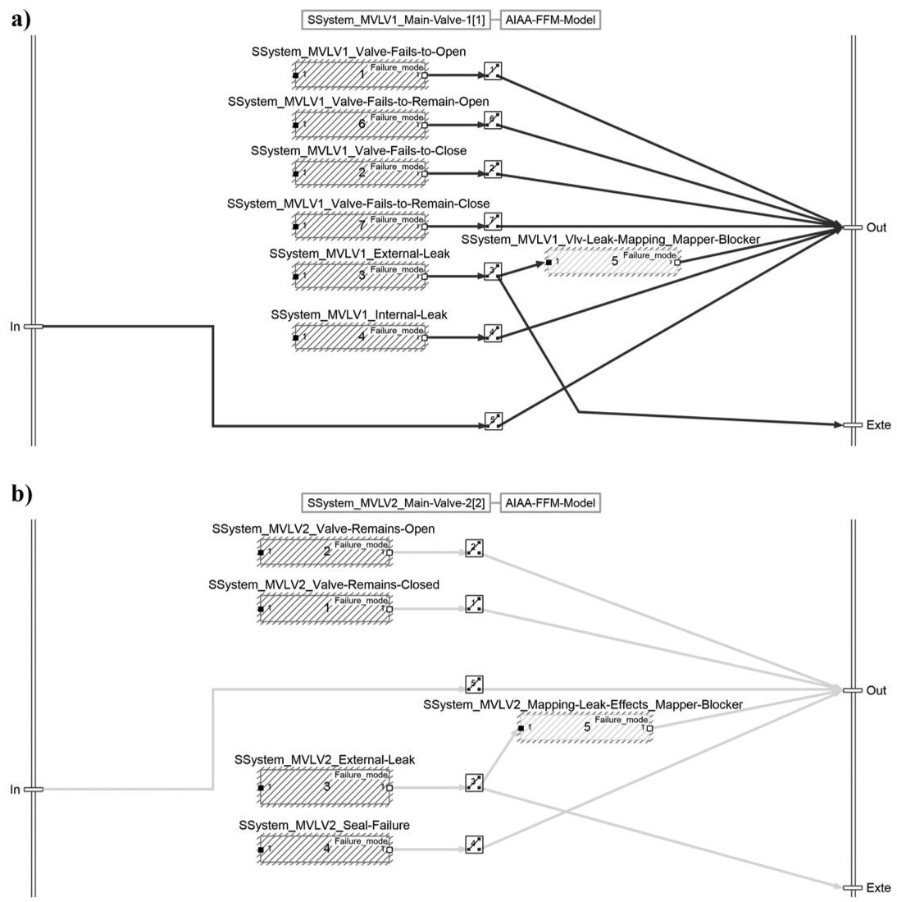

Fig. 2.10 FFM representations of two sets (a and b) of identical valve hardware illustrate the variations that can occur when models of identical components are developed individually.

<!-- PDF_PAGE: 31 -->

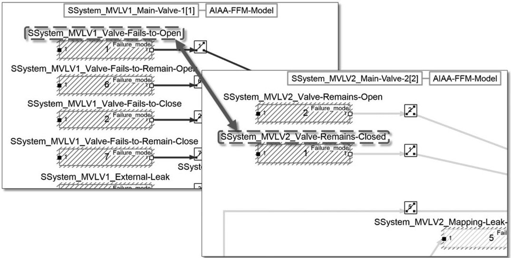

Fig. 2.11 FFM representations of two common valve components zooming in on a specific variation between the models.

Previous diagnostic modeling efforts identified the advantages of establishing a library of component models that could be used as building blocks in constructing future FFM system models [8, 19]. Although the concept of component libraries is not new, current versions of the FFM development software do not natively support reusable component libraries. To work around this limitation and advance FFMs, modelers working under the NASA Ground Systems Development and Operations (GSDO) program's AGSM project developed in-house tools to support the use of FFM component libraries [22].

FFM libraries containing generic component models were advanced as one means of overcoming the previously described issues. Although the idea of generic models is not new, the use of generic models in the FFM domain is recent and still maturing. Figure 2.12 illustrates the FFM development process where Generic Component Models (GCMs) are established initially for candidate component types that are common in the FFM. The GCMs are then "instantiated," meaning that information placeholders are updated to reflect the specific representation of the final component, the Instantiated Component Model (ICM). These ICMs can then be integrated into the general system-level FFM. Under the AGSM application, systematic verifications were performed at the GCM, ICM, general system-level, and final system-level stages of FFM development. Based on experience with the initial application of this process, researchers estimated an 80 percent reduction in component module development costs [19]. The GCM models can be maintained in a library that is then available for future FFM efforts, further reducing overall development cost.

This generic component model development process took advantage of approved modeling conventions [14] and extended them to the generic

<!-- PDF_PAGE: 32 -->

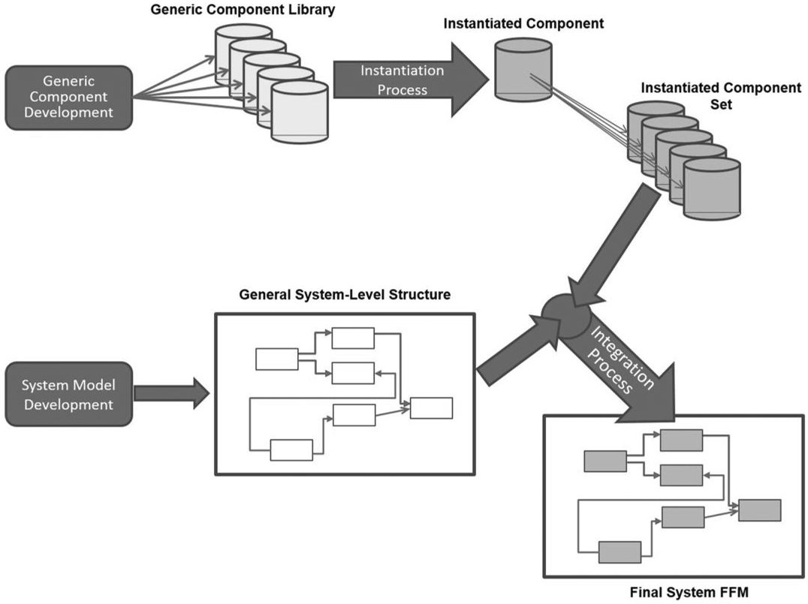

Fig. 2.12 FFM development process with generic component modeling included.

component modeling, which in turn facilitated the development of a software tool called GEMINI. This software tool enforces the modeling conventions during the instantiation process and guides the user through the various places in each GCM that can accept system-specific input.

Generic component model development processes like the one discussed here are essential in areas where similar components are being modeled over and over. Establishing an accepted library of component models that the developer can draw from can result in more rapid model development and models that have a more consistent look and feel. Having a formal development process also enables a structured verification approach to be applied throughout the FFM development cycle, which enhances the process of accrediting FFMs.

## 2.3.3.3 VERIFICATION AND VALIDATION OF FFMS

Once the FFM is developed and built, it must be evaluated to ensure that the model is constructed properly and that it fulfills its intended purpose. These two assessments make up the verification and validation of the FFM, which can involve both formal and informal methods. In practice, using a combination of formal and informal methods will thoroughly review the model and reveal

<!-- PDF_PAGE: 33 -->

where issues must be addressed. In addition, the amount of verification and validation required is determined by the model's intended use. An FFM developed for a proof-of-concept application will not need the rigorous assessment that an FFM used for an actual space-flight application may need. Ultimately, verification and validation are important steps that are required if the FFM needs to be certified for its planned function.

Systematic evaluation of the FFM for verification can be performed to ensure that the model is built according to the defined modeling conventions and practices [14]. When this is done in an automated fashion, human-touch errors are eliminated, and the accuracy of the FFM, as measured against the modeling conventions, is quantitatively defined. As a consequence, there is confidence in the ability of the FFM to accurately represent the system design. One automated tool that has significantly advanced the verification of FFMs is the Verification Analysis (VERA) tool [18]. The VERA tool automatically compiles a list of all of the elements in an FFM and programmatically verifies (to the extent possible) that they follow the established conventions and practices [14] that have been developed. This program is able to produce a comprehensive list of model elements and to verify most of the low-level model implementation. The VERA tool is written in Visual Basic for Applications (VBA) and utilizes the extracted FFM information to inspect the model's structure, then produces a comprehensive list of specified elements within the FFM, including all component modules, arcs/ links, failure modes, failure effects, tests, and mappers. These elements are then analyzed by the tool to confirm that they follow the approved modeling conventions and practices [14], have the appropriate relationship with their parent and child elements, and contain all available design information specific to the item being modeled.

Specifically, the VERA tool generates a Microsoft Excel workbook that contains all of the components of each verification category. A separate spreadsheet is created in the workbook for each verification category, and every model element from each category is listed along with all pertinent information about that element that the VERA tool is able to collect from the extracted FFM information. Identified errors are divided into categories based on the part of the model that they affect, and scores are assigned to each error based on that error's severity. These errors and the resulting scores are divided into four different groups: technical errors, convention errors, cosmetic errors, and information errors. Each type of error is scored independently so that both the severity and the scope of each error type is readily apparent. Here is a definition of each type of error:

- Technical errors: These are identified modeling errors that directly impact the performance of the model. An example would be an unconnected failure mode module. These are the most critical errors and should be addressed immediately. The assigned scores for these errors are one hundred (100).

- Convention errors: These are errors that violate the approved modeling conventions and practices [14] and will impact the ability of the model to properly

<!-- PDF_PAGE: 34 -->

interact with supporting software or diagnostic assessment output. An example would be a failure mode module with a name containing the incorrect number of fields. These errors should be addressed, but the model will function. The assigned scores for these errors are ten (10).

- Cosmetic errors: These errors do violate the approved modeling convention and practices, but their impact is minimal. Often these errors are simply visual representation and meant for human consumption only. An example of this type of error would be that a failure mode module does not have the correct fill color, red. These errors should be corrected as they will enhance the verification reviews of the model. The assigned scores for these errors are one (1).

- Information errors: These errors simply detect an omission of design information in the model, such as if no FMEA ID is provided in the failure mode module name. It is possible that the omission is intentional or is because the data are not available yet, in which case it cannot be corrected. Still, this error will indicate what information gaps remain in the model. The assigned scores for these errors are one (1).

Validation of the FFM can begin with informal reviews, which provide a means to capture an expert's knowledge that otherwise might be overlooked. In this case, reviewing the model with domain experts ensures that the model fundamentally represents the application under consideration and is a worthwhile endeavor, because it exposes the model to a level of inspection that cannot necessarily be quantified but is intrinsically beneficial. On the other hand, formal project reviews, such as preliminary and critical design reviews, afford a well-established manner in which the FFM can be methodically and systematically reviewed against the defined requirements and offers an official vetting of the model. This type of FFM validation is typically required when the application is implemented in hardware for an experiment or space-flight project. Stakeholders benefit from both informal and formal validation reviews, because they expose the FFM to what should be a thorough review process.

Further validation of the FFM will most likely be performed with simulated or experimental data to make sure that the model performs as expected and produces accurate results. Because the FFM is used for health management analyses such as fault detection, isolation, and recovery, having data that represent off-nominal and failure scenarios is critical for its validation. For that reason, the numerical data must be representative of the instrumentation data that are expected to be processed by the FFM that is actually put into practice. In addition, software-in-the-loop testing can provide a cost-effective way of validating the FFM that would otherwise be prohibitive in hardware due to the cost or safety concerns; this also provides a controlled environment in which the conditions are repeatable.

The D-Matrix Comparator (DMC) [15] is another software tool that has been developed to advance the validation of FFMs. As described in Section 2.2.1, the

<!-- PDF_PAGE: 35 -->

D-Matrix is one critical element of the FFM development software's testability analysis output. The D-Matrix represents the model's failure space where each row is a failure mode within the system diagnostic model and each column a measurement test. For a particular set of conditions, the testability analysis determines whether a measurement test can detect a particular failure mode. If so, the value "1" is placed in the cell where the measurement test column and failure mode row intersect. The set of tests that can detect a particular failure mode is that fault's detection signature.

During the system design process, the FFM will evolve with the system design. To validate the model as it evolves, it is important to identify and understand how changes to the model impact the associated testability analysis output—including the D-Matrix. Differences between D-Matrix files, from various versions of the model, are due to the applied modifications or from errors introduced during modifications. Therefore, a capability to compare D-Matrix output files for multiple versions of the model is needed. When manually comparing D-Matrix files, two problems are encountered. First, unless the model is rather simple, the D-Matrix file will contain an overwhelming number of rows of faults and columns of tests. For example, one Ares I subsystem model had almost 280 tests and over 500 faults. Further, the vehicle-level Ares I model, composed of integrated subsystem models, had over 1300 tests and 8300 failure modes. In addition, when a change has occurred in the model, the number and order of the rows and columns may change, making manual comparison of the two files tedious, time-intensive, and prone to human error. The DMC tool was developed to simplify the verification and validation of model changes. The tool supports model verification and validation by analyzing the various failure modes, tests, and detection signatures in the two D-Matrix files to identify differences. The user can then use this information to determine the need for, and direction of, future modifications to the model.

When utilized, the DMC tool will open an Excel workbook with six worksheets. The first two are the D-Matrices for the specified files and the last four are analysis and comparison reports. The following is a summary of the four analysis and comparison reports:

- Testability Options Report: This report compares the options that were selected for each FFM when the Testability Analysis was run. These options include the selected technologies (which are often used to specify the fault criticalities), selected modes (which are used to specify the "switch" positions), the level to which the failure was isolated, and the tests that were selected. This worksheet allows the user to verify that the same testability settings have been selected for each model and, therefore, any difference between the D-Matrices is due to differences between the models, not to different testability conditions.

- Test Comparison Report: The second worksheet displays a list of the first model's measurement tests that are not available in the second model

<!-- PDF_PAGE: 36 -->

according to the D-Matrix outputs, as well as a corresponding list of measurement tests that are available for the second model, but not for the first. Test names from the first file that have no match in the second file are listed in one column, while test names from the second file that have no corresponding match in the first file are listed in a second column. If all of the test names in a given file are matched with the names in the other file, "None" is inserted as the only entry within the column for that file. Note: at this point the D-Matrix Comparator identifies only differences in test names between the D-Matrices; no attempt is made to directly compare the definition of the test elements.

- Failure Mode Comparison Report: The next worksheet displays failure modes found in one model's D-Matrix but not in the other. Similar to the previous Test Comparison Report, failure modes that are in the first D-Matrix file, but not the second file, are listed in column one. The second column contains the failure modes found in the second file, but not the first. If all of the failure modes in a given file are matched with the failure modes in the other file, "None" is inserted as the only entry within the column for that file. Note: at this point the D-Matrix Comparator identifies only differences in failure mode names between the D-Matrices; no attempt is made to directly compare the definition of the failure mode modules.

- Detection Signature Comparison Report: The DMC's final report is a comparison between the failure detection signatures from the two D-Matrix files. The worksheet for this report contains four columns. The first column lists all of the common failure modes between the D-Matrices. For each failure mode, the second column lists measurement tests where both D-Matrices indicate the test detects the failure mode. The third column lists measurement tests detecting the failure mode that are indicated only in the first D-Matrix. Similarly, the fourth column lists measurement tests that are only indicated by the second D-Matrix.

## 2.3.4 FFM APPLICATION

In this section, the application of FFMs to two classes of problems is discussed. First, the use of FFMs in supporting the analytical verification of systems requirements is discussed. Second, the use of FFMs to support operations is discussed. In both cases, implementation approaches, advances, best practices, and potential challenges are addressed.

## 2.3.4.1 FFM ANALYSES SUPPORT FOR SYSTEM REQUIREMENTS VERIFICATION

FFMs can provide insight into the FM capabilities of the system. Through analyses with the model, system requirements for safety, availability, and maintainability can be evaluated. Developing the ability to verify these requirements early in the design phase enables system engineers to address deficiencies while cost

<!-- PDF_PAGE: 37 -->

impacts are less severe. The FFMs enable a level of verification early and throughout the design process due to the qualitative aspect of the data contained within the model. FFMs also provide an ability to trace a given failure mode to the sensor(s) available to detect off-nominal effects propagated by the failure mode. This allows the user to assess the overall effectiveness of the monitored system sensor suite to detect and isolate these failures.

The two key concepts defined in this section are "detection signature" and "ambiguity group." For each failure mode, the detection signature is the list of all of the tests that will detect the effects propagated from the failure mode. This signature will include not only tests from local sensors, but from every sensor included in the initial testability analysis. For the failure mode analyses presented here, an ambiguity group is defined as a group of failure modes with identical detection signatures. This indicates that the current set of observations cannot discriminate between the failure modes in the group. If the detection system is required to make a discrimination between failure modes in an ambiguity group, then the system designers may need to consider developing additional tests or adding additional measurements.

Figure 2.13 illustrates a notional FFM that represents a series of propagation paths along which the effects from each failure mode could propagate. Failure effects generated by the failure modes (i.e., boxes labeled FM1, FM2, and FM3) can be transformed along the propagation paths as they pass through various components. Along these paths, connected test points (i.e., circles) represent observation points or sensors that contain tests used to detect failure effects.

The D-Matrix from the FFM testability analysis can be further analyzed in several ways. First, the user can review the tests that detect each failure mode. This is called detectability analysis and is depicted for the notional FFM representation in Fig. 2.14. In the figure, the failure mode, FM1, is under review and the sensors containing tests that detect the effects propagated from FM1 are TP1 and TP3. This detection trace for each failure mode is called the detection signature.

The detectability analysis also identifies failure modes that are not detected by any of the available sensor tests. Failure modes identified as undetectable should be brought to the attention of systems designers, as they may indicate a failure of the system to meet requirements to detect critical failure modes.

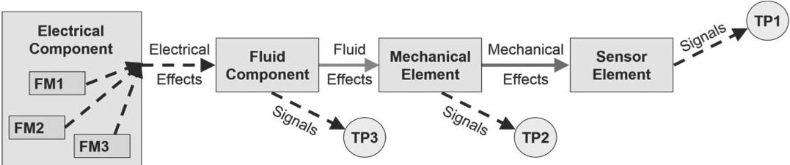

Fig. 2.13 Notional representation of an FFM.

<!-- PDF_PAGE: 38 -->

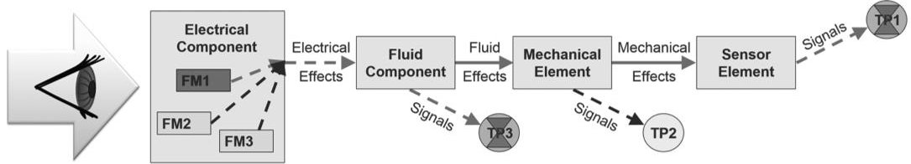

Fig. 2.14 Notional representation of detectability analysis for an FFM.

The ability of the system to detect failures may be quantified by the detection coverage, $ D_{\mathrm{cov}} $ , as follows:

$$
D _ {\mathrm {cov}} = \left(\frac {F M _ {\mathrm {total}} - F M _ {\mathrm {miss}}}{F M _ {\mathrm {total}}}\right) \times 100 \%
$$

Here, $ F M_{\mathrm{total}} $ is the total number of failure modes available for the testability analysis and $ F M_{\mathrm{miss}} $ is the number of available failure modes that were not detected from the available test suite for the analysis. If the FFM is developed sufficiently and follows key modeling conventions, then the user can restrict the testability analyses to contain only certain failure modes and tests. For example, the user may want to determine the detection coverage for failure modes resulting in complete loss of the system and restricted to a certain classification of sensor. In space launch vehicle applications, this example could be for criticality 1 failure modes that would result in a "loss of vehicle" and/or a "loss of crew," and restrict the system observability to flight critical sensor measurements. The analysis may also constrain the definition of failure mode detection to require more than one test detection, thus requiring redundancy for failure detection.

From another perspective, the FFM can be reviewed to determine which failure modes are detected by each test. This is called test utilization analysis and is depicted for the notional FFM representation in Fig. 2.15. In this analysis, each individual test is reviewed to determine which failure modes it detects. The results can determine the effectiveness of the test suite and indicate tests that provide no detection for the analyzed conditions. This analysis can be used as a justification for retaining or removing measurements from the sensor suite.

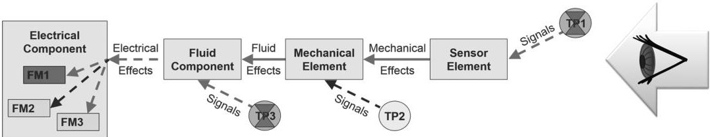

Fig. 2.15 Notional representation of test utilization analysis for an FFM.

<!-- PDF_PAGE: 39 -->

This analysis can be further restricted to a small set of tests that represents a specific detection algorithm. The resulting trace of failure modes could be used as part of the algorithm verification process to show that the expected detection of failure modes is possible, that all anticipated failure modes can be detected by the algorithm, and that no unintended failure mode detections occur. Under the SLS M&FM project, this type of approach is being applied to generate failure mode traces for specific monitored conditions. These traces are then used to support quantitative estimates of false positive/false negative values for the algorithms, as well as support probability risk assessments for the monitored conditions.

Extending the detectability analysis, the user can determine the isolation capability of the system. Isolation refers to the system's ability to detect and distinguish between failure modes and groups of failure modes. As previously discussed, each failure mode has a detection signature. If that signature is unique from all other failure modes, then the failure mode is said to be isolatable. Failure modes possessing common detection signatures are ambiguous relative to each other and are reported as an ambiguity group. If that detection signature was observed during actual operation of the system, the diagnostic assessment could only be refined to this grouping.

Because of the hierarchical nature, the FFM failure modes should be contained in modules representing the hardware component where the failures originate. Taking the failure mode isolation analysis one step further, failure mode ambiguity groups can be divided by the originating failed component. Therefore, component isolation analysis is a review of the failure mode ambiguity grouping from the component perspective. This ambiguity grouping helps to determine the associated failure modes that are detected and isolated. In addition, if the component's failure mode is not isolated, a list is provided for the other components that are members of the ambiguity group. This level of isolation is important in establishing maintenance strategies for the system.

These processes have been refined under NASA's Ares I Project and SLS program to provide support for the following analyses:

- Abort Conditions (AC) and Abort Triggers (AT) Failure Mode Traces

- Caution and Warning (C&W) Condition Failure Mode Traces

- Redundancy Management (RM) Detection Coverage Failure Mode Traces

- Launch Commit Criteria (LCC) Failure Mode Traces

- Latent Failure Interaction Analysis

- Prelaunch LRU Analysis

- Post-Flight Observability Analysis

The NASA SLS AC and AT failure mode traces are represented by a list of all failure modes whose effects lead to a particular AC, and support the calculation of AC probability of occurrence and the probability of AT activation for the

<!-- PDF_PAGE: 40 -->

associated monitored ACs. In addition, these traces are used to indicate potential false alarms (i.e., false positive detections) resulting from noncritical failure modes. The NASA SLS C&W failure mode traces are also represented by a trace of all failure modes that would lead to the violation of a particular C&W condition. This trace is used to identify missed (i.e., false negative) detections for failure modes not traced to the C&W condition that were expected to be detected, as well as false alarms associated with failure modes whose effects trace to the C&W condition but do not warrant a C&W alarm. If this occurs, then the C&W condition detection may need to be reevaluated to ensure proper identification of the condition. This information is also used to support the C&W message storm analysis, which ensures that C&W messages generated from single fault scenarios do not overwhelm the crew with more messages than they can effectively process.

The NASA SLS RM detection coverage failure mode traces are represented by a list of failure modes that could lead to a loss of redundant functionality within the system. This list is used to provide SLS designers with a mapping of the failure modes addressed by the redundancy management strategy implemented. Finally, the LCC failure mode trace is represented by the list of failure modes that would lead to a violation of each LCC condition. For all of the failure mode traces just described, this information is also beneficial in the support of post-test and postflight operational failure and anomaly investigations. The Latent Failure Interaction Analysis identifies failure modes from redundant elements or safety devices that remain unobservable until some other event makes them visible. The Prelaunch LRU Analysis uses the LRU lists, as supplied by the SLS elements, and determines the effectiveness of the SLS vehicle sensor suite to detect and isolate faults to a LRU during prelaunch operations. The Post-Flight Observability Analysis is performed for individual sensors, or a group of sensors, to identify the set of failure modes that could be detected by the associated sensor tests.

The general approach for generating the failure mode traces associated with the AC/AT, C&W, RM detection coverage, and LCC conditions is to first determine the specific sensor tests associated with the particular condition and align those sensor tests to the ones represented in the SLS IVFM. In addition, the operating phase(s) when the particular condition is active is also determined and aligned to the IVFM operational phases that establish the proper FFM configuration. The SLS IVFM testability analysis is then conducted based on this information, using an advanced automated tool called the Extended Testability Analysis (ETA) tool [17]. The purpose of the ETA tool is to process the testability analysis results from the FFM development software, along with information contained within the associated FFM, to provide the user with detailed documentation of the results. The ETA tool was initially developed under the NASA Constellation Program to support the Functional Fault Analysis (FFA) team for the Ares I Launch Vehicle and has been advanced under the SLS program to support the M&FM IVFM team. The ETA tool extracts information from the testability analysis output and the associated FFM to provide a detailed set of

<!-- PDF_PAGE: 41 -->

HTML and XML reports highlighting aspects of the system's ability to detect the effects propagated from failure modes and to isolate system faults or failed components. The following analysis reports may be generated using the ETA tool:

- Detectability Report: This report provides the detectability of each failure mode that propagates effects. It lists failure modes detected by the available suite of tests, the tests that detect each failure mode, and failure modes that are not detected by the available suite of tests. Additional information is extracted from the FFM to facilitate the location of the failure modes and test measurements.

- Test Utilization Report: This report provides the capability to detect each of the failure modes using the available suite of tests. It lists each test in the available suite of tests, the failure modes detected by each test, and tests that do not detect any of the failure modes. Additional information is extracted from the FFM to facilitate the location of the test measurements and failure modes. This report is used to support the AC/AT, C&W, and LCC failure mode traces.

- Failure Mode Isolation Report: This report provides the capability to isolate each of the failure modes using the available testability analysis results. It lists failure mode ambiguity groups that are composed of a unique detection signature, and all failure modes having that unique detection signature. Additional information is extracted from the FFM to facilitate the location of the test measurements and failure modes. This report is used to support the LCC failure mode traces.

- Component Isolation Report: This report provides the capability to isolate each of the failure modes to a user-specified component label or to a list of explicitly specified components. The component labels are an internal property in FFM assigned for the module representations of the physical components. Each FFM module can have only one label, but the same label can be assigned to multiple modules. The report lists only failure mode ambiguity groups that contain failure modes from the specified components. Each listed ambiguity group is reported in the same manner as in the Failure Mode Isolation Report. An extended report provides an assessment of each selected component, highlighting undetected failure modes and isolated failure modes.

- System Effect Mapping Report: This report provides the failure modes that propagate to special user-created test points that represent system-level effects within the model. The ETA Tool generates five sub-reports. The first lists system-level effects that are not mapped to any failure modes. The second, alternatively, lists failure modes that are not mapped to any system-level effects. The third sub-report provides an Effect-to-Failure Mode mapping similar in format to the Test Utilization report. The fourth and fifth sub-reports provide Effect Isolation results with different levels of detail. These sub-reports are similar to those generated by the Failure Mode

<!-- PDF_PAGE: 42 -->

Isolation Report, except that the system-level effects are the detection signatures. This report is used to generate failure mode traces that support RM.

- Sensor Sensitivity Report: This report provides the change in diagnostic performance that results from the removal of individual sensors or groups of sensors and the tests mapped to those sensors. The sensors involved in the analysis are specified by the user with a selected input file. Separate reports are generated for the individual sensor removal analysis and each sensor grouping specified (up to two).

- FMEA Report: This report provides an FMEA style spreadsheet for the XML output only from the FFM. The report is restricted to the conditions of the testability analysis. Therefore, it only reports failure modes and tests available in the testability analysis.

## 2.3.4.2 FFM SUPPORT FOR OPERATIONS

The FFM developed for FM analysis can be used for real-time diagnostics when built into an operational environment. The model development tools generate data artifacts that include the D-Matrix described in Section 2.2.1. The artifacts also include a mapping of test names and failure mode names to model indices used by the diagnostic reasoner to associate FFM tests with failure diagnoses. Test results are derived from system sensors and onboard computers using test functions external to the diagnostic model, and these test results are then passed to the diagnostic reasoner to complete the real-time diagnosis. Automated tests are updated regularly, such as every second, to provide continual diagnostic results.

Diagnosis is accomplished using tests that can either implicate or exonerate system failure modes. A failed test can be due to a number of possible causes, and each of these causes is said to be implicated by the test. A different test that passes can prove that one of the possible failure modes implicated by the first test is not responsible. That failure mode is then exonerated, or proven to not be responsible for the failed test, just as the suspect of a crime can be exonerated by an airtight alibi. If all goes well, additional passing tests will exonerate all but one of the failure modes, and the remaining failure mode will be unambiguously diagnosed as the only possible cause for the failed tests. If multiple failure modes are implicated and not exonerated, these failure modes are called an "ambiguity group." In an ambiguity group, one (or more) of the group's members may be the cause of the failure, but the data is insufficient to determine specifically which member or members of the group are at fault.

This section describes several advancements that have been achieved in recent years that mature operational capabilities for system FM using FFMs. These advancements are described in detail in the following paragraphs.

- Interface definition: The interfaces required to transfer data between the system, test logic, diagnostic reasoners, failure impact reasoners, decision

<!-- PDF_PAGE: 43 -->

support reasoners, and displays have been defined and elaborated in both test environments, such as AMPS, and in large-scale systems, such as Orion EFT-1.

- Data filtering and cleaning: One of the most difficult aspects of failure diagnostics is to avoid false positives that can result from incorrect or incomplete data. Recent emphasis on data quality used for diagnostics has begun to improve the reliability of diagnostic information available from run-time reasoners.

- Data framing and synchronization: Systems often use different data rates that can obscure the true failure sequence as a failure propagates through a system. Techniques have been developed to reduce false failure diagnosis resulting from data timing issues.

- System mode determination: A complex system can have vast numbers of possible configurations, such as when equipment is turned on or off or changed between standby and primary status. Improved modeling and data processing methods have reduced the likelihood that a system mode change is mischaracterized as a component failure or that incorrect data interpretation results in a missed diagnosis.

- Test logic: Diagnostic reasoning relying on pass or fail results requires highly accurate test logic that is valid over a wide range of configurations and environments.

- Presentation of results: The raw output of a diagnostic reasoner can contain information that usually needs to be formatted and filtered for a particular user. Onboard flight crews, mission controllers, or other support personnel, maintenance personnel, and failure analysts may all require different presentations of the outputs of FM reasoners.

- Failure Impact Determination: Diagnosing a failure is only a starting point for determining what to do about the failure. Recent work has identified the impact of failures on other parts of a system and how those losses affect the mission itself.

The remainder of this section describes these advances in operational FM based on a system-level FFM that is connected to the system's sensors, processors, and data networks.

The FFM contains the primary information needed to perform fault diagnosis during system operation. The components, their failure modes, the applicable system modes, connectivity between components and failures, and tests that detect the symptoms of failures are all included in the model. Test logic converts system data to pass or fail results that are sent to the diagnostic reasoner. The test logic could be built into the model itself or may be defined in a separate set of data. Within TEAMS-RT (hereafter referred to as the "FFM operational software") the diagnostic reasoner is segregated from the test logic. However, diagnostic systems could be constructed such that the test logic is built into the fault model. The

<!-- PDF_PAGE: 44 -->

diagnostic tests that reduce sensor data to the pass/fail test results used by the diagnostic reasoner can be as simple as a limit check on a single data value, such as a temperature exceeding $ 1 0 0^{\circ} \mathrm{C} $ . They may also be highly complex, such as statistical analysis performed on a number of data elements. The diagnostic reasoner uses the pass/fail results with the D-Matrix and supporting run-time data generated by the model to complete the fault diagnosis.

From the FFM, the D-Matrix, described in Section 2.2.1, is constructed to correlate tests to failure modes. For diagnosis of the root cause of a failure, the essential information is an association, or mapping, of tests to failure modes for a given system mode. The FFM generates run-time data that are loaded at system initialization. These data include the D-Matrix, which is used by the FFM operational software. The diagnostic system obtains system data and uses the test logic to check for conditions that may indicate failures, and the diagnostic reasoner applies the test logic to the stored D-Matrix data to generate the diagnostic results. The relationships between the FFM, the system and its operational data output, and the diagnostic reasoner are shown in Fig. 2.16.

## Interfaces for Real-time Diagnostics

Real-time automated diagnosis is performed by establishing interfaces between the system data and the diagnostic system. The operational system interfaces with the diagnostic system to obtain data from the system's sensors and computers. The outputs of the diagnostic system provide system health information to mission operations systems, including both human operators on board or on the ground, and to automated decision reasoners that use the information to reconfigure the system in response to failure or degradation.

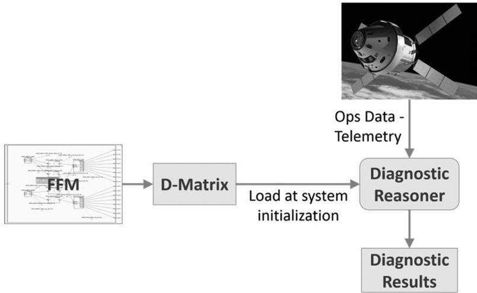

Fig. 2.16 The diagnostic reasoner correlates the FFM with data from the operational system to continually diagnose system health throughout a mission.

<!-- PDF_PAGE: 45 -->

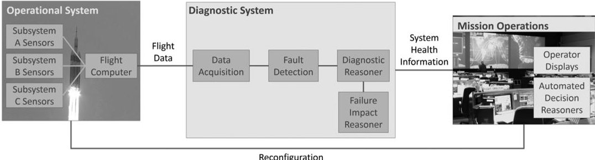

Fig. 2.17 A simplified run-time diagnostic architecture shows the system, its subsystems, and data processors.

As shown in Fig. 2.17, a diagnostic system interfaces with the operational system to obtain data from the system's sensors and flight computers. The diagnostic system data acquisition element cleans and filters the data, then passes them to a fault detection element to reduce the data to a set of pass or fail results. The diagnostic reasoner determines failures from the test results, and the failure impacts associated with diagnoses are determined. The combined failure and failure impact information is then provided to mission operations elements to make decisions about system reconfigurations that will mitigate the impact of failures. Mission operations could include onboard crew, ground-based mission operations, or automated decision systems.

## Data Filtering

Real-time data may be messy. It is often necessary to filter and clean the data before performing the fault detection logic to assure quality information and avoid transient, misleading, and distracting outputs. A diagnostic system that generates false results, either a failure when the system is actually behaving nominally (a false positive) or not identifying a failure when there actually is one (a false negative, or missed diagnosis), is not likely to be trusted by the system operators and is a major cause for skepticism about automated reasoners. A primary method for reducing false results is to filter and clean (i.e., pre-process) the data coming into the system. Some common data filters include the following:

Off-scale Data: Sensors are typically calibrated over a range of possible values, but sensor or sensor processing failures can cause data to fall outside practical ranges. A test for a temperature falling below a threshold should not be evaluated as a failed test result if the reading suddenly drops to $ - 4 5 9^{\circ} \mathrm{F} $ or absolute $ 0^{\circ} \mathrm{K} $ . A data filter that prevents performing the temperature threshold test precludes a false positive on the data. A separate test that checks for an off-scale reading can be used to diagnose a failure of a sensor or data processing equipment, but there may be normal modes of operation in which sensors are off scale, such as sensing systems that are turned off when the data aren't needed. If an off-scale temperature reading is detected, qualitative tests on

<!-- PDF_PAGE: 46 -->

the temperature need to be avoided regardless of the cause of the off-scale readings.

Static or Lost Data: Real-time systems often produce cyclic data that are transmitted at a given rate, even if the actual source of the data has been lost. Various methods may be used to report on the validity of the data, and if available, are a valuable and easy filtering method. If the system does not produce valid values, perhaps due to data bandwidth limitations, the data interface filtering and cleaning logic may need to determine if incoming data is "alive." For example, an Analog to Digital Input/Output (ADIO) data card could lose power and stop generating data signals, but a receiving flight processor may continue to transmit the latest known value from the card. The filtering logic could determine that the value has stopped updating, or that all of the data from the card have stopped updating, and suppress the execution of any test using the data.

Transient Data: Occasionally, a real-time system may produce a temporary erroneous indication that doesn't reflect actual stable conditions. A data value could spike because radiation alters the data, or because vibration affects the electrical output of a sensor independent of the physical measurement. If the test logic generates a failed result based on a transient data value, the diagnostic system could diagnose a failure and then clear that failure during the next cycle. Although the system operators can recognize transient false positives and learn to ignore them, they can be distracting and result in a lack of trust in the diagnostic system. If automated decision reasoners use the faulty diagnostic information, undesired actions could be taken that are unnecessary or detrimental to the mission. One method for avoiding transient conditions is to delay changing the state of a test from pass to fail, or from fail to pass, for a number of consecutive cycles; this is known as persistence. As early as the Apollo program, spacecraft engineers have used a rule of thumb that three readings in a row should be seen before acting on a data change, but other counts can be used, depending on various factors.

One means of addressing the previously described data filtering challenges is Sensor Data Qualification and Consolidation (SDQC) [25, 26]. SDQC is an onboard flight software function that implements algorithmic approaches to determine the validity of sensor data and to reduce valid data from redundant measurements to a single representative measurement for each data frame. The qualification function is designed to mitigate the impact of corrupt data on higherlevel decision and control logic; the consolidation function reduces the amount of data that need to be presented to the higher-level logic. The development of SDQC was initiated under NASA's Ares I Upper Stage project [25] and is being implemented in flight software for NASA's SLS [26].

## Data Framing and Synchronization

Real-time systems typically execute at a cyclic rate and organize data into various rate groups in a well-defined data frame. The diagnostic system must account for

<!-- PDF_PAGE: 47 -->

the timing of the data in order to avoid diagnostic errors. If a diagnostic reasoner uses a passing value to exonerate a possible failure, and a failing test to implicate a failure, and some of the data are sampled at 1 Hertz (Hz) and other data are sampled at lower rates, such as every 10 seconds (0.1 Hz), the test results could be inconsistent when a failure occurs. With an FFM and its counterpart diagnostic reasoner, a vector of test values is sent to the reasoner each diagnostic cycle. If the last observed value for a test is sent to the reasoner every data cycle, when a failure occurs, the tests on higher rate synchronous data yield a failed test, but the slower rate data would still indicate a passed test. The reasoner could exonerate the actual fault based on the passed tests from the slower rate data. At the next read cycle for the slower data, the results will become consistent, but if the actual fault has already been exonerated, a reasoner may reach a different conclusion. It could take several additional data cycles to correct itself, while yielding changing and inconsistent results during this critical time. The ISS and Orion Spacecraft both use data rates ranging from 40 Hz to 0.1 Hz.

To avoid such inconsistencies, the diagnostic system needs to account for timing of multi-rate data. A possible simple method to handle multi-rate data may be to execute the diagnostic reasoner's calculation cycle at the slowest rate to sample the data from every data element, and use only the last value of the faster rate data. The test results are collected from all of the data rate groups, and at the completion of the system's major frame (e.g., the 10-second period), all of the test results are transmitted as a complete set to the diagnostic reasoner. One drawback to this approach is that diagnostic results may be needed more quickly than the slowest cyclic data rate. Failures characterized by rapid onset and detected by fast data will not be diagnosed for some time after they occur. Furthermore, because the purpose for slow rate data may be to reduce bandwidth on networks and telemetry downlinks, the 0.1 Hz data probably are not all sampled on the same cycle, so that even slowing the diagnostic cycle may not guarantee consistency of test results. If each 0.1 Hz data element is offset from a 10-second frame boundary in order to balance the data throughput, it may be difficult to always determine a point at which the fault signature is complete.

Another approach, which has been used successfully with the Orion ACAWS Project, avoids the problem of finding a point at which the diagnostic signature is complete. The data and test interface set an UNKNOWN value on tests for all data cycles in which data are not received from the system. It is an accurate, conservative representation of the system, one that avoids assumptions about the persistence of information. If a failure occurs between readings from slow data, any tests based on faster data will be processed and sent to the reasoner. The reasoner might identify a group of possible causes based on the available data, but the slower rate group has not yet reported any results. When the slow data are read and sent to the diagnostic reasoner, tests that pass can exonerate some possible faults, whereas failing tests support the results from earlier failing tests. By using UNKNOWN results for slow tests, a false exoneration of preliminary candidate failures is avoided. Figure 2.18 shows the problem and its resolution. In the

<!-- PDF_PAGE: 48 -->

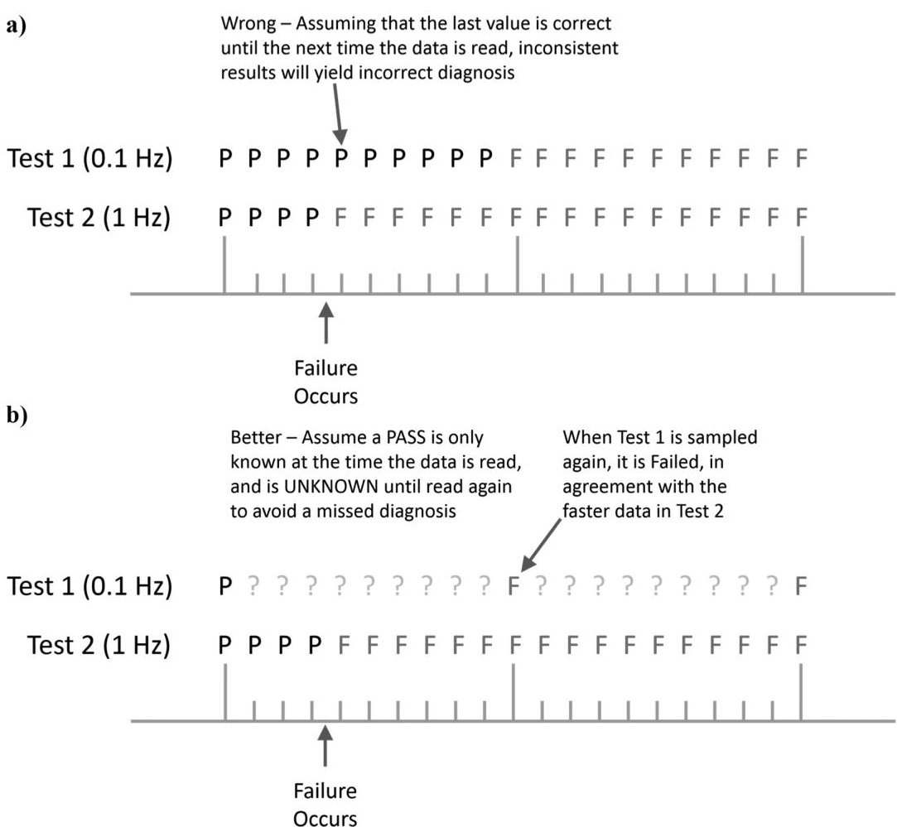

Fig. 2.18 Testing data with multiple rates can yield incorrect conclusions without proper filtering and data framing.

upper diagram, the system assumes that the last observed value remains correct until the next value is sampled, but if a fault occurs between data samples, the actual fault could be exonerated prematurely. A better approach is to treat results as UNKNOWN, except when they are explicitly observed.

## System Mode Determination

The failure modes that can occur, the criticality of failure modes, and data available for diagnosis can change significantly over the course of a mission. During spacecraft launch, engine performance, guidance, abort systems, and controls are critical, whereas solar arrays and thermal radiators are not yet deployed. Later on, engines are jettisoned from the vehicle and on-orbit equipment is activated. Throughout the mission, equipment may be added or discarded, turned on or deactivated. The diagnostic system must respond and remain in harmony with

<!-- PDF_PAGE: 49 -->

the state of the system as it updates in response to its mission plan and the environment in which it operates.

The changes in system state may be planned and known far in advance, but other changes that affect diagnosis may occur with little prior knowledge. The operational phases, mission, and operational modes such as launch, on-orbit, trans-lunar cruise, or Earth return are known early in the operation's concept definition. Decisions about deactivating a payload, switching over to a backup system, or cross-strapping a power bus may be made in response to unforeseen circumstances.

From the perspective of a diagnostic system, the major mission phase and system mode changes that occur during transition from launch through reaching orbit can almost be viewed as using a different fault model. Many failure modes are only applicable in some mission phases, such as the launch vehicle during ascent, and are not possible once orbit is reached. Systems typically change the data that are produced, or change the rates of data as mission configurations are changed. These changes often coincide with, or even define, the mission phases and system mode boundaries. The data available to the diagnostic system contain information that define the mission phases and system configurations. The diagnostic system can use the data in various ways.

One approach to system mode changes is to simply reload a different diagnostic system as the system modes change. For example, when the launch booster segments are jettisoned, the associated diagnostic system and models can be unloaded and discarded. The diagnostic system developed for on-orbit mission phases may not even be loaded into memory until the on-orbit processors are activated.

A diagnostic system and its models that are built and tested for an entire mission will need to adapt to known major mode changes. The diagnostic FFM can be built with awareness of these defined modes. System data that define the mode changes can be passed to the diagnostic reasoner, similar to the passed/ failed test results. The mode change can affect which tests are used, as well as which failure modes are applicable, and adjust its reasoning accordingly. The FFM operational software's reasoner can precompute different D-Matrices for each system mode and, when notified, can rapidly swap in the new D-Matrix without interruption.

Every time equipment is turned on or off, the environment changes, or failures occur, the system is in a different configuration. Many of these configuration changes have a relatively minor impact on the diagnostic reasoning, but need to be accommodated nonetheless. The reasoner needs to avoid diagnosing a component as failed simply because the operator decided to turn it off. These somewhat minor, perhaps temporary, system configuration changes can be more difficult to manage than the major, planned mission phase changes because the number of possible combinations of configurations can be very large.

One approach to managing configuration changes is to build all possible configurations into the FFM. Because most equipment can be turned on or off, and

<!-- PDF_PAGE: 50 -->

many systems allow for rerouting power and other resources, a model can include switches for each one of these configuration options. There is, however, a vast number of possible combinations, with each combination representing an operational mode. The reasoner is capable of receiving data that describe the position of each of these mode switches and updating accordingly. Its approach is to recalculate a D-Matrix in real time, but possibly taking considerable processor time (seconds to minutes, depending on the processor, the model, and the number of switches).

An alternate approach is to manage configuration changes external to the diagnostic FFM, determining which tests do not apply, or require different test logic, for different operational modes. A mode manager external to the diagnostic reasoner can readily determine which tests don't apply, and in certain operating modes can suppress test results by passing UNKNOWN to the diagnostic reasoner. This approach avoids a possible interruption to diagnosis that could result from forcing the reasoner to recompute its diagnostic solution on the fly, and has been used successfully in NASA technology demonstrations.

## Test Logic

A discrete diagnostic reasoner, such as that found in the FFM operational software, requires that system data are transformed from digital data to discrete results such as pass/fail, or perhaps multistate discrete values, such as Nominal, Low-Threshold, or High-Threshold. The test logic performs this transformation, obtaining data from the system and transmitting them to the diagnostic reasoner to perform fault diagnosis. The data originate from the system's sensors but may be processed extensively by the system's avionics and software. Diagnostic tests often rely on direct sensor values (e.g., temperature, pressure, voltage) exceeding an operational threshold. Tests often need to combine conditions, perhaps using voltage and current readings to calculate power, and testing the result against a threshold. Modern system avionics and software perform many tests that are used for automated decisions or operator notifications such as Fault Detection, Isolation, and Recovery (FDIR) algorithms commonly used in spacecraft systems.

In addition to data values from sensors and software, the absence or the corruption of data is itself a diagnostic input. For example, suppose there is a failure mode that is characterized by a temperature exceeding $ 1 3 0^{\circ} \mathrm{F} $ . During operations the temperature sensor jumps from $ 7 2^{\circ} \mathrm{F} $ during one cycle to $ 7 3 2^{\circ} \mathrm{F} $ during the next cycle, and then remains constant at $ 7 3 2^{\circ} \mathrm{F} $ . If the data are read once per second, the physics would generally preclude an actual temperature rise of $ 7 0 0^{\circ} \mathrm{F} $ in two sequential measurements, and the diagnostic reasoner could conclude that the reading is not valid. Further, if the system reports "failed" with the now invalid temperature test, the diagnostic reasoner would attempt to identify a failure that caused the temperature to exceed the threshold and will reach an incorrect conclusion. There is some failure that has caused the data to become invalid; the cause could be a sensor or ADIO device failure, the failure of a flight processor or one of its interfaces, or a failed network component. Because

<!-- PDF_PAGE: 51 -->

tests on data validity are related to failures that may have little relationship to the failure being checked in the data itself, the data validity tests included in the model should be located in or near the data processing equipment, rather than in the subsystem where the failure effect would manifest itself.

Data validity and data value testing need to be associated. Invalid data need to result in the data value test receiving an unknown result. There are a couple approaches to this. One is to include the data validity testing in the model along with the data value testing, perhaps using a multi-outcome test. A test could be defined as off-scale low, nominal, above-threshold, or off-scale high. The model could then associate the nominal and above-threshold value with a thermal-related failure mode, and associate the off-scale results with other failure modes. An alternative approach that has been used successfully is to test for status external to the FFM and diagnostic reasoner. Any invalid status results in setting the data value test to unknown. The status can then be used as a test input to other FFM tests, such as tests for sensor short or open circuits, ADIO failure, network connectivity failures, or other data errors. If groups of sensors all go invalid concurrently, the system can then isolate the common point of data loss such as an ADIO, connector, network, or processing component. Data validity can include various forms or levels of validity:

- Off-scale high or low. Sensor short or open circuits or analog-to-digital conversion equipment can cause sensor values to be reported at the extreme ends of the range. Sensors start with converting a physical attribute, such as temperature or pressure, to a small voltage signal, typically over a small range from 0 to 5 volts. Broken wires or short circuits could result in either no voltage or maximum voltage (or very close to it).

- Static or missing data. Depending on how the data architecture is built, a loss of network or data processing capability can result in either no data at all or a continuous transmission of the same value. The Orion spacecraft flight computers produce a constant data frame that is filled with some value, so that if the source of the data is lost due to a power loss of component, or loss of a network element, the last observed value will be transmitted continuously. In other systems, the data may just drop out. If data are not received at all, the data value tests on the data are not performed, and so it is easy to assure that no test value, or an unknown value, is passed to the diagnostic reasoner. The test logic may need to detect that data are not being received, however, and generate failed results for tests associated with the data transmission mechanisms and their failures.

Once it is known that good-quality data have been received by the test logic, the data value tests can be performed. These tests can range from a simple threshold to complex algorithms involving multiple data values and conditions. Modern system software often performs tests for automation, control, or display purposes that can be used as test inputs to a diagnostic reasoner. FDIR

<!-- PDF_PAGE: 52 -->

algorithms offer a variety of fault conditions at a subsystem level, such as testing for low pressure, overcurrent, and rather than performing the same algorithm in the test logic, the FDIR results can form the basis of the test logic. Orion's FDIR logic often includes testing the validity of data, checks persistence of a condition (five cycles in a row before declaring a test failure, for example), and uses multiple redundant sensors when available. When high-quality processed data are available from the system and convey the necessary failure symptom information, the test logic can be significantly simplified, and the reasoning is more likely to remain consistent with the vehicle's FDIR and automation logic.

For many conditions, the system's sensor data are used directly. If the flight systems perform sensor engineering unit conversion, the test logic can work with understandable data values such as temperatures, pressures, or voltages. Some systems may transmit the raw, unprocessed sensor signals, and the diagnostic test logic will need to do its own engineering unit conversion, or else specify tests based on the unprocessed sensor values. Many sensors, for example, use 12 bits of data scaled over the range of the electrical input that the sensor can generate. These unprocessed values are in "counts," in which 0 volts equates to 0 counts and 5 volts (or whatever the maximum scale is) equates to 4095 counts. A test could be specified as "fail when greater than 1237 counts," which might equate to $ 1 3 0^{\circ} \mathrm{F} $ . Logic could be added that converts the sensor value to temperature, and then the test could be more readably specified as "fail when greater than $ 1 3 0^{\circ} \mathrm{F} $."

Recall that test logic should assure that the incoming data are valid before performing a test on the data. Prior checking for missing, static, or off-scale data will significantly reduce false results and help build operator trust in results generated by the diagnostic system.

When there are redundant or at least similar sensors, the combination of sensors provides additional benefit to the diagnostic logic. Sensor redundancy can be handled in the test logic, the diagnostic FFM, or perhaps in both. Suppose there is a component with two independent sensors measuring the temperature near the component, and a failure mode characterized by temperature over $ 1 3 0^{\circ} \mathrm{F} $ . The FFM could be built with two tests related to the component, test T1 and test T2. If both T1 and T2 pass, the component is readily recognized as good or not failed, and if both tests fail, the component is implicated with respect to the temperature. If the sensors diverge, T1 may fail while T2 passes, so T1 implicates the component failure mode, while T2 exonerates it. The diagnostic reasoner probably at best identifies the component as suspect, or possibly failed; the human operator may be able to judge which sensor is more likely correct, relying on judgments about data "reasonableness," prior history of a sensor, how rapidly the values diverged, or other intuition. Putting the logic for redundant sensors in the test logic has some advantages. If both sensors agree within a reasonable bound, the test can provide high confidence data to the diagnostic reasoner. If the sensors are right on the edge of a test threshold, but jittering around it, the test logic can suppress a conclusion until the values

<!-- PDF_PAGE: 53 -->

clearly converge on one side of the threshold or the other. If they diverge significantly from each other, it can be concluded that at least one of them has failed, which is a different diagnostic problem than the component over-temperature condition for which the sensors are testing. Unless there is clear evidence supporting which sensor is in error, a conservative position is to evaluate the temperature test as unknown. Because the sensor validation is dependent on knowledge about the system design and command, and its data handling systems, this level of sensor validation may need to be handled in custom test logic, rather than in the FFM that does not have a capacity for the detailed sensor knowledge involved. If there is a third sensor or a compatible attribute, it may be possible to determine which sensor is in error, but if not, it is advisable to disregard both sensors.

There are often significant timing considerations when designing the diagnostic test logic. Some failure effects propagate rapidly through a system, whereas others may take considerable time to show up in data. Electrical power faults, for example, have an immediate effect when electrical power is lost. Faults in a thermal control system may often propagate slowly and may exhibit variations due to the environment and configuration. Suppose a valve in a coolant loop fails, stuck in the closed position, thus preventing the flow of coolant to a thermal radiator. Tests of the coolant temperature on one side of the valve would be expected to rise as a symptom of the fault, but the temperature rise may take minutes or more. In some conditions, the temperature might remain in normal limits indefinitely, such as if the equipment to be cooled is in a low usage condition, or if the system is operating in a cold environment. Test logic, coupled with the diagnostic FFM, often needs to handle these sorts of timing and variability considerations.

Test logic is one of the more complex aspects of a run-time diagnostics system. Tradeoffs between diagnostic sensitivity and avoidance of false results must often be made. Can the diagnostic system wait until it is certain that a component is failed, or is it more important to provide results quickly, even if this results in incorrect information some of the time? The diagnostic system requirements should be carefully and fully defined in order to properly define the test and diagnostic logic needed for a successful system implementation.

## Failure Impacts Determination

Although it is crucial to be able to identify the source, or root cause, of a failure, it is equally important to understand the effects of a system failure on other components and how the loss of function of those components impacts the mission. For example, if a power distribution component fails, such as an AMPS PDU (Fig. 2.5), power to electrical loads is lost, resulting in either a loss function or loss of redundancy. The FFM can be built to contain information that is useful for identifying components and functions affected by a failure. For example, when an AMPS PDU output switch fails to open, there is resulting loss of function of the cabin lights. Critical functions often rely on redundant

<!-- PDF_PAGE: 54 -->

components, and although loss of one of these redundant components does not result in loss of the function, the loss of redundancy increases the risk. The AMPS system's MBSUs provide redundant paths for providing power to electrical equipment, and loss of one of the MBSUs increases the risk that another failure will result in loss of function of electrical equipment.

To diagnose system faults, the FFM is used to trace back from tests to a specific failure mode. To identify failure impacts, a separate reasoner is used that takes a diagnostic result as its input and follows a directed graph built from the FFM to identify the functional and redundancy impacts. Functional impacts are identified when the model indicates that all required resources for a component's functioning have been lost due to failure. Redundancy impacts occur when a failure impacts one pathway to a component but other pathways remain. The model's AND nodes are used to determine if an impact is loss of function or loss of redundancy. If multiple failures result in loss of all paths to a component, the impact changes from loss of redundancy to loss of function.

## Presentation of Results

The outputs from a diagnostic reasoner, such as that found in the FFM operational software, can provide highly useful information to an operator or team that needs to make rapid decisions in the face of a failure and possibly loss of critical functionality. While determining the root cause failure, the reasoner may generate additional information, such as possible additional or alternative failure causes. To provide clear and concise actionable knowledge, system health management engineers, in collaboration with system operators, must judiciously select information to be displayed and devise a means of presentation that efficiently supports the decisions being made by each operator.

Every failure that is diagnosed may not need to be displayed for every type of operator. Flight crew have different information needs from those of groundbased flight controllers of a crewed spacecraft. Backroom or engineering support personnel have different needs from front-room controllers. The diagnostic results typically are filtered and processed for different operators. Diagnostic results can also be used as an input to automated decision reasoners, and the diagnoses presented to these tools must match the reasoners' interfaces and capabilities. Flight crews may only need information about failures requiring immediate action, whereas ground controllers may need information about any failure.

If the FFM and diagnostic reasoner are not able to unambiguously determine a root cause failure, and can only determine a group of possible causes, the health management engineers are challenged to provide useful information without obfuscation. Ambiguity between closely related failure modes may provide useful actionable information. For example, if the reasoner can't distinguish between a short circuit and an open circuit, but either would result in loss of power to a pump, displaying results that indicate that some failure has resulted in loss of particular functionality is probably very useful. On the other hand, if the reasoner can't distinguish between several possible diverse sources, it may

<!-- PDF_PAGE: 55 -->

be better to report nothing than to report a long list of possible faults. The FFM may include probabilistic information that may be useful in narrowing ambiguity, although it should be used cautiously. A flight crew that needs to make recovery decisions or an engineering support team performing failure analysis have very different needs and expectations. The flight crew need to decide what to do, and if there is uncertainty, procedures typically provide steps to resolve ambiguity before taking actions. It wouldn't be very useful to report "70% probability that Pump A failed, 30% probability that Isolation Valve 1 Stuck Closed," leaving crew to guess which one to work. A procedure that disambiguates possible failures, or a procedure that recovers cooling function regardless of root cause, is needed. In completely unexpected, unanticipated, and unlikely situations, there may not be sufficient information to even begin a diagnostic procedure. Engineering support groups are typically engaged to help in such circumstances, and any information available from the FFM and diagnostic reasoner can be useful.

Ambiguity can also arise from cases in which a single fault could account for the entire fault signature, but multiple faults could also produce the same signature. Suppose a failure of a controller card results in loss of power to six different components. The diagnostic reasoner could ascertain that the card has failed, but the reasoner may also consider it possible that all six components had failed, independently, at the same time as the card failed, and report the electrical loads as possibly faulted along with a controller card fault. A common diagnostic strategy is to report only the single fault when one fault adequately explains the full fault signature, even though it may be feasible that multiple concurrent faults could produce the same fault signature. Figure 2.19 provides an example of a diagnostic display showing the impact of loss of function for an analog-to-digital input-output board. The failed hardware is identified in the PDU-C1 window of Fig. 2.19 as C1 ADIO. Loss of redundancy impacts can also be identified and displayed when applicable. In systems with hundreds or thousands of components and failure modes, building graphical displays requires careful management of the display hierarchy. When a failure occurs, the operator needs to rapidly locate the failure on a display and gain situational awareness as quickly as possible. Providing indications of failure at both an overview level and with preciseness requires careful display design. The examples show use of icons to indicate failures, loss of function, and loss of redundancy impacts. Displays may need to indicate that a subsystem or assembly has a failure of a subcomponent, prompting an operator to open another display to retrieve detailed information about the failure. Fault displays can include capabilities to understand what the impact of additional failures might be, so including provisions for what-if analysis can be desirable. For example, if a failure of a coolant pump has occurred, the operator can plan ahead and query the diagnostic system, such as "What will be the condition if I lose a power on a bus?" The what-if capability can help identify worst-case failures and make decisions about continuing a mission or taking precautions to abort the mission.

<!-- PDF_PAGE: 56 -->

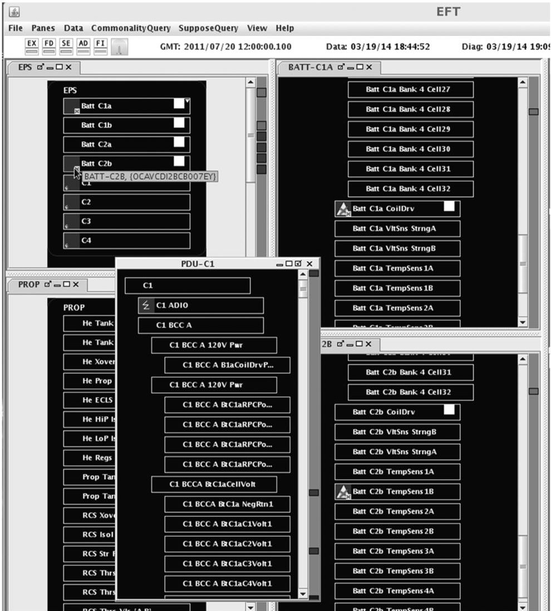

Fig. 2.19 Fault displays showing faults and failure impacts are used to show system health and failure information to operators.

<!-- PDF_PAGE: 57 -->

## 2.4 THE FUTURE OF FFM

Functional models are a key element of conventional systems engineering. Engineers capitalize on functional analysis in the early phases of system design, due to its qualitative nature and flexibility. Functional Fault Modeling and analysis provide the benefits of analyzing the impact of failures on a system's ability to achieve desired goals. Current research efforts to expand the application of FFMs in the early design phase include combining FFMs with simulation to analyze failure scenarios. Other efforts address the knowledge acquisition phase in FFM by providing new methodologies to store and link component-, subsystem-, and system-level information for more efficient reuse.

Development of FFMs is labor-intensive, as described in Section 2.3.3 of this chapter. The recent popularity of Model-based Systems Engineering (MBSE) has increased the understanding of just how powerful an interconnected set of models can be in the design and development of complex systems. NASA is sponsoring research that is aimed at leveraging system models developed in SysML, the modeling language of choice in the MBSE community, to reduce the often tedious and time-consuming manual effort required in the development of FFMs. The ability of SysML to represent failure behavior, and the mapping of modeling elements used in MBSE to those required for FFMs, is being studied. A major goal of this effort is to increase the automation of FFM construction and, simultaneously, to decrease the amount of manual labor and associated human "touch" errors. Current automation efforts capitalize on data sources that are available in digital form, such as FMEAs and channelization (connectivity). Models produced by MBSE efforts hold the possibility of providing similar knowledge, as well as additional information about system behavior, due to the richness of the modeling elements included in SysML. The ability to tap into a robust set of models of the structure and behavior of a complex system would also increase the consistency of system knowledge used in various modeling and analysis efforts.

The impact of having a rich set of functional fault models will never be more evident than in the operational phases of a system's life cycle. As shown in Section 2.3.4.2, FFMs can be utilized to monitor and diagnose system operation in real time. Analysis of FFMs already benefits the design of runtime monitoring systems by providing coverage statistics on the system's ability to detect and diagnose failures, provide false positive and false negative analyses, and analyze latent failures that may exist in the system. Future work on mapping elements of FFMs back to the requirements they satisfy, and testing plans for certifying the implementation of FM algorithms, will increase the benefits being derived from this methodology. For future aerospace systems that have extremely complex interactions among subsystems, large, integrated hardware and software systems, and autonomy requirements, the robust representation of the failure propagation through the system available from FFMs will be essential in the design of the FM for safety- and mission-critical operations.

<!-- PDF_PAGE: 58 -->

The theory supporting ISHM is continuing to evolve and coalesce [1-3]. As part of that process, a set of robust FM metrics for state estimation was recently presented with example calculations [5]. Combined, these metrics quantify the performance of FM control loops and, subsequently, the effectiveness of the whole ISHM system. In order for FFMs to support these metrics, qualitative estimates embodied in the FFMs need to be linked to quantitative estimates for the system and relevant analyses applied.

## 2.5 CONCLUDING REMARKS

This chapter describes key advances in Functional Fault Modeling (FFM) that have occurred under NASA programs over the past five to seven years. These advances are primarily motivated by a need and desire to improve the safety and to reduce the life-cycle cost of crewed and uncrewed space systems. They can benefit intelligent and autonomous systems—systems that are largely recognized as a requirement for future NASA missions—by providing real-time, state self-awareness capabilities, as well as supporting analytical verification of these systems' diagnostic requirements early in the design when they will have the largest impact and benefit. However, they are not limited to this domain and can be used in other FFM applications. These advances have also influenced the FFM paradigm, where the process, analytical, and software tools developed during this period are accepted as the building blocks for standardized FFM by the modeling community.

Initially, background material describing the essence of FFMs, how they are being advanced by NASA, their benefits, and example FFMs are provided as foundational to the discussion and as tutorial information for those unfamiliar with FFMs. An overview of an FFM development process is then used to organize and provide a context for discussing specific advances in FFM capabilities. The development process—which includes phases for knowledge acquisition, conceptual design, implementation and verification, and application—also provides a structured approach for those new to FFM development. The chapter concludes with a discussion of future capabilities and software tools that would further advance the FFM discipline.

It is the authors' objective and sincere hope that, by documenting FFM advances in this way, FM—intelligent and autonomous systems developers will discover and learn about state awareness tools and techniques previously unknown to them; and that they will be able to use those tools and techniques to advance the capabilities of their applied disciplines. Likewise, as other disciplines use FFMs and the advances presented in this chapter, further acceptance of FFM and the analyses it can provide will be the outcome.

## ACKNOWLEDGEMENTS

The advances in Functional Fault Modeling identified in this chapter were supported by the NASA Human Exploration and Operations Mission Directorate

<!-- PDF_PAGE: 59 -->

under the following programs and projects: Constellation Program, Ares I Project; Space Launch System Program, Mission and Fault Management Project; Ground Systems Development and Operations Program, Advanced Ground Systems Maintenance Project; and the Orion Program, Multi-Purpose Crew Vehicle Project.

## REFERENCES

[1] Rasmussen, R. D., "GN&C Fault Protection Fundamentals," 31st American Astronautical Society Guidance, Navigation, and Control Conference, Breckenridge, CO, Feb. 2008.

[2] Johnson, S., "Introduction to System Health Engineering and Management in Aerospace," 1st Integrated Systems Health Engineering and Management Forum. Napa, CA, Nov. 2005.

[3] Johnson, S. B., Gormley, T. J., Kessler, S. S., Mott, C., Patterson-Hine, A., Reichard, K. M., and Scandura, P. A., Jr., System Health Management with Aerospace Applications, Wiley, Chichester, UK, 2011, pp. 3-27.

[4] Aaseng, G. B., Patterson-Hine, A., and Garcia-Galan, C., "A Review of Systems Health State Determination Methods," AIAA Paper 2005-2528, Jan. 2005.

[5] Johnson, S. B., Ghoshal, S., Haste, D., and Moore, C. M., "Fault Management Metrics," AIAA Science and Technology Forum, Grapevine, TX, Jan. 2017.

[6] Poll, S. et al., "Evaluation, Selection, and Application of Model-Based Diagnosis Tools and Approaches," AIAA Infotech@Aerospace Conference, Rohnert Park, CA, May 2007.

[7] Maul, W., Melcher, K., Chicatelli, A., and Johnson, S., "Application of Diagnostic Analysis Tools to the Ares I Thrust Vector Control System," AIAA Infotech@Aerospace Conference, Atlanta, GA, April 2010.

[8] Ferrell, B., Lewis, M., Perotti, J., Oostdyk, R., and Brown, B., "Functional Fault Modeling of Cryogenic System for Real-Time Fault Detection and Isolation," AIAA Infotech@Aerospace Conference, Atlanta, GA, April 2010.

[9] Ferrell, B., Lewis, M., Perotti, J., Oostdyk, R., Spirkovska, L., Hall, D., and Brown, B., "Usage of Fault Detection Isolation & Recovery in Constellation Launch Operations," AIAA SpaceOps 2010 Conference, Huntsville, AL, April 2010.

[10] Schwabacher, M., Martin, R., Waterman, R., Oostdyk, R., Ossenfort, J., and Matthews, B., "Ares I-X Ground Diagnostic Prototype," AIAA Infotech@Aerospace Conference, Atlanta, GA, April 2010.

[11] Spirkovska, L., Aaseng, G., Iverson, D., McCann, R., Robinson, P., Dittemore, G., Liolios, S., Baskaran, V., Johnson, J., Lee, C., Ossenfort, J., Dalal, M., Fry, C., and Garner, L., "Advanced Caution and Warning System, Final Report-2011," NASA TM-216510, 2013.

[12] Frank, J., Aaseng, G., Dalal, K., Fry, C., Lee, C., McCann, R., Narasimhan, S., Spirkovska, L., Swanson, K., Wang, L., Molin, A., and Garner, L., "Integrating Planning, Execution and Diagnosis to Enable Autonomous Mission Operations," 2013 International Workshop on Planning & Scheduling for Space (IWPSS), Moffett, CA, 2013.

<!-- PDF_PAGE: 60 -->

[13] Deb, S., and Ghoshal, S., "Remote Diagnosis Server Architecture," IEEE Systems Readiness Technology Conference (AUTOTESTCON), Valley Forge, PA, Aug. 2001.

[14] Maul, W., "Testability Engineering and Maintenance System (TEAMS) Modeling Conventions and Practices," Report K0000190582-GEN, National Aeronautics and Space Administration, 2014.

[15] Barszcz, E., Robinson, P., and Fulton, C., "Tools Supporting Development and Integration of TEAMS Diagnostic Models," AIAA Infotech@Aerospace Conference, St. Louis, MO, March 2011.

[16] Maul, W., Fulton, C., and Melcher, K., "Extended Testability Analysis Tool User Guide," AIAA Infotech@Aerospace Conference, St. Louis, MO, March 2011.

[17] Maul, W. A., and Fulton, C. E., "Software Users Manual (SUM) Extended Testability Analysis (ETA) Tool," NASA/CR-2011-217240.

[18] Bis, R., and Maul, W., "Verification of Functional Fault Models and the Use of Resource Efficient Verification Tools," AIAA Infotech@Aerospace Conference, Kissimmee, FL, Jan. 5C9, 2015.

[19] Maul, W. A., Hemminger, J. A., Oostdyk, R., and Bis, R. A., "A Generic Modeling Process to Support Functional Fault Model Development," AIAA Infotech@Aerospace Conference, San Diego, CA, Jan. 4-8, 2016.

[20] NASA Systems Engineering Handbook, NASA/SP-2007-6105 Rev. 1, Dec. 2007.

[21] Aaseng, G. B., Barszcz, E., Valdez, H., and Moses, H., "Scaling Up Model-Based Diagnostic and Fault Effects Reasoning for Spacecraft," AIAA Space Conference and Exhibition, Pasadena, CA, Aug. 31-Sept. 2, 2015.

[22] Ferrell, B., Lewis, M., Perotti, J., Oostdyk, R., and Brown, B., "Functional Fault Modeling Conventions and Practices for Real-Time Fault Isolation," SpaceOps 2010 Conference, Huntsville, AL, April 2010.

[23] Melcher, K. J., Maul, W. A., and Hemminger, J. A., "Functional Fault Model Development Process to Support Design Analysis and Operational Assessments," AIAA Space and Astronautics Forum, Long Beach, CA, Sept. 2016.

[24] Oeftering, R. C., Kimnach, G. L., Fincannon, J., Mckissock, B. I., Loyselle, P. L., and Wong, E., "Advanced Modular Power Approach to Affordable, Supportable Space Systems," AIAA Space Conference and Exhibition, Pasadena, CA, Sept. 2012.

[25] Wong, E., Fulton, C. E., Maul, W. A., and Melcher, K. J., "Sensor Data Qualification System (SDQS) Implementation Study," NASA/TM-2009-215442, International Conference on Prognostics and Health Management, Denver, CO, Oct. 2008.

[26] Wong, E., "Sensor Data Qualification and Consolidation (SDQC) for Real-Time Operation of Launch Systems," AIAA SPACE Conferences and Exposition, Long Beach, CA, Sept. 2016.