<!-- PDF_PAGE: 1 -->

ANALYSIS OF VERIFICATION AND VALIDATION TECHNIQUES FOR EDUCATIONAL CUBESAT PROGRAMS

A Thesis presented to

# the Faculty of California Polytechnic State University San Luis Obispo

# In Partial Fulfillment of the Requirements for the Degree Master of Science in Computer Science

by

Noah Weitz

May 2018

<!-- PDF_PAGE: 2 -->

$ \textcircled{c} $ 2018 Noah Weitz ALL RIGHTS RESERVED

<!-- PDF_PAGE: 3 -->

## COMMITTEE MEMBERSHIP

Analysis of Verification and Validation Techniques for Educational CubeSat Programs

AUTHOR: Noah Weitz

DATE SUBMITTED: May 2018

COMMITTEE CHAIR: John Bellardo, Ph.D.

Professor of Computer Science

COMMITTEE MEMBER: John Clements, Ph.D.

Professor of Computer Science

COMMITTEE MEMBER: Jordi Puig-Suari, Ph.D.

Professor of Aerospace Engineering

<!-- PDF_PAGE: 4 -->

## ABSTRACT

# Analysis of Verification and Validation Techniques for Educational CubeSat Programs

## Noah Weitz

Since their creation, CubeSats have become a valuable educational tool for university science and engineering programs. Unfortunately, while aerospace companies invest resources to develop verification and validation methodologies based on larger-scale aerospace projects, university programs tend to focus resources on spacecraft development. This paper looks at two different types of methodologies in an attempt to improve CubeSat reliability: generating software requirements and utilizing system and software architecture modeling. Both the Consortium Requirements Engineering (CoRE) method for software requirements and the Monterey Phoenix modeling language for architecture modeling were tested for usability in the context of PolySat, Cal Poly's CubeSat research program.

In the end, neither CoRE nor Monterey Phoenix provided the desired results for improving PolySat's current development procedures. While a modified version of CoRE discussed in this paper does allow for basic software requirements to be generated, the resulting specification does not provide any more granularity than PolySat's current institutional knowledge. Furthermore, while Monterey Phoenix is a good tool to introduce students to model-based systems engineering (MBSE) concepts, the resulting graphs generated for a PolySat specific project were high-level and did not find any issues previously discovered through trial and error methodologies. While neither method works for PolySat, the aforementioned results do provide benefits for university programs looking to begin developing CubeSats.

<!-- PDF_PAGE: 5 -->

# ACKNOWLEDGMENTS

Thanks to:

- Mom and Dad: For supporting me in all my endeavors and shaping me into the person I am today. Whether it was pushing me to new heights or picking me up when I fell, I would not be anything without either of you. You encouraged me to pursue the impossible even when I did not think I could. This paper would not exist without you.

- Steven: For being the person I look up to, even though you probably do not know it. Your drive and perseverance pushes me to be a better person, even if you do not see it. Thank you for being my brother and my friend. This paper is as much yours as it is mine.

- Grandma and Grandpa: For being invested and excited about everything I have pursued within my education. From sharing newspaper articles about cool science and technology topics to asking me questions about my latest projects, thank you for reminding me each time we talk just how cool it is to be an engineer.

- Dr. Bellardo: For taking the time to talk with a naive freshman about satellites and guiding me throughout my time at Cal Poly. I would not be were I am today without your help and support. It means a lot to have the opportunity to work with someone who cares as much about their students as you do. I am glad I had the chance to call you my mentor.

- Dr. P and Dr. Clements: For joining my committee and participating in the review of this thesis. Thank you for answering my questions and taking the time to review my paper's content.

<!-- PDF_PAGE: 6 -->

- Daniel Yao, Alex Bartlett, Matthew O'Neil, and Jair Herrera: For being amazing study partners, roommates, and friends. Whether it was late nights studying or messing around, I am extremely lucky to have known all of you and had the opportunity to work with you. I could not have wished to have known such amazing and genuine people as you all.

- PolySat: For giving me a place on campus to learn and grow as an engineer while working on truly incredible projects. My education would have been significantly less meaningful without the countless members who have guided me and allowed me to serve them. Thank you for providing me with opportunities that will continue to reward me for the rest of my life.

<!-- PDF_PAGE: 7 -->

## TABLE OF CONTENTS

LIST OF FIGURES ix

CHAPTER

1 Introduction 1

2 Background 4

2.1 CubeSats 4

    2.1.1 PolySat 5

    2.1.1.1 ExoCube-2 5

    2.1.1.2 Launch Environment Observer and StangSat 6

2.2 Software Requirements 7

2.3 Software Requirements and CubeSats 8

2.4 Consortium Requirements Engineering (CoRE) Method 9

    2.4.1 Two Model Structure 9

    2.4.1.1 Behavioral Model 10

    2.4.1.2 Class Model 11

    2.4.2 Steps of the CoRE Method 12

    2.4.3 CoRE Used at Lockheed Aeronautical Systems 12

    2.4.3.1 Meeting Process Goals for the C-130J 13

2.5 Why CubeSats Lack Software Requirements 14

    2.5.1 Timeline 15

    2.5.2 Project Team Size 15

    2.5.3 Project Cost 16

2.6 Model Verification and Validation 16

2.7 Monterey Phoenix Modeling Language 18

    2.7.1 Events and Relations 18

    2.7.2 Event Grammars 19

    2.7.2.1 Event Patterns 19

    2.7.3 Steps for Using Monterey Phoenix for Verification and Validation 22

    2.7.4 Existing CubeSat Models 23

<!-- PDF_PAGE: 8 -->

3 Applying the CoRE Method to CubeSats 24

3.1 How CoRE can be Applied to CubeSats 24

3.1.1 Modifying the Behavioral Model 24

3.1.1.1 Determine the Environmental Quantities 25

3.1.1.2 Separate Monitored Variables from Controlled Variables 25

3.1.1.3 Formalize the Requirements 26

3.1.2 Reasons for Omitting Portions of the Behavioral Model 26

3.2 Implementing CoRE for ExoCube-2 27

4 Analysis of the CoRE Method 29

4.1 Results 29

5 Applying Monterey Phoenix to CubeSats 31

5.1 Why Model CubeSats 31

5.2 Criteria for Selecting a Language 34

5.3 Reasons for Using Monterey Phoenix 35

5.4 Using Monterey Phoenix 38

6 Analysis of Monterey Phoenix 41

6.1 Advantages of Using Monterey Phoenix 41

6.2 Why Monterey Phoenix Does Not Work for PolySat 42

7 Future Work 48

7.1 Future Work Pertaining to CoRE 48

7.2 Future Work Pertaining to Monterey Phoenix 49

8 Conclusion 51

BIBLIOGRAPHY 53

APPENDICES

A ExoCube-2 CoRE Software Specification 57

B Axioms Applied to Monterey Phoenix Event Traces 59

B.1 Mutual Exclusion of Relations 59

B.2 Non-commutativity 59

B.3 Transitivity 59

B.4 Distributivity 59

C Monterey Phoenix Representations of LEO and StangSat 61

<!-- PDF_PAGE: 9 -->

## LIST OF FIGURES

Figure Page

2.1 The waterfall model for developing software systems [29]. 8

2.2 Visual representation of the CoRE behavioral model. 11

2.3 Graphical representation of IN and PRECEDES relations 19

2.4 Sequence of event B followed by C 20

2.5 Alternative events B and C 20

2.6 Ordered sequence of zero or more B events 20

2.7 Ordered sequence of one or more B events 21

2.8 Optional B event 21

2.9 Unordered events B and C 21

2.10 Unordered B events concurrently executing zero or more times 22

2.11 Unordered B events concurrently executing one or more times 22

3.1 Controlled variables table for ExoCube-2 28

3.2 Monitored variables table for ExoCube-2 28

5.1 Monterey Phoenix representation of LEO and Stangsat for an abort sequence 36

5.2 Monterey Phoenix representation of barometer checking procedure for LEO 37

6.1 Monterey Phoenix representation of LEO and Stangsat for a successful launch with a scope of 2 45

6.2 UML activity diagram representation of LEO and Stangsat for a successful launch 46

C.1 Monterey Phoenix representation of LEO and Stangsat for a successful launch with a scope of 1 61

<!-- PDF_PAGE: 10 -->

## Chapter 1

## INTRODUCTION

Any system in an engineering domain should be properly tested and shown to operate in a given environment to ensure its quality. In the context of software and systems engineering, this means having methodologies in place such as verifiable requirements and applicable tests to verify and validate that the final product both solves the presented problem and works properly with minimal issues. By using these types of methodologies to improve how software is written, developers can better guarantee the quality and reliability of a piece of software.

This becomes more crucial for expensive systems or life-critical systems because the result of a failure or unexpected result could be the loss of large amounts of money or human life. The complexity of the issue is further compounded when these projects are put into space where there is very little opportunity to fix any issues after the system is outside of Earth's atmosphere.

Initially, spacecraft, such as satellites, were built by government organizations such as NASA or commercial companies that already had verification and validation processes in place or developed them based on previous knowledge and experience to minimize potential issues. This landscape, however, has changed drastically with the widespread adoption of CubeSats. Since the emergence of the CubeSat Standard in 1999, building a satellite and sending it into space has become more attainable to students in university programs. While this provides an excellent learning opportunity for students, the extent to which the proper software and system engineering methodologies are put in place to ensure a satellite will successfully complete its missions is much smaller.

<!-- PDF_PAGE: 11 -->

This is mostly due to the nature of CubeSat development within education. Unlike aerospace companies and organizations that have developed processes to ensure spacecraft software quality, university programs tend to start from scratch. This means developing and integrating the proper procedures, such as developing software requirements and using different software testing methods, have a stronger chance of being a lower priority for programs. Even though no program is fully absent of verification and validation methodologies, a better process for the program may or may not be used, which could lead to mission-killing problems.

While no single process or collection of processes is the solution to every program, there is a need for solutions that help prevent CubeSat programs from running into mission-killing software issues while keeping the overhead for implementing new verification and validation processes low. While methodologies such as formal modeling and requirements traceability are useful, their implementation and integration into a CubeSat program is much harder in practice. By investigating what types of methods can be useful for university CubeSat programs, mission-killing problems can be caught sooner.

In the case of PolySat, Cal Poly’s CubeSat building program, two areas that need improvement are minimizing the overhead of creating software requirements and modeling CubeSat software and system architectures to better test each system. Since the program is well established, there is a larger push to try new software methodologies in these particular areas. In the end, both requirements improvement and formal modeling aid in verification and validation by providing formal artifacts that can be referenced throughout the development process.

In this paper, two potential solutions are investigated in the context of PolySat. The first is requirements modeling using the Consortium Requirements Engineering (CoRE) method, and the second is software architecture modeling using the Monterey

<!-- PDF_PAGE: 12 -->

Phoenix modeling language. Both methodologies have been used in other contexts, however they each show good potential to benefit CubeSat software verification and validation processes developed in an educational setting.

The primary reason the methods were selected was because each relies on the intended behavior of the software or system. By focusing on the spacecraft's behavior, students can develop specifications or models early on and communicate specific design choices based on how the spacecraft should behave to any customer involved. Furthermore, understanding and translating behaviors into specifications and models is easier to grasp while learning basic systems and software engineering techniques.

The rest of the paper is structured into the following chapters. Chapter 2 provides background regarding both software requirements and model verification and validation along with information on both the CoRE method and the Monterey Phoenix language. Chapter 3 looks at how the CoRE method can be applied to CubeSat development and how the CoRE behavioral model was modified to better suit an educational program. Chapter 4 delves into the analysis of CoRE method used in the context of a PolySat mission, ExoCube-2. Chapter 5 goes into the process of using Monterey Phoenix to model CubeSats. Chapter 6 explains the results of the models generated by Monterey Phoenix and assesses their usefulness. Chapter 7 discusses work pertaining to both CoRE and Monterey Phoenix that can be done in the future if there is interest. Chapter 8 concludes the paper with a summary of the results.

<!-- PDF_PAGE: 13 -->

## Chapter 2

## BACKGROUND

The following chapter discusses both the use of software requirements and modelbased software engineering along with their respective methodologies analyzed in this paper: the CoRE method and the Monterey Phoenix modeling language.

## 2.1 CubeSats

In 1999, Dr. Jordi Puig-Suari of Cal Poly and Bob Twiggs of Standford University developed the idea of CubeSats to provide a standardized platform for satellite missions to be completed within a university student's education [9]. This shorter project lifespan allows undergraduate and graduate level students to participate in a satellite mission's complete life cycle including mission requirements planning, designing, building, testing, and ground-based operation [34].

The CubeSat standard dictates any satellite using the standard must follow the 10-cm cubed unit commonly referred to as a 1U. Furthermore, a 1U must be no heavier than 1.33 kilograms. In recent years, larger sizes have been added to the standard to allow for larger mission payloads such as 2U (10x10x20-cm), 3U (10x10x30-cm), and 6U (10x20x30-cm). The physical requirements were based around the PolyPicosatellite Orbital Deployer's (P-POD) dimensions, available commercial off-the-shelf (COTS) components, and environmental and operational requirements called for by launch vehicle providers. These stipulations, in conjunction with other minor electrical and structural requirements, ensure CubeSats can be properly stored and deployed as well as guarantee the safety of all higher priority payloads on the launch vehicle if a CubeSat malfunctions.

<!-- PDF_PAGE: 14 -->

While the nature of CubeSat development is fairly open-ended, most institutions have internal structural, electrical, and software designs to help focus attention on unique aspects associated with each individual mission. For example, PolySat uses two modular structural designs referred to as HyperCube [12] and Tesseract [7]. The designs help ensure all satellites built by PolySat follow a tested formula, which aids in tracing issues to the requirements put forth by the designs if something fails [16].

## 2.1.1 PolySat

PolySat is an university-based CubeSat program located at California Polytechnic State University in San Luis Obispo. The main focus of the program is to give undergraduate and graduate students the opportunity to design, build, test, and operate CubeSats on campus during their college education. While the program does have faculty advisors, all satellite missions are run by students. As of writing of this paper, PolySat has built 11 CubeSats with 3 more currently in development.

In an effort to give students as many opportunities to exercise their knowledge gained through coursework, almost all parts of each CubeSat are built on campus. This includes designing and building the mechanical structure, designing and laying out the electrical boards, and developing the flight software. From a software prospective, all satellite software is developed in-house and, other than the payload specific drivers and processes, reused from mission to mission.

## 2.1.1.1 ExoCube-2

ExoCube-2 is a 3U CubeSat built by the PolySat program in collaboration with NASA's Goddard Space Flight Center and sponsored by the National Science Foundation [2]. ExoCube-2 will be continuing it's predecessor's mission of measuring ion neutral particle densities in the upper exosphere. Specifically, ExoCube-2 will be

<!-- PDF_PAGE: 15 -->

measuring [H], [He], [O], [H+], [He+], [O+], and total ion density to provide high resolution in-situ measurements [28]. These measurements will serve as a benchmark for the composition of the upper atmosphere, which can help researchers better understand global atmospheric structure, exospheric behavior, and storm-time behavior characterization.

## 2.1.1.2 Launch Environment Observer and StangSat

Sponsored by NASA Launch Services Program (LSP) and a.i. solutions, PolySat's 2U Launch Environment Observer (LEO) and Merritt Island High School's 1U StangSat will be measuring the launch environment inside their deployer using g-force sensors and a thermocouple at different events of interest (EOIs) during ascent [2]. In order to ensure both spacecraft start data collection simultaneously, StangSat relies on an LED trigger signal in order to be turned on and off. LEO will activate StangSat in the event of a launch and turn StangSat back off if any detected movement was misread as a launch. In order to determine whether a launch is or is not happening, there are two criteria that LEO must detect: a measured impulse of 0.2 g-forces (Gs) followed by a change in pressure of 4 kilopascals within 15 seconds. In the event the change in pressure is not detected, LEO carry out an abort sequence, which will send another LED signal to StangSat signifying it must turn off.

Since StangSat does not have the capabilities to communicate with Cal Poly's ground stations, an ad hoc Wi-Fi network is set up between the two spacecraft, and StangSat connects and transfers it's data to LEO. Since the data collection portion of the mission happens inside the P-POD, StangSat will transfer its data to LEO in real-time. Once the spacecraft have been ejected from the P-POD, both sets of data will be downloaded from LEO to Cal Poly.

<!-- PDF_PAGE: 16 -->

## 2.2 Software Requirements

Any engineering project can be defined as a problem without a solution. In order to properly plan and organize the development of a solution, descriptions of the goals or services the solution must provide and the constraints under which it operates need to be specified. These are otherwise known as requirements. From a software engineering perspective, requirements describe what a piece of a software system must do or is constrained from doing in order to successfully meet the goals of the proposed problem [25].

In a software design process model, the act of developing requirements is one of the first steps, and it always comes before design. However, the requirements development process does require a certain amount of system design in order to properly characterize the goals of the system and how it must perform. Considering Dr. Winston Royce's version of the waterfall model, the requirements for the entire system come before software requirements as a way to characterize these goals and define them for the software [29]. There is a problem that arises if too many design elements are introduced before the software requirements have been developed; software requirements should only express the external behavior of the system [21]. Implementations, which are to be left to the design section of the waterfall diagram depicted in Figure 2.1, become the required solutions without any freedom to modify how the software should actually be constructed. It is for this reason software requirements must describe what the software needs to accomplish, but not how it should go about accomplishing it [8].

<!-- PDF_PAGE: 17 -->

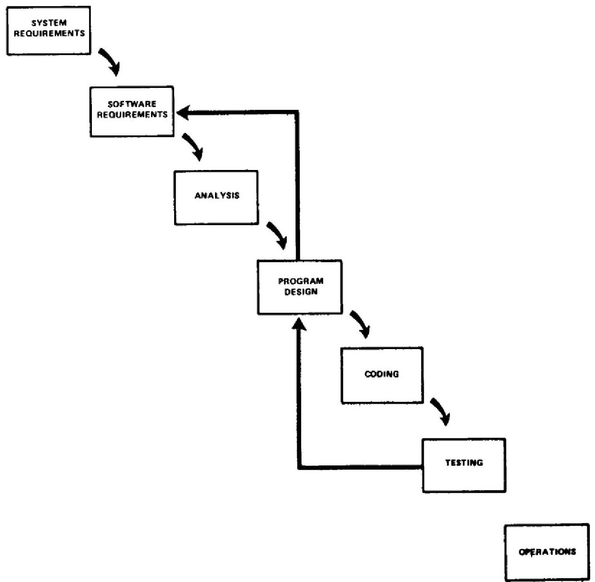

Figure 2.1: The waterfall model for developing software systems [29].

## 2.3 Software Requirements and CubeSats

When considering an organization dedicated to the construction of CubeSats, such as PolySat, software requirements are not a required deliverable and are rarely documented. Part of this is due to the misconception the system-level requirements serve as the primary specification, containing the required information on what both the software and the system as a whole must do. While information pertaining to how the system will achieve mission success is the main purpose of this type of documentation, elements pertaining to what the software must specifically do is not necessarily given.

<!-- PDF_PAGE: 18 -->

In the case of PolySat, this type of information is not documented in certain cases and is simply agreed upon through informal methods of communication such as verbal agreement or email. From an organizational perspective, it becomes difficult to keep track of this information over time because it is no longer in a single, easy-to-access location. Furthermore, it does not provide a clear definition of what is required of the software, which can lead to gaps in implementation.

## 2.4 Consortium Requirements Engineering (CoRE) Method

The Consortium Requirements Engineering (CoRE) method is a method of designing software requirements for real-time software systems designed by the Software Productivity Consortium [16]. The idea behind CoRE is to provide practical instruction for developing software requirements and methods for organizing the specifications into parts using a two model system. One of the major benefits of using CoRE is resulting requirements specifications have precise descriptions of the scope of acceptable software behaviors. This method also requires the language of the requirements use familiar terms and measured quantities in order to ensure all involved parties have a clear understanding of what is required of the software.

## 2.4.1 Two Model Structure

The CoRE method is built on two underlying models: the behavioral model and the class model. These models were included into CoRE to address issues real-time software programmers faced in industry. These issues include ensuring requirements can be derived for real-time embedded systems, are easy to change if the product changes, and written using understandable language for the document's audience.

<!-- PDF_PAGE: 19 -->

## 2.4.1.1 Behavioral Model

The behavioral model pulls many elements from the four-variable model [27] in order to provide a structure for capturing behavioral requirements for a given software system. In order to do this, the software system is viewed within the environment affecting and interfacing with it, which helps in obtaining all relevant environmental quantities. These quantities can be placed in two categories: monitored variables and controlled variables. Monitored variables are any environmental quantities the software system must keep track of or measure, while controlled variables are the quantities the system controls or influences.

In terms of the behavioral model, two relations can be defined to help map possible monitored variables to controlled variables based on nature (NAT) and required (REQ). NAT represents the constraints nature imposes on the the system such as physical laws, properties of physical systems, or interfacing hardware constraints. This makes any environmental constraints explicit rather than implicit. REQ represents the required behavior of the system or what the software must enforce, and it relates observable changes in the environment to the observable system actions.

To describe the actual inputs and outputs to the software system, CoRE considers these as resources to the system and represents them as input (IN) and output (OUT) relations. IN is the relation between monitored variables to the actual system inputs. In other words, it describes what the available inputs are to the software from the monitored variables. OUT is the relation between output variables to the controlled variables, otherwise described as how the controlled variables are affected by certain values being output by output devices. The CoRE behavioral model and its four components can be represented as shown in Figure 2.2.

<!-- PDF_PAGE: 20 -->

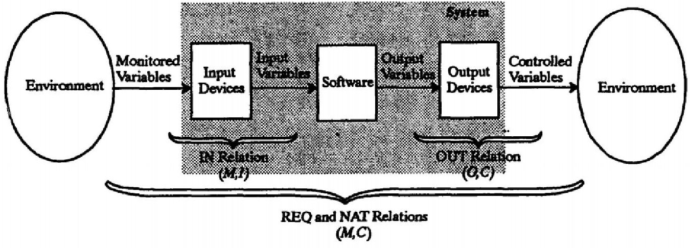

Figure 2.2: Visual representation of the CoRE behavioral model.

## 2.4.1.2 Class Model

Similar to the behavioral model, the CoRE class model is based off of Paul Ward's computer-aided software engineering Real-Time Method for object-oriented domain and requirements analysis [36]. The class model provides a way to package the behavioral model into objects, classes, and superclasses. This is used to provide a way to abstract and encapsulate the behavioral model as a way to address packaging issues. Furthermore, since the class model divides the requirements into parts, it is easier to implement changes and reuse portions in other specifications.

The definitions within the CoRE class model are similar to definitions used in object-oriented programming. A CoRE object is an instance of a class that specifies a component of the system in terms of one of the four variables in the behavioral model. CoRE classes are templates for objects that define encapsulated information. A superclass defines common properties and serves as a template for a class.

Unlike other methods of creating object-oriented requirements specifications, there is a separation between the class model and the behavioral model. Requirements are not meant to be defined in the class model, which means all classes are to be written in terms of the behavioral model. While the behavioral model determines the

<!-- PDF_PAGE: 21 -->

required behavior of the software, the class model simply provides details to how the information is structured.

## 2.4.2 Steps of the CoRE Method

According to the idealized process for using the CoRE method [16], there are five steps to developing a CoRE specification.

1. Determine all environmental quantities that interact with the software and the constraints these quantities impose.

2. Determine the scope of the software by identifying the environmental quantities the software must track or affect.

3. Use the CoRE class model to package the environmental quantities into classes.

4. Define the behavior, timing, and accuracy constraints of the software in the CoRE class model.

5. Define the inputs and outputs of the software in the CoRE class model.

Steps one and two involve using the behavioral model to specify the environmental quantities in terms of monitored and controlled variables as well as the basic relationships the software must have connecting these variables. The third step determines how the quantities defined in the behavioral model should be structured into the class model. The fourth and fifth steps handle completing the class definitions by filling in the details from the behavioral model into the class model.

## 2.4.3 CoRE Used at Lockheed Aeronautical Systems

Lockheed Aeronautical Systems Company's (LASC) C-130J Hercules aircraft is an advanced aircraft used for military and civilian purposes. During the early develop-

<!-- PDF_PAGE: 22 -->

ment stages, LASC decided to set goals for the overall project, which would in turn affect the software engineering methods used on the aircraft and, in particular, its software avionics system. These goals were safety, quality, affordability, and flexibility. LASC decided to utilize the CoRE method because it satisfied these goals and was assessed to have a low risk and high payoff for the program [15].

After deciding to use CoRE, LASC used the basic properties of both the behavioral and class models, but changed the notation and formalisms. This allowed CoRE to be adapted for different development standards and used with different tools. In particular, LASC removed the use of the IN and OUT relations because they were viewed as part of the design phase and should not be included with modeling and requirements.

## 2.4.3.1 Meeting Process Goals for the C-130J

Once the C-130J's software avionics system passed its preliminary design review (PDR), LASC determined how CoRE contributed to the C-130J's process goals:

Safety: Since the software avionics system of the C-130J was a safety critical component of the aircraft, the use of tables for monitored and controlled variables helped with identifying the set of test cases needed to show the requirements had test coverage.

Quality: The use of CoRE aided in identifying the priority of different components of the software, which helped in ordering the development process.

Flexibility: The requirements structure remained stable due to the use of the class model. In particular, no changes were needed to the higher levels of the class model if adjustments were required. Any updates that were required due to changes in hardware only affected single classes rather than the entire class structure.

<!-- PDF_PAGE: 23 -->

Affordability: By integrating CoRE with Quality Function Deployment (QFD), LASC was able to rate requirements based on customer needs, which allowed for cost/feature tradeoffs. Furthermore, by being able to capture any changes with CoRE, LASC was driven to develop and design an architecture that was robust to anticipated changes.

Low-Risk: The use of CoRE ensured requirements were not missing or incomplete because requirements issues were raised earlier in development. The integration of CoRE into the rest of LASC's processes did not negatively affect the development schedule.

Beyond CoRE's ability to address LASC's goals for adopting the method, the behavioral model proved to be extremely useful in determining gaps within the requirements specification early on. At the same time, the behavioral model helped engineers separate identifying requirements and developing designs because it was much clearer to define the space between what the system needed to do versus how the system was supposed to do it.

## 2.5 Why CubeSats Lack Software Requirements

Even though many large-scale aerospace projects follow processes to develop software requirements, there is no apparent documented attempt to have a CubeSat project follow similar or modified processes used in industry. While this can causes problems with software development, it is important to distinguish how CubeSats differ from other projects in the Aerospace industry.

<!-- PDF_PAGE: 24 -->

## 2.5.1 Timeline

One of the initial purposes of developing the CubeSat standard was to provide university-level students with the opportunity to work on all phases in a spacecraft's life cycle. This means the timeline for CubeSats falls within one to two years [9]. It is important to note this timeline is for a unique spacecraft rather than a spacecraft that has been built before and requires little to no research and development to build.

In comparison to the life cycle of a CubeSat, a unique large-scale spacecraft designed by the United States Army and Navy takes an average of 7.5 years from the start of the contract to launch [11]. This timeline allows for software engineers to spend longer durations on requirements development as well as use more complex methods for generating requirements. When considering the average two year development life cycle of a CubeSat, the ability to use in-depth methods for generating requirements and specifications is restricted to a period of a few weeks.

## 2.5.2 Project Team Size

Another major factor limiting CubeSat projects is the common size of each spacecraft team. Since CubeSats are less complex in comparison to a 2,000 kilogram satellite, the number of individuals working on a CubeSat mission is also small in comparison. On average, 10 people will comprise a CubeSat team. The breakdown of majors on the team is evenly divided between aerospace, electrical, mechanical, and software engineers. Due to the small number of software engineers working on a single project, the amount of time focused on design, implementation, and testing is increased while documenting requirements, whether it is intended or not, is reduced. This promotes requirements to be left as informal, widely accepted agreements discussed shortly before design rather than a document following a formula.

<!-- PDF_PAGE: 25 -->

## 2.5.3 Project Cost

In conjunction, the amount of funding CubeSats require in order to be built is significantly less than larger satellites. For example, LandSat-8, a 2,000 kilogram Earth imaging satellite, cost approximately $850 million to build, launch and operate in comparison to one of Planet's 3U Dove CubeSats, which cost approximately $60,000 [24]. Even though the higher cost is representative of paying for expensive, custom components, it also allows for tools to aid in the project's success. From a software engineering perspective, this means computer aided software engineering (CASE) tools can be used to help with tasks such as requirements development.

In a large organization that can support both the monetary and educational costs of teaching software engineers how to properly utilize CASE tools, it makes sense to uses requirement methods to their fullest. In the case of LASC, software engineers built all of their CoRE specifications and requirements documentation using Cadre's team work CASE tool, which cost $8,900 in the late 1980's [3] and required on-site training for two days every two months over a year. While the cost of CASE tools have significantly decreased, the amount of time required to educate software engineers on a CubeSat team would be too great. Furthermore, when considering an university CubeSat program, new members would have to constantly be trained in order to replace graduating members, which would otherwise result in a loss of institutional knowledge.

## 2.6 Model Verification and Validation

While software requirements exist as one half of ensuring a software system will be built as intended by the design team and envisioned by the customer, the processes of verifying and validating the software or overall system is the other half. Validation

<!-- PDF_PAGE: 26 -->

is the act of confirming a system is able to meet the customer requirements through objective evidence. Verification is the act of confirming requirements have been met through objective evidence [4]. This evidence can be discerned through techniques such as system and component level testing or modeling and simulation [18]. In other words, validation is meant to determine if the right system was built while verification is meant to determine if the system was built right [4].

No matter the project domain, verification and validation techniques are a constant because of their importance in confirming a system's accuracy and functionality. However, there are many different ways confirmation can be done. One of these types is through modeling and simulation. In the case of Model-Based Systems Engineering (MBSE), the techniques are based around the development and interrogation of computer models. MBSE is, as defined by the International Council on Systems Engineering, the "formalized application of modeling to support system requirements, design, analysis, verification and validation activities beginning in the conceptual design phase and continuing throughout development and later life cycle phases"[26]. This means the focus is on creating conceptual models built off of data and behavior using tools such as the Object Management Group's UML for software engineering and SysML for systems engineering [17].

The concepts of verification and validation still apply to MBSE. Model verification confirms the model produced is correct while model validation confirms the data generated from the model is accurate [10]. In domains such as software engineering, formal methods, which rely on mathematical techniques to help with verification and validation, can be utilized [30]. These methods have varying levels of characterization which describe the extent to which a single technique can be applied. One characterization is lightweight formal methods, which are used to partially analyze specifications without the need to develop and baseline a formal specification [13]. When it comes to software, lightweight formals methods are good for catching errors

<!-- PDF_PAGE: 27 -->

in the early stages of development and aiding in software architecture design [18].

## 2.7 Monterey Phoenix Modeling Language

Developed by the Navy at the Naval Postgraduate School, the Monterey Phoenix modeling language is a formal approach to modeling systems, software, hardware, organizational relations, and environmental behaviors [18]. Monterey Phoenix uses lightweight formal methods to create sets of scope-complete scenarios based on components' behavior and their interactions between one another. This means all behaviors of a system can be depicted using the same model within a small scope based on the Small Scope Hypothesis [23, 1].

## 2.7.1 Events and Relations

Monterey Phoenix is based around the concept of events. As defined by Dr. Mikhail Auguston, an event is an abstraction of any noticeable action performed during the operation of a system or software[6]. These events can be the execution of a statement in a software context or a system behavior in a system engineering context. Events are organized around two relations: execution time and granularity. In terms of execution time, events may or may not need to execute at specific times, which means they have a temporal relationship. For example, an event X may only execute after event Y has completed. In terms of granularity, some events may contain another event or series of events, which means there can be a hierarchy to event execution and represented as a single unit. For example, in the case of a software system, event A may represent a function call that executes events B and C in a particular order.

The concepts of time and granularity help to define the two basic relations that define event interactions: precedence (PRECEDES) and inclusion (IN). With these two relations, system and software behaviors can be represented as sets of events

<!-- PDF_PAGE: 28 -->

connected by the PRECEDES and IN relations, which are referred to as event traces. The event relations help define acceptable orders in which events can occur. The axioms defined by Dr. Mikhail Auguston in Appendix B apply to all possible event traces [6].

## 2.7.2 Event Grammars

Event traces are organized into different structures to make up a behavioral model known as event grammars. Event grammars follow a two-part structure in the following form X:Y where X is the event name and Y is the combination of different event patterns. The event patterns are defined using a short nomenclature and can be represented graphically. For the purpose of this paper, the IN and PRECEDES event relations will be represented as depicted in Figure 2.3.

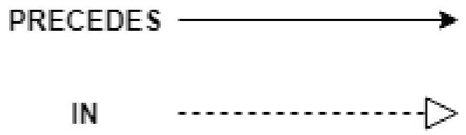

Figure 2.3: Graphical representation of IN and PRECEDES relations

## 2.7.2.1 Event Patterns

In total, there are eight basic event patterns that can be combined to create a behavioral model. In the following definitions, A will represent the event name while B and C will represent two different events. The basic patterns are defined as follows:

1. Sequence: Ordering of events using the PRECEDES relation to define when an event or series of events comes before another. A sequence is defined by separating two events with a space such as A:B C. In Monterey Phoenix, a sequence of two events is shown in Figure 2.4.

<!-- PDF_PAGE: 29 -->

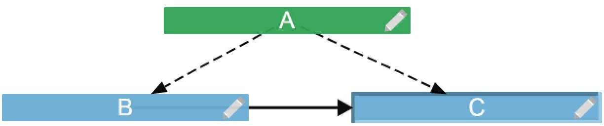

Figure 2.4: Sequence of event B followed by C

2. Alternative: An alternative pattern means one event may execute instead of another depending on preceding events. This is denoted as A: (B C) and represented in Monterey Phoenix as shown in Figure 2.5.

(a) Path using event B chosen

(b) Path using event C chosen

Figure 2.5: Alternative events B and C

3. Sequence of zero or more: Based on what precedes it, an event may execute a repeated number of times or not at all. This pattern allows for loops to be constructed. This is denoted as A: $ \left( ^{*}B^{*} \right) $ and represented in Monterey Phoenix as shown in Figure 2.6.

(a) Zero events executed

(b) Three events executed

Figure 2.6: Ordered sequence of zero or more B events

<!-- PDF_PAGE: 30 -->

4. Sequence of one or more: Similar to a sequence of zero or more events, a sequence of one or more events allows for a similar behavior to a do-while loop. This is denoted as A: （+B+）and represented in Monterey Phoenix as shown in Figure 2.7.

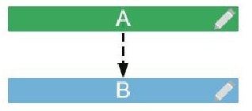

(a) One event executed

(b) Three events executed

Figure 2.7: Ordered sequence of one or more B events

5. Optional: In certain cases, an event may or may not need to execute, which is defined by the optional statement A: [B]. This is represented in Monterey Phoenix as shown in Figure 2.8.

(a) Optional B event is not executed

(b) Optional B event is executed

Figure 2.8: Optional B event

6. Unordered: Two or more events can be unordered and have no bearing on whether one precedes another. This can be used to model concurrency. This is denoted as A: {B, C} and represented in Monterey Phoenix as shown in Figure 2.9.

Figure 2.9: Unordered events B and C

<!-- PDF_PAGE: 31 -->

7. Unordered zero or more: This represents zero or more unordered events of the same type. This is denoted as A: $ \{ \cdot ^{*}B^{*} \} $ and represented in Monterey Phoenix as shown in Figure 2.10.

(a) Unordered B event executing zero times

(b) Unordered B event concurrently executing three times

Figure 2.10: Unordered B events concurrently executing zero or more times

8. Unordered one or more: This is similar to an unordered set of zero or more events; however, at least one of the events is executed. This is denoted as $ A:\{+B+} $ and represented in Monterey Phoenix as shown in Figure 2.11.

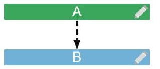

(a) Unordered B event executing one time

(b) Unordered B event concurrently executing three times

Figure 2.11: Unordered B events concurrently executing one or more times

## 2.7.3 Steps for Using Monterey Phoenix for Verification and Validation

In order to ensure verification and validation can be performed on behavior models generated in Monterey Phoenix, there are steps that can be followed to determine if there are any issues. These steps can help discern if there are unspecified or undesired behaviors within a system [18].

1. Collect any materials describing system requirements or customer requests. These inputs will serve as the basis for the model.

<!-- PDF_PAGE: 32 -->

2. Translate the desired behaviors into a model using Monterey Phoenix.

3. Check the resulting model against any available verification information to ensure there are no errors. If errors exist, correct them and recheck the model.

4. Once the model has been completed, generate a list of scenarios the system will be put through in order to confirm all behaviors are as expected. This process can be done manually or through the use of automated tools.

5. If there are any issues, classify them as either verification or validation issues and fix the model until all behaviors are as expected.

(a) If the issue is related to verification, correct the model to ensure it matches the specification.

(b) If the issues is related to validation, review the uncovered behavior with the design team and customer to determine an appropriate solution. Once a decision has been reached make the corrections to the specifications, model, or both.

## 2.7.4 Existing CubeSat Models

In 2012 and 2013, two studies were conducted to determine how a spacecraft could be modeled using MSBE techniques and SysML [32, 31]. Based on a hypothetical CubeSat and University of Michigan's RAX spacecraft, the CubeSat Modeling Framework breaks down each element of the satellites' design including the mission objective, environment, flight system, ground system, and any subsystems. The framework ranges from high-level to specific in order to capture what functionality is needed and how it will be provided. In the end, a SysML model of RAX was constructed based on the mission specification.

<!-- PDF_PAGE: 33 -->

## Chapter 3 APPLYING THE CORE METHOD TO CUBESATS

The following chapter discusses how the CoRE method can be applied to CubeSats. Furthermore, the modified steps of the behavioral model used to model a CubeSat are outlined.

## 3.1 How CoRE can be Applied to CubeSats

In its idealized form, it is not practical to implement the CoRE method on CubeSat projects based on the amount of time and resources CubeSat teams have for developing projects. With the restricted timeline for unique spacecraft, the amount of time software engineers would need to invest in forming the behavioral model and structuring it into the class model using a CASE tool would detract from other elements of design and development.

While the idealized form of CoRE is a lengthy process for smaller projects, using a modified version of CoRE makes developing software requirements for CubeSats worthwhile. In particular, the behavioral model provides all the processes needed for discerning important environmental quantities into the monitored and controlled variables.

## 3.1.1 Modifying the Behavioral Model

When considering the first two steps for developing software requirements using the CoRE method, the act of discerning the environmental quantities in terms of monitored and controlled variables is a process most CubeSat programs innately do when developing hardware and structural requirements for the spacecraft. The issue, as

<!-- PDF_PAGE: 34 -->

stated previously, is there usually is no formal method for documenting the environmental quantities. In the case of PolySat, these requirements are more informal and take shape during the design phase rather than before. However, by modifying components of the behavioral model, a simplified method of documenting these variables into requirements becomes exposed.

## 3.1.1.1 Determine the Environmental Quantities

Following the first two steps of CoRE, a list of environmental quantities that affect the system must be recorded to begin. While collecting this information, it is crucial four pieces of data are collected for each quantity:

1. Name: The name of the quantity in the context of what device or mechanism is monitoring or controlling.

2. Type: The unit of measure of the quantity.

3. Values: The range of values for precision.

4. Physical Interpretation: A description of the quantity outlining what importance it has for being either monitored or controlled by the system. This will serve as the skeleton for the requirement relating to the quantity.

This information should be structured into a table as it is collected to aid with organization as well as make it easier to separate the monitored variables and the controlled variables from one another.

## 3.1.1.2 Separate Monitored Variables from Controlled Variables

Once all relevant environmental quantities have been documented into a table, the next step is to determine which quantities represent the monitored and controlled

<!-- PDF_PAGE: 35 -->

variables. The two types of variables must be separated from one another in order to easily distinguish each type and prepare for documenting the requirements as different sections.

## 3.1.1.3 Formalize the Requirements

Once the tables for monitored and controlled variables have be completed, the requirements can be written formally. In order to do this, the physical interpretation statement must be structured as a declarative sentence in terms of the system. To avoid potential vagueness, use terms such as "shall" to establish the statement is contractually binding and a mandatory item. Following the same pattern as forming the tables, keep the requirements pertaining to monitored variables separate from the requirements pertaining to controlled variables.

## 3.1.2 Reasons for Omitting Portions of the Behavioral Model

Recalling the differences between CubeSat projects and other large aerospace projects, certain formalities within the behavioral model are unnecessary in order to achieve the goal of an easy to understand requirements specification. Due to the likeliness most CubeSat teams will not have access to CASE tools, the use of assigning mathematical variables to environmental quantities would make developing requirements by hand harder to understand. Instead, it is clearer to define each quantity in terms of the technology that will most likely be used in monitoring or controlling said quantity. This makes referencing the variables easier while writing requirements because the name of the quantity aligns with the physical interaction.

Similar to the process followed by LASC, it makes sense to omit the use of the IN and OUT relations. These require information about the system's software developed in the design phases of projects, which can include designing a packet structure for

<!-- PDF_PAGE: 36 -->

properly communicating data bits. In the case of PolySat, this serves as the first step for developing a CubeSat's software, which omitted the use of formal requirements. By avoiding these considerations, it becomes easier to critically assess the system as a whole and understand how the goals of the satellite translate into the goals of the software.

## 3.2 Implementing CoRE for ExoCube-2

In order to determine the effectiveness of using the modified behavioral model, it was important to test the process on a CubeSat project. At the time this research was being conducted, ExoCube-2 was in the system requirements phase of the project and was ready to proceed into design. It is important to note, structural, mechanical, and electrical requirements, separate from system requirements, were formally documented in a single location. At this point, there were no documented requirements for software, but there was institutional knowledge of what the software must do from the first ExoCube mission and a mutual understanding of the software's requirements based on the system requirements. This institutional knowledge was not documented and consisted only of verbally agreed upon decisions also made based on the system requirements.

After forming the steps for developing requirements based on the modified behavioral model as described previously, information regarding the environmental quantities was collected through discussions with members of the ExoCube-2 team. The quantities were compiled and separated into two tables based on whether they were controlled or monitored variables as seen in Figure 3.1 and Figure 3.2 respectively. Once information regarding the name, type, values, and physical interpretation was documented for each variable, requirements were developed using declarative "shall" statements as shown in Appendix A. These requirements could easily be added into

<!-- PDF_PAGE: 37 -->

the documentation containing the other structural, mechanical, and electrical requirements.

<table border="1"><tr><td>Name</td><td>Type</td><td>Value</td><td>Physical Interpretation</td></tr><tr><td>Magnetorquers</td><td>volts</td><td>0-10 volts</td><td>Controls position of the spacecraft by manipulating the magnetic field in relation to Earth</td></tr><tr><td>Digitally Controlled Momentum Wheel</td><td>bits</td><td>8-16 bits</td><td>Repositions spacecraft around a single axis</td></tr></table>

Figure 3.1: Controlled variables table for ExoCube-2

<table border="1"><tr><td>Name</td><td>Type</td><td>Value</td><td>Physical Interpretation</td></tr><tr><td>Sun Sensor</td><td>volts</td><td>Field of View:0-150°</td><td>Measures angle of inclination to the sun</td></tr><tr><td>Magnetometers(Bus)</td><td>millitesla</td><td>$\pm$1 millitesla</td><td>Measures magnetic field relative to Earth</td></tr><tr><td>Magnetometers(Booms)</td><td>millitesla</td><td>$\pm$1 millitesla</td><td>Confirms booms are properly oriented in terms of the rest of the spacecraft</td></tr><tr><td>Temperature Sensor</td><td>volts</td><td>0.4-2.4 volts</td><td>Measures the temperature of the spacecraft</td></tr><tr><td>Power Supply</td><td>volts</td><td>4.2 volts nominally</td><td>Confirms the bus rail is kept at a desired value</td></tr><tr><td>Antenna Deployment Switches</td><td>I/O(volts)</td><td>deployed-not deployed(high-low)</td><td>Confirms the antennas properly deploy</td></tr><tr><td>Foot Deployment Switches</td><td>I/O(volts)</td><td>deployed-not deployed(high-low)</td><td>Confirms satellite has deployed from the deployer is capable of turning on.</td></tr><tr><td>Nadir Facing</td><td>degrees</td><td>knowledge:within5°accuracy:10°-15°</td><td>Measures the orientation of the spacecraft pointing directly towards Earth</td></tr><tr><td>Ram Facing</td><td>degrees</td><td>knowledge:within5°accuracy:10°-15°</td><td>Measures the orientation of the spacecraft moving forward in space</td></tr><tr><td>Radiation Sensor</td><td>event detection</td><td>count nominal</td><td>Measures radiation environment surrounding the spacecraft</td></tr><tr><td>Solar Cell Current Monitor</td><td>volts</td><td>0.15-0.4 volts</td><td>Measures the voltage drop across the solar cell resistors to determine if the spacecraft is receiving current from the solar cells</td></tr></table>

Figure 3.2: Monitored variables table for ExoCube-2

<!-- PDF_PAGE: 38 -->

## Chapter 4 ANALYSIS OF THE CORE METHOD

The following chapter discusses the results of using the modified behavioral method on ExoCube-2.

## 4.1 Results

There are advantages to using the modified CoRE method for generating CubeSat software requirements. The process for developing the specification is relatively quick. Once all the information regarding the environment variables has been collected and the monitored and controlled variables have been defined, forming the "shall" statements based off each row in the tables is the last step for generating the formal requirement specification. At a minimum, students get a better understanding of what the software must do in order to achieve a mission-correlated purpose and exercises what is required to be agreed upon between the customer and the development team to ensure the mission is successful. Furthermore, it gives students without knowledge of software or systems engineering the opportunity to learn the importance of using software requirements and partake in negotiations with the customer regarding what is required for mission success.

Even though there are some benefits to using the modified CoRE method, there are some glaring issues. The biggest problem is the level of requirements the current iteration of the method produces. Based on the standard created for ExoCube-2, the granularity of the requirements align with a function-level definition [19]. Initially, this does not appear to be a very big issue, however using only function-level requirements can potentially pigeonhole a design by forcing a development team into using

<!-- PDF_PAGE: 39 -->

certain components or ensure certain behaviors. Unfortunately, while function-level requirements are fine when combined with higher-level requirements that give the development team the ability to ensure how the spacecraft can behave without limiting what components can be used, the lack of any software requirements being used by the PolySat program means design elements may be added into the requirements.

In conjunction with the level of requirements generated, the requirements themselves were too self-explanatory for PolySat. For example, requirement FR-2 from the specification in Appendix A states, "the system shall measure the magnetic field around the spacecraft relative to Earth within a 1 millitesla tolerance." This requirement references integrating the proper software to measure the magnetic field from an instrument such as a magnetometer. Even though the information defined in the requirement does state what is needed from the software, it did not specify anything that wasn't already institutional knowledge. While this may come off as a benefit by forcing institutional knowledge to be documented in a way that gives rigidity to a repeatable design, the majority of elements captured in the CoRE requirements were not under scrutiny to change. In the case of FR-2, defining the tolerance of the measurements is important for later reference during design, however this information was already known and reused from previous PolySat missions utilizing magnetometers including ExoCube-2's predecessor, ExoCube-1. Furthermore, the documented behaviors applied more to general spacecraft functionality and less to the actual mission. Again, this may or may not appear as a disadvantage, but when considering software pertaining to different missions changes more than software consistent across multiple spacecraft, having the mission elements captured in the requirements is rather important.

<!-- PDF_PAGE: 40 -->

## Chapter 5 APPLYING MONTEREY PHOENIX TO CUBESATS

This chapter looks at why modeling CubeSats can have benefits for educating engineers unfamiliar with systems engineering concepts. Furthermore, the criteria used for selecting Monterey Phoenix are explained along with the reasons why the benefits initially outweigh the disadvantages.

## 5.1 Why Model CubeSats

In comparison to developing CubeSats within a company setting, CubeSat development as an educational tool has distinct differences that influence the ability to model them. In an educational setting, designing spacecraft is much more intuition-based [31]. Most of the time this due to an educational program's unfamiliarity with the processes and methodologies required to successfully build a spacecraft. While this unfamiliarity is expected because the intent is to teach, the desire to use simple yet inefficient methodologies is strong. In particular, educational CubeSat programs are highly conducive to trial and error mentalities. Again, this is not necessarily a bad methodology to use since it makes students think critically about different processes, test them, and understand why they were or were not successful, but trial and error can use a lot of time especially in cases of failure and redesign. As discussed in section 2.5.1, time is a valuable resource, and potentially squandering it if multiple trials yield errors can be problematic.

Institutional knowledge also plays a key role in how educational programs build CubeSats. Over the course of an educational program's lifetime, projects' successes or failures provide lots of insight into how future projects are completed. This type

<!-- PDF_PAGE: 41 -->

of knowledge serves as first-hand concrete evidence for a program, and it can affect anything from engineering decisions such as design choices and test procedures to organizational structure. The primary benefit of institutional knowledge is not simply the higher chances of success, but it reduces the amount of time dedicated to trial and error methodologies; it influences what is reused over what needs to be researched further.

Even though institutional knowledge can be beneficial, if it is not properly documented, there is a higher chance it will not be passed down. While companies can suffer from employees leaving with a sufficient understanding of a concept without documenting it, this tends to be a larger issue with university programs. This is primarily due to students graduating within a few years of joining a CubeSat program or leaving due to prioritization of coursework over extracurricular activities. The combination of intuition and institutional knowledge is beneficial for programs that have launched CubeSats, such as PolySat, but access to previous experiences is harder for new educational programs to come by. It is for this reason why documents such as NASA's CubeSat 101 [22] guide exist.

For educational CubeSat programs, reducing the amount of resources put towards trial and error can be extremely beneficial. One way this can be done is through modeling. Using MBSE techniques can help drive a consistent design, which would help remove programs from using a trial and error workflow [20]. Even though the initial work of developing a CubeSat model would take time for a given program's architecture, more focus would be put into the design stages in order to remove as many errors as possible before the spacecraft is put into development.

In turn, this would help conserve resources by helping expose issues early. Since the cost of fixing an error later in development costs more by an exponential factor, the incentive to put more effort into minimizing design errors saves both time and

<!-- PDF_PAGE: 42 -->

money [33]. Furthermore, the opportunity cost for modeling is low. At minimum, more time is spent considering the spacecraft's design, which in it of itself can be beneficial from an educational perspective. Furthermore, there is no monetary cost of integrating MBSE concepts and ideas into a CubeSat program.

Even with the benefits of using modeling techniques, there are a few issues that need to be considered beforehand. First, even though the monetary cost may be nonexistent depending on what tools an educational program may use, the value of teaching students the necessary skills to develop appropriate models and understand them once generated has to be considered. This can include whether the concepts and selected language require a professor to teach or if students can educate themselves with available resources in a timely matter. Furthermore, the amount of time to educate students and foster an understanding of the concepts might be counterproductive in the context of developing CubeSats simply due to time constraints.

Second, it is important to make sure any model is constructed in a way that is easily understandable to all parties involved with the project. While students can be educated and generate new models if necessary, the primary goal is to reuse previous work. This means if a previously generated generic model is developed for a CubeSat program's architecture yet details pertaining to how to use the model are not passed on, students either have to spend time learning what work was completed or design a brand new model. This issue pertains to institutional knowledge and how it is passed on, but if the information needed is not documented properly, then a modeling language that is easy to read can help new students by minimizing the amount of time needed to understand any previous work.

Third, it is important the modeling language selected can actually provide the specificity needed for the task. In other words, whether the model is for high-level system interaction descriptions or low-level component interactions, the language has

<!-- PDF_PAGE: 43 -->

to be able to accommodate what the CubeSat program needs. If a language is built for high-level modeling but the desire is to provide software component interactions between multiple subsystems, then it benefits a program to find the best language for high-level description. This issue can depend on what is required for a given situation primarily because a high-level description may be all that is required.

Lastly, an educational program should determine if the language can model complex interactions. Similar to programming languages, certain modeling languages are capable of easily modeling complex behaviors because the features are built into the language. This may or may not be as large an issue for two reasons. First, only basic functionality is needed for a high-level model, which means the need for having complex features is irrelevant. Second, even if the feature is needed, it could be fairly easy to build more advance capabilities using what is already part of the language. While an element for solving this issue is subjective depending on the program's needs, there is a potential, if a feature not built into the language is needed, for wasting time attempting to create the feature from scratch.

## 5.2 Criteria for Selecting a Language

Based on the issues discussed in the previous section, there are four criteria used to determine which language could be best suited for modeling CubeSat missions in an educational setting.

1. Readability: Is the resulting model produced by the language understandable to those with minimal understanding of the language's intricacies? Can a student or customer be able to read a model or resulting documentation and understand the interactions and behaviors it is trying to capture?

2. Explicit: Is the language strictly built for high-level modeling, or does it have

<!-- PDF_PAGE: 44 -->

the capability to model low-level interactions as well?

3. Teaching Complexity: Is the language hard to teach to students? Can students understand the basics of the language enough through self-teaching resources or does a professor or teacher need to provide instruction?

4. Language Complexity: Can complex behaviors or interactions be modeled using built-in language features? Do certain interactions require being programmed by hand, or does the language provide a wide array of language capabilities?

## 5.3 Reasons for Using Monterey Phoenix

Based on the criteria discussed previously, Monterey Phoenix seemed like the best solution. Due to the design of the two-relation language, it was easy to interpret system interactions with only a cursory understanding of how Monterey Phoenix works. Even though the language was designed to be high-level, the flexibility of the language did seem to allow for low-level interactions to be modeled by shifting the context to a given subsystem.

When considering the abort sequence for the LEO and StangSat mission, a highlevel description can be generated depicting the interactions between both spacecraft in the event of a false launch detection such as Figure 5.1. However, if the context is shifted to a lower-level, more details about specific processes can be modeled. Figure 5.2 shows the specific path of execution for LEO during an abort sequence once the system needs to read measurements from the barometer. Unlike Figure 5.1, the lowerlevel description provides greater detail about a smaller portion of the system even though scope of the graph is narrower.

<!-- PDF_PAGE: 45 -->

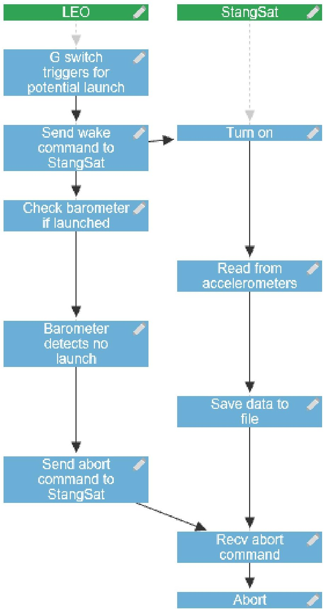

Figure 5.1: Monterey Phoenix representation of LEO and Stangsat for an abort sequence

<!-- PDF_PAGE: 46 -->

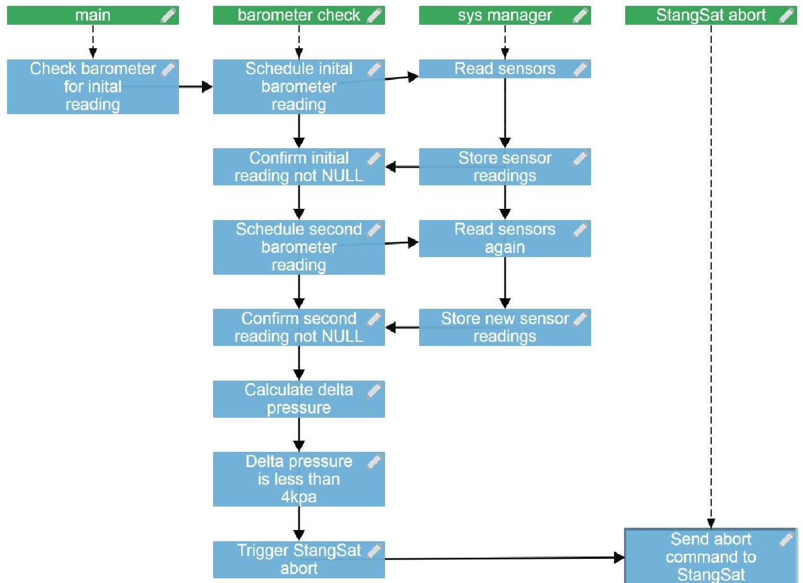

Figure 5.2: Monterey Phoenix representation of barometer checking procedure for LEO

Furthermore, due to the language's small set of event patterns, Monterey Phoenix is an easier language to grasp over SysML and UML. While some of the more complex elements of the language could warrant further explaining, the resources available through the Monterey Phoenix wiki provided by the Naval Postgraduate School is clear and straightforward [1]. Initially, it also seemed fairly easy to model complex behaviors in Monterey Phoenix even though the language did not have many built-in features.

The largest reason for using a different language, such as SysML or UML, over Monterey Phoenix has to do with both how explicit it is and the available features of the language. In the case of an UML activity diagram, the Object Management Group developed specific notations to depict how interactions between behaviors take

<!-- PDF_PAGE: 47 -->

place such as loops and concurrency [35]. The use of a high-level language does depend on what an institution needs modeled and how detailed they need it to be. In certain cases, even using a high-level language can be beneficial from an educational perspective by having students breakdown a system into simpler pieces and model the elements. On top of this, Monterey Phoenix does not have many language features to help define different relations or behaviors like dependencies or loops. This alone could be a reason to select a language with more options than the IN and PRECEDES relations provided, but the presence of more language features can further complicate teaching the basics to students. It is a balance that needs to be considered when determining what modeling language a CubeSat program should use.

For the purpose of what is trying to be achieved in this paper, the benefits as an educational tool outweigh the lack of explicitness and language features. Considering the value of teaching MSBE concepts to engineers who may not be exposed to system engineering through coursework, the use of a modeling language like Monterey Phoenix can give engineering students a better understanding of how to utilize modeling tools to enhance the design process. Furthermore, the introduction of a tool with more features than what might be needed to foster this education can add an extra layer of complexity while students may be trying to teach themselves the concepts.

## 5.4 Using Monterey Phoenix

In order to determine if the benefits of modeling a CubeSat could be gained for the PolySat program, the LEO and StangSat mission was selected as a candidate. As mentioned in Section 2.1.1.2, LEO and StangSat will be measuring the launch environment inside their deployer during launch. In order to ensure data between the two spacecraft is properly synced, LEO turns on StangSat using an LED signal. Once all data has been collected, another LED signal is sent to turn StangSat back

<!-- PDF_PAGE: 48 -->

off. Furthermore, if LEO is activated by a strong enough impulse outside of launch conditions, it must turn StangSat off in order to be prepared for an actual launch. The reason LEO and StangSat were selected was because the two systems rely on several interactions between both systems in order to successfully get two sets of launch environment data back to Earth. In turn, the possible variety of behaviors the two systems exhibit appeared to be a good choice to show how Monterey Phoenix models the mission.

On top of assessing the software architecture of LEO and StangSat, a project currently in development at PolySat is looking to capture the same data using a single spacecraft and updated technology. Even though the new mission does not rely on two separate spacecraft for data collection, the mission objective and design is almost identical. Having a model that represents a similar mission means the ability to potentially reuse most of what was developed is higher.

The process outlined by the Naval Postgraduate School for developing Monterey Phoenix models was used to develop the model based on LEO and StangSat. This process was described in Section 2.7.3 and was not modified. Based what was modeled, three graphs were generated from the model code written based on the different scenarios LEO and StangSat can experience.

As mentioned earlier, the two criteria that define a successful launch from LEO's perspective are an impulse of 0.2 Gs followed by a 4 kilopascal change in pressure over 15 seconds. If the barometer does not read the appropriate change in pressure, LEO must send an LED signal to turn off StangSat. This is referred to as an abort sequence, which is represented in Monterey Phoenix in Figure 5.1.

In the event both criteria for a launch are met, LEO and StangSat remain on and collect their respective data sets. While StangSat is collecting its environment data, it will send all data samples in real-time to LEO over the ad hoc Wi-Fi network

<!-- PDF_PAGE: 49 -->

for storage. Since the process for LEO's data collection is repeated, the scope for a successful launch scenario was set at two in order to see if any issues could be discovered through repeated execution. The Monterey Phoenix representations for the one scope and two scope graphs are depicted in Figures C.1 and 6.1 respectively.

<!-- PDF_PAGE: 50 -->

## Chapter 6 ANALYSIS OF MONTEREY PHOENIX

This section looks at the implications of using the Monterey Phoenix modeling language as a verification and validation tool for CubeSat software. In particular, the usefulness of the language is assessed in the context of the LEO and StangSat CubeSat mission built by PolySat and Merritt Island High School respectively. The advantages and disadvantages of modeling software in Monterey Phoenix are also discussed in the context of CubeSat programs outside of PolySat.

## 6.1 Advantages of Using Monterey Phoenix

The Monterey Phoenix modeling language can be used in the context of a CubeSat project being built in an educational setting. One of the largest draws of using Monterey Phoenix is the ease at which models can be generated. The language is high-level, which makes it easier to understand for those not familiar with programming concepts. Since there are only two relations that make up all models (IN and PRECEDES), the amount of time it takes to understand how unique events interact with one another is much shorter in comparison to using another modeling language such as UML or SysML. Furthermore, there are eight event patterns that can be used to define a system's behavior, which makes breaking down each behavior into a combination of the base event patterns easier [6]. This is especially useful when minimizing the amount of content required for students to understand the basics of modeling system and software behavior. In the case of the most current version of UML known as UML 2.5, there are 15 different diagram types with their own semantics [35].

When considering a young CubeSat program at either the high school or univer-

<!-- PDF_PAGE: 51 -->

sity level, it is much harder to initially understand how different system components interact with one another without having prior institutional knowledge or assistance from outside parties. The use of a high-level modeling language, such as Monterey Phoenix, allows for students to discuss how different system components can interact with one another without needing to model the entire system in-depth. Furthermore, using a modeling tool that is easy to understand and does not take an exorbitant amount of time to become familiar with can help in visualizing the interactions between systems or system components.

As another benefit, simple interactions can be modeled quickly, which makes the Monterey Phoenix language a good solution for brainstorming how a software system should behave. This is especially true in a situation when a customer and the development team have different ideas on how a specific software interactions should illicit certain behaviors. Using a modeling tool that allows for quick mock-ups of intended behavior provides a concrete representation of what each party believes to be the solution and allows for better discussion. Furthermore, it serves as a good tool to quickly model interactions between subsystems defined in interface control documents (ICD) such as a spacecraft's payload and on-board computer. While it is important to ensure all parties have a solid understanding of information in an ICD, the added simplistic visual representation using a small graphical vocabulary can help minimize any disparity or miscommunication issues throughout the document.

## 6.2 Why Monterey Phoenix Does Not Work for PolySat

When considering the impacted schedule and student availability while designing and developing a CubeSat in an educational setting, the focus is to successfully complete a working spacecraft. The balance of how much time is spent on each stage of development varies depending on where students feel the least comfortable. For instance,

<!-- PDF_PAGE: 52 -->

when considering a new CubeSat program, more time might be spent understanding the overall design of the system because no one has a firm idea of how a spacecraft might work. In another case, an older program is going to put more time into how payload-specific portions of the spacecraft effect the rest of the existing system. In the end, the decision to model a system has to be based on the amount of time it will take to generate the model against the benefits the model could provide once complete. Since Monterey Phoenix can be used to model both system and software architectures, there are two potential ways a program, such as PolySat, could utilize the tool and gain some benefit.

Unfortunately, while there are benefits to using Monterey Phoenix within the PolySat program for system architecture modeling, the primary problem is that most system interaction issues that a high-level language could potentially expose have already been discovered through other techniques such as trial and error. This is a result of PolySat being a well-established program with consistent designs that do not change drastically between spacecraft. In conjunction, the verification and validation documents that could benefit from modeling system interactions, such as interface control documents and test procedures, tend to rely on institutional knowledge based on how previous iterations of the similar systems behave; there is no need to model how a spacecraft will behave if the majority of the behavior is already understood.

When it comes to modeling PolySat's software architecture in Monterey Phoenix, the outlook is not as bleak. Since root actors can be defined as anything, the specificity of software elements can be modeled to reflect interactions between different aspects of the software. The issue arises, however, when considering the available interactions definable and how they are represented in the Monterey Phoenix language. The IN and PRECEDES relations can provide a student with the ability to model all behaviors of any software system, but displaying a complex interaction or system behavior in a manner that does not require an extensive amount of time to understand

<!-- PDF_PAGE: 53 -->

how the behavior is depicted can be an issue.

This is where the readability of the generated models are hindered by the simplicity of the language. While complex behaviors can be modeled, they are only possible through careful combination of the IN and PRECEDES relations. In a more feature-heavy language, complex behaviors have relations and structures built-in to ensure clarity is not sacrificed for simplicity. For instance, Figure 6.2 uses UML's activity diagram format to depict a successful launch sequence similar to the Monterey Phoenix representation in Figure 6.1. Unlike the Monterey Phoenix graph, the activity diagram is able to clearly depict repeated behaviors using decision symbols to define looping behavior. Loops are easily implemented and provide a clearer definition of the intended system behavior rather than repeating portions of the graph to show the same process is happening multiple times. Not only is looping behavior easier to define, but activity diagrams allow for nested loops. In the case of Monterey Phoenix, nested loops are not allowed based on the experimentation done during the time this paper is being written. This means behaviors such as checking for more EOIs and determining if the current EOI is still ongoing cannot be depicted using Monterey Phoenix. In this case, this exclusion of built-in language features prevents the system from being modeled as accurately as it could be.

<!-- PDF_PAGE: 54 -->

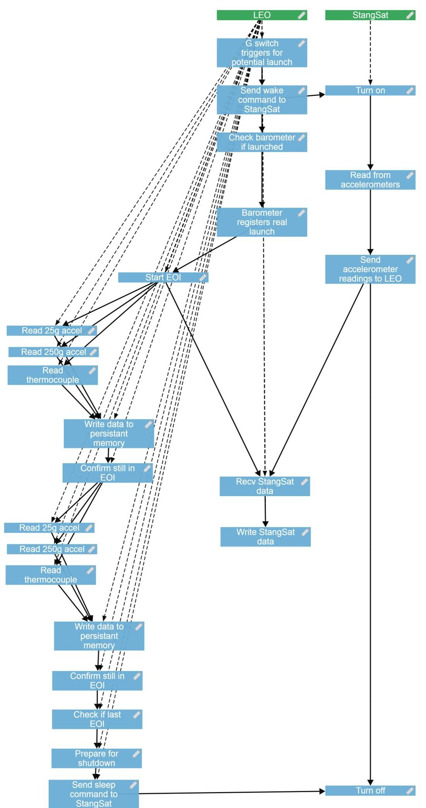

Figure 6.1: Monterey Phoenix representation of LEO and Stangsat for a successful launch with a scope of 2

<!-- PDF_PAGE: 55 -->

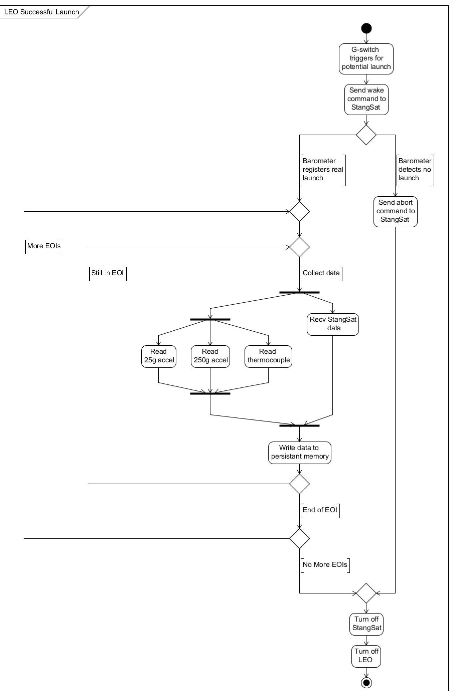

Figure 6.2: UML activity diagram representation of LEO and Stangsat for a successful launch 46

<!-- PDF_PAGE: 56 -->

At this point, the consideration for using Monterey Phoenix has to be made based on the benefits the program is hoping to achieve. As a teaching tool to get students to better understand a CubeSat's software architecture at a high level, the exercise of using Monterey Phoenix to model the software and produce interaction graphs of the software's behavior can be helpful. However, if the desire is to improve a program's current software architecture, the decision to perform architecture modeling has to be based on how complex the changes are going to be and if the time invested will produce worthy educational and design benefits. While simplicity does have its place in modeling CubeSats for the sake of educating students and conserving time, the largest benefit of Monterey Phoenix is as a brainstorming tool within the PolySat program.

For this reason, PolySat would get a larger benefit by integrating either SysML or UML for system and software architecture modeling respectively. There are more resources available for teaching students and troubleshooting common issues than Monterey Phoenix currently has. Even though the complexity of SysML and UML do create a steeper learning curve than Monterey Phoenix, the wider use of both the former languages also provides a greater benefit to students entering into system and software design. Furthermore, this could encourage advising professors to integrate material using MBSE concepts while learning either SysML or UML.

<!-- PDF_PAGE: 57 -->

## Chapter 7

## FUTURE WORK

Since this paper focuses on two different techniques, the following sections will look at aspects that can potentially be added to improve the findings discussed prior. The first section will discuss ways to improve the CoRE method while the second section will discuss ways to improve the use of Monterey Phoenix.

## 7.1 Future Work Pertaining to CoRE

While the modified behavioral method alone was not as good as initially thought, there are ways it could potentially be improved and make it worthwhile to use. The primary element that might make the the behavioral model better is the use of a CASE tool. As it was expressed earlier, a CASE tool did aid in creating the requirement specifications used for the C-130J. While the tools are expensive and can potentially take a lot of time to gain a good understanding of how to use them, it is possible an open source solution may exist in the future or a tool provider may have educational licences available for purchase. In either case, the opportunity to teach students how to use CoRE with a CASE tool could provide more benefit than designing the specification manually.

The other aspect of CoRE that can be improved based on the implementation presented is the use of the class model. During the course of this research, the behavioral model was required to reflect some amount of success before the modification and integration of the class model. Even though the behavioral model might not have yielded as positive results as initially thought, the class model could provide an element of reusability that encourages more updates and improvements to the

<!-- PDF_PAGE: 58 -->

methodology.

The first step in integrating the class model would be to assess the steps both in [16] and section 2.4.2 and how they could be applied to the modified behavioral model discussed in section 3.1.1. Similar to the behavioral model, the process to translate elements of the requirements specification into reusable objects would have to be tailored to the time constraints of the requirements phase for CubeSats.

The next step is to determine the point during the modified behavioral model development when requirements should be formatted as objects. While it is most likely possible to generate the objects after the specification is complete as stated in section 2.4.2, it may save time to have reusable objects earlier by forcing students to think about what elements of the software could be reused in future missions. The most likely time to do this might be after the creation of the monitored and controlled variables tables.

The last step would be to take the a requirement specification that uses both the behavioral and class models from a CubeSat project and reuse overlapping requirements objects on a different mission. The missions would not have to be the same because the specification should capture non-mission specific requirements to ensure the spacecraft bus works properly. In particular, requirements pertaining to monitored variables will probably have a higher chance of reuse because bus designs may remain consistent to avoid full system redesigns for each mission.

## 7.2 Future Work Pertaining to Monterey Phoenix

Unfortunately, based on the initial attempts made in this paper, there is not much in the way of future work for integrating Monterey Phoenix. One potential path is to utilize the language for more specific components within a software system. By breaking down elements of the software's design into smaller pieces and using

<!-- PDF_PAGE: 59 -->

multiple graphs to make up the entire system, it may be possible to have a better representation. At this moment, the nature of a high-level language is the reason why Monterey Phoenix is not a good choice for PolySat, but it could become a better tool if it is used in this way. Furthermore, a young CubeSat program could use the language to model interactions as they lay the foundation for their system's design.

There are some points discovered during the course of this research that the Naval Postgraduate School could utilize to improve the overall usability of Monterey Phoenix. The first is a dedicated integrated development environment (IDE) that can be downloaded and used for modeling rather than relying strictly on the online interface. There are a two reasons why this would be of benefit. First, in-house CubeSat designs tend to be proprietary information, and using an online editor running on an off-site server can be a disincentive to using the modeling language. Second, if any information that is International Traffic in Arms Regulations (ITAR) controlled, using an online interface on an unsecured server would have major legal repercussions if any information was intercepted between the server and the CubeSat program's secure development space.

The second language improvement deals with the overall organization of the code. While defining a large system in Monterey Phoenix, the combination of defining different execution paths and order of each statement's execution makes the readability of the code itself very difficult. This statement should not be confused with the readability of the generated graphs themselves. There is no current alignment method for parentheses and bracket, which makes distinguishing different blocks of code difficult. This is partially due to the lack of loop and path execution statements, which, if added, would make the code much more readable. With these changes integrate, Monterey Phoenix could become a wider used tool for educational CubeSat programs looking to begin modeling their system and software designs.

<!-- PDF_PAGE: 60 -->

## Chapter 8

## CONCLUSION

CubeSats are an amazing and arguably vital aspect to an engineering education. The practical application of knowledge gained from coursework is a benefit to students while also giving professional science teams the opportunity to perform experiments previously too expensive. While the benefits are clear and abundant, the lack of verification and validation techniques used within these educational programs is worrisome. Even programs that have many years of experience and have launched multiple successful spacecraft, such as PolySat, need to utilize methodologies and processes to aid in conserving resources and ensure their spacecraft will be successful and avoid mission-killing errors.

While both the CoRE method and the Monterey Phoenix modeling language have benefits and a potential place in CubeSat development, more research has to be done to determine the best ways these methods can be integrated into educational CubeSat programs. The problem of lacking verification and validation techniques is persistent throughout CubeSat programs, and no definite solution exists. There are minor benefits to using the modified CoRE method presented in this paper and the Monterey Phoenix modeling language. The behavioral model can provide students with a basic guide on how to distinguish different behaviors and classify them into a document that resembles very basic software requirements. It is also possible to use Monterey Phoenix as a brainstorming tool to model different system or software interactions quickly to make better informed design decisions.

For PolySat, the results were not as positive as initially expected. After modifying CoRE's behavioral model to streamline the requirements development process, the result was a specification that defined previously undocumented software requirements.

<!-- PDF_PAGE: 61 -->

in a manner that was too simplistic and not beneficial in the end. Initially, Monterey Phoenix seemed to be an easy-to-learn language with the potential to model both system and software interactions in an effort to expose illegal behaviors; however, the language was too high-level to capture anything of use and serves as a better tool for brainstorming.

Even though neither of the two methodologies really worked, it is important the PolySat program finds solutions that will. This could mean investing the time and effort into familiarizing students with aspects of SysML or UML to promote a MBSE mindset or documenting requirements using an unique approach. Since UML is taught within the computer science and software engineering curriculum, it may be easier to encourage students to use it to model software interactions. While PolySat might not have a method for specifying requirements or modeling systems or software, utilizing the immense institutional knowledge base to come up with a practical solution is possible given time and the desire to have a solution.

<!-- PDF_PAGE: 62 -->

## BIBLIOGRAPHY

[1] Monterey Phoenix Home - Monterey Phoenix - NPS Wiki. https://wiki.nps.edu/display/MP/Monterey+Phoenix+Home.

[2] PolySat - Missions Launched. http://www.polysat.org/launched/.

[3] New products/software & services. Computerworld, 20(37):96, Sept 1986.

[4] Iso/iec/ieee international standard - systems and software engineering - system life cycle processes. ISO/IEC/IEEE 15288 First edition 2015-05-15, pages 1-118, May 2015.

[5] J. Andrews and A. Bonnema. Ticket to space-how to get your small satellite from the cleanroom to orbit. 2011.

[6] M. Auguston. Software architecture built from behavior models. 34(5):1-15.

[7] E. Baumgarten, V. Faune, A. Saunders, C. Taylor, J. Weaver, N. Weitz, and O. Woolsoncroft. Tesseract cubesat bus with deployable solar panels, 2015.

[8] T. E. Bell and T. A. Thayer. Software requirements: Are they really a problem? In Proceedings of the 2nd International Conference on Software Engineering, ICSE '76, pages 61-68, Los Alamitos, CA, USA, 1976. IEEE Computer Society Press.

[9] A. Chin, R. Coelho, R. Nugent, R. Munakata, and J. Puig-Suari. Cubesat: The pico-satellite standard for research and education, 2008.

[10] E. M. Clarke and J. M. Wing. Formal methods: State of the art and future directions. ACM Comput. Surv., 28(4):626-643, Dec. 1996.

<!-- PDF_PAGE: 63 -->

[11] L. A. Davis and L. Filip. How long does it take to develop and launch government satellite systems?, Mar 2015.

[12] J. Dolengewicz, J. Puig-Suari, L. Whipple, A. Williams, and S. Wong. The next generation cubesat: A modular and adaptable cubesat frame design, 2010.

[13] S. Easterbrook, R. Lutz, R. Covington, J. Kelly, Y. Ampo, and D. Hamilton. Experiences using lightweight formal methods for requirements modeling. IEEE Transactions on Software Engineering, 24(1):4-14, Jan 1998.

[14] J. A. Estefan et al. Survey of model-based systems engineering (mbse) methodologies. Incose MBSE Focus Group, 25(8):1-12, 2007.

[15] S. Faulk, L. Finneran, J. Kirby, S. Shah, and J. Sutton. Experience applying the core method to the lockheed c-130j software requirements. In Computer Assurance, 1994. COMPASS '94 Safety, Reliability, Fault Tolerance, Concurrency and Real Time, Security. Proceedings of the Ninth Annual Conference on, pages 3-8, Jun 1994.

[16] S. R. Faulk, L. Finneran, J. Kirby, and A. Moini. Consortium requirements engineering guidebook. Technical Report SPC-92060-CMS, Software Productivity Consortium, 2214 Rock Hill Road, Herndon, Virginia, Dec 1993.

[17] M. Fowler. Patterns of enterprise application architecture. Addison-Wesley Longman Publishing Co., Inc., 2002.

[18] K. Giammarco and K. Giles. Verification and validation of behavior models using lightweight formal methods. In A. M. Madni, B. Boehm, R. G. Ghanem, D. Erwin, and M. J. Wheaton, editors, Disciplinary Convergence in Systems Engineering Research, pages 431-447. Springer International Publishing.

<!-- PDF_PAGE: 64 -->

[19] T. Gorschek and C. Wohlin. Requirements abstraction model. Requir. Eng., 11(1):79-101, Dec. 2005.

[20] L. E. Hart. Introduction to model-based system engineering (mbse) and sysml. In Delaware Valley INCOSE Chapter Meeting, Ramblewood Country Club, Mount Laurel, New Jersey, 2015.

[21] K. L. Heninger. Specifying software requirements for complex systems: New techniques and their application. IEEE Transactions on Software Engineering, SE-6(1):2-13, Jan 1980.

[22] S. Higginbotham. CubeSat Launch Initiative Overview and CubeSat 101, Sept. 2017.

[23] D. Jackson. Software Abstractions: logic, language, and analysis. MIT press, 2012.

[24] B. Lal, E. J. Sylak-Glassman, M. C. Minerio, N. Gupta, L. M. Pratt, and A. R. Azari. Global trends in space volume 2: Trends by subsector and factors that could disrupt them. IDA Paper, 2, Jun 2015.

[25] T. Lethbridge and R. Laganiere. Object-Oriented Software Engineering: Practical Software Development Using UML and Java. McGraw-Hill, Inc., New York, NY, USA, 1 edition, 2002.

[26] I. T. Operations. Systems engineering vision 2020, Sept 2007.

[27] D. L. Parnas and J. Madey. Functional documents for computer systems. Science of Computer Programming, 25(1):41-61, 1995.

[28] M. P. Rodriguez. Miniaturized Ion and Neutral Mass Spectrometer for CubeSat Atmospheric Measurements, Aug. 2016.

<!-- PDF_PAGE: 65 -->

[29] W. W. Royce. Managing the development of large software systems: Concepts and techniques. In Proceedings of the 9th International Conference on Software Engineering, ICSE '87, pages 328-338, Los Alamitos, CA, USA, 1987. IEEE Computer Society Press.

[30] J. Rushby. Formal methods and the certification of critical systems. Citeseer, 1993.

[31] S. C. Spangelo, J. Cutler, L. Anderson, E. Fosse, L. Cheng, R. Yntema, M. Bajaj, C. Delp, B. Cole, G. Soremekum, and D. Kaslow. Model based systems engineering (mbse) applied to radio aurora explorer (rax) cubesat mission operational scenarios. In 2013 IEEE Aerospace Conference, pages 1-18, March 2013.

[32] S. C. Spangelo, D. Kaslow, C. Delp, B. Cole, L. Anderson, E. Fosse, B. S. Gilbert, L. Hartman, T. Kahn, and J. Cutler. Applying model based systems engineering (mbse) to a standard cubesat. In 2012 IEEE Aerospace Conference, pages 1-20, March 2012.

[33] J. M. Stecklein, J. Dabney, B. Dick, B. Haskins, R. Lovell, and G. Moroney Error cost escalation through the project life cycle. 2004.

[34] A. Toorian, E. Blundell, J. Puig-Suari, and R. Twiggs. Cubesats as responsive satellites, 2005.

[35] O. UML. Unified modelling language version 2.5. unified modelling (2017), 2017.

[36] P. T. Ward and S. J. Mellor. Structured Development for Real-Time Systems. Prentice Hall Professional Technical Reference, 1991.

<!-- PDF_PAGE: 66 -->

## APPENDICES

## Appendix A

## EXOCUBE-2 CORE SOFTWARE SPECIFICATION

## Environmental Monitoring:

- FR-1: The system shall measure the angle of inclination to the sun within a range of 0-150.

- FR-2: The system shall measure the magnetic field around the spacecraft relative to Earth within a 1 millitesla tolerance.

- FR-3: The system shall measure the magnetic field around the deployable booms relative to the rest of the spacecraft within a 1 millitesla tolerance.

- FR-4: The system shall measure the temperature of the spacecraft within a range of 0.4-2.4 volts.

- FR-5: The system shall confirm the power supply on the bus rail nominally reads 4.2 volts.

- FR-6: The system shall confirm both antennas have properly deployed after each burn attempt through the antenna deployment two switches.

- FR-7: The system shall confirm the satellite has properly deployed from the deployer through the foot deployment switch.

- FR-8: The system shall measure its nadir facing within a 5 knowledge and 10-15 accuracy.

<!-- PDF_PAGE: 67 -->

- FR-9: The system shall measure its ram facing with in a 5 knowledge and 10-15 accuracy.

- FR-10: The system shall measure the number of radiation events the spacecraft experiences.

- FR-11: The system shall measure the voltage drop across the solar cells within a range of 0.15-0.4 volts.

## Control Mechanisms:

- FR-12: The system shall be able to control the spacecraft be providing a voltage range of 0-10 volts to the magnetorquers.

- FR-13: The system shall be able to control the on-board, digitally controlled momentum wheel by providing a 8-16 bit speed to reposition itself.

<!-- PDF_PAGE: 68 -->

# Appendix B

# AXIOMS APPLIED TO MONTEREY PHOENIX EVENT TRACES

## B.1 Mutual Exclusion of Relations

Axiom 1: a PRECEDES b $ \Rightarrow $ $ \neg $ (a IN b)

Axiom 2: a PRECEDES $ b \Rightarrow \neg(b IN a) $

Axiom 3: a IN b $ \Rightarrow $ $ \neg $ (a PRECEDES b)

Axiom 4: a IN b $ \Rightarrow $ $ \neg(b $ PRECEDES a)

## B.2 Non-commutativity

Axiom 5: a PRECEDES $ b \Rightarrow \neg(b $ PRECEDES a)

Axiom 6: a IN b $ \Rightarrow $ $ \neg(b IN a) $

Irreflexivity for PRECEDES and IN follows from non-commutativity.

## B.3 Transitivity

Axiom 7: (a PRECEDES b) $ \wedge $ (b PRECEDES c) $ \Rightarrow $ (a PRECEDES c)

Axiom 8: (a IN b) $ \wedge $ (b IN c) $ \Rightarrow $ (a IN c)

## B.4 Distributivity

Axiom 9: (a IN b) $ \wedge $ (b PRECEDES c) $ \Rightarrow $ (a PRECEDES c)

Axiom 10: (a PRECEDES b) $ \wedge $ (c IN b) $ \Rightarrow $ (a PRECEDES c)

<!-- PDF_PAGE: 69 -->

Event trace is always a directed acyclic graph.

<!-- PDF_PAGE: 70 -->

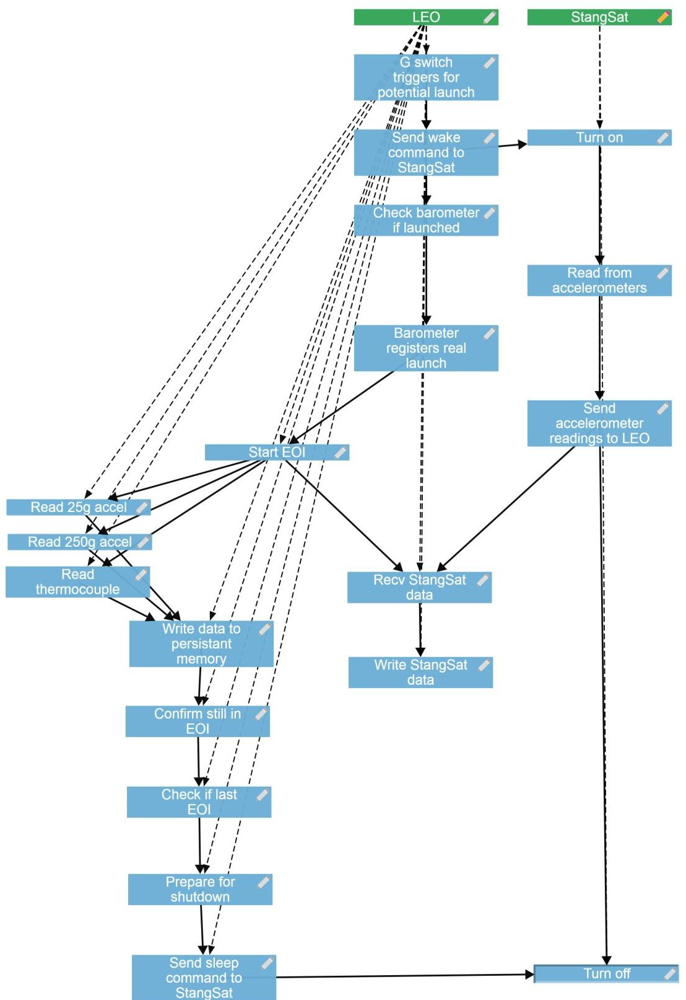

Figure C.1: Monterey Phoenix representation of LEO and Stangsat for a successful launch with a scope of 1

