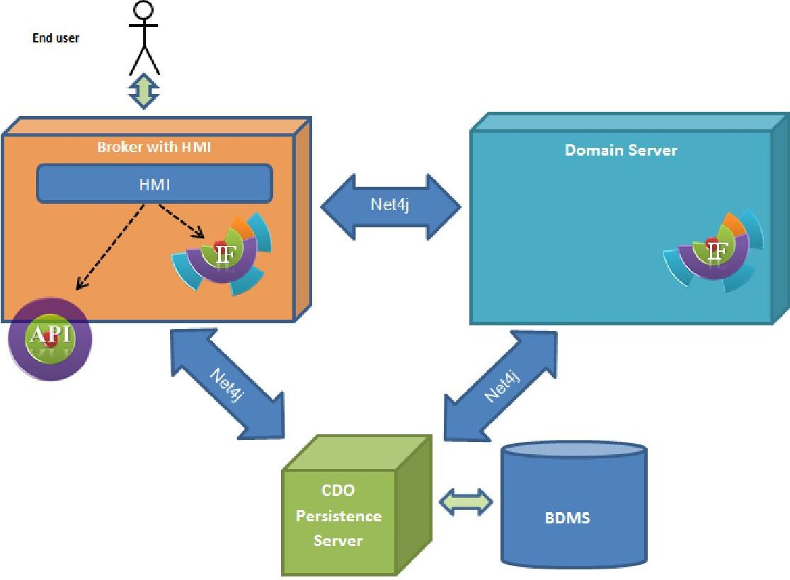
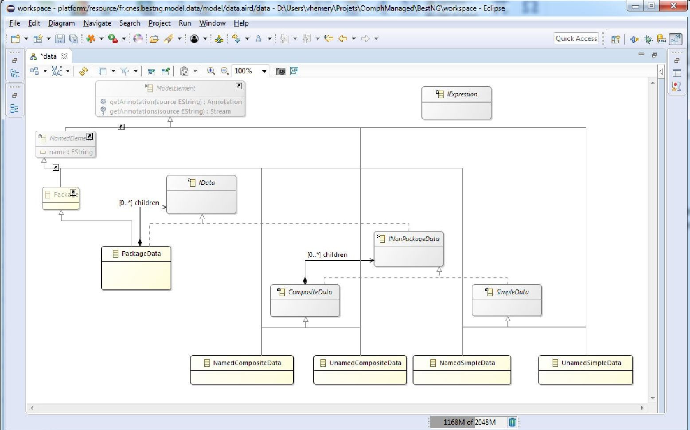
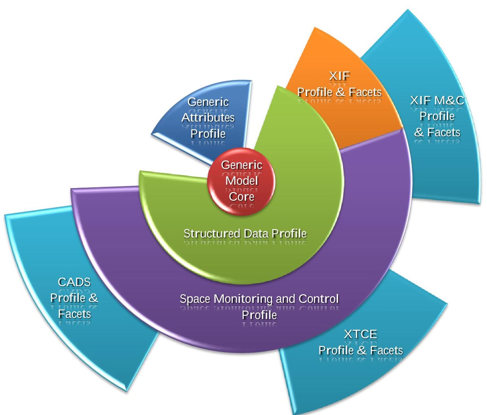
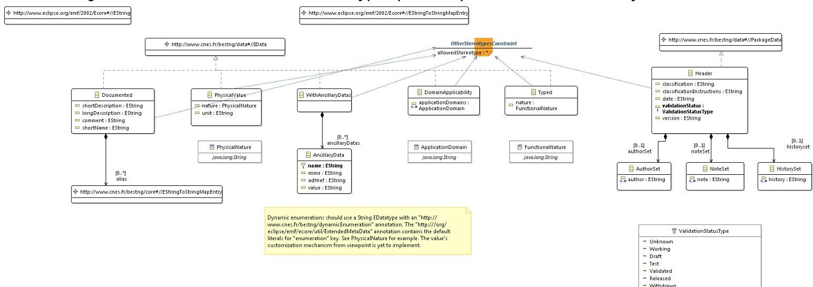
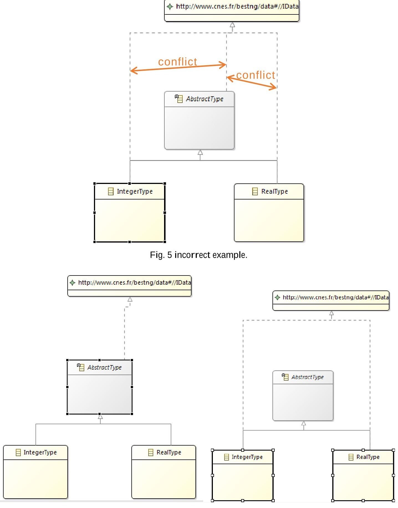
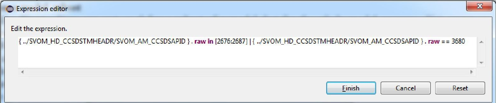

<!-- PDF_PAGE: 1 -->

# BEST-NG a new modeler for describing the satellite's database

Vincent Hémery $ ^{1} $ CS Systèmes d'Information, Toulouse, 31500, France

and Béatrice Larzul $ ^{2} $ , and Benoît Chausserie-Laprée $ ^{3} $ Centre National d'Etudes Spatiales (CNES), Toulouse, 31400, France

As the BEST engineering tooling (https://logiciels.cnes.fr/content/best) is no longer adapted to the requirements of new space projects (in terms of data size and data formats), the CNES (https://cnes.fr/en) is preparing a new generation of software to replace this framework. This paper presents the BEST-NG solution, a new modeling editor for describing the content of the satellite's database. BEST-NG is designed to address multi-domain issues and multi-format issues: in a single model, it can handle information from XTCE, CADS, XIF M&C, and XIF files. The solution is based on a UML-like custom Profile approach and the use of EMF Facet. It uses Eclipse Modeling technologies to solve major challenges. Especially, it provides import/export support for all these formats, good performances, validation, and a rich user-friendly expressions editor-implemented with Xtext-. BEST-NG should be used as the corner stone for future developments concerning the new space database management tools suite developed for the CNES.

## I. Nomenclature

APF = Application Programming Interface

BEST = Beyond EAST

CADS = Computer Aided Design of Systems (or “CNES Atelier Données Système” in French).

A data modeler based on the “ISIS System Data Model Specification”， written by CNES, Airbus-DS and TAS

CDO = Connected Data Objects https://www.eclipse.org/cdo/

CNES = Centre National d’Etudes Spatiales. French Space Agency.

DBMS = DataBase Management System

Domain = A set of concepts defining a particular business knowledge

DSL = Domain-Specific Language

Ecore = EMF core metamodel. Also the format for expressing EMF metamodels (including itself) and by such the EMF implementation of the MOF.

EMF = Eclipse Modeling Framework https://www.eclipse.org/modeling/emf/

ESA = European Space Agency

HMI = Human-Machine Interface

IF = Internal Form. The whole manipulated model (abbreviation used in diagrams).

Metamodel= A model describing all the concepts of a given domain.

MOF = Meta-Object Facility. http://www.omg.org/mof/

M(&)C = Monitoring and Control

OASIS = Outil d’Aide à la Structuration d’Informations Spatiales

<!-- PDF_PAGE: 2 -->

OMG = Object Management Group. An international normalization organization.

REST = Representational State Transfer

UML = Universal Modeling Language https://www.omg.org/spec/UML/About-UML/

XIF = XML Interchange Format

XIF M&C = XIF format, completed by the M&C extensions

XSD = XML Schema Document

XTCE = XML Telemetry & Command Exchange format (normalized by OMG).

https://www.omg.org/spec/XTCE/About-XTCE/

## II. Introduction

Satellites database is a key element for the design and operation of a satellite. The CNES has designed several tools to manage them. Among them, BEST [25] is part of the generic ground segment tools suite used by most operational missions at the CNES. It binds together the strengths of several mature industrial tools and has received contributions from both CNES and ESA.

Yet, as the requirements of new space projects keep evolving, BEST seems no longer an appropriate solution. BEST—especially its core component the "OASIS Modeller"—relies deeply on the XIF internal format. With time, space agencies collaborate more and more with other structures and they now need to exchange databases in other formats, like XTCE (at international) or CADS. On the other hand, the databases keep growing in size and BEST which relies on quite old technologies—cannot support the change of scale (from a 20 Mbytes maximum to over 100 Mbytes).

A new modeler framework for managing satellites databases is being developed, code-named "BEST-NG" (New Generation). This framework has to face new challenges:

Supporting very large models (the solution must scale with reasonable performances)

Supporting various concepts in a multi-domain environment. As BEST works on XIF, it also supports non-M&C XIF files, especially in a mode called "EAST mode". The BEST-NG should be able to support both "EAST mode" databases—not related to Space M&C—and Space M&C databases. These 2 distinct domains must be both addressed by BEST-NG.

Supporting various formats. BEST-NG has be able to work with XIF—M&C or not—, XTCE, and CADS files. It must be able to store information from each of these formats, which sometime overlap or complete each-other.

> Avoid the pitfalls encountered in BEST. In particular:

- Handle references between elements in a clean way. The XIF M&C extensions have references stored as text, which makes it hard to maintain inverse references when elements are renamed.

User-friendly expressions. When talking about XIF M&C format, we have not less than 5 different expression grammars. Not all of them have content assist in the BEST HMI.

BEST-NG has to provide solid foundations, on which the whole space database management tools suite will be renewed.

## III. Project history

## A. A preliminary study

Before the first implementation Guillaume Barthe (CS Systèmes d'Information) wrote a preliminary study asked by the CNESanalyzing the different technologies capable to support voluminous models for BEST-NG on a standalone architecture (May 2014). In this study, EMF and XSD emerged as good candidates. Moreover, EMF has the advantage to bring along other capabilities, like a validation framework, persistence frameworks, and so on.

This study underlined the strong performance limitations induced by a standalone architecture.

## B. First BEST-NG implementation shot, and the MXIF format

At first, the CNES did not express the need to support numerous formats. The first BEST-NG prototype was designed only to compensate the pitfalls of BEST-NG and allow for scalability, even with poor client configuration (32-bits Windows). It was based on an "MXIF" format (for "Model XIF") which was pretty much the same as the XIF M&C format, refactored to allow better modeling. It supported XIF format by imports and exports.

The MXIF format was:

implemented in Ecore format, hence based on the EMF technology,

<!-- PDF_PAGE: 3 -->

designed with clean model references,

containing expressions formalized as model elements, also with clean references instead of text.

By relying on EMF, the BEST-NG solution was able to use other useful technologies which easily integrate together:

The EMF file persistence is not limited to one format. We could persist in XML or binary files depending on the objectives (human readability or non-corruption and performance).

The EMF Validation framework provides a way to define model constraints and evaluating them on the model.

The CDO technology allows for collaborative edition, but also solves performance issues—with lazy loading—by offering a distributed architecture with clients and a persistence server. It supports interfacing with various DBMS.

EMF Query allows for querying the model.

Xtext has been used to provide user-friendly expression editors and to formalize the corresponding grammar.

The REST technology was also used to demonstrate the capabilities for API and lightweight HMI, since the HMI technology was not decided yet. A domain server was used, in addition to the persistence server, to delegate costly treatments like extensive validation.

The MXIF format suffered from a lack of extensibility, like the XIF format, as we could not provide extensible APIs on these. On the other hand, this prototype demonstrated the strength of EMF collaborating with other modeling technologies and validated the proposed architecture.

Fig. 1 Distributed architecture for BEST-NG.

## C. BEST-NG as we know it

Finally, the CNES asked in 2015 for the possibility to review the internal form of BEST-NG, to allow support for import/export of all concerned formats—XTCE, XIF, XIF M&C, and CADS—and storage of all information in these formats. The technologies, which had been proofed in the previous study, were already acted.

The CS Systèmes d'Information team had already though about such a need and two possibilities had emerged:

a big "group-them-all" metamodel which aggregates all possible information from all the concerned metamodels,

a modular solution, with clean separation of domain concepts and formats.

A consensus emerged to avoid the first solution at all costs, since it was nor evolutive nor maintainable. Moreover, the CADS format was still evolving quite fast, and this had been responsible for difficulties in

<!-- PDF_PAGE: 4 -->

maintaining another tool (DataModelConverter), which was in charge of converting XTCE or CADS files to XIF M&C. Since these difficulties were already present on only the formats intersection, we could only imagine the consequences on maintaining the union of these formats as a metamodel.

This modular approach is detailed thereafter.

## IV. Technical design

There are two aspects in supporting all the concerned formats—XTCE, XIF, XIF M&C, and CADS—.

The first aspect is storing information for all these formats. Pieces of information are common to all/some formats (e.g. boolean include condition), whereas others are specific to a particular format (e.g. the telecommand packet which should be sent immediately after another telecommand packet is stored only in CADS). Some concepts are not even meaningful for all formats (e.g. XIF without M&C extensions knows nothing about data monitoring). This is what I call the "Multi-domain" issue, as we refer to a domain as a given set of concepts in modeling.

The second aspect is reading/presenting this information in a way that makes sense for a given format. A similar concept will be seen with a different type in different formats—according to their respective XSD—, with different attributes. Formats may even have two opposite ways of presenting the model (e.g. CADS and XTCE have packet inheritance and composition for packet entries, whereas in XIF M&C there is only composition: a generic packet contains the inheriting instance packets). This is what I call the "Multi-format" issue, since we may have a same concept, but different ways of formatting it.

## A. Multi-domain issues

In a classic EMF modeling approach, we use a single Ecore file to express the concepts of a domain, writing what is called a DSL. Having a DSL based on another DSL is not an issue. Indeed, DSLs can import other DSLs and DSL elements can extend elements from another DSL. On the other hand, having two concepts from two different DSLs applied at the same time on a same model element is more complicated.

Yet, this situation is not without precedent and it has already been addressed in the past. This has been implemented by UML, which needed to let people extend the UML format with new domain-specific concepts. This implementation is named UML Profiles (see Ref. [5] at chapter 12.3) and is already widely used [6]. The "Profile" approach differs from the classic MOF approach, but looks more indicated in our case (due to the formats variety and evolution, as explained in Ref. [7] page 12).

Using the UML Profiles implementation has major drawbacks:

The model must be based on UML [8]. This is not acceptable for our use case because :

UML doesn't adapt well to the domains we wish to describe. Only a minuscule portion of the UML metamodel would be reused and it only makes harder to define the Profiles by forcing us to map domain concepts on UML.

UML is way too rich compared to the part of it we use. Our model would be polluted with lots of extra information with no relationship to our domain.

Historical choices exist in the Eclipse UML implementation. These now violate the EMF good practices. As a consequence, some EMF-based technologies might not work with such models, or only partially. In particular, CDO can only use UML in "legacy" mode [9][10] (because it extends directly Ecore classes).

We need to add constraints to the Profile mechanism, which do not exist in UML implementation. These constraints are useful to:

- Force the application of a Stereotype (i.e. class) as a prerequisite of another Stereotype. It may be tempting in this case to link the two Stereotypes by inheritance, but this solution does not work since we want to cumulate the format-specific Stereotypes for different formats. E.g. we have an InstanceTelemetryPacket Stereotype, understandable by the 3 formats, and format-specific Stereotypes only to hold additional format-specific attributes (with no duplication of information).

o Redefine some associations to restrict the scope of reachable values. E.g. a structure can inherit from another structure, but when these structures are packets, they can only inherit from specific kinds of compatible packets (instance or generic, Telemetry or Telecommand side...).

Nevertheless, huge efforts have been made to interface CDO with UML—including Profiles usage—which succeeded in beginning 2013 [11] with only few drawbacks [12].

<!-- PDF_PAGE: 5 -->

The Profile approach is still very interesting, and different implementations were analyzed, along with their consequences [1]. We considered with great interest the EMF Profiles solution [2][3][13][14][26], which raised interest in the community in 2011-2012. It aimed at applying the Profile approach not on UML, but on any EMF element. As such, it was a good candidate for the prototype implementation. Sadly, the project's activity analysis [15] underlined that:

The project never left EclipseLabs repository.

The project never had more than a couple simultaneous contributors (for a grand total of 3).

Only 42 tickets were opened and less than 40% of them were closed.

There has been no significant activity since March 2013 (only an isolated commit in 2014).

This did not look like a reliable project. In addition, the "metaleveling" technique used by the implementation ("Metalevel Lifting by Inheritance") was very likely to cause integration issues with CDO. In comparison, an approach more similar to the UML implementation ("Metalevel Lifting by Transformation") was safer for simpler cases (see Ref. [1] at page 5: "2.2 Integrating Profiled in the EMF Metalevel Architecture").

We finally decided to implement our own Profile implementation. We relied on the UML specification [6] and the experience of the Eclipse implementation. When defining a version of a Profile, a corresponding DSL Ecore file is generated and stored in an annotation of the Profile, which is then used to define instance elements. Yet we tried to make it better by having a much simpler base metamodel, by avoiding the pitfalls UML had experienced, and by enriching the Profile domain with the additions we needed.

A key ingredient of the Profile implementation is the ability to define DSLs without generating the corresponding Java classes. Such instance models are created with "dynamic EMF" [16][17]. This technology makes possible:

Static Profiles. These are defined in the application's sources. We choose to also generate a Java interface with the names of Profile elements, to be able to use these names in Java code for transformations and validations. We can also generate APIs for such Profiles.

Runtime Profiles. These are located in the user's workspace. We have not yet exploited them, but they may prove useful to let an expert user adding new attributes without regenerating the modeler's code. This need already existed in BEST, where the user could define "semantic attributes", with mission-specific configured keys and associated values. In a Profile approach, this would translate as mission-specific Stereotypes (i.e. Class) with the necessary attributes or references.

Each format has its own specificities which do not exist in others. So we need at least one static Profile per format. In addition, we also need DSLs to implement the domain contexts, independently of the format. We chose to implement this domain-specific DSLs also in Profile, so that our base metamodel is domain-agnostic. It extends Metaclasses defined in a "core" Metamodel, which is also used by Profile Metamodel and reimplements interesting Ecore features, like the annotations mechanism.

<!-- PDF_PAGE: 6 -->

Fig. 2 The "data" Metamodel used as base Metamodel for Profiles.

Internal services and utilities were also implemented to ease the manipulation of models with applied Profiles and Stereotypes.

## B. Multi-format issues

Once all the model information is stored, we still have to present it in a way that is compatible with the suited format for export. The correspondence is not a simple property renaming, but may consist in very complex queries using several related objects (e.g. in XIF M&C, which uses composition instead of inheritance, the children of a type are all the entries in this type, but also the inheriting types, in a particular order).

EMF Facet enables formalizing derived properties and completes our profiled model in a non-intrusive way [3][4][18][19][27]. EMF Facet is not fully mature yet, since it is still in "incubation phase" [20]. Nevertheless, we considered the project trustworthy since:

It is hosted by Eclipse. Hence, the source can always be recovered to take over the project maintenance if needed.

It is still active.

The project has a various community of contributors, from different companies whose engagement in the Eclipse Modeling community is noticeable on the long term (Obeo, Mia Software, CEA LIST).

EMF Facet still has limitations, including:

Access to the properties is not fully integrated to the EMF framework and still goes through a dedicated manager class.

There is no direct write access to these properties [21].

This last limitation has been worked around in our prototype by using a utility class and facet queries implementations extending a particular abstract java class. Indeed, in order to import the models, we had to "set" the value of a format property.

By relying on these derived properties, the import and export of models to specific formats is eased, even though it is not always fully sufficient. It also brings the possibility to display data in a format-specific point of view.

<!-- PDF_PAGE: 7 -->

## V. Designing the generic model

We abusively call "generic model" the subset composed of:

The instances of the base "data" metamodel—which is truly generic—.

The "Stereotype applications" related to the domain-specific Profiles (i.e. not specific to a particular format)which decorate the base model to add domain-related concepts-

This subsets is not dedicated to a format, hence the "generic". It is though domain-oriented.

We like to think of the whole model as a lotus flower, with the base "data" model at its core as its pistil, and the decorating Profiles and Facets around as petals.

Fig. 3 Internal Form with Profiles and Facets.

The Internal Form is composed of:

The "generic model". It contains all the domain intelligence:

The base "data" model. Profile elements are applied on it.

O The "Generic Attributes" Profile. It gathers elements not specific to our Space domain (e.g. description, unit, ancillary data...).

<!-- PDF_PAGE: 8 -->

The "Structured Data" Profile. It describes the domain of typed fields arborescence. This is what corresponds to the domain-intelligence of the XIF format—which may be used for nonspatial applications—.

The "Space Monitoring and Control" Profile. It describes the spatial concepts associated to M&C (e.g. packets, monitoring, TM parameters, TC arguments...).

Format-specific information (that are specific to 1 format only and not factorized):

The "XIF" Profile and Facets. Used for translation to XIF format (independent from "Space M&C" Profile).

The "XIF M&C" Profile and Facets. Used for translation to XIF format with M&C extensions.

The "XTCE" Profile. Used for translation to XTCE format.

The "CADS" Profile. Used for translation to CADS format.

These Profiles and Facets are still evolving as the prototype is being completed with new features.

BEST-NG may be completed with additional Profiles, though only those are of interest from the prototype's perspective. It may even be used with different Profiles to address a completely different domain.

## A. The "Generic Attributes" Profile

This is the lightest Profile in BEST-NG. Its Stereotypes (i.e. class) can decorate almost any model element.

Fig. 4 Generic Attributes Profile.

The Profile contains:

the possibility to insert a header with general information,

documentation-related information (including AncillaryData),

nature and unit information for particular fields (e.g. The APID may be used as FunctionalNature, whereas a length would be used as PhysicalNature, with a meter unit).

## B. The "Structured Data" Profile

This Profile contains everything needed to describe an arborescence of typed entries—with optionality conditions and repetitions—and constants.

Some types are simple, whereas there is also a complex "ContainerType" which contains other entries. Complex spatial structures may rely on this type (e.g. packets, type of complex arguments, reusable structures, messages, and commands). Types may inherit from another type of the same nature, which allows for structures inheritance. In case we need footers, entries may be tagged with a "TrailerEntry" Stereotype; the other entries naturally come first, before the content of inherited structures.

At this point, the Profile diagrams starts becoming a bit large and too complicated to read without a proper training (hence no illustration).

## C. The "Space Monitoring and Control" Profile

Any information related to the domain and available in at least two of the supported formats ends up in this Profile. This covers:

<!-- PDF_PAGE: 9 -->

> physical and functional elements composing the Space System hierarchy;

> components, such as parameters and arguments;

transfer functions;

> algorithms, their usages, and their definitions;

> packets and other containers;

usage of expressions in the Space M&C context;

specific types not present in Structured Data, such as Time types, PacketData, Deduced, Filler;

> monitoring functions, their usages, and their definitions.

At this point, it is impossible to represent the whole Profile in a single diagram. The Profile is split in different diagrams and the usage of queries helps analyzing the relations in the Profile.

Since the domain concepts can be interpreted in many ways (as illustrated by the formats themselves), the development team and the CNES organized many meetings in order to:

> Define what makes sense in the generic model Profiles.

> Define what should be the best usage of these Profiles and how we constrain it during import and export to produce similar models. E.g. even though nature and unit are permitted on components and their associated types—each format choosing a different place for factorization—, we use it only on the component's physical type.

## D. Tooling and methodology

CS Systèmes d'Information developed his own tooling for editing Profiles. The basic tree-editor generated by EMF is far from satisfying for big Profiles. The BEST-NG Profile editor (which is demonstrated in Fig. 4) relies on the Eclipse Sirius technology. The editor has been enhanced with specific decorations and actions—to navigate to related facets or to add annotations exploited by the Profile generation—.

With time, the team discovered anti-patterns and good practices which were added when possible as validation rules in the editor. These include:

It is often better to specialize an element by adding a new Stereotype applying on it (with constraints) rather than adding a containment reference to a dedicated Stereotype containing the information. This makes easier to specialize or override the concept in dependent Profiles (e.g. Stereotype holding PUS parameter information is applied on the same element as "TMParameter" Stereotype).

A Stereotype A in a Profile should generally not inherit from another concrete Stereotype B in another Profile. If so, the modularity is reduced because both Stereotypes A and B can contain the same attributes and user must choose between the two Profiles. On the contrary we wish we could switch between the two Profiles visualization or even remove the specific information from A. A dedicated constraint helps working around the problem by forcing B application before applying A—which holds only complementary non-redundant information—.

> When specifying the base model elements on which a Stereotype applies, it is better to make it at a same depth level in all the Stereotypes members of a same inheritance tree. This avoids conflicting references to base element.

<!-- PDF_PAGE: 10 -->

Fig. 6 fixed examples.

These are only a few examples of the rules implemented in the Profile editor.

## VI. Mapping the formats

Usage of EMF Facets with dedicated queries helps mapping format-specific properties. On one hand, format-specific information is stored in the dedicated Profile. On the other hand, information stored in the generic model is

<!-- PDF_PAGE: 11 -->

extracted by the mean of Facets—which properties are implemented with Java queries. We developed a simple routine which converts a Metamodel into a Profile with Stereotype declarations. Hence, the format mapping with the generic model consists in:

> Refactoring the generated Profile—which has been generated from format Ecore—, to :

o make the format-specific Stereotypes extend the correct base elements,

o add the Facets and make them rely on the correct generic model elements,

move derived properties to them (when information is in the generic model),

transform syntactic sugar tags into Facet information.

> Writing the queries' Java implementations to extract the information from the generic model. The queries must be written with both methods to "set" (for import) and "get" (for export) the value.

A set of generic queries is available for the most obvious cases. E.g. get the children data with a specific Stereotype, get the value from another specific feature in the generic model...

A generic import and export framework has been developed to read and write models relying on format-specific Stereotypes-for information available only in the format-and format-specific facets-for information derived from the generic form. This framework is based on the EMF persistence and declares specific reading and saving classes for the concerned file extension. Hence, importing and exporting behaves like a file opening or saving.

Though, this framework has its limitations and exceptions are required when the format is too far from our generic model. We often have to override methods for some format-specific behaviors, or even, in some rare exceptions, write manually XML elements which do not exist in the generic model. The XIF export has its own export mechanic generated from the Profile and Facets, using a more static algorithm structure, but also relying on the Facet queries.

As a consequence of the usage of Facets for import, it should theoretically be possible to edit the model by manipulating the format-specific properties. Though, as the import procedure may post-process the model to fix some elements, this usage is not recommended and may corrupt the model when the mapping is too complex.

## VII. Expressions editors

Expressions are saved as model elements with actual model references. On the other hand, a textual editor is more adapted when it provides appropriate syntax coloring and auto-completion. Xtext fits perfectly in this context, as the technology provides textual editor for models [22][23][28]. Xtext is used to:

define a grammar syntax,

define the semantic interpretation (model elements to create or reference),

> generate all the required artefacts (e.g. formatter, parser, syntax coloring...).

## A. Xtext on a model subset

Generally, Xtext editors are not used for a subset of a model, but for the whole model resource. Yet, some interactions with graphical editors provided interesting tips to achieve this goal, by creating a virtual resource [24][29]. With this virtual resource trick, we can open the Xtext editor on an expression model (e.g. optionality condition, algorithm definition...), which is then inserted in the main model. To enable referencing main model elements from the grammar (Xtext scoping), we used a utility class which stores the relationship between these virtual resources and the corresponding parent in the main model, so that the implementation knows in which context the grammar element is used.

Fig. 7 Expression example in the dedicated Xtext editor.

<!-- PDF_PAGE: 12 -->

## B. Xtext grammars organization

As BEST-NG hosts several domains, it becomes natural to have several grammars dedicated to each one of them. On the other hand, having different grammars makes the maintenance more complex and gets the end user lost. Luckily, Xtext provides a grammar inheritance mechanism, allowing reusing/overriding elements from a grammar in another one. Hence, we have in the prototype:

A generic grammar "GenericExpressions", independent from the domain (inheriting a few elements from the Xtext "Terminal" grammar). This grammar defines useful expression elements, like numerical/logical operators and literal, but is not auto-sufficient as model references rules must be overridden.

A grammar "StructuredDataExpressions" dedicated to the Structured Data domain (inheriting from "GenericExpressions"). This grammar defines specific references, like field paths and constants.

A grammar "SpaceMCExpression" dedicated to the Space M&C domain (inheriting from "StructuredDataExpressions"). This grammar allows for simpler direct references, since we know in a Space M&C context that TM parameters or TC arguments appear only once in the packet. It also allow to choose between the raw and the engineering value of a TM parameter or TC argument.

Several grammars specific to formats (CADS and XIF). These are used only for import/export or to store the information in the Profile when the expressions are not compatible with the grammars of the generic model.

## C. Xtext grammars independent from the domain classes

The Profile definitions are quite volatile and no corresponding classes are generated. Hence, it would be difficult to reference the Stereotype application elements directly in Xtext. We wanted to avoid a strong coupling between the grammars and the Profiles.

On one hand, the Profiles do not have java dependency to the grammars. To achieve this, we simply used an "IExpression" interface, defined in the base "Data" metamodel. The Profiles can restrict the kind of expression they use with a Stereotype constraint, which tells which grammar can be used (with its ID). As grammars are registered, the framework can link it all together.

On the other hand, the grammars implementations do not know the Profiles either. The grammars only reference elements from the base "Data" metamodel (or "EObject" which is implemented by all model elements). They can restrict the scope of reachable objects by filtering with specific keywords (e.g. "structuredData:Global", "spaceMC:Variable", "structuredData:inheritanceTree"). These keywords are reused by the Profiles:

In annotations on Stereotypes. This tells which Stereotypes must be applied on the data.

In annotations on Facet operations. These are used by a "TreeNavigationService", which allows for navigation in the main model. This navigation service can navigate in different ways in the model, depending on the keyword used (composition, inheritance). It could also be exploited to present elements in a specific way in an HMI.

With this very weak "keyword" coupling, the maintenance of the grammars and the Profiles are relatively independent. The generic tooling takes it all in charge.

## VIII. The future of BEST-NG

Currently, the prototype is focusing only on the modeling. The HMI will be part of later studies. Hence, minimal effort was spent on the HMI in the prototype, reusing the default EMF tree-editor and upgrading it with only the minimal tooling (e.g. apply Stereotype actions, open Xtext editor).

Obviously, creating a user-friendly HMI for BEST-NG will be a major step in BEST-NG future. CS Systèmes d'Information already led a few experiments with rich clients implemented with Eclipse 4 and JavaFX.

BEST-NG also needs a new branding. "BEST-NG" name (or literally "Beyond Enhanced Ada SubseT - New Generation") is awkward since it relies on the tools history rather than on the projects own capabilities or technologies. New better names are in discussions, which should have a strong impact on the graphical charter.

Yet, the BEST-NG modeler is only a first step. At the end, the whole space database management tools suite should be renewed, with modern technologies. As such, EMF has the advantage of proposing many derived technologies for various needs. These technologies could help developing modern replacements for other tools, working with the BEST-NG generic model. E.g. EMF DiffMerge can be used to compare models and replace

<!-- PDF_PAGE: 13 -->

Aladin; the GEMOC initiative provides model execution which could prove useful; graphical editors with Sirius can be migrated from CADS to BEST-NG to handle Sequence/Mode diagrams...

BEST-NG could also be used in completely different domains to address other needs, where formats superposition is also of interest. The framework remains the same, only new dedicated Profiles must be developed. This would be possible once the CNES diffuses a stabilized version of BEST-NG, since the EPL free license has been chosen for BEST-NG.

## IX. Conclusion

The BEST-NG experiment successfully demonstrated the possibility to merge, in a single model, different visions of a space database. Designing the Profiles, which capture the domain, requires both modeling skills and an important domain expertise. Designing the generic model has been a conjoint effort of CNES experts and the development team, both specialized in the domain. Eclipse modeling technologies allowed us to achieve complex goals, including multi-domain modeling, multi-format presentation, scales, and time performances.

Import and export to a dedicated format remains a tedious task. But the maintenance should be less expensive than with dedicated transformations. BEST-NG is already being used to help transforming CADS files into XIF M&C files, whereas a dedicated transformation tool existed with lower version of CADS format.

## Acknowledgments

BEST-NG is being developed for the CNES under the EPL license. The current development team is affiliated to CS Systèmes d'Information. CS Systèmes d'Information also funded a developer-friendly editor for BEST-NG Profiles, used internally by the development team.

## References

## Periodicals

[1] Philip Langer, Konrad Wieland, Manuel Wimmer, and Jordi Cabot, "EMF profiles : A lightweight extension approach for EMF models", Journal of Object Technology, Vol. 11, No. 1, 2012, pages 8:1-29, URL: http://www.jot.fm/issues/issue_2012_04/article8.pdf [retrieved 9 October 2017] or https://www.researchgate.net/profile/Philip_Langer/publication/257303731_EMF_profiles_A_lightweight_extension_approach_for_EMF_models/links/02e7e524d288b429e7000000.pdf [retrieved 9 October 2017] doi: 10.5381/jot2012.11.1.a8

## Proceedings

[2] Philip Langer, Konrad Wieland, Manuel Wimmer, and Jordi Cabot, "From UML Profiles to EMF Profiles and Beyond". In: Bishop J., Vallecillo A. (eds) Objects, Models, Components, Patterns. TOOLS 2011. Lecture Notes in Computer Science, vol 6705. Springer, Berlin, Heidelberg. doi: 10.1007/978-3-642-21952-8_6 Slides URL: http://fr slideshare.net/PhilinLanger/from-uml-profiles-to-emf-profiles-and-beyond-tools11 [retrieved 9 October 2017]

http://fr.slideshare.net/PhilipLanger/from-uml-profiles-to-emf-profiles-and-beyond-tools11 [retrieved 9 October 2017]

[3] Hugo Bruneliere, and Philip Langer, "You need to extend your models ? EMF Facet vs. EMF Profiles", EclipseCon 2012 - Modeling Symposium, Mar 2012, Reston, VA, United States. 2012. Slides URL: http://fr.slideshare.net/HugoBruneliere/you-need-to-extend-your-models-emf-facet-vs-emf-profiles-12163425 [retrieved 9 October 2017]

[4] Grégoire Dupé, "EMF Facet 0.1.0", Nantes Indigo Demo Camp (2011). Slides URL: http://www.slideshare.net/GregoireDupe/emf-facet-nantesdemocamp [retri

http://www.slideshare.net/GregoireDupe/emf-facet-nantesdemocamp [retrieved 9 October 2017]

## Electronic Publications

[5] Object Management Group, "OMG Unified Modeling Language", URL:

http://www.omg.org/spec/UML/2.5/PDF/ [retrieved 9 October 2017]

[6] Object Management Group, "UML Profile Specifications" (standard UML profiles examples), URL:

[7] Philippe Desfray, "UML Profiles versus Metamodel extensions : An ongoing debate", URL:

http://www.lcc.uma.es/~av/MDD-MDA/presentaciones/uml_profiles_vs_metamodel.pdf [retrieved 9 October 2017]

[8] uml-diagrams.org, "UML Profile Diagrams", URL:

[8] uml-diagrams.org, UML Profile Diagrams , URL http://www.uml-diagrams.org/profile-diagrams.html [retrieved 9 October 2017]

<!-- PDF_PAGE: 14 -->

[9] Eike Stepper, "Re: [CDO] Importing a UML model", on EMF forums (Eike Stepper, one of the main actors on CDO and Eclipse Modeling, answers about the limitations concerning CDO usage for UML), URL: https://www.eclipse.org/forums/index.php?t=msg&th=136395&goto=429918&#msg_429918 [retrieved 9 October 2017]

https://www.eclipse.org/forums/index.php?t=msg&th=136395&goto=429918&#msg_429918 [retrieved 9 October 2017]

[10] Ed Merks, "Re: EModelElement is not a valid classifier", on EclipseZone forums (Ed Merks, one of the main Eclipse Modeling, answers about how dangerous it is to extend directly from the Ecore metamodel), URL: http://www.eclipsezone.com/eclipse/forums/t97961.html#92157387 [retrieved 9 October 2017]

[11] Christian W. Damus, "Connect and share your UMLs" (about using CDO for UML)”, URL:

[11] Christian W. Damus, Connect and share your UMLs (about using CDO for UML) , URL http://www.damus.ca/blog/2013/02/connect-and-share-your-umls.html [retrieved 9 October 2017]

[12] Christian W. Damus, Thorsten Schlathölter, Eike Stepper and Xavier Zetoun, “[CDO] integrating uml profile in servers”, on EMF forums (discussions about the limitations concerning CDO usage for UML), URL: https://www.eclipse.org/forums/index.php/t/1078055/ [retrieved 9 October 2017]

[13] Jordi Cabot, "EMF Profiles - An annotation mechanism for EMF Models", URL:

http://modeling-languages.com/emf-profiles-annotation-mechanism-emf-models/ [retrieved 9 October 2017]

[14] Philip Langer, "How to create an EMF Profile", URL:

http://me-at-big.blogspot.fr/2013/04/how-to-create-emf-profile.html [retrieved 9 October 2017]

[15] Commit activity on the "EMF Profiles" project, URL:

https://code.google.com/archive/a/eclipselabs.org/p/emf-profiles/source/default/commits [retrieved 9 October 2017]

[16] Nidhi Singh, and Rohit Babbar, "Build metamodels with dynamic EMF", 20 November 2007, URL:

http://www.ibm.com/developerworks/library/os-eclipse-dynamicemf/ [retrieved 9 October 2017]

[17] Soé Dery, and Didier Vojtisek, "Create an EMF model from your metamodel" (about how to create dynamic instance model elements with EMF), URL: http://www.kormete.org/docs/html/chunked/KormeteEMFtutorial/ch02.html [retrieved 9 October 2017]

http://www.kermeta.org/docs/html.chunked/KermetaEMFTutorial/ch03.html [retrieved 9 October 2017]

[18] Frédéric Madiot, "EMF Facet, a new project for model customization and extensibility", URL:

http://fmadiot.blogspot.fr/2010/04/emf-facet-new-project-for-model.html [retrieved 9 October 2017]

[19] Jordi Cabot "EMF Facet (a UML profile-like mechanism for EMF?)" , URL:

http://modeling-languages.com/emf-facet-uml-profile-mechanism-emf/ [retrieved 9 October 2017]

[20] Bjorn Freeman-Benson and Wayne Beaton, "What is Incubation", on Eclipse wiki about the Incubation phase for Eclipse projects development, URL: http://wiki.eclipse.org/Development Resources/Process Guidelines/What is Incubation [retrieved 9 October 2017]

http://wiki.eclipse.org/Development_Resources/Process_Guidelines/What_is_Incubation [retrieved 9 October 2017]

[21] Gregoire Dupe, and Vincent Lorenzo, "Bug 365726 - [Restructuring] Setting of a FacetReference/FacetAttribute owned by a Facet", on Eclipse Bugzilla concerning a feature request for EMF Facet, URL: https://bugs.eclipse.org/bugs/show_bug.cgi?id=365726 [retrieved 9 October 2017]

[22] Itemis, Xtext-dedicated website, URL: https://www.itemis.com/en/xtext/ [retrieved 9 October 2017]

http://alain-bernard.developpez.com/tutoriels/eclipse/creation-grammaire-xtext/ [retrieved 9 October 2017]

[24] Nicolas Fauverguer, Vincent Lorenzo, Mickaël Adam, and Quentin Le Menez, “Value Specification Xtext editor (utilisation des éditeurs Xtext dans l'atelier Papyrus)”, in Papyrus Developer Guide wiki, URL: https://wiki.eclipse.org/Papyrus/Papyrus_Developer_Guide/Papyrus_Embedded_Editors_Documentation/Value_Specification on_Xtext_editor [retrieved 9 October 2017]

## Computer Software

[25] CNES, "BEST", BEST data modeler website (contains, among others, formats specifications), URL: https://logiciels.cnes.fr/content/best [retrieved 9 October 2017]

[26] AMOR by Johannes Kepler University of Linz and Vienna University of Technology, "EMF Profiles" website, URL: http://www.modelversioning.org/indexd7a8.html?option=com_content&view=article&id=69&Itemid=99 [retrieved 9 October 2017]

[27] Eclipse community, "EMF Facet" project's website, URL: http://www.eclipse.org/facet/ [retrieved 9 October 2017]

[28] Eclipse community, "Xtext" project's website, URL: http://www.eclipse.org/Xtext/ [retrieved 9 October 2017]

[29] Obeo, "Xtext Sirius Embedded Editor Example", available on ObeoNetwork Github, https://github.com/ObeoNetwork/Xtext-Sirius-integration [retrieved 9 October 2017]