<!-- PDF_PAGE: 1 -->

## EPFL's first steps toward the Eco- Design of the CleanSpace One mission

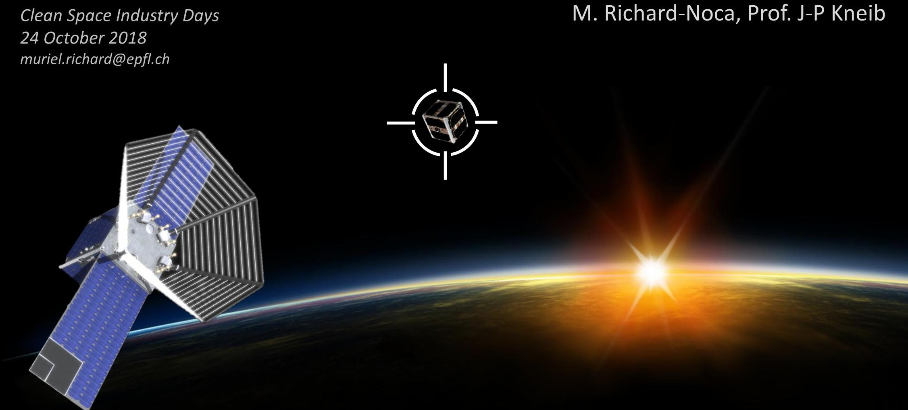

## Hes·so

Haute Ecole Spécialisée de Suisse occidentale Fachhochschule Westschweiz University of Applied Sciences and Arts Western Switzerland

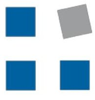

## NTB

Interstaatliche Hochschule für Technik Buchs

FHO Fachhochschule Ostschweiz

## ETH

Eidgenössische Technische Hochschule Zürich Swiss Federal Institute of Technology Zurich

<!-- PDF_PAGE: 2 -->

## CleanSpace One demonstration mission

500km

7. Capture and securing

5. Detection, tracking, approach

6. Identification of SwissCube

7. Close proximity operations

8. De-orbiting

2. Deployment, commissioning

3. Test of critical operations

4. RAAN phasing

9. Atmospheric entry

1. Launch at ~500 km

eSPACE

<!-- PDF_PAGE: 3 -->

## Why an LCA for CSO?

## Consistent with the project's intentions

- Help design choices: technology/components trade-offs, or design that reduces the environmental impact

## Investigate integration into the project's MBSE model

- The integration of a LCA tool in the MBSE environment would allow to consider the environmental performance of a mission as an optimisation parameter, at the same level as the weight or cost optimisation.

- The work presented here is the result of a student semester project (equivalent to a total of 3 weeks of work, including ramp-up and report)

<!-- PDF_PAGE: 4 -->

## First step:

<table><tr><td>Prepared by</td><td>ESA LCA Working Group</td></tr><tr><td>Reference</td><td>ESSB-HB-U-005</td></tr><tr><td>Issue</td><td>1</td></tr><tr><td>Revision</td><td>0</td></tr><tr><td>Date of Issue</td><td>31 October 2016</td></tr><tr><td>Status</td><td>Approved</td></tr><tr><td>Document Type</td><td>Handbook</td></tr><tr><td>Distribution</td><td>ESA internal</td></tr></table>

<!-- PDF_PAGE: 5 -->

## Ecodesign: From previous LCA

- Launch phase is the biggest contributor: stage production contributes to 30% of most impacts: Importance of reusable rockets!

- Launch phase: 15% of GWP transport of the rocket to Kourou: Importance of production close to launch area

- Office work (electricity and infrastructure): important role for the whole mission especially for C-D phase. Same as many industries: sustainable energy is required.

<!-- PDF_PAGE: 6 -->

## Model Based System Engineering

CAMEO

SYSTEMS MODELER

PORTAL

## Model of CSO system and states

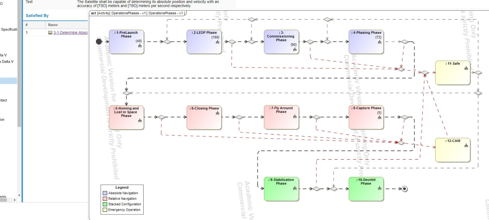

<!-- PDF_PAGE: 7 -->

## Ecodesign: LCA of CSO

- Include LCA in MBSE

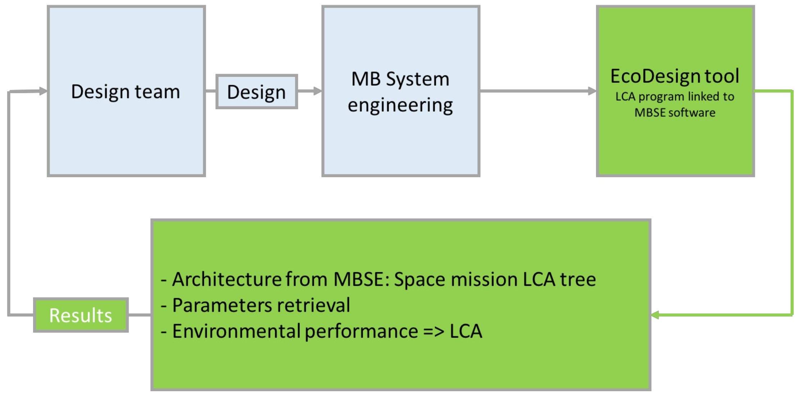

- Link project/system description (timeline, hardware...) link to LCA Excel node

<!-- PDF_PAGE: 8 -->

## LCA into CAMEO

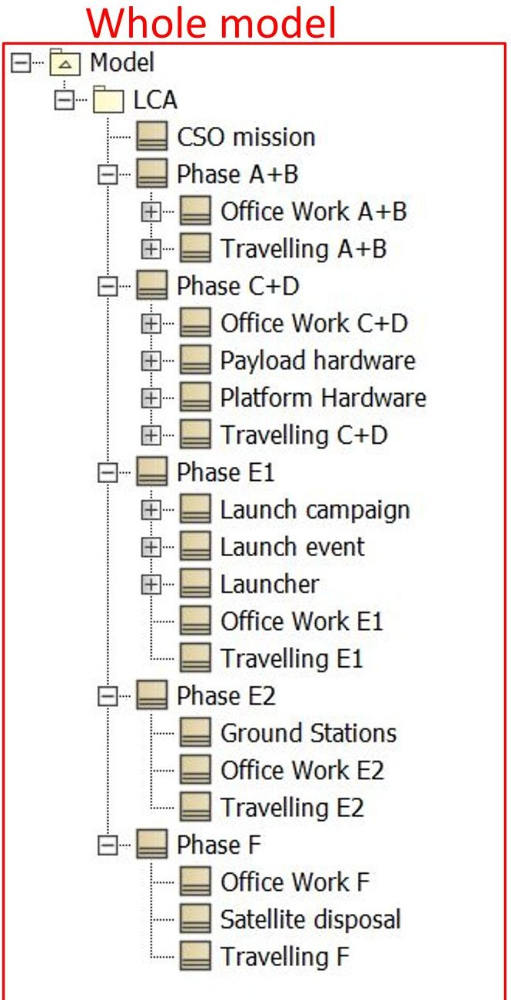

Phase A+B

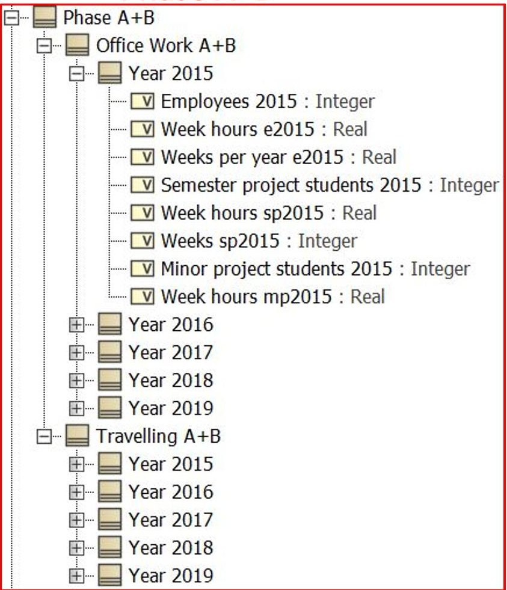

Phase C+D

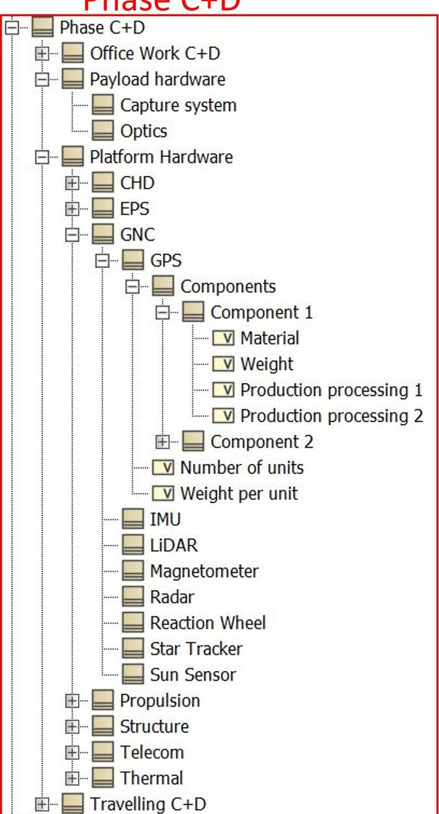

<!-- PDF_PAGE: 9 -->

## LCA of CSO: Excel model

## System boundaries and mission breakdown:

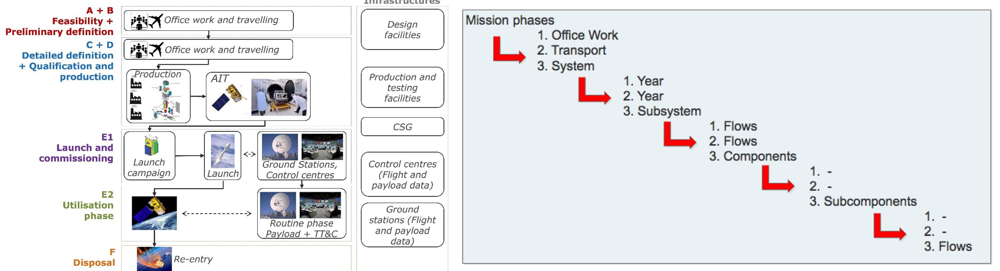

<!-- PDF_PAGE: 10 -->

## LCA of CSO: Excel file structure

- Phase O+A+B, Phase C+D, Phase E1, Phase E2, Phase F

- Transport: contains several flows for the transport.

- Infrastructure: contains one flow for EPFL buildings.

- Electricity: contains several flows for electricity.

## Databases:

- EcoInvent 2.2

- EPFL Sustainable Campus

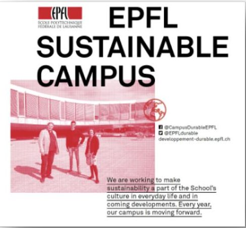

<!-- PDF_PAGE: 11 -->

## LCA of CSO: Excel model

- Inputs

<table border="1"><tr><td>Office Work</td><td>Year 2016</td><td>Year 2017</td><td>Year 2018</td><td>Year 2019</td><td>Year 2020</td></tr><tr><td>Employees</td><td>5</td><td>5</td><td>5</td><td>15</td><td>15</td></tr><tr><td>Work Hours per week per employee</td><td>45</td><td>45</td><td>45</td><td>45</td><td>45</td></tr><tr><td>Weeks per employee per year</td><td>46</td><td>46</td><td>46</td><td>46</td><td>46</td></tr><tr><td>Semester project students</td><td>10</td><td>10</td><td>19</td><td>10</td><td>10</td></tr><tr><td>Work Hours per week per student</td><td>15</td><td>15</td><td>15</td><td>15</td><td>15</td></tr><tr><td>Weeks of work per student</td><td>16</td><td>16</td><td>16</td><td>16</td><td>16</td></tr><tr><td>Minor project students</td><td>5</td><td>5</td><td>5</td><td>5</td><td>5</td></tr><tr><td>Work Hours per week per student</td><td>18</td><td>18</td><td>18</td><td>18</td><td>18</td></tr><tr><td>Weeks of work per student</td><td>16</td><td>16</td><td>16</td><td>16</td><td>16</td></tr><tr><td></td><td></td><td></td><td></td><td></td><td></td></tr><tr><td>Commuting</td><td></td><td></td><td></td><td></td><td></td></tr><tr><td>Distance by Scooter [km]</td><td>0</td><td>0</td><td>0</td><td>0</td><td>0</td></tr><tr><td>Distance by Car [km]</td><td>8718</td><td>8718</td><td>8718</td><td>8718</td><td>8718</td></tr><tr><td>Distance by Public transport [km]</td><td>14706,3</td><td>14706,3</td><td>14706,3</td><td>14706,3</td><td>14706,3</td></tr><tr><td>Travelling</td><td></td><td></td><td></td><td></td><td></td></tr><tr><td>Distance by Plane (Europe) [km]</td><td>36000</td><td>36000</td><td>36000</td><td>36000</td><td>36000</td></tr><tr><td>Distance by Plane (intercont.) [km]</td><td>0</td><td>0</td><td>0</td><td>0</td><td>0</td></tr><tr><td>Distance by Train (CH) [km]</td><td>0</td><td>0</td><td>0</td><td>0</td><td>0</td></tr><tr><td>Distance by Train (EU) [km]</td><td>0</td><td>0</td><td>0</td><td>0</td><td>0</td></tr><tr><td>Distance by Car [km]</td><td>0</td><td>0</td><td>0</td><td>0</td><td>0</td></tr></table>

<table border="1"><tr><td colspan="2">Assumptions</td><td colspan="2">Factor 1</td><td colspan="2">Factor 2</td><td colspan="2">Factor 3</td></tr><tr><td colspan="2">Plane</td><td colspan="2">3000km/month</td><td colspan="2">(GE-Amsterdam 700km)</td><td colspan="2"></td></tr><tr><td colspan="2">Car</td><td>1.6/1.14</td><td>passenger/car</td><td colspan="2">0.34Employees(car)</td><td colspan="2">0.0355Students(car)</td></tr><tr><td rowspan="2"></td><td>Students</td><td colspan="2">100km/week</td><td colspan="2">16weeks/semester</td><td colspan="2"></td></tr><tr><td>Employees</td><td colspan="2">100km/week</td><td colspan="2">46weeks/year</td><td colspan="2"></td></tr><tr><td rowspan="2">Train</td><td rowspan="2">Students</td><td colspan="2">6kmFlon-EPFL</td><td colspan="2">60km/week</td><td colspan="2"></td></tr><tr><td colspan="2">0,625Students(tp)</td><td colspan="2"></td><td colspan="2"></td></tr><tr><td rowspan="2">PPH building</td><td rowspan="2">Employees</td><td colspan="2">0,4135Employees(tp)</td><td colspan="2"></td><td colspan="2"></td></tr><tr><td colspan="2">3240m^2</td><td colspan="2">80ans(duréevie)</td><td colspan="2">3m(hauteurétage)</td></tr><tr><td colspan="2">EPFL building area2016</td><td colspan="2">429223m^2</td><td colspan="2"></td><td colspan="2"></td></tr><tr><td colspan="2">EPFL electricity consumed2016</td><td colspan="2">70779MWh</td><td colspan="2"></td><td colspan="2"></td></tr><tr><td rowspan="2">EPFL specific electricity per building</td><td rowspan="2"></td><td colspan="2">0,164900297MWh/m^2</td><td colspan="2"></td><td colspan="2"></td></tr><tr><td colspan="2">164,9002966kWh/m^2</td><td colspan="2"></td><td colspan="2"></td></tr><tr><td colspan="2">MWh to MJ</td><td colspan="2">3600</td><td colspan="2"></td><td colspan="2"></td></tr></table>

<!-- PDF_PAGE: 12 -->

## LCA of CSO: Excel model

## Outputs

<table border="1"><tr><td></td><td></td><td>Human health [DALY]</td><td>Ecosystem quality [PDF.m]</td><td>Climate change [kgCO2eq]</td><td>Resources [MJ]</td><td>Water withdrawal[m^3]</td><td>Water turbined[m^3]</td></tr><tr><td rowspan="13">2016</td><td>Transport Total</td><td>0.02</td><td>5579</td><td>37827</td><td>606393</td><td>215</td><td>211670</td></tr><tr><td>Commuting</td><td>0.001</td><td>616</td><td>1897</td><td>40448</td><td>26</td><td>51149</td></tr><tr><td>Scooter</td><td>0</td><td>0</td><td>0</td><td>0</td><td>0</td><td>0</td></tr><tr><td>Car</td><td>0.001</td><td>334</td><td>1735</td><td>28595</td><td>15</td><td>4089</td></tr><tr><td>Public transport</td><td>0.000</td><td>282</td><td>162</td><td>11853</td><td>11</td><td>47060</td></tr><tr><td>Travelling</td><td>0.003</td><td>623</td><td>6048</td><td>88920</td><td>22</td><td>1415</td></tr><tr><td>Plane (Europe)</td><td>0.003</td><td>623</td><td>6048</td><td>88920</td><td>22</td><td>1415</td></tr><tr><td>Plane (intercont.)</td><td>0.000</td><td>0</td><td>0</td><td>0</td><td>0</td><td>0</td></tr><tr><td>Train (CH)</td><td>0.000</td><td>0</td><td>0</td><td>0</td><td>0</td><td>0</td></tr><tr><td>Train (EU)</td><td colspan="4"></td><td>0</td><td>0</td></tr><tr><td>Car (t)</td><td colspan="4"></td><td>0</td><td>0</td></tr><tr><td>Transport 2015</td><td colspan="4"></td><td>48</td><td>52564</td></tr></table>

<table border="1"><tr><td>Commuting</td><td></td></tr><tr><td>Scooter</td><td>transport, scooter [pkm]-CH11350</td></tr><tr><td>Car</td><td>transport, passenger car [pkm]-CH1946</td></tr><tr><td>Public transport</td><td>transport, regional train,SBB mix [pkm]-CH6077</td></tr><tr><td>Travelling</td><td></td></tr><tr><td>Plane(Europe)</td><td>operation, aircraft, passenger,Europe [pkm]-RER1896</td></tr><tr><td>Plane(Intercontinental)</td><td>transport, aircraft,passenger,intercontinental [pkm]-RER1897</td></tr><tr><td>Train(CH)</td><td>transport,average train,SBB mix [pkm]-CH11304</td></tr><tr><td>Train(Europe)</td><td>transport,高速 train [pkm]-DE6081</td></tr><tr><td>Car</td><td>transport,passenger car [pkm]-CH1946</td></tr><tr><td>Infrastructure</td><td>building,multi-storey[m^3]RE549</td></tr><tr><td>Electricity</td><td>Mix 100% hydro local[MJ]-CH(EPFL elec consommée)</td></tr></table>

<!-- PDF_PAGE: 13 -->

## LCA of CSO: Excel model

- Outputs

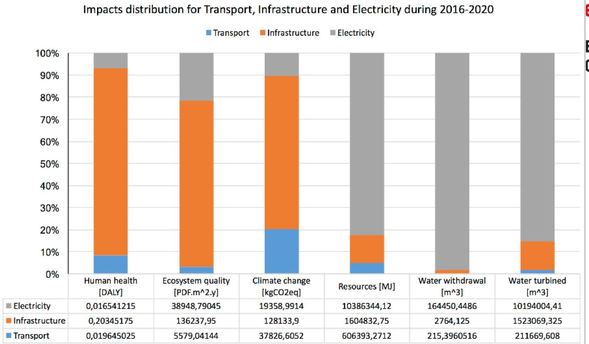

## eSPACE

EPFL Space Center

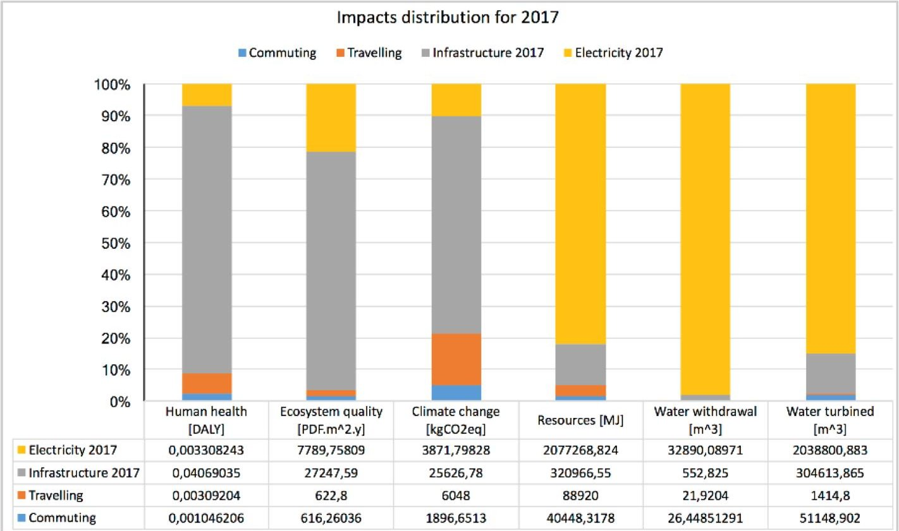

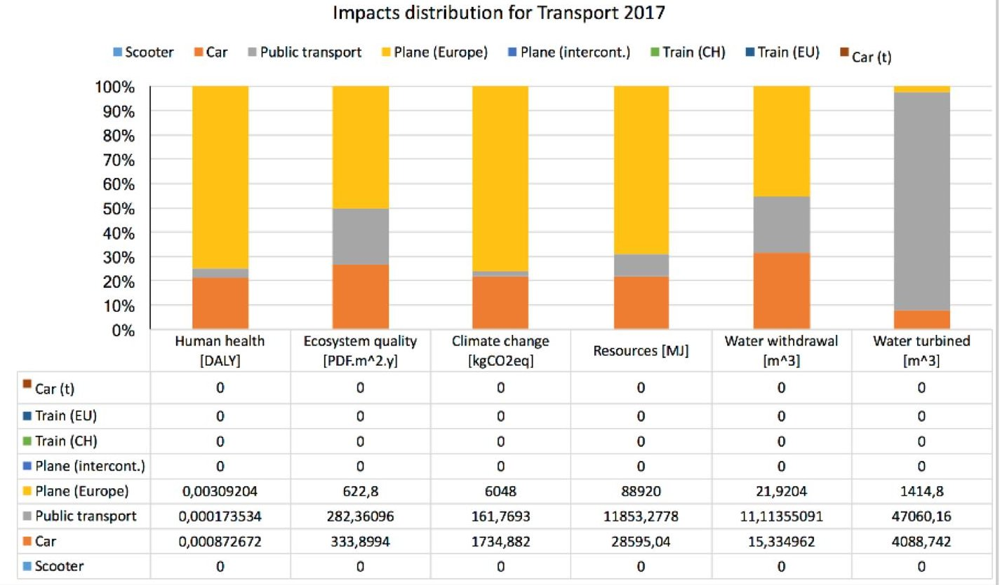

<!-- PDF_PAGE: 14 -->

## LCA of CSO: Excel model

## Flows: transport

<table border="1"><tr><td colspan="2">Transportation: Europe and CH</td><td>Human health [DALY]</td><td>Ecosystem quality [PDF.m^2.y]</td><td>Climate change [kgCO2eq]</td><td>Resources [MJ]</td><td>Water withdrawal [m^3]</td><td>Water turbined [m^3]</td><td></td></tr><tr><td colspan="9">Air</td></tr><tr><td colspan="2">Passenger, aircraft, Europe RER1889 [pkm]</td><td>8,5460E-08</td><td>1,7200E-02</td><td>1,6700E-01</td><td>2,4600E+00</td><td>5,8460E-04</td><td>2,9800E-02</td><td></td></tr><tr><td colspan="2">Passenger, aircraft, intercontinental RER1890 [pkm]</td><td>5,4330E-08</td><td>1,0900E-02</td><td>1,0600E-01</td><td>1,5600E+00</td><td>3,7100E-04</td><td>1,9000E-02</td><td></td></tr><tr><td colspan="2">Freight, aircraft, Europe RER1886 [tkm]</td><td>8,5460E-07</td><td>1,7200E-01</td><td>1,6700E+00</td><td>2,4570E+01</td><td>5,8360E-03</td><td>2,9800E-01</td><td></td></tr><tr><td colspan="2">Freight, aircraft, intercontinental RER1887 [tkm]</td><td>5,4330E-07</td><td>1,0900E-01</td><td>1,0600E+00</td><td>1,5620E+01</td><td>3,7100E-03</td><td>1,9000E-01</td><td></td></tr><tr><td colspan="2">operation, aircraft, passenger, Europe [pkm]-RER1896</td><td>8,589E-08</td><td>1,730E-02</td><td>1,680E-01</td><td>2,470E+00</td><td>6,089E-04</td><td>3,930E-02</td><td>Air continental</td></tr><tr><td colspan="2">transport, aircraft, passenger, intercontinental [pkm]-RER1897</td><td>5,516E-08</td><td>1,140E-02</td><td>1,080E-01</td><td>1,610E+00</td><td>4,328E-04</td><td>4,590E-02</td><td>Air intercontinental</td></tr><tr><td colspan="9">Rail</td></tr><tr><td colspan="2">Freight, rail, diesel with particle filter CH11327 [tkm]</td><td>6,9060E-08</td><td>1,0800E-02</td><td>5,1400E-02</td><td>7,7800E-01</td><td>3,9590E-04</td><td>9,4600E-02</td><td></td></tr><tr><td colspan="2">Passenger, average train, SBB mix CH11304 [pkm]</td><td>7,9190E-09</td><td>1,1900E-02</td><td>8,0130E-03</td><td>5,0800E-01</td><td>4,9130E-04</td><td>1,9200E+00</td><td></td></tr><tr><td colspan="2">Passenger, metropolitan train, SBB mix CH11330 [pkm]</td><td>8,8680E-09</td><td>1,1200E-02</td><td>9,4430E-03</td><td>4,8300E-01</td><td>4,8640E-04</td><td>1,6700E+00</td><td></td></tr><tr><td colspan="2">transport, regional train, SBB mix [pkm]-CH 6077</td><td>1,1800E-08</td><td>1,9200E-02</td><td>1,1000E-02</td><td>8,0600E-01</td><td>7,5570E-04</td><td>3,2000E+00</td><td>Transports publics</td></tr><tr><td colspan="2">transport, average train, SBB mix [pkm]-CH 11304</td><td>7,919E-09</td><td>1,190E-02</td><td>8,013E-03</td><td>5,080E-01</td><td>4,913E-04</td><td>1,920E+00</td><td>Rail domestique</td></tr><tr><td colspan="2">transport, high speed train [pkm]-DE 6081</td><td>1,946E-08</td><td>9,289E-03</td><td>6,410E-02</td><td>1,040E+00</td><td>2,241E-03</td><td>2,040E-01</td><td>Rail intercontinental</td></tr><tr><td colspan="9">Road</td></tr><tr><td colspan="2">Passenger car diesel EURO5 city car CH11782 [pkm]</td><td>2,3580E-08</td><td>2,3900E-02</td><td>5,3600E-02</td><td>9,4800E-01</td><td>6,2710E-04</td><td>1,9300E-01</td><td></td></tr><tr><td colspan="2">Passenger electric bicycle CH11338 [pkm]</td><td>1,8540E-08</td><td>8,8070E-03</td><td>1,6900E-02</td><td>3,3000E-01</td><td>5,0830E-04</td><td>2,9700E-01</td><td></td></tr><tr><td colspan="2">Passenger bicycle CH11342 [pkm]</td><td>8,6780E-09</td><td>2,8210E-03</td><td>9,6310E-03</td><td>1,4800E-01</td><td>2,2090E-04</td><td>1,4100E-01</td><td></td></tr><tr><td colspan="2">Passenger scooter CH11350 [pkm]</td><td>7,2260E-08</td><td>2,1100E-02</td><td>1,2600E-01</td><td>1,5700E+00</td><td>6,6580E-04</td><td>1,1300E-01</td><td></td></tr><tr><td colspan="2">Passenger electric car (VW golf size) certified elec CH11762 [pkm]</td><td>6,2980E-08</td><td>6,5200E-02</td><td>5,2400E-02</td><td>1,2600E+00</td><td>1,8950E-03</td><td>3,5600E+00</td><td></td></tr><tr><td colspan="2">Freight lorry 3.5-16t fleet average RER1941 [tkm]</td><td>2,7590E-07</td><td>9,8300E-02</td><td>2,5900E-01</td><td>4,4000E+00</td><td>2,2390E-03</td><td>4,9500E-01</td><td></td></tr><tr><td colspan="2">Freight lorry >16t fleet average RER1943 [tkm]</td><td>1,4390E-07</td><td>4,9700E-02</td><td>1,3400E-01</td><td>2,2400E+00</td><td>1,0840E-03</td><td>1,6100E-01</td><td></td></tr><tr><td colspan="2">transport, passenger car [pkm]-CH 1946</td><td>1,0010E-07</td><td>3,8300E-02</td><td>1,9900E-01</td><td>3,2800E+00</td><td>1,7590E-03</td><td>4,6900E-01</td><td>Voiture</td></tr><tr><td colspan="2">transport, passenger car [pkm]-CH 1946</td><td></td><td></td><td></td><td></td><td></td><td></td><td>Véhicules de location</td></tr><tr><td colspan="2">transport, passenger car [pkm]-CH 1946</td><td></td><td></td><td></td><td></td><td></td><td></td><td>Véhicules privés</td></tr><tr><td colspan="2">transport, passenger car [pkm]-CH 1946</td><td></td><td></td><td></td><td></td><td></td><td></td><td>Véhicules ElectricEasy</td></tr><tr><td colspan="2">transport, scooter [pkm]-CH 11350</td><td>7,2260E-08</td><td>2,1100E-02</td><td>1,2600E-01</td><td>1,5700E+00</td><td>6,6580E-04</td><td>1,1300E-01</td><td>Scooter</td></tr><tr><td colspan="2">transport, passenger car, diesel, EURO5 [pkm]-CH 6586</td><td>6,3990E-08</td><td>3,4900E-02</td><td>1,6000E-01</td><td>2,7300E+00</td><td>1,6140E-03</td><td>4,6600E-01</td><td>Véhicules EPFL Diesel</td></tr><tr><td colspan="2">transport, passenger car, diesel, EURO5 [pkm]-CH 6586</td><td></td><td></td><td></td><td></td><td></td><td></td><td>Véhicules Mobility Diesel</td></tr><tr><td colspan="2">transport, passenger car, petrol, EURO5 [pkm]-CH 6590</td><td>7,702E-08</td><td>3,570E-02</td><td>1,680E-01</td><td>2,860E+00</td><td>1,681E-03</td><td>4,730E-01</td><td>Véhicules EPFL Essence</td></tr><tr><td colspan="2">transport, passenger car, petrol, EURO5 [pkm]-CH 6590</td><td></td><td></td><td></td><td></td><td></td><td></td><td>Véhicules Mobility essence</td></tr></table>

<!-- PDF_PAGE: 15 -->

## LCA of CSO: Excel model

## Flows: infrastructure and electricity

<table border="1"><tr><td colspan="2">Infrastructure</td><td>Human health[DALY]</td><td>Ecosystem quality[PDF.m^2.y]</td><td>Climate change[kgCO2eq]</td><td>Resources[MJ]</td><td>Water withdrawal[m^3]</td><td>Water turbined[m^3]</td></tr><tr><td colspan="2">building, multi-storey[m^3]RE549</td><td>3,349E-04</td><td>2,243E+02</td><td>2,109E+02</td><td>2,642E+03</td><td>4,550E+00</td><td>2,507E+03</td></tr><tr><td colspan="9">Electricity</td></tr><tr><td></td><td>Human health[DALY]</td><td>Ecosystem quality[PDF.m^2.y]</td><td>Climate change[kgCO2eq]</td><td>Resources[MJ]</td><td>Non-renewable[MJ]</td><td>Renewable[MJ]</td><td>Water withdrawal[m^3]</td><td>Water turbined[m^3]</td></tr><tr><td>Mix100% hydro local[MJ]-CH(EPFL elec consommée)</td><td>1,7200E-09</td><td>4,0500E-03</td><td>2,0130E-03</td><td>1,0800E+00</td><td>1,7100E-02</td><td>1,0600E+00</td><td></td><td></td></tr><tr><td>Photovoltaics naturemade star[kWh]-CH</td><td>5,6460E-08</td><td>2,8600E-02</td><td>7,6100E-02</td><td>1,2200E+00</td><td></td><td></td><td>7,2460E-03</td><td>1,5300E+00</td></tr><tr><td>Hydroelectricity naturemade star[kWh]-CH</td><td></td><td></td><td></td><td></td><td></td><td></td><td></td><td></td></tr><tr><td>electricity, hydropower, at reservoir power plant[kWh]-CH980</td><td>4,8140E-09</td><td>4,3160E-03</td><td>5,3200E-03</td><td>5,5700E-02</td><td></td><td></td><td>9,5060E-05</td><td>8,3900E-01</td></tr><tr><td>electricity, consumer mix[kWh]-CHEcoInvent2.211360</td><td>8,3120E-08</td><td>5,6300E-02</td><td>1,1600E-01</td><td>7,6800E+00</td><td></td><td></td><td>8,0430E-03</td><td>8,7500E+00</td></tr></table>

## When possible, same flows as Sustainable Campus

<!-- PDF_PAGE: 16 -->

## Further work

## LCA for space is very involved but trends have been highlighted

- Further develop and refine the model

- Implement ESA databases

- Update EPFL flows

- Check for implementation of new impacts (orbital use and debris indicator)

<!-- PDF_PAGE: 17 -->

## 23'500

<!-- PDF_PAGE: 18 -->

## It's time to go home!

EPFL

ÉCOLE POLYTECHNIQUE

FÉDÉRALE DE LAUSANNE

EPFL Space Engineering Center email: espace(at)epfl.ch eSpace.epfl.ch facebook.com/epflSpace