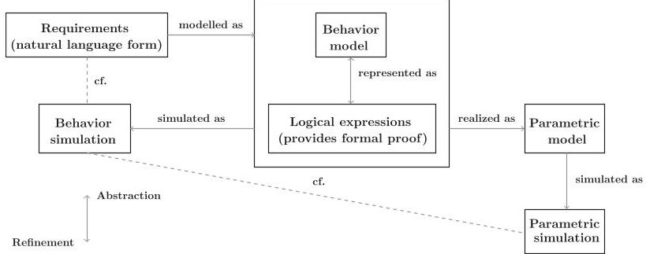
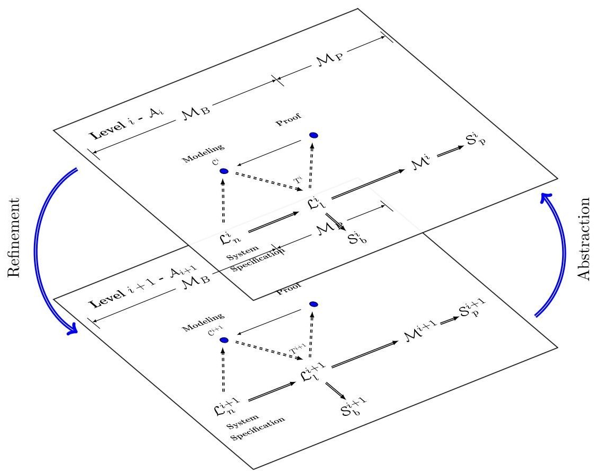
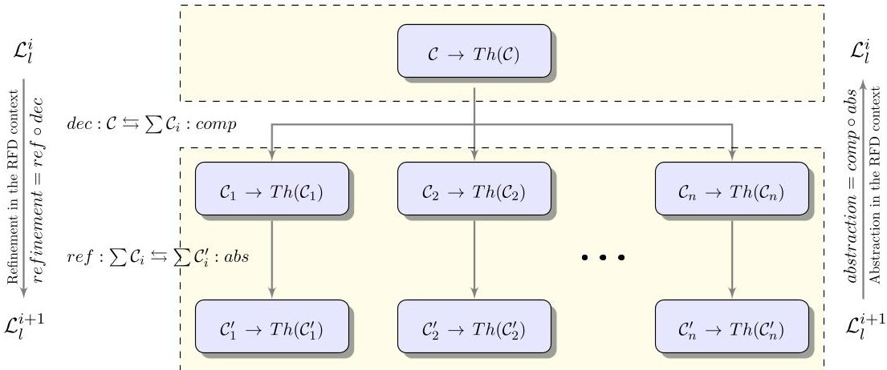
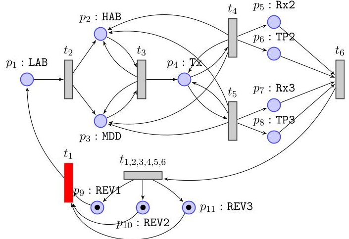
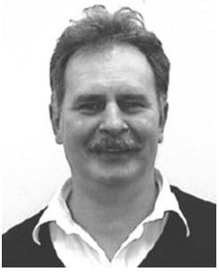

<!-- PDF_PAGE: 1 -->

# Formal Behavioral Requirements Management

Solomon Gebreyohannes, William Edmonson, Senior Member, IEEE, and Albert Esterline

Abstract—In this paper, we develop the mathematical foundation for a formal requirements management of a systems engineering (SE) methodology called the Responsive and Formal Design (RFD) process. The RFD process relates a set of requirements, associated models, simulations, and the relationship between them, by integrating model-based systems engineering (MBSE) to manage system modeling complexity with formal methods to ensure that designs are verifiably correct against their requirements. In this paper, we formally define basic notions of the RFD process, develop algorithms to extract a set of logical expressions from a set of requirements, and present a technique that is used to map a behavior model to its simulation. We also present a formal way of refining requirements in the RFD process and show how properties are preserved along the way in a fundamental fashion. We demonstrate our development using three small satellites measurement system that images the colorful auroral ovals around Earth's magnetic poles.

Index Terms—Formal methods, model-based systems engineering (MBSE), requirements management, responsive and formal design (RFD) process.

## I. INTRODUCTION

REQUIREMENTS drive any systems engineering (SE) process. They are "necessary attributes in a system, statements that identify a capability, characteristic, or quality factor of a system in order for it to have value and utility to a customer or user" [1]. In software systems, for example, requirements decide the software to be produced. An extensively growing size of requirement specifications creates needs that provide engineering means to activities related with discovering system functionalities and constraints [2], [3]. This demands a way of managing requirements, preferably, a formal way (from a mathematical perspective) of managing them. Requirements management is defined as "the set of procedures that support the development of requirements including planning, traceability, impact analysis, change management, etc." [4]. Specifically, requirements management consists of tasks, such as requirements elicitation, analysis, specification, and verification and validation; and it is completed when products that satisfy the acceptance criteria are delivered [2], [5]. Design processes, however, generally lack a

proper approach to manage frequently changing requirements. The challenges are as follows. 1) There is a gap often present between stakeholders' vision and requirements representation. On one hand, stakeholders present requirements using a natural language, which is ambiguous and not complete or consistent (from logical point of view); on the other hand, requirement engineers use languages [e.g., (semi-) formal languages] that are too complex for stakeholders to understand. This limits the stakeholders' involvement and, hence, the impact that they can add in the requirements management process and the design procedure as a whole. 2) They lack a formal way of refining high level requirements to domain specific requirements (implementation level). Design processes usually start with high level requirements. Then, the requirements will be refined by adding stakeholders' input and/or expertise knowledge. But how do we represent and manage refinement of requirements, i.e., the relation between one level of requirements (or tier [6]) to another with different level of granularity? Lack of addressing these issues in a design process may result in a design with errors or a product which is unwanted or undesired. An agile design process directly involves the stakeholders vision at each level of the requirement elicitation, which results in improved communication between stakeholders and the engineering team. The agile process should also integrate high level requirements with domain specific considerations and verify formally. The development of a unifying framework is a current challenge; for example, design of such a framework (for cyber-physical systems), which allows easy interfacing and consistency, is not addressed yet [7]. There is a long tradition in software engineering of deriving functional requirements expressed in logic from requirements in natural language. In particular, one formulates logic-based declarative statements that describe system states before and after certain computational tasks are performed. In refinement, the predicates used in the declarative statements are refined, and computational units are decomposed. This works for software, which is realized by structured imperative statements, but it generally does not work for SE, where the artifacts constructed are not presented in a (executable) language.

A methodology that incorporates behavioral simulations in a design process, to improve the communication between stakeholders and engineers, and formally verifies requirements is proposed in [8] and [9], called the responsive and formal design (RFD) process. The RFD process combines model-based systems engineering (MBSE) [10] to manage system modeling complexity and formal methods [11] to ensure that designs are verifiably correct against their requirements or stakeholder needs. It consists of a set of levels of abstraction. Each level of abstraction represents a set of requirements and its associated

<!-- PDF_PAGE: 2 -->

models, simulations, and the relationship between them. System requirements expressed in natural language are the starting point of the RFD process. This representation lacks the ability to check the requirements against functionality, consistency, and completeness. Logic-based approaches provide a verifiable language that is consistent and complete; hence, these requirements are translated to a set of logical expressions. Though the logical representation is used to check correctness of the requirements, it may not fully capture all the requirements. By mapping the logical representations to behavior simulation and comparing it with the requirements, one can tell if they are fully captured. If the behavior simulation associated with the logical expressions fully capture the requirements, then we have an equivalence between the requirements and their logical representation. On the other hand, if the requirements are not fully captured, we go to the logical representations and make corrections or enhancement. We assume the same structure (but different level of detail) for each level of abstraction of the RFD process. Levels of abstraction are related with refinement and abstraction functions. We also want to formally trace each decision made as a result of refinement. This helps us to know where the requirement came from (its context), how the contradiction arose (if any), its ways of implementation and testing.

This paper presents a formal requirement management framework. We implement the RFD process based on Barwise and Seligman's channel theory [12], [13]. A system is modeled using a notion of a classification (a table form to represent an informational network based on situation theory [14], [15]). A set of constraints (logical expressions) called a theory that represents the classification can be extracted. This helps us to do a formal proof for checking consistency (showing no contradiction) and deducing a requirement (verifying a property). We develop algorithms that extract a theory from a classification and refine a classification (with the corresponding theory interpretations). We also present a technique that is used to map a classification model to its Petri net simulation. A Petri net [16], [17] is a graphical tool used to model several types of systems and will be used as a behavior simulation tool in this paper.

The rest of this paper is organized as follows. Section II introduces Barwise and Seligman's channel theory and Petri nets. Section III discusses the RFD process and related formal framework. In Section IV, we implement the logical representations of requirements in the RFD process using channel theory (extract a theory from a classification), map a classification to a Petri net, and refine high level requirements. In Section V, we demonstrate our development using three small satellites measurement system that images the colorful auroral ovals around Earth's magnetic poles. Section VI concludes this paper.

## II. CHANNEL THEORY AND PETRI NET

This section introduces Barwise and Seligman's channel theory and Petri net.

## A. Channel Theory

This section introduces Barwise and Seligman's channel theory following [12], [13]. They presented a framework for the

$$
\begin{array}{l} t y p (\mathcal {A}) \xrightarrow {f ^ {\wedge}} t y p (\mathcal {C}) \\ \left| \models_ {\mathcal {A}} \begin{array}{c} \text {I n f o r m a t i o n} \\ \text {F l o w} \\ = = = = \Rightarrow \end{array} \right| \models_ {\mathcal {C}} \\ t o k (\mathcal {A}) \xleftarrow {f ^ {\vee}} t o k (\mathcal {C}) \\ \end{array}
$$

Fig.1. Infomorphism f from $ \mathcal{A} $ to $ \mathcal{C} $

"flow of information" in category-theoretic terms, based on situation theory [14], [15], [18]. They address the question, "How is it that information about any component of a system carries information about other components of the system?" Information is always taken to be information about some situation. A situation is an ongoing happening in the world. Types are entities that are aspects of the agent's cognition of the world. Information flow is made possible by uniformities across relations between situations, that is, constraints (including natural laws and linguistic rules) that link various types of situations. Hence, the modeling of the flow of information involves two relations, one that links types and one that links situations. The concept of a channel is introduced to express relations between situations. Channel theory is the theory of information and its flow based on the ontology of channels.

A notion of a classification is used to represent information networks.

Definition 1 ( see[13] p. 69): A classification $ \mathcal{A}=\langle \mathrm{tok}(\mathcal{A}) $ typ( $ \mathcal{A} $ ), $ \models_{\mathcal{A}} $ consists of the following:

1) a set, $ \operatorname{tok}(\mathcal{A}) $ , of objects to be classified, called the tokens of $ \mathcal{A} $ ;

2) a set, typ $ (\mathcal{A}) $ , of objects used to classify the tokens, called the types of $ \mathcal{A} $ ; and

3) a binary relation, $ \models_{\mathcal{A}} $ , between tok( $ \mathcal{A} $ ) and typ( $ \mathcal{A} $ ).

For classifications $ \mathcal{A} $ and $ \mathcal{C} $ , an infomorphism f from $ \mathcal{A} $ to $ \mathcal{C} $ (see Fig. 1) is a pair of functions $ (f^{\wedge}, f^{\vee}) $ , where $ f^{\wedge}:\operatorname{typ}(\mathcal{A})\rightarrow\operatorname{typ}(\mathcal{C}) $ , and $ f^{\vee}:\operatorname{tok}(\mathcal{C})\rightarrow\operatorname{tok}(\mathcal{A}) $ , satisfying for all tokens $ c\in\operatorname{tok}(\mathcal{C}) $ and all types $ \alpha\in\operatorname{typ}(\mathcal{A}) $ $ f^{\vee}(c)\models_{\mathcal{A}}\alpha $ iff $ c\models_{\mathcal{C}}f^{\wedge}(\alpha) $ . In category theoretic terms, an informorphism is a kind of Galois connection. A contravariant Galois connection between $ (\operatorname{tok}(\mathcal{A}),\operatorname{typ}(\mathcal{A}),\models_{\mathcal{A}}) $ and $ (\operatorname{tok}(\mathcal{B}),\operatorname{typ}(\mathcal{B}),\models_{\mathcal{B}}) $ will be a pair $ (\varphi,\psi) $ of mappings $ \varphi:\operatorname{tok}(\mathcal{A})\longrightarrow\operatorname{typ}(\mathcal{B}) $ $ \psi:\operatorname{tok}(\mathcal{B})\longrightarrow\operatorname{typ}(\mathcal{A}) $ satisfying $ a\models_{\mathcal{A}}\psi(b) $ if and only if $ b\models_{\mathcal{B}}\varphi(a) $ . An infomorphism between $ (\operatorname{tok}(\mathcal{A}),\operatorname{typ}(\mathcal{A}),\models_{\mathcal{A}}) $ and $ (\operatorname{tok}(\mathcal{B}),\operatorname{typ}(\mathcal{B}),\models_{\mathcal{B}}) $ however is a covariant Galois connection. There is a contravariant Galois connection between $ (\operatorname{tok}(\mathcal{A}),\operatorname{typ}(\mathcal{A}),\models_{\mathcal{A}}) $ and $ (\operatorname{typ}(\mathcal{B}),\operatorname{tok}(\mathcal{B}),\models_{\mathcal{B}}^{-1}) $ where $ \models_{\mathcal{B}}^{-1}\subseteq\operatorname{typ}(\mathcal{B})\times\operatorname{tok}(\mathcal{B}) $ with $ (\beta,b)\in\models_{\mathcal{B}}^{-1}iff(b,\beta)\in\models_{\mathcal{B}}. $

Components of the system may be distant from one another in time and space, and the system can be made up of heterogeneous components. The system is "distributed" in this sense and not necessarily in the classical sense used in computer science.

An information channel is a family of infomorphisms with a common codomain, called the core. Essentially, a channel consists of a set $ \mathcal{A}_{1},\dots, \mathcal{A}_{n} $ of classifications that represent the parts of the distributed system, a classification $ \mathcal{C} $ (the core) that represents the system as a whole, and a set of infomorphisms $ f_{1},\dots,f_{n} $ from each of the parts onto $ \mathcal{C} $ . Tokens in $ \mathcal{C} $ are the

<!-- PDF_PAGE: 3 -->

connections of the system: a given token c in C connects the tokens it is related to by means of $ f_{1},...,f_{n} $ . Parts $ \mathcal{A}_{1},...,\mathcal{A}_{n} $ carry information about each other as long as they all are parts of C. Intuitively, an information channel is a part-to-whole $ \mathcal{A}_{i} $ to- $ \mathcal{C} $ informational relationship. In category theoretic terms, the core is a cocone in the category of classifications (objects are classifications and morphisms are informorphisms).

Turning to regularities in a classification's types, let A be a classification and $ \Gamma $ and $ \Delta $ be subsets of types in A. A token a of A satisfies the sequent $ \Gamma\vdash\Delta $ given that, if a is a token of every type in $ \Gamma $ , then it is of some type in $ \Delta $ . If every token of A satisfies $ \Gamma\vdash\Delta $ , then $ \Gamma $ is said to entail $ \Delta $ and $ \Gamma\vdash\Delta $ is called a constraint supported by A. The set of all constraints supported by A is called the theory of A, denoted by $ \operatorname{Th}(\mathcal{A}) $ . These constraints are systematic regularities, and it is by virtue of regularities among connections that information about certain components of a distributed system can be carried by other components into diverse parts of the system. Barwise and Seligman's summary statement of their analysis of information flow, restricted to the simple case of a system with two components, is as follows: "Suppose that the token a is of type $ \alpha $ . Then a's being of type $ \alpha $ carries the information that b is of type $ \beta $ , relative to channel C, if a and b are connected in C and if the translation $ \beta^{\prime} $ of $ \beta $ entails the translation $ \alpha^{\prime} $ of $ \alpha $ in the theory $ \operatorname{Th}(\mathcal{C}) $ , where C is the core of C" [13].

Finally, a theory is regular if it satisfies the structural rules

Identity: $ \alpha\vdash\alpha $

Weakening: If $ \Gamma\vdash\Delta $ then $ \Gamma, \Gamma^{\prime}\vdash\Delta, \Delta^{\prime} $

Global Cut: If $ \Gamma, \Sigma_{0}\vdash\Delta, \Sigma_{1} $ then $ \Gamma\vdash\Delta $

where $ \Gamma, \Delta $ , and $ \Sigma $ are subsets of types of a classification and $ \langle \Sigma_{0},\Sigma_{1}\rangle $ is a partition. A sequent $ \langle \Gamma, \Delta \rangle $ of $ \Sigma $ is a partition if $ \Gamma \cup \Delta=\Sigma $ and $ \Gamma \cap \Delta=\emptyset $ . Transitivity: For any type $ \alpha $ , if $ \Gamma\vdash\alpha $ and $ \alpha\vdash\Delta $ , then $ \Gamma\vdash\Delta $ .

## B. Petri Net

A Petri net is a graphical tool used to model several types of systems. It consists of three types of objects, viz. places, transitions, and directed arcs connecting places to transitions and vice versa. Places are represented by circles and transitions are represented using bars or boxes. A Petri net as a graphical tool provides a powerful communication medium between the user, requirements engineer, and the customer [17]. This is why we need to use Petri nets for behavioral simulation of systems in the RFD process.

A Petri net [16], [17] is a five-tuple $ \mathrm{P N}=\left(P,T,I,O,M_{0}\right) $ where P is a finite set of places, T is a finite set of transitions, I is an input function that defines directed arcs from places to transitions, O is an output function that defines directed arcs from transitions to places, and $ M_{O} $ is the initial marking. A marking is an assignment of tokens to the places of a Petri net. A more detail explanation of each tuple follows.

1) Places: Places in a Petri net normally represent conditions, data, signals, status, resources, or operations [16], e.g., signal states [19], (local) processing workstations [20],

agents (nodes) [21], operations [22], and (de-) modulation (de-) spread-spectrum, send data, receive data,... [23].

2) Transitions: Some interpretations for transitions are events, computation steps, signal processors, tasks or processors which occur to change the status of the places [16], e.g., delays in signal states [19], availability of parts at the input buffer in designing a communication protocol [20], interactions between agents [21], operations [22], and excitation [23].

3) Tokens: Dynamic behavior of systems is studied by changing distribution of tokens on places which tells the occurrence of events or execution of operations [17].

4) Markings: A Petri net containing tokens is called a marked Petri net [16]. A marking is represented by a vector. The set of markings of a Petri net is represented by a matrix.

5) Input and output functions: Input (output resp.) functions define directed arcs from places (transitions resp.) to transitions (places resp.) [16], [17].

By changing the distribution of tokens in places, Petri nets are used to model dynamic behavior of systems. Flow of tokens are governed by certain rules.

Enabling rule (see [17] ): A transition t is said to be enabled if each input place p of t contains at least the number of tokens equal to the weight of the directed arc connecting p to t.

Firing Rule (see[17]):

1) an enabled transition t may or may not fire depending on the additional interpretation; and

2) A firing of an enabled transition t removes from each input place p the number of tokens equal to the weight of the directed arc connecting p to t. It also deposits in each output place p the number of tokens equal to the weight of the directed arc connecting t to p.

There are several types of Petri nets. For example, a Petri net is 1-bounded if the number of tokens in each place does not exceed 1 for any marking reachable from $ M_{0} $

## III. FORMAL FOUNDATION FOR SE

There is a recent interest to develop a theoretical foundation for MBSE that is based strongly in the field of mathematics. The motivation for this development is to provide a methodology for the design of complex systems whose process is correct with respect to requirements. A mathematical foundation for SE began with W. Wymore, who introduced a set-theoretic representation of an input-output relation and defined as the "Tricotyledon theory of systems design" [24]. Much of his work has been neglected due to it being "dense, terse, and mathematically intense." Also, M. Tribus put forth the use of probability to perform decision making in the determination of an optimum design [25]. Recently there has been a growing need for a theoretical foundation for SE to ensure correctness of design and to reduce time to market by reducing the occurrence of redesigns. Interest amongst the community is also growing, as it is evident from the attendance at special sessions on theoretical foundations of SE at the Annual IEEE International Systems Conference and the International Symposium on SE.

<!-- PDF_PAGE: 4 -->

Fig. 2. Capturing the responsive and formal design (RFD) process.

## A. RFD Process

The RFD process is a design procedure that combines MBSE [10] to manage system modeling complexity and formal methods [11] to ensure that designs are verifiably correct against their requirements. Fig. 2 shows the RFD process. It relates a set of requirements and its associated models, simulations, and the relationship between them.

The integration of formal methods throughout the design process as an integral part of requirements management provides correct-wrt-requirements design, which is the goal of the RFD process. The framework that we follow in implementing the RFD process is based on mission design flow [26], and is iterative. The RFD process was introduced in [8] and [9]. We also showed integrating the RFD process with standard frameworks like the open-system interconnection framework in [27].

Designing a system using a short and agile process relies on the ability to characterize system function at various levels of abstraction [28]. The RFD process consists of different levels of abstraction. Each level $ \mathcal{A}_{i} $ (the ith level) consists of the behavior (specification) $ \mathcal{M}_{B}^{i} $ and parametric (realization) $ \mathcal{M}_{P}^{i} $ parts. The equation below summarizes the essence of the RFD process

$$
\mathcal {A} _ {i}: \begin{array}{c c c} \mathcal {M} _ {B} ^ {i}: \text {B e h a v i o r a l p a r t} \\ \mathcal {L} _ {n} ^ {i} \Longleftrightarrow \mathcal {L} _ {l} ^ {i} \\ \Downarrow \\ \mathcal {S} _ {b} ^ {i} \end{array} \Longleftrightarrow \begin{array}{c c c} \mathcal {M} _ {P} ^ {i}: \text {P a r a m e t r i c p a r t} \\ \mathcal {M} ^ {i} \Longrightarrow \mathcal {S} _ {p} ^ {i} \end{array}
$$

where design parameters are defined as the following (see Fig. 2 again):

1) $ \mathcal{L}_{n}^{i}\Rightarrow $ requirements written in natural language form;

2) $ \mathcal{L}_{l}^{i}\Rightarrow $ requirements written as a set of logical expressions;

3) $ \mathcal{M}^{i}\Rightarrow $ system of interconnected models;

4) $ S_{p}^{i} \Rightarrow $ simulations-based on the parameters of $ \mathcal{M}^{i} $;

5) $ \mathcal{S}_{b}^{i}\Rightarrow $ simulations-based on the logical description of $ \mathcal{L}_{l}^{i}. $

System requirements expressed in natural language is the starting point of the RFD process. As a model-based process, it produces two main system models representing the logical and behavioral aspects of the requirements. A simulation is successful if all constraints associated with attributes of the system are met. The objective of behavior model simulation is to describe the operations of a system and the flow of information between the different subsystems. Traditional system simulation can be described as parametric since it focuses on the parameters of a system model. There are different levels of system abstraction and refinement in the RFD process. Refinement and

abstraction relate inversely to each other. As we go down in the levels (towards the implementation), more granular refinements are obtained.

## B. Related Work

Luzeaux [29] presents a formal foundation of SE-based on category theory. Category theory is used to unify and simplify properties of mathematical systems using diagrams of arrows [30]. It arises from the idea of a system of functions among some objects [31]. Category theory and its applications are discussed in [30] [35]. It also provides a precise definition of concepts and relates them with logic; therefore, the framework presented in this paper provides a common language and a set of unifying concepts based on a relational approach. Furthermore, the framework is strongly related to the field of mathematical logic. It encompasses and relates the three main steps of the SE life cycle process, viz., system modeling, system specification, and property verification. A system can be viewed either by inputs coming in and outputs coming out or by the link (flow of matter, energy, or information) connecting two systems. In this paper, the framework deals with both viewpoints and is illustrated with the first view. A system is graphically interpreted as boxes and wires. A category (symmetric monoidal and compact closed) of such systems is introduced—objects label the wires, morphisms label the boxes, and a composition operator allow sequential composition. Once categorical framework is established, it will be linked to categorical logic. It is possible to model a system as a category and specify properties as logical fragments. Logic (e.g., linear logic) has a well-studied proof theory (e.g., proof nets and geometry of interaction). Therefore, the modeling framework provides simultaneously the verification framework.

## IV. FORMAL REQUIREMENTS MANAGEMENT FOR THE RFD PROCESS

In this section, we implement and analyze the logical representations of requirements in the RFD process using channel theory.

## A. Overview, Challenges, and Notations

1) Overview: Recall that each level of abstraction in the RFD process comprises behavioral (or requirement) and parametric parts, see the following:

$$
\mathcal {A} _ {i}: \mathcal {M} _ {B} \Longleftrightarrow \mathcal {M} _ {P}.
$$

In this paper, we concentrate on the requirements management of the RFD process and it is based on channel theory, shown as

$$
\begin{array}{l} \mathcal {M} _ {B}: \mathcal {L} _ {n} \Longleftrightarrow \overbrace {\mathcal {C} \rightarrow \mathcal {T}} ^ {\mathcal {L} _ {l}} \\ \Downarrow \\ \mathcal {S} _ {b} \\ \end{array}
$$

where $ \mathcal{C} $ is a classification model (in a table form) and $ \mathcal{T} $ is its theory (a set of logical formulas).

Natural languages represent system requirements. These representations, $ \mathcal{L}_{n} $ , lack a way to check the requirements against

<!-- PDF_PAGE: 5 -->

Fig. 3. Levels of abstraction of the RFD process.

functionality, consistency, and completeness. Logic-based approaches provide a verifiable language that is consistent and complete; hence, these requirements $ \mathcal{L}_{n} $ are translated to a set of logical expressions $ \mathcal{L}_{l} $ . In order to make the translation, a system should be modeled using a convenient structure in which one can relate logical expressions to it. We use a notion of a classification to model a system, which is formulated from Barwise and Seligman's channel theory. A classification is a model of a system as an informational network (i.e., representing the system using the information flow through it), usually presented in a table. A theory is extracted from a classification. This helps to do a formal proof for checking consistency (no contradiction) and deducing to a requirement (verifying a property) using a theorem proving approach.

Though the logical representation $ \mathcal{L}_{l} $ (strictly, the theory) is used to check correctness of the requirements, it may not fully capture the whole requirements. By mapping the logical representations to behavior simulation $ S_{b} $ and comparing to $ \mathcal{L}_{n} $ one can tell whether the requirements are fully captured or not. The behavior model simulation $ S_{b} $ can be represented as state diagrams, activity diagrams [36], [37], Petri nets [16], [17], etc. If the behavior simulation $ S_{b} $ associated with $ \mathcal{L}_{l} $ fully captures the requirements of $ \mathcal{L}_{n} $ , then we have equivalence between requirements and its logical representation, i.e.,

$$
\text {i f} \quad \mathcal {L} _ {l} \quad \text {i s c o n s i s t e n t} \wedge \mathcal {S} _ {b} \equiv \mathcal {L} _ {n}, \quad \text {t h e n} \quad \mathcal {L} _ {n} \equiv \mathcal {L} _ {l}.
$$

If the requirements are not fully captured, we go to the logical representations and make corrections or enhancement.

We assume the same structure (but different level of granularity) for each level of abstraction of the RFD process. As we descend from higher levels of abstraction, we naturally produce more granular refinements. Fig. 3 shows the ith and (i+1)th

levels of representation with refinement and abstraction relations. Different levels of system abstraction and refinement go hand in hand in an inverse relationship. The refinement relation preserves properties. Abstraction relation is used to trace back to high level requirements (though not necessarily in a unique way). All parameters are superscripted with the level of abstraction it exists in.

2) Challenges: To make RFD an automatic process, algorithms that extract information within a domain (either from requirements, models, or simulations) and mapping techniques (that associate each element or its semantic of a given domain with one or more elements of the other) should be developed (in addition to formally define the RFD notions). These are algorithms or techniques that perform the following tasks:

1) extract a set of constraints (or a theory) from a classification $ (\mathcal{L}_l) $;

2) map a classification to a behavioral simulation $ (\mathcal{L}_{l}\rightarrow \mathcal{S}_{b}) $ and

3) refine a classification (with the corresponding theory interpretations) $ (\mathcal{L}_{l}^{i}\rightarrow \mathcal{L}_{l}^{i+1}) $

We address these challenges in the following sections. In Section IV-B, we develop an algorithm that extract component and system theories from corresponding classifications. In Section IV-C, we show how to map a (binary) classification to a Petri net (1-bounded). Finally, Section IV-D defines a pair of functions, refinement and abstraction, that exists between two layers (classifications) and their logical representations (theories) with different level of granularity. We also show how high level requirements are interpreted in the refined levels.

3) Notations: This section presents a list of notations and defines operations on tokens and types. Table I shows some of the notations we use in this paper.

<!-- PDF_PAGE: 6 -->

TABLE I NOTATIONS

<table border="1"><tr><td>Symbol</td><td>Meaning</td><td>Symbol</td><td>Meaning</td></tr><tr><td>A,B,C</td><td>Classification</td><td>$\Omega$</td><td>Set of tokens, $\subseteq$ tok($\cdot$)</td></tr><tr><td>typ($\cdot$)</td><td>a full set of types of a classification</td><td>$\Gamma_{\mathrm{set}}, \Delta_{\mathrm{set}}, \dots$</td><td>Set of set of types</td></tr><tr><td></td><td></td><td>$\langle \Gamma, \Delta \rangle$</td><td>Sequent</td></tr><tr><td>tok($\cdot$)</td><td>A full set of tokens of a classification</td><td>T</td><td>A set of formulas</td></tr><tr><td></td><td></td><td>$T_{1}$</td><td>... of the form $\Gamma \vdash \emptyset$</td></tr><tr><td>$\alpha, \beta, \gamma, \dots$</td><td>Types</td><td>$T_{2}$</td><td>... of the form $\emptyset \vdash \Delta$</td></tr><tr><td>$a_{1}, a_{2}, a_{3}, \dots$</td><td>Tokens</td><td>$T_{3}$</td><td>... of the form $\Gamma \vdash \Delta$</td></tr><tr><td>$b_{1}, b_{2}, b_{3}, \dots$</td><td></td><td>Th($\cdot$)</td><td>Theory</td></tr><tr><td>$\Gamma, \Delta, \Sigma$</td><td>Set of types, $\subseteq$ typ($\cdot$)</td><td>r</td><td>Constraint, $\in$ Th($\cdot$)</td></tr></table>

We also define the following.

(1) A classification is a set of tokens. Since tokens themselves are sets of types, a classification is a set of sets of types. For a given type $ \alpha $ and token a, a set of tokens that realize the type $ \alpha $ is given by $ \alpha^{\prime} $ , and a set of types that are realized by a is given by $ a^{\prime} $ . For a set of types $ \Gamma $ $ \Gamma^{\cap} $ represents a set of tokens that realize every type in $ \Gamma $ , and $ \Gamma^{\cup} $ denotes a set of tokens that realize at least one of the types in $ \Gamma $ . Formally, these are defined as follows. Let $ \mathcal{A} = (\mathrm{tok}(\mathcal{A}),\mathrm{typ}(\mathcal{A}),\models_{\mathcal{A}}) $ be a classification, $ \alpha\in\mathrm{typ}(\mathcal{A}) $ $ a\in\mathrm{tok}(\mathcal{A}) $ , and $ \Gamma, \Sigma $ are sets of types and tokens of $ \mathcal{A} $ , respectively

$$
\alpha^ {\prime} = \left\{a \in \operatorname {t o k} (\mathcal {A}) \mid a \models_ {\mathcal {A}} \alpha \right\}
$$

$$
a ^ {\prime} = \{\alpha \in \operatorname {t y p} (\mathcal {A}) | a \models_ {\mathcal {A}} \alpha \}
$$

$$
\Gamma^ {\cap} = \Gamma^ {\prime} = \left\{a \in \operatorname {t o k} (\mathcal {A}) | \forall \alpha \in \Gamma , a \models_ {\mathcal {A}} \alpha \right\} = \bigcap_ {\alpha \in \Gamma} \alpha^ {\prime}
$$

$$
\Sigma^ {\prime} = \left\{\alpha \in \operatorname {t y p} (\mathcal {A}) | \forall a \in \Sigma , a \models_ {\mathcal {A}} \alpha \right\}
$$

$$
\Gamma^ {\cup} = \left\{a \in \operatorname {t o k} (\mathcal {A}) \mid \exists \alpha \in \Gamma , a \models_ {\mathcal {A}} \alpha \right\} = \bigcup_ {\alpha \in \Gamma} \alpha^ {\prime}.
$$

(2) Let $ \Sigma $ be a set of types and $ \Sigma_{\mathrm{strict},\mathcal{A}} $ a set of $ \Sigma $ , with: $ \forall\Sigma\in $ $ \Sigma_{\mathrm{strict},\mathcal{A}} $ $ \Sigma^{\cup}=\mathrm{tok}(\mathcal{A}) $ and:

1) $card(\Sigma) = 1$, i.e., a type which is realized by every token, where $card(\cdot)$ is cardinality of a set; or

2) $ \Sigma^{\cap}=\emptyset $ —these are incompatible types such that each token realizes a single type.

$ \Sigma_{\mathrm{strict}} $ is a set of uniquely realized incompatible types and/or a necessity type.

## B. Deriving Component and System Theories, and Deductions

We developed two algorithms—the first algorithm is used to extract a theory from a classification table and the second algorithm is used to check whether a given theory captures the regularities of a classification. We shared the development of these algorithms in [38]. We discuss the first algorithm in this section and refer the reader to the same paper for the second one. We follow Barwise and Seligman's logic of distributed systems to define and model a theory. Recall that the entailment formula $ \Gamma\vdash\Delta $ is interpreted as: each token having all types from $ \Gamma $ has some types from $ \Delta $ . This kind of formulas have been studied for a long time in computer science and mathematics [39]. In formal concept analysis (FCA), formulas

Algorithm 1: Generate Theory.

1: INPUT: $ \mathcal{A} $ ▷Classification

2: Initialize: $ T_{1}, T_{2}, T_{3} := \emptyset $

3: Compute $ \Sigma_{\mathrm{strict},\mathcal{A}} $

4: for $ \Lambda \subseteq \mathrm{typ}(\mathcal{A}) $ do

5: Compute $ \Lambda^{\cap}, \Lambda^{\cup} $

6: if $ \Lambda \in \Sigma_{\mathrm{strict},\mathcal{A}} $ then

7: $ \Lambda \vdash \emptyset \in T_{1} $

8: if $ card(\Lambda) > 1 $ then

9: $ \emptyset \vdash \Lambda \in T_{2} $

10: end if

11: end if

12: if $ \Lambda = (\Lambda^{\prime})^{\prime} $ then

13: compute partitions of $ \Lambda $ , i.e., $ \langle \Gamma, \Delta \rangle $

14: if $ \Gamma^{\cap} \subseteq \Delta^{\cup} $ then

15: $ \Gamma \vdash \Delta \in T_{3} $

16: end if

17: end if

18: end for

19: $ T_{3} := \mathrm{NonExtendable}(T_{3}) $

20: $ T_{2} := \mathrm{Transitivity}(T_{2}, T_{3}) $

21: $ T := T_{1} \cup T_{2} \cup T_{3} $

22: $ Th(\mathcal{A}) := \mathrm{Weakening}(T) $

23: OUTPUT: $ Th(\mathcal{A}) $ ▷Theory

$ \Gamma\Rightarrow\Delta $ are called attribute implications and the meaning is "each object having all attributes from $ \Gamma $ has also all attributes from $ \Delta $” [39]----[44]. In databases, formulas $ \Gamma\Rightarrow\Delta $ are called functional dependencies with the corresponding meaning: "Any two objects which have the same values of attributes from $ \Gamma $ have also the same values of attributes from $ \Delta $” [45]----[48]. An implication formula $ \Gamma\Rightarrow\Delta $ is more strict than the consequence relation formula $ \Gamma\vdash\Delta $ , hence it is used more often for deterministic systems. For systems operating in an unpredictable environment (with only limited information), e.g., small satellites operating in space, the latter formula is more appropriate.

1) Extracting a Theory: We develop Algorithm 1 to extract a theory from a classification table and is implemented using Python 2.7.6.

We extract a theory using basic definitions of incompatible, necessity, and entailment constraints, $ T_{1}, T_{2} $ , and $ T_{3} $ , respectively. These constraints are defined as the following.

$ T_{1}. $ Incompatible types: For $ \Gamma $ a set of types of a classification, $ \Gamma\vdash\emptyset $ if there is no token of the classification that is of all types in $ \Gamma. $

$ T_{2}. $ Necessity: For $ \Delta $ a set of types of a classification, $ \emptyset \vdash \Delta $ if every token of the classification is of some type in $ \Delta $

$ T_{3}. $ Entailment: For nonempty sets $ \Gamma $ and $ \Delta $ $ \Gamma \vdash \Delta $ if each token having all types from $ \Gamma $ has some types from $ \Delta $

Note that $ T_{1} $ and $ T_{2} $ are extracted from 'strict' incompatible and/or necessity types; $ T_{3} $ is extracted from the concept of the classification table.

To help reduce redundancy, the following subroutines of NonExtendable, Transitivity, and Weakening will be used.

<!-- PDF_PAGE: 7 -->

**Algorithm 2: Non-Extendable.**

1: INPUT: T $ \triangleright $ Theory

2: **for** $ \langle \Gamma, \Delta \rangle \in T $ **do**

3: **for** $ \langle \Omega, \Theta \rangle \in T $ **do**

4: **if** $ \Gamma \subseteq \Omega $ and $ \Delta \subseteq \Theta $ **then**

5: $ T = T \setminus \{ \langle \Gamma, \Delta \rangle \} $; **break;**

6: **end if**

7: **end for**

8: **end for**

9: OUTPUT: $ T $ $ \triangleright $ Set of sequents which are non-extendable.

**Algorithm 3: Transitivity.**

1: INPUT: $ T_{2}, T_{3} $ $ \triangleright $ Sets of sequents

2: **for** $ \langle \Gamma, \Delta \rangle \in T_{3} $ **do**

3: **for** $ \langle \emptyset, \Omega \rangle, \langle \emptyset, \Theta \rangle \in T_{2} $ **do**

4: **if** $ \Gamma \subseteq \Omega $ and $ \Theta = \Delta \cup (\Omega \setminus \Gamma) $ **then**

5: $ T = T \setminus \{ \langle \emptyset, \Theta \rangle \} $

6: **end if**

7: **end for**

8: **end for**

9: OUTPUT: $ T_{2} $ $ \triangleright $ Sequents in $ T_{2} $ which can be derived using *transitivity* (from $ T_{3} $) are removed.

Given any set of sequents, NonExtendable returns a nonextendable set of sequents only. Similarly, Transitivity and Weakening deletes sequents that can be obtained by the respective rules. Algorithm 1 shows details of the constraint extraction from a classification table.

From a given set of sequents, one can extract a smaller theory with nonextendable constraints. Algorithm 2 returns a set of nonextendable constraints from any set of sequents $ T $ . Similarly, Transitivity and Weakening returns a set of independent (when using the respective structural rules only) sequents.

We implement Weakening similar to Algorithm 2 except that line 4 is substituted by if $ \Omega\subseteq\Gamma $ and $ \Theta\subseteq\Delta $ , then $ T=T\backslash\{\langle\Gamma,\Delta\rangle\} $ ; break ; and implement Transitivity using Algorithm 3.

2) Deductions in Theory: The main reasons to translate system specifications represented using natural language $ \mathcal{L}_{n} $ to a set of logical functions $ \mathcal{L}_{l} $ in the RFD process are to define consistency in a theory and deduce to a requirement. A derivation or proof within a theory is as usual a sequence of sequents, where each of the sequents in the sequence is either a premise (element of the theory) or is deduced from previous sequents appearing in the sequence using one of the deduction (Armstrong [45], [46], [49]) rules described as follows.

1) Reflexivity: If $ \Gamma \subseteq \Delta $ , then $ \Gamma \vdash \Delta $ .

2) Augmentation: If $ \Gamma \vdash \Delta $ , then $ \Gamma \cap \Gamma^{\prime}\vdash \Delta \cup \Gamma^{\prime}. $

3) Transitivity: If $ \Gamma\vdash\Sigma $ and $ \Sigma\vdash\Delta $ , then $ \Gamma\vdash\Delta $ .

For a given theory T and a requirement (sequent) $ \tau, T \vdash \tau $ means there is a formal proof of the requirement $ \tau $ from the theory T and the deduction rules mentioned above. If there is no formal proof of $ \tau $ from T, we write $ T \vdash \tau $ . In our RFD design process, there should not be any contradiction between constraints of the theory. Consistency is defined as the following.

TABLE II

MAPPING BETWEEN A CLASSIFICATION AND A PETRI NET

<table border="1"><tr><td></td><td>Petri netA=(P,T,I,O,M0)</td><td>ClassificationA={tok(A),typ(A),|=A}</td></tr><tr><td>1</td><td>P,places</td><td>typ(A),types</td></tr><tr><td>2</td><td>T,transitions</td><td>t:a_{i}\rightarrow a_{j},where a_{i},a_{j}\in tok(A), transitions between tokens (not shown in a classification)</td></tr><tr><td>3</td><td>I/O,input/output functions</td><td>(not shown in a classification)</td></tr><tr><td>4</td><td>M0,initial marking</td><td>a∈tok(A),c-token</td></tr><tr><td>5</td><td>M,marking matrix</td><td>|=A, consequence relation</td></tr></table>

1) If there is a formal proof of the contradiction from the theory T, written as $ T\vdash\bot $ , we say the theory T is inconsistent, where $ \bot $ has been used for contradiction in the literature [50].

2) If there is no formal proof of the contradiction from T, i.e., $ T \Vdash \bot $ , T is consistent.

## C. Mapping a Classification to a Petri Net

In this section, we show how to map a (binary) classification to a Petri net (1-bounded). Since the term "token" is used in both modeling domains but with different meaning, we substitute using terms "c-token" when it is used in a classification context and "p-token" when it is used in a Petri net context.

From a given classification $ \mathcal{A}=\langle \mathrm{tok}(\mathcal{A}),\mathrm{typ}(\mathcal{A}),\models_{\mathcal{A}}\rangle $ , a Petri net $ A=(P,T,I,O,M_{0}) $ can be generated, see Table II. Generally, a (c-token in) classification can be seen as a snap shot of (p-tokens distribution in) a Petri net simulation.

We define places, transitions, input, output functions, and markings of the Petri net from the three-tuple classification structure based on semantics similarity as follows.

1) $ \mathrm{t y p} (\mathcal{A})\rightarrow P $ : Places in a Petri net normally represent conditions, data, signals, status, resources, or operations [16]. These are situation features which are captured by types in a classification.

2) $ \{t:a_{i}\rightarrow a_{j}, $ where $ a_{i}, a_{j}\in \operatorname{t o k} (\mathcal{A})\} \rightarrow T $ : Some interpretations for transitions are events, computation steps, signal processors, tasks, or processors that occur to change the status of the places [16]. These are connections between particulars (c-tokens) and are not shown in a classification; but they are implicated. They are the reasons to move from one row (c-token) to the other in a classification table. In other terms, the difference between realizations of types can be considered as transitions.

3) p-tokens: Dynamic behavior of systems is studied by changing distribution of p-tokens on places which tells the occurrence of events or execution of operations [17]. The relation between a c-token and a type, $ \models $ , tells the presence or absence of a p-token in a place. Due to a binary relation between a c-token and a type, the number of p-token in a place is either 0 or 1, i.e., 1-bounded Petri net; this kind of Petri net is safe.

4) $ \models_{\mathcal{A}} \rightarrow M $ : A Petri net containing p-tokens is called a marked Petri net [16]. A marking is represented by a

<!-- PDF_PAGE: 8 -->

vector. The set of markings of a Petri net is represented by a matrix. It has similar meaning to a classification table. However, since the order in which the c-tokens are presented in the table is random, the table may not be exactly the same as matrix of the corresponding Petri net. The context of the system should be given in order to find the right order of the markings of the Petri net (when fired) from a classification table. Similarly, context of the system should also be considered to find initial marking of the Petri net $ M_{0} $ from a classification table. A c-token $ a_{1} $ represented as a binary vector (0,1,0,1), for example, with its meaning " $ a_{1} $ has only the second and forth corresponding types") can be considered as a marking in a Petri net where the second and forth places have one p-token each.

5) Input and output functions: Input (output resp.) functions define directed arcs from places (transitions resp.) to transitions (places resp.) [16], [17].

## D. Requirements Hierarchy

This section presents a formal way of refining requirements in the RFD process. This section in particular is based on our contribution in [51]. Each level of the RFD process has its own level of granularity. This is true for the model, logical representations, and simulation of the requirements. For logical representations in particular, the process can be implemented by extracting component classifications (or theories) from a sum classification (or theory), i.e., decomposition, and then introducing a refined level of granularity to the component classifications or their theories (on their types), i.e., (type) refinement. This process will go on till to the implementation level. Similarly, levels of granularity on attributes (for objectattribute data tables) is defined and a related FCA is presented in [52]. An object is refined by defining its attributes using a set of incompatible attributes. In our work, however, we refine a token by defining its types using any (incompatible or dependent) set of types. This helps to capture the refinement context in full. Requirement refinement is also defined using supporting tools (e.g. refinement using PVS [53] and Event-B or B method [54], [55]). Formal requirement refinements are also discussed in [56].

1) Classification Decomposition and Amalgamation: Extracting a set of component classifications that make up the system classification is called decomposition. This helps to analyze the logic that captures the constraints of the components in more detail and create a requirement hierarchy (or tier [6]). In decomposing a (sum) classification, we classify tokens of components using types that are chosen from the sum classification.

Definition 2: Given a classification $ \mathcal{A} $ , the decomposition

$$
d e c: \mathcal {A} \Rightarrow \mathcal {A} _ {1} + \mathcal {A} _ {2} + \dots + \mathcal {A} _ {n}
$$

of $ \mathcal{A} $ is a set of classifications $ \mathcal{A}_{i,1\leq i\leq n} $ defined as follows.

1) The set tok $ (\mathcal{A}_i) $ is the projection of tok $ (\mathcal{A}) $ over typ $ (\mathcal{A}_i) $.

2) The set typ $ (\mathcal{A}_i) \subseteq \mathrm{typ}(\mathcal{A}) $ will be chosen by the user; but, $ \bigcup_{1\leq i\leq n}\mathrm{typ}(\mathcal{A}_i)=\mathrm{typ}(\mathcal{A}). $

Algorithm 4: Decomposition.

1: INPUT: $ \mathcal{A} $ $ \triangleright $ Sum classification

2: $ \Gamma := \emptyset $

3: **for** $ i : 1 \rightarrow n $ **do**

4: **if** $ typ(\mathcal{A}) \backslash \Gamma \neq \emptyset $ **then**

5: Step 1: Choose $ typ(\mathcal{A}_i) \subseteq typ(\mathcal{A}) \backslash \Gamma $

6: Step 2: Restriction $ \models_{\mathcal{A}} \upharpoonright typ(\mathcal{A}_i) $

7: Step 3: Cancel repeated rows.

8: Step 4: Define a token for each realization (row).

9: Step 5: $ \Gamma := \Gamma \cup typ(\mathcal{A}_i) $

10: **end if**

11: **end for**

12: OUTPUT: $ \mathcal{A}_1, \mathcal{A}_2, \cdots, \mathcal{A}_n $ $ \triangleright $ Component classifications

3) The classification relation $ \models_{\mathcal{A}_i} $ is defined as the relation $ \models_{\mathcal{A}} $ over $ \mathrm{typ}(\mathcal{A}_i) $ , i.e., $ \models_{\mathcal{A}} $ $ \uparrow $ $ \mathrm{typ}(\mathcal{A}_i) $ . The symbol $ \uparrow $ means "restriction," i.e., define over a given set.

For $ 1\leq i\leq n $ , the classification $ \mathcal{A}_{i} $ can be extracted from $ \mathcal{A} $ following the steps in Algorithm 4.

Combining classifications gives a way of putting the components of the information channel together into a single classification (the same is true for combining the infomorphisms). This simplifies finding of the logic that captures the constraints of the system [13]. The most basic way of combining classifications is to add them. In adding classifications $ \mathcal{A}_{1},\mathcal{A}_{2},\dots $ , and $ \mathcal{A}_{n} $ we classify tuples $ \langle a,b,\dots,m\rangle $ of tokens, a from $ \mathcal{A}_{1} $ , b from $ \mathcal{A}_{2},\dots $ , and m from $ \mathcal{A}_{n} $ , using types that are copies of the types in $ \mathcal{A}_{1},\mathcal{A}_{2},\dots $ , and $ \mathcal{A}_{n} $ .

Definition 3 (Definition 5.5, p. 83 [13]): Given classifications $ \mathcal{A}_{1},\mathcal{A}_{2},\dots,\mathcal{A}_{n} $ , the sum

$$
\mathcal {A} = \sum_ {i \in \{1, \dots , n \}} \mathcal {A} _ {i} = \mathcal {A} _ {1} + \mathcal {A} _ {2} + \dots + \mathcal {A} _ {n}
$$

of $ \mathcal{A}_{1},\mathcal{A}_{2},\dots $ , and $ \mathcal{A}_{n} $ , i.e., $ \operatorname{comp}(\mathcal{A}_{1},\mathcal{A}_{2},\dots ,\mathcal{A}_{n}) $ , is the classification defined as follows.

1) The set $ \mathrm{tok}(\mathcal{A}_{1}+\mathcal{A}_{2}+\dots+\mathcal{A}_{n}) $ is the Cartesian product of $ \mathrm{tok}(\mathcal{A}_{1}) $ , $ \mathrm{tok}(\mathcal{A}_{2}) $ , ..., and $ \mathrm{tok}(\mathcal{A}_{n}) $ . Specifically, the tokens of $ \mathcal{A}_{1}+\mathcal{A}_{2}+\dots+\mathcal{A}_{n} $ are tuples $ \langle a,b,\dots,m\rangle $ of tokens, $ a\in\mathrm{tok}(\mathcal{A}_{1}) $ , $ b\in\mathrm{tok}(\mathcal{A}_{2}) $ , ..., and $ m\in\mathrm{tok}(\mathcal{A}_{n}) $ .

2) The set $ \mathrm{typ}(\mathcal{A}_{1}+\mathcal{A}_{2}+\cdots+\mathcal{A}_{n}) $ is the disjoint union of $ \mathrm{typ}(\mathcal{A}_{1}) $ , $ \mathrm{typ}(\mathcal{A}_{2}) $ ,..., and $ \mathrm{typ}(\mathcal{A}_{n}) $ .

3) The classification relation $ \models_{\mathcal{A}_1+\mathcal{A}_2+\cdots+\mathcal{A}_n} $ is defined by $ a_{1},a_{2},\ldots,a_{n}\models_{\mathcal{A}_{1}+\mathcal{A}_{2}+\cdots+\mathcal{A}_{n}}\langle i,\alpha\rangle $ if $ a_{i}\models_{\mathcal{A}_{i}}\alpha, \forall i\in $ {1,2,...,n}.

Similarly, we can operate on theories of component classifications to result the theory of the sum classification.

Definition 4 (cf., Definition 10.1, [13]): The sum $ \mathrm{Th}(\mathcal{A}_{1})+\mathrm{Th}(\mathcal{A}_{2})+\cdots+\mathrm{Th}(\mathcal{A}_{n}) $ of regular theories $ \mathrm{Th}(\mathcal{A}_{1}),\mathrm{Th}(\mathcal{A}_{2}), $ ..., and $ \mathrm{Th}(\mathcal{A}_{n}) $ is the regular theory whose types are the disjoint union of typ( $ \mathrm{Th}(\mathcal{A}_{1}) $ ), typ( $ \mathrm{Th}(\mathcal{A}_{2}) $ ),..., and typ( $ \mathrm{Th}(\mathcal{A}_{n}) $ ) and whose consequence relation is such that for $ \Gamma_{1},\Delta_{1}\subseteq\mathrm{typ}(\mathrm{Th}(\mathcal{A}_{1})) $ $ \Gamma_{2},\Delta_{2}\subseteq\mathrm{typ}(\mathrm{Th}(\mathcal{A}_{2})) $ ..., and

<!-- PDF_PAGE: 9 -->

$$
\Gamma_ {n}, \Delta_ {n} \subseteq \operatorname {t y p} \left(\operatorname {T h} \left(\mathcal {A} _ {n}\right)\right)
$$

$$
\Gamma_ {1}, \Gamma_ {2}, \dots , \Gamma_ {n} \vdash_ {\mathrm {T h} \left(\mathcal {A} _ {1}\right) + \mathrm {T h} \left(\mathcal {A} _ {2}\right) + \dots + \mathrm {T h} \left(\mathcal {A} _ {n}\right)} \Delta_ {1}, \Delta_ {2}, \dots , \Delta_ {n}
$$

The justification of this definition for n=2 can be found in [13, p. 132].

The sum of the theories is the same as the theory of the sum classification

$$
\operatorname {T h} \left(\mathcal {A} _ {1} + \mathcal {A} _ {2} + \dots + \mathcal {A} _ {n}\right) = \operatorname {T h} \left(\mathcal {A} _ {1}\right) + \operatorname {T h} \left(\mathcal {A} _ {2}\right) + \dots + \operatorname {T h} \left(\mathcal {A} _ {n}\right).
$$

Again, the proof of this proposition for n=2 can be found in [13, p. 133].

2) Classification Refinement and Abstraction: In this section, we define the pair of functions refinement ref and abstraction abs that exist between two classification models with different levels of granularity (of their types). We also show how high level requirements are interpreted in the refined level.

Definition 5: For an "abstract" classification $ \mathcal{A}_{a}=\langle \mathrm{tok} \left( \mathcal{A}_{a}\right), \mathrm{typ} \left( \mathcal{A}_{a}\right),\models_{\mathcal{A}_{a}}\rangle $ and a refined classification denoted by $ \mathcal{A}_{r}=\langle \mathrm{tok} \left( \mathcal{A}_{r}\right),\mathrm{typ} \left( \mathcal{A}_{r}\right),\models_{\mathcal{A}_{r}}\rangle $ , a morphism ref: $ \mathcal{A}_{a}\rightarrow \mathcal{A}_{r} $ is a type refinement and abs: $ \mathcal{A}_{r}\rightarrow \mathcal{A}_{a} $ is a type abstraction if $ \alpha_{i,i\in I}\in \mathcal{A}_{r} $ are details of $ \alpha\in \mathrm{typ} \left( \mathcal{A}_{a}\right) $ , where I is a set, s.t.

1) $ \forall \alpha, \alpha\in\operatorname{typ}(\mathcal{A}_{a}) $ and $ \Omega=\{\alpha_{i}, i\in I\} $

$$
\alpha^ {\prime} = \Omega^ {\cup}
$$

and

2) $ \operatorname{t o k} \left( \mathcal{A}_{a} \right)=\operatorname{t o k} \left( \mathcal{A}_{r} \right). $

Remark 1: Every token that realizes $ \alpha\in\operatorname{typ}(\mathcal{A}_{a}) $ should at least realize $ \alpha_{i,i\in I}\in\operatorname{typ}(\mathcal{A}_{r}) $

For $ a \in \operatorname{tok} \left( \mathcal{A}_{a} \right) $ and $ \alpha \in \operatorname{typ} \left( \mathcal{A}_{a} \right) $ , Remark 1 can be written as

$$
a = \alpha^ {\prime} \Rightarrow \exists \alpha_ {i}, \alpha_ {i} \in \operatorname {t y p} \left(\mathcal {A} _ {r}\right) \quad \mathrm {s . t .} \quad \left(a \in \alpha_ {i} ^ {\prime}\right).
$$

This means, $ \alpha\vdash\alpha_{1},\dots,\alpha_{m} $ , where $ I=\{1,\dots,m\} $ (remember that comma is used as a disjunctive operator if it is placed to the right of " $ \vdash $ ). This formula represents the relation between the abstract and the refined classifications. Properties of the abstract classification [formally represented as a set $ \operatorname{Th}(\mathcal{A}_{a}) $ ] is transformed to the refined classification $ \mathcal{A}_{r} $ through the definition $ \alpha\vdash\alpha_{1},\dots,\alpha_{m} $ . In fact, $ \mathcal{A}_{r} $ has also additional constraints (among $ \alpha_{i} $ 's).

Example 1: A necessity constraint $ \emptyset \vdash \alpha $ in Th( $ \mathcal{A}_{a} $ ) is inter preted as $ \emptyset \vdash \alpha_{1},\dots,\alpha_{m} $ , where $ I=\{1,\dots,m\} $ , in Th( $ \mathcal{A}_{r} $ ).

Solution 1: Given that $ \emptyset \vdash \alpha \in \operatorname{Th}(\mathcal{A}_{a}) $ . From (10), $ \alpha \vdash \alpha_{1},\dots,\alpha_{m} $ . Using transitivity property, $ \emptyset \vdash \alpha_{1},\dots,\alpha_{m} \in $ $ \operatorname{Th}(\mathcal{A}_{r}) $ .

Generally, for $ \Gamma, \Delta\subseteq \operatorname{typ}(\mathcal{A}_{a}) $ , ref : $ \operatorname{typ}(\mathcal{A}_{a})\to \operatorname{typ}(\mathcal{A}_{r}) $ and $ \operatorname{Th}(A_{1,\mathrm{ref}}) $ is a regular theory

$$
\Gamma \vdash \Delta \quad \text {i f f} \quad \operatorname {r e f} [ \Gamma ] \vdash_ {\operatorname {T h} \left(A _ {r}\right)} \operatorname {r e f} [ \Delta ].
$$

Moving a theory $ \mathrm{Th}(\mathcal{A}_{a})\rightarrow\mathrm{Th}(\mathcal{A}_{r}) $ , i.e., reasoning of $ \mathcal{A}_{a} $ at a distance $ \mathcal{A}_{r} $ , is called an interpretation.

3) Refinement and Abstraction in the RFD Context: In the RFD process, the process of refinement (refinement) can be implemented by extracting component classifications (or theories) from a sum classification (or theory) (from the previous level of representation), and then introducing a refined level

of granularity to the component classifications or their theories (on their types), i.e., decomposition (dec), followed by type refinement (ref); i.e., refinement $ \triangleq $ ref $ \circ $ dec, (the reverse process is abstraction abs followed by composition comp i.e., abstraction $ \triangleq $ comp $ \circ $ abs). See Fig. 4 for an overview of the discussed classification decomposition and refinement.

## V. EXAMPLE

Consider a system of three small satellites auroral imaging example in [57].

The goal of a system of three small satellites, $ S_{1}, S_{2}, $ and $ S_{3}, $ is to image the auroral ovals that exist around both magnetic poles of Earth and thereby study the impact of the solar wind on the magnetosphere. $ S_{1} $ measures the intensity of the auroral brightness; if this is over a given threshold, then $ S_{1} $ measures the magnetic disturbance density and sends a message to $ S_{2} $ and $ S_{3} $ to begin imaging. $ S_{2} $ and $ S_{3} $ do the same thing from different perspectives, viz., take an image of the auroral oval to determine its extent.

Understanding the impact of the solar wind on the Earth and near-Earth space is of growing importance in our technologydependent society. Studying the highly coupled solar wind magnetosphere-ionosphere system is a difficult task because of the vastness of the magnetosphere and the relative paucity of observations. The dynamical processes of the different magnetospheric regions are projected onto the ionosphere through the auroral ovals. The auroral is an optical manifestation of the large-scale electric currents that flow upward and downward along the terrestrial magnetic field lines. Auroral imaging, by far most effective way, helps us elucidate the physics of magnetosphere-ionosphere coupling, which is essential to improving our space weather prediction capabilities.

In this section, we model the specification using a classification, extract component and system theories, and deduce to a requirement (through a formal proof). We also present its behavior simulation using Petri net. We differ from [57] on how we define the types and classify the tokens.

## A. Modeling the Specification and Extracting Constraints

We classify the small satellite measurement system based on what the satellites are doing. The system is modeled using a classification structure. We classify the first satellite at times $ s_{1,t} $ , for example, based on its action, resulting in three types— LAB (measuring low auroral brightness), HAB (measuring high auroral brightness), MDD (measuring magnetic disturbance density), Tx (sending), and REV1 (revolving or motor is working). $ s_{1,t}\models \mathrm{L A B} $ if $ S_{1} $ measures low auroral brightness around Earth's magnetic poles. The classification is shown in Table III.

The remaining component classifications are defined in a similar way as follows.

1) The second satellite classification, $ S_{2}=\langle \mathrm{tok}(S_{2}) $ $ \mathrm{typ}(S_{2}),\models_{S_{2}}\rangle $ : There are many ways to classify the satellite. The tokens of $ S_{2} $ consist of status of the second satellite at various times. Types are Rx2 (receiver of the second satellite is on), TP2 $ (S_{2} $ is taking pictures), and REV2 (revolving).

<!-- PDF_PAGE: 10 -->

Fig. 4. Classification decomposition and refinement.

$$
\mathcal {S} _ {1}
$$

<table border="1"><tr><td>$ \models_{S_{1}} $</td><td>LAB</td><td>HAB</td><td>MDD</td><td>Tx</td><td>REV1</td></tr><tr><td>$ a_{1} $</td><td>0</td><td>0</td><td>0</td><td>0</td><td>1</td></tr><tr><td>$ a_{2} $</td><td>1</td><td>0</td><td>0</td><td>0</td><td>1</td></tr><tr><td>$ a_{3} $</td><td>0</td><td>1</td><td>1</td><td>0</td><td>1</td></tr><tr><td>$ a_{4} $</td><td>0</td><td>1</td><td>1</td><td>1</td><td>1</td></tr></table>

TABLE IV

<table border="1"><tr><td colspan="4">(a) Classification $ S_{2} $</td></tr><tr><td>$ \models_{S_{2}} $</td><td>Rx2</td><td>TP2</td><td>REV2</td></tr><tr><td>$ b_{1} $</td><td>0</td><td>0</td><td>1</td></tr><tr><td>$ b_{2} $</td><td>1</td><td>1</td><td>1</td></tr><tr><td colspan="4">(b) Classification $ S_{3} $</td></tr><tr><td>$ \models_{S_{3}} $</td><td>Rx3</td><td>TP3</td><td>REV3</td></tr><tr><td>$ b_{1} $</td><td>0</td><td>0</td><td>1</td></tr><tr><td>$ b_{2} $</td><td>1</td><td>1</td><td>1</td></tr></table>

2) The third satellite classification, $ S_{3}=\langle \mathrm{tok}(S_{3}),\mathrm{typ}(S_{3}), $ $ \models_{S_{3}}\rangle $ : Similarly, the tokens of $ S_{3} $ consist of the status of the third satellite at various times. Types are Rx2 (receiver of the second satellite is on), TP2 $ (S_{3} $ is taking pictures), and REV2 (revolving).

Table IV shows the remaining component classifications.

The core classification $ S $ (that represents the whole system) is the categorical sum (Definition 5.1, pp. 81, [13]) of the component classifications $ S_{1}, S_{2} $ , and $ S_{3} $ . The types and tokens of the sum of classifications is defined as the disjoint union and cartesian product of the types and tokens of the component classifications, respectively. The sum $ S=S_{1}+S_{2}+S_{3} $ is the classification defined asthe following.

1) The set $ \mathrm{tok}(\mathcal{S}_{1}+\mathcal{S}_{2}+\mathcal{S}_{3}) $ of tokens is the cartesian product of $ \mathrm{tok}(\mathcal{S}_{1}) $ , $ \mathrm{tok}(\mathcal{S}_{2}) $ , and $ \mathrm{tok}(\mathcal{S}_{3}) $ .

2) The set typ $ \mathcal{S}_{1}+\mathcal{S}_{2}+\mathcal{S}_{3} $ of types is the disjoint union of typ $ \mathcal{S}_{1} $ , typ $ \mathcal{S}_{2} $ , and typ $ \mathcal{S}_{3} $ .

3) The classification relation $ \models_{\mathcal{S}_1+\mathcal{S}_2+\mathcal{S}_3} $ of $ \mathcal{S}_1+\mathcal{S}_2+\mathcal{S}_3 $ is defined by $ (a_{1},a_{2},a_{3})\models_{\mathcal{S}_{1}+\mathcal{S}_{2}+\mathcal{S}_{3}}\langle i,\alpha\rangle $ only if $ a_{i}\models_{\mathcal{S}_{i}} $ $ \alpha, \forall i\in\{1,2,3\} $

The core classification is shown in Table V.

Various systems are described using scientific laws which in turn are expressed in terms of equations (mathematical terms) or sentences of some scientific language. Analogy of these laws for information flow in a distributed system is a theory of the system or a component. We used the algorithm developed in Section IV-B to extract the set of constraints or theory. The theory of the core classification $ \mathcal{S} $ is shown in Table VI.

Reading the constraint {HAB, Tx, Rx2} $ \vdash $ {TP2}, for example, is if the first satellite measures high auroral brightness and sends message to the second satellite and the second satellite receives it, then the second satellite takes a picture of the colorful auroral ovals.

From the theory Th(S), a requirement

$$
r: \left\{\mathrm {H A B}, \mathrm {T x}, \mathrm {R x 2}, \mathrm {R x 3} \right\} \vdash \left\{\mathrm {T P 2}, \mathrm {T P 3} \right\}
$$

that reads as "the two satellites will take images of the auroral ovals from different perspectives if the third satellite measures high auroral brightness and they receive a message from the third satellite" can be deduced as the following.

$$
1. \left\{\mathrm {H A B}, \mathrm {T x}, \mathrm {R x} 2 \right\} \vdash \left\{\mathrm {T P} 2 \right\}
$$

Given rule, $ r_{8}. $

$$
2. \left\{\mathrm {H A B}, \mathrm {T x}, \mathrm {R x} 3 \right\} \vdash \left\{\mathrm {T P} 3 \right\}
$$

$$
\text {G i v e n r u l e}, r _ {9}.
$$

$$
3. \left\{\mathrm {H A B}, \mathrm {T x}, \mathrm {R x 2}, \mathrm {R x 3} \right\} \vdash \left\{\mathrm {T P 2}, \mathrm {H A B}, \mathrm {T x}, \mathrm {R x 3} \right\}
$$

Augmentation rule on 1.

4. {HAB, Tx, Rx2, Rx3} $ \vdash $ {TP2, TP3} Transitivity rule, 3,2.

## B. Behavioral Simulation Using Petri net

Using the techniques developed in Section II-B, we generate a Petri net for the core classification S, as shown in Fig. 5.

The interpretations of the places (interms of types) are: $ p_{1} $ LAB, $ p_{2} $ HAB, $ p_{3} $ MDD, $ p_{4} $ Tx, $ p_{5} $ Rx2, $ p_{6} $ TP2, $ p_{7} $ Rx3, $ p_{8} $ TP3, $ p_{9} $ REV1, $ p_{10} $ REV2, and $ p_{11} $ REV3. There is a one-to-one mapping between places and types, as labeled in Fig. 5. The transitions are: $ t_{1} $ satellites move closer to Earth's magnetic poles; $ t_{2} $ auroral brightness increases; $ t_{3} $ transmitter sends message; $ t_{4} $ receiver 2 receives message; $ t_{5} $ receiver 3 receives message; and $ t_{6} $ satellites move away from the Earth's magnetic poles. For readability purpose, the transition symbol labelled as $ t_{1,2,3,4,5,6} $ is introduced to show that the places $ p_{9}, p_{10} $ , and $ p_{11} $ are connected to all transitions. The snap shot of the p-token distribution in the figure is similar to the c-token $ c_{1} $ in Table V.

<!-- PDF_PAGE: 11 -->

TABLE V CORE CLASSIFICATION S

<table border="1"><tr><td rowspan="2">$ \models_{S} $</td><td colspan="5">$ S_{1} $</td><td colspan="3">$ S_{2} $</td><td colspan="3">$ S_{3} $</td></tr><tr><td>LAB</td><td>HAB</td><td>MDD</td><td>Tx</td><td>REV1</td><td>Rx2</td><td>TP2</td><td>REV2</td><td>Rx3</td><td>TP3</td><td>REV3</td></tr><tr><td>$ c_{1} $</td><td>0</td><td>0</td><td>0</td><td>0</td><td>1</td><td>0</td><td>0</td><td>1</td><td>0</td><td>0</td><td>1</td></tr><tr><td>$ c_{2} $</td><td>1</td><td>0</td><td>0</td><td>0</td><td>1</td><td>0</td><td>0</td><td>1</td><td>0</td><td>0</td><td>1</td></tr><tr><td>$ c_{3} $</td><td>0</td><td>1</td><td>1</td><td>0</td><td>1</td><td>0</td><td>0</td><td>1</td><td>0</td><td>0</td><td>1</td></tr><tr><td>$ c_{4} $</td><td>0</td><td>1</td><td>1</td><td>1</td><td>1</td><td>0</td><td>0</td><td>1</td><td>0</td><td>0</td><td>1</td></tr><tr><td>$ c_{5} $</td><td>0</td><td>1</td><td>1</td><td>1</td><td>1</td><td>1</td><td>1</td><td>1</td><td>0</td><td>0</td><td>1</td></tr><tr><td>$ c_{6} $</td><td>0</td><td>1</td><td>1</td><td>1</td><td>1</td><td>0</td><td>0</td><td>1</td><td>1</td><td>1</td><td>1</td></tr></table>

TABLE VI

THEORY OF THE CORE CLASSIFICATION

<table border="1"><tr><td>$Th(S)=Th(S_{1}+S_{2}+S_{3})$</td></tr><tr><td>$r_{1}: \{ \mathrm{LAB}, \mathrm{HAB}\} \vdash \emptyset$</td></tr><tr><td>$r_{2,3,4}: \emptyset \vdash \{ \mathrm{REV1}\}, \emptyset \vdash \{ \mathrm{REV2}\}, \emptyset \vdash \{ \mathrm{REV3}\}$</td></tr><tr><td>$r_{5,6,7}: \{ \mathrm{HAB}\} \vdash \{ \mathrm{MDD}\}, \{ \mathrm{MDD}\} \vdash \{ \mathrm{HAB}\}, \{ \mathrm{HAB}, \mathrm{Tx}\} \vdash \{ \mathrm{MDD}\}$</td></tr><tr><td>$r_{8,9}: \{ \mathrm{HAB}, \mathrm{Tx}, \mathrm{Rx2}\} \vdash \{ \mathrm{TP2}\}, \{ \mathrm{HAB}, \mathrm{Tx}, \mathrm{Rx3}\} \vdash \{ \mathrm{TP3}\}$</td></tr></table>

Fig. 5. Petri net $ P N_{\mathcal{S}} $

## VI. CONCLUSION

In this paper, we presented the mathematical foundation for the RFD process. The RFD relates a set of requirements, associated models, simulations, and the relationship between them, by integrating MBSE to manage system modeling complexity with formal methods to ensure that designs are verifiably correct against their requirements. We used a notion of a classification (table form) to model a system which is formulated from Barwise and Seligman's channel theory. This helps us to link our specification to logical expressions; from which a formal proof is possible. In this paper, we developed algorithms to extract a theory (set of constraints) from a classification system model and defined type refinement that details the "types" and abstractions, and show how properties are preserved along the way in a fundamental fashion. We demonstrated our development using three small satellites measurement system whose goal is to image the colorful auroral ovals seen around the Earth's magnetic poles.

## REFERENCES

[1] R. R. Young, The Requirements Engineering Handbook. Boston, MA, USA: Artech House, 2004.

[2] N. Baruah, "Requirement management in agile software environment," Procedia Comput. Sci., vol. 62, pp. 81-83, 2015.

[3] K. Wnuk, Understanding and Supporting Large Scale Requirements Management, LU-CS-LIC: 2010-1, Licentiate thesis, 2010.

[4] C. Hood, S. Wiedemann, S. Fichtinger, and U. Pautz, Requirements Management: The Interface Between Requirements Development and all Other Systems Engineering Processes. New York, NY, USA: Springer Sci. Business Media, 2007.

[5] Software Engineering Management Working Group, Requirements Management Guidebook: Avionics Software Engineering, SRM:GDBK: SWELT:1.0:14AUG98, 1998.

[6] NASA Systems Engineering Handbook, nasa/sp-2007-6105, Dec. 2007.

[7] S. K. Khaitan and J. D. McCalley, "Design techniques and applications of cyberphysical systems: A survey," IEEE Syst. J., vol. 9, no. 2, pp. 350-365, Jun. 2015.

[8] W. Edmonson, H. Herencia-Zapana, N. Neogi, W. Moore, and S. Ferguson, "Highly confident reduced life-cycle design process for small satellite systems: Methodology and theory," in Proc. Complex Syst. Data Manage. Conf., Paris, France, 2012.

[9] W. Edmonson, J. Chenou, N. Neogi, and H. Herencia-Zapana, "Small satellite systems design methodology: A formal and agile design process," in Proc. 8th Annu. IEEE Int. Syst. Conf., 2014, pp. 518-524.

[10] "INCOSE systems engineering vision 2020," 2007. [Online]. Available: http://www.incose.org/ProductsPubs/products/sevision2020.aspx

[11] J. Wing, "A specifiers introduction to formal methods," IEEE Comput., vol. 23, no. 9, pp. 8-22, Sep. 1990.

[12] J. Barwise and J. Seligman, "Imperfect information flow," in Proc. 8th Annu. IEEE Symp. Logic Comput. Sci., Jun. 1993, pp. 252-260.

[13] J. Barwise and J. Seligman, Information Flow the Logic of Distributed Systems (Cambridge Tracks in Theoretical Computer Science). Cambridge, U.K.: Cambridge Univ. Press, 1997.

[14] J. Barwise, "Constraints, channels, and the flow of information," in Situation Theory and its Application, vol. 3. Stanford, CA, USA: CSLI, 1992.

[15] K. Devlin, "Situation theory and situation semantics," in Handbook of the History of Logic, vol. 7. Amsterdam, The Netherlands: Elsevier, 2006, pp. 601-664.

[16] T. Murata, "Petri nets: Properties, analysis and applications," Proc. IEEE, vol. 77, no. 4, pp. 541-580, Apr. 1989.

[17] R. Zurawski and M. Zhou, "Petri nets and industrial applications: A tutorial," IEEE Trans. Ind. Electron., vol. 41, no. 6, pp. 567-583, Dec. 1994.

[18] J. Barwise and J. Perry, Situations and attitudes. Cambridge, MA, USA: MIT Press, 1983.

[19] M. Soares and J. Vrancken, "Road traffic signals modeling and analysis with petri nets and linear logic," in Proc. 2007 IEEE Int. Conf. Netw., Sensing Control, Apr. 2007, pp. 15-17.

[20] B. Krogh and W. Genter, "Petri net analysis of a transfer-line protocol," in Proc. Rensselaer's 2nd Int. Conf. Comput. Integr. Manuf., 1990, pp. 186-192.

[21] A. Pouyan and S. Reeves, "Behavioral modeling for mobile agent systems using petri nets," in Proc. IEEE Int. Conf. Syst., Man Cybern., 2004, vol. 5, pp. 4935-4940.

[22] S. C. Brofferio, "A petri net control unit for high-speed modular signal processors," IEEE Trans. Commun., vol. 35, no. 6, pp. 577-583, Jun. 1987.

<!-- PDF_PAGE: 12 -->

[23] Z. W. G. Wu, and S. Wu, "Research of multidisciplinary inter-satellite communication system simulation," in Proc. 10th IEEE Int. Conf. Control Autom., Jun. 2013, pp. 1230-1234.

[24] A. W. Wymore, Model-Based Systems Engineering: An Introduction to the Mathematical Theory of Discrete Systems and to the Tricotyledon Theory of System Design, vol. 3. Boca Raton, FL, USA: CRC press 1993.

[25] M. Tribus, Rational Descriptions, Decisions and Designs (Pergamon Unified Engineering Series). Amsterdam, The Netherlands: Elsevier, 2016.

[26] J. Wertz and W. Larson, Space Mission Analysis and Design. Portland, OR, USA: Microcosm Press, 1999.

[27] W. Edmonson et al., "Systems engineering of inter-satellite communications for distributed systems of small satellites," in Proc. 9th Annu. IEEE Int. Syst. Conf., Apr. 2015, pp. 705-710.

[28] J. Rasmussen, "A framework for cognitive task analysis in systems design," Riso Nat. Lab., Roskilde, Denmark, 1985.

[29] D. Luzeaux, "A formal foundation of systems engineering," in Complex Systems Design & Management. New York, NY, USA: Springer International Publishing, 2014.

[30] S. M. Lane, Categories for the Working Mathematician, 2nd ed. New York, NY, USA: Springer, 1998.

[31] S. Awodey, Category Theory, In Oxford Logic Guides. Oxford, U.K.: Clarendon Press, 2006.

[32] J. Goguen, "A categorical manifesto," Oxford University Computing Laboratory, Oxford, U.K., 1989.

[33] M. Kao, N. Fillion, and J. Bell, "Jean-pierre marquis, from a geometrical point of view: A study of the history and philosophy of category theory," Philosophia Mathematica, vol. 18, no. 2, pp. 227-234, 2010.

[34] B. Pierce, Basic Category Theory for Computer Scientists. Cambridge, MA, USA: MIT Press, 1991.

[35] D. I. Spivak, Category Theory for the Sciences. Cambridge, MA, USA: MIT Press, 2014.

[36] S. Friedenthal, A. Moore, and R. Steiner, A Practical Guide to SysML: The Systems Modeling Language. San Mateo, CA, USA: Morgan Kaufman, 2009.

[37] L. Delligatty, SysML Distilled—A Brief Guide To The Systems Modeling Language. London, U.K.: Pearson, 2014.

[38] S. Gebreyohannes, W. Edmonson, J. Chenou, N. Neogi, and A. Esterline, "Formal requirement management for the Responsive and Formal Design Process," in Proc. 1st IEEE Int. Symp. Syst. Eng., Sep. 2015, pp. 364-369.

[39] R. Bělohlávek and V. Vychodil, "Attribute implications in a fuzzy setting," in Formal Concept Analysis. New York, NY, USA: Springer, 2006, pp. 45-60.

[40] B. Ganter, "Two basic algorithms in concept analysis," in Proc. Int. Conf. Formal Concept Analysis, 2010, pp. 312-340.

[41] K. Q. Y. Zhai and D. Li, "Decision implication canonical basis: A logical perspective," J. Comput. Syst. Sci., vol. 81, pp. 208-218, 2014.

[42] Q. H. H. Shi and B. Zhang, "The canonical basis of implicational system," in Proc. Int. Conf. Mach. Learn. Cybern., 2006, pp. 1076-1081.

[43] V. Vychodil, "On the importance of fuzzy attribute implications," in Proc. IEEE Int. Conf. Congr. Comput. Intell., 2008, pp. 281-286.

[44] Z. Xie and Z. Liu, "From intent reducts for attribute implications to approximate intent reducts for association rules," in Proc. Int. Conf. Comput. Inf. Technol., 2005, pp. 162-169.

[45] W. W. Armstrong, "Dependency structures in data base relationships," in Proc. Int. Fed. Inf. Process. Congr., Geneva, Switzerland, 1974, pp. 580-583.

[46] D. Maier, The Theory of Relational Databases. Rockville, MD, USA: Computer Science, 1983.

[47] M. Nakata, "Dependencies in fuzzy databases: Functional dependency," in Proc. IEEE Int. Conf. Fuzzy Syst., 1995, pp. 757-764, vol. 2.

[48] T. Furukawa and F. Sha, "Utilizing functional dependencies in multidimensional databases," in Proc. Int. Symp. Appl. Non-Traditional Environ., 1999, pp. 59-65.

[49] C. Beeri, M. Dowd, R. Fagin, and R. Statman, "On the structure of armstrong relations for functional dependencies," J. ACM, vol. 31, pp. 30-46, 1984.

[50] R. Kaye, The Mathematics of Logic a Guide to Completeness Theorems and Their Applications. Cambridge, U.K.: Cambridge Univ. Press, 2007.

[51] S. Gebreyohannes, W. Edmonson, A. Esterline, and J. Chenou, "Requirement hierarchy in the responsive and formal design process," in Proc. 2nd IEEE Int. Symp. Syst. Eng., 2016, pp. 1-8.

[52] R. Belohlávek and V. Sklenar, "Formal concept analysis over attributes with levels of granularity," in Proc. Int. Conf. Comput. Intell. Modell., Control Autom., Int. Conf. Intell. Agents, Web Technol. Internet Commerce, 2005, vol. 1, pp. 619-624.

[53] E. de Jong, J. van de Pol, and J. Hooman, "Refinement in requirements specification and analysis: A case study," in Proc. 7thIEEE Int. Conf. Workshop Eng. Comput.-Based Syst., 2000, pp. 290-298.

[54] K. Traichaiyaporn and T. Aoki, "Preserving correctness of requirements evolution through refinement in event-b," in Proc. 20th Asia-Pacific Softw. Eng. Conf., 2013, pp. 315-322.

[55] K. Antonis and N. S. Voros, "System level design of telecom systems using formal model refinement: Applying the b method/language in practice," J. Syst. Archit., vol. 54, no. 1, pp. 287-304, 2008.

[56] S. Wang, J. Ma, Q. He, and J. Wan, "Formal behavior modeling and effective automatic refinement," Inf. Sci., vol. 180, no. 20, pp. 3894-3913, 2010.

[57] J. Chenou, W. Edmonson, A. Esterline, and N. Neogi, "Formal framework for ensuring consistent system and component theories in the design of small satellite systems," in Proc. Complex Syst. Data Manage. Conf., 2014, p. 365.

Solomon Gebreyohannes received the Ph.D. degree in electrical engineering from North Carolina A&T State University, Greensboro, NC, USA, in 2016.

He is currently a Postdoctoral Research Scholar with the Autonomous Control and Information Technology Institute, North Carolina A&T State University, working on applying machine learning techniques for unmanned autonomous systems applications.

William Edmonson (SM'16) received the Ph.D. degree in electrical and computer engineering from North Carolina (NC) State University, Raleigh, NC, USA, in 1990.

He is currently the National Institute of Aerospace (NIA) S. P. Langley Professor with the Department of Electrical and Computer Engineering, NC A&T State University, Greensboro, NC, USA. He is also the Director of the Small Satellite Systems Research Center, NIA, whose research focuses on advancing the capabilities, functionality, and scope of mission

for small satellites, particularly in the areas of intersatellite communication and verifiable systems engineering. The objective is to enable these satellites to operate reliably and autonomously for earth observations or deep-space missions with little to no human interaction. Research thrusts at the center are twofold: to develop satellite systems and subsystems, and to develop a systems engineering methodology, processes and tools that is optimized for flexible and reconfigurable space systems with the goal of providing a reduced design, build, and launch life cycle for reliable small satellites. His additional research interests include the areas of global optimization for digital signal processing/controls applications using interval analysis, computational intelligence, and stochastic approximation optimization methods, and applying big data to space systems. From 2008 to 2009, he was on an IPA assignment with NASA-Langley as Lead Systems Engineers for the GPS radio occultation instrument. He is currently collaborating with universities in Great Britain, Ethiopia, Ghana, South Africa, Spain, and Nigeria on human capacity development and research on small satellites development and with universities and organizations in France on theoretical foundations of systems engineering research.

Dr. Edmonson is a member of the IEEE P1788 Standards Committee on Interval Arithmetic. He is also a member of the AIAA and Technical Chair of the AIAA Small Satellite Technical Committee.

Albert Esterline received the Ph.D. degree in philosophy from the University of St. Andrews, St Andrews, U.K., in 1982, and the M.S. degree in mathematics and Ph.D. degree in computer science from the University of Minnesota, Minneapolis, MN, USA, in 1992.

He is currently an Associate Professor with the Department of Computer Science, NC A&T State University, Greensboro, NC, USA. His current research interests include formal methods has applied topics at the intersection of computer science, philosophy, and mathematics. In his 20 plus years with A&T, he has graduated 74 M.S. students (project or thesis), and he has been the Coadvisor of five graduated Ph.D. students and the Advisor of three. He has nearly 200 peer-reviewed publications (conferences, journals, and chapters). His research interests also include identity theory, the Semantic Web, multiagent systems, and design theory.