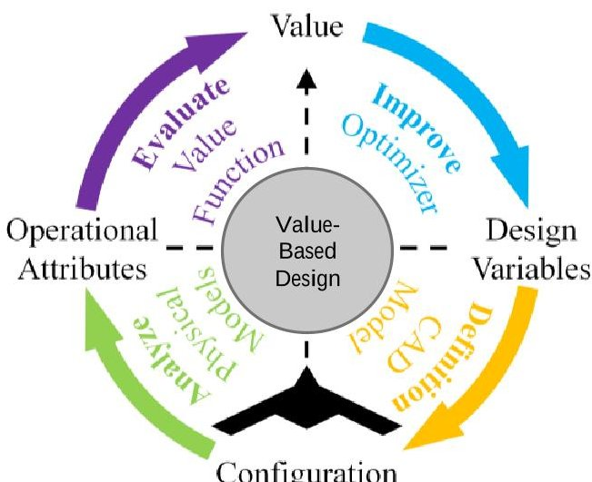
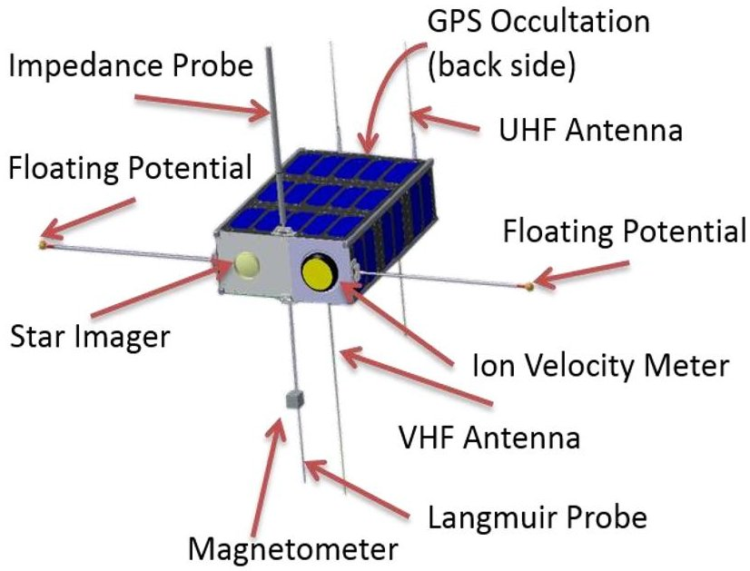
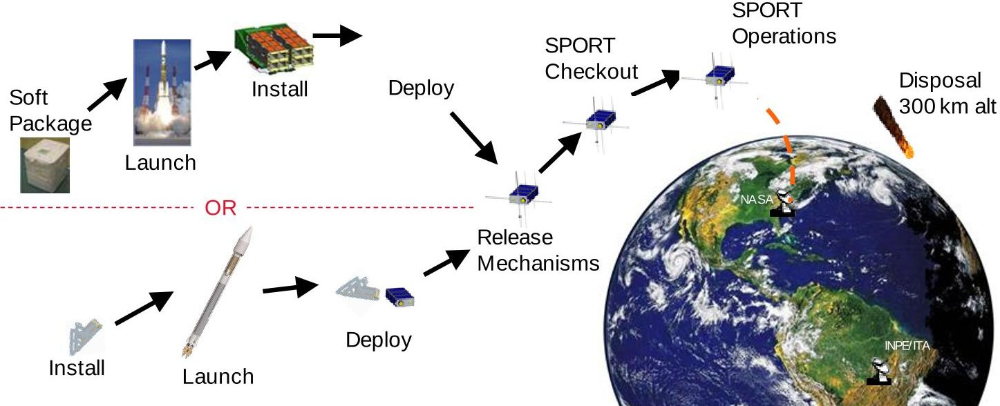
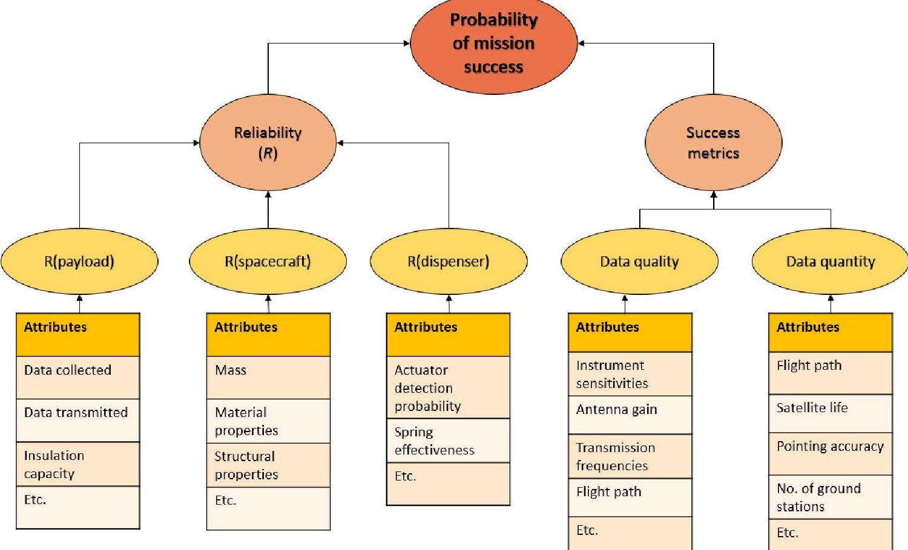
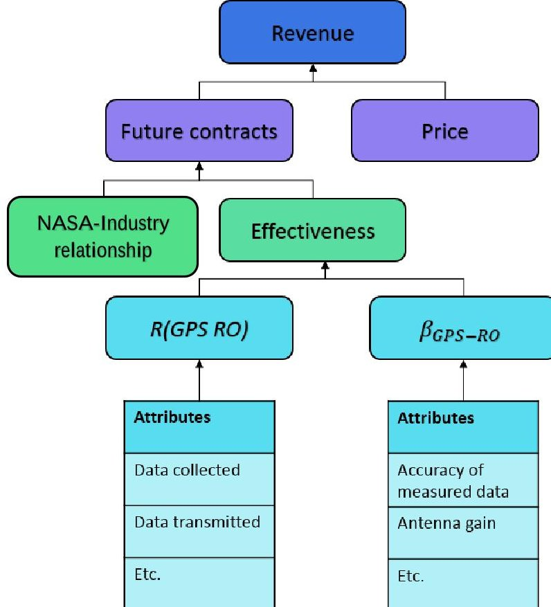
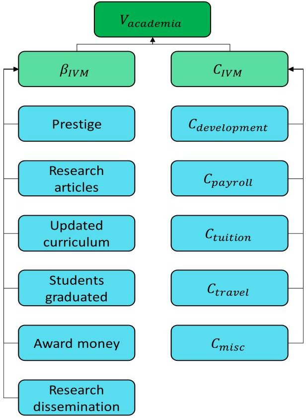

<!-- PDF_PAGE: 1 -->

# Mathematical Representation of Stakeholder Preferences for the SPORT Small Satellite Project

Garima V. Bhatia, $ ^{1} $ Bryan Mesmer $ ^{2} $ , and Kristin Weger $ ^{3} $ The University of Alabama in Huntsville, Huntsville, AL, 35899, USA

The design of complex systems involves multiple stakeholders with various preferences working together to realize a single system. The interfaces existing between the subsystems creates a complex system in itself. While contributing to the same system, design teams have unique objectives to their team and the subsystem they are designing. The preferences of individuals within each design team may also be unique, adding to the overall project complexity. Differing preferences often lead to challenges in many aspects of systems engineering, such as leadership, project management, contracting and interface documentation. This paper is a first step to overcome such challenges by understanding the impact of differing preferences on system design. The aim of the paper will be to mathematically represent a small satellite system's stakeholders' preferences using value models based on general beliefs about organizational goals. Specific to this study, stakeholders represent various organizations, both in the top management level as well as design teams developing the subsystems for the Scintillation Prediction Observation Research Task (SPORT). Four value models were created to represent the preferences of stakeholders involved in the SPORT project. The attributes affecting these differing preferences were identified, and the expected implication of these attributes on the satellite design was discussed. While the value models depict preference that were specific to each organization, similarities of preferences amongst stakeholders could also be found. Future work will compare the presented value models to value models generated by the stakeholders through survey research.

## I. Nomenclature

$ \pi_{sport} $ = economic impact of SPORT in $

$ \beta_{total} $ = total benefit achieved from SPORT in $

$ C_{\mathrm{total}} $ = total cost of the project in $

$ \beta_{GPS} $ = economic impact from benefit to GPS in $

$ \beta_{NASA-Brazil} $ = economic impact due to NASA-Brazil relationship in $

$ \beta_{science} $ = economic impact from general scientific benefit in $

$ \pi_{industry} $ = total profit to industry partner in $

Revenue $ _{total} $ = total revenue made by industry partner in $

$ C_{industry} $ = total cost to industry in $

R(GPS-RO) = reliability of GPS-RO ( % )

$ \beta_{GPS-RO} $ = benefit of GPS-RO in $

$ C_{GPS-RO} $ = cost of GPS-RO in $

$ V_{academia} $ = total value to academia in $

$ \beta_{IVM} $ = total benefit from IVM in $

$ C_{IVM} $ = total cost to academia for IVM in $

<!-- PDF_PAGE: 2 -->

## II. I. Introduction

STAKEHOLDERS involved in the design and development of systems vary over a wide spectrum of backgrounds and organizations, including industry, government, academia, and non-profit organizations. These stakeholders hold different expectations of the system and for system design. For instance, while commercial organization developing an instrument for a small satellite would be concerned about profit, a government agency such as NASA and an academic institution may prefer the scientific benefit of the instrument. These deferring preference may present challenges to system design within the project team. Challenges with multiple stakeholder preferences become more apparent when subsystems or components are developed separately. This is particularly evident in interface management. Often times during the initial phase of system design, contractors and subcontractors make assumptions about other contractors' artifacts to facilitate development of their own system. These assumptions may later prove to be detrimental in the sense that the components may not interface together as expected or the integrated system may not perform as desired. Even if contractors communicate with each other about their respective subsystems to not solely rely on assumptions, it is difficult for the project team to predict the functioning of the integrated system with the couplings that exist within the systems until the very end of the project. Therefore, the importance lies in realizing and effectively capturing these couplings during the initial design phase [1].

Another thing to be considered is that, while a downward flow of system design from the top level of the system to its lower level components may have some advantages, it does not come without its share of problems, such as excessive cost for reiterating, or assumptions about the components. Further, while top-down design has shown to be advantageous for large system design that encompass many subsystems, its benefit for smaller system design with a manageable number of subsystems is not as clear. Hence, in order to compare the subsystem to system and system to subsystem approaches, it is important to understand the preferences of the stakeholders at both the system and component levels. This would allow to mathematically represent the preferences of stakeholders and to make a comparison between the approaches. Literature has shown value models to be an enhanced way of mathematically representing preferences as compared to requirements [2], this research used value models for the representation of stakeholder preferences. Specifically, this paper focuses on the development of four different high-level value models for the Scintillation Prediction Observation Research Task (SPORT) small satellite project.

## III. Background

The focus of this paper is to mathematically represent diverse preferences of stakeholders belonging to multidisciplinary teams that concentrate their efforts on developing parts of a single small satellite by creating four different value models to accomplish the objective. This section describes the importance of correctly capturing stakeholder expectations and representing them within system design. A detailed description of value-based design that deals with formation of value models, is given. This section also provides a background about the SPORT project: its objective, stakeholders involved, and CubeSat description.

## A. Preference communication in systems engineering

System design and development can be associated with the involvement of a wide range of individuals throughout the life cycle of the system. These individuals, or system stakeholders, have different expectations of the system; i.e. the preferences of these stakeholders differ in various aspects. Examples of inconsistent preferences may be maximizing organization profit in the case of a CEO of an industrial organization, whereas the chief scientist's primary preference on a scientific project may be to maximize the probability of mission success. Preferences may also drive the decision-making process, in which inconsistent preferences may lead to erroneous design components. Such suboptimal designs may thus be attributed to conflicting or inadequately captured preferences. So far, representing preferences of all stakeholders and translating them to a meaningful design is one of the major challenges in systems engineering.

Requirements have been traditionally used as the means for communicating stakeholder preferences to the system designers. The design of the system is confined to the hyperspace created by requirements. The popular systems engineering V-model is used to break down requirements to drive subsystem designs [2], [3]. Requirements formed at the highest level are passed down the system hierarchy and are broken into further requirements. The subsystems are then integrated to form a complete system. Requirements exist from pre-production through the post-production phases of a system's lifecycle [4]. A design is achieved when requirements are satisfied. However, any design that satisfies the requirements is accepted. The V-model does not inherently include the drive to optimize systems that meet the set of requirements. It is for this reason that the value-based design approach was chosen to represent preferences.

<!-- PDF_PAGE: 3 -->

## B. Value-based design (VBD)

A new approach to systems engineering aimed at representing and communicating the true preferences of the stakeholders is value-based design [5]----[8]. A single mathematical function called a value model is used to represent the value and capture the true preferences of the stakeholder. A well-defined value model will help in reducing the number of requirements associated with the system, since their essence would be captured in the value model. This can enable increased exploration of the design space by not restricting designs to the hyperspace created by requirements. As an example, a for-profit organization may be driven by requirements that limit mass or cost, which

act as surrogates for the true preference of maximizing profit. In reality, the organization likely does not care about mass, and these requirements just act as poor representations of the true preference of the organization [9], [10]. Design optimization in the context of value-based design is represented by Fig. 1 that shows the life cycle development of systems [11].

The characteristics of the system are represented by attributes that form the value model. Attributes in turn are functions of design variables that can be directly altered by the designers to reflect changes in system design. Mass, cost, range, and velocity are some examples of attributes whereas length, material type, and number of engines exemplify design variables. Higher level attributes are functions of lower-level attributes and design variables. A welldefined value model must be consistent at all levels, and must be able to correctly capture design tradeoffs with the help of meaningful mathematical relationships. Improved consistency in design decision making is facilitated because of the ability of a single value model to be decomposed to the lowest levels of the

Figure 1. Value-Based Design Process

design hierarchy, enabling decision-makers to design for a single objective [7]. In addition to this, the importance of consistency in physical couplings and their inclusion in design has been captured by multiple researchers in the past [12]----[14]. The benefits of value-modeling using different value models for different stakeholders as well as models for systems such as aircraft and spacecraft can be found in [1], [10]----[12], [15] [16].

## C. SPORT

The Scintillation Prediction Observation Research Task (SPORT) is a small satellite mission being developed collaboratively by NASA and Brazil to study the preconditions leading to the formation of equatorial plasma bubbles. This, it is hoped, will lend to understanding the phenomenon of ionospheric scintillation, which is the fluctuation of radio-frequency signals when passing through regions of varying electron densities in the ionosphere [17]. The satellite being developed is a 6U CubeSat and the envisioned configuration for the spacecraft is shown in Fig. 2 [18]. The tentative plan is for the CubeSat to be launched from the International Space Station (ISS). The involvement of three distinct sectors, namely government, industry and academia, as well as a partnership between two nations are the highlights of this project that make it interesting to study from a preference perspective. Multiple teams, including NASA MSFC, NASA GSFC, The Aerospace Corporation, INPE, ITA, Utah State University, University of Texas, Dallas, and University of Alabama in Huntsville are working on different aspects of the project, including instrument development, systems engineering, system development and others. Table 1 describes the role of each team in the project [19]

The instruments developed in the USA will be shipped to Brazil, where the payload will be integrated with the spacecraft. The satellite will then be stocked and transported back to NASA for launch. The project team is small, comprising of approximately 20 members, who belong to the different teams listed above. The diverse nature of the team as well as its manageable size makes it an appropriate candidate for conducting preference research. Fig. 3 shows the mission concept of operations (ConOps). A detailed description of the mission can be found in [17] - [20].

<!-- PDF_PAGE: 4 -->

Table 1. Description of SPORT project team roles

<table border="1"><tr><td>Project Teams</td><td>Role in project</td></tr><tr><td>NASA MSFC</td><td>Systems engineering, project science, launch services</td></tr><tr><td>ITA Brazil</td><td>Spacecraft, I&amp;T, flight operations</td></tr><tr><td>INPE Brazil</td><td>Ground observation systems, science data processing and distribution</td></tr><tr><td>NASA GSFC</td><td>Magnetometer</td></tr><tr><td>The Aerospace Corporation</td><td>GPS Radio Occultation, GPS antenna</td></tr><tr><td>Utah State University</td><td>Langmuir probe, impedance probe</td></tr><tr><td>The University of Texas, Dallas</td><td>Ion velocity meter</td></tr><tr><td>The University of Alabama in Huntsville</td><td>Systems engineering support, MBSE</td></tr></table>

Fig. 2. SPORT cubesat configuration [18]

Fig. 3 ConOps for the SPORT mission

<!-- PDF_PAGE: 5 -->

## IV.Methodology

As mentioned earlier, the objective of this paper is to create value models to represent preferences of stakeholders involved in the SPORT project. Four value models, each showcasing the expectations of different stakeholders, are created. Two value models represent the overall value for SPORT and for its system level stakeholders of the United States and Brazil's ITA and INPE. The other two represent preferences of stakeholders belonging to the industry as well as academic partners working on the design aspect of the subsystems. The subsystem stakeholders were specifically picked for this study to represent diversity in expectations and preferences of different entities involved in the project. Inconsistent preferences would indicate the design of very different system components by each stakeholder. This section describes these four value models, the reasoning behind them, the attributes that feed into each value model, and finally the comparisons between the different models and their resulting designs. These value models were developed by the authors and their understanding of stakeholder preferences.

## D. Government value model for SPORT 1: Economic impact

The first value model represents the overall value to the US government from the SPORT mission. This value or "profit" represents the tradeoffs between the overall benefits from developing the satellite and performing the mission as well as the total cost of the project, including development, operations, and maintenance. The value model is described by Eq.1. The economic impact, $ \pi_{sport} $ , is in dollar units, showing the monetary value gained by the community from the SPORT project.

$$
\pi_ {s p o r t} = \beta_ {t o t a l} - C _ {t o t a l}
$$

In the above equation, $ \beta_{total} $ represents the total benefit achieved from the SPORT project, whereas $ C_{total} $ is the total cost. The expression for total benefits is given by Eq. 2., where $ \beta_{GPS}, $ $ \beta_{NASA-Brazil}, $ and $ \beta_{science} $ represent benefits achieved from improved GPS, the NASA-Brazil partnership, as well as the general benefits received by the scientific community.

$$
\beta_ {t o t a l} = \beta_ {G P S} + \beta_ {N A S A - B r a z i l} + \beta_ {s c i e n c e}
$$

The benefit was derived keeping in mind the reasons for funding this small satellite project. Each of the three attributes $ (\beta_{GPS},\beta_{NASA-Brazil},\beta_{science}) $ are described in detail as follows.

$$
\beta_ {G P S}
$$

By understanding the phenomenon behind the occurrence of plasma bubbles, the main benefit would be the improvement in communication signals. This in turn, would translate to improved GPS, resulting in an improvement in the different sectors that benefit from GPS. The economic benefits of GPS by way of its contribution to the US economy have been described in [21]. As per the 2015 report, GPS benefits accounted for 0.3% of the GDP. As per the report, the following sectors benefitted from the introduction of GPS: agriculture, construction, surveillance, air transportation, rail transportation, maritime transportation, timing, fleet vehicles, and consumer and other non-fleet vehicles. The report also lists the economic contributions of each individual sector. Thus, improvement in GPS signal would also provide economic benefits to the economy. The resulting improvement, or the change in the contribution of GPS to the American GDP is given by Eq. 3.

$$
\begin{array}{l} \beta_ {G P S} = \Delta V _ {G P S} = \Delta V _ {a g r i c u l t u r e} + \Delta V _ {s u r v e l l a n c e} + \Delta V _ {c o n s} + \Delta V _ {A i r T r a n s} + \Delta V _ {R a i l T r a n s} + \Delta V _ {M a r i T r a n s} + \\ \Delta V _ {t i m i n g} + \Delta V _ {f l e e t v e h i c l e s} + \Delta V _ {n o n - f l e e t} \\ \end{array}
$$

In the above equation, the various deltas represent the increase in economic contribution of the various sectors to the economy. This can then be translated to the % change in the contribution of GPS to the American GDP.

## 2. $ \beta_{NASA-Brazil} $

The international partnership between the US and Brazil on the SPORT project highlights plenty of gains to both nations. Several reports have documented the benefits of international space project partnerships and the importance of space exploration [22],[23]. In the case of SPORT particularly, the collaboration would bring prestige to both the

<!-- PDF_PAGE: 6 -->

nations, and help advance the reputation of the nations' space programs in the international market. The latter would be more prominent in case of Brazil, since the US already has a well-established space program. Collaborating with NASA would help Brazil improve not only their reputation internationally, but also boost their economy. The successful partnership on this project could pave the way for future contracts, which would translate to added economic benefits. Student exchanges between the US universities on the project team and ITA would also foster exchange of knowledge and cultures and improve academic understanding. The quantification of these attributes into monetary benefits remains part of future work.

## 3. $ \beta_{s i e n c e} $

The successful completion of the SPORT mission would benefit the scientific community as a whole, in that the data collected by the satellite would help scientists understand the reason behind the occurrence of plasma bubbles that tampers with the transmission of RF signals through the ionosphere. This could also help unveil other properties of the ionosphere that may be of use to the scientists for other scientific reasons. This would, in turn, translate to advancement of scientific knowledge, which could be translated to value based on the number of papers published or patents obtained. In addition to this, the reusability of the test facilities, spare parts, as well as the expertise developed for SPORT on other similar small sat projects would be value adding benefits of the project.

## 4. Ctotal

In the case of SPORT, the total cost of the project could be divided into the following sub-categories: procurement, payload, spacecraft, development, operations, maintenance, and other miscellaneous costs. The various expenditures falling under each of these cost categories are listed in Table 2.

Table 2. Breakdown of total cost for the SPORT project

<table border="1"><tr><td>Cost Category</td><td>Expenditure Breakdown</td></tr><tr><td>Procurement</td><td>Initial contracting, export control, initial research</td></tr><tr><td>Payload</td><td>Instruments</td></tr><tr><td>Spacecraft</td><td>Mechanical structure, electronics, solar panels, etc.</td></tr><tr><td>Development</td><td>Payroll, integration and test, transportation</td></tr><tr><td>Operations</td><td>Data collection, telemetry and telecommunication, ground support</td></tr><tr><td>Maintenance</td><td>Ground support</td></tr><tr><td>Miscellaneous</td><td>Additional unforeseen costs</td></tr></table>

Thus, the total cost can be described by Eq. 4.

$$
C _ {t o t a l} = C _ {p r o c u r e m e t} + C _ {p a y l o a d} + C _ {s p a c e c r a f t} + C _ {d e v e l o p m e n t} + C _ {o p e r a t i o n s} + C _ {m a i n t e n a n c e} + C _ {m i s c}
$$

<!-- PDF_PAGE: 7 -->

## E. Government value model for SPORT 2: Probability of mission success

The second value model captures the probability of mission success as the primary concern of the involved stakeholders. Here, the cost is overlooked, and emphasis is placed purely on the attributes impacting the mission success. Although, these theoretical assumptions might be unrealistic, it must be kept in mind that these are high-level

Fig. 4 Government value model for Sport 2: Probability of mission success

value models that are being used for the purposes of demonstrating extreme dimensions of preferences and their impact on system design. In the case of SPORT, mission success refers to successfully deploying the satellite in orbit obtaining the intended data, and then successfully communicating the data back to earth. The two main attributes that would feed into this value model are reliability and attributes affecting mission success. In this paper, we denote these attributes by success metrics. The reliabilities would determine the successful insertion of the CubeSat into orbit and successful collection and transmission of data. The success metrics on the other hand, would determine the quality and usefulness of the acquired data. The authors theorize that based on the goals of the SPORT mission, these attributes are imperative to determining the success of the mission. The breakdown of the value model into attributes and subattributes can best be described by the visual depiction provided in Fig. 4.

From Fig. 4, it can be seen that the overall reliability of the system has been broken down in to three subcomponents, namely, the reliabilities of the payload, spacecraft, and dispenser. The collective success of these three individual components is imperative to the overall success of SPORT. The failure of a single component is enough to cause mission failure. Thus, the collective system reliability would be the product of the reliabilities of the three enlisted components. Some examples of attributes to determine the respective component reliabilities are provided in Figure 4. The inclusion of these attributes can be understood intuitively. For example, the success of the instruments (payload) depends on the data gathered by them and the successful transmission of the collected data. Various physical conditions, such as thermal properties or environmental conditions are imperative to the effective collection and transmission of data. The other two reliabilities can be interpreted in a similar fashion.

The quality of the collected data, on the other hand, can be determined by the mission success metrics. The usefulness of the mission depends on the richness of the data, since the better the data collected, the greater the knowledge gained from it. Sub-attributes affecting the data quality for instance, could be the sensitivities of the instruments, the antenna gains, transmission frequencies, and flight path, among others. While the attributes affecting reliability and mission success may overlap on certain notes, reliability is primarily affected by the amount of data gathered, whereas the success metrics are affected by the quality of data collected.

<!-- PDF_PAGE: 8 -->

## F. Value model for industry: Profit

The industry stakeholders on the SPORT project, The Aerospace Corporation, is responsible for providing GPS support. The GPS Radio Occultation (RO) and the GPS antenna are being developed by the company. It is well understood that for a large, well established commercial organization such as Aerospace, the primary driver is profit. Thus, theoretically, the preference of this stakeholder will drive all decisions towards a design that leads to the highest profit. The generic value model for industry can be depicted by Eq. 5.

$$
\pi_ {i n d u s t r y} = R e v e n u e _ {t o t a l} - C _ {i n d u s t r y}
$$

In the above equation, $ \pi_{industry} $ represents the total profit achieved by the organization, whereas $ C_{industry} $ is the total cost incurred for developing the instrument. The two high-level attributes (revenue and cost) that form the value model are described in the following sections. Revenue

## 1. Revenue total

The main contributing factor to the organization's revenue would be the price charged for providing the service. The other key attribute that could drive the revenue of the organization could be the effectiveness of the instrument produced, which could in turn, pave the way to future contracts for the organization with NASA or other space agencies and corporations. The effectiveness of the instrument would be a function of the instrument reliability as well as the benefits achieved from the instrument. Future contracts would also be dependent on the nature of the relationship built between NASA and the industrial organization. The flowchart in Fig. 5 depicts the breakdown of the revenue into its sub-attributes. A detailed analysis of the component attributes, the corresponding physics, and the translation of these attributes into dollar amounts will be part of the future work.

Fig. 5 Breakdown of revenue for industry

## 2. Cindustry

The total cost to the organization could be easily calculated as the sum of the costs of the instrument

(including manufacturing), workforce, and miscellaneous costs, given by Eq. 6.

$$
C _ {i n d u s t r y} = C _ {G P S - R O} + C _ {w o r k f o r c e} + C _ {m i s c}
$$

## G. Value model for academia: Value

The value model for academia would be similar to the value model described in section D, i.e. the economic impact value model for SPORT. While this value model may overlap with value models of other stakeholders, the benefits to academia will be different. Let us consider a value model for UT Dallas, who develop the ion velocity meter (IVM) for SPORT. The model is described by Eq. 7.

$$
V _ {a c a d e m i a} = \beta_ {I V M} - C _ {I V M}
$$

The above equation follows a similar structure and terminology to the value model of Eq.1 where $ V_{academia} $ represents the overall value to UTD. Total benefit and cost of the IVM, represented by $ \beta_{IVM} $ and $ C_{IVM} $ , are the high-

<!-- PDF_PAGE: 9 -->

level attributes that make up this value model. A detailed description of these attributes, as well as their breakdown, is provided in the following sections.

1. $ \beta_{IVM} $

One of the main preferences for academia is to improve the ranking of the institution, which depicts the national/international standing of the institution in terms of academic excellence. Climbing the rank ladder brings prestige to the institute. Involvement with an international project

such as SPORT may help to enhance the reputation of the institute. The other major direct benefits to the academic partner are published research articles, updated curriculums, workshops conducted, number of students graduated, and very importantly, award money. The academic institutes would also gain tremendous benefit by disseminating their research and gained knowledge at conferences and other educational summits. This, in turn, would market the project within the community, and also help exchange ideas and create new knowledge by means of collaboration. A successful partnership on this project may also lead the way to future collaborations. This depends again, like in the previous case of the industry value model, upon the effectiveness of the instrument as well as the current relationship between the institute and NASA.

$$
C _ {I V M}
$$

The total cost to the academic institution can be broken down into the cost for developing the instrument, including manufacturing and labor, the expenditure to cover payrolls of professors and students as well as student stipend, and travel expenditure, among others. Eq.8 represents the total cost of having the academic institution develop the required instrument. The final term is added to account for any additional costs that may not have been considered.

Fig. 6 Value model for academia

$$
C _ {I V M} = C _ {d e v e l o p m e n t} + C _ {p a y r o l l} + C _ {t u i t i o n} + C _ {t r a v e l} + C _ {m i s c}
$$

The value model for academia is visually depicted in Fig. 6.

## H. Comparison of value models

The four value modes formed in this paper represent four different, but often times overlapping preferences. The value models represent three different stakeholders: government, industry, and academia. The economic impact value model and industry value model primarily focus on the monetary gains associated with the project. In the mission success value model, emphasis is placed on the performance characteristics of the system, whereas the academic model aims at optimizing the preferences of the universities. These models are similar and dissimilar on various counts. For example, while the mission success, academia, and industry model focus on the payload, the mission success model focuses on all the instruments comprising the payload, whereas academia and industry are primarily focused on their respective instruments. As an additional example, both the academia and industry value models have the possibility of future contracts impacting the benefits being generated from participation. A major difference is seen in the probability of mission success and academia preference representations where academia's preferences are influenced by such attributes as number of journal articles produced while the success of the mission, as theoretically defined for NASA by the attributes in Fig. 4, is more focused on the data generated specifically from the satellite. As the value models are further decomposed it may be discovered that an attribute such as number of journal articles may be found in the determination of the success of a mission, or that design variables that impact the number of journal articles that are able to be produced relate to the amount of data obtained (which is expected). A summary of the value models created in this paper is seen in Table 3.

<!-- PDF_PAGE: 10 -->

Table 3. Summary of value models

<table border="1"><tr><td>Stakeholder</td><td>Preference</td><td>Main Contributing System Attributes</td></tr><tr><td>Government</td><td>Economic impact</td><td>βGPS，βNASA-Brazil，βscience，Cprocuremet，Cpayload，Cspacecraft，Cdevelopment，Coperations，Cmaintenance，Cmisc</td></tr><tr><td>Government</td><td>Probability of mission success</td><td>Rpayload，Rspacecraft，Rdispenser，Quality of gathered data</td></tr><tr><td>Industry</td><td>Profit</td><td>Future contracts，instrument price，total cost</td></tr><tr><td>Academia</td><td>Value</td><td>Prestige，award money，articles published，workshops，students graduated，Cdevelopment，Cpayroll，Ctuition，Ctravel，Cmisc</td></tr></table>

## V.Future Work

This paper is one of the first steps towards a detailed study focused on eliciting stakeholder preferences and representing the preferences by means of value models. The central idea is to examine how inconsistent preferences can lead to sub-optimal system designs, and how these can be mitigated throughout the project life-time to obtain systems which the primary stakeholder prefers. This paper outlined theoretical high-level value models of four different stakeholders. The attributes that build each value model were identified, and high-level implications of the models on design were outlined. These models were built from the authors' beliefs on the stakeholder preferences. The next step of this study is to conduct a survey of all the SPORT team members to collect true data about individual preferences. The reasoning behind the use of surveys and the layout for the SPORT survey has been discussed in a previous paper [24]. The survey has been developed, and consists of both open and close-ended questions to elicit preferences. The close-ended questions were formed by modifying a 16-item PERVAL questionnaire that has previously been validated. The open-ended questions were also based off a validated survey. The survey is presently waiting IRB approval. Once the approval is achieved, a pilot study will first be conducted using undergraduate students from engineering and psychology programs. Once reliability and validity is achieved in the survey, it will be disseminated to all members of the SPORT team, and data will be obtained. The data will be analyzed to extract the preferences of the stakeholders and will be used to increase the fidelity of the value models created in this study. Further, new models might be created if the hypothesized models do not relate to the data, and the models will be populated with actual data.

The obtained data will also support the development of detailed physics-based models that would provide detailed perspectives on the system design. Even if the data obtained speaks differently than what was predicted, it forms a substantial basis for the comparison between the value models created in this paper and those created using survey data. In either case, the survey data will provide significant insights into stakeholder preferences and help enrich the quality, validity and reliability of the value models. Game theoretic methods will be used to study the interactions between different stakeholders once the detailed value models have been created. The authors also intend to use SysML[25], [26], a prominent model-based system engineering (MBSE) language to represent different value models in an effort to enhance system understanding. Previous work performed by the authors highlights the benefit of using this approach for system design and development [27]. The authors postulate the overall study to be a stepping stone in improving preference communication and representation in systems engineering, and positively impact the way project teams currently approach the design of complex systems.

## VI. Conclusion

The design of complex systems, especially the ones involved in crucial missions such as space travel and space exploration, involves multiple stakeholders with various preferences working together to realize a single system. The differing preferences can lead to sub-optimal or even inconsistent designs since it is preferences that drive the

<!-- PDF_PAGE: 11 -->

stakeholders' decisions. It is thus imperative to understand the preferences of all stakeholders and represent them in an efficient way in order to study their effect on system design. This paper, part of a greater study, aimed at stakeholder preference communication and representation, proposed the use of value models to mathematically represent stakeholder true preferences. Due to the diverse nature of the project teams, the SPORT small satellite project was chosen to demonstrate the proposed work. Four value models were created to represent four different preferences, from the perspectives of different stakeholders. The attributes affecting these differing preferences were identified, and the expected implication of these attributes on the satellite design was discussed. This preliminary work sets the stage for a detailed representation of preferences using survey data. The data will be obtained by surveying the SPORT team, and will be used to improve the models presented in this paper. The future research will provide meaningful insights into answering questions concerning the design of small satellites which might be extended to address also the difficulties associated with developing large scale satellites that are magnified in both size and associated complexity, by demonstrating the uniqueness of smaller satellite system design.

## VII. Acknowledgements

Garima Bhatia and Bryan Mesmer would like to acknowledge NASA MSFC Scintillation Prediction Observation Research Task - SPORT for their partial support of this work.

## VIII. References

[1] H. Kannan, B. L. Mesmer, and C. L. Bloebaum, "Increased System Consistency through Incorporation of Coupling in Value-Based Systems Engineering," Syst. Eng., vol. 20, no. 1, pp. 21-44, 2017.

[2] N. NASA, "Systems Engineering Handbook (NASA/SP-2007-6105,) Rev. 1, 2007," Garvey Paul R Anal. Methods Risk Manag. Syst. Eng. Perspect. Boca Rotan Chapman HallCRC, vol. 113, 2009.

[3] T. Robertson, "INCOSE systems engineering handbook," INSIGHT, vol. 1, no. 2, pp. 20-20, 1998.

[4] B. S. Blanchard, W. J. Fabrycky, and W. J. Fabrycky, Systems engineering and analysis, vol. 4. Prentice Hall Englewood Cliffs, NJ, 1990.

[5] P. D. Collopy and P. M. Hollingsworth, "Value-driven design," J. Aircr., vol. 48, no. 3, pp. 749-759, 2011.

[6] J. Cheung et al., "Application of value-driven design to commercial aeroengine systems," J. Aircr., vol. 49, no. 3, pp. 688-702, 2012.

[7] P. Collopy, "Economic-based distributed optimal design," in AIAA Space 2001 Conference and Exposition, 2001, p. 4675.

[8] P. Collopy, "Aerospace system value models: A survey and observations," in AIAA Space 2009 Conference & Exposition, 2009, p. 6560.

[9] B. Mesmer, C. L. Bloebaum, and H. Kannan, "Incorporation of Value-Driven Design in Multidisciplinary Design Optimization for a Satellite System Application," Submitt. Struct. Multidiscip. Optim., 2014.

[10] B. L. Mesmer, C. L. Bloebaum, and H. Kannan, "Incorporation of value-driven design in multidisciplinary design optimization," in 10th World Congress on Structural and Multidisciplinary Optimization, 2013, pp. 1- 19.

[11] G. V. Bhatia, "A game theory approach to negotiations in defense acquisitions in the context of value-driven design: an aircraft system case study," 2016.

[12] H. Kannan, "An MDO augmented value-based systems engineering approach to holistic design decisionmaking: a satellite system case study," 2015.

[13] H. Kannan, E. Tibor, B. Mesmer, and C. L. Bloebaum, "Incorporation of Coupling Strength Models in a Valuebased Systems Engineering framework for optimization," in 16th AIAA/ISSMO Multidisciplinary Analysis and Optimization Conference, 2015, p. 3086.

[14] H. Kannan, C. L. Bloebaum, and B. Mesmer, "Incorporation of Coupling Strength Models in Decomposition Strategies for Value-Based MDO," in 15th AIAA/ISSMO Multidisciplinary Analysis and Optimization Conference, 2014, p. 2430.

[15] G. V. Bhatia, H. Kannan, and C. L. Bloebaum, "A Game Theory approach to Bargaining over Attributes of Complex Systems in the context of Value-Driven Design," in 54th AIAA Aerospace Sciences Meeting, 2016, p. 0972.

[16] T. G. Topcu and B. Mesmer, "Customer, Commercial, and Government Value Functions for Electric Vehicle System Design," in IIE Annual Conference. Proceedings, 2015, p. 959.

<!-- PDF_PAGE: 12 -->

[17] A. de O. Ferraz, "A Systems Approach for the Development of the SPORT Mission," Technical Aeronautics Institute (ITA), Brazil, 2016.

[18] J. Spann et al., "The Scintillation Prediction Observations Research Task (SPORT): An International Science Mission using a CubeSat," presented at the SSC17-XIII-03, Logan, Utah, 2017.

[19] J. F. Spann et al., "The Scintillation Prediction Observations Research Task SA43C-04," 2015.

[20] J. Spann et al., "The Scintillation Prediction Observations Research Task% 28SPORT% 29 Mission," 2017.

[21] I. Leveson, "The Economic Value of GPS: Preliminary Assessment," presented at the National Space-Based Positioning, Navigation and Timing Advisory Board Meeting, 11-Jun-2015.

[22] K. Laurini, "International Partnerships for Space Exploration," Ask Magazine.

[23] ISECG, "Benefits Stemming from Space Exploration," Sep. 2013.

[24] G. V. Bhatia, J. Dyas, J. Clerkin, and B. L. Mesmer, "Stakeholder Preference Solicitation with a focus on Surveys and Value Models," presented at the submitted to the American Society for Engineering Management 2017 International Annual Conference, Huntsville, Alabama, 2017.

[25] OMG, "OMG Systems Modeling Language (OMG SysMLTM)." Sep-2015.

[26] O. M. G. SysML, SysML v1. 4 Specification. 2015.

[27] G. Bhatia and B. Mesmer, "Integrating Model-Based Systems Engineering and Value-Based Design with an NEA Scout Small Satellite Example," in AIAA SPACE and Astronautics Forum and Exposition, 2017, p. 5234.