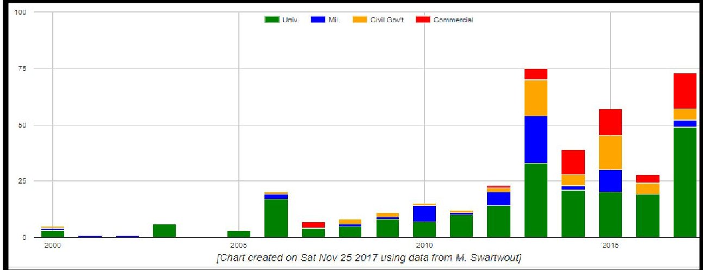
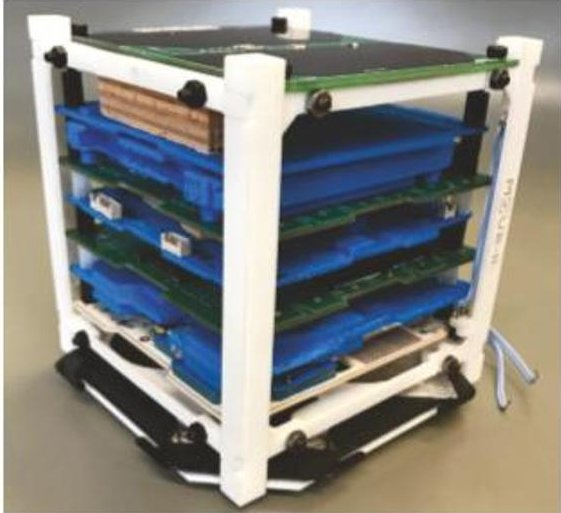
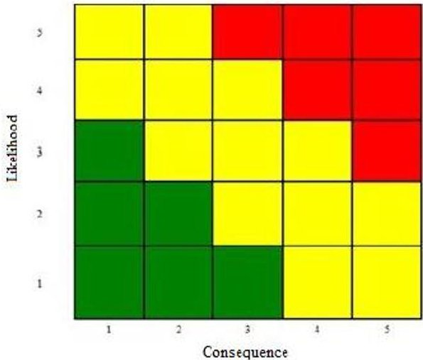
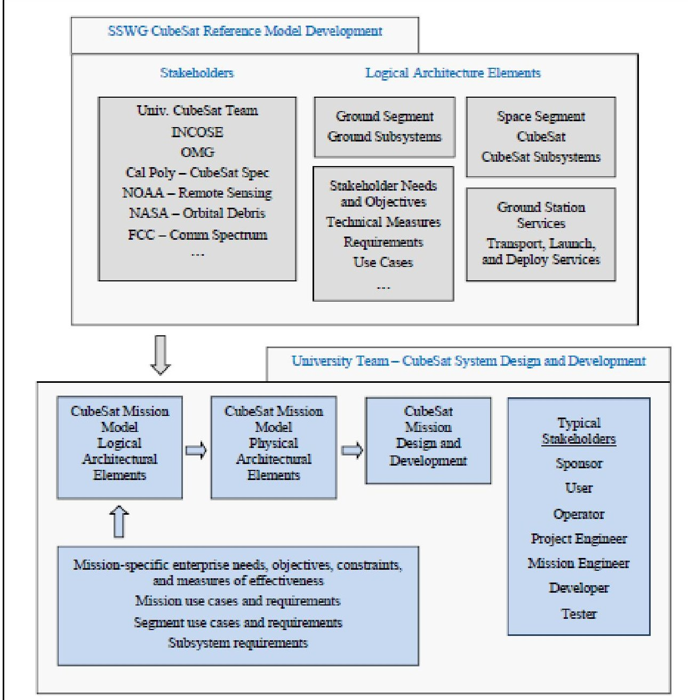
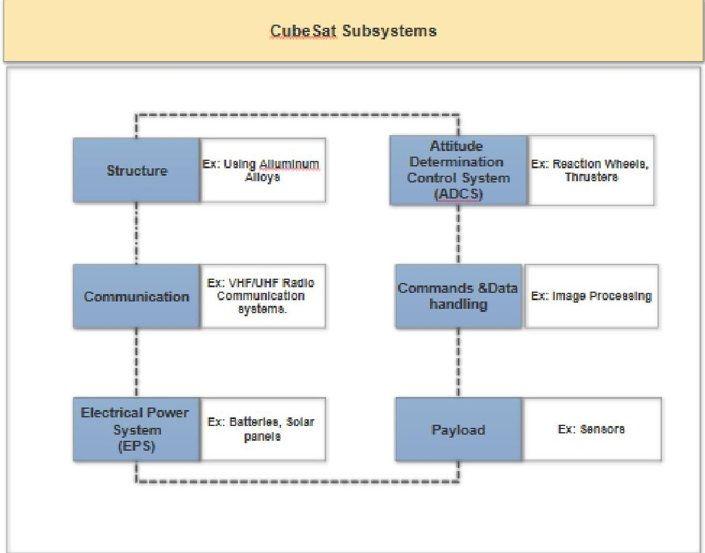
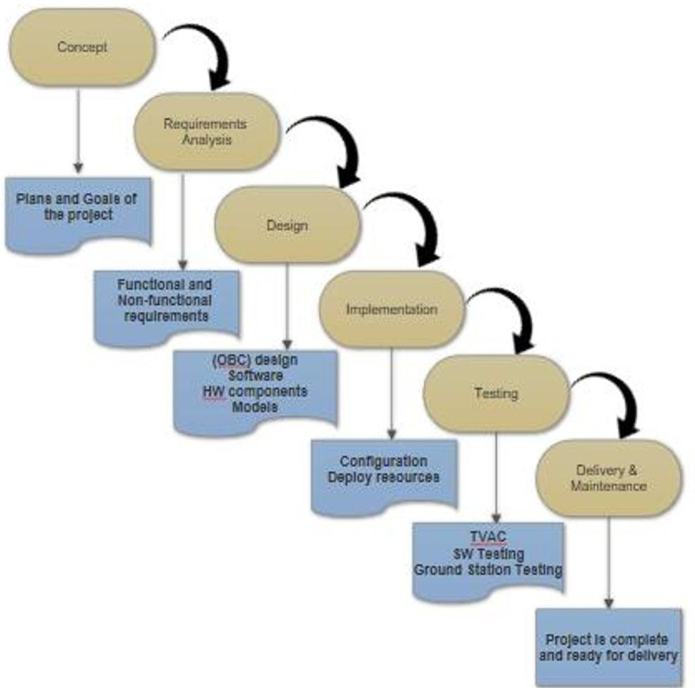
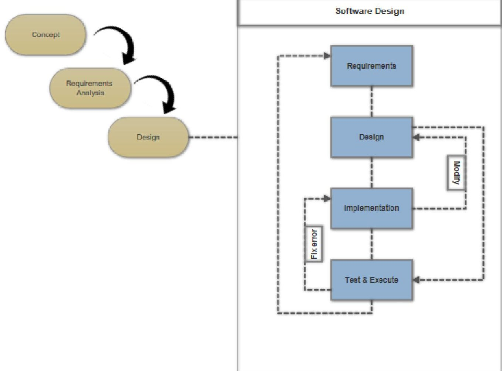

<!-- PDF_PAGE: 1 -->

# Methodology and Tools for Reducing CubeSat Mission Failure

Abdulaziz Alanazi North Dakota State University, Fargo, ND, 58102

A CubeSat is considered a great engineering system used for space research in the last decade. This is due to its simple design, low cost, and usage of open-source software and hardware tools. CubeSats are in high demand for use in a multitude of ways. Universities invest in space studies by encouraging and educating STEM (Science, Technology, Engineering, and Math) students to be involved in designing, implementing, and testing of CubeSats. Universities differ in their CubeSat missions. A 1U CubeSat can be launched into space and operate on a simple mission for basic science experiments. CubeSats can also be deployed in clusters for space exploration. According to Swartwout, however, roughly 50% of CubeSats fail to fulfill their mission. Different reasons lead CubeSats to fail including power, mechanical, and communication issues. Some researchers suggested for this high level of failure, that universities and research institutions mainly focus on the system and component level design, while neglecting the elicitation of requirements needed beforehand. To minimize the rate of failure of CubeSat missions, this research proposes a framework for CubeSat systems engineering. This system provides tools to help institutions with planning, collecting, elicitation, and documenting requirements in a well-defined manner. This paper focuses on universities' CubeSat projects designed by students and faculty members. Thus, a recent survey has been conducted by the researcher to identify the challenges and needs of such groups. Plans for future work are also discussed.

## I. Nomenclature

ADCS = Attitude Determination Control System

COTS = Commercial Off the Shelf

CRM = CubeSat Reference Model

EPS = Electrical Power System

SSWG = Space Systems Working Group

## II. Introduction

Since 1977 when NASA launched Voyager 1 to orbit, space exploration has been an interesting subject for scientists, researchers, and students. Spacecraft have evolved in system designs and complicated missions. Yet, in the last twenty years, small spacecraft have gained popularity in educational institutions (i.e CubeSatellites). CubeSats are now considered one of the most effective reliable spacecraft used for space exploration. Since the advent of CubeSats in early 2000, research institutions have devoted their time and effort for designing CubeSats. CubeSats have gained attention from researchers due to their sizes and masses. There are several modular sizes of CubeSats, including 1U,2U,3U, and even 12U (Ref. 1). Dimensions of a structured one-unit CubeSat (1U) is 10x10x10 cm with a mass of 1.33 kg (Ref. 2). The increasing number of University CubeSats is shown in Fig.1.

<!-- PDF_PAGE: 2 -->

Fig 1. CubeSats developed by Universities.

What makes CubeSats in high demand is that they don't cost as much as regular satellites. Building a traditional satellite would cost roughly $50,000, whereas building a 1U CubeSat with simple mission can cost less than $5000 (Ref. 3). CubeSats cost less because universities can use commercial-off-the-shelf components (COTS) and open-source software and hardware parts donated from vendors (Ref. 3). Additionally, teams that work on building CubeSats are mostly students with different engineering disciplines, including Space, Software, Mechanical, and Electrical Engineering; thus, the cost of labor is relatively cheaper compared to the working hours of professional engineers at NASA.

Another reason that CubeSats in high demands is that they can send out some significant data once they start orbiting space. CubeSats can collect data and communicate significantly with ground stations using some COTS parts, such as cameras, antennas, and sensors (Ref. 4). Up until August, 2018, 875 CubeSats have been launched (Ref. 5). Thus, universities and research institutions can rapidly design and build their CubeSats by a team of students from different disciplines using COTS parts. However, this doesn't guarantee a CubeSat mission will be successful. Statistics show that 139 CubeSats have failed their mission between 2002 to 2016 (Ref. 6)(Ref. 7). Reasons of failure vary between power failure, mechanical, communication failure or system design failure.

## III. Methodologies and Systematic Approach

Regardless of how effective The CubeSat system's components are, universities design projects that help students apply the skills they have learnt into CubeSat projects. Different set of teams work on designing and developing CubeSat projects. For instance, Aerospace students work on environmental analysis and control systems, Mechanical students can work on the structures and layout mechanisms, Software students can test and develop software for data communication, and Electrical students can design and test the Electrical Power Subsystem (EPS). Universities implement different methods and concepts into their CubeSat projects depending on their desired mission. For example, University of North Dakota is investigating and discussing the attempt to document the software requirements of CubeSats. Implementing model-based requirements engineering (MBRE) method to the development of the CubeSat (Ref. 8). Technical University of Munich manufactured a 3D printed mechanical representation of CubeSat (MOVE-II) at an early stage to help students validate and verify CAD models to avoid potential design deficiencies (Ref. 9). Universidad del Valle de Guatemala designed a tool (Risk Matrix) to mitigate risk factors during the design phase of their project (Ref. 10).

Fig 2. 3D Printed CubeSat-MOVE-II

Fig 3. Risk Matrix. This tool helps controlling mission risk

Hence, students come from different school disciplines, they need to understand how to analyze and design space missions properly. Thus, a group of engineers, NASA associates, consultants, college professors, and students collaborated as Space Systems Working Group (SSWG). The group developed a CubeSat reference model (CRM), a logical architecture design of a CubeSat system. The (SSWG) group believe that their (CRM) can help university students with developing project processes, including addressing requirements, design, analysis, and validation and verification (Ref. 11).

<!-- PDF_PAGE: 3 -->

Figure 4. SSWG - CubeSat Reference Model

Some universities apply traditional methodologies into their CubeSat projects, mostly V-model (Ref. 12). Others may follow the Spiral-model when they consider risk as a major factor (Ref. 10), or apply Agile methodology by dividing up the project into small phases to help student designing case scenarios to detect error at the early stage level of their project (Ref. 9).

## IV. Associated Factors of Mission Failure

Building a robust framework to decrease the failure rate and increase success, requires identifying factors that are associated directly to mission success or failure. Such factors may include but not limited to: testing time reduction, design problems, availability for modifications, ease of adding or deleting components, system design objectives met, mission objectives met, and using a reference model. The principle objectives of the analysis is to assess factors that can be associated with reducing the rate of CubeSat failure through the application of a system engineering approach. The table below lists these factors with their coding for data analysis Table 1. These factors with tests results derived from a recent study on reasons of CubeSat mission failure (Ref. 13).

<!-- PDF_PAGE: 4 -->

<table border="1"><tr><td>Factor</td><td>Variable Name</td><td>Code</td></tr><tr><td>Testing Time Reduction</td><td>TTR</td><td>Occurred(1)Not occurred(0)</td></tr><tr><td>Design Problems</td><td>DesPr</td><td>Tools(1),Models(2),Both(3)</td></tr><tr><td>Availability of modification</td><td>Mod</td><td>Yes(1),No(0)</td></tr><tr><td>Adding/Deleting Components</td><td>AddDel</td><td>Easy(1),Difficult(2)</td></tr><tr><td>Systems Design Objectives</td><td>SysMet</td><td>Yes(1),No(0)</td></tr><tr><td>Mission Objectives</td><td>MMet</td><td>Yes(1),No(0)</td></tr><tr><td>MBSE as reference</td><td>Mission</td><td>Yes(1),No(0)</td></tr></table>

Table 1. List of Factors Associated with Mission Failure

Among the presented factors however, System design objective met shows a significant relationship with the success/failure of CubeSat missions. The survey also shows that 38% of students met their CubeSat project objective, while 60% of them didn't think so due to different reasons including, no communications detected from their satellite, power or launch failure (Ref. 13). Other challenges may also be considered, such as the level of experience of the CubeSat developer, the size of the team, and project budgeting/scheduling. For instance, Universidad del Valle de Guatemala had a team of over 100 students (Ref. 10). Such large group of students would increase the level of risk awareness during the development phase due to miss communications, lack of proper documentation, and experiencing the main objective of CubeSat project.

University projects designed by students could experience challenges throughout the project including inadequacy in baseline review and milestone performance, unstable baseline including objectives, requirements, design integration, test, and operation, and integration and testing. In every aspect of project design, there are constraints that limit additional functionality or performance. For instance, the standard SWaP (size, weight, and power) would be the most dominant constraints. Additionally, Cost can also be a major driver on what hardware component is purchased or what testing is performed. Common costs associated with the development of CubeSat projects are, materials, labor, environmental testing, travel (Ref. 14). Students may investigate whether their project failed because of tools or models. However, students may never discussed project scopes and goals at the early stage of their projects, or may never follow methodology standards when developing their CubeSat projects.

## V. Framework for CubeSat Projects

University CubeSat projects vary by different mission purposes, such as scientific, educational, or other purposes. However, a standard 1U CubeSat system will include mainly six sub-systems demonstrated in Figure 5. Regardless of the CubeSat mission, a simple CubeSat project would follow through certain stages from the concept stage till the delivery process. The phases of the project can also be modified or even skipped in some cases. The following graphical representation of a CubeSat project life cycle represent a sequential approach presented in Figure 6.

<!-- PDF_PAGE: 5 -->

Figure 5. CubeSat Sub-systems

Figure 6. CubeSat Project Life-Cycle

<!-- PDF_PAGE: 6 -->

Some of these steps may vary in time processing, which eventually cause some serious delay in the CubeSat project. Developing a project concept make take up to 6 months, while the ground station development and testing may take 12 months (Ref. 14). A CubeSat project however, can be also divided into small phases. Each phase will follow the same steps presented in the previous graphical diagram. Hence, a CubeSat includes several sub-systems with different functionalities and attitudes. These sub-systems include Structure, Communication, EPS, ADCS, Data handling and Payload. In the following diagram Figure 7, shows how the designing phase can be broken down into small iterations following Agile methodology. Software design in this example can be divided into small iterations, each with 4-5 steps. This process however can add more flexibility and adaptability to the CubeSat project, because it helps stakeholders to easily add/delete requirements, and also help developers to detect errors at early stages.

Figure 7.1 Iteration Cycle of a Software Design

## VI. Conclusion

The main purpose of writing this research is to design system engineering methodology and tools to for university CubeSat projects. To do so, investigating previous and current universities CubeSat projects is needed. This will cover the main objective of universities CubeSat designs, the tools and models that have been used, different systems aspects of structure, behavior, requirements, and parametric. Additionally, the incorporated functionality used in previous CubeSat systems will also be covered. Also, the design problems, failure of modeling and tools and availability of

<!-- PDF_PAGE: 7 -->

CubeSat systems modifications. Future work will include a case study of the 1st North Dakota State University CubeSat's that is currently under development.

## Acknowledgments

The author would like to thank Dr. Jeremy Straub for advising on this research study. Also, many thanks extended to Dave Kaslow, Martin Langer, and Florian Schummer for their valuable feedback and suggestions on this research.

## References

[1] Xiaozhou, Yu., "The Status of University Nanosatellites in China", The 14th Annual CubeSat Workshop in San Luis Obispo, CA, published online April.2017.

[2] Waydo, S., Henry, D., and Campbell, M., "Cubesat design for leo-based earth science mission," Proceedings of the IEEE Aerospace Conference, Dec. 2002, pp. 435-445.

[3] Sassi, S., "Power generation and solar panels for an MSU CubeSat", Mississippi State University, Dec.2016.

[4] Zea, L., Ayerdi, V., Argueta, S., and Muñoz, A., "A Methodology for CubeSat Mission Selection." Journal of Small Satellites. JoSS. Vol.5, No.3, Jan.2016, pp. 483-511.

[5] Erik, E., Nanosats Database [online database], URL: https://www.nanosats.eu/ [retrieved August 2018].

[6] Swartwout, M., "CubeSats and Mission Success: A Look at the Numbers", The 14th Annual CubeSat Workshop in San Luis Obispo, CA, published online April 2016.

[7] eoPortal Directory Reference [online database], URL: https://directory.eoportal.org/web/eoportal/satellite missions/t/terra#reference [retrieved May 2018].

[8] Reza, H., Rashmi, S., Alexander, N., and Straub, J., "Toward Model-Based Requirement Engineering Tool Support." IEEE Aerospace Conference 10.1109/AERO.2017.7943647.

[9] Weisgerber, M., Langer, M., Schummer, F., and Steinkirchner, K., "Risk Reduction and Process Acceleration for Small Spacecraft Assembly and Testing by Rapid Prototyping" Conference Paper Sept.2017.

[10] González, D., Rodríguez, D., Birnie, J., Bagur, J., Paz, R., Miranda, E., Solórzano, F., Esquit, C., Gallegos, J., Álvarez, E., Ayerdi, V., and Zea, L., "Guatemala's Remote Sensing CubeSat - Tools and Approaches to Increase the Probability of Mission Success" Proceedings of 2018 AIAA/USU SmallSat Conference August, 2018.

[11] Kaslow, D., Louise, A., Asundi, S., Bradley, A., Curtis, I., Bungo, S., and Robert, R., "Developing a CubeSat Model-Based System Engineering (MBSE) Reference Model-interim status. 10.1109/AERO.2015.7118965. Proceedings of IEEE Aerospace Conference 2017.

[12] J. Aerosp. Technol. Manag., São José dos Campos, "Design of a Nanosatellite Ground Monitoring and Control Software - a Case Study" Journal of Aerospace Technology and Management.Vol.8, No 2, pp.211-231, Apr.-Jun., 2016.

[13] Alanazi A., and Straub, J., "Statistical Analysis of CubeSat Mission Failure" Proceedings of 2018 AIAA/USU SmallSat Conference in Logan, UT. August,2018.

[14] NASA CubeSat 101: Basic Concepts and Processes for First Time CubeSat Developers. [online publishing] URL: https://www.nasa.gov/sites/default/files/atoms/files/nasa_csli_cubesat_101_508.pdf

<!-- PDF_PAGE: 8 -->

